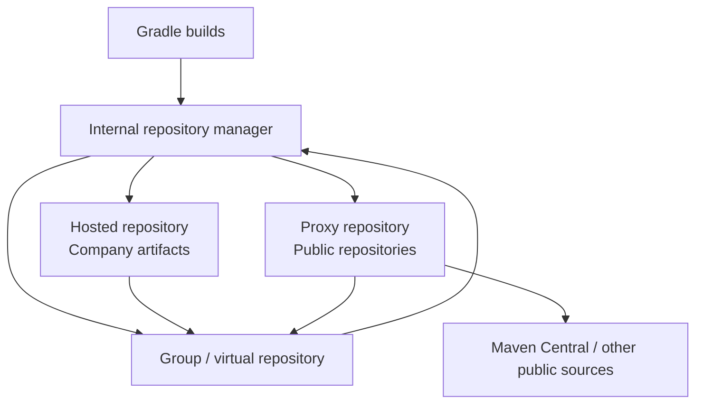
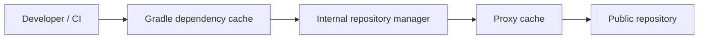
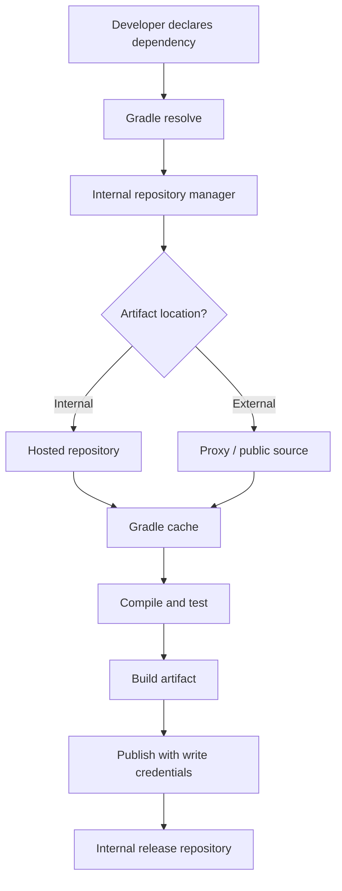

# Kho công cộng, kho nội bộ và máy chủ quản lý kho

Một dự án Java thường không chứa toàn bộ thư viện mà ứng dụng cần. Khi build, Gradle phải tìm và tải các dependency, plugin hoặc artifact từ những nơi lưu trữ bên ngoài project. Những nơi đó được gọi là **repository** (kho lưu trữ). Repository có thể công khai trên Internet, được tổ chức vận hành riêng trong mạng nội bộ, hoặc được cung cấp thông qua một máy chủ quản lý kho để tập trung lưu trữ, proxy, kiểm soát và phân phối artifact.

Hiểu các loại repository giúp cấu hình build đúng nơi, kiểm soát nguồn dependency, bảo vệ thông tin xác thực và làm cho build ổn định hơn. Cũng cần phân biệt repository dùng để **đọc dependency** với repository dùng để **publish artifact**: chúng có thể nằm trên cùng một máy chủ nhưng phục vụ hai luồng công việc khác nhau.

## 1. Repository trong quy trình build là gì?

Repository là một nơi lưu artifact cùng metadata để công cụ build có thể tìm kiếm và tải chúng theo tọa độ. Với hệ sinh thái Java, định dạng phổ biến là Maven repository layout. Một artifact thường được nhận diện bằng các thành phần:

- `group`: nhóm hoặc namespace của artifact.
- `artifact`: tên module.
- `version`: phiên bản.
- `classifier` (nếu có): biến thể như `sources`, `javadoc` hoặc một loại artifact bổ sung.
- `extension`: định dạng tệp như `jar`, `pom`, `module` hoặc `zip`.

Ví dụ tọa độ dependency:

```text
org.apache.commons:commons-lang3:3.14.0
```

Có thể hiểu đây là artifact `commons-lang3`, thuộc group `org.apache.commons`, phiên bản `3.14.0`. Trong Maven repository layout, đường dẫn thường được tổ chức theo group, artifact và version:

```text
org/apache/commons/commons-lang3/3.14.0/
├── commons-lang3-3.14.0.pom
├── commons-lang3-3.14.0.jar
└── commons-lang3-3.14.0-sources.jar
```

Gradle đọc metadata để biết artifact có dependency bắc cầu nào, variant nào phù hợp và tệp nào cần tải. Metadata có thể là Maven POM, Gradle Module Metadata hoặc metadata khác được repository hỗ trợ.

Một repository không nhất thiết là một thư mục trên máy. Nó có thể là một endpoint HTTP(S), dịch vụ cloud hoặc máy chủ nội bộ. Gradle sử dụng cấu hình repository để truy cập và phân giải dependency.

## 2. Kho công cộng (public repository)

Kho công cộng là repository có thể truy cập rộng rãi qua Internet, thường không yêu cầu tài khoản hoặc chỉ yêu cầu tài khoản cho một số chức năng đặc biệt. Ví dụ quen thuộc là Maven Central và Gradle Plugin Portal.

Một project Java có thể khai báo Maven Central trong `build.gradle`:

```groovy
repositories {
    mavenCentral()
}

dependencies {
    implementation 'org.apache.commons:commons-lang3:3.14.0'
}
```

Hoặc dùng Kotlin DSL:

```kotlin
repositories {
    mavenCentral()
}

dependencies {
    implementation("org.apache.commons:commons-lang3:3.14.0")
}
```

Gradle sẽ tìm dependency trong repository đã khai báo và tải metadata/artifact cần thiết. Kho công cộng thuận tiện vì không cần nhóm tự vận hành hạ tầng lưu trữ cho các thư viện phổ biến.

### Ưu điểm

- Dễ tiếp cận và có hệ sinh thái artifact lớn.
- Không cần tự lưu trữ mọi thư viện bên thứ ba.
- Thường có độ sẵn sàng và mạng phân phối được đầu tư chuyên nghiệp.
- Phù hợp cho dependency open source phổ biến.

### Hạn chế và điểm cần quản lý

- Build phụ thuộc kết nối Internet và trạng thái dịch vụ bên ngoài.
- Một số mạng doanh nghiệp chặn hoặc giới hạn truy cập trực tiếp.
- Nhóm khó áp dụng chính sách nội bộ nếu từng project truy cập nhiều nguồn công cộng tùy ý.
- Không nên giả định mọi artifact trên Internet đều đáng tin chỉ vì tải được từ một repository công khai.
- Một dependency có thể biến mất, bị thay đổi metadata hoặc có vấn đề bảo mật; cần version rõ ràng và cơ chế kiểm chứng phù hợp.

Kho công cộng là nguồn tốt cho dependency bên thứ ba, nhưng tổ chức có yêu cầu kiểm soát cao thường đặt một repository manager nội bộ làm điểm truy cập chung.

## 3. Kho nội bộ (private/internal repository)

Kho nội bộ là repository do tổ chức hoặc nhóm dự án kiểm soát. Nó có thể chỉ truy cập được trong mạng công ty, qua VPN hoặc bằng tài khoản và token. Repository này thường lưu:

- Thư viện nội bộ do các team phát triển.
- Artifact đã build và publish từ pipeline của tổ chức.
- Bản sao cache của dependency công cộng.
- Plugin Gradle hoặc Maven dùng riêng trong công ty.
- Artifact thử nghiệm, snapshot hoặc bản phát hành chưa công khai.

Ví dụ cấu hình Maven repository nội bộ trong Gradle:

```kotlin
repositories {
    maven {
        name = "companyReleases"
        url = uri("https://repo.example.com/maven/releases")
    }
}

dependencies {
    implementation("com.example.platform:logging-api:2.4.0")
}
```

Ở đây, dependency `com.example.platform:logging-api:2.4.0` được lấy từ kho do tổ chức quản lý nếu repository đó chứa artifact và metadata tương ứng.

### Lợi ích của kho nội bộ

- **Chia sẻ artifact riêng:** các nhóm có thể sử dụng thư viện nội bộ qua tọa độ chuẩn.
- **Kiểm soát nguồn:** quản trị viên quyết định nguồn nào được phép truy cập hoặc proxy.
- **Tăng tốc:** dependency thường dùng có thể được cache gần môi trường build.
- **Hỗ trợ mạng hạn chế:** máy build có thể truy cập repository nội bộ thay vì truy cập Internet trực tiếp.
- **Quản lý vòng đời:** phân biệt release, snapshot, artifact thử nghiệm và chính sách lưu trữ.
- **Kiểm soát quyền:** phân quyền đọc, publish, xóa hoặc quản trị theo nhóm.

### Những việc cần lưu ý

Kho nội bộ cần được vận hành: quản lý tài khoản, quyền truy cập, backup, dung lượng, chứng chỉ TLS, retention policy, tính sẵn sàng và giám sát. Nếu repository nội bộ ngừng hoạt động, nhiều pipeline có thể cùng thất bại.

Cũng cần tránh việc mỗi team tự tạo một kho riêng không có chính sách version hoặc quyền truy cập thống nhất. Một repository nội bộ có giá trị khi tổ chức quản lý được nguồn gốc, cách publish và cách tiêu thụ artifact.

## 4. Máy chủ quản lý kho (repository manager)

Máy chủ quản lý kho là một dịch vụ đứng giữa các công cụ build và các repository. Nó không chỉ lưu file mà còn cung cấp chức năng quản trị, proxy, cache, phân quyền và phân phối artifact.

Một số sản phẩm thường gặp trong doanh nghiệp là Sonatype Nexus Repository và JFrog Artifactory. Các nền tảng như GitHub Packages hoặc GitLab Package Registry cũng có thể cung cấp registry/package repository cho tổ chức, dù phạm vi tính năng quản trị và proxy khác nhau.

Repository manager thường có thể cung cấp ba loại kho chính:

| Loại kho | Vai trò | Ví dụ sử dụng |
|---|---|---|
| Hosted/local | Lưu artifact do tổ chức publish | `com.example:inventory-api:1.5.0` |
| Proxy/remote | Đại diện cho repository bên ngoài và cache artifact tải về | Proxy Maven Central |
| Group/virtual | Gom nhiều repository thành một endpoint cho client | Một URL gồm kho release nội bộ và proxy public |

Tên gọi cụ thể thay đổi theo sản phẩm. Nexus thường dùng khái niệm hosted, proxy và group repository; Artifactory thường dùng local, remote và virtual repository. Ý tưởng chung là phân biệt nơi lưu artifact nội bộ, nơi đại diện cho nguồn bên ngoài và endpoint tổng hợp cho client.



Sơ đồ minh họa luồng khái niệm: client có thể dùng một endpoint nội bộ; repository manager quyết định artifact nằm ở kho hosted hay cần lấy từ proxy.

## 5. Hosted, proxy và group/virtual repository

### Hosted repository

Hosted repository lưu artifact do tổ chức kiểm soát. Một pipeline publish thư viện nội bộ lên kho release có thể đưa artifact vào đây. Nhóm quản trị đặt quyền ai được publish và ai được tải.

Thông thường nên phân biệt release repository với snapshot/development repository. Release là phiên bản được xem như bất biến sau khi công bố; snapshot có thể được cập nhật trong quá trình phát triển tùy chính sách.

### Proxy repository

Proxy repository đại diện cho một nguồn bên ngoài. Khi client yêu cầu artifact, repository manager có thể lấy từ nguồn gốc, cache metadata và file rồi phục vụ các lần yêu cầu tiếp theo từ cache.

Ví dụ, công ty tạo proxy cho Maven Central. Gradle chỉ cần truy cập endpoint nội bộ; repository manager xử lý việc liên hệ với Maven Central khi cần.

Proxy giúp:

- Giảm số lần tải lặp từ Internet.
- Giảm phụ thuộc trực tiếp của mỗi máy build vào dịch vụ bên ngoài.
- Áp dụng chính sách cho phép hoặc chặn nguồn/artifact.
- Tập trung log truy cập và chẩn đoán.

Proxy không tự động chứng minh artifact an toàn. Tổ chức vẫn cần kiểm tra nguồn, checksum/signature khi có, chính sách quarantine và công cụ quét lỗ hổng nếu yêu cầu.

### Group hoặc virtual repository

Group/virtual repository gom nhiều repository thành một endpoint logic. Ví dụ endpoint `maven-public` có thể bao gồm kho release nội bộ, kho snapshot nội bộ và proxy Maven Central.

Gradle khai báo một URL duy nhất:

```groovy
repositories {
    maven {
        name = 'companyMaven'
        url = uri('https://repo.example.com/repository/maven-public/')
    }
}
```

Client không cần biết từng repository thành phần. Quản trị viên có thể thay đổi thành phần phía sau endpoint mà ít phải sửa build script của các project.

Tuy nhiên, group/virtual repository cần được cấu hình cẩn thận về thứ tự tìm kiếm, quyền truy cập, chính sách snapshot/release và tránh để artifact nội bộ bị giả mạo bởi một nguồn công cộng có cùng tọa độ.

## 6. Cấu hình repository trong Gradle

Gradle có nhiều phạm vi cấu hình repository. Cần chọn đúng phạm vi dựa trên loại artifact cần resolve.

### Dependency repositories

Trong project build script, khối `repositories` thường khai báo nơi tìm dependency của project:

```kotlin
repositories {
    mavenCentral()
    maven {
        name = "internal"
        url = uri("https://repo.example.com/repository/maven-public/")
    }
}
```

Trong multi-project build, có thể quản lý repository tập trung trong `settings.gradle.kts`:

```kotlin
dependencyResolutionManagement {
    repositoriesMode.set(RepositoriesMode.FAIL_ON_PROJECT_REPOS)
    repositories {
        mavenCentral()
        maven {
            name = "companyMirror"
            url = uri("https://repo.example.com/repository/maven-public/")
        }
    }
}
```

`RepositoriesMode.FAIL_ON_PROJECT_REPOS` yêu cầu project không tự khai báo repository riêng; nếu project cố thêm repository, Gradle báo lỗi. Cách này giúp tổ chức giữ một chính sách nguồn dependency thống nhất. Các chế độ khác như `PREFER_SETTINGS` và `PREFER_PROJECT` có hành vi ưu tiên khác nhau; cần chọn theo chính sách của build.

### Plugin repositories

Plugin Gradle được resolve trong phạm vi `pluginManagement` của settings, không phải chỉ từ `repositories` của project:

```kotlin
pluginManagement {
    repositories {
        gradlePluginPortal()
        maven {
            name = "companyGradlePlugins"
            url = uri("https://repo.example.com/repository/gradle-plugins/")
        }
    }
}
```

Nếu tổ chức mirror plugin repository qua server nội bộ, endpoint đó cần chứa hoặc proxy được plugin marker và implementation artifact mà Gradle cần. Chỉ thêm Maven Central vào dependency repositories không đảm bảo plugin DSL resolve được plugin.

### Repository dùng để publish

Repository nhận artifact do project publish được cấu hình riêng, thường qua `publishing.repositories` của Maven Publish Plugin. Việc một URL xuất hiện trong `repositories` để đọc dependency không có nghĩa Gradle tự động publish artifact lên đó.

## 7. Thứ tự repository và nguồn gốc artifact

Khi khai báo nhiều repository, Gradle tìm metadata và artifact theo các repository đã cấu hình. Thứ tự khai báo có ý nghĩa trong quá trình tìm kiếm. Khi một module được tìm thấy và chọn từ một repository, Gradle gắn việc phân giải artifact của module đó với repository tương ứng; không nên giả định Gradle sẽ lấy POM từ kho này rồi tùy ý lấy JAR cùng tọa độ từ kho khác.

Ví dụ:

```groovy
repositories {
    maven {
        name = 'internalFirst'
        url = uri('https://repo.example.com/repository/releases/')
    }
    mavenCentral()
}
```

Nếu cùng tọa độ artifact có mặt ở nhiều nguồn, thứ tự và metadata có thể ảnh hưởng nguồn được sử dụng. Với artifact nội bộ, nên tránh để một repository công cộng có thể cung cấp cùng tọa độ như artifact nội bộ. Dùng namespace/group riêng, content filters và repository manager giúp giảm nguy cơ dependency confusion.

### Content filters

Có thể giới hạn repository chỉ cung cấp một số group hoặc module:

```kotlin
repositories {
    maven {
        name = "internalLibraries"
        url = uri("https://repo.example.com/repository/releases/")
        content {
            includeGroupByRegex("com\\.example(\\..*)?")
        }
    }

    mavenCentral {
        content {
            excludeGroupByRegex("com\\.example(\\..*)?")
        }
    }
}
```

Ví dụ này dành group `com.example` cho repository nội bộ và loại group đó khỏi Maven Central. Cần bảo đảm regex khớp namespace thực tế và các repository được cấu hình nhất quán.

Với những trường hợp cần ràng buộc một module chỉ được resolve từ một repository cụ thể, Gradle còn hỗ trợ `exclusiveContent`:

```kotlin
repositories {
    exclusiveContent {
        forRepository {
            maven {
                name = "companyOnly"
                url = uri("https://repo.example.com/repository/releases/")
            }
        }
        filter {
            includeGroup("com.example.internal")
        }
    }

    mavenCentral()
}
```

`exclusiveContent` diễn tả rằng nội dung được lọc chỉ được tìm trong repository được chỉ định; Gradle áp dụng tính độc quyền đó khi xét các repository trong phạm vi cấu hình. Cơ chế này hữu ích để bảo vệ namespace nội bộ khỏi việc bị resolve từ nguồn khác.

## 8. Xác thực khi truy cập kho nội bộ

Repository nội bộ thường yêu cầu xác thực. Gradle hỗ trợ cấu hình credentials cho Maven repository:

```kotlin
repositories {
    maven {
        name = "companyReleases"
        url = uri("https://repo.example.com/repository/maven-releases/")
        credentials {
            username = providers.gradleProperty("repoUser").orNull
            password = providers.gradleProperty("repoPassword").orNull
        }
    }
}
```

Có thể cung cấp project properties qua `~/.gradle/gradle.properties` trên máy phát triển hoặc qua biến môi trường/secret trong CI. Ví dụ cấu hình ở máy cá nhân:

```properties
repoUser=developer-account
repoPassword=replace-with-a-secret
```

Không commit file chứa password hoặc token vào repository. Tên property trong ví dụ là minh họa; tổ chức có thể dùng cách đặt tên khác.

Có thể đọc credentials từ environment variables:

```kotlin
repositories {
    maven {
        name = "companyReleases"
        url = uri("https://repo.example.com/repository/maven-releases/")
        credentials {
            username = providers.environmentVariable("REPO_USER").orNull
            password = providers.environmentVariable("REPO_TOKEN").orNull
        }
    }
}
```

Trong CI, secret store của nền tảng nên cấp các biến này cho job có quyền cần thiết. Tránh in giá trị ra log, đưa chúng vào artifact hoặc dùng chung credentials có quyền publish cho mọi job chỉ cần đọc.

Một số repository hỗ trợ token, header authentication hoặc các cơ chế xác thực khác. Hãy dùng kiểu credentials tương ứng với máy chủ và tránh tự xây dựng cơ chế truyền bí mật bằng URL query string.

## 9. Đọc dependency và publish artifact là hai luồng khác nhau

Một dự án có thể vừa đọc dependency từ repository vừa publish artifact của chính nó. Hai cấu hình này có mục đích khác nhau:

| Hoạt động | Gradle configuration | Mục tiêu |
|---|---|---|
| Resolve dependency | `repositories {}` hoặc `dependencyResolutionManagement` | Tìm và tải artifact mà build cần dùng |
| Resolve plugin | `pluginManagement.repositories` | Tìm Gradle plugin và plugin marker |
| Publish artifact | `publishing.repositories` | Upload artifact do project tạo ra |

Ví dụ publish Maven bằng Maven Publish Plugin:

```kotlin
plugins {
    `java-library`
    `maven-publish`
}

group = "com.example.internal"
version = "1.0.0"

publishing {
    publications {
        create<MavenPublication>("mavenJava") {
            from(components["java"])
        }
    }

    repositories {
        maven {
            name = "internalReleases"
            url = uri("https://repo.example.com/repository/maven-releases/")
            credentials {
                username = providers.gradleProperty("repoUser").orNull
                password = providers.gradleProperty("repoPassword").orNull
            }
        }
    }
}
```

Sau khi cấu hình, Gradle cung cấp task publish tương ứng với publication và repository, ví dụ:

```bash
./gradlew publish
```

Tên task cụ thể phụ thuộc tên publication và repository. `publish` đưa artifact lên repository được cấu hình; nó không có nghĩa ứng dụng đã được triển khai lên máy chủ chạy production.

Trong thực tế, nhóm nên tách quyền đọc và quyền publish. Developer hoặc CI chạy test có thể chỉ cần quyền đọc. Chỉ pipeline phát hành được phê duyệt mới cần credentials có quyền ghi.

## 10. Release repository và snapshot repository

Nhiều máy chủ quản lý kho tách artifact release và snapshot thành các repository riêng.

- **Release repository:** lưu version phát hành như `1.0.0`, `2.3.1`. Artifact release thường được xem là bất biến sau khi publish.
- **Snapshot repository:** lưu version phát triển như `1.1.0-SNAPSHOT`. Nội dung có thể được cập nhật theo build mới tùy quy tắc snapshot của hệ sinh thái và máy chủ.

Không nên ghi đè một release version đã được consumer sử dụng. Nếu cần sửa artifact, hãy phát hành version mới để người dùng có thể truy vết và tái lập. Với snapshot, cần hiểu chính sách metadata và cache vì cùng tọa độ snapshot có thể trỏ tới nội dung được cập nhật.

Ví dụ khai báo hai repository:

```groovy
publishing {
    repositories {
        maven {
            name = 'releases'
            url = uri('https://repo.example.com/repository/maven-releases/')
        }
        maven {
            name = 'snapshots'
            url = uri('https://repo.example.com/repository/maven-snapshots/')
        }
    }
}
```

Trong build thực tế, thường chọn repository theo version hoặc publication target, tránh publish cùng một version vào nhiều nơi không có chính sách rõ ràng.

## 11. Cache dependency của Gradle và cache của repository manager

Có hai lớp cache dễ bị nhầm:

1. **Gradle dependency cache:** nằm trên máy build, lưu metadata và artifact đã resolve để các lần build sau không phải tải lại mọi thứ.
2. **Repository manager proxy cache:** nằm trên máy chủ nội bộ, lưu bản sao artifact từ repository bên ngoài để nhiều máy build có thể dùng chung.



Khi dependency đã có trong Gradle cache và còn hợp lệ theo trạng thái resolution, Gradle có thể không gửi request tới repository trong lần build tiếp theo. Khi Gradle cần tải artifact, repository manager có thể trả từ proxy cache mà không cần truy cập Internet.

Hai cache giải quyết các phạm vi khác nhau. Xóa Gradle cache trên một máy không xóa cache của repository manager. Ngược lại, xóa proxy cache trên máy chủ không tự động xóa artifact đã cache trên máy developer.

Cache cũng có thể làm chậm việc nhận ra thay đổi ở repository, đặc biệt với metadata động hoặc snapshot. Vì vậy, cần hiểu cache policy và cách refresh dependency:

```bash
./gradlew build --refresh-dependencies
```

`--refresh-dependencies` yêu cầu Gradle kiểm tra lại trạng thái dependency thay vì chỉ dựa vào cache hiện tại. Lệnh này không có nghĩa mọi file chắc chắn được tải lại; Gradle vẫn có thể kiểm tra metadata và quyết định artifact chưa cần tải lại.

Không nên dùng `--refresh-dependencies` như bước mặc định cho mọi build vì nó có thể tăng thời gian và tải dữ liệu không cần thiết. Dùng khi cần điều tra cache hoặc cập nhật dependency theo chính sách của nhóm.

## 12. Proxy mạng, mirror và chứng chỉ TLS

Trong mạng doanh nghiệp, máy build có thể không được truy cập Internet trực tiếp. Có thể cần HTTP proxy ở cấp Gradle/JVM hoặc dùng repository manager làm mirror.

Ví dụ cấu hình JVM proxy trong `gradle.properties`:

```properties
systemProp.https.proxyHost=proxy.example.com
systemProp.https.proxyPort=8080
systemProp.http.proxyHost=proxy.example.com
systemProp.http.proxyPort=8080
```

Nếu proxy yêu cầu xác thực, credentials cần được quản lý như secret. Không commit password vào `gradle.properties` dùng chung.

Một cách khác là cấu hình Gradle chỉ dùng endpoint nội bộ của repository manager. Máy build không cần biết URL của từng public repository; máy chủ nội bộ xử lý proxy và cache. Cách này giúp tập trung chính sách mạng và nguồn dependency.

Repository nội bộ nên dùng HTTPS với chứng chỉ hợp lệ. Không nên tắt kiểm tra TLS hoặc cho phép kết nối HTTP không an toàn chỉ để khắc phục lỗi chứng chỉ. Nếu tổ chức dùng CA nội bộ, cần cài đặt trust chain đúng cho JVM chạy Gradle hoặc cấu hình môi trường theo hướng dẫn của quản trị hệ thống.

## 13. Kiểm soát nguồn và độ tin cậy của artifact

Tải được artifact không đồng nghĩa artifact đã được xác minh. Đối với build quan trọng, cần quan tâm tới:

- **Namespace/group rõ ràng:** dành namespace nội bộ riêng như `com.example.internal`.
- **Repository content filters:** giới hạn group/module được phép lấy từ từng nguồn.
- **Dependency verification:** xác minh checksum hoặc chữ ký của artifact theo metadata được quản lý trong dự án.
- **TLS và chứng chỉ:** bảo vệ đường truyền tới repository.
- **Quyền publish hạn chế:** chỉ pipeline hoặc người được ủy quyền mới có quyền ghi.
- **Artifact immutability:** không ghi đè release version đã phát hành.
- **Quét bảo mật:** kiểm tra dependency và artifact theo chính sách của tổ chức.
- **Audit log:** lưu thông tin ai đã publish hoặc tải artifact khi hệ thống hỗ trợ.

Gradle hỗ trợ dependency verification. Có thể tạo metadata verification ban đầu bằng lệnh:

```bash
./gradlew --write-verification-metadata sha256 help
```

Lệnh này có thể tạo hoặc cập nhật `gradle/verification-metadata.xml` với checksum được quan sát trong quá trình resolve. Kết quả sinh ra cần được xem xét và quản lý trong version control. Không nên coi việc tự động ghi checksum lần đầu là bằng chứng rằng nguồn artifact ban đầu đã đáng tin; cần xác minh nguồn và checksum theo quy trình tin cậy của tổ chức.

Dependency verification giúp phát hiện artifact thay đổi ngoài dự kiến hoặc không khớp metadata đã tin cậy. Nó bổ sung cho repository access control, TLS và dependency scanning chứ không thay thế tất cả các cơ chế đó.

## 14. Chẩn đoán lỗi truy cập repository

Khi Gradle không tải được dependency, trước tiên hãy phân biệt lỗi mạng, xác thực, không tìm thấy artifact và lỗi metadata.

| Triệu chứng | Nguyên nhân có thể | Cách kiểm tra |
|---|---|---|
| `Could not resolve` hoặc timeout | DNS, firewall, proxy, server ngừng hoạt động | Kiểm tra endpoint, kết nối và log máy chủ |
| HTTP `401 Unauthorized` | Thiếu hoặc sai credentials | Kiểm tra secret/property được cấp cho job |
| HTTP `403 Forbidden` | Tài khoản không có quyền đọc hoặc policy chặn | Kiểm tra quyền repository và content policy |
| HTTP `404 Not Found` | Sai tọa độ, version, repository URL hoặc artifact chưa publish | Kiểm tra group/artifact/version và đường dẫn Maven layout |
| Plugin không resolve được | Plugin repository thiếu plugin marker/implementation | Kiểm tra `pluginManagement.repositories` |
| Máy local resolve được nhưng CI không được | Secret, proxy, truststore hoặc network khác nhau | So sánh môi trường và cấu hình CI mà không in secret |
| Dependency cũ vẫn được dùng | Gradle cache hoặc proxy cache | Kiểm tra metadata, cache policy và cân nhắc `--refresh-dependencies` |
| Checksum verification thất bại | Artifact không khớp metadata đã tin cậy | Xác minh nguồn, checksum/signature và thay đổi repository |

Các lệnh Gradle hỗ trợ chẩn đoán:

```bash
./gradlew dependencies --configuration runtimeClasspath
./gradlew dependencyInsight --dependency commons-lang3 --configuration runtimeClasspath
./gradlew build --info
./gradlew build --refresh-dependencies --info
```

Không gửi token, password, header xác thực hoặc URL chứa secret vào log khi thu thập thông tin chẩn đoán. Nếu cần chia sẻ log, hãy loại bỏ dữ liệu nhạy cảm trước.

## 15. Chọn mô hình repository phù hợp

Không phải tổ chức nào cũng cần tự vận hành một repository manager lớn. Có thể chọn theo nhu cầu:

| Nhu cầu | Mô hình phù hợp |
|---|---|
| Dự án cá nhân dùng thư viện open source phổ biến | Repository công cộng như Maven Central |
| Nhóm nhỏ có vài thư viện nội bộ | Hosted repository hoặc package registry được quản lý đơn giản |
| Doanh nghiệp có nhiều dự án và cần cache public dependency | Repository manager với proxy và group/virtual repository |
| Nhiều team publish thư viện riêng | Hosted release/snapshot repositories cùng quyền publish riêng |
| Build chạy trong mạng kín | Repository mirror nội bộ được đồng bộ hoặc proxy theo chính sách |
| Cần kiểm soát plugin Gradle | Plugin repository nội bộ hoặc proxy nguồn plugin phù hợp |

Khi thiết kế, hãy cân nhắc số lượng project, độ ổn định mạng, yêu cầu bảo mật, dung lượng, khả năng backup, chi phí vận hành và nhu cầu audit. Một endpoint nội bộ thống nhất có thể giảm độ phức tạp ở phía client, nhưng máy chủ đó trở thành thành phần hạ tầng quan trọng cần được giám sát và dự phòng.

## 16. Quy trình làm việc mẫu trong tổ chức

Một quy trình điển hình có thể diễn ra như sau:

1. Developer khai báo dependency trong `build.gradle` hoặc version catalog.
2. Gradle resolve dependency qua repository nội bộ được cấu hình tập trung.
3. Repository manager kiểm tra quyền, áp dụng policy và lấy artifact từ hosted repository hoặc proxy cache.
4. Gradle lưu metadata/artifact trong dependency cache cục bộ.
5. CI chạy test và tạo artifact của project.
6. Pipeline phát hành dùng credentials có quyền ghi để publish artifact lên hosted release repository.
7. Các project khác khai báo tọa độ artifact nội bộ và tải đúng version đã phát hành.
8. Quản trị viên theo dõi audit, dung lượng, retention và chính sách bảo mật.



Trong quy trình này, quyền đọc dependency và quyền publish được tách biệt. Artifact đã phát hành có tọa độ và version rõ ràng, giúp project tiêu thụ có thể nâng cấp có chủ đích.

## 17. Những nhầm lẫn thường gặp

| Nhầm lẫn | Cách hiểu chính xác |
|---|---|
| Repository chỉ là một thư mục local | Repository có thể là endpoint HTTP(S), dịch vụ cloud hoặc kho trên máy local. |
| Maven Central và repository manager là một loại | Maven Central là public repository; repository manager là dịch vụ có thể lưu hosted artifact và proxy nguồn khác. |
| Proxy repository sở hữu artifact gốc | Proxy đại diện cho nguồn bên ngoài và thường cache bản sao; nguồn gốc vẫn là upstream. |
| Group/virtual repository sao chép mọi artifact vào một kho | Nó cung cấp endpoint tổng hợp logic; cách lưu và cache phụ thuộc sản phẩm. |
| Khai báo repository để đọc là đủ để publish | Publish cần cấu hình riêng trong `publishing.repositories`. |
| Dependency repositories cũng tự resolve Gradle plugin DSL | Plugin DSL dùng repository trong `pluginManagement`. |
| Gradle cache và proxy cache là một | Gradle cache nằm ở client; proxy cache nằm ở repository manager. |
| Artifact tải từ public repository mặc nhiên an toàn | Cần kiểm soát nguồn, TLS, checksum/signature và chính sách dependency. |
| Có thể dùng chung tài khoản admin để đọc và publish | Nên phân quyền tối thiểu và tách credentials đọc/ghi. |

## 18. Nguyên tắc cần ghi nhớ

Kho công cộng cung cấp dependency bên thứ ba; kho nội bộ lưu artifact riêng và có thể làm điểm truy cập được kiểm soát; repository manager giúp tổ chức hosted, proxy và group/virtual repository, đồng thời quản lý quyền, cache và chính sách. Gradle cần cấu hình đúng phạm vi: `repositories` hoặc `dependencyResolutionManagement` cho dependency, `pluginManagement.repositories` cho plugin và `publishing.repositories` cho artifact được upload.

Khi thiết kế hệ thống repository, hãy đặt namespace nội bộ rõ ràng, giới hạn nguồn bằng content filters hoặc `exclusiveContent`, quản lý credentials bằng secret store, dùng HTTPS, phân biệt release với snapshot và kiểm tra dependency bằng metadata verification khi phù hợp. Gradle cache và proxy cache giúp tăng tốc nhưng không thay thế quản lý nguồn gốc và version. Một hệ thống kho được tổ chức tốt giúp build ổn định, bảo vệ artifact nội bộ và cho phép các team chia sẻ dependency có kiểm soát.
