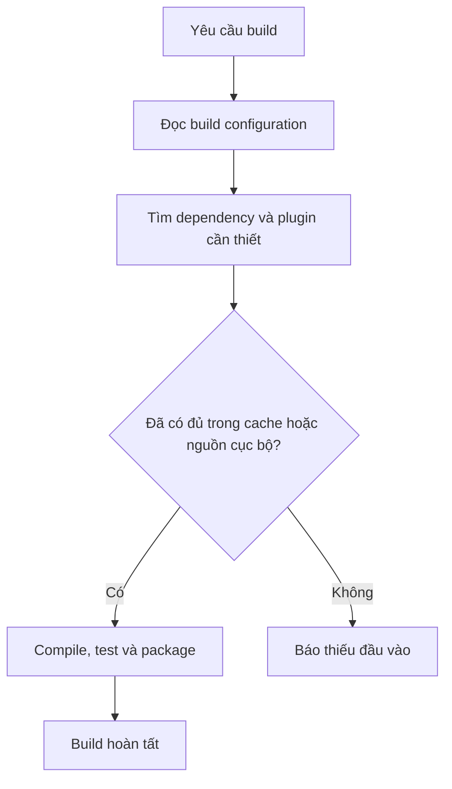
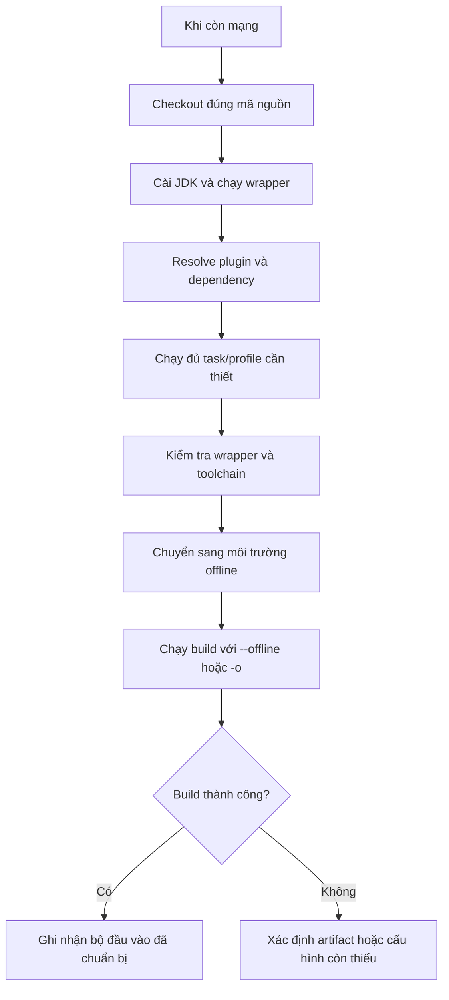

# Build ngoại tuyến: điều kiện có đủ đầu vào trong bộ nhớ đệm

Một dự án Java thường tải thư viện, plugin và các thành phần build từ repository trên Internet hoặc repository nội bộ. Nhưng có lúc máy phát triển không có mạng, CI chạy trong mạng bị giới hạn, hoặc nhóm cần build trong môi trường cách ly. Khi đó, build chỉ có thể thành công nếu những đầu vào cần thiết đã có sẵn tại máy hoặc được cung cấp từ một nguồn cục bộ.

**Build ngoại tuyến (offline build)** là quá trình chạy build tool mà không cần truy cập mạng để phân giải hoặc tải dependency. Maven và Gradle đều có chế độ offline, nhưng bật chế độ này không tự tạo ra những thư viện còn thiếu. Máy phải có đủ dependency, plugin, metadata và các thành phần cần thiết trong cache hoặc trong repository cục bộ.

Bài học này giải thích điều kiện để build ngoại tuyến thành công, cách Maven và Gradle sử dụng cache, cách chuẩn bị máy trước khi mất mạng, những giới hạn của chế độ offline và cách chẩn đoán lỗi khi thiếu đầu vào.

## 1. Build ngoại tuyến là gì?

Trong một lần build thông thường, build tool có thể cần tải:

- Thư viện mà mã nguồn sử dụng.
- Dependency bắc cầu của các thư viện đó.
- Plugin build và dependency của plugin.
- Maven extension hoặc Gradle plugin.
- Metadata để tìm phiên bản phù hợp.
- Các artifact cần cho biên dịch, kiểm thử và đóng gói.

Khi bật chế độ offline, build tool không cố tải những thành phần còn thiếu từ repository từ xa. Nó chỉ có thể sử dụng những thành phần sẵn có trong cache hoặc nguồn cục bộ đã cấu hình.

Ví dụ, dự án khai báo:

```groovy
dependencies {
    implementation 'org.apache.commons:commons-lang3:3.17.0'
}
```

Nếu artifact commons-lang3 phiên bản 3.17.0 đã được tải về máy, build có thể dùng nó khi offline. Nếu máy chưa có artifact cần thiết, build tool không thể tự lấy từ Maven Central trong chế độ offline và build có thể thất bại.

Có thể hình dung:



Điều kiện quan trọng là **đủ đầu vào cho đúng quy trình build đang chạy**. Một máy có thể build được task compile nhưng vẫn không chạy được test hoặc package offline nếu plugin, test dependency hay artifact cần cho các bước đó chưa có sẵn.

## 2. Cache là gì và lưu những gì?

Cache là nơi build tool lưu lại những thành phần đã tải hoặc kết quả đã tạo để có thể sử dụng lại.

Với build ngoại tuyến, cần phân biệt ít nhất hai loại dữ liệu:

1. **Dependency cache:** lưu artifact và thông tin phân giải dependency như thư viện, plugin hoặc metadata repository.
2. **Build output/cache:** lưu kết quả task hoặc các file được tạo trong quá trình build.

Hai loại cache phục vụ mục đích khác nhau. Có dependency cache không có nghĩa đã có kết quả biên dịch; có build output cũ cũng không có nghĩa dependency còn đủ để thực hiện một build sạch.

### 2.1. Dependency cache

Dependency cache có thể chứa:

- JAR hoặc archive của thư viện.
- Metadata mô tả module và phiên bản.
- Plugin và dependency của plugin.
- Artifact của annotation processor.
- Thông tin repository nơi artifact được tìm thấy.

Khi build offline, build tool cần tìm thấy cả thông tin cần thiết để xác định dependency lẫn nội dung artifact mà task cần sử dụng.

### 2.2. Build cache

Build cache lưu kết quả của task để có thể tái sử dụng khi các đầu vào tương ứng không đổi. Ví dụ, Gradle có thể tái sử dụng kết quả một task compile nếu đầu vào và điều kiện cache phù hợp.

Build cache không thay thế dependency cache. Nếu một task cần thư viện để biên dịch mà thư viện chưa được tải, việc có kết quả task cũ trong build cache không đảm bảo toàn bộ quy trình có thể chạy offline.

### 2.3. Cache không phải nơi lưu toàn bộ dự án

Các tệp thuộc mã nguồn, tài nguyên, cấu hình, script hoặc file dependency của dự án thường đến từ working tree hoặc một nguồn local đã khai báo. Chúng không nhất thiết nằm trong dependency cache.

Để build ngoại tuyến, repository làm việc cũng phải có đủ nội dung cần thiết. Nếu build dựa vào submodule chưa checkout, file được tạo từ một bước chuẩn bị chưa chạy hoặc một file nằm ngoài repository mà máy không có, dependency cache không thể bù đắp.

## 3. Điều kiện chung để build offline thành công

Một build ngoại tuyến thành công thường cần đáp ứng các điều kiện sau.

### 3.1. Đã có build tool distribution

Nếu dùng Maven hoặc Gradle Wrapper, bản phân phối mà wrapper yêu cầu phải được tải về và lưu trong cache trước đó.

Wrapper là bước khởi động build tool. Nó cần tìm thấy hoặc tải bản phân phối Maven/Gradle trước khi build tool có thể đọc tùy chọn offline.

Do đó, lệnh như:

```bash
./gradlew --offline build
```

vẫn có thể thất bại ngay từ bước wrapper nếu máy chưa có Gradle distribution tương ứng. Tùy chọn --offline được chuyển cho Gradle sau khi wrapper đã khởi động được Gradle.

Tương tự, Maven Wrapper cần có Maven distribution tương ứng trong cache. Nếu không, wrapper có thể cần truy cập URL distribution để tải Maven trước khi xử lý tùy chọn offline.

### 3.2. Có JDK phù hợp

Maven hoặc Gradle cần JVM để chạy. Dự án còn có thể cần một JDK/toolchain cụ thể để biên dịch hoặc chạy test.

Cần kiểm tra:

- JDK dùng để khởi động build tool.
- JDK mà dự án yêu cầu.
- Java toolchain nếu build cấu hình toolchain riêng.
- Compiler và runtime cần thiết cho các task.

JDK không tự động có mặt chỉ vì dependency JAR đã nằm trong cache. Nếu cấu hình toolchain yêu cầu tải một JDK mới nhưng máy offline chưa có JDK đó, build có thể thất bại.

### 3.3. Đã tải đủ dependency cần thiết

Không chỉ direct dependency mới cần có. Tất cả dependency bắc cầu được resolve trong configuration liên quan cũng cần sẵn sàng.

Ví dụ, compileClasspath có thể đã được tải đầy đủ nhưng runtimeClasspath hoặc testRuntimeClasspath vẫn còn thiếu thư viện. Khi chạy test offline, build có thể thất bại dù compile trước đó thành công.

### 3.4. Đã có plugin và dependency của plugin

Build tool cần plugin để thực hiện một số bước như:

- Biên dịch Java.
- Chạy JUnit.
- Tạo JAR hoặc WAR.
- Tạo distribution.
- Kiểm tra code hoặc tạo báo cáo.
- Sinh mã nguồn.

Plugin có dependency riêng. Vì vậy, việc đã tải thư viện ứng dụng không đảm bảo plugin và toàn bộ dependency của plugin cũng đã có trong cache.

### 3.5. Đã chuẩn bị metadata và cấu hình cần thiết

Build tool có thể cần metadata repository để xác định module, phiên bản hoặc dependency bắc cầu. Dynamic version và version range đặc biệt phụ thuộc thông tin này.

Cấu hình repository, mirror, settings, proxy hoặc plugin management cũng phải hợp lệ. Offline mode không sửa cấu hình sai và cũng không tự tạo những file cấu hình cá nhân còn thiếu.

### 3.6. Các bước build không đòi hỏi dịch vụ mạng bên ngoài

Một custom task có thể gọi API, tải file, truy vấn database hoặc lấy dữ liệu từ dịch vụ bên ngoài. Tùy chọn offline của Maven hoặc Gradle chủ yếu điều khiển việc phân giải dependency của build tool; nó không tự biến mọi task hoặc chương trình con thành một quy trình không dùng mạng.

Nếu test cần database, message broker hoặc dịch vụ từ xa, những dịch vụ đó vẫn phải được cung cấp cục bộ hoặc được thay thế bằng test fixture phù hợp.

## 4. Build offline bằng Gradle

Gradle hỗ trợ chế độ offline bằng tùy chọn --offline.

Ví dụ:

```bash
./gradlew --offline clean build
```

Trên Windows:

```powershell
.\gradlew.bat --offline clean build
```

Khi bật chế độ này, Gradle không truy cập repository từ xa để tìm hoặc tải dependency còn thiếu. Nó sử dụng dependency đã có trong cache. Nếu thiếu module hoặc artifact cần thiết, Gradle báo lỗi và build không thể tiếp tục theo cách bình thường.

### 4.1. Gradle lưu dependency ở đâu?

Gradle User Home thường nằm tại:

```text
Linux/macOS: ~/.gradle/
Windows:     %USERPROFILE%\.gradle\
```

Dependency cache thường nằm trong thư mục con caches/modules-2. Wrapper distribution cũng được lưu trong Gradle User Home, nhưng thuộc vùng cache riêng của wrapper.

Có thể thay đổi Gradle User Home bằng biến môi trường GRADLE_USER_HOME hoặc tùy chọn tương ứng của môi trường. Vì vậy, nếu một máy có vẻ đã tải dependency nhưng build offline vẫn báo thiếu, hãy kiểm tra xem lần build trước và lần build hiện tại có đang dùng cùng Gradle User Home hay không.

Không nên mặc định sao chép một thư mục cache tùy tiện từ máy khác rồi cho rằng nó sẽ hoạt động. Cache có thể gắn với metadata repository, phiên bản Gradle, trạng thái xác minh và môi trường cụ thể. Cách đáng tin cậy hơn là chuẩn bị cache bằng chính build tool và cấu hình của dự án.

### 4.2. Gradle cần cache cho configuration nào?

Một dự án Java thường có nhiều configuration:

| Configuration | Dùng cho |
|---|---|
| compileClasspath | Biên dịch mã nguồn chính |
| runtimeClasspath | Chạy ứng dụng |
| testCompileClasspath | Biên dịch mã kiểm thử |
| testRuntimeClasspath | Chạy kiểm thử |
| annotationProcessor | Chạy annotation processor khi biên dịch |
| Các configuration của plugin | Task do plugin cung cấp |

Nếu chỉ chạy compile, Gradle có thể mới resolve compileClasspath và những configuration cần cho task đó. Khi chạy test hoặc một plugin task khác trong môi trường offline, các configuration chưa từng được resolve có thể thiếu artifact.

Vì vậy, hãy chuẩn bị cache bằng những lệnh tương ứng với các tác vụ thật sự cần chạy offline, chẳng hạn build, test, integrationTest hoặc task đóng gói của dự án.

### 4.3. Chuẩn bị Gradle cache khi còn mạng

Trên máy có mạng, từ repository và với JDK phù hợp, chạy các task mà môi trường offline sẽ cần:

```bash
./gradlew clean build
```

Nếu dự án có task kiểm thử tích hợp hoặc task tạo distribution riêng, hãy chạy chúng trước:

```bash
./gradlew test integrationTest distZip
```

Tên task integrationTest chỉ là ví dụ; chỉ dùng task tồn tại trong build của dự án. Mục tiêu là để Gradle resolve các dependency và plugin thực tế được dùng bởi những task đó.

Sau khi chuẩn bị, thử lại chính lệnh cần dùng ở chế độ offline:

```bash
./gradlew --offline clean build
```

Nếu build thành công, cache hiện tại đủ cho tập task và cấu hình đã được chạy trong lần thử đó. Điều này không chứng minh mọi task có thể có trong repository đều đã được chuẩn bị.

### 4.4. Plugin cũng phải có trong cache

Gradle có thể tải plugin từ Plugin Portal hoặc repository được cấu hình trong pluginManagement. Plugin và dependency của nó cũng cần được chuẩn bị trước.

Ví dụ:

```groovy
plugins {
    id 'java'
    id 'application'
}
```

Nếu máy chưa từng resolve plugin cần thiết và không có plugin artifact trong cache, Gradle offline không thể tải plugin đó.

Ngoài plugin DSL, dự án có thể dùng buildscript dependencies hoặc convention plugin trong build-logic/included build. Các thành phần này cũng phải có sẵn khi build offline.

### 4.5. Dynamic version khi offline

Ví dụ:

```groovy
dependencies {
    implementation 'org.example:library:2.+'
}
```

Khi có mạng, Gradle có thể tìm phiên bản phù hợp mới nhất theo metadata repository. Khi offline, nó không thể truy vấn repository để lấy thông tin mới. Gradle chỉ có thể sử dụng thông tin đã cache và lock state nếu dự án đã cấu hình locking.

Đối với build cần tái lập, nên:

- Ưu tiên phiên bản cụ thể hoặc constraint rõ ràng.
- Sử dụng dependency locking khi phù hợp.
- Tránh phụ thuộc vào latest.release hoặc dynamic version trong build phát hành.
- Cập nhật dependency có chủ đích khi đang có mạng và review lockfile.

Lưu ý: dependency locking giúp giữ phiên bản đã chọn; nó không thay thế việc tải artifact. Nếu lockfile ghi phiên bản nhưng JAR tương ứng chưa có trong cache, Gradle offline vẫn không thể sử dụng nó.

## 5. Build offline bằng Maven

Maven hỗ trợ chế độ offline bằng tùy chọn -o hoặc --offline.

Ví dụ:

```bash
./mvnw --offline clean verify
```

Hoặc:

```bash
./mvnw -o clean package
```

Trên Windows:

```powershell
.\mvnw.cmd -o clean verify
```

Maven sử dụng local repository để lưu dependency, plugin và metadata đã tải. Mặc định, local repository thường nằm tại:

```text
~/.m2/repository
```

Vị trí này có thể được thay đổi trong settings.xml hoặc qua cấu hình dòng lệnh. Nếu local repository được đặt ở vị trí khác, phải bảo đảm môi trường offline sử dụng đúng repository đã được chuẩn bị.

### 5.1. Maven offline sử dụng local repository

Khi gọi Maven với -o, Maven không tải artifact còn thiếu từ repository từ xa. Nếu POM yêu cầu một dependency chưa có trong local repository, Maven có thể báo lỗi kiểu artifact không có sẵn ở chế độ offline.

Ví dụ POM:

```xml
<dependencies>
    <dependency>
        <groupId>org.apache.commons</groupId>
        <artifactId>commons-lang3</artifactId>
        <version>3.17.0</version>
    </dependency>
</dependencies>
```

Để build offline, artifact và các dependency cần thiết của nó phải có sẵn trong local repository.

### 5.2. Plugin và goal Maven cũng cần được tải trước

Maven lifecycle sử dụng plugin để thực hiện compile, test, package và các bước khác. Ví dụ:

- maven-compiler-plugin.
- maven-surefire-plugin.
- maven-resources-plugin.
- maven-jar-plugin.
- Plugin do dự án tự khai báo.

Các plugin này có dependency riêng. Nếu máy chỉ tải dependency của ứng dụng nhưng chưa có plugin cần cho lifecycle, lệnh offline vẫn có thể thất bại.

Vì vậy, chuẩn bị cache Maven bằng cách chạy đúng lifecycle hoặc goal mà môi trường offline sẽ cần, không chỉ tải các dependency khai báo trong phần dependencies.

### 5.3. Chuẩn bị Maven local repository khi còn mạng

Khi máy còn mạng, có thể chạy lifecycle đầy đủ:

```bash
./mvnw clean verify
```

Nếu muốn đóng gói:

```bash
./mvnw clean package
```

Maven Dependency Plugin có goal go-offline:

```bash
./mvnw dependency:go-offline
```

Goal này giúp tải dependency của project và plugin cần thiết theo những gì plugin có thể xác định. Tuy nhiên, nó không phải bảo đảm tuyệt đối cho mọi goal tùy chỉnh, profile, plugin động hoặc tác vụ phát sinh dependency lúc thực thi.

Cách xác nhận đáng tin cậy là chạy chính lệnh build dự kiến trong chế độ offline sau khi chuẩn bị cache:

```bash
./mvnw --offline clean verify
```

Nếu CI cần chạy thêm một profile hoặc plugin goal khác, hãy chuẩn bị và thử offline với đúng profile/goal đó.

### 5.4. Profile và settings

Maven profile có thể thêm dependency hoặc plugin. Nếu profile chỉ được kích hoạt trong CI, máy phát triển cần chuẩn bị dependency tương ứng của profile đó.

Ví dụ:

```bash
./mvnw -Pproduction clean verify
```

Nếu profile production bổ sung dependency hoặc plugin chưa được tải, build offline có thể thất bại.

Maven cũng có thể dùng user settings tại ~/.m2/settings.xml để khai báo mirror, server credentials hoặc local repository. Cấu hình settings cần tồn tại trong môi trường offline nếu build phụ thuộc vào nó. Credentials có thể không cần khi thực sự không truy cập mạng, nhưng mirror hoặc repository configuration vẫn có thể ảnh hưởng cách Maven tìm artifact cục bộ.

## 6. Wrapper distribution là một đầu vào riêng

Một nhầm lẫn phổ biến là cho rằng chỉ cần thêm --offline hoặc -o vào lệnh wrapper thì lần chạy đầu tiên sẽ không cần mạng.

Thực tế, trình tự khởi động gồm hai giai đoạn:

1. Wrapper tìm hoặc tải Maven/Gradle distribution.
2. Sau khi build tool khởi chạy, Maven/Gradle mới xử lý chế độ offline cho dependency resolution.

Ví dụ:

```bash
./gradlew --offline build
```

Nếu Gradle distribution được cấu hình trong gradle-wrapper.properties chưa có trong cache, wrapper có thể cần tải distribution trước khi Gradle đọc tùy chọn --offline. Khi đó lệnh có thể thất bại vì không truy cập được URL phân phối.

Tương tự với Maven Wrapper và distributionUrl trong .mvn/wrapper/maven-wrapper.properties.

Để chuẩn bị offline:

- Chạy wrapper khi còn mạng ít nhất một lần với đúng phiên bản được khai báo.
- Kiểm tra wrapper distribution đã được tải vào cache.
- Đảm bảo JDK tương thích đã được cài.
- Sau đó mới thử lệnh wrapper trong môi trường không có mạng.

Nếu dùng Maven hoặc Gradle cài toàn hệ thống thay vì wrapper, distribution không cần được tải bởi wrapper, nhưng phiên bản công cụ vẫn phải được cài sẵn và tương thích với dự án.

## 7. Chuẩn bị máy cho một lần build offline

Một quy trình chuẩn bị có thể thực hiện khi máy còn mạng:

1. Checkout đúng commit hoặc tag cần build.
2. Cài JDK phù hợp.
3. Chạy wrapper để tải đúng build tool distribution.
4. Dùng đúng profile, project properties và settings sẽ sử dụng khi offline.
5. Chạy các task compile, test và package cần thiết.
6. Chạy thêm các plugin goal hoặc task tùy chỉnh mà pipeline yêu cầu.
7. Kiểm tra toolchain và các thành phần được tải tự động.
8. Ngắt mạng hoặc chuyển sang môi trường offline.
9. Chạy lại đúng lệnh với tùy chọn offline.
10. Ghi nhận kết quả và những dependency còn thiếu nếu có.

Sơ đồ:



Điểm quan trọng là chuẩn bị theo **đúng cấu hình và đúng tập task**. Chạy một task compile đơn giản không đảm bảo cache đủ cho integration test hoặc đóng gói distribution.

## 8. Ví dụ: một dự án Gradle cần chạy test offline

Giả sử build.gradle:

```groovy
plugins {
    id 'java'
    id 'application'
}

repositories {
    mavenCentral()
}

dependencies {
    implementation 'com.fasterxml.jackson.core:jackson-databind:2.18.3'
    testImplementation 'org.junit.jupiter:junit-jupiter:5.11.4'
}

application {
    mainClass = 'com.example.Main'
}

tasks.test {
    useJUnitPlatform()
}
```

Để chuẩn bị cache, khi có mạng chạy:

```bash
./gradlew clean test installDist
```

Lệnh này giúp resolve dependency cho compile, runtime, test và các task distribution được thực hiện trong build.

Khi chuyển sang offline, chạy:

```bash
./gradlew --offline clean test installDist
```

Nếu lệnh thành công, các dependency và plugin cần cho tập task đó đã có sẵn trong cache hiện tại.

Nếu chỉ chuẩn bị bằng:

```bash
./gradlew compileJava
```

thì testRuntimeClasspath hoặc dependency cần cho distribution có thể chưa được tải. Lúc đó chạy test hoặc installDist offline có thể báo thiếu artifact.

## 9. Ví dụ: một dự án Maven cần chạy verify offline

Giả sử POM khai báo JUnit và plugin compiler/surefire phù hợp. Khi còn mạng, chạy:

```bash
./mvnw clean verify
```

Nếu dự án có profile production hoặc plugin đóng gói bổ sung, chạy cả lệnh tương ứng:

```bash
./mvnw -Pproduction clean verify
```

Sau khi local repository được chuẩn bị, chuyển sang offline:

```bash
./mvnw --offline clean verify
```

Nếu lệnh thất bại, đọc thông báo để xác định artifact thiếu là dependency của ứng dụng, plugin, plugin dependency hay thành phần khác.

Không nên chỉ chạy dependency:go-offline rồi mặc định mọi profile và mọi goal đều đã sẵn sàng. Hãy chạy chính quy trình cần dùng để kiểm tra.

## 10. Offline mode không đồng nghĩa toàn bộ tiến trình không dùng mạng

Tùy chọn offline của build tool chủ yếu ngăn build tool tải dependency từ repository từ xa. Nó không phải một sandbox mạng toàn hệ thống.

Ví dụ, build.gradle có custom task:

```groovy
tasks.register('downloadSchema') {
    doLast {
        // A custom script may access a remote URL here.
    }
}
```

Task tùy chỉnh có thể tự dùng HTTP client hoặc công cụ ngoài để truy cập mạng. Gradle --offline không nhất thiết chặn request đó.

Tương tự, test có thể kết nối database, API hoặc message broker bên ngoài. Maven -o không tự chặn chương trình test truy cập dịch vụ.

Vì vậy cần phân biệt:

| Khái niệm | Ý nghĩa |
|---|---|
| Build tool offline mode | Không tải dependency từ repository từ xa theo cơ chế resolution của build tool |
| Môi trường không có mạng | Hệ điều hành hoặc network policy không cho tiến trình truy cập mạng |
| Hermetic build | Build chỉ phụ thuộc vào các đầu vào đã khai báo và kiểm soát, không phụ thuộc trạng thái bên ngoài không xác định |
| Reproducible build | Cùng đầu vào và môi trường được kiểm soát tạo ra kết quả tương đương hoặc giống nhau theo yêu cầu |

Một build hermetic có thể cần sandbox hoặc network policy để ngăn custom task truy cập mạng. Offline mode hữu ích nhưng không tự bảo đảm tính hermetic.

## 11. Những thứ thường bị quên khi chuẩn bị offline

### 11.1. Dependency của test

Máy có thể compile thành công nhưng test thất bại vì chưa tải JUnit, Mockito, test engine hoặc dependency testRuntimeOnly.

### 11.2. Plugin build

Compiler plugin, test plugin, packaging plugin, code generation plugin và dependency của chúng đều cần có sẵn.

### 11.3. Annotation processor

Các thư viện như processor sinh mã được resolve trong configuration riêng. Nếu chưa tải processor, compile offline có thể thất bại.

### 11.4. Dependency của build logic

Gradle convention plugin, included build hoặc buildSrc có thể có dependency riêng. Maven extension cũng có thể cần artifact ngoài POM thông thường.

### 11.5. Toolchain

Build có thể tự động tìm hoặc tải JDK theo cấu hình toolchain. Máy offline phải có JDK tương thích hoặc có cách cung cấp toolchain cục bộ.

### 11.6. Profile và biến môi trường

Profile có thể thêm dependency, plugin hoặc task. Nếu offline chạy với profile khác lần chuẩn bị, cache có thể không đủ.

### 11.7. File dependency và tài nguyên ngoài repository

Một build có thể tham chiếu file JAR cục bộ, schema, file sinh tự động hoặc thư mục nằm ngoài checkout. Những đầu vào này phải được cung cấp riêng.

### 11.8. Submodule và Git LFS

Nếu repository dùng Git submodule hoặc Git LFS, checkout có thể chưa chứa nội dung đầy đủ khi không có mạng. Các thành phần này cần được lấy trước hoặc cung cấp từ nguồn nội bộ.

## 12. Chẩn đoán lỗi offline

Khi build offline thất bại, hãy xác định chính xác thành phần nào còn thiếu.

| Thông báo hoặc hiện tượng | Nguyên nhân có thể | Hướng xử lý |
|---|---|---|
| Gradle không tìm thấy module trong cache | Dependency hoặc metadata chưa được tải | Khi còn mạng, resolve đúng configuration; sau đó thử offline lại |
| Gradle không tìm thấy plugin | Plugin hoặc plugin dependency chưa có trong cache | Chạy các task có dùng plugin khi còn mạng |
| Wrapper không tải được distribution | Maven/Gradle distribution chưa có trong wrapper cache | Chạy wrapper online trước hoặc cung cấp distribution cục bộ theo cấu hình được hỗ trợ |
| Maven báo artifact chưa có trong local repository | Dependency hoặc plugin còn thiếu | Chạy đúng lifecycle/goal khi còn mạng |
| Compile được nhưng test offline thất bại | Test dependency hoặc test plugin chưa được tải | Chạy test online để chuẩn bị test classpath |
| Build báo không tìm thấy JDK/toolchain | JDK yêu cầu chưa có trên máy | Cài hoặc cung cấp JDK phù hợp trước khi offline |
| Build vẫn cố gọi dịch vụ từ xa | Custom task hoặc test tự truy cập mạng | Chuẩn bị dịch vụ cục bộ hoặc điều chỉnh task/test cho môi trường offline |
| Chỉ một profile build được offline | Profile khác có dependency hoặc plugin chưa cache | Chuẩn bị đúng profile và task cần dùng |
| Máy khác có cache nhưng máy hiện tại không có | Cache thuộc user home hoặc máy khác | Chuẩn bị cache trên đúng máy/GRADLE_USER_HOME/local Maven repository cần dùng |

Đừng vội xóa cache khi gặp lỗi. Trước tiên hãy đọc tọa độ dependency, repository và configuration trong thông báo. Xóa cache có thể làm mất những artifact duy nhất đang có sẵn trên máy offline.

## 13. Dùng repository nội bộ khi nhiều máy cần build offline

Nếu nhiều máy trong nhóm cần build trong mạng hạn chế, việc sao chép cache cá nhân không phải lúc nào cũng thuận tiện. Một giải pháp có thể quản lý tập trung là dùng repository manager nội bộ hoặc mirror.

Ví dụ:

- Maven dùng mirror trong settings.xml để chuyển yêu cầu tới repository nội bộ.
- Gradle khai báo repository nội bộ trong settings hoặc build configuration.
- CI tải dependency từ repository được quản lý và lưu cache theo chính sách.
- Máy phát triển truy cập mirror trong mạng nội bộ thay vì Internet công cộng.

Repository nội bộ giúp nhiều máy lấy cùng artifact từ một nguồn được quản lý. Tuy nhiên, nếu môi trường thật sự không có kết nối tới cả repository nội bộ, dependency vẫn cần được cache hoặc cung cấp bằng phương thức chuyển giao ngoại tuyến.

Không nên đưa credentials cá nhân vào URL repository hoặc commit vào build script. Hãy dùng cơ chế xác thực được bảo vệ trong settings hoặc secret store.

## 14. Những hiểu lầm thường gặp

| Hiểu lầm | Thực tế |
|---|---|
| Chỉ cần thêm --offline là build chắc chắn thành công | Các dependency, plugin và distribution cần thiết phải có sẵn |
| Đã compile một lần thì test offline luôn chạy được | Test có thể cần configuration và dependency riêng |
| Gradle build cache thay thế dependency cache | Build cache lưu kết quả task; dependency cache lưu artifact và metadata |
| Wrapper tự có sẵn vì script đã nằm trong Git | Wrapper distribution có thể vẫn phải tải lần đầu |
| Maven dependency:go-offline bảo đảm mọi task đều offline được | Goal này hữu ích nhưng không bảo đảm mọi plugin, profile và custom goal |
| Offline mode chặn mọi kết nối mạng | Custom task, test hoặc chương trình con vẫn có thể truy cập mạng |
| Có lockfile thì không cần tải dependency | Lockfile ghi phiên bản, không chứa nội dung JAR |
| Sao chép cache từ máy khác luôn an toàn | Cache phụ thuộc công cụ, metadata, repository và môi trường; cần kiểm chứng |
| Offline build đồng nghĩa reproducible build | Còn phải kiểm soát JDK, plugin, task input, file và môi trường |

## 15. Quy trình thực hành đề xuất

Đối với một dự án Java cần có khả năng build offline, nhóm có thể thống nhất quy trình sau:

1. Commit Maven/Gradle Wrapper và cấu hình phiên bản rõ ràng.
2. Ghi rõ JDK hoặc Java toolchain cần dùng.
3. Pin phiên bản dependency quan trọng và cân nhắc dependency locking.
4. Khi còn mạng, chạy đúng task, profile và plugin goal sẽ dùng trong môi trường offline.
5. Chuẩn bị wrapper distribution, plugin, dependency chính, dependency test và toolchain.
6. Kiểm tra file cấu hình người dùng, repository và các đầu vào ngoài mã nguồn.
7. Thử lại cùng lệnh với --offline hoặc -o.
8. Ghi lại các đầu vào còn thiếu và bổ sung quy trình chuẩn bị.
9. Với CI, duy trì cache hoặc repository nội bộ theo chính sách của nhóm.
10. Nếu yêu cầu không có kết nối mạng tuyệt đối, chạy trong môi trường sandbox/network policy để phát hiện task tự truy cập mạng.

## 16. Ghi nhớ

- Build ngoại tuyến chỉ thành công khi mọi đầu vào cần thiết đã có trong cache hoặc nguồn cục bộ.
- Gradle dùng --offline; Maven dùng -o hoặc --offline.
- Dependency cache khác build cache: một bên lưu thư viện/metadata, bên kia lưu kết quả task.
- Wrapper distribution phải có sẵn trước khi wrapper có thể khởi động build tool offline.
- JDK, Java toolchain, plugin và dependency của plugin cũng là đầu vào cần chuẩn bị.
- Compile, test, package và các profile khác nhau có thể cần những configuration dependency khác nhau.
- Gradle nên được chuẩn bị bằng các task thực tế sẽ chạy offline.
- Maven dependency:go-offline hữu ích nhưng cần xác nhận bằng chính lifecycle hoặc goal sẽ sử dụng.
- Lockfile giữ phiên bản dependency nhưng không chứa artifact.
- Offline mode không tự ngăn custom task hoặc test truy cập mạng.
- Repository nội bộ có thể giúp nhiều máy chia sẻ artifact; môi trường hoàn toàn cách ly vẫn cần nguồn cục bộ.
- Build offline là một bước hỗ trợ tính tái lập, nhưng không tự bảo đảm build hermetic hoặc reproducible.

## 17. Tự kiểm tra

1. Build ngoại tuyến là gì?
2. Vì sao bật --offline không tự làm cho dependency còn thiếu xuất hiện?
3. Dependency cache khác build cache như thế nào?
4. Vì sao wrapper distribution phải được tải trước khi chạy Gradle hoặc Maven offline?
5. Tại sao compile thành công chưa chứng minh test có thể chạy offline?
6. Gradle dùng tùy chọn nào để bật offline mode?
7. Maven dùng tùy chọn nào để chạy offline?
8. dependency:go-offline có bảo đảm mọi plugin goal đều sẵn sàng không?
9. Vì sao dependency locking không thay thế dependency cache?
10. Offline mode có chặn custom task gọi API bên ngoài không?
11. Những thành phần nào cần chuẩn bị ngoài thư viện ứng dụng?
12. Làm thế nào để xác nhận một lệnh build cụ thể thật sự chạy được khi không có mạng?

Khi có thể xác định đầy đủ dependency, plugin, wrapper distribution, JDK và các đầu vào cần thiết cho một tập task cụ thể, bạn đã hiểu điều kiện để build Java ngoại tuyến thành công và cách chuẩn bị môi trường trước khi mất kết nối mạng.

