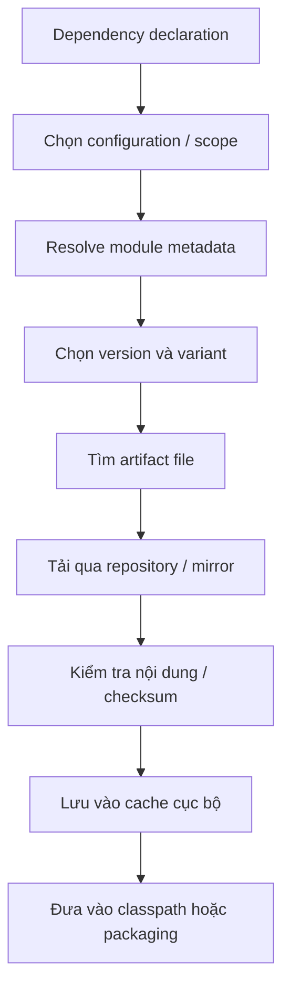

# Artifact không tìm thấy, tải lỗi và metadata cũ trong bộ nhớ đệm

Gradle và Maven lấy dependency từ các repository như Maven Central hoặc repository nội bộ. Khi build, công cụ phải tìm đúng tọa độ artifact, đọc metadata mô tả phiên bản và dependency, sau đó tải các file cần thiết về cache cục bộ. Nếu một bước trong chuỗi này gặp vấn đề, build có thể báo không tìm thấy artifact, không tải được file, dùng metadata cũ hoặc tiếp tục thất bại dù repository đã được cập nhật.

Những lỗi này thường bị gọi chung là “lỗi repository”, nhưng nguyên nhân có thể rất khác nhau: tọa độ dependency sai, artifact chưa được publish, repository không được khai báo, credentials không hợp lệ, proxy/TLS/DNS gặp lỗi, metadata chưa được làm mới hoặc cache đang lưu kết quả thất bại trước đó. Muốn xử lý đúng, cần xác định công cụ đang tìm artifact nào, ở repository nào, đang đọc metadata hay tải file nội dung, và cache nào đang ảnh hưởng đến lần build hiện tại.

## 1. Artifact, tọa độ và repository

**Artifact** là một sản phẩm được lưu trữ và phân phối để build khác có thể sử dụng. Với Java, artifact thường là JAR, WAR, ZIP, POM hoặc metadata mô tả module. Một thư viện có thể gồm nhiều file: file JAR chứa bytecode, POM mô tả dependency theo Maven, Gradle Module Metadata mô tả variant và các file checksum/signature.

### 1.1. Tọa độ Maven của một artifact

Một dependency Maven thường được xác định bằng các thành phần:

- `groupId`: namespace hoặc nhóm phát hành.
- `artifactId`: tên artifact.
- `version`: phiên bản.
- `type`/`packaging`: loại file, thường là `jar`, `pom`, `war` hoặc loại khác.
- `classifier`: biến thể bổ sung nếu có, ví dụ `sources`, `javadoc` hoặc `tests`.

Ví dụ:

```xml
<dependency>
    <groupId>com.example</groupId>
    <artifactId>customer-client</artifactId>
    <version>2.4.1</version>
</dependency>
```

Tọa độ rút gọn là `com.example:customer-client:2.4.1`. Trong Maven repository layout mặc định, các thành phần này tạo ra đường dẫn tương ứng:

```text
com/example/customer-client/2.4.1/
    customer-client-2.4.1.pom
    customer-client-2.4.1.jar
```

Nếu có classifier `sources`, file có thể là `customer-client-2.4.1-sources.jar`. Một tọa độ đúng tên nhưng sai version, classifier hoặc packaging vẫn có thể khiến công cụ tìm file không tồn tại.

### 1.2. Repository là nơi lưu và phân phối artifact

Repository là nguồn mà Gradle/Maven truy vấn để tìm metadata và file artifact. Các loại thường gặp:

| Loại repository | Mục đích |
|---|---|
| Public repository | Cung cấp thư viện công khai, ví dụ Maven Central |
| Private repository | Lưu thư viện nội bộ hoặc artifact có quyền truy cập giới hạn |
| Proxy/cache repository | Làm trung gian, cache và kiểm soát việc truy cập repository bên ngoài |
| Local Maven repository | Lưu artifact đã cài hoặc tải về trên máy, thường ở `~/.m2/repository` |
| Gradle dependency cache | Cache metadata và artifact mà Gradle đã resolve/tải về trong Gradle User Home |

Repository không nhất thiết chứa mọi file tại cùng một địa chỉ. Công cụ có thể truy vấn metadata trước, sau đó tải POM/module metadata, JAR, checksum hoặc signature từ các URL tương ứng.

### 1.3. Phân biệt dependency artifact và project artifact

Dependency artifact là file dự án cần tải về để compile hoặc chạy. Project artifact là file được chính lần build tạo ra. Khi publish, project artifact được đưa lên repository để dự án khác có thể sử dụng như dependency.

Một dự án build thành công ở local không chứng minh artifact đã được publish lên repository. Ví dụ, `mvn package` tạo JAR trong `target/`, còn `mvn install` đưa nó vào local Maven repository. Để dự án khác trên máy hoặc CI tải được từ remote repository, artifact phải được publish/deploy lên repository dùng chung và tọa độ phải khớp.

## 2. Quy trình resolve và tải artifact

Khi gặp dependency, build tool không chỉ tìm một file JAR. Nó cần giải quyết tọa độ, phiên bản, metadata và các dependency bắc cầu.

Luồng khái quát:



Một lỗi ở mỗi giai đoạn sẽ có biểu hiện khác nhau:

- Không tìm được module/version: tọa độ sai, repository thiếu artifact hoặc metadata không liệt kê version.
- Không tải được metadata: lỗi mạng, HTTP, TLS, proxy, credentials hoặc repository.
- Metadata tìm thấy nhưng JAR không tồn tại: publish thiếu file, mirror chưa đồng bộ hoặc metadata trỏ đến artifact sai.
- Tải được file nhưng checksum không khớp: file hỏng, proxy/mirror trả nội dung khác hoặc repository có vấn đề.
- Cache giữ trạng thái cũ: công cụ chưa kiểm tra lại remote theo update policy/TTL hoặc đang chạy offline.

Điều quan trọng là xác định lỗi nằm ở metadata hay file artifact. “Could not find artifact” và “Could not transfer artifact” không phải lúc nào cũng có cùng nguyên nhân.

## 3. Các loại lỗi thường gặp và cách đọc thông báo

### 3.1. Artifact không tìm thấy (404 / not found)

Thông báo có thể giống:

```text
Could not find com.example:customer-client:2.4.1.
Searched in the following locations:
  https://repo.example.com/maven2/com/example/customer-client/2.4.1/customer-client-2.4.1.pom
```

Nguyên nhân thường gặp:

- Sai `groupId`, `artifactId`, version hoặc classifier.
- Artifact chưa được publish, publish chưa hoàn tất hoặc bị xóa.
- Repository cần thiết chưa được khai báo trong build.
- Build đang dùng repository/mirror khác với nơi artifact được lưu.
- Repository có metadata không đồng bộ với file thực tế.
- Version là snapshot hoặc dynamic version nhưng metadata chưa được cập nhật.
- Cache lưu kết quả không tìm thấy từ lần truy vấn trước.

Hãy đọc URL đầy đủ trong log. Nó cho biết công cụ đã tìm file nào ở repository nào. So sánh từng thành phần trong đường dẫn với tọa độ artifact và kiểm tra xem file đó có tồn tại trên repository hay không.

### 3.2. Không thể tải artifact (transfer/download failure)

Ví dụ:

```text
Could not transfer artifact com.example:customer-client:pom:2.4.1
from/to internal-repo (https://repo.example.com/maven2):
Connect timed out
```

Artifact có thể tồn tại nhưng máy không truy cập được. Những nguyên nhân phổ biến:

- DNS không phân giải được hostname.
- Firewall, VPN hoặc proxy chặn kết nối.
- Repository server đang quá tải hoặc không hoạt động.
- TLS certificate không được tin cậy hoặc cấu hình TLS không tương thích.
- Credentials hết hạn hoặc không có quyền đọc.
- URL repository sai hoặc redirect không được xử lý như dự kiến.
- Kết nối bị gián đoạn giữa lúc tải file lớn.

Nếu log ghi `Connect timed out`, `Connection refused`, `UnknownHostException` hoặc lỗi handshake TLS, hãy điều tra kết nối trước khi sửa tọa độ dependency.

### 3.3. HTTP 401 và 403

Hai mã này thường liên quan đến quyền truy cập:

| Mã | Ý nghĩa thường gặp | Hướng kiểm tra |
|---|---|---|
| 401 Unauthorized | Chưa xác thực hoặc credentials không hợp lệ/hết hạn | Username/token, cấu hình server ID, secret của CI |
| 403 Forbidden | Đã đến server nhưng không được phép truy cập tài nguyên | Quyền đọc repository, quyền của token, policy hoặc IP allowlist |

Một số repository có thể trả 404 thay cho 401/403 để không tiết lộ tài nguyên riêng tư. Vì vậy, khi một artifact nội bộ “không tìm thấy” nhưng URL và tọa độ đã được xác nhận, hãy kiểm tra cả quyền truy cập.

Không đưa token hoặc password trực tiếp vào URL, build script được commit hay log. Maven thường lấy credentials từ `settings.xml` với server ID khớp repository/mirror. Gradle có thể đọc credentials từ biến môi trường hoặc secret store và gắn vào repository configuration.

### 3.4. HTTP 5xx, timeout và lỗi gateway

HTTP 500, 502, 503 hoặc 504 thường cho thấy server repository, reverse proxy hoặc dịch vụ trung gian đang gặp sự cố. Nếu lỗi chỉ xảy ra trong một khoảng thời gian và cùng dependency tải lại thành công sau đó, khả năng cao là lỗi hạ tầng tạm thời.

Không nên vội đổi version dependency khi lỗi là `503 Service Unavailable`. Hãy kiểm tra trạng thái repository/mirror, retry policy của CI và log server nếu có quyền. Retry có thể giúp với lỗi tạm thời, nhưng không khắc phục một URL sai hoặc permission bị từ chối.

### 3.5. Checksum mismatch hoặc file tải về bị hỏng

Repository có thể cung cấp checksum SHA-1/SHA-256 hoặc metadata kiểm tra tính toàn vẹn. Nếu checksum của file tải về không khớp, build tool có thể từ chối sử dụng artifact.

Nguyên nhân có thể là:

- File trên repository bị upload thiếu hoặc bị thay thế không đúng quy trình.
- Proxy/cache trả về file cũ nhưng metadata mới, hoặc ngược lại.
- Kết nối bị gián đoạn làm file tải không đầy đủ.
- Repository metadata/checksum chưa được cập nhật đồng bộ.
- Artifact mutable bị ghi đè trong khi nhiều client đang truy cập.

Không tắt kiểm tra checksum chỉ để build tiếp tục. Hãy xác minh file gốc trên repository, checksum công bố, và log của proxy/mirror. Nếu artifact bị publish sai, sửa hoặc publish lại theo chính sách repository, rồi làm mới cache có chọn lọc.

## 4. Metadata là gì và vì sao có thể cũ?

Metadata là thông tin mô tả module và artifact. Nó có thể cho biết version nào tồn tại, dependency nào cần thiết, variant nào có thể được chọn, file artifact nằm ở đâu và checksum nào được công bố.

Ví dụ các loại metadata:

- Maven POM (`.pom`): tọa độ, dependency, scope, dependency management và cấu hình liên quan.
- Maven metadata (`maven-metadata.xml`): danh sách version, thông tin snapshot và dữ liệu phục vụ version resolution.
- Gradle Module Metadata (`.module`): variants, attributes, capabilities, dependency constraints và artifact.
- Checksum/signature: dữ liệu xác minh tính toàn vẹn hoặc nguồn gốc.

Metadata có thể được cache để giảm số request tới repository. Điều này cải thiện tốc độ, nhưng cũng có nghĩa client không nhất thiết truy vấn server ở mọi lần build.

### 4.1. Metadata cũ dẫn đến biểu hiện nào?

Giả sử repository vừa publish `customer-client:2.4.2`, nhưng client vẫn giữ metadata chỉ liệt kê đến `2.4.1`. Build có thể báo không tìm thấy version mới dù file đã có trên server. Trường hợp khác, metadata cũ vẫn trỏ đến file đã bị xóa hoặc thay đổi, dẫn đến tải artifact thất bại.

Một số biểu hiện:

- Version mới publish nhưng Gradle/Maven chưa nhìn thấy.
- Snapshot vẫn resolve về build cũ sau khi có bản mới.
- Một version trước đó không tồn tại vẫn tiếp tục bị báo missing trong một khoảng thời gian.
- Một dependency dynamic như `1.+` chọn version cũ vì danh sách version chưa được làm mới.
- Máy A tải được nhưng máy B vẫn dùng kết quả metadata cũ trong cache.

### 4.2. Negative caching: cache cả kết quả không tìm thấy

Cache không chỉ lưu file thành công. Một số cơ chế còn lưu việc một module hoặc version không tồn tại, hoặc lần truy cập trước thất bại. Đây là **negative caching**.

Ví dụ, build hỏi repository về `customer-client:2.4.2` trước khi publisher upload xong. Repository trả 404. Client có thể ghi nhớ kết quả missing theo update policy/TTL. Sau khi publisher upload artifact, client chưa chắc hỏi lại ngay; nó có thể tiếp tục dùng kết quả thất bại đã cache.

Đây là lý do một dependency mới publish đôi khi vẫn không resolve được ngay trên một máy đã thử build trước đó. Làm mới metadata hoặc chờ hết khoảng cache có thể khiến client truy vấn lại.

### 4.3. Snapshot và release có tính chất khác nhau

Release version như `2.4.1` thường được coi là bất biến: một tọa độ release không nên bị ghi đè bằng nội dung khác sau khi publish. Snapshot version như `2.5-SNAPSHOT` có thể thay đổi theo thời gian và được repository quản lý qua metadata snapshot.

Ví dụ một snapshot có thể được lưu dưới tên file duy nhất:

```text
customer-client-2.5-20261113.071500-4.jar
```

Metadata snapshot cho biết `2.5-SNAPSHOT` hiện trỏ đến timestamp/build number nào. Nếu metadata snapshot chưa được làm mới, client có thể tiếp tục tải build trước đó.

Không nên dùng cùng một release version cho nhiều nội dung khác nhau. Nếu artifact đã phát hành cần thay đổi, hãy tạo version mới theo chính sách versioning. Việc ghi đè release gây khó xác định nội dung thực tế trong cache và làm mất tính tái lập.

## 5. Cache của Maven

Maven thường lưu artifact đã tải hoặc đã cài trong local repository, mặc định là:

```text
~/.m2/repository
```

Trên Windows, đường dẫn mặc định thường nằm dưới thư mục user home, ví dụ:

```text
C:\Users\<user>\.m2\repository
```

Đường dẫn có thể được thay đổi bằng cấu hình `<localRepository>` trong `settings.xml` hoặc qua cấu hình môi trường cụ thể.

### 5.1. Local repository lưu gì?

Ví dụ cấu trúc:

```text
~/.m2/repository/
└── com/example/customer-client/2.4.1/
    ├── customer-client-2.4.1.pom
    ├── customer-client-2.4.1.jar
    ├── customer-client-2.4.1.pom.sha1
    └── customer-client-2.4.1.jar.sha1
```

Local repository có thể chứa:

- Artifact được tải từ remote repository.
- Artifact được cài bằng `mvn install` từ máy hiện tại.
- POM và metadata đã resolve.
- File phụ trợ ghi nhận trạng thái lần tải, update check hoặc checksum.

Vì local repository được chia sẻ giữa các project chạy bằng cùng cấu hình Maven/user, một artifact đã tải có thể được sử dụng lại mà không cần tải lại.

### 5.2. File `.lastUpdated` và trạng thái tải thất bại

Khi Maven không tìm thấy hoặc không tải được artifact từ remote repository, local repository có thể có file đánh dấu như:

```text
customer-client-2.4.1.pom.lastUpdated
```

File này chứa thông tin liên quan đến lần kiểm tra/tải trước. Maven Resolver có thể dùng nó để tránh truy vấn remote liên tục trong khoảng update policy. Vì vậy, sau khi artifact được publish, Maven có thể vẫn báo lỗi cho đến khi policy cho phép kiểm tra lại hoặc người dùng yêu cầu cập nhật.

Không nên xóa toàn bộ `~/.m2/repository` như phản xạ đầu tiên. Nếu đã xác định một tọa độ cụ thể bị cache sai, chỉ cân nhắc xóa thư mục artifact/version tương ứng sau khi hiểu ảnh hưởng. Maven sẽ phải tải lại các file cần thiết ở lần build sau.

### 5.3. Update policy của Maven repository

Maven hỗ trợ update policy cho metadata và snapshot qua cấu hình repository. Các giá trị thường gặp:

- `always`: kiểm tra cập nhật ở mỗi lần resolve phù hợp.
- `daily`: kiểm tra theo ngày; đây là mặc định phổ biến.
- `interval:X`: kiểm tra theo khoảng X phút.
- `never`: không tự kiểm tra cập nhật từ remote theo policy đó.

Ví dụ cấu hình:

```xml
<repositories>
    <repository>
        <id>internal-repo</id>
        <url>https://repo.example.com/maven2</url>
        <releases>
            <enabled>true</enabled>
            <updatePolicy>daily</updatePolicy>
        </releases>
        <snapshots>
            <enabled>true</enabled>
            <updatePolicy>always</updatePolicy>
        </snapshots>
    </repository>
</repositories>
```

Ví dụ này cho phép release và snapshot, nhưng kiểm tra cập nhật snapshot thường xuyên hơn. Chính sách thật cần phù hợp với repository và quy trình phát hành của tổ chức. Đặt `always` cho mọi repository có thể tăng request và thời gian build; đặt `never` có thể làm metadata cũ tồn tại lâu.

### 5.4. Buộc Maven kiểm tra lại

Maven có tùy chọn `-U`:

```bash
mvn -U clean verify
```

`-U` buộc Maven kiểm tra các release bị thiếu và snapshot được cập nhật trên remote repository. Nó hữu ích khi artifact vừa được publish hoặc khi cache đang ghi nhận kết quả missing cũ.

Lưu ý: `-U` không sửa tọa độ sai, URL sai, permission bị từ chối hoặc repository không có file. Nó yêu cầu Maven kiểm tra lại theo cơ chế cập nhật, chứ không thể tạo ra artifact chưa được publish.

### 5.5. Chế độ offline của Maven

Maven có `-o`/`--offline`:

```bash
mvn -o verify
```

Ở chế độ này, Maven không truy cập remote repository. Build chỉ thành công nếu tất cả dependency/plugin cần thiết đã có trong local repository và metadata đủ để resolve. Nếu thiếu một artifact, Maven không thể tải bổ sung.

Khi đang điều tra lỗi repository, hãy kiểm tra xem lệnh hoặc IDE có bật offline mode hay không. Một máy có thể chạy Maven bình thường trong terminal nhưng IDE lại bật “Work offline”, khiến kết quả khác nhau.

## 6. Cache của Gradle

Gradle lưu dependency cache trong Gradle User Home, mặc định thường là:

```text
~/.gradle/caches/
```

Trên Windows, thường là:

```text
C:\Users\<user>\.gradle\caches\
```

Có thể thay đổi Gradle User Home qua biến môi trường `GRADLE_USER_HOME` hoặc cấu hình tương ứng. Cache của Gradle quản lý metadata và file artifact theo cách riêng; không nên giả định cấu trúc cache giống Maven local repository.

### 6.1. Gradle cache metadata và artifact

Gradle cache có thể lưu:

- Kết quả truy vấn metadata module từ từng repository.
- Kết quả version listing và dynamic version resolution.
- Thông tin về artifact được chọn cho module/variant.
- File JAR, POM, module metadata và artifact đã tải.
- Trạng thái resolution hoặc kết quả thiếu module theo thời hạn cache.

Gradle liên kết thông tin cache với repository và identity của dependency. Điều này giúp tránh tải lặp lại và giảm nguy cơ dùng nhầm metadata giữa những nguồn khác nhau.

### 6.2. Dynamic version và changing module

Dynamic version như `1.+`, `latest.release` hoặc range version yêu cầu Gradle tìm version phù hợp từ metadata repository. Kết quả này được cache trong một khoảng thời gian.

Một dependency có thể được đánh dấu changing nếu cùng tọa độ/version được phép trả nội dung thay đổi, thường gặp với snapshot hoặc module mutable. Gradle áp dụng TTL cho dynamic version và changing module metadata/artifact theo cấu hình cache.

Ví dụ:

```groovy
dependencies {
    implementation 'com.example:customer-client:1.+'
    implementation('com.example:customer-client:2.5-SNAPSHOT') {
        changing = true
    }
}

configurations.configureEach {
    resolutionStrategy.cacheDynamicVersionsFor 10, 'minutes'
    resolutionStrategy.cacheChangingModulesFor 0, 'seconds'
}
```

Ví dụ trên chỉ minh họa cách cấu hình TTL. Đặt TTL bằng 0 khiến Gradle kiểm tra changing module thường xuyên hơn, có thể tăng tải repository và làm build phụ thuộc nhiều hơn vào mạng. Nếu có thể, ưu tiên release version bất biến và tránh dynamic version trong quy trình build cần tái lập.

### 6.3. Làm mới dependency cache của Gradle

Gradle cung cấp `--refresh-dependencies`:

```bash
./gradlew build --refresh-dependencies
```

Tùy chọn này yêu cầu Gradle làm mới trạng thái dependency resolution và kiểm tra lại các nguồn cần thiết. Gradle không nhất thiết tải lại mọi file nếu xác định artifact trên server chưa thay đổi; nó có thể dùng checksum/metadata để tránh tải không cần thiết.

Đây là lựa chọn phù hợp khi nghi ngờ metadata hoặc kết quả resolution trong cache đã cũ. Nếu vấn đề là credentials, DNS, proxy hoặc artifact chưa tồn tại, refresh sẽ truy vấn lại nhưng vẫn thất bại vì nguyên nhân gốc chưa được xử lý.

### 6.4. Chế độ offline của Gradle

Gradle có `--offline`:

```bash
./gradlew build --offline
```

Gradle chỉ sử dụng dependency đã cache. Nếu cần module/artifact chưa có trong cache, resolution thất bại. Offline mode hữu ích khi đi công tác hoặc mạng bị hạn chế, nhưng không thể kiểm tra metadata mới trên repository.

Trong IDE, Gradle có thể có tùy chọn Offline work. Nếu terminal và IDE cho kết quả khác nhau, hãy kiểm tra trạng thái offline của cả hai.

### 6.5. Không chỉnh sửa trực tiếp Gradle cache

Thư mục Gradle cache là cấu trúc do công cụ quản lý. Không sửa tên file, nội dung metadata hoặc xóa ngẫu nhiên một thư mục con bên trong khi chưa hiểu định dạng. Hãy dùng `--refresh-dependencies` trước; nếu nghi ngờ một artifact cụ thể bị hỏng, có thể đóng các tiến trình Gradle và xóa đúng phần cache tương ứng theo hướng dẫn của phiên bản công cụ, sau đó để Gradle tải lại.

Xóa toàn bộ `~/.gradle/caches` thường làm mất cache của nhiều project, tăng thời gian tải dependency và có thể làm lộ vấn đề mạng vốn trước đó được cache che đi. Chỉ làm khi đã có lý do cụ thể và hiểu tác động.

## 7. So sánh cache và lệnh cập nhật của Maven, Gradle

| Tình huống | Maven | Gradle |
|---|---|---|
| Cache dependency mặc định | `~/.m2/repository` | `~/.gradle/caches` trong Gradle User Home |
| Ép kiểm tra dependency/metadata | `-U` | `--refresh-dependencies` |
| Build offline | `-o` / `--offline` | `--offline` |
| Version động | Version range và metadata Maven; snapshot metadata | Dynamic version như `1.+`, `latest.release`, range |
| Artifact mutable | Snapshot và update policy | Changing module và cache TTL |
| Lưu dấu lần tải thiếu/thất bại | Có thể có `.lastUpdated` và Resolver tracking | Cache metadata/resolution theo repository và thời hạn |
| Quản lý thời gian cập nhật | Repository `updatePolicy` | TTL cho dynamic/changing modules |

Hai lệnh `-U` và `--refresh-dependencies` có mục tiêu gần nhau là yêu cầu kiểm tra lại, nhưng không có nghĩa chúng xóa toàn bộ cache hay hoạt động giống hệt nhau. Cơ chế cache, metadata và resolution của hai công cụ khác nhau.

## 8. Repository, mirror, proxy và credentials

Nếu artifact không tìm thấy hoặc không tải được, cần xác nhận build đang truy cập đúng repository.

### 8.1. Khai báo repository trong Gradle

Ví dụ:

```groovy
repositories {
    mavenCentral()

    maven {
        name = 'internalRepo'
        url = uri('https://repo.example.com/maven2')
    }
}
```

Gradle sẽ resolve dependency từ các repository được khai báo theo cơ chế của nó. Với build hiện đại, repository cho plugin trong `pluginManagement.repositories` là phạm vi riêng với repository dùng để resolve dependency của project. Khai báo repository dependency không tự động làm plugin marker được tìm thấy, và ngược lại.

Trong `settings.gradle`, tổ chức có thể tập trung repository qua `dependencyResolutionManagement` để các project dùng một chính sách chung. Cần chú ý `repositoriesMode` vì nó quyết định repository trong project build script có được phép bổ sung hoặc thay thế repository ở settings hay không.

### 8.2. Khai báo repository trong Maven

Ví dụ repository trong POM:

```xml
<repositories>
    <repository>
        <id>internal-repo</id>
        <url>https://repo.example.com/maven2</url>
        <releases>
            <enabled>true</enabled>
        </releases>
        <snapshots>
            <enabled>true</enabled>
        </snapshots>
    </repository>
</repositories>
```

Maven cũng hỗ trợ mirror trong `settings.xml`. Mirror có thể chuyển mọi request hoặc một nhóm repository sang repository proxy nội bộ. Khi debug, cần xác định URL cuối cùng Maven sử dụng, vì mirror có thể thay URL được khai báo trong POM.

### 8.3. Server ID và credentials của Maven

Maven dùng `<server><id>...</id></server>` trong `settings.xml` để gắn credentials với repository/mirror ID tương ứng:

```xml
<servers>
    <server>
        <id>internal-repo</id>
        <username>${env.REPO_USER}</username>
        <password>${env.REPO_TOKEN}</password>
    </server>
</servers>
```

Đoạn trên minh họa việc tham chiếu biến môi trường; cách interpolation và cung cấp secret cần phù hợp với Maven/settings của tổ chức. Không commit token hoặc password thật vào repository. ID trong `settings.xml` phải khớp với ID repository hoặc mirror mà Maven đang dùng.

### 8.4. Credentials trong Gradle

Gradle có thể lấy credentials từ environment:

```groovy
repositories {
    maven {
        url = uri('https://repo.example.com/maven2')
        credentials {
            username = System.getenv('REPO_USER')
            password = System.getenv('REPO_TOKEN')
        }
    }
}
```

Trong thực tế, cần xử lý trường hợp biến chưa được cung cấp và chỉ yêu cầu credentials khi repository cần xác thực. Tránh ghi secret trực tiếp trong `build.gradle`, `gradle.properties` được commit hoặc log. Có thể sử dụng Gradle user-level properties hoặc secret store của CI.

### 8.5. Proxy và TLS

Máy phát triển có thể cần proxy/VPN để truy cập repository nội bộ hoặc internet. Maven và Gradle có cách cấu hình proxy riêng, thường thông qua user-level settings hoặc system properties. CI runner cũng có thể chạy trong network khác với máy cá nhân.

Khi gặp lỗi TLS handshake, hãy kiểm tra:

- URL có đúng HTTPS endpoint không.
- Certificate chain của repository/proxy có hợp lệ và được trust bởi JDK đang chạy build không.
- Proxy có thay certificate hoặc yêu cầu xác thực riêng không.
- JDK trong IDE và terminal có truststore khác nhau không.
- Server có hỗ trợ giao thức TLS mà JDK sử dụng không.

Không tắt kiểm tra certificate hoặc chuyển sang HTTP không bảo mật như một cách sửa lâu dài. Hãy cài đặt trust chain đúng theo chính sách của tổ chức.

## 9. Repository có thể đã publish nhưng client vẫn không tìm thấy

Đây là tình huống phổ biến trong hệ thống có proxy repository hoặc snapshot. Publisher có thể đã tải artifact lên một node, trong khi client truy cập mirror chưa đồng bộ.

### 9.1. Kiểm tra nơi publish và nơi resolve

Hãy xác nhận:

1. Artifact được publish lên repository nào?
2. Client đang resolve từ repository nào sau khi áp dụng mirror/proxy?
3. Tọa độ và đường dẫn file trên repository có khớp không?
4. File POM/module metadata và JAR đã xuất hiện đầy đủ chưa?
5. Snapshot metadata hoặc version listing đã được cập nhật chưa?

Nếu publish vào repository `releases` nhưng client chỉ tìm ở repository `snapshots`, artifact sẽ không được tìm thấy theo cấu hình hiện tại. Tương tự, nếu artifact có classifier mà dependency không khai báo classifier đúng, build có thể tìm nhầm file.

### 9.2. Replication và cache của repository manager

Nhiều tổ chức sử dụng Nexus, Artifactory hoặc proxy repository khác. Repository manager có thể cache kết quả 404 trong một khoảng thời gian, đồng bộ từ remote theo lịch hoặc phân phối request qua nhiều node. Vì vậy, một file vừa publish có thể chưa hiện diện ở mọi đường truy cập ngay lập tức.

Khi client đã làm mới cache cục bộ mà vẫn nhận 404, hãy kiểm tra repository manager/mirror. Refresh ở phía client không thể xóa negative cache trên server. Người quản trị repository có thể cần invalidate cache hoặc chờ replication hoàn tất theo quy trình của hệ thống.

### 9.3. Publish chưa hoàn tất

Một quá trình publish có thể tải POM trước rồi JAR sau, hoặc upload nhiều file liên quan theo các request riêng. Nếu client resolve đúng vào khoảng thời gian upload dở dang, metadata có thể tồn tại trong khi artifact file chưa có.

Pipeline publish nên chỉ đánh dấu thành công sau khi các file cần thiết đã được upload và có thể đọc lại. Với release artifact, nên tránh tái sử dụng cùng version cho lần publish khác nội dung. Với snapshot, metadata cần được cập nhật đúng sau khi upload các file timestamped.

## 10. Quy trình chẩn đoán từng bước

Khi gặp lỗi artifact not found hoặc download failure, hãy thu thập bằng chứng trước khi xóa cache.

### Bước 1: Ghi lại dependency đầy đủ

Ghi group, artifact/module, version, classifier, packaging/type và configuration/scope. Với Gradle, xác định configuration đang resolve. Với Maven, xác định scope và profile được bật.

### Bước 2: Đọc URL và repository trong log

Tìm dòng `Searched in the following locations`, `from/to`, `Could not transfer` hoặc thông tin repository tương ứng. Xác định URL metadata và URL artifact. Nếu có mirror/proxy, tìm URL thực tế sau khi áp dụng cấu hình.

### Bước 3: Phân loại lỗi

| Thông báo | Nhóm nguyên nhân ưu tiên kiểm tra |
|---|---|
| `Could not find` / 404 | Tọa độ, version, publish, repository, negative cache |
| 401 / 403 | Credentials, server ID, permission, token scope |
| Timeout / connection refused | DNS, VPN, firewall, proxy, server availability |
| TLS handshake / certificate | Truststore, certificate chain, JDK, proxy TLS |
| Checksum mismatch | File publish, mirror/cache, checksum metadata, transfer corruption |
| Snapshot vẫn cũ | Snapshot metadata, update policy, changing-module TTL |
| Dynamic version không thấy bản mới | Version listing metadata, cache TTL, offline mode |

### Bước 4: Xác minh artifact trên repository

Kiểm tra đúng URL/file bằng trình duyệt hoặc công cụ phù hợp với quyền truy cập. Nếu không có quyền đọc repository, cung cấp URL và tọa độ cho người quản trị. Không đoán rằng file tồn tại chỉ vì publisher nói đã chạy task publish thành công.

### Bước 5: Kiểm tra offline mode và update policy

Xác nhận terminal/IDE/CI không bật offline mode. Kiểm tra Maven update policy hoặc Gradle TTL nếu dependency là snapshot, changing module hoặc dynamic version.

### Bước 6: Yêu cầu refresh có mục tiêu

Maven:

```bash
mvn -U clean verify
```

Gradle:

```bash
./gradlew build --refresh-dependencies
```

So sánh log trước và sau refresh. Nếu lỗi chuyển từ missing sang 401/403 hoặc timeout, đó là bằng chứng giúp khoanh vùng nguyên nhân thật.

### Bước 7: Chỉ xóa cache cụ thể nếu có bằng chứng cache hỏng

Nếu artifact cụ thể bị lưu hỏng hoặc Maven giữ file trạng thái missing, có thể xóa đúng thư mục tọa độ/version trong local Maven repository rồi resolve lại. Với Gradle, ưu tiên refresh trước; nếu cần xóa cache thủ công, dừng tiến trình Gradle và chỉ thao tác trên cache phù hợp theo hướng dẫn công cụ. Không xóa toàn bộ cache chỉ để thử vận may.

### Bước 8: Kiểm tra lại trên môi trường sạch

Chạy build trong checkout sạch hoặc CI runner có cache trống để xác nhận artifact thực sự có thể resolve từ repository. Nếu chỉ máy đã có cache mới build được, repository hoặc publish process có thể chưa cung cấp đầy đủ dependency.

## 11. Lệnh hữu ích để điều tra

### 11.1. Maven

```bash
# Xem cây dependency
mvn dependency:tree -Dverbose

# Lọc một artifact
mvn dependency:tree -Dincludes=com.example:customer-client

# Ép kiểm tra lại dependency thiếu và snapshot cập nhật
mvn -U verify

# Build offline để xác định cache hiện có đủ không
mvn -o verify

# Xem POM sau khi kế thừa parent/profile
mvn help:effective-pom
```

`dependency:tree` giúp xác định dependency nào kéo artifact vào. `effective-pom` cho biết repository, dependency management và profile sau khi hợp nhất. `-U` yêu cầu kiểm tra lại; `-o` tắt truy cập remote.

### 11.2. Gradle

```bash
# Xem dependency graph theo runtime classpath
./gradlew dependencies --configuration runtimeClasspath

# Tìm lý do một version được chọn
./gradlew dependencyInsight \\
    --dependency customer-client \\
    --configuration runtimeClasspath

# Làm mới trạng thái dependency resolution
./gradlew build --refresh-dependencies

# Chỉ sử dụng dependency đã cache
./gradlew build --offline

# Tăng log để xem repository và quá trình resolve
./gradlew build --info
```

Trên PowerShell, có thể viết lệnh `dependencyInsight` trên một dòng để tránh khác biệt ký tự nối dòng. Các lệnh này phải được chạy từ đúng Gradle build root hoặc dùng `-p` để chỉ định rõ.

### 11.3. Kiểm tra kết nối tới repository

Có thể kiểm tra DNS và HTTP endpoint bằng công cụ có sẵn trên hệ điều hành, nhưng cần nhớ rằng trình duyệt/curl và JVM có thể dùng proxy, truststore hoặc credentials khác nhau. Một URL mở được trong trình duyệt không chứng minh Gradle/Maven có cùng quyền truy cập.

Trên PowerShell, có thể kiểm tra DNS:

```powershell
Resolve-DnsName repo.example.com
```

Và kiểm tra cổng TCP nếu được phép:

```powershell
Test-NetConnection repo.example.com -Port 443
```

Trên Linux/macOS, các công cụ như `curl`, `nslookup` hoặc `openssl s_client` có thể giúp kiểm tra HTTP/DNS/TLS. Không đưa token vào tham số command line nếu lệnh có thể được ghi vào history hoặc hiển thị trong process list.

## 12. Tránh cache cũ và lỗi publish ngay từ quy trình dự án

### 12.1. Ưu tiên release version bất biến

Artifact release nên được publish một lần cho một tọa độ/version. Nếu cần sửa nội dung, phát hành version mới. Điều này giúp cache, checksum và consumer có thể dự đoán nội dung file.

Snapshot phù hợp cho phát triển liên tục, nhưng cần hiểu update policy/TTL và metadata snapshot. Không dùng snapshot như một bản phát hành ổn định cần tái lập lâu dài.

### 12.2. Quản lý dependency version rõ ràng

Hạn chế dynamic version trong build release. Dùng version catalog, BOM/platform, dependency management hoặc lockfile để kiểm soát version theo chính sách dự án. Nếu buộc dùng version động, đặt TTL và lịch cập nhật phù hợp, đồng thời lưu lại version đã resolve trong build metadata.

### 12.3. Đảm bảo publish hoàn tất trước khi consumer build

Pipeline producer nên đợi publish thành công và xác minh artifact có thể đọc được trước khi kích hoạt consumer pipeline. Trong hệ thống có replication, cần tính đến độ trễ đồng bộ hoặc cung cấp cơ chế xác nhận từ repository manager.

### 12.4. Giữ repository config nhất quán

Terminal, IDE và CI nên dùng cùng repository definitions, mirror policy và version constraints. Credentials được cấp riêng cho từng môi trường nhưng phải trỏ đến cùng repository và có quyền phù hợp. Tránh để IDE dùng mirror riêng không được tài liệu hóa, khiến local build resolve một artifact mà CI không thể truy cập.

### 12.5. Theo dõi sức khỏe repository và cache

Với repository nội bộ, nên theo dõi:

- Tỷ lệ request lỗi 4xx/5xx.
- Thời gian phản hồi và timeout.
- Cache hit/miss và negative cache.
- Trạng thái replication giữa các node.
- Dung lượng lưu trữ và checksum validation.
- Quyền truy cập token/service account.
- Tuổi metadata snapshot/dynamic version.

Những thông tin này giúp phân biệt lỗi ở client với lỗi hạ tầng repository.

## 13. Những việc nên tránh

- Không xóa toàn bộ `.m2` hoặc `.gradle` mỗi khi build thất bại.
- Không tắt checksum hoặc TLS verification để vượt qua lỗi tải.
- Không chuyển dependency nội bộ sang repository công khai chỉ để tránh cấu hình credentials.
- Không ghi đè release artifact đã phát hành bằng nội dung mới.
- Không bật `--offline` khi cần kiểm tra version/metadata mới trên remote.
- Không dùng `-U` hoặc `--refresh-dependencies` như giải pháp cho URL, permission hay network sai.
- Không đưa password/token vào POM, build script, URL hoặc log.
- Không kết luận artifact chưa tồn tại chỉ từ một thông báo 404 nếu repository có cơ chế mirror hoặc negative caching.
- Không kiểm tra duy nhất JAR; POM/module metadata và checksum cũng có thể là file đang thiếu hoặc cũ.

Khi artifact không tìm thấy hoặc tải lỗi, hãy lần theo chuỗi từ tọa độ dependency đến repository URL, metadata, file artifact và cache. Maven có thể lưu kết quả missing qua local repository tracking và update policy; Gradle cache metadata, version resolution và artifact với TTL riêng. `mvn -U` và `gradle --refresh-dependencies` yêu cầu kiểm tra lại nhưng không sửa được tọa độ sai, repository thiếu file, quyền truy cập hoặc lỗi mạng. Xác định đúng tầng đang lỗi, làm mới cache có mục tiêu và xác nhận lại từ môi trường sạch sẽ giúp build đáng tin cậy mà không phải xóa cache hàng loạt.
