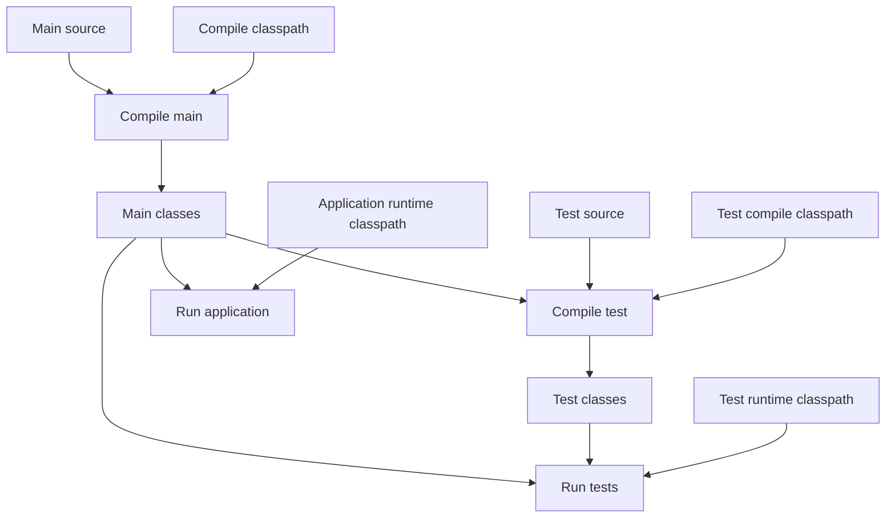

# Phân biệt classpath biên dịch, kiểm thử và thực thi

Một chương trình Java không chỉ cần mã nguồn để biên dịch. Ở từng giai đoạn, công cụ cần tìm được những lớp và thư viện phù hợp: compiler cần API mà mã nguồn tham chiếu; compiler của test cần thêm framework kiểm thử; JVM chạy ứng dụng cần các lớp mà chương trình sử dụng lúc thực thi; test runner cần cả mã ứng dụng, mã test và engine thực hiện test.

Tập hợp đường dẫn mà Java compiler hoặc JVM dùng để tìm lớp và tài nguyên được gọi là **classpath**. Trong một dự án dùng build tool, không có một classpath duy nhất cho mọi công việc. Ta thường cần phân biệt:

- **Compile classpath:** thư viện và lớp cần để biên dịch mã ứng dụng chính.
- **Test compile classpath:** lớp và thư viện cần để biên dịch mã kiểm thử.
- **Runtime classpath:** lớp và thư viện cần khi chạy ứng dụng.
- **Test runtime classpath:** lớp và thư viện cần khi test runner thực thi bài kiểm thử.

Những classpath này có phần giao nhau, nhưng không giống hệt nhau. Đưa một dependency vào sai classpath có thể khiến compiler không tìm thấy class, test không khởi chạy, ứng dụng thiếu thư viện khi chạy hoặc artifact đóng gói thừa thành phần không cần thiết.

## 1. Classpath là gì?

Classpath là danh sách các thư mục chứa file `.class`, các file JAR hoặc ZIP mà Java compiler và JVM tìm kiếm khi cần nạp một lớp hay tài nguyên. Mỗi phần tử thường được phân tách bằng ký tự theo hệ điều hành:

| Hệ điều hành | Ký tự phân tách classpath |
|---|---|
| Windows | Dấu chấm phẩy `;` |
| Linux/macOS | Dấu hai chấm `:` |

Ví dụ trên Windows:

```powershell
javac -cp "lib\jackson.jar;lib\logging.jar" -d out src\Main.java
```

Trên Linux/macOS:

```bash
javac -cp "lib/jackson.jar:lib/logging.jar" -d out src/Main.java
```

`-cp` là viết tắt của `-classpath`; có thể dùng `--class-path` trong các lệnh Java hiện đại. Classpath có thể chứa nhiều thư mục hoặc JAR. Khi compiler/JVM tìm một lớp, nó tra cứu trong những vị trí được cung cấp.

Classpath có thể được đặt bằng tham số dòng lệnh hoặc biến môi trường `CLASSPATH`. Với build tự động, nên truyền classpath tường minh qua build tool hoặc command line để biết chính xác một lệnh đang sử dụng thư viện nào. Biến `CLASSPATH` toàn cục dễ gây ảnh hưởng ngầm giữa các dự án và làm cho kết quả trên máy này khác máy khác.

### 1.1. Thư mục output cũng là một phần của classpath

Sau khi biên dịch, các file `.class` thường nằm trong thư mục output. Ví dụ:

```text
project/
├── src/
│   ├── main/java/
│   └── test/java/
├── build/
│   ├── classes/java/main/
│   └── classes/java/test/
└── lib/
```

Khi chạy ứng dụng, JVM cần tìm được thư mục chứa class chính, ví dụ `build/classes/java/main`, cùng các dependency runtime. Khi chạy test, test runner cần thêm `build/classes/java/test` và các thư viện test.

Với Maven, thư mục output mặc định thường là `target/classes` cho mã chính và `target/test-classes` cho mã kiểm thử. Với Gradle Java Plugin, output mặc định thường là `build/classes/java/main` và `build/classes/java/test`. Dự án có thể tùy chỉnh các đường dẫn này.

### 1.2. Classpath không phải danh sách dependency khai báo

Dependency declaration mô tả thư viện mà project yêu cầu. Classpath là tập hợp thực tế mà một tác vụ cụ thể sử dụng sau khi build tool giải quyết dependency, áp dụng scope/configuration, thêm output của source set và xử lý dependency bắc cầu.

Ví dụ, POM có thể khai báo JUnit ở scope `test`. JUnit vẫn là dependency của project, nhưng không nằm trong compile classpath của mã ứng dụng chính và không cần có trong runtime classpath production. Nó xuất hiện trong classpath phục vụ biên dịch và chạy test.

Do đó, khi chẩn đoán lỗi, hãy hỏi “classpath của tác vụ nào đang thiếu lớp này?” thay vì chỉ hỏi “project đã khai báo thư viện chưa?”.

## 2. Bốn classpath cần phân biệt

### 2.1. Compile classpath của mã ứng dụng

Compile classpath chứa những lớp và thư viện mà compiler cần khi biên dịch `src/main/java` hoặc source set chính tương ứng.

Ví dụ, mã nguồn dùng Jackson:

```java
import com.fasterxml.jackson.databind.ObjectMapper;

public class JsonFormatter {
    private final ObjectMapper mapper = new ObjectMapper();

    public String format(Object value) throws Exception {
        return mapper.writeValueAsString(value);
    }
}
```

Compiler cần tìm được `ObjectMapper` và những kiểu mà API này tham chiếu trong compile classpath. Nếu dependency Jackson chỉ được khai báo ở runtime, compiler có thể báo:

```text
package com.fasterxml.jackson.databind does not exist
cannot find symbol: class ObjectMapper
```

Compile classpath thường gồm:

- output hoặc source dependency cần thiết của project/module khác;
- dependency được dùng trong mã ứng dụng chính;
- dependency được môi trường cung cấp nhưng vẫn cần để biên dịch, như một số API servlet;
- các thư viện compile bắc cầu được resolve theo quy tắc của build tool.

Compile classpath không nhất thiết chứa mọi thư viện cần lúc chạy. Một driver JDBC có thể chỉ cần ở runtime nếu mã nguồn chỉ gọi API `java.sql` có sẵn trong JDK.

### 2.2. Test compile classpath

Test compile classpath dùng để biên dịch mã kiểm thử, thường nằm trong `src/test/java`. Nó cần các lớp của ứng dụng đã biên dịch và các thư viện mà test source trực tiếp tham chiếu.

Ví dụ:

```java
import org.junit.jupiter.api.Test;

import static org.junit.jupiter.api.Assertions.assertEquals;

class PriceCalculatorTest {
    @Test
    void appliesDiscount() {
        PriceCalculator calculator = new PriceCalculator();
        assertEquals(90, calculator.finalPrice(100, 10));
    }
}
```

Để biên dịch lớp này, compiler cần:

- output của mã ứng dụng, để tìm `PriceCalculator`;
- JUnit API, để tìm `@Test` và `Assertions`;
- các dependency khác mà test source sử dụng, như Mockito hoặc AssertJ.

Test compile classpath thường kế thừa hoặc bao gồm phần cần thiết từ compile classpath chính. Vì thế test có thể dùng API ứng dụng và dependency mà ứng dụng sử dụng, đồng thời bổ sung các thư viện chỉ dành cho test.

### 2.3. Runtime classpath của ứng dụng

Runtime classpath chứa output đã biên dịch của ứng dụng và các thư viện mà JVM cần khi chạy. Nó có thể chứa dependency không có trong compile classpath của mã chính.

Ví dụ, ứng dụng dùng JDBC API chuẩn:

```java
import java.sql.Connection;
import java.sql.DriverManager;

public class DatabaseClient {
    public Connection connect(String url, String user, String password)
            throws Exception {
        return DriverManager.getConnection(url, user, password);
    }
}
```

Mã nguồn không tham chiếu lớp riêng của PostgreSQL driver. Compiler có thể biên dịch chỉ với JDK. Nhưng khi chạy, ứng dụng cần driver PostgreSQL trong runtime classpath để tạo kết nối.

Runtime classpath thường gồm:

- output của mã ứng dụng chính;
- dependency runtime;
- dependency compile được giữ lại ở runtime;
- các thư viện mà môi trường triển khai yêu cầu ứng dụng tự cung cấp.

Không nhất thiết đưa thư viện do application server cung cấp vào artifact của ứng dụng. Cần biết môi trường chạy có trách nhiệm cung cấp những lớp nào.

### 2.4. Test runtime classpath

Test runtime classpath là tập lớp và thư viện mà test runner/JVM cần để thực thi test. Nó thường bao gồm:

- output của mã ứng dụng chính;
- output của mã test;
- dependency runtime của ứng dụng;
- thư viện test API, engine, launcher và các tiện ích test runtime;
- test fixture hoặc resource phục vụ kiểm thử.

Một test có thể biên dịch thành công nhưng không chạy được nếu thiếu JUnit engine hoặc launcher. Ngược lại, engine có thể có mặt trong test runtime nhưng test source vẫn không biên dịch nếu thiếu JUnit API trong test compile classpath.

### 2.5. Bảng so sánh tổng quát

| Thành phần | Compile chính | Test compile | Runtime ứng dụng | Test runtime |
|---|---:|---:|---:|---:|
| Class đã biên dịch của ứng dụng | Không phải dependency đầu vào ban đầu; tạo ra output | Có | Có | Có |
| Dependency dùng trong mã chính | Có nếu cần cho compile | Thường có | Có nếu cần khi chạy | Thường có |
| API do container cung cấp | Có nếu source tham chiếu | Thường có | Container cung cấp | Có thể cần tùy cách test |
| JDBC driver chỉ được nạp lúc chạy | Không | Không nhất thiết | Có | Có nếu test kết nối DB |
| JUnit API | Không | Có | Không | Có |
| JUnit engine/launcher | Không | Không nhất thiết | Không | Có |
| Mockito/AssertJ dùng trong test | Không | Có | Không | Có |

Các ô “thường” và “có thể” phụ thuộc cách project khai báo dependency, plugin test, source set và môi trường thực thi. Bảng mô tả vai trò, không thay thế báo cáo classpath thực tế.

## 3. Hình dung luồng compile và test



Compile test cần output mã chính vì test gọi lớp của ứng dụng. Run tests cần cả output mã chính và output test, cùng các dependency test runtime. Run application chỉ cần output ứng dụng và dependency runtime của ứng dụng; JUnit không cần xuất hiện trong runtime production.

## 4. Tự tạo classpath bằng JDK để hiểu cơ chế

Build tool thường tự tạo classpath, nhưng hiểu cách `javac` và `java` sử dụng classpath giúp đọc log và chẩn đoán chính xác hơn.

Giả sử project có:

```text
demo/
├── lib/
│   └── json-library.jar
├── src/
│   ├── main/java/com/example/App.java
│   └── test/java/com/example/AppTest.java
└── out/
```

### 4.1. Biên dịch mã chính

Trên Linux/macOS:

```bash
mkdir -p out/main
javac --class-path "lib/json-library.jar" \
      -d out/main \
      src/main/java/com/example/App.java
```

Trên Windows PowerShell:

```powershell
New-Item -ItemType Directory -Force out/main | Out-Null
javac --class-path "lib\json-library.jar" `
      -d out/main `
      src/main/java/com/example/App.java
```

`--class-path` cung cấp JAR mà compiler cần. `-d` chỉ định thư mục chứa file `.class` sau khi biên dịch.

### 4.2. Chạy ứng dụng

Trên Linux/macOS:

```bash
java --class-path "out/main:lib/json-library.jar" com.example.App
```

Trên Windows:

```powershell
java --class-path "out/main;lib\json-library.jar" com.example.App
```

Classpath khi chạy cần có cả output `out/main` và dependency mà ứng dụng sử dụng. Việc JAR đã có trong compile classpath không tự đảm bảo nó có trong lệnh `java` nếu ta tự quản lý lệnh chạy.

### 4.3. Biên dịch test

Giả sử JUnit API và các dependency cần thiết được lưu trong `lib`:

```bash
mkdir -p out/test
javac --class-path "out/main:lib/json-library.jar:lib/junit-api.jar" \
      -d out/test \
      src/test/java/com/example/AppTest.java
```

Trên Windows, dùng dấu `;` để phân tách các phần tử classpath. Test compile cần output của mã chính, dependency chính và JUnit API.

### 4.4. Chạy test

Để chạy test, classpath còn cần test output và các thư viện runtime của test, ví dụ JUnit engine và launcher:

```bash
java --class-path "out/main:out/test:lib/json-library.jar:lib/junit-api.jar:lib/junit-engine.jar:lib/junit-platform-launcher.jar" \
     org.junit.platform.console.ConsoleLauncher execute \
     --scan-class-path
```

Đây là ví dụ minh họa cơ chế; cách gọi thực tế phụ thuộc phiên bản JUnit Platform và cách project cung cấp ConsoleLauncher. Trong dự án thật, Maven Surefire hoặc Gradle Test thường tạo test runtime classpath và gọi test engine giúp ta.

### 4.5. Vì sao không nên tự duy trì danh sách JAR bằng tay?

Khi một dependency có dependency bắc cầu, ta phải đưa cả những JAR cần thiết vào classpath. Nếu cập nhật một thư viện, danh sách JAR có thể thay đổi. Build tool giải quyết việc tải, chọn version, xử lý dependency bắc cầu và tạo classpath cho từng task.

Các lệnh JDK ở trên nhằm giúp hiểu vai trò classpath. Với dự án thực tế, hãy để Maven/Gradle quản lý classpath và dùng report/log của công cụ để quan sát nó.

## 5. Maven tạo classpath theo dependency scope

Maven không yêu cầu người dùng tự viết một danh sách classpath cho từng lệnh. Nó resolve dependency trong POM rồi tạo classpath phù hợp với từng phase và plugin.

### 5.1. Scope ảnh hưởng classpath nào?

Với dependency trực tiếp, có thể ghi nhớ bảng tổng quát:

| Maven scope | Compile mã chính | Runtime ứng dụng | Test classpath |
|---|---:|---:|---:|
| `compile` | Có | Có | Có |
| `provided` | Có | Không | Có |
| `runtime` | Không | Có | Có |
| `test` | Không | Không | Có |
| `system` | Có | Không theo runtime thông thường | Có |

Maven còn có `import` trong `dependencyManagement` để nhập BOM; nó không phải scope thông thường đưa một thư viện vào classpath. Dependency bắc cầu có quy tắc scope propagation và mediation riêng, nên bảng này là điểm bắt đầu để hiểu classpath chứ không mô tả mọi trường hợp lồng nhau.

### 5.2. Ví dụ POM

```xml
<dependencies>
    <!-- Mã ứng dụng dùng Jackson ở compile và runtime. -->
    <dependency>
        <groupId>com.fasterxml.jackson.core</groupId>
        <artifactId>jackson-databind</artifactId>
        <version>2.17.2</version>
    </dependency>

    <!-- Container cung cấp Servlet API khi triển khai. -->
    <dependency>
        <groupId>jakarta.servlet</groupId>
        <artifactId>jakarta.servlet-api</artifactId>
        <version>6.0.0</version>
        <scope>provided</scope>
    </dependency>

    <!-- Driver được nạp khi ứng dụng kết nối PostgreSQL. -->
    <dependency>
        <groupId>org.postgresql</groupId>
        <artifactId>postgresql</artifactId>
        <version>42.7.3</version>
        <scope>runtime</scope>
    </dependency>

    <!-- JUnit chỉ dùng cho test source và test execution. -->
    <dependency>
        <groupId>org.junit.jupiter</groupId>
        <artifactId>junit-jupiter</artifactId>
        <version>5.10.2</version>
        <scope>test</scope>
    </dependency>
</dependencies>
```

Với cấu hình này:

- compile mã chính nhìn thấy Jackson và Servlet API;
- runtime ứng dụng nhận Jackson và PostgreSQL driver, còn Servlet API do container cung cấp;
- test classpath nhận dependency test cùng các dependency cần thiết của project;
- JUnit không được đưa vào runtime classpath production chỉ vì nó cần cho test.

### 5.3. `mvn compile`

```bash
./mvnw compile
```

Maven chạy các phase trước và tới `compile` trong default lifecycle. Maven Compiler Plugin sử dụng compile classpath của project để biên dịch mã chính. Test source chưa được biên dịch ở phase này và test runner chưa chạy.

Nếu thiếu thư viện dùng trong mã chính, lỗi xuất hiện ở compile. Nếu thiếu một dependency chỉ cần lúc chạy, compile có thể vẫn thành công; lỗi chỉ xuất hiện khi ứng dụng được khởi chạy.

### 5.4. `mvn test`

```bash
./mvnw test
```

Maven đi qua các phase cần thiết để compile mã chính, xử lý test resources, biên dịch test source và chạy unit test theo plugin test được cấu hình. Test compiler cần test compile classpath; Maven Surefire cần test runtime classpath cùng test framework/engine.

Nếu test source không biên dịch được vì thiếu `org.junit.jupiter.api.Test`, hãy xem dependency `test` và cấu hình compiler/test plugin. Nếu test compile được nhưng runner báo không tìm thấy engine hoặc không phát hiện test, hãy xem test runtime classpath và phiên bản Surefire/JUnit Platform.

### 5.5. `mvn package` và runtime classpath

```bash
./mvnw package
```

Maven chạy các phase trước `package`, thông thường bao gồm compile và test. Artifact được tạo theo packaging và plugin của project. Với JAR thường, dependency không nhất thiết được nhúng vào trong JAR; ứng dụng chạy cần runtime classpath được thiết lập riêng hoặc một cách đóng gói như executable/fat JAR.

Với WAR, Maven WAR Plugin và quy tắc packaging quyết định dependency nào được đặt trong `WEB-INF/lib`, dependency `provided` nào không được đóng gói vì container sẽ cung cấp. Hãy kiểm tra nội dung WAR thay vì giả định mọi dependency trong POM đều được đưa vào archive.

### 5.6. `maven-surefire-plugin` và `maven-failsafe-plugin`

Surefire thường chạy unit test ở phase `test`. Failsafe thường chạy integration test qua các phase `integration-test` và `verify`. Cả hai cần classpath phù hợp cho test nhưng có thể có cấu hình include/exclude, system properties và môi trường chạy khác nhau.

Không nên suy ra integration test đã chạy chỉ vì `mvn test` thành công. Hãy xem plugin được khai báo, phase binding và lệnh CI thực tế. Nếu Failsafe được cấu hình, `mvn verify` thường là mục tiêu phù hợp để chạy đến bước kiểm tra kết quả integration test.

### 5.7. Xem dependency và classpath Maven

Xem cây dependency:

```bash
./mvnw dependency:tree
```

Lọc theo scope:

```bash
./mvnw dependency:tree -Dscope=compile
./mvnw dependency:tree -Dscope=runtime
./mvnw dependency:tree -Dscope=test
```

Có thể dùng Maven Dependency Plugin để tạo chuỗi classpath cho một scope cụ thể. Ví dụ:

```bash
./mvnw dependency:build-classpath -Dmdep.includeScope=runtime
```

Hoặc yêu cầu scope test:

```bash
./mvnw dependency:build-classpath -Dmdep.includeScope=test
```

`dependency:build-classpath` hiển thị dependency classpath được plugin tạo theo tham số, không phải lúc nào cũng là toàn bộ command line thực tế của Surefire hoặc compiler. Plugin, output directory và classpath riêng của test runner có thể bổ sung thêm thành phần. Khi cần biết tác vụ thực sự dùng gì, hãy kết hợp dependency report với log của compiler/test plugin.

## 6. Gradle tạo classpath theo source set và configuration

Với Gradle Java Plugin, các source set chính thường là `main` và `test`. Mỗi source set có compile classpath, runtime classpath và thư mục output riêng.

### 6.1. Các configuration chính

| Configuration | Vai trò |
|---|---|
| `compileClasspath` | Dependency để biên dịch mã nguồn chính |
| `runtimeClasspath` | Dependency và output để chạy ứng dụng chính |
| `testCompileClasspath` | Output mã chính và dependency để biên dịch test source |
| `testRuntimeClasspath` | Output mã chính, output test và dependency để chạy test |
| `annotationProcessor` | Processor chạy khi biên dịch mã chính |
| `testAnnotationProcessor` | Processor chạy khi biên dịch test source |

Các configuration được tạo và nối bởi Java Plugin. Plugin bổ sung hoặc source set tùy chỉnh có thể tạo configuration khác.

### 6.2. Ví dụ `build.gradle.kts`

```kotlin
plugins {
    java
}

repositories {
    mavenCentral()
}

dependencies {
    // Mã chính cần khi compile và ứng dụng cần khi chạy.
    implementation("com.fasterxml.jackson.core:jackson-databind:2.17.2")

    // API compile được cung cấp bởi môi trường triển khai.
    compileOnly("jakarta.servlet:jakarta.servlet-api:6.0.0")

    // Chỉ cần khi ứng dụng thực thi và kết nối PostgreSQL.
    runtimeOnly("org.postgresql:postgresql:42.7.3")

    // Chỉ dành cho test compile/runtime.
    testImplementation("org.junit.jupiter:junit-jupiter:5.10.2")
}

tasks.test {
    useJUnitPlatform()
}
```

`implementation` xuất hiện trong compile và runtime classpath chính. `compileOnly` không được thêm vào runtime classpath chính. `runtimeOnly` không tham gia compile classpath nhưng có mặt khi chạy. `testImplementation` phục vụ cả compile và runtime của test.

### 6.3. `compileJava`

```bash
./gradlew compileJava
```

Task `compileJava` sử dụng `compileClasspath` của source set main. Nó không chạy test. Nếu mã chính import một lớp từ dependency chỉ khai báo ở `runtimeOnly`, compile sẽ thất bại.

### 6.4. `compileTestJava`

```bash
./gradlew compileTestJava
```

Task này biên dịch test source bằng `testCompileClasspath`. Classpath bao gồm output của main và các dependency cần cho test compile. Nó chưa thực thi test, nên test engine không nhất thiết cần xuất hiện ở giai đoạn này.

### 6.5. `test`

```bash
./gradlew test
```

Task `test` sử dụng `testRuntimeClasspath` để chạy test. Gradle sẽ thực hiện các task cần thiết như compile mã chính, compile test và xử lý resources theo task graph. Test framework cần có API để biên dịch và engine/launcher phù hợp khi thực thi.

Nếu project dùng test suite tùy chỉnh hoặc có task `integrationTest`, gọi `test` không có nghĩa mọi test suite đều chạy. Hãy xem task graph và cấu hình từng `Test` task.

### 6.6. Xem dependency classpath Gradle

```bash
./gradlew dependencies --configuration compileClasspath
./gradlew dependencies --configuration runtimeClasspath
./gradlew dependencies --configuration testCompileClasspath
./gradlew dependencies --configuration testRuntimeClasspath
```

Các lệnh này giúp xem dependency được resolve cho từng configuration. Để biết vì sao một version được chọn:

```bash
./gradlew dependencyInsight \
    --dependency jackson-databind \
    --configuration runtimeClasspath
```

Để in trực tiếp file classpath cho mục đích chẩn đoán, có thể đăng ký task tạm trong `build.gradle.kts`:

```kotlin
tasks.register("printMainRuntimeClasspath") {
    doLast {
        sourceSets.main.get().runtimeClasspath.files
            .forEach { println(it.absolutePath) }
    }
}
```

Với test runtime:

```kotlin
tasks.register("printTestRuntimeClasspath") {
    doLast {
        sourceSets.test.get().runtimeClasspath.files
            .forEach { println(it.absolutePath) }
    }
}
```

Các task này chỉ phục vụ quan sát. Trong build logic dùng lâu dài, nên ưu tiên provider/configuration API và không đọc `Project` hoặc resolve dependency quá sớm trong configuration phase. Không cần giữ task debug trong project nếu nhóm đã có công cụ quan sát phù hợp.

## 7. Maven và Gradle: cùng mục đích, cách biểu diễn khác nhau

| Mục đích | Maven | Gradle Java Plugin |
|---|---|---|
| Dependency compile và runtime của mã chính | `compile` (mặc định) | `implementation` |
| Compile-only, runtime do môi trường cung cấp | `provided` | `compileOnly` |
| Runtime-only | `runtime` | `runtimeOnly` |
| Dependency chỉ dành cho test | `test` | `testImplementation` |
| Compile test | Maven tạo test classpath từ các scope phù hợp | `testCompileClasspath` |
| Runtime test | Maven test classpath theo scope và Surefire/Failsafe | `testRuntimeClasspath` |
| Annotation processor | Compiler Plugin processor path | `annotationProcessor` / `testAnnotationProcessor` |

Không nên xem các cặp trong bảng là tương đương hoàn toàn. Ví dụ `provided` và `compileOnly` đều loại dependency khỏi runtime classpath thông thường, nhưng cách truyền dependency cho project tiêu thụ, cách plugin đóng gói và test classpath có thể khác.

Với Gradle `java-library`, còn có `api` để công khai dependency trong compile API của consumer. Maven có quy tắc truyền dependency theo scope và POM metadata. Khi chuyển từ công cụ này sang công cụ khác, cần xác định public API, runtime ownership và classpath thực tế.

## 8. Classpath của test: API, engine và launcher

Một test framework có thể gồm nhiều thành phần:

- **API:** annotation và assertion mà test source gọi khi biên dịch;
- **Engine:** thành phần tìm và thực thi test theo framework;
- **Launcher hoặc runner:** thành phần điều phối test execution và giao tiếp với build tool.

Với JUnit 5, `junit-jupiter-api` cung cấp annotation/assertion; `junit-jupiter-engine` thực thi test Jupiter; JUnit Platform cung cấp cơ chế launcher. Dependency tổng hợp `junit-jupiter` thường kéo các thành phần cần thiết qua metadata.

Một ví dụ Gradle khai báo tách:

```kotlin
dependencies {
    testImplementation("org.junit.jupiter:junit-jupiter-api:5.10.2")
    testRuntimeOnly("org.junit.jupiter:junit-jupiter-engine:5.10.2")
}

tasks.test {
    useJUnitPlatform()
}
```

Nếu test source compile được nhưng không có engine tương ứng trong test runtime, test runner có thể không phát hiện hoặc không thực thi test. Nếu thiếu API, lỗi xuất hiện sớm ở `compileTestJava`.

Trong Maven, dependency `junit-jupiter` thường khai báo với scope `test`, và Surefire cần phiên bản hỗ trợ JUnit Platform. Nếu dùng Failsafe, cần kiểm tra cấu hình riêng cho integration test.

### 8.1. Test fixture và resource

Test runtime classpath không chỉ gồm JAR. Nó còn cần:

- `target/test-classes` hoặc `build/classes/java/test`;
- `target/classes` hoặc `build/classes/java/main`;
- test resources đã được xử lý;
- fixture, file mẫu và dữ liệu test;
- runtime dependency của ứng dụng nếu test khởi chạy thành phần đó.

Nếu test báo không tìm thấy `application-test.yml` hoặc file JSON mẫu, vấn đề có thể nằm ở test resources chứ không phải dependency JAR. Hãy kiểm tra resource directory và output của task `processTestResources` hoặc Maven resources plugin.

## 9. Runtime classpath và cách đóng gói ứng dụng

Một lỗi phổ biến là nghĩ rằng compile classpath đã có đủ thư viện thì JAR cuối cùng tự chứa tất cả chúng. Điều này không đúng với mọi loại artifact.

### 9.1. JAR thông thường

JAR được tạo bởi Java/Maven/Gradle thường chứa class và resource của project. Nó không nhất thiết nhúng toàn bộ dependency bên ngoài. Khi chạy:

```bash
java -jar app.jar
```

JVM đọc manifest của JAR để tìm main class. Nếu dependency ngoài không được nhúng hoặc không được khai báo trong manifest `Class-Path`, ứng dụng có thể thất bại với `ClassNotFoundException` hoặc `NoClassDefFoundError`.

Một cách chạy JAR thông thường là truyền classpath tường minh:

```bash
java -cp "app.jar:lib/*" com.example.Main
```

Trên Windows, dùng `;` làm ký tự phân tách:

```powershell
java -cp "app.jar;lib\*" com.example.Main
```

### 9.2. Executable/fat JAR

Một số plugin đóng gói dependency vào một archive chạy độc lập (fat JAR hoặc uber JAR), hoặc tổ chức dependency ở các thư mục riêng và tạo launcher. Khi đó runtime classpath được plugin quản lý theo cấu trúc đóng gói.

Ví dụ, Spring Boot plugin tạo executable archive có cấu trúc riêng cho application classes và dependency JAR. Không nên giả định một JAR thông thường có cùng cách đóng gói.

### 9.3. WAR và thư viện do container cung cấp

Với WAR, dependency runtime thường được đóng gói vào `WEB-INF/lib`. Dependency `provided` như Servlet API thường không được đóng gói vì servlet container cung cấp nó. Nếu đóng gói nhầm API container, có thể xảy ra xung đột classloader hoặc hành vi không tương thích.

### 9.4. Kiểm tra nội dung artifact

Có thể liệt kê nội dung JAR:

```bash
jar --list --file build/libs/app.jar
```

Với Maven, JAR thường ở `target/`; với Gradle, thường ở `build/libs/`. Để xem manifest:

```bash
jar --extract --file app.jar META-INF/MANIFEST.MF
```

Hoặc mở archive bằng công cụ phù hợp. Kiểm tra artifact giúp xác định dependency có được nhúng hay không, resource có được đưa vào và main class/manifest có đúng không.

## 10. Classpath và Java Module Path (JPMS)

Classpath có liên hệ với Java Platform Module System (JPMS), nhưng hai khái niệm không đồng nghĩa.

### 10.1. Classpath

Khi JAR hoặc thư mục được đặt trên classpath, các lớp thường thuộc **unnamed module** của classloader tương ứng. Cơ chế module không yêu cầu mỗi thư viện trên classpath phải có `module-info.java`. Đây là mô hình truyền thống được nhiều ứng dụng Java sử dụng.

Ví dụ:

```bash
java --class-path "app.jar:lib/*" com.example.Main
```

### 10.2. Module path

Module path chứa các module có tên, thường được mô tả bằng `module-info.java` hoặc được nhận diện theo quy tắc automatic module cho một số JAR không có descriptor.

Ví dụ compile module:

```bash
javac --module-path lib \
      -d out \
      src/module-info.java \
      src/com.example.app/com/example/Main.java
```

Chạy module:

```bash
java --module-path "out:lib" \
     --module com.example.app/com.example.Main
```

Module path tham gia giải quyết module graph, quan hệ `requires`, `exports`, `opens` và tính đóng gói. Classpath truyền thống không thực hiện đầy đủ các quy tắc module này.

### 10.3. Không nhầm `--class-path` với `--module-path`

| Tùy chọn | Mục đích | Cách tổ chức |
|---|---|---|
| `--class-path` hoặc `-cp` | Tìm lớp theo classpath truyền thống | Thư mục/JAR; lớp thường thuộc unnamed module |
| `--module-path` hoặc `-p` | Tìm module có tên và module tự động | Module được phân giải thành module graph |
| `--module` hoặc `-m` | Chọn module và main class để chạy | Dạng `module[/mainclass]` |
| `--add-modules` | Bổ sung module vào module graph khi cần | Điều chỉnh tập module được resolve |
| `--add-reads`, `--add-exports`, `--add-opens` | Điều chỉnh quan hệ truy cập module trong tình huống đặc biệt | Dùng có chủ đích, không phải cách thay thế thiết kế module |

Một thư viện không có `module-info.class` có thể được coi là automatic module khi đặt trên module path, nhưng tên module tự động có thể được suy ra từ tên JAR hoặc metadata. Không nên dựa vào tên suy ra mà không kiểm tra. Một số dependency cũ vẫn được đặt trên classpath trong ứng dụng modular thông qua unnamed module.

### 10.4. Build tool và JPMS

Maven Compiler Plugin và Gradle Java Plugin có thể hỗ trợ compile module theo module path khi project có cấu trúc module phù hợp. Cấu hình chính xác phụ thuộc phiên bản JDK, plugin, source set và cách tổ chức multi-project build.

Khi lỗi nói rằng một package không được export, module không đọc được module khác hoặc module không được resolve, vấn đề có thể nằm ở module path và `module-info.java`, không chỉ là thiếu JAR trên classpath.

## 11. Chẩn đoán lỗi theo giai đoạn

Xác định lỗi xảy ra ở compile, test compile, runtime ứng dụng hay test runtime giúp thu hẹp classpath cần kiểm tra.

| Triệu chứng | Giai đoạn thường gặp | Nguyên nhân có thể | Nơi kiểm tra |
|---|---|---|---|
| `package ... does not exist` | Compile/test compile | JAR thiếu trên compile classpath tương ứng | Dependency scope/configuration và compile log |
| `cannot find symbol` | Compile/test compile | Thiếu class, sai version hoặc source set chưa được thêm | Compile classpath, module path và source set |
| `ClassNotFoundException` | Runtime | Class không được tìm thấy qua classloader/runtime classpath | Lệnh chạy, manifest, container và runtime dependencies |
| `NoClassDefFoundError` | Runtime | Thiếu class khi nạp hoặc lỗi khởi tạo lớp trước đó | Stack trace, runtime JAR và class initialization |
| `NoSuchMethodError` | Runtime | Compile và runtime dùng phiên bản thư viện không tương thích | Dependency mediation, runtime classpath và version conflict |
| Test compile thành công nhưng không phát hiện test | Test runtime | Thiếu engine, launcher hoặc cấu hình test runner | Test runtime classpath và plugin test |
| Test chạy trên IDE nhưng fail ở build | Test runtime/build | IDE dùng classpath hoặc test runner khác | Gradle/Maven task, test report và IDE runner config |
| `module ... does not read` hoặc package không export | Module resolution/access | Quan hệ JPMS không phù hợp | `module-info.java`, module path và module options |

### 11.1. `ClassNotFoundException` và `NoClassDefFoundError`

`ClassNotFoundException` thường xuất hiện khi chương trình gọi cơ chế nạp lớp theo tên, ví dụ `Class.forName`, nhưng classloader không tìm được lớp đó. Lỗi thường liên quan runtime classpath, tên lớp hoặc classloader được dùng.

`NoClassDefFoundError` là lỗi linkage khi JVM cần một định nghĩa lớp mà không thể cung cấp. Nguyên nhân thường là JAR thiếu lúc chạy, nhưng cũng có thể xảy ra nếu lớp đã thất bại khi khởi tạo trước đó. Hãy đọc toàn bộ stack trace và `Caused by`, không chỉ dòng đầu tiên.

### 11.2. `NoSuchMethodError`

Lỗi này thường chỉ ra rằng mã đã được biên dịch dựa trên một phiên bản thư viện có method, nhưng runtime nạp một phiên bản khác không có method đó. Đây là dấu hiệu điển hình của dependency version conflict hoặc classpath khác nhau giữa compile và runtime.

Hãy xác định JAR thực tế chứa lớp, xem version được resolve ở compile và runtime, rồi điều chỉnh dependency constraints/BOM hoặc loại bỏ phiên bản xung đột.

### 11.3. Class trùng lặp

Nếu hai JAR cùng chứa một class có tên đầy đủ giống nhau, classloader có thể nạp bản đầu tiên theo thứ tự tìm kiếm. Điều này có thể dẫn đến hành vi khác nhau tùy classpath. Dùng dependency tree và kiểm tra nội dung JAR để xác định nguồn lớp.

Không nên chỉ thêm một JAR khác vào classpath để “thử cho chạy”. Cần loại bỏ dependency trùng hoặc quản lý version sao cho runtime chỉ nạp phiên bản mong muốn.

## 12. Cách tìm classpath thực tế trong Maven và Gradle

### 12.1. Maven

Các lệnh hữu ích:

```bash
# Cây dependency
./mvnw dependency:tree

# Dependency ở phạm vi runtime
./mvnw dependency:tree -Dscope=runtime

# Dependency ở phạm vi test
./mvnw dependency:tree -Dscope=test

# POM sau khi áp dụng parent, properties và dependency management
./mvnw help:effective-pom

# Tạo classpath dependency cho scope runtime
./mvnw dependency:build-classpath -Dmdep.includeScope=runtime

# Tạo classpath dependency cho scope test
./mvnw dependency:build-classpath -Dmdep.includeScope=test
```

Nếu compiler plugin hoặc Surefire có cấu hình đặc biệt, xem log của plugin và effective POM. Dependency report không nhất thiết hiển thị mọi output directory, system property hoặc classloader bổ sung của test runner.

### 12.2. Gradle

```bash
# Compile classpath của mã chính
./gradlew dependencies --configuration compileClasspath

# Runtime classpath của mã chính
./gradlew dependencies --configuration runtimeClasspath

# Compile classpath của test
./gradlew dependencies --configuration testCompileClasspath

# Runtime classpath của test
./gradlew dependencies --configuration testRuntimeClasspath
```

Xem lý do dependency version được chọn:

```bash
./gradlew dependencyInsight \
    --dependency jackson-databind \
    --configuration runtimeClasspath
```

Xem task graph của test:

```bash
./gradlew test --dry-run
```

Task graph cho biết công việc dự kiến chạy, còn dependency report cho biết dependency trong configuration. Hai thông tin bổ sung cho nhau.

## 13. Classpath trong IDE và trên CI

IDE thường tự đồng bộ Maven/Gradle project rồi tạo module classpath để hỗ trợ autocomplete, compile và chạy test. Tuy nhiên, cấu hình IDE có thể khác build command nếu:

- IDE chưa refresh dependency sau khi POM/build script thay đổi;
- run configuration tự thêm JAR hoặc thư mục ngoài build;
- IDE dùng test runner riêng;
- module SDK hoặc language level khác toolchain của build;
- một file được đánh dấu source/resource root thủ công trong IDE nhưng chưa được khai báo trong build.

Nếu chạy test được trong IDE nhưng thất bại trên CI, hãy thử cùng wrapper và task mà CI gọi từ terminal. So sánh classpath/configuration thay vì giả định IDE và build tool đang dùng một cấu hình.

CI thường chạy trong workspace sạch, do đó không có JAR được thêm thủ công vào IDE hoặc file cũ trên máy developer. Một build đáng tin cậy phải mô tả dependency và source/resource roots trong cấu hình được quản lý của project.

## 14. Những lỗi cấu hình classpath thường gặp

### 14.1. Đưa JUnit vào compile classpath chính

Khai báo JUnit ở Maven scope `compile` hoặc Gradle `implementation` khiến thư viện kiểm thử có thể xuất hiện trong dependency graph của ứng dụng. Điều này làm runtime artifact hoặc consumer nhận dependency không cần thiết.

**Cách xử lý:** dùng Maven `test` hoặc Gradle `testImplementation` cho thư viện test.

### 14.2. Đặt driver runtime vào compile-only

Nếu ứng dụng cần JDBC driver khi chạy nhưng dependency bị khai báo là `compileOnly` hoặc Maven `provided`, JAR có thể không có trong runtime classpath.

**Cách xử lý:** dùng Maven `runtime` hoặc Gradle `runtimeOnly` nếu mã nguồn không tham chiếu lớp driver; dùng compile+runtime nếu mã nguồn tham chiếu trực tiếp API của driver.

### 14.3. Chỉ thêm JAR vào compile classpath

Compiler thành công nhưng khi chạy ứng dụng, JVM không tìm thấy lớp thư viện.

**Cách xử lý:** kiểm tra runtime classpath hoặc packaging. Đảm bảo dependency cần lúc chạy được đưa vào đúng môi trường hoặc artifact.

### 14.4. Thiếu output của main khi compile test

Test source gọi lớp ứng dụng nhưng test compile classpath không có output mã chính. Điều này thường xảy ra khi tự viết lệnh `javac` hoặc cấu hình source set sai.

**Cách xử lý:** thêm `target/classes` hoặc `build/classes/java/main` vào classpath test, hoặc để build tool Java Plugin quản lý source set mặc định.

### 14.5. Thiếu test engine

Test source compile được nhưng runner không thực thi test hoặc báo không tìm thấy engine.

**Cách xử lý:** kiểm tra test runtime classpath, dependency engine/launcher và phiên bản Maven Surefire/Failsafe hoặc Gradle test configuration.

### 14.6. Dùng classpath của IDE làm cấu hình chính

Ứng dụng chạy được trên IDE nhưng CI hoặc production thiếu thư viện do IDE đã thêm JAR thủ công.

**Cách xử lý:** khai báo dependency trong POM/build script và chạy bằng wrapper trong môi trường sạch.

### 14.7. Nhầm classpath với module path

Đặt module lên classpath có thể làm các quy tắc `requires`, `exports` và encapsulation của JPMS không được áp dụng như mong đợi.

**Cách xử lý:** xác định project đang chạy theo classpath truyền thống hay module path, kiểm tra `module-info.java` và tham số `--module-path`/`--class-path`.

## 15. Quy trình chẩn đoán có hệ thống

Khi gặp lỗi không tìm thấy lớp hoặc method, thực hiện theo thứ tự:

1. **Xác định giai đoạn:** lỗi xảy ra khi compile main, compile test, chạy test hay chạy ứng dụng?
2. **Xác định class cần tìm:** lấy tên đầy đủ của class/package từ thông báo lỗi.
3. **Xác định JAR sở hữu class:** tìm artifact nào chứa lớp đó và version nào có lớp/API mong đợi.
4. **Xem classpath đúng giai đoạn:** compileClasspath, testCompileClasspath, runtimeClasspath hoặc testRuntimeClasspath.
5. **Kiểm tra scope/configuration:** dependency có được đưa vào đúng classpath không?
6. **Kiểm tra dependency bắc cầu:** version nào được chọn, có xung đột hoặc exclusion không?
7. **Kiểm tra packaging/môi trường:** JAR có được đóng gói hoặc runtime container có cung cấp thư viện không?
8. **Kiểm tra JPMS nếu có:** module có được resolve, đọc và export package cần thiết không?
9. **Chạy lại mục tiêu phù hợp:** compile, test hoặc run trong cùng môi trường mà lỗi xuất hiện.

Không nên thay đổi nhiều scope cùng lúc. Hãy dùng dependency report để xác định classpath hiện tại, sau đó điều chỉnh cấu hình tối thiểu và quan sát kết quả.

## 16. Bài tập thực hành

### Bài 1 — Quan sát bốn classpath Gradle

Tạo một dự án Gradle Java, khai báo:

- một dependency `implementation`;
- một dependency `runtimeOnly`;
- một dependency `testImplementation`;
- một dependency `testRuntimeOnly` nếu framework test cần tách engine.

Chạy:

```bash
./gradlew dependencies --configuration compileClasspath
./gradlew dependencies --configuration runtimeClasspath
./gradlew dependencies --configuration testCompileClasspath
./gradlew dependencies --configuration testRuntimeClasspath
```

Ghi lại dependency xuất hiện trong từng configuration và giải thích vì sao.

### Bài 2 — Tạo lỗi compile classpath

Khai báo một thư viện ở `runtimeOnly`, sau đó viết mã chính import trực tiếp class của thư viện. Chạy `compileJava` và quan sát lỗi. Chuyển dependency sang `implementation`, chạy lại và giải thích sự khác nhau.

### Bài 3 — Tạo lỗi runtime classpath

Giữ mã nguồn chỉ dùng API chuẩn của JDK, khai báo JDBC driver ở runtime. Build thành công rồi thử chạy mà không có driver trong runtime classpath. Quan sát lỗi kết nối và thêm driver vào đúng runtime classpath.

### Bài 4 — Phân biệt test compile và test runtime

Khai báo JUnit API cho test compile nhưng cố ý bỏ engine/launcher khỏi test runtime. Quan sát test source có thể compile nhưng test runner không thực thi được. Sau đó thêm engine phù hợp và chạy lại.

### Bài 5 — So sánh Maven scope

Tạo project Maven với dependency `compile`, `provided`, `runtime` và `test`. Chạy `dependency:tree` với các scope khác nhau và ghi lại khác biệt. Kiểm tra effective POM để xác nhận cấu hình thực tế.

### Bài 6 — Kiểm tra artifact

Tạo JAR thường và xem nội dung bằng `jar --list`. Chạy JAR bằng `java -jar` rồi bằng classpath tường minh. Xác định dependency nào đã được nhúng và dependency nào cần cung cấp riêng.

### Bài 7 — Phân biệt classpath và module path

Tạo một module nhỏ có `module-info.java`. Thử compile/run bằng `--module-path`, sau đó đặt JAR lên classpath. Quan sát sự khác nhau về module resolution và quyền truy cập package.

## 17. Câu hỏi tự kiểm tra

1. Classpath là gì và nó có thể chứa những loại đường dẫn nào?
2. Compile classpath khác runtime classpath ở điểm nào?
3. Vì sao test compile classpath cần output của mã ứng dụng chính?
4. Test runtime classpath cần những thành phần nào ngoài test class đã biên dịch?
5. Vì sao JDBC driver có thể chỉ cần ở runtime?
6. Vì sao JUnit API cần trong test compile nhưng không cần trong runtime production?
7. Maven scope `provided` ảnh hưởng compile và runtime classpath ra sao?
8. Gradle `compileClasspath` và `runtimeClasspath` khác nhau như thế nào?
9. Làm thế nào xem dependency của `testRuntimeClasspath` trong Gradle?
10. Vì sao compile thành công nhưng ứng dụng vẫn có thể báo `ClassNotFoundException`?
11. `NoSuchMethodError` thường gợi ý vấn đề gì giữa compile và runtime?
12. JAR thông thường có tự chứa mọi dependency không?
13. Vì sao dependency do servlet container cung cấp thường không được đóng gói vào WAR?
14. Classpath khác module path của JPMS ở điểm nào?
15. Khi test chạy được trong IDE nhưng thất bại trên CI, nên so sánh những yếu tố nào?

Khi phân biệt được compile classpath, test compile classpath, runtime classpath và test runtime classpath, bạn có thể xác định chính xác thư viện cần xuất hiện ở giai đoạn nào. Đây là cơ sở để khai báo dependency đúng scope, hiểu lỗi class loading, đóng gói artifact phù hợp và giữ hành vi nhất quán giữa IDE, command line, CI và môi trường triển khai.
