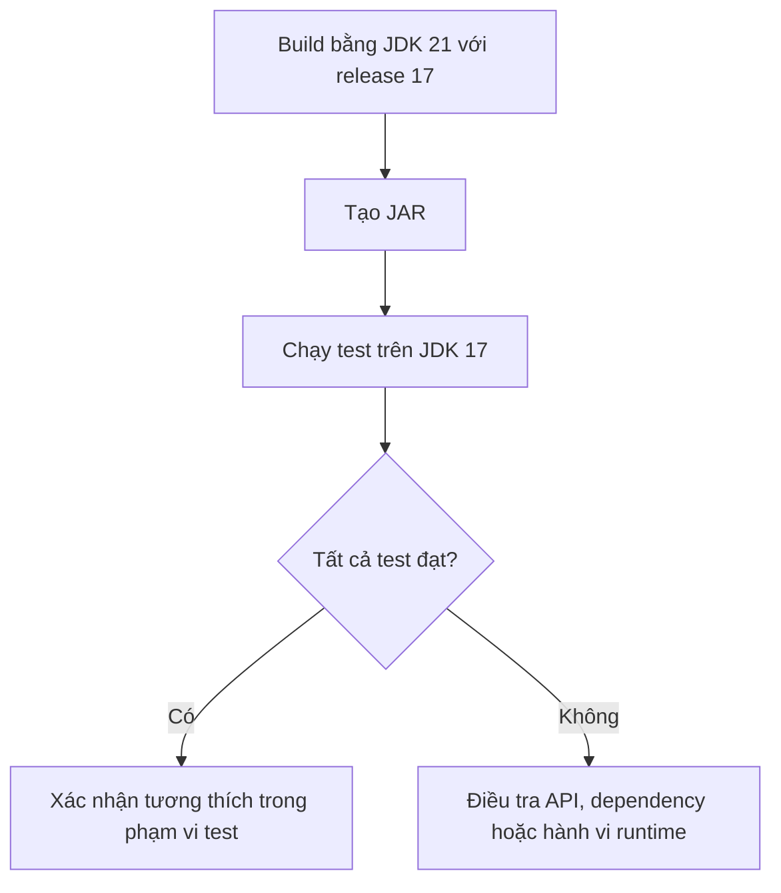

# Phiên bản ngôn ngữ, bytecode đích và mức tương thích Java

Một dự án Java có thể được biên dịch trên JDK mới nhưng vẫn cần chạy trên một phiên bản Java cũ hơn. Ví dụ, nhóm phát triển dùng JDK 21 trên máy cá nhân nhưng ứng dụng phải chạy trên Java 17 ở máy chủ. Để đáp ứng yêu cầu đó, dự án cần kiểm soát phiên bản cú pháp Java được phép sử dụng, định dạng bytecode được tạo ra và tập API Java mà mã nguồn có thể gọi.

Ba yếu tố này có liên quan nhưng không hoàn toàn giống nhau. Chọn đúng phiên bản ngôn ngữ và bytecode chưa đủ để bảo đảm ứng dụng tương thích với runtime cũ nếu mã nguồn vẫn gọi API chỉ có ở JDK mới.

Bài học này giải thích source level, target bytecode và Java API release; cách chọn mức tương thích; cách cấu hình bằng javac, Maven và Gradle; cùng cách kiểm tra artifact trước khi bàn giao.

## 1. Ba khái niệm cần phân biệt

Khi biên dịch Java, ta thường cần trả lời ba câu hỏi:

1. Mã nguồn được phép sử dụng cú pháp và tính năng ngôn ngữ nào?
2. Compiler tạo ra bytecode theo định dạng của phiên bản Java nào?
3. Mã nguồn được phép sử dụng những API Java SE nào?

Ba câu hỏi tương ứng với source level, target bytecode và platform/API release.

### 1.1. Source level: phiên bản ngôn ngữ nguồn

Source level xác định cú pháp và tính năng ngôn ngữ Java mà compiler chấp nhận.

Ví dụ, một tính năng cú pháp mới có thể chỉ được hỗ trợ từ Java 17. Nếu source level đặt ở Java 11, compiler sẽ từ chối cú pháp đó dù compiler đang chạy trên JDK 21.

Source level ảnh hưởng đến những gì lập trình viên có thể viết trong mã nguồn:

- Cú pháp khai báo và biểu thức.
- Từ khóa và cấu trúc ngôn ngữ.
- Quy tắc kiểm tra kiểu và ngữ nghĩa biên dịch.
- Những tính năng ngôn ngữ được giới thiệu ở từng phiên bản.

Ví dụ, từ khóa var cho biến cục bộ được giới thiệu từ Java 10. Nếu dự án yêu cầu source level 8, mã dùng var sẽ không được chấp nhận.

### 1.2. Target bytecode: phiên bản class file đầu ra

Sau khi biên dịch, Java compiler tạo bytecode trong các tệp .class. Mỗi tệp class có định dạng class file với một số phiên bản được ghi trong header.

Target bytecode xác định phiên bản định dạng class file mà compiler tạo ra. JVM dùng thông tin này để biết nó có hỗ trợ định dạng bytecode đó hay không.

Ví dụ:

- Target Java 8 tạo class file có major version 52.
- Target Java 17 tạo class file có major version 61.
- Target Java 21 tạo class file có major version 65.

Nếu chương trình được biên dịch thành class file Java 21 nhưng chạy trên JVM Java 17, JVM cũ không hiểu định dạng class file đó và có thể báo UnsupportedClassVersionError.

### 1.3. Platform/API release: tập API Java được phép sử dụng

Source level và target bytecode không tự giới hạn các API mà compiler đang chạy có thể nhìn thấy.

Giả sử compiler là JDK 21 nhưng dự án muốn chạy trên Java 17. Nếu chỉ đặt source và target là 17, mã nguồn vẫn có nguy cơ gọi một API được giới thiệu ở Java 18, 19, 20 hoặc 21. Bytecode có thể mang định dạng Java 17, nhưng khi chạy trên Java 17, JVM không tìm thấy API mới đó.

API release xác định tập API Java SE mà mã nguồn được phép sử dụng khi biên dịch.

Với JDK 9 trở lên, tùy chọn javac --release kết hợp ba yêu cầu:

- Chọn source level.
- Chọn target class file version.
- Giới hạn API Java SE theo release được chỉ định.

Vì vậy, khi dùng JDK mới để tạo ứng dụng cho runtime cũ hơn, --release thường là lựa chọn phù hợp nhất.

## 2. Mối quan hệ giữa source, target và API

Có thể tóm tắt như sau:

| Thành phần | Câu hỏi cần trả lời | Điều nó kiểm soát |
|---|---|---|
| Source level | Mã nguồn được dùng cú pháp Java nào? | Tính năng ngôn ngữ được chấp nhận |
| Target bytecode | Compiler tạo class file theo định dạng nào? | Khả năng JVM đọc bytecode |
| API release | Mã nguồn được gọi những API Java SE nào? | Khả năng tìm thấy API trên runtime mục tiêu |

Ví dụ, dự án dùng JDK 21 nhưng muốn hỗ trợ Java 17:

- Source level: 17.
- Target bytecode: 17.
- API release: 17.
- Runtime tối thiểu dự kiến: Java 17, nếu các dependency và thành phần khác cũng tương thích.

Nếu chỉ đặt source và target ở 17 mà không giới hạn API, mã nguồn có thể biên dịch với API mới của JDK 21 và thất bại khi chạy trên Java 17.

## 3. Phiên bản Java và class file major version

Mỗi phiên bản Java tương ứng với một class file major version. Một số mốc thường gặp:

| Java release | Class file major version |
|---|---:|
| Java 8 | 52 |
| Java 9 | 53 |
| Java 10 | 54 |
| Java 11 | 55 |
| Java 12 | 56 |
| Java 13 | 57 |
| Java 14 | 58 |
| Java 15 | 59 |
| Java 16 | 60 |
| Java 17 | 61 |
| Java 18 | 62 |
| Java 19 | 63 |
| Java 20 | 64 |
| Java 21 | 65 |
| Java 22 | 66 |
| Java 23 | 67 |
| Java 24 | 68 |
| Java 25 | 69 |

Bảng này giúp đọc thông tin class file khi chẩn đoán lỗi tương thích.

Ví dụ:

- Major version 52 tương ứng Java 8.
- Major version 61 tương ứng Java 17.
- Major version 65 tương ứng Java 21.

Class file có major version cao hơn thường cần JVM mới hơn để đọc. Một JVM mới hơn thường có thể chạy class file cũ, nhưng điều đó không bảo đảm mọi API hoặc hành vi của ứng dụng đều tương thích.

## 4. Vì sao chỉ đặt source và target có thể chưa đủ?

Giả sử lập trình viên dùng JDK 21 nhưng ứng dụng phải chạy trên Java 17.

Có thể cấu hình compiler:

```bash
javac -source 17 -target 17 -d out src/main/java/com/example/Main.java
```

Hai tùy chọn có ý nghĩa:

- -source 17: chỉ chấp nhận cú pháp Java 17.
- -target 17: tạo class file theo định dạng Java 17.

Nhưng compiler vẫn đang chạy trên JDK 21 và có thể nhìn thấy API của JDK 21. Mã nguồn có thể gọi một phương thức chỉ có từ Java 21. Class file vẫn có thể mang target 17, nhưng runtime Java 17 không cung cấp phương thức đó. Kết quả có thể là lỗi liên kết khi chạy như NoSuchMethodError hoặc NoClassDefFoundError.

Để tránh trường hợp này, dùng --release:

```bash
javac --release 17 -d out src/main/java/com/example/Main.java
```

--release 17 yêu cầu compiler biên dịch theo ngôn ngữ Java 17, tạo class file Java 17 và chỉ cho phép dùng API Java SE có trong Java 17.

Đây là cách đơn giản và an toàn hơn khi dùng JDK mới để tạo artifact cho runtime cũ hơn.

## 5. Biên dịch trực tiếp bằng javac

### 5.1. Dùng --release

Với JDK 9 trở lên:

```bash
javac --release 17 -d out src/main/java/com/example/Main.java
```

Nếu có nhiều file nguồn:

```bash
javac --release 17 -d out src/main/java/com/example/*.java
```

Hoặc chỉ định source path phù hợp với cấu trúc dự án:

```bash
javac --release 17 -d out --source-path src/main/java src/main/java/com/example/Main.java
```

Khi biên dịch thành công, các tệp .class trong out sẽ dùng class file version tương ứng Java 17.

Không kết hợp --release với -source hoặc -target trong cùng một lệnh. --release đã xác định cả source level, target bytecode và API release.

### 5.2. Dùng -source và -target

Trong môi trường compiler cũ hoặc khi cần cấu hình riêng, có thể sử dụng:

```bash
javac -source 8 -target 8 -d out src/main/java/com/example/Main.java
```

Tuy nhiên, khi compiler mới hơn Java 8, lệnh này không tự giới hạn API Java 8. Để tránh gọi nhầm API mới, cần cung cấp đúng API của nền tảng đích, chẳng hạn boot classpath phù hợp trong các môi trường JDK cũ.

Với JDK hiện đại, ưu tiên --release 8 nếu compiler hỗ trợ release đó:

```bash
javac --release 8 -d out src/main/java/com/example/Main.java
```

Khả năng hỗ trợ release cũ phụ thuộc phiên bản JDK đang dùng. Một JDK mới không nhất thiết hỗ trợ mọi release Java từng tồn tại.

### 5.3. Kiểm tra phiên bản compiler

Xem JDK và compiler đang được sử dụng:

```bash
java -version
javac -version
```

Hai lệnh có thể trả về phiên bản khác nhau nếu PATH hoặc JAVA_HOME được cấu hình không nhất quán. Khi build trong IDE, Maven/Gradle hoặc CI, cũng cần kiểm tra JDK thực tế mà build tool sử dụng.

## 6. Cấu hình Java release trong Maven

Maven Compiler Plugin chịu trách nhiệm biên dịch mã nguồn Java. Với plugin hiện đại, có thể đặt thuộc tính maven.compiler.release trong pom.xml.

Ví dụ dự án cần tương thích Java 17:

```xml
<project>
    <modelVersion>4.0.0</modelVersion>

    <groupId>com.example</groupId>
    <artifactId>sample-app</artifactId>
    <version>1.0.0</version>

    <properties>
        <maven.compiler.release>17</maven.compiler.release>
        <project.build.sourceEncoding>UTF-8</project.build.sourceEncoding>
    </properties>

    <build>
        <plugins>
            <plugin>
                <groupId>org.apache.maven.plugins</groupId>
                <artifactId>maven-compiler-plugin</artifactId>
                <version>3.13.0</version>
            </plugin>
        </plugins>
    </build>
</project>
```

Thuộc tính maven.compiler.release được Maven Compiler Plugin hỗ trợ từ phiên bản 3.6.0. Dùng phiên bản plugin được quản lý rõ ràng giúp tránh việc build phụ thuộc vào một phiên bản plugin mặc định quá cũ.

Có thể cấu hình trực tiếp trong plugin:

```xml
<plugin>
    <groupId>org.apache.maven.plugins</groupId>
    <artifactId>maven-compiler-plugin</artifactId>
    <version>3.13.0</version>
    <configuration>
        <release>17</release>
    </configuration>
</plugin>
```

Hai cách trên đều hướng tới cùng mục tiêu. Nhóm nên chọn một cách thống nhất trong parent POM hoặc build convention để các module không vô tình biên dịch với release khác nhau.

### 6.1. Phân biệt source/target với release trong Maven

Cấu hình cũ có thể dùng:

```xml
<properties>
    <maven.compiler.source>17</maven.compiler.source>
    <maven.compiler.target>17</maven.compiler.target>
</properties>
```

Cách này đặt source và target, nhưng không tương đương hoàn toàn với release khi compiler chạy trên JDK mới hơn. Nếu mục tiêu là bảo đảm mã nguồn chỉ sử dụng API của Java 17, nên dùng maven.compiler.release.

### 6.2. Maven chạy bằng JDK nào?

Maven Compiler Plugin thường sử dụng compiler từ JDK chạy Maven, trừ khi dự án cấu hình toolchain hoặc compiler riêng.

Có thể kiểm tra:

```bash
./mvnw -version
```

Lệnh này hiển thị Maven và Java runtime mà Maven đang dùng.

Nếu dự án yêu cầu JDK cụ thể để build, Maven Toolchains có thể giúp chọn compiler JDK riêng. Việc chọn JDK để chạy Maven và việc chọn release đích là hai quyết định khác nhau.

Ví dụ:

- Maven chạy trên JDK 21.
- Compiler toolchain dùng JDK 21.
- maven.compiler.release là 17.
- Artifact được tạo để tương thích với Java 17 về ngôn ngữ, class file và API Java SE.

## 7. Cấu hình Java release trong Gradle

Gradle Java Plugin cung cấp cấu hình cho compiler và toolchain. Hai thành phần cần phân biệt:

- **Java toolchain:** chọn JDK dùng để thực hiện compile/test hoặc các task Java tương ứng.
- **options.release:** giới hạn source level, class file target và Java API release cho compiler.

Ví dụ dùng Groovy DSL, build.gradle:

```groovy
plugins {
    id 'java'
}

java {
    toolchain {
        languageVersion = JavaLanguageVersion.of(21)
    }
}

tasks.withType(JavaCompile).configureEach {
    options.release = 17
}
```

Trong ví dụ này:

- Gradle dùng JDK 21 làm toolchain compiler.
- Compiler tạo bytecode và kiểm tra API theo Java 17.
- Mã nguồn không được dùng cú pháp hoặc API Java SE mới hơn release 17.

Có thể cấu hình bằng Kotlin DSL:

```kotlin
plugins {
    java
}

java {
    toolchain {
        languageVersion.set(JavaLanguageVersion.of(21))
    }
}

tasks.withType<JavaCompile>().configureEach {
    options.release.set(17)
}
```

Nếu dự án muốn biên dịch bằng chính JDK 17, có thể đặt toolchain languageVersion thành 17 và vẫn đặt options.release = 17 để thể hiện rõ mục tiêu compile.

### 7.1. Toolchain khác target release

Ví dụ:

```groovy
java {
    toolchain {
        languageVersion = JavaLanguageVersion.of(21)
    }
}

tasks.withType(JavaCompile).configureEach {
    options.release = 17
}
```

Cấu hình này không có nghĩa ứng dụng yêu cầu Java 21 để chạy. Nó có nghĩa JDK 21 được dùng làm compiler, trong khi output được giới hạn ở Java 17.

Ngược lại, nếu toolchain chọn JDK 17 nhưng options.release đặt 21, cấu hình không hợp lệ vì compiler JDK 17 không thể tạo bytecode hoặc API target của một release tương lai mà nó chưa hỗ trợ.

### 7.2. sourceCompatibility và targetCompatibility

Gradle cũng có các thuộc tính:

```groovy
java {
    sourceCompatibility = JavaVersion.VERSION_17
    targetCompatibility = JavaVersion.VERSION_17
}
```

Chúng xác định source và target compatibility cho Java compile. Tuy nhiên, khi cần giới hạn API theo release, nên dùng options.release.

Không nên nhầm sourceCompatibility hoặc targetCompatibility với Java toolchain. Toolchain chọn JDK thực thi compiler; source/target và release chọn mức tương thích đầu ra.

## 8. Chọn Java release nào cho dự án?

Việc chọn release cần dựa trên runtime thấp nhất mà sản phẩm phải hỗ trợ, môi trường triển khai và dependency đang sử dụng.

Một quy trình ra quyết định:

1. Xác định phiên bản Java thấp nhất trên môi trường đích.
2. Kiểm tra các thư viện và framework có hỗ trợ phiên bản đó không.
3. Chọn source/API release phù hợp.
4. Chọn JDK compiler có thể hỗ trợ release đích.
5. Cấu hình Maven hoặc Gradle thống nhất.
6. Chạy test trên runtime tối thiểu được hỗ trợ.
7. Kiểm tra dependency và artifact cuối cùng.

Ví dụ:

| Yêu cầu triển khai | JDK dùng để build | Release đích |
|---|---|---|
| Ứng dụng chạy trên Java 8 | JDK hỗ trợ --release 8 | 8 |
| Ứng dụng chạy trên Java 11 | JDK 17 hoặc mới hơn có hỗ trợ release 11 | 11 |
| Ứng dụng chạy trên Java 17 | JDK 21 | 17 |
| Ứng dụng chạy trên Java 21 | JDK 21 hoặc mới hơn | 21 |

Bảng chỉ minh họa các lựa chọn phổ biến. Cần kiểm tra JDK cụ thể có hỗ trợ release đích và dependency của dự án có tương thích hay không.

Không nên chọn release quá cũ chỉ để tăng số lượng môi trường hỗ trợ nếu framework hoặc dependency đã yêu cầu Java mới hơn. Ngược lại, cũng không nên nâng release chỉ vì máy lập trình viên đã cài JDK mới.

## 9. Vì sao compile thành công chưa bảo đảm runtime tương thích?

Có nhiều lớp tương thích cần xem xét.

### 9.1. Class file version

Nếu class file được tạo cho Java 21, JVM Java 17 không thể nạp class đó. Lỗi thường gặp là:

```text
java.lang.UnsupportedClassVersionError
```

Đây là dấu hiệu class file mới hơn khả năng hỗ trợ của runtime.

### 9.2. API không có trên runtime đích

Nếu chỉ dùng -source và -target, mã nguồn có thể gọi API mới hơn runtime mục tiêu. Bytecode có thể được tạo thành công nhưng khi thực thi, JVM không tìm thấy lớp hoặc phương thức đó.

Các lỗi có thể gặp:

- NoClassDefFoundError.
- NoSuchMethodError.
- NoSuchFieldError.

Dùng --release giúp phát hiện nhiều trường hợp sử dụng API Java SE mới hơn target ngay ở bước compile.

### 9.3. Dependency bên ngoài yêu cầu Java mới hơn

Dù mã nguồn dự án được compile với release 17, một dependency có thể được biên dịch bằng Java 21 hoặc yêu cầu runtime Java 21. Khi chạy trên Java 17, ứng dụng vẫn thất bại.

Vì vậy, cần kiểm tra yêu cầu Java của toàn bộ dependency trực tiếp và bắc cầu, không chỉ mã nguồn của dự án.

### 9.4. Khác biệt hành vi giữa các runtime

Một ứng dụng có thể biên dịch và nạp được trên runtime mục tiêu nhưng vẫn gặp khác biệt về hành vi, TLS, charset, locale, garbage collector, module access hoặc API đã bị deprecated/removed.

Tương thích bytecode và API không thay thế kiểm thử thực tế trên runtime đích.

## 10. Kiểm tra class file sau khi build

Có thể dùng javap để xem phiên bản class file.

Ví dụ:

```bash
javap -verbose out/com/example/Main.class
```

Trong output, tìm dòng:

```text
major version: 61
```

Major version 61 tương ứng Java 17.

Một số lệnh hữu ích:

```bash
javap -verbose path/to/SomeClass.class
java -version
javac -version
```

Với JAR, có thể xem danh sách lớp:

```bash
jar --list --file build/libs/my-app.jar
```

Sau đó giải nén hoặc trích xuất class cần kiểm tra và dùng javap. Khi kiểm tra một sản phẩm có nhiều dependency, cần xem cả class file của thư viện bên ngoài nếu muốn xác định runtime tối thiểu của toàn bộ ứng dụng.

## 11. Kiểm thử trên runtime thấp nhất được hỗ trợ

Cấu hình --release là một bước quan trọng nhưng không thay thế kiểm thử trên runtime đích.

Ví dụ, dự án dùng JDK 21 để build cho Java 17. Nên có một bước kiểm thử bằng Java 17 trong CI hoặc môi trường staging:



Test trên runtime thấp nhất giúp phát hiện:

- Dependency cần Java mới hơn.
- API không có trên runtime.
- Lỗi class loading.
- Khác biệt hành vi.
- Thiếu module hoặc cấu hình runtime.

Nếu sản phẩm hỗ trợ nhiều Java release, có thể tạo ma trận CI để build một lần theo release mục tiêu và chạy test trên từng runtime được hỗ trợ theo chính sách dự án.

## 12. Java preview features và mức tương thích

Một số phiên bản Java cung cấp preview features để thử nghiệm tính năng ngôn ngữ hoặc JVM trước khi chính thức ổn định.

Preview feature gắn với một Java release cụ thể. Để dùng, compiler và runtime thường cần cùng release hỗ trợ preview đó, với tùy chọn bật preview tương ứng.

Ví dụ khái niệm:

```bash
javac --enable-preview --release 21 -d out src/main/java/com/example/Main.java
java --enable-preview -cp out com.example.Main
```

Preview feature không phải cách để tạo artifact tương thích với một runtime cũ hơn. Một chương trình dùng preview của Java 21 cần runtime Java 21 có hỗ trợ preview đó. Khi nâng hoặc đổi runtime, cần biên dịch và kiểm tra lại.

Với thư viện hoặc ứng dụng phát hành rộng rãi, nên cân nhắc kỹ trước khi phụ thuộc preview feature.

## 13. Multi-release JAR

Một số thư viện cần cung cấp implementation khác nhau cho các phiên bản Java khác nhau. Java hỗ trợ multi-release JAR, trong đó một JAR có thể chứa lớp mặc định và các lớp thay thế trong những thư mục phiên bản dưới META-INF/versions/.

Ví dụ cấu trúc:

```text
library.jar
├── META-INF/
│   └── MANIFEST.MF
├── com/example/Feature.class
└── META-INF/
    └── versions/
        ├── 11/
        │   └── com/example/Feature.class
        └── 17/
            └── com/example/Feature.class
```

Manifest cần khai báo:

```text
Multi-Release: true
```

Khi chạy trên runtime hỗ trợ multi-release JAR, JVM có thể chọn implementation phù hợp với phiên bản Java hiện tại.

Đây là kỹ thuật nâng cao để một artifact phục vụ nhiều runtime. Nó không có nghĩa mọi class trong JAR có thể tùy ý dùng API mới. Lớp mặc định vẫn cần tương thích với runtime cơ sở, còn lớp trong thư mục phiên bản phải phù hợp với release tương ứng.

## 14. Các lỗi thường gặp

| Hiện tượng | Nguyên nhân có thể | Cách xử lý |
|---|---|---|
| UnsupportedClassVersionError | Class file được biên dịch cho Java mới hơn runtime | Hạ release đích hoặc nâng runtime |
| Compile được nhưng chạy lỗi NoSuchMethodError | Mã nguồn dùng API không có trên runtime cũ hoặc dependency không tương thích | Dùng --release và kiểm tra dependency |
| JDK mới build được nhưng server cũ không chạy | Target bytecode hoặc API release cao hơn server hỗ trợ | Chọn release theo runtime thấp nhất |
| Source level đặt thấp nhưng vẫn gọi API mới | Chỉ dùng source/target, không giới hạn platform API | Dùng --release |
| Maven dùng release khác giữa các module | Cấu hình compiler không tập trung | Quản lý release trong parent POM hoặc pluginManagement |
| Gradle dùng JDK khác trên máy dev và CI | Toolchain hoặc JAVA_HOME không thống nhất | Cấu hình Java toolchain và kiểm tra CI |
| Dependency gây lỗi class version | Thư viện bên ngoài yêu cầu Java mới hơn | Chọn phiên bản dependency hỗ trợ runtime mục tiêu |
| IDE compile được nhưng command line lỗi | IDE và build tool dùng JDK hoặc compiler options khác nhau | Đồng bộ IDE project SDK, toolchain và build configuration |
| Preview feature không chạy trên runtime | Runtime không cùng release hoặc chưa bật preview | Dùng đúng JDK và bật preview ở cả compile lẫn run nếu thực sự cần |

## 15. Quy trình cấu hình mức tương thích cho dự án

Khi bắt đầu dự án hoặc thay đổi Java baseline, nhóm có thể thực hiện theo trình tự:

1. Xác định Java runtime thấp nhất mà sản phẩm phải hỗ trợ.
2. Kiểm tra framework, plugin và dependency có hỗ trợ baseline đó không.
3. Chọn JDK dùng để build.
4. Cấu hình --release hoặc thuộc tính tương ứng trong Maven/Gradle.
5. Cấu hình Java toolchain nếu cần cố định JDK compiler.
6. Đồng bộ cấu hình trong mọi module và IDE.
7. Build và kiểm tra class file major version.
8. Chạy test trên runtime thấp nhất.
9. Kiểm tra dependency có yêu cầu Java cao hơn hay không.
10. Ghi rõ Java baseline trong README và pipeline CI.

Một nguyên tắc dễ nhớ: **runtime thấp nhất quyết định release đích; JDK dùng để build có thể mới hơn, miễn compiler hỗ trợ release đích và dependency tương thích.**

## 16. Ghi nhớ

- Source level xác định cú pháp và tính năng ngôn ngữ Java được phép sử dụng.
- Target bytecode xác định class file version được tạo.
- API release xác định tập API Java SE được phép gọi.
- javac --release N kết hợp source, target và API theo Java release N.
- Chỉ đặt -source và -target không tự giới hạn API của JDK mới.
- Major version 52 là Java 8, 61 là Java 17 và 65 là Java 21.
- Maven Compiler Plugin hỗ trợ cấu hình release bằng maven.compiler.release hoặc thẻ release.
- Gradle có thể chọn JDK bằng toolchain và giới hạn release bằng options.release.
- Toolchain chọn compiler JDK; release chọn mức tương thích của đầu ra.
- Dependency bên ngoài cũng phải tương thích với runtime tối thiểu.
- Nên kiểm tra class file và chạy test trên runtime thấp nhất được hỗ trợ.
- Preview feature gắn với release cụ thể; multi-release JAR là kỹ thuật nâng cao cho nhiều runtime.

## 17. Tự kiểm tra

1. Source level khác target bytecode ở điểm nào?
2. API release kiểm soát điều gì?
3. Vì sao -source 17 -target 17 trên JDK 21 vẫn có thể tạo mã gọi API Java 21?
4. javac --release 17 giải quyết vấn đề đó như thế nào?
5. Class file major version 61 tương ứng với Java release nào?
6. Maven cấu hình Java release bằng thuộc tính nào?
7. Gradle toolchain khác options.release như thế nào?
8. Vì sao dependency bên ngoài cũng phải hỗ trợ runtime tối thiểu?
9. UnsupportedClassVersionError thường cho biết vấn đề gì?
10. Vì sao cần chạy test trên runtime thấp nhất được hỗ trợ?
11. Preview feature có thể được dùng để tạo bytecode tương thích với một runtime cũ hơn không?
12. Multi-release JAR giải quyết nhu cầu nào?

Khi có thể phân biệt source level, target bytecode và API release, cấu hình được chúng trong Maven hoặc Gradle và xác nhận artifact trên runtime tối thiểu, bạn đã nắm được cách kiểm soát mức tương thích Java của một dự án.

