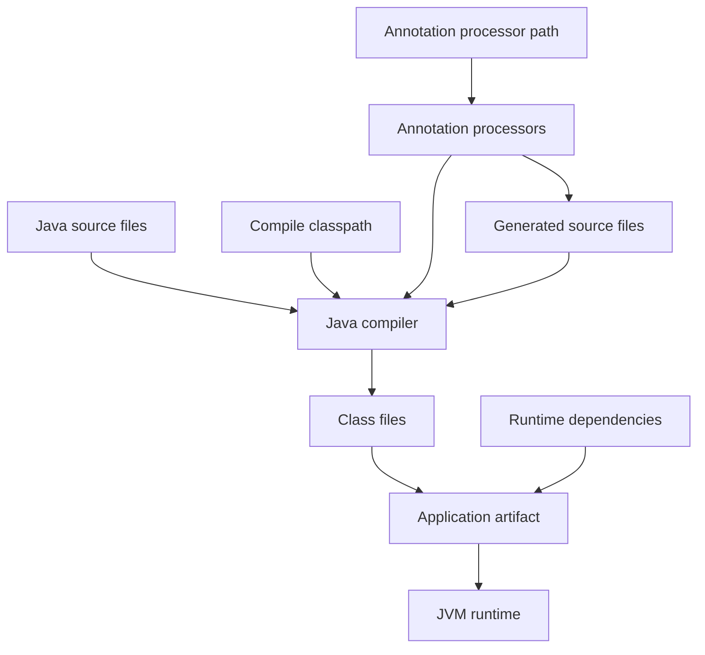

# Tách đường dẫn annotation processor khỏi thư viện ứng dụng

Trong một dự án Java, có những thư viện được ứng dụng gọi khi chạy và có những thư viện chỉ tham gia trong lúc biên dịch để sinh mã hoặc kiểm tra mã nguồn. Hai nhóm này có vai trò khác nhau, vì vậy không nên đặt chúng chung một classpath nếu không có lý do.

Các công cụ như Lombok, MapStruct, Dagger hoặc một annotation processor do nhóm tự viết được thực thi trong quá trình biên dịch. Chúng đọc annotation và thông tin kiểu dữ liệu, sau đó có thể sinh thêm mã Java hoặc báo lỗi biên dịch. Ứng dụng thường không cần mang chính bộ xử lý đó vào runtime. Gradle cung cấp configuration riêng `annotationProcessor` để đưa các processor lên **processor path**, tách khỏi **compile classpath** và **runtime classpath** của ứng dụng.

Tách đúng đường dẫn giúp dependency graph rõ ràng, tránh đóng gói nhầm công cụ build vào sản phẩm, giảm xung đột phiên bản và làm cho việc chẩn đoán quá trình sinh mã dễ hơn.

## 1. Annotation processing diễn ra ở giai đoạn nào?

Annotation processing là một phần của quá trình biên dịch Java. Compiler có thể phát hiện annotation trên class, method, field, parameter hoặc các phần tử khác trong mã nguồn rồi gọi những annotation processor đã được cấu hình.

Một processor có thể:

- Đọc annotation và thông tin kiểu dữ liệu trong chương trình.
- Kiểm tra quy tắc sử dụng annotation và báo lỗi nếu mã nguồn không hợp lệ.
- Sinh thêm tệp `.java` để compiler biên dịch cùng mã nguồn ban đầu.
- Sinh resource hoặc metadata phục vụ các bước build tiếp theo.
- Tạo mã hỗ trợ cho dependency injection, mapping, serialization hoặc các framework khác.

Ví dụ, một class có annotation:

```java
import lombok.Getter;

@Getter
public class Customer {
    private final String name;

    public Customer(String name) {
        this.name = name;
    }
}
```

Lombok tham gia quá trình biên dịch để làm cho compiler nhìn thấy accessor được tạo từ annotation. Processor không phải là một thư viện mà ứng dụng cần gọi như một service thông thường khi chạy.

Một ví dụ khác là MapStruct. Processor đọc các interface mapper và sinh implementation Java tương ứng:

```java
@Mapper
public interface CustomerMapper {
    CustomerDto toDto(Customer customer);
}
```

Trong build, processor tạo class triển khai mapper để compiler biên dịch. Ứng dụng có thể sử dụng implementation được sinh ra khi chạy, nhưng thường không cần đưa chính artifact `mapstruct-processor` vào runtime.

## 2. Phân biệt ba đường dẫn: compile, processor và runtime

Một build Java thường cần phân biệt ít nhất ba nhóm classpath:

| Đường dẫn | Ai sử dụng? | Chứa loại dependency nào? | Có được đóng gói vào ứng dụng? |
|---|---|---|---|
| Compile classpath | Java compiler khi biên dịch mã nguồn | API và thư viện mà source code tham chiếu | Tùy configuration; `implementation` thường có cả runtime, `compileOnly` thì không |
| Annotation processor path | Compiler khi nạp và chạy annotation processor | Processor và dependency của chính processor | Không tự động trở thành runtime dependency của ứng dụng |
| Runtime classpath | JVM khi chạy ứng dụng hoặc test | Thư viện cần thiết khi thực thi | Thường được đưa vào gói phân phối theo cách đóng gói của project |

Sơ đồ đơn giản:



Compile classpath cung cấp những class mà mã nguồn cần tham chiếu. Processor path cung cấp code của công cụ xử lý annotation. Runtime classpath cung cấp thư viện cần thiết khi chạy ứng dụng. Một artifact có thể xuất hiện ở nhiều nhóm nếu nó thực sự đảm nhiệm nhiều vai trò, nhưng không nên thêm một dependency vào mọi configuration chỉ để “cho chắc”.

### Ví dụ về sự khác nhau

Giả sử project sử dụng một thư viện `api-model` và một processor `model-generator`:

- Source code import annotation hoặc API từ `api-model`, nên artifact này cần trên compile classpath.
- Compiler cần chạy `model-generator`, nên processor cần trên annotation processor path.
- Nếu bytecode hoặc ứng dụng gọi class của `api-model` lúc chạy, API đó cần trên runtime classpath.
- Ứng dụng không gọi `model-generator`, nên processor thường không cần trên runtime classpath.

Đây là lý do configuration riêng có ý nghĩa: mỗi dependency được khai báo theo đúng mục đích sử dụng.

## 3. Gradle cung cấp configuration `annotationProcessor`

Khi áp dụng Java Plugin, Gradle tạo configuration `annotationProcessor` cho annotation processor của source set chính. Dependency khai báo ở đây được dùng để cấu hình processor path cho các task biên dịch Java tương ứng.

Ví dụ Groovy DSL:

```groovy
plugins {
    id 'java'
}

dependencies {
    annotationProcessor 'com.example:code-generator:1.2.0'
}
```

Ví dụ Kotlin DSL:

```kotlin
plugins {
    java
}

dependencies {
    annotationProcessor("com.example:code-generator:1.2.0")
}
```

Gradle dùng dependency của configuration này để thiết lập `annotationProcessorPath` cho `JavaCompile`. Các dependency bắc cầu cần thiết của processor cũng được resolve theo dependency graph của configuration đó.

Với Java Plugin, configuration tương ứng với source set kiểm thử là `testAnnotationProcessor`. Các source set bổ sung cũng có configuration annotation processor riêng theo tên source set, ví dụ `integrationTestAnnotationProcessor` nếu project khai báo source set `integrationTest`.

Không cần tự tạo task `javac` riêng chỉ để chạy processor. Hãy dùng task `compileJava`, `compileTestJava` và các configuration do Java Plugin cung cấp, trừ khi dự án có một quy trình biên dịch đặc biệt.

## 4. Vì sao không khai báo processor trong `implementation`?

`implementation` dành cho dependency mà project cần để biên dịch và chạy phần triển khai của nó. Dependency này có thể trở thành một phần của runtime dependency graph và metadata được publish tùy loại component.

Annotation processor lại là công cụ build-time. Nếu chỉ khai báo processor trong `implementation`, một số hệ quả có thể xảy ra:

- Processor bị đưa vào runtime dependency graph dù ứng dụng không cần chạy nó.
- Artifact phát hành có thể kéo theo các dependency phục vụ build không cần thiết.
- Classpath runtime lớn hơn và khó kiểm soát hơn.
- Có thể xảy ra xung đột version giữa dependency của processor và thư viện ứng dụng.
- Người đọc build script khó phân biệt API ứng dụng với công cụ sinh mã.

Cấu hình đúng thông thường là:

```groovy
dependencies {
    implementation 'com.example:application-api:2.0.0'
    annotationProcessor 'com.example:code-generator:1.2.0'
}
```

Nếu processor cần một thư viện hỗ trợ riêng, khai báo thư viện đó trong dependency graph của processor (thường processor artifact đã khai báo transitive dependency của nó). Không đưa mọi dependency của processor vào `implementation` chỉ để compiler có thể nạp processor.

## 5. Annotation type và annotation processor là hai thứ khác nhau

Một nhầm lẫn thường gặp là cho rằng chỉ cần khai báo `annotationProcessor` là đủ cho tất cả annotation. Thực tế cần phân biệt:

1. **Annotation API:** các kiểu annotation mà mã nguồn import và sử dụng, ví dụ `lombok.Getter`, `org.mapstruct.Mapper`.
2. **Annotation processor:** code được compiler nạp để xử lý annotation, ví dụ Lombok processor hoặc `mapstruct-processor`.

Annotation type cần có trên compile classpath để compiler phân giải annotation trong source code. Processor cần có trên processor path để compiler nạp và thực thi nó.

Có thư viện cung cấp cả annotation API và processor trong cùng một artifact; có thư viện tách chúng thành hai artifact riêng.

| Thư viện/công cụ | Annotation/API | Processor |
|---|---|---|
| Lombok | `org.projectlombok:lombok` | Cùng artifact Lombok được đặt thêm trong `annotationProcessor` |
| MapStruct | `org.mapstruct:mapstruct` | `org.mapstruct:mapstruct-processor` |
| Dagger | `com.google.dagger:dagger` | `com.google.dagger:dagger-compiler` |
| Processor nội bộ | API annotation do nhóm định nghĩa | Artifact triển khai processor riêng hoặc artifact kết hợp tùy thiết kế |

Cấu hình hai vai trò theo đúng cách thư viện thiết kế. Không phải annotation API nào cũng cần runtime; lựa chọn `compileOnly` hay `implementation` phụ thuộc việc class của ứng dụng hoặc generated code có tham chiếu API đó lúc chạy hay không.

## 6. Ví dụ Lombok: `compileOnly` kết hợp `annotationProcessor`

Lombok là ví dụ phổ biến vì cùng một artifact đảm nhiệm vai trò annotation API và processor.

Groovy DSL:

```groovy
plugins {
    id 'java'
}

repositories {
    mavenCentral()
}

dependencies {
    compileOnly 'org.projectlombok:lombok:1.18.32'
    annotationProcessor 'org.projectlombok:lombok:1.18.32'

    testCompileOnly 'org.projectlombok:lombok:1.18.32'
    testAnnotationProcessor 'org.projectlombok:lombok:1.18.32'
}
```

Kotlin DSL:

```kotlin
plugins {
    java
}

repositories {
    mavenCentral()
}

dependencies {
    compileOnly("org.projectlombok:lombok:1.18.32")
    annotationProcessor("org.projectlombok:lombok:1.18.32")

    testCompileOnly("org.projectlombok:lombok:1.18.32")
    testAnnotationProcessor("org.projectlombok:lombok:1.18.32")
}
```

Phiên bản trong ví dụ chỉ để minh họa; hãy chọn version tương thích với JDK và Gradle của dự án.

- `compileOnly` giúp compiler tìm thấy annotation type Lombok trong mã nguồn chính mà không tự đưa Lombok vào runtime.
- `annotationProcessor` cung cấp Lombok cho compiler để xử lý annotation trong source set chính.
- `testCompileOnly` cung cấp annotation type nếu mã kiểm thử sử dụng annotation Lombok.
- `testAnnotationProcessor` chạy processor khi biên dịch mã kiểm thử.

Nếu test không dùng annotation Lombok, hai cấu hình test tương ứng có thể không cần thiết. Hãy khai báo theo source set thực sự sử dụng annotation.

Không nên chỉ khai báo:

```groovy
dependencies {
    implementation 'org.projectlombok:lombok:1.18.32'
}
```

Cấu hình đó đặt Lombok vào dependency của ứng dụng nhưng không diễn tả rõ processor path. Với Gradle hiện đại, hãy khai báo processor trong configuration chuyên dụng.

## 7. Ví dụ MapStruct: API và processor được tách thành hai artifact

MapStruct cung cấp annotation API trong artifact `mapstruct` và processor trong artifact `mapstruct-processor`.

Ví dụ Groovy DSL:

```groovy
dependencies {
    implementation 'org.mapstruct:mapstruct:1.6.3'
    annotationProcessor 'org.mapstruct:mapstruct-processor:1.6.3'
}
```

Ví dụ Kotlin DSL:

```kotlin
dependencies {
    implementation("org.mapstruct:mapstruct:1.6.3")
    annotationProcessor("org.mapstruct:mapstruct-processor:1.6.3")
}
```

Mã nguồn có thể khai báo mapper:

```java
import org.mapstruct.Mapper;

@Mapper
public interface CustomerMapper {
    CustomerDto toDto(Customer customer);
}
```

Khi `compileJava` chạy, processor đọc `@Mapper` và sinh implementation. Thư viện API `mapstruct` và processor `mapstruct-processor` nên dùng version tương thích, thường cùng version release.

Trong ví dụ, `implementation` được chọn cho MapStruct API vì generated code hoặc ứng dụng có thể sử dụng runtime helper như `Mappers.getMapper(...)`. Nếu dự án chỉ dùng annotation trong quá trình biên dịch và generated code không tham chiếu MapStruct runtime API, có thể đánh giá `compileOnly` theo contract của thư viện và cách ứng dụng lấy mapper. Đừng đổi scope một cách máy móc nếu runtime thực sự cần class từ API artifact.

Nếu mapper nằm trong source set kiểm thử, processor cần khai báo trong `testAnnotationProcessor`; API annotation cần có trên `testCompileClasspath` thông qua configuration phù hợp.

## 8. Ví dụ Dagger: compiler tool riêng cho dependency injection

Dagger cũng tách API và compiler. API annotation/utility được cung cấp bởi artifact `dagger`, còn processor nằm trong `dagger-compiler`.

```kotlin
dependencies {
    implementation("com.google.dagger:dagger:2.51.1")
    annotationProcessor("com.google.dagger:dagger-compiler:2.51.1")
}
```

Mã nguồn có thể dùng annotation:

```java
@Module
public interface NetworkModule {
    @Binds
    HttpClient bindHttpClient(OkHttpClient implementation);
}
```

Processor phân tích module và sinh mã factory/component cần thiết. Generated code có thể tham chiếu API Dagger, vì vậy API artifact thường vẫn cần ở compile/runtime theo cách ứng dụng sử dụng component. Compiler artifact không cần được đóng gói chỉ vì nó đã tham gia sinh mã.

Các ví dụ Lombok, MapStruct và Dagger cho thấy một quy tắc chung: **đặt annotation API ở configuration mà source/generated code cần; đặt processor implementation trong `annotationProcessor`.**

## 9. Annotation processor cho mã kiểm thử và source set tùy chỉnh

Processor được cấu hình theo source set. `annotationProcessor` mặc định phục vụ source set `main`; không nên giả định nó tự động áp dụng cho mọi source set khác.

Nếu test source sử dụng annotation cần processor, khai báo:

```groovy
dependencies {
    testCompileOnly 'org.projectlombok:lombok:1.18.32'
    testAnnotationProcessor 'org.projectlombok:lombok:1.18.32'
}
```

Nếu project có source set `integrationTest`:

```groovy
sourceSets {
    integrationTest {
        java.srcDir 'src/integrationTest/java'
        resources.srcDir 'src/integrationTest/resources'
        compileClasspath += sourceSets.main.output
        runtimeClasspath += output + compileClasspath
    }
}
```

Configuration processor tương ứng có tên theo source set, ví dụ `integrationTestAnnotationProcessor`. Có thể khai báo dependency:

```groovy
dependencies {
    integrationTestAnnotationProcessor 'com.example:code-generator:1.2.0'
}
```

Đồng thời, annotation API phải có trên compile classpath của source set đó nếu test/integration source import annotation. Cấu hình dependency cho source set cần khớp với task biên dịch mà nó sử dụng.

## 10. Processor options và cấu hình compiler

Một processor có thể nhận tùy chọn cấu hình từ compiler. Các tùy chọn thường được truyền dưới dạng `-Akey=value`.

Ví dụ Groovy DSL:

```groovy
tasks.withType(JavaCompile).configureEach {
    options.compilerArgs += [
        '-Amapstruct.defaultComponentModel=spring',
        '-Amapstruct.unmappedTargetPolicy=ERROR'
    ]
}
```

Kotlin DSL:

```kotlin
tasks.withType<JavaCompile>().configureEach {
    options.compilerArgs.addAll(
        listOf(
            "-Amapstruct.defaultComponentModel=spring",
            "-Amapstruct.unmappedTargetPolicy=ERROR"
        )
    )
}
```

Tên option hợp lệ phụ thuộc processor. Ví dụ trên là các option MapStruct; processor khác có thể định nghĩa option riêng. Hãy tham khảo tài liệu của processor thay vì tự đặt tên tùy ý.

Với một processor nội bộ, có thể khai báo option trong code processor bằng `@SupportedOptions` hoặc override phương thức tương ứng của `AbstractProcessor`. Compiler có thể cảnh báo nếu nhận option không được processor nào hỗ trợ.

### Cấu hình riêng theo task

Nếu main và test cần option khác nhau, có thể cấu hình task cụ thể:

```groovy
tasks.named('compileJava', JavaCompile) {
    options.compilerArgs += ['-Acodegen.mode=production']
}

tasks.named('compileTestJava', JavaCompile) {
    options.compilerArgs += ['-Acodegen.mode=test']
}
```

Giữ cấu hình tập trung khi mọi source set dùng cùng quy tắc; cấu hình task cụ thể khi có khác biệt thực sự.

## 11. Nơi lưu mã nguồn được sinh ra

Annotation processor có thể tạo thêm source file trong lúc biên dịch. Gradle quản lý output này cùng task `JavaCompile`; với Java Plugin, generated source thường nằm dưới thư mục build như:

```text
build/
└── generated/
    └── sources/
        └── annotationProcessor/
            └── java/
                ├── main/
                └── test/
```

Đường dẫn cụ thể có thể thay đổi theo Gradle version, source set và cấu hình task. Hãy xem output của task thay vì hard-code đường dẫn nếu không cần.

Generated source là build output, không phải source file do developer viết trực tiếp. Thông thường:

- Không chỉnh sửa generated source bằng tay; thay đổi sẽ bị ghi đè ở lần build sau.
- Không commit generated output trừ khi quy trình dự án có yêu cầu rõ ràng.
- Không đặt generated output vào thư mục `src/main/java`.
- Khi cần chẩn đoán, kiểm tra source được sinh ra để hiểu processor đã tạo gì.

Nếu processor sinh source nhưng compiler không biên dịch source đó, hãy kiểm tra task `JavaCompile`, processor execution, generated source directory và log compiler. Với Gradle Java Plugin thông thường, output được quản lý bởi task biên dịch tương ứng.

## 12. Tự động phát hiện processor và chỉ định processor cụ thể

Nhiều annotation processor được phát hiện tự động thông qua service registration trong JAR, thường ở:

```text
META-INF/services/javax.annotation.processing.Processor
```

File này liệt kê tên lớp processor để Java compiler có thể phát hiện khi JAR nằm trên processor path.

Thông thường không cần chỉ định tên processor bằng tay. Nếu có yêu cầu giới hạn processor được chạy, `javac` hỗ trợ tùy chọn `-processor` để chỉ định lớp processor. Tuy nhiên, hãy dùng cách đó chỉ khi cần và bảo đảm danh sách không vô tình loại bỏ processor khác mà build đang cần.

Có thể dùng tùy chọn compiler như `-XprintRounds` và `-XprintProcessorInfo` để quan sát các vòng annotation processing và processor nào được gọi (tùy JDK/compiler hỗ trợ):

```groovy
tasks.named('compileJava', JavaCompile) {
    options.compilerArgs += ['-XprintRounds', '-XprintProcessorInfo']
}
```

Nếu processor không được phát hiện, hãy kiểm tra:

- Dependency processor có nằm trong `annotationProcessor` không?
- Artifact có chứa service registration đúng không?
- Processor có tương thích với JDK/compiler đang dùng không?
- Processor có bị vô hiệu hóa bằng `-proc:none` không?
- Source set/task đang chạy có configuration processor tương ứng không?
- Processor có điều kiện để chạy dựa trên annotation hoặc loại source không?

## 13. Tắt annotation processing khi cần

Java compiler có tùy chọn `-proc:none` để không chạy annotation processing. Nếu tùy chọn này được truyền vào `JavaCompile`, processor sẽ không thực hiện công việc như mong đợi dù dependency đã nằm trong processor configuration.

Ví dụ:

```groovy
tasks.named('compileJava', JavaCompile) {
    options.compilerArgs += ['-proc:none']
}
```

Chỉ dùng khi project chủ đích không chạy annotation processor. Nếu project dựa vào Lombok, MapStruct, Dagger hoặc processor sinh mã khác, `-proc:none` có thể làm compile thất bại vì generated code không được tạo hoặc annotation không được xử lý.

Không nên thêm `-proc:none` như một cách khắc phục cảnh báo processor nếu chưa hiểu tác động. Hãy xác định processor nào không mong muốn và cấu hình processor path phù hợp.

## 14. Annotation processing và build tăng dần

Annotation processor có thể ảnh hưởng đến incremental compilation. Gradle cần biết processor tạo ra loại output nào và phạm vi source nào có thể tác động.

Gradle hỗ trợ incremental annotation processing với processor khai báo loại xử lý phù hợp, chẳng hạn:

- **Isolating:** output của một source có thể được liên hệ với source đó, không phụ thuộc tùy tiện vào mọi source khác.
- **Aggregating:** output có thể phụ thuộc vào nhiều source hoặc tập source của một compilation.

Processor cần cung cấp metadata incremental theo cơ chế Gradle hỗ trợ, thường qua file metadata trong JAR. Nếu processor không khai báo hoặc không đáp ứng điều kiện incremental, Gradle có thể phải biên dịch lại rộng hơn hoặc không thể dùng incremental annotation processing cho compilation đó.

Tác giả processor nên khai báo chính xác loại incremental processing. Khai báo sai có thể làm Gradle bỏ sót output cần sinh lại hoặc tạo kết quả không nhất quán. Người dùng build nên dùng phiên bản processor hỗ trợ incremental processing khi có thể và xem log nếu compilation thường xuyên chạy lại toàn bộ.

Một processor tốt cũng cần khai báo output và hành vi phù hợp để Gradle có thể quản lý build cache và incremental work. Không nên tự ý ghi file ra ngoài output directory do compiler/task quản lý.

## 15. Tác động tới dependency graph và artifact được publish

Tách processor path giúp công cụ build không bị hiểu nhầm là thư viện ứng dụng.

Ví dụ, một Java library sử dụng Lombok có thể khai báo:

```groovy
dependencies {
    compileOnly 'org.projectlombok:lombok:1.18.32'
    annotationProcessor 'org.projectlombok:lombok:1.18.32'
}
```

Khi publish thư viện:

- Lombok không nên xuất hiện như runtime dependency chỉ vì nó dùng để sinh accessor.
- Consumer nhận class đã biên dịch và API public của thư viện.
- Nếu public API của thư viện thực sự dùng kiểu từ một thư viện khác, dependency đó cần được công bố theo scope phù hợp.
- Processor chỉ cần có trong build của chính thư viện, trừ khi consumer cũng phải chạy processor cho source của họ.

Với MapStruct hoặc Dagger, API artifact có thể cần ở runtime nếu generated code hoặc ứng dụng gọi helper/runtime type. Hãy kiểm tra generated code và contract thư viện để chọn `implementation`, `api` hoặc `compileOnly` phù hợp. Processor implementation vẫn ở `annotationProcessor`.

Không nên publish processor như dependency của consumer nếu consumer không cần chạy nó. Với processor được phát triển để người dùng khác áp dụng, cần tài liệu hóa rõ cách khai báo `annotationProcessor` và annotation API tương ứng.

## 16. Chẩn đoán khi processor không chạy hoặc generated code bị thiếu

Một số triệu chứng phổ biến:

| Triệu chứng | Nguyên nhân có thể | Cách kiểm tra |
|---|---|---|
| Compiler báo không tìm thấy annotation type | Thiếu annotation API trên compile classpath | Kiểm tra `compileClasspath` hoặc `testCompileClasspath` |
| Annotation có mặt nhưng processor không chạy | Thiếu `annotationProcessor`, service registration sai hoặc processor không tương thích | Kiểm tra processor configuration và compiler log |
| Main compile chạy được nhưng test compile thiếu generated type | Chưa khai báo `testAnnotationProcessor` | Kiểm tra test processor path |
| Processor class được tìm thấy nhưng thiếu class phụ thuộc | Processor dependency graph thiếu dependency cần thiết | Xem `annotationProcessor` dependency graph |
| Runtime thiếu class sau khi generated code được dùng | API/runtime dependency bị khai báo sai scope | Kiểm tra runtimeClasspath và generated code |
| Processor không thấy option cấu hình | Sai `-Akey=value` hoặc option được đặt ở task khác | Kiểm tra compilerArgs và tài liệu processor |
| Build luôn chạy lại nhiều source | Processor không hỗ trợ incremental hoặc khai báo metadata không phù hợp | Xem log compile và hỗ trợ incremental của processor |
| Generated source cũ vẫn xuất hiện | Output build cũ hoặc task/configuration sai | Kiểm tra generated output, task inputs và khi cần chạy clean để tái tạo |

Các lệnh hữu ích:

```bash
./gradlew dependencies --configuration annotationProcessor
./gradlew dependencyInsight --dependency lombok --configuration annotationProcessor
./gradlew dependencies --configuration compileClasspath
./gradlew dependencies --configuration runtimeClasspath
./gradlew compileJava --info
./gradlew compileTestJava --info
```

Nếu cần kiểm tra processor của test, thay configuration thành `testAnnotationProcessor`. Nếu dùng source set tùy chỉnh, kiểm tra configuration tương ứng với source set đó.

Khi chẩn đoán, hãy phân biệt lỗi resolve dependency với lỗi processor execution. `Could not resolve` thường là vấn đề repository/version/credentials; exception trong compiler có thể là processor không tương thích, lỗi logic processor hoặc source annotation không hợp lệ.

## 17. Bảo mật và độ tin cậy của annotation processor

Annotation processor là code được thực thi trên máy build. Nó có thể đọc source, truy cập filesystem trong phạm vi tiến trình và tạo output. Vì vậy, processor cần được xem như một build tool có ảnh hưởng tới chuỗi cung ứng phần mềm.

Một số thực hành nên áp dụng:

- Dùng processor từ nguồn tin cậy và repository được kiểm soát.
- Khóa hoặc cố định version phù hợp, tránh version động không kiểm soát.
- Dùng dependency verification nếu dự án có chính sách checksum/signature.
- Review thay đổi version processor giống như review plugin hoặc compiler tool.
- Không cấp credentials không cần thiết cho build chỉ chạy compile/test.
- Không để processor ghi dữ liệu nhạy cảm vào generated source hoặc log.
- Kiểm tra tương thích với JDK và Gradle trước khi nâng cấp.
- Với processor nội bộ, kiểm thử output, xử lý lỗi và incremental metadata.

Tách processor khỏi runtime dependency không chỉ làm classpath gọn hơn; nó còn làm rõ công cụ nào được thực thi trong build và thư viện nào được đưa vào ứng dụng.

## 18. Quy trình cấu hình annotation processor cho dự án Java

Khi thêm một processor mới, có thể làm theo trình tự:

1. **Xác định thư viện:** tìm artifact cung cấp annotation/API và artifact triển khai processor.
2. **Xác định source set:** processor phục vụ `main`, `test` hay một source set riêng.
3. **Khai báo API:** đặt annotation API trên compile classpath bằng `compileOnly`, `implementation` hoặc `api` tùy nhu cầu runtime/public API.
4. **Khai báo processor:** đặt processor implementation trong `annotationProcessor`, `testAnnotationProcessor` hoặc configuration tương ứng.
5. **Đồng bộ version:** dùng version tương thích giữa API và processor; với thư viện phát hành theo cặp, thường chọn cùng version.
6. **Cấu hình processor options:** chỉ thêm `-A...` nếu processor yêu cầu.
7. **Chạy đúng compile task:** ví dụ `compileJava` hoặc `compileTestJava`.
8. **Xác nhận output:** kiểm tra generated source/class và log processor.
9. **Kiểm tra runtime:** bảo đảm generated code có đủ dependency API cần thiết khi chạy.
10. **Kiểm tra publication:** xác nhận processor không bị công bố như runtime dependency ngoài ý muốn.

Một cấu hình tổng hợp cho Lombok và MapStruct có thể như sau:

```kotlin
plugins {
    java
}

repositories {
    mavenCentral()
}

dependencies {
    // Lombok: annotation API và processor cùng artifact.
    compileOnly("org.projectlombok:lombok:1.18.32")
    annotationProcessor("org.projectlombok:lombok:1.18.32")

    // MapStruct: API và processor là hai artifact riêng.
    implementation("org.mapstruct:mapstruct:1.6.3")
    annotationProcessor("org.mapstruct:mapstruct-processor:1.6.3")

    // Nếu test source cũng sử dụng Lombok.
    testCompileOnly("org.projectlombok:lombok:1.18.32")
    testAnnotationProcessor("org.projectlombok:lombok:1.18.32")
}
```

Cấu hình này cho thấy API và processor được đặt ở đúng vai trò. Dự án thực tế cần chọn version đã được kiểm tra với JDK/Gradle đang dùng và chỉ khai báo các processor thực sự cần cho từng source set.

## 19. Những nhầm lẫn thường gặp

| Nhầm lẫn | Cách hiểu chính xác |
|---|---|
| Annotation processor là thư viện runtime | Processor là công cụ build-time; thường đặt trong `annotationProcessor`. |
| Khai báo processor trong `implementation` là đủ | `implementation` không diễn tả processor path; dùng configuration processor riêng. |
| `annotationProcessor` thay thế annotation API | Source code vẫn cần annotation type trên compile classpath. |
| `compileOnly` tự chạy processor | `compileOnly` chỉ cung cấp class cho compiler; processor phải được cấu hình riêng. |
| Main processor tự áp dụng cho test | Test có `testAnnotationProcessor` riêng. |
| Mọi thư viện annotation đều phải dùng `compileOnly` | Chọn scope theo việc source/generated code có cần API đó lúc runtime hoặc công khai qua API hay không. |
| Có generated source nghĩa là processor phải được commit | Generated source thường là build output được tái tạo, không phải source chính. |
| Processor path có thể chứa mọi thư viện ứng dụng | Processor path chỉ nên chứa processor và dependency cần cho chính processor. |
| Compiler không tìm thấy annotation thì tăng version processor là đủ | Có thể thiếu annotation API trên compile classpath hoặc dùng sai source set. |
| Tách processor path chỉ để giảm kích thước JAR | Nó còn giúp cô lập dependency, quản lý resolution, bảo mật và làm rõ vai trò build-time. |

## 20. Nguyên tắc cần ghi nhớ

Annotation API là kiểu mà source code import; annotation processor là công cụ compiler nạp để xử lý kiểu annotation đó. Gradle Java Plugin cung cấp `annotationProcessor` cho source set chính và `testAnnotationProcessor` cho test. Compile classpath cung cấp API cho source, processor path cung cấp code thực thi trong quá trình biên dịch, còn runtime classpath chứa thư viện cần khi ứng dụng chạy.

Với Lombok, thường khai báo `compileOnly` cùng `annotationProcessor`; với MapStruct và Dagger, API và processor là các artifact riêng nên khai báo theo đúng vai trò. Nếu generated code hoặc ứng dụng cần API ở runtime, giữ dependency API trong runtime scope phù hợp. Khi processor không chạy, hãy kiểm tra source set, processor configuration, annotation API, service registration, compiler options và JDK compatibility. Tách đúng đường dẫn giúp build minh bạch, artifact gọn và dependency graph dễ kiểm soát.
