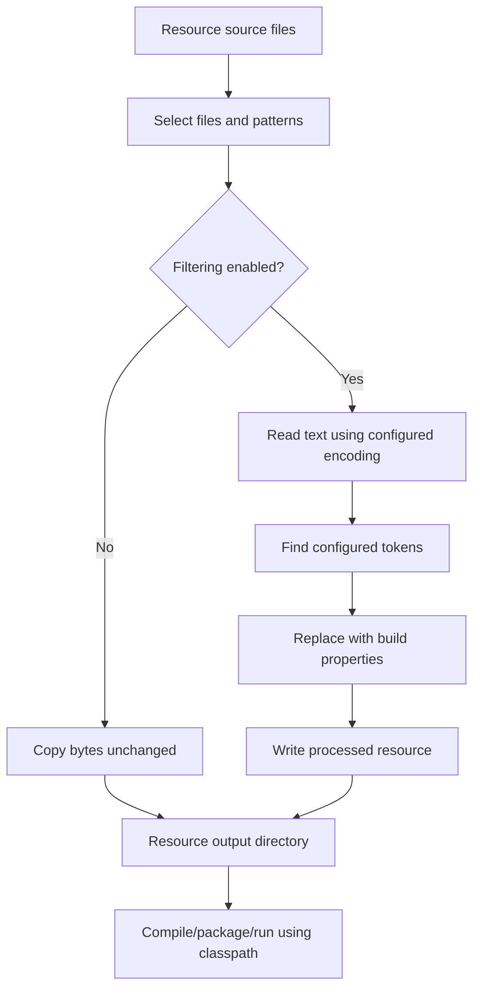

# Sao chép, lọc và thay thế giá trị trong tệp tài nguyên

Một ứng dụng Java thường cần nhiều file bên cạnh mã nguồn: `application.properties`, file YAML, template HTML, file XML, thông điệp đa ngôn ngữ, schema, ảnh, chứng chỉ công khai hoặc dữ liệu mẫu. Những file này được gọi là **resources** (tài nguyên). Khi build, build tool thường sao chép tài nguyên từ thư mục nguồn vào thư mục output để compiler, test runner hoặc ứng dụng có thể tìm thấy chúng trên classpath.

Trong một số dự án, nội dung tài nguyên cần thay đổi theo phiên bản hoặc môi trường. Ví dụ, file cấu hình có thể chứa phiên bản ứng dụng, tên môi trường, URL dịch vụ hoặc một cờ bật/tắt tính năng. Build tool có thể **lọc tài nguyên** (resource filtering): đọc file văn bản, thay các placeholder bằng giá trị cấu hình rồi ghi kết quả vào thư mục output.

Ba thao tác cần phân biệt:

1. **Sao chép (copy):** đưa file từ thư mục nguồn sang thư mục output, thường giữ nguyên nội dung và cấu trúc tương đối.
2. **Lọc (filter):** xử lý nội dung file trong lúc sao chép, ví dụ thay placeholder hoặc loại bỏ/biến đổi một phần nội dung theo quy tắc.
3. **Thay thế giá trị (token/property expansion):** tìm dấu giữ chỗ như `${app.version}` hoặc `@app.version@` rồi thay bằng giá trị được cung cấp từ POM, Gradle build, file filter hoặc biến cấu hình.

Filtering rất hữu ích cho file văn bản, nhưng cần được cấu hình có chủ đích. Nếu áp dụng cho ảnh, JAR, font hoặc file nhị phân, công cụ có thể làm hỏng dữ liệu. Nếu thay thế nhầm placeholder mà framework cần xử lý lúc runtime, ứng dụng cũng có thể hoạt động sai.

## 1. Tài nguyên nằm ở đâu trong dự án Java?

Với cấu trúc phổ biến của Maven và Gradle Java Plugin, tài nguyên được chia theo source set:

```text
my-app/
├── src/
│   ├── main/
│   │   ├── java/
│   │   └── resources/
│   └── test/
│       ├── java/
│       └── resources/
└── build output/
```

`src/main/resources` chứa tài nguyên của ứng dụng. `src/test/resources` chứa tài nguyên chỉ dùng trong kiểm thử, chẳng hạn file cấu hình test, JSON mẫu hoặc dữ liệu fixture.

Build tool thường sao chép và xử lý chúng vào thư mục output tương ứng:

| Công cụ | Tài nguyên chính | Tài nguyên kiểm thử |
|---|---|---|
| Maven | `target/classes` | `target/test-classes` |
| Gradle Java Plugin | `build/resources/main` | `build/resources/test` |

Các thư mục output này được đưa vào classpath tương ứng. Khi ứng dụng gọi `ClassLoader.getResource(...)` hoặc `Class.getResourceAsStream(...)`, JVM có thể tìm tài nguyên đã được sao chép vào classpath.

### 1.1. Đường dẫn tương đối được giữ lại

Ví dụ, nếu project có:

```text
src/main/resources/
├── application.properties
├── config/
│   └── logging.xml
└── templates/
    └── welcome.html
```

thì sau khi xử lý, output thường có cấu trúc:

```text
target/classes/ hoặc build/resources/main/
├── application.properties
├── config/
│   └── logging.xml
└── templates/
    └── welcome.html
```

Thư mục `src/main/resources` là gốc tài nguyên. Khi truy cập bằng classloader, đường dẫn thường là `application.properties`, `config/logging.xml` hoặc `templates/welcome.html`, không bao gồm tiền tố `src/main/resources`.

Ví dụ đọc file properties từ classpath:

```java
import java.io.InputStream;
import java.util.Properties;

public class AppSettings {
    public Properties load() throws Exception {
        Properties properties = new Properties();
        try (InputStream input = getClass()
                .getClassLoader()
                .getResourceAsStream("application.properties")) {
            if (input == null) {
                throw new IllegalStateException(
                    "application.properties was not found on the classpath"
                );
            }
            properties.load(input);
        }
        return properties;
    }
}
```

Nếu file bị đặt sai thư mục hoặc task copy không chạy, ứng dụng có thể không tìm thấy resource dù file vẫn tồn tại trong source tree.

## 2. Sao chép tài nguyên và lọc tài nguyên là hai việc khác nhau

Không phải mọi tài nguyên đều cần được thay đổi trong lúc build.

| Loại file | Thao tác thường phù hợp | Lý do |
|---|---|---|
| `application.properties` có placeholder phiên bản | Copy và filter | Nội dung văn bản cần thay giá trị |
| File YAML cấu hình có token môi trường | Copy và filter có kiểm soát | Giá trị cấu hình được chèn khi build hoặc đóng gói |
| HTML template có token build | Copy và filter nếu token thuộc build | Có thể chèn version hoặc tên sản phẩm |
| Ảnh PNG/JPEG, GIF, WebP | Copy nguyên trạng | Đây là dữ liệu nhị phân |
| Font, file PDF, JAR, ZIP | Copy nguyên trạng | Filtering văn bản có thể phá cấu trúc nhị phân |
| File JSON mẫu dùng cho test | Thường copy nguyên trạng | Nội dung mẫu cần được giữ chính xác |
| File JSON cấu hình có placeholder rõ ràng | Filter nếu có nhu cầu | Chỉ xử lý đúng file và token được thiết kế cho build |

Sao chép nguyên trạng là hành vi mặc định an toàn cho hầu hết tài nguyên. Chỉ bật filtering trên những file văn bản thực sự cần thay thế giá trị.

### 2.1. Filtering không phải xử lý template runtime

Một file HTML hoặc YAML có thể chứa placeholder được framework xử lý khi ứng dụng chạy. Ví dụ, Spring có cú pháp `${database.url}` để đọc property lúc runtime. Nếu build tool cũng lọc mọi `${...}`, nó có thể cố thay `database.url` trong lúc build, dù giá trị đó chỉ tồn tại trong môi trường triển khai.

Hãy phân biệt:

- **Build-time placeholder:** giá trị được biết trong quá trình build, ví dụ version của artifact.
- **Runtime placeholder:** giá trị chỉ được biết khi ứng dụng chạy, ví dụ URL database của production.
- **Deployment-time placeholder:** giá trị được hệ thống triển khai thay sau khi build, ví dụ biến môi trường của container hoặc hệ thống cấu hình.

Không nên thay mọi placeholder chỉ vì build tool hỗ trợ filtering. Chỉ thay token được giao cho build; giữ nguyên token mà runtime hoặc hệ thống triển khai cần xử lý.

## 3. Một quy trình filtering điển hình

Một bước xử lý tài nguyên thường diễn ra theo luồng:



Các bước quan trọng là chọn đúng tập file, xác định file nào được filter, chọn encoding và xác định nguồn giá trị thay thế. Nếu một trong các phần này không rõ ràng, kết quả có thể bị thay sai hoặc khác nhau giữa máy phát triển và CI.

## 4. Token và placeholder

Token là dấu giữ chỗ trong file văn bản. Build tool tìm token rồi thay bằng giá trị tương ứng.

Một số kiểu thường gặp:

| Kiểu token | Ví dụ | Công cụ thường gặp |
|---|---|---|
| `${property}` | `${project.version}` | Maven filtering; Gradle `expand` dùng cú pháp template tương thích Groovy |
| `@property@` | `@app.version@` | Maven Resources Plugin; Gradle `ReplaceTokens` khi cấu hình delimiter `@` |
| Token tùy chỉnh | `@@APP_VERSION@@` | Có thể cấu hình filter phù hợp hoặc dùng task riêng |

Không có một cú pháp duy nhất được mọi công cụ và framework hiểu giống nhau. Cần biết file được xử lý bởi Maven, Gradle, Ant, Spring hay một template engine runtime.

### 4.1. Ví dụ file nguồn

Giả sử `src/main/resources/build-info.properties` chứa:

```properties
app.name=Inventory Service
app.version=${app.version}
app.environment=@app.environment@
```

Trong build, ta muốn thay `app.version` bằng version project và `app.environment` bằng giá trị cấu hình. File output có thể trở thành:

```properties
app.name=Inventory Service
app.version=2.3.0
app.environment=staging
```

File nguồn vẫn giữ token để các lần build sau có thể tạo output theo giá trị khác. Không nên sửa trực tiếp file nguồn trong mỗi lần build.

### 4.2. Nguồn giá trị thay thế

Giá trị có thể đến từ:

- project version và metadata của build;
- property được khai báo trong POM hoặc Gradle build;
- file filter được quản lý cùng source;
- Gradle/Maven command-line property;
- profile hoặc build variant;
- biến môi trường được chuyển thành property;
- giá trị mặc định không nhạy cảm.

Với dữ liệu nhạy cảm như mật khẩu, token, private key hoặc thông tin xác thực, không nên nhúng vào resource được đóng gói trong artifact. Hãy để runtime secret manager hoặc cơ chế cấu hình triển khai cung cấp chúng khi chạy.

## 5. Maven: sao chép và filtering tài nguyên

Maven mặc định sử dụng thư mục `src/main/resources` và `src/test/resources` cho tài nguyên. Maven Resources Plugin thực hiện việc copy resource vào output directory của project. Có thể bật filtering bằng cấu hình `<filtering>true</filtering>` trong từng resource set.

### 5.1. Bật filtering cho một resource set

Ví dụ trong `pom.xml`:

```xml
<properties>
    <app.version>${project.version}</app.version>
    <app.environment>development</app.environment>
</properties>

<build>
    <resources>
        <resource>
            <directory>src/main/resources</directory>
            <filtering>true</filtering>
        </resource>
    </resources>
</build>
```

Khi filtering được bật, Maven Resources Plugin có thể thay các biểu thức được cấu hình bằng giá trị property tương ứng. Ví dụ, file nguồn:

```properties
app.version=${app.version}
app.environment=${app.environment}
```

sẽ nhận giá trị từ POM. `project.version` là property Maven có sẵn; ta cũng có thể dùng property tự định nghĩa.

### 5.2. Khai báo file filter riêng

Đối với cấu hình thay đổi theo môi trường, có thể đặt giá trị trong file filter:

```text
src/main/filters/
├── development.properties
├── staging.properties
└── production.properties
```

Ví dụ `src/main/filters/staging.properties`:

```properties
app.environment=staging
service.baseUrl=https://staging-api.example.test
feature.checkoutV2=true
```

Khai báo file filter trong POM:

```xml
<build>
    <filters>
        <filter>src/main/filters/${deployment.environment}.properties</filter>
    </filters>
    <resources>
        <resource>
            <directory>src/main/resources</directory>
            <filtering>true</filtering>
        </resource>
    </resources>
</build>
```

Property `deployment.environment` cần được cung cấp từ POM, profile hoặc dòng lệnh. Ví dụ chạy:

```bash
./mvnw package -Ddeployment.environment=staging
```

Maven sẽ dùng file filter tương ứng để lấy giá trị. Hãy bảo đảm file filter tồn tại và không chứa secret. Các URL, tên môi trường và cờ tính năng thường có thể được đưa vào artifact; password và token thì không.

### 5.3. Dùng Maven profile để chọn môi trường

Có thể định nghĩa profile:

```xml
<profiles>
    <profile>
        <id>development</id>
        <properties>
            <deployment.environment>development</deployment.environment>
        </properties>
    </profile>
    <profile>
        <id>staging</id>
        <properties>
            <deployment.environment>staging</deployment.environment>
        </properties>
    </profile>
</profiles>
```

Chạy profile staging:

```bash
./mvnw package -Pstaging
```

Profile giúp chọn tập property hoặc cấu hình build. Cần hiểu profile có thể được kích hoạt theo tên, điều kiện môi trường hoặc cấu hình settings. Tránh để nhiều profile cùng đặt một property với giá trị không rõ thứ tự ưu tiên.

### 5.4. Phân biệt resource được filter và không được filter

Không nên bật filtering cho cả thư mục nếu trong đó có ảnh, font, file nén hoặc dữ liệu nhị phân. Có thể tách resource set bằng `includes` và `excludes`.

Ví dụ: filter các file properties/YAML/HTML, còn các file khác copy nguyên trạng:

```xml
<build>
    <resources>
        <resource>
            <directory>src/main/resources</directory>
            <filtering>false</filtering>
            <excludes>
                <exclude>**/*.properties</exclude>
                <exclude>**/*.yml</exclude>
                <exclude>**/*.yaml</exclude>
                <exclude>**/*.html</exclude>
            </excludes>
        </resource>
        <resource>
            <directory>src/main/resources</directory>
            <filtering>true</filtering>
            <includes>
                <include>**/*.properties</include>
                <include>**/*.yml</include>
                <include>**/*.yaml</include>
                <include>**/*.html</include>
            </includes>
        </resource>
    </resources>
</build>
```

Hai resource set chia tập file thành hai nhóm không trùng nhau. Cách này giữ nguyên nội dung file không được filter và chỉ xử lý các file văn bản đã chọn.

Nếu project có JSON hoặc XML cần filter, thêm pattern phù hợp. Không nên thêm `**/*` vào nhóm filtering nếu chưa xác định toàn bộ tài nguyên đều là văn bản có token.

### 5.5. Cấu hình encoding

Đặt encoding thống nhất, thường là UTF-8:

```xml
<properties>
    <project.build.sourceEncoding>UTF-8</project.build.sourceEncoding>
</properties>
```

Maven Resources Plugin dùng encoding được cấu hình cho filtering. Encoding không thống nhất có thể làm hỏng tiếng Việt hoặc ký tự ngoài ASCII khi đọc và ghi resource. Nếu có file properties theo quy ước encoding đặc biệt hoặc file do công cụ khác sinh, cần xác nhận encoding thực tế của file đó.

### 5.6. Delimiter mặc định và delimiter tùy chỉnh

Maven Resources Plugin hỗ trợ các delimiter phổ biến như `${...}` và `@...@`. Có thể cấu hình delimiter riêng để tránh xung đột với placeholder của framework.

Ví dụ cấu hình delimiter `@`:

```xml
<plugin>
    <groupId>org.apache.maven.plugins</groupId>
    <artifactId>maven-resources-plugin</artifactId>
    <version>3.3.1</version>
    <configuration>
        <delimiters>
            <delimiter>@</delimiter>
        </delimiters>
        <useDefaultDelimiters>false</useDefaultDelimiters>
    </configuration>
</plugin>
```

Với cấu hình này, token như `@app.version@` có thể được thay thế, còn cú pháp `${...}` có thể được giữ nguyên cho runtime nếu default delimiters đã bị tắt. Hãy áp dụng cấu hình một cách nhất quán cho plugin execution đang xử lý tài nguyên.

### 5.7. Giữ nguyên placeholder dành cho runtime

Giả sử file `application.yml` chứa:

```yaml
app:
  version: ${project.version}
database:
  url: ${DATABASE_URL}
  username: ${DATABASE_USERNAME}
```

Ta muốn build thay `project.version`, nhưng giữ `${DATABASE_URL}` và `${DATABASE_USERNAME}` để Spring hoặc môi trường runtime giải quyết. Nếu dùng mặc định filtering với `${...}`, Maven có thể cố xử lý cả placeholder runtime.

Một cách dễ kiểm soát là dùng delimiter riêng cho build, ví dụ `@...@`:

```yaml
app:
  version: @project.version@
database:
  url: ${DATABASE_URL}
  username: ${DATABASE_USERNAME}
```

Sau đó cấu hình Maven chỉ dùng delimiter `@`. Kết quả build sẽ thay `@project.version@`, đồng thời giữ `${DATABASE_URL}` và `${DATABASE_USERNAME}` nguyên vẹn.

Đây là cách phân tách rõ ràng giữa build-time token và runtime placeholder. Không nên dựa vào việc công cụ tình cờ để lại placeholder không tìm thấy; hãy chọn delimiter để tránh xung đột ngay từ thiết kế.

## 6. Gradle: sao chép và filtering tài nguyên

Gradle Java Plugin có task `processResources` cho source set chính và `processTestResources` cho tài nguyên kiểm thử. Task `processResources` thường sao chép từ `src/main/resources` vào `build/resources/main`.

### 6.1. Sao chép nguyên trạng

Nếu chỉ cần sao chép file mà không thay nội dung, có thể dùng task `Copy`:

```kotlin
tasks.register<Copy>("copyDocumentationAssets") {
    from("src/main/resources/docs")
    into(layout.buildDirectory.dir("generated/docs"))
    include("**/*")
}
```

`from` xác định nguồn, `into` xác định đích và `include` giới hạn tập file. Task Copy giữ nguyên nội dung nếu không cấu hình filter/transform. Nếu file cần được đưa vào classpath ứng dụng, hãy dùng source set/resource configuration hoặc nối output với task đóng gói tương ứng.

### 6.2. Dùng `expand` để thay placeholder

Gradle `CopySpec.expand(...)` dùng cơ chế template của Groovy để thay các biểu thức `$property` hoặc `${expression}` trong file văn bản.

Ví dụ trong `build.gradle.kts`:

```kotlin
tasks.processResources {
    filteringCharset = "UTF-8"

    filesMatching("application-build.properties") {
        expand(
            "appVersion" to project.version.toString(),
            "appName" to project.name,
            "buildEnvironment" to providers.gradleProperty("buildEnvironment")
                .orElse("development").get()
        )
    }
}
```

File nguồn `src/main/resources/application-build.properties`:

```properties
app.name=${appName}
app.version=${appVersion}
app.environment=${buildEnvironment}
```

Chạy:

```bash
./gradlew processResources -PbuildEnvironment=staging
```

Gradle sẽ xử lý file khớp `application-build.properties` và ghi output vào thư mục resource của source set main. `filesMatching` giới hạn file được xử lý; các resource khác vẫn được copy theo quy tắc bình thường.

`expand` dùng cú pháp template Groovy. Nếu file chứa `${...}` dành cho runtime, Groovy template engine có thể coi đó là biểu thức cần thay. Nếu tên property không tồn tại trong binding, việc xử lý có thể thất bại. Vì vậy, chỉ nên dùng `expand` trên những file được thiết kế cho cú pháp này, hoặc chọn delimiter khác để tránh xung đột.

### 6.3. Dùng token `@...@` với `ReplaceTokens`

Nếu muốn token có delimiter riêng, có thể dùng Ant `ReplaceTokens` filter trong Gradle. Ví dụ Kotlin DSL:

```kotlin
import org.apache.tools.ant.filters.ReplaceTokens

tasks.processResources {
    filteringCharset = "UTF-8"

    filesMatching("application-build.properties") {
        filter<ReplaceTokens>(
            "tokens" to mapOf(
                "app.version" to project.version.toString(),
                "app.name" to project.name
            )
        )
    }
}
```

File nguồn:

```properties
app.name=@app.name@
app.version=@app.version@
database.url=${DATABASE_URL}
```

`ReplaceTokens` mặc định dùng `@` làm ký tự mở và đóng token. Vì vậy, các token `@app.name@` và `@app.version@` được thay thế, còn `${DATABASE_URL}` không bị Groovy template engine xử lý. Cách này phù hợp khi file cần giữ placeholder runtime dạng `${...}`.

Nếu cần delimiter khác, có thể cấu hình `beginToken` và `endToken` trong filter theo API của Ant `ReplaceTokens`. Hãy bảo đảm mọi người trong nhóm biết cú pháp token đã chọn.

### 6.4. Giới hạn file được filter

Không nên gọi `expand` hoặc `ReplaceTokens` trên toàn bộ resource tree nếu trong đó có binary. Hãy dùng `filesMatching` hoặc `filesNotMatching` để giới hạn:

```kotlin
tasks.processResources {
    filteringCharset = "UTF-8"

    filesMatching("**/*.properties") {
        expand("appVersion" to project.version.toString())
    }

    filesMatching("**/*.yml") {
        filter<ReplaceTokens>(
            "tokens" to mapOf("app.version" to project.version.toString())
        )
    }
}
```

Ảnh, font, JAR và file nén không khớp các pattern trên sẽ được sao chép nguyên trạng. Nếu chỉ một số file YAML có token, hãy dùng pattern cụ thể hơn thay vì filter mọi YAML trong project.

### 6.5. Tách tài nguyên chính và tài nguyên test

Gradle có task `processTestResources` cho `src/test/resources`. Nếu test resource cần filtering, cấu hình task đó riêng:

```kotlin
tasks.processTestResources {
    filteringCharset = "UTF-8"
    filesMatching("test-environment.properties") {
        expand(
            "testMode" to providers.gradleProperty("testMode")
                .orElse("local").get()
        )
    }
}
```

Không nên đưa file cấu hình production vào test resource nếu test không cần. Tách source set giúp tránh đóng gói fixture hoặc cấu hình kiểm thử vào artifact chính.

## 7. So sánh Maven filtering và Gradle resource processing

| Khía cạnh | Maven Resources Plugin | Gradle Java Plugin |
|---|---|---|
| Task/bước xử lý | Resources Plugin trong lifecycle, thường ở `process-resources` | `processResources` và `processTestResources` |
| Thư mục nguồn mặc định | `src/main/resources`, `src/test/resources` | `src/main/resources`, `src/test/resources` |
| Thư mục output chính | `target/classes` | `build/resources/main` |
| Bật filtering | `<filtering>true</filtering>` trong resource set | `expand`, `filter`, `filesMatching` trong CopySpec |
| Nguồn property | POM, Maven properties, filter files, system/user properties theo cơ chế Maven | Map truyền cho `expand`, Gradle properties, project metadata hoặc provider |
| Token thường gặp | `${...}`, `@...@` tùy delimiter configuration | `${...}`/`$name` với Groovy template `expand`; `@...@` với `ReplaceTokens` |
| Giới hạn file | `includes`/`excludes` trên resource set | `filesMatching`, `filesNotMatching`, include/exclude |
| Encoding | `project.build.sourceEncoding` và plugin configuration | `filteringCharset` |
| Resource test | Có thể cấu hình riêng trong `<testResources>` | `processTestResources` |

Hai công cụ đều có thể copy và filter, nhưng cú pháp, nguồn property và cách xử lý placeholder không giống nhau. Khi chuyển dự án giữa Maven và Gradle, hãy kiểm tra output thực tế và các placeholder còn lại trong resource.

## 8. Filtering và encoding

Filtering thường đọc nội dung file dưới dạng văn bản rồi ghi lại. Nếu encoding đầu vào không khớp encoding mà build tool sử dụng, ký tự tiếng Việt hoặc ký tự Unicode có thể bị biến dạng.

Ví dụ file UTF-8:

```properties
app.description=Quản lý hàng tồn kho
message.welcome=Chào mừng bạn đến với hệ thống
```

Hãy thống nhất UTF-8 trong editor, source control, build tool và runtime. Maven có thể dùng `project.build.sourceEncoding`; Gradle Copy task có `filteringCharset` khi áp dụng filter. Với file properties được đọc trực tiếp bởi Java, cần chú ý cách API đọc properties và phiên bản Java đang dùng; không giả định mọi API cũ đều xử lý UTF-8 giống cách editor lưu file.

Nếu file có encoding đặc biệt hoặc binary, đừng bật filtering mặc định. Hãy copy nguyên trạng hoặc dùng một công cụ chuyển đổi chuyên biệt biết rõ định dạng.

## 9. Filtering file nhị phân có thể làm hỏng dữ liệu

File nhị phân không phải chuỗi văn bản. Nội dung có thể chứa byte trùng với ký tự delimiter, byte null hoặc chuỗi trông giống token một cách ngẫu nhiên. Khi filter đọc và ghi lại bằng charset, byte có thể bị thay đổi.

Các file nên loại khỏi filtering:

- `.png`, `.jpg`, `.jpeg`, `.gif`, `.webp`, `.ico`;
- `.woff`, `.woff2`, `.ttf`, `.otf`;
- `.pdf`;
- `.jar`, `.zip`, `.gz`;
- file database, keystore hoặc định dạng nhị phân khác.

Maven Resources Plugin có các cơ chế xử lý extension không filter, nhưng dự án vẫn nên định nghĩa rõ resource set và excludes để tránh phụ thuộc vào danh sách mặc định. Gradle nên giới hạn filter bằng pattern file văn bản cụ thể.

Nếu nghi ngờ file bị hỏng, so sánh checksum hoặc kích thước của resource trước và sau khi copy. Với file cần copy nguyên trạng, không áp dụng text filter.

## 10. Placeholder runtime và xung đột cú pháp

Một trong những lỗi phổ biến nhất là build tool thay một placeholder mà framework cần xử lý lúc chạy.

Ví dụ Spring Boot:

```yaml
server:
  port: ${SERVER_PORT:8080}
spring:
  datasource:
    url: ${DATABASE_URL}
    username: ${DATABASE_USERNAME}
    password: ${DATABASE_PASSWORD}
app:
  version: @project.version@
```

Trong file trên, `${SERVER_PORT:8080}` và `${DATABASE_URL}` là placeholder runtime. `@project.version@` là token build-time nếu Maven được cấu hình delimiter `@`.

Nếu bật filtering `${...}` trên toàn file, Maven hoặc Gradle có thể xử lý nhầm các placeholder runtime. Kết quả có thể là build warning, giá trị rỗng, lỗi template hoặc file output không còn token để Spring giải quyết.

Một số cách tránh xung đột:

1. Dùng delimiter riêng cho build, ví dụ `@...@`.
2. Chỉ filter file hoặc dòng cần thiết.
3. Cấu hình escape cho placeholder phải giữ nguyên, nếu công cụ hỗ trợ và cách escape đã được kiểm tra.
4. Để cấu hình runtime bên ngoài artifact, chẳng hạn biến môi trường, mounted config hoặc secret store.

Không nên dựa vào việc placeholder không tìm thấy sẽ được giữ nguyên trong mọi công cụ. Hành vi phụ thuộc filter engine và phiên bản. Hãy kiểm tra output của build bằng một ví dụ có cả build token và runtime token.

## 11. Giá trị theo môi trường: build-time hay runtime?

Một ứng dụng thường có cấu hình khác nhau giữa local, development, staging và production. Có hai chiến lược chính.

### 11.1. Thay giá trị khi build

Build tạo artifact riêng cho từng môi trường. Ví dụ, `application.properties` được filter để chứa URL staging hoặc production.

Ưu điểm:

- artifact chứa giá trị cấu hình cụ thể;
- dễ nhìn thấy cấu hình đã được chọn khi kiểm tra file output;
- phù hợp với giá trị công khai, ổn định theo môi trường.

Nhược điểm:

- cần build lại cho mỗi môi trường;
- cùng một version source có thể tạo artifact khác nhau;
- khó bảo đảm artifact đã test chính là artifact triển khai nếu mỗi môi trường build lại;
- nguy cơ nhúng nhầm secret vào JAR/WAR.

### 11.2. Thay giá trị khi chạy

Artifact được build một lần, còn môi trường cung cấp cấu hình qua biến môi trường, file được mount hoặc configuration service.

Ưu điểm:

- cùng một artifact có thể được promote qua development, staging và production;
- không cần build lại chỉ để đổi URL hoặc thông tin kết nối;
- secret có thể được quản lý ngoài artifact.

Nhược điểm:

- môi trường triển khai phải cung cấp đầy đủ biến hoặc file cấu hình;
- cần xác thực cấu hình lúc khởi động và có thông báo lỗi rõ ràng;
- việc tái tạo môi trường cần quản lý cả cấu hình runtime.

Với URL dịch vụ, cờ tính năng và secret, cấu hình runtime thường phù hợp nếu ứng dụng hỗ trợ. Build-time filtering phù hợp hơn cho metadata bất biến như version, tên build hoặc thông tin nguồn phát hành không nhạy cảm.

## 12. Không nhúng secret vào resource được filter

Một lỗi nghiêm trọng là đặt mật khẩu database hoặc token API trong file filter rồi để build tool thay vào `application.properties` trước khi đóng gói.

Khi đó secret có thể bị lưu trong:

- JAR/WAR;
- artifact repository;
- build cache;
- log hoặc báo cáo;
- bản sao artifact được chia sẻ với nhiều người.

Ngay cả khi repository private, artifact có thể được tải bởi nhiều pipeline hoặc người dùng hơn dự kiến. Không nên coi việc file filter không được commit là đủ để bảo vệ secret.

Hãy dùng secret store của CI hoặc nền tảng triển khai, truyền secret vào runtime bằng cơ chế được quản lý và không ghi giá trị vào output/log. Nếu đã publish artifact chứa secret, cần xử lý như một sự cố lộ thông tin: thu hồi/đổi secret và quản lý artifact theo chính sách của tổ chức.

## 13. Filtering và khả năng tái lập build

Resource filtering có thể làm artifact khác nhau dù mã nguồn giống nhau. Ví dụ, build A thay `app.environment=staging`, build B thay `app.environment=production`. Điều này không nhất thiết sai, nhưng cần được ghi nhận rõ.

Các yếu tố làm output thay đổi gồm:

- property hoặc profile được chọn;
- file filter thay đổi;
- version project;
- biến môi trường được đọc trong build;
- thời gian build hoặc số build;
- encoding hoặc phiên bản filter plugin;
- thứ tự hoặc tập file nguồn.

Để build dễ tái lập:

- khai báo rõ property và profile được sử dụng;
- tránh lấy giá trị ngầm từ máy developer;
- không đưa timestamp hiện tại vào output nếu không cần;
- khóa version plugin và build tool;
- dùng encoding thống nhất;
- chỉ filter file cần thiết;
- lưu lại tham số build quan trọng cùng artifact/provenance.

Nếu cùng một commit cần tạo artifact duy nhất để promote qua nhiều môi trường, hãy ưu tiên thay cấu hình runtime thay vì build-time filtering theo từng môi trường.

## 14. Kiểm tra resource sau khi build

Đừng chỉ kiểm tra log cho biết task thành công. Hãy đọc file output để xác nhận token được thay đúng và token runtime vẫn còn.

Với Maven:

```text
target/classes/application-build.properties
target/classes/application.yml
```

Với Gradle:

```text
build/resources/main/application-build.properties
build/resources/main/application.yml
```

Kiểm tra:

- file output có tồn tại không;
- đường dẫn tương đối có được giữ đúng không;
- giá trị build-time có được thay đúng không;
- placeholder runtime có còn nguyên không;
- tiếng Việt và ký tự Unicode có bị lỗi encoding không;
- file nhị phân có được copy nguyên trạng không;
- test resource có bị đưa nhầm vào output chính không.

Có thể tìm token còn sót bằng lệnh tìm kiếm văn bản, nhưng cần phân biệt token cố ý giữ lại cho runtime với token build-time bị bỏ sót. Không nên thay thế mọi chuỗi `${...}` một cách mù quáng.

### 14.1. Xem nội dung JAR/WAR

Sau khi đóng gói, kiểm tra resource thực sự được đưa vào artifact:

```bash
jar --list --file target/application.jar
```

Với Gradle, JAR thường nằm dưới `build/libs`. Có thể trích xuất một file cụ thể để xem nội dung hoặc mở archive bằng công cụ phù hợp. Với WAR, kiểm tra `WEB-INF/classes` và `WEB-INF/lib` để xác nhận resource và dependency được đóng gói đúng.

### 14.2. So sánh source và output

Source chứa token là điều bình thường. Output cần có giá trị được thay cho token build-time. Hãy giữ cả hai trạng thái rõ ràng:

```text
Source: app.version=@app.version@
Output: app.version=2.3.0
```

Nếu output vẫn là `@app.version@`, filter chưa chạy, pattern không khớp hoặc property chưa được cung cấp. Nếu output thành chuỗi rỗng, kiểm tra nguồn property và hành vi khi token không có giá trị.

## 15. Lỗi thường gặp và cách xử lý

| Triệu chứng | Nguyên nhân có thể | Hướng xử lý |
|---|---|---|
| Token vẫn còn trong output | Filtering chưa bật, file không khớp pattern hoặc property chưa được nạp | Kiểm tra resource set, `filesMatching`, profile và file filter |
| Token bị thay bằng giá trị rỗng | Property tồn tại nhưng rỗng hoặc filter engine xử lý giá trị thiếu theo cấu hình | Kiểm tra nguồn property và đặt validation/default rõ ràng |
| Spring báo thiếu placeholder sau khi build | Build filter đã xử lý nhầm `${...}` runtime | Dùng delimiter riêng cho build và giữ placeholder runtime |
| Ảnh hoặc font bị hỏng | File nhị phân bị đưa qua text filtering | Loại extension khỏi filtering; copy nguyên trạng |
| Tiếng Việt bị lỗi ký tự | Encoding đầu vào/output không khớp | Đặt UTF-8 nhất quán và kiểm tra encoding file nguồn |
| Local build khác CI | Property, profile, environment hoặc file filter khác nhau | Ghi rõ tham số build và so sánh cấu hình CI |
| Test dùng nhầm cấu hình production | Test resource bị trộn với main resource hoặc dùng chung filter | Cấu hình `testResources`/`processTestResources` riêng |
| Artifact chứa password/token | Secret được filter vào resource trước khi package | Loại secret khỏi build-time filtering; dùng runtime secret store |
| File nguồn bị sửa sau build | Task hoặc script thay trực tiếp source thay vì ghi output | Chỉ ghi vào thư mục build/target |
| Build output không cập nhật sau khi đổi property | Task không theo dõi property hoặc build cache/input chưa được cấu hình đúng | Khai báo input/property tường minh và kiểm tra task execution |

### 15.1. Chẩn đoán Maven

Kiểm tra POM hiệu lực:

```bash
./mvnw help:effective-pom
```

Xem log chi tiết của bước resources:

```bash
./mvnw process-resources -X
```

Kiểm tra property/profile được chọn:

```bash
./mvnw help:active-profiles
```

Sau đó mở file trong `target/classes` để xem nội dung thực tế. Nếu filtering không hoạt động, kiểm tra `maven-resources-plugin`, resource directory, `filtering`, `includes`/`excludes`, delimiter và nguồn property.

### 15.2. Chẩn đoán Gradle

Chạy task xử lý resource với log:

```bash
./gradlew processResources --info
```

Kiểm tra task có bị up-to-date hay không, file pattern có khớp và property có giá trị không. Sau đó đọc output trong `build/resources/main`.

Nếu cần xác nhận action chạy lại để chẩn đoán:

```bash
./gradlew processResources --rerun-tasks
```

Không nên dùng `--rerun-tasks` như cách sửa lâu dài nếu property không được khai báo là input hoặc task không nhận ra thay đổi. Hãy xử lý cấu hình và input tracking.

## 16. Thói quen cấu hình tốt

- Giữ resource nguồn trong `src/main/resources` hoặc `src/test/resources` theo đúng mục đích.
- Không chỉnh sửa trực tiếp resource nguồn trong lúc build.
- Đặt output trong `target/` hoặc `build/` để có thể clean và tạo lại.
- Chỉ filter file văn bản đã chọn; loại file nhị phân khỏi filter.
- Chọn delimiter riêng cho build-time token nếu file có placeholder runtime.
- Đặt encoding rõ ràng, ưu tiên UTF-8.
- Đưa property ảnh hưởng output vào cấu hình được quản lý và có thể tái lập.
- Không nhúng secret vào resource hoặc artifact.
- Tách cấu hình test và production khi mục đích khác nhau.
- Kiểm tra output sau filtering và nội dung artifact sau packaging.
- Không dùng giá trị môi trường ngầm từ máy developer.
- Ghi nhận tham số build quan trọng để có thể giải thích artifact được tạo từ cấu hình nào.

## 17. Quy trình thực hành từ đầu đến cuối

Với một file `application-build.properties`, có thể làm theo trình tự:

1. Tạo file nguồn trong `src/main/resources` với token dành riêng cho build, ví dụ `@app.version@`.
2. Xác định giá trị thay thế lấy từ project version, Gradle property hoặc Maven property.
3. Chỉ cấu hình filtering cho file đó hoặc nhóm file văn bản phù hợp.
4. Đặt encoding UTF-8.
5. Giữ nguyên placeholder runtime như `${DATABASE_URL}` bằng delimiter riêng.
6. Chạy `process-resources` hoặc phase Maven tương ứng.
7. Đọc file trong `build/resources/main` hoặc `target/classes` để xác nhận giá trị.
8. Kiểm tra ảnh, font và file nhị phân vẫn được copy nguyên trạng.
9. Chạy test và package để xác nhận resource có trong classpath/artifact.
10. Kiểm tra artifact cuối và xác nhận không có secret hoặc placeholder build-time chưa được thay.

Quy trình này giúp phân biệt lỗi copy, lỗi filtering, lỗi classpath và lỗi packaging. Nếu resource đã đúng trong output nhưng không xuất hiện trong JAR, vấn đề nằm ở bước đóng gói hoặc source set; nếu output đã sai, hãy quay lại filter configuration và nguồn property.

## 18. Bài tập thực hành

### Bài 1 — Copy resource nguyên trạng

Tạo `src/main/resources/config/sample.properties` và một ảnh PNG nhỏ. Chạy Maven `process-resources` hoặc Gradle `processResources`. Xác nhận cả hai file được copy vào output và cấu trúc thư mục được giữ lại.

### Bài 2 — Thay version trong resource

Tạo `build-info.properties` với token version. Cấu hình Maven Resources Plugin hoặc Gradle `processResources` để thay bằng version của project. Build hai version khác nhau và so sánh output.

### Bài 3 — Chọn môi trường

Tạo property `app.environment` cho development và staging. Chọn giá trị bằng Maven profile hoặc Gradle property. Kiểm tra output cho mỗi lần build.

### Bài 4 — Giữ placeholder runtime

Tạo YAML có cả token build-time và `${DATABASE_URL}`. Dùng delimiter riêng cho build để thay version nhưng giữ nguyên placeholder runtime. Mở file output để xác nhận cả hai hành vi.

### Bài 5 — Loại binary khỏi filtering

Đặt ảnh, font và file văn bản trong cùng thư mục resource. Cấu hình filtering chỉ áp dụng cho `.properties` và `.yml`. So sánh checksum hoặc kích thước của binary trước và sau copy.

### Bài 6 — Kiểm tra test resources

Tạo file trong `src/test/resources` và cấu hình một giá trị chỉ dùng cho test. Chạy test, xác nhận file xuất hiện trong `target/test-classes` hoặc `build/resources/test`, đồng thời không xuất hiện trong resource output chính.

### Bài 7 — Kiểm tra secret

Tạo một ví dụ cấu hình có URL và một giá trị giả lập không nhạy cảm. Xác định giá trị nào có thể được filter vào artifact và giá trị nào phải được truyền lúc runtime. Không dùng secret thật trong bài tập.

## 19. Câu hỏi tự kiểm tra

1. Tài nguyên Java thường nằm trong những thư mục nào?
2. Maven và Gradle copy main resources vào output directory nào?
3. Sao chép tài nguyên khác filtering ở điểm nào?
4. Build-time placeholder khác runtime placeholder như thế nào?
5. Vì sao không nên filter toàn bộ resource tree?
6. Maven bật filtering ở đâu trong resource configuration?
7. Maven filter file có vai trò gì và property được lấy từ những nguồn nào?
8. Gradle `processResources`, `filesMatching` và `expand` phối hợp ra sao?
9. `ReplaceTokens` giúp tránh xung đột với `${...}` như thế nào?
10. Vì sao phải đặt encoding rõ ràng khi filter file có tiếng Việt?
11. Điều gì có thể xảy ra nếu filter ảnh hoặc file JAR?
12. Vì sao không nên nhúng password/token vào resource đã đóng gói?
13. Khi nào nên thay cấu hình lúc build và khi nào nên thay lúc runtime?
14. Làm thế nào kiểm tra resource đã được filter đúng trong output?
15. Vì sao cần kiểm tra cả resource output và artifact cuối?

Khi hiểu rõ việc sao chép, lọc và thay thế giá trị, bạn có thể tổ chức resource theo đúng source set, đưa metadata cần thiết vào output, giữ nguyên dữ liệu nhị phân và tránh can thiệp vào placeholder runtime. Đây là một phần quan trọng của quy trình biên dịch và đóng gói Java vì tài nguyên cũng là đầu vào của ứng dụng, test và artifact phát hành.
