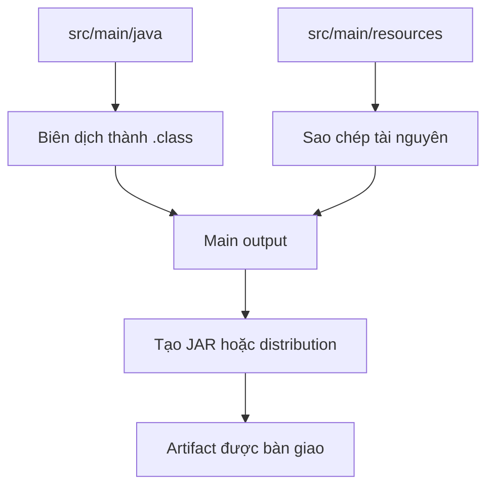

# Tránh đóng gói nhầm bí mật và cấu hình riêng của máy

Một dự án Java thường cần cấu hình để kết nối database, gọi API, lưu file hoặc bật một tính năng. Trong lúc phát triển, lập trình viên cũng có thể tạo các tệp cấu hình riêng cho máy của mình. Nếu những tệp này nằm trong thư mục tài nguyên hoặc bị build tool sao chép vào output, chúng có thể vô tình xuất hiện trong JAR, WAR hoặc distribution được bàn giao.

Rủi ro lớn nhất là đóng gói **bí mật** như mật khẩu, access token, API key, private key hoặc thông tin đăng nhập. Một vấn đề khác là đóng gói **cấu hình riêng của máy** như đường dẫn tuyệt đối, địa chỉ dịch vụ local, tên người dùng, port thử nghiệm hoặc cấu hình IDE. Những dữ liệu này có thể làm lộ thông tin hoặc khiến artifact chỉ chạy được trên máy đã tạo ra nó.

Nguyên tắc quan trọng là: **artifact nên chứa mã nguồn đã biên dịch, tài nguyên dùng chung và cấu hình mặc định không nhạy cảm; bí mật và giá trị phụ thuộc môi trường phải được cung cấp từ bên ngoài khi chạy**.

Bài học này giải thích cách tách cấu hình, cách build tool xử lý tài nguyên, những lỗi đóng gói thường gặp và cách kiểm tra artifact trước khi bàn giao.

## 1. Phân biệt bí mật, cấu hình môi trường và cấu hình máy cá nhân

Không phải mọi file cấu hình đều có cùng mức độ nhạy cảm. Trước khi quyết định đặt file ở đâu, hãy xác định nó thuộc loại nào.

### 1.1. Bí mật (secret)

Bí mật là dữ liệu mà người không được phép biết có thể dùng để truy cập hệ thống, giả mạo danh tính hoặc thực hiện hành động thay người sở hữu.

Ví dụ:

- Mật khẩu database.
- API key hoặc access token.
- Private key, signing key và chứng chỉ có khóa riêng.
- Credentials của repository hoặc dịch vụ cloud.
- Mật khẩu SMTP hoặc thông tin xác thực của dịch vụ bên ngoài.

Bí mật không nên nằm trong source code, file resource được đóng gói, build script hoặc repository Git. Đổi tên file thành application-prod.properties hoặc đặt nó trong thư mục config không làm nội dung trở nên an toàn.

### 1.2. Cấu hình theo môi trường

Cấu hình môi trường mô tả cách ứng dụng hoạt động ở development, test, staging hoặc production.

Ví dụ:

- Database host và database name.
- URL của dịch vụ bên ngoài.
- Port mà ứng dụng lắng nghe.
- Log level.
- Thư mục lưu file.
- Feature flag.

Một số giá trị không phải bí mật nhưng vẫn thay đổi theo môi trường. Nếu đóng cứng chúng vào artifact, nhóm có thể phải build lại cho từng môi trường và dễ triển khai nhầm cấu hình.

### 1.3. Cấu hình riêng của máy phát triển

Đây là những giá trị chỉ có ý nghĩa trên máy của một lập trình viên:

- Đường dẫn như C:\Users\An\workspace\project hoặc /home/dev/project.
- Địa chỉ localhost của một dịch vụ đang chạy cục bộ.
- Port đang được dùng bởi một ứng dụng khác.
- Tên người dùng hoặc thư mục home.
- Đường dẫn JDK, SDK hoặc thư mục công cụ cài đặt riêng.
- Cấu hình debug của IDE.

Những giá trị này thường nên ở file local không được commit, biến môi trường cá nhân hoặc run configuration của IDE. Chúng không nên đi vào artifact được chia sẻ.

### 1.4. Cấu hình mặc định không nhạy cảm

Ứng dụng có thể cần một số giá trị mặc định chung, ví dụ log level mặc định hoặc timeout an toàn. Những giá trị này có thể được đóng gói nếu chúng không chứa bí mật và không phụ thuộc vào máy cụ thể.

Một file mẫu có thể được commit:

```properties
app.name=sample-service
app.timeout-seconds=10
app.log-level=INFO
```

Giá trị mẫu không nên chứa credentials thật hoặc địa chỉ nội bộ mà người nhận không được phép biết.

## 2. Vì sao bí mật có thể lọt vào JAR hoặc distribution?

Build tool thường sao chép tài nguyên từ source resource directory vào thư mục output, sau đó đưa output vào artifact.

Ví dụ cấu trúc dự án:

```text
my-app/
├── src/
│   └── main/
│       ├── java/
│       │   └── com/example/Main.java
│       └── resources/
│           ├── application.properties
│           └── application-prod.properties
├── build.gradle
└── .gitignore
```

Với cấu hình Java thông thường, nội dung trong src/main/resources được sao chép vào main output. Nếu tạo JAR từ output đó, các file resource cũng sẽ nằm trong JAR.

Quy trình khái quát:



Nếu application-prod.properties chứa mật khẩu production và nằm trong src/main/resources, build tool có thể sao chép file đó rồi đóng gói vào JAR. Việc file có tên prod hoặc chỉ được dùng khi chạy production không ngăn nó bị đóng gói.

**Bất kỳ file nào nằm trong resource input được cấu hình để đóng gói đều cần được xem xét như một phần có thể xuất hiện trong artifact.**

## 3. Tách file mẫu và file cấu hình thật

Một cách tổ chức rõ ràng là commit file mẫu không nhạy cảm, còn file thật được tạo hoặc cung cấp ở môi trường chạy.

Ví dụ:

```text
my-app/
├── src/main/resources/
│   └── application-default.properties
├── config/
│   └── application.properties.example
├── .env.example
├── .gitignore
└── build.gradle
```

Ý nghĩa:

- application-default.properties chứa giá trị mặc định không nhạy cảm, có thể đóng gói.
- application.properties.example là mẫu để người triển khai tạo file cấu hình thật.
- .env.example chỉ liệt kê tên biến và giá trị minh họa, không chứa secret thật.
- File cấu hình thật nằm ở vị trí ngoài source resources và được cung cấp trên từng môi trường.

Ví dụ file mẫu:

```properties
# Copy this file to config/application.properties and set environment values.
app.port=8080
app.log-level=INFO
database.url=jdbc:postgresql://localhost:5432/example
database.username=CHANGE_ME
database.password=CHANGE_ME
```

File mẫu có thể được commit nếu mọi giá trị đều là placeholder. File cấu hình thật cần được bảo vệ và không được đưa vào artifact.

Nếu ứng dụng có framework hỗ trợ cấu hình ngoài, hãy dùng cơ chế của framework đó. Nếu không, ứng dụng có thể đọc đường dẫn cấu hình từ một biến môi trường hoặc tham số dòng lệnh.

## 4. Cung cấp cấu hình từ bên ngoài khi chạy

Một artifact có thể được sử dụng ở nhiều môi trường nếu các giá trị thay đổi được cung cấp lúc khởi chạy.

Các cách phổ biến:

- Environment variables.
- JVM system properties.
- Tham số dòng lệnh.
- File cấu hình bên ngoài artifact.
- Secret manager hoặc cơ chế inject secret của nền tảng triển khai.

### 4.1. Đọc environment variable trong Java

Ví dụ:

```java
package com.example;

public class Main {
    public static void main(String[] args) {
        String port = System.getenv().getOrDefault("APP_PORT", "8080");
        String databaseUrl = System.getenv("DATABASE_URL");
        String databaseUser = System.getenv("DATABASE_USERNAME");
        String databasePassword = System.getenv("DATABASE_PASSWORD");

        if (databaseUrl == null || databaseUrl.isBlank()) {
            throw new IllegalStateException("DATABASE_URL is required");
        }

        if (databaseUser == null || databaseUser.isBlank()) {
            throw new IllegalStateException("DATABASE_USERNAME is required");
        }

        if (databasePassword == null || databasePassword.isBlank()) {
            throw new IllegalStateException("DATABASE_PASSWORD is required");
        }

        System.out.println("Starting application on port " + port);
        // Initialize the application using the supplied configuration.
    }
}
```

Đoạn mã minh họa việc đọc cấu hình từ môi trường. Trong ứng dụng thật, không nên in mật khẩu hoặc token ra console, log hay exception message.

Biến môi trường cho phép cùng một JAR nhận các giá trị khác nhau mà không cần build lại. Tuy nhiên, biến môi trường cũng có thể bị lộ qua process inspection, diagnostic dump, log hoặc cấu hình CI sai. Hãy giới hạn quyền truy cập và dùng secret manager khi nền tảng hỗ trợ.

### 4.2. Truyền cấu hình bằng JVM system properties

Java có thể đọc system property:

```java
String region = System.getProperty("app.region", "local");
```

Khởi chạy:

```bash
java -Dapp.region=staging -jar my-app.jar
```

System property phù hợp với một số cấu hình khởi động, nhưng giá trị nhạy cảm vẫn có thể xuất hiện trong command history hoặc danh sách tham số tiến trình. Tránh truyền mật khẩu trực tiếp trên dòng lệnh nếu có lựa chọn an toàn hơn.

### 4.3. File cấu hình ngoài JAR

Một số ứng dụng cần file cấu hình đầy đủ hơn. Có thể đặt file ở thư mục bên ngoài artifact và truyền đường dẫn khi khởi chạy.

Ví dụ:

```bash
java -jar my-app.jar --config=/etc/my-app/application.properties
```

Đường dẫn trên chỉ là ví dụ cho môi trường Linux. Trên Windows hoặc nền tảng khác, đường dẫn và cách truyền tham số có thể khác.

Ứng dụng cần có logic đọc file ngoài JAR và xác định rõ thứ tự ưu tiên giữa cấu hình mặc định, file ngoài, environment variables và command-line arguments.

Một thứ tự thường gặp:

1. Cấu hình mặc định không nhạy cảm trong ứng dụng.
2. File cấu hình ngoài artifact.
3. Environment variables.
4. Tham số khởi chạy có mức ưu tiên cao hơn nếu framework quy định như vậy.

Thứ tự thực tế phụ thuộc framework và cách ứng dụng triển khai. Hãy tài liệu hóa để người vận hành biết giá trị nào đang được áp dụng.

## 5. Không commit file bí mật vào Git

File bí mật thường được tạo trên máy phát triển hoặc được cung cấp bởi môi trường triển khai. Cần thêm các mẫu file đó vào .gitignore.

Ví dụ:

```gitignore
# Local configuration
.env
.env.*
!.env.example

# Real application configuration
config/application.properties
config/application-*.properties
!config/application.properties.example

# Local credentials and keys
*.pem
*.key
secrets/
local-secrets/

# IDE and machine-specific files
.idea/
.vscode/
*.iml
.DS_Store
Thumbs.db
```

Các pattern trên chỉ là ví dụ. Cần điều chỉnh theo cấu trúc dự án để không vô tình bỏ qua những file cần commit, chẳng hạn file cấu hình mẫu.

Một số lưu ý:

- .gitignore chỉ ngăn Git theo dõi file chưa được track; nó không tự gỡ file đã commit trước đó.
- Nếu file đã được commit, thêm pattern vào .gitignore không xóa nội dung khỏi lịch sử Git.
- Không nên dùng wildcard quá rộng nếu có thể làm mất các file cấu hình mẫu hoặc tài nguyên hợp lệ.
- File local có thể cần quyền truy cập hạn chế trên máy.

Nếu file đã được đưa vào Git, cần loại nó khỏi index và xử lý secret như một thông tin có thể đã bị lộ.

Ví dụ bỏ file khỏi index nhưng giữ bản local:

```bash
git rm --cached config/application.properties
git commit -m "Stop tracking local application config"
```

Lệnh này không xóa file khỏi các commit cũ. Nếu file chứa secret thật, việc thu hồi hoặc xoay vòng secret là bước cần thực hiện; chỉ xóa file ở commit mới không làm secret cũ mất hiệu lực.

## 6. Tránh đóng gói cấu hình máy cá nhân

Cấu hình máy cá nhân thường lọt vào artifact theo các cách sau:

- File local được đặt trong src/main/resources.
- Build script sao chép cả thư mục config của máy phát triển.
- Resource filtering thay placeholder bằng giá trị từ môi trường local.
- Task đóng gói lấy nhầm thư mục output có chứa file tạm.
- Artifact được tạo từ thư mục dự án quá rộng, gom cả file local.
- File cấu hình được sinh ra trong main output trước khi đóng gói.

Không nên đặt file riêng của máy trong source resource directory chỉ vì ứng dụng dễ đọc nó ở đó. Hãy giữ source resources cho dữ liệu dùng chung và có chủ đích đưa vào artifact.

Ví dụ cấu trúc nên tách:

```text
my-app/
├── src/main/resources/
│   └── application-default.properties
├── config/
│   ├── application.properties.example
│   └── local/
│       └── README.md
├── .env.example
├── .env
└── build.gradle
```

File .env thật được ignore; config mẫu được commit; file default được đóng gói nếu không chứa thông tin nhạy cảm.

## 7. Kiểm soát resource processing trong Gradle

Gradle Java Plugin mặc định xử lý tài nguyên từ src/main/resources và đưa vào main output. Task processResources có thể được cấu hình để lọc hoặc loại file.

### 7.1. Chỉ đóng gói resource được phép

Có thể dùng exclude để loại file không được đưa vào output:

```groovy
tasks.named('processResources') {
    exclude 'local/**'
    exclude '**/*.local.properties'
    exclude '**/*.secret'
}
```

Đây là lớp phòng vệ bổ sung. Tốt hơn hết, secret và file local không nên nằm trong source resource directory ngay từ đầu.

### 7.2. Chọn file resource tường minh

Nếu dự án có nhiều loại tài nguyên, có thể cấu hình sourceSets để xác định rõ thư mục nguồn:

```groovy
sourceSets {
    main {
        resources {
            srcDirs = ['src/main/resources']
            exclude 'local/**'
            exclude '**/*.secret'
        }
    }
}
```

Khi cần thêm thư mục tài nguyên khác, hãy xem xét mục đích của nó trước khi thêm vào main resources. Thêm cả thư mục cấu hình local vào main resources có thể làm file riêng bị đóng gói.

### 7.3. Cẩn trọng với resource filtering

Gradle có thể thay placeholder trong file resource:

```groovy
tasks.named('processResources') {
    filesMatching('application.properties') {
        expand(
            appName: project.name,
            appVersion: project.version
        )
    }
}
```

Chỉ đưa vào expand những giá trị không nhạy cảm, ổn định và được phép xuất hiện trong artifact. Không truyền mật khẩu, token hoặc secret từ environment vào resource filtering.

Nếu build script thay placeholder như DATABASE_PASSWORD bằng giá trị môi trường, secret có thể được ghi thành văn bản rõ trong file output và JAR. Đây là một trong những cách vô tình đóng gói bí mật thường gặp.

### 7.4. Không copy toàn bộ thư mục máy cá nhân

Tránh cấu hình kiểu:

```groovy
tasks.named('processResources') {
    from(file(System.getProperty('user.home') + '/my-app-config'))
}
```

Cấu hình này làm artifact phụ thuộc vào thư mục riêng của người build và có thể sao chép dữ liệu ngoài dự án. Nếu thực sự cần file ngoài, hãy xác định rõ đó là input của task nào và file đó có thuộc artifact hay không. Với cấu hình runtime, thường nên cung cấp file bên ngoài lúc chạy thay vì copy vào JAR.

## 8. Kiểm soát resource processing trong Maven

Maven Resources Plugin sao chép tài nguyên từ resource directories vào output. Nếu cấu hình resource filtering, placeholder trong file có thể được thay bằng giá trị từ POM hoặc filter properties.

### 8.1. Loại file local khỏi resources

Ví dụ cấu hình trong pom.xml:

```xml
<build>
    <resources>
        <resource>
            <directory>src/main/resources</directory>
            <filtering>true</filtering>
            <excludes>
                <exclude>local/**</exclude>
                <exclude>**/*.secret</exclude>
                <exclude>**/*.local.properties</exclude>
            </excludes>
        </resource>
    </resources>
</build>
```

Ví dụ này loại một số pattern khỏi quá trình resource processing. Tuy nhiên, hãy tránh lưu secret trong thư mục này từ đầu.

Nếu không cần filtering, nên để filtering false hoặc không bật filtering cho toàn bộ resources. Chỉ bật cho những file thật sự cần thay placeholder.

### 8.2. Tách resource được filter và không được filter

Một số file nhị phân hoặc file chứa ký tự đặc biệt không nên bị filtering. Có thể khai báo hai resource block riêng:

```xml
<build>
    <resources>
        <resource>
            <directory>src/main/resources</directory>
            <filtering>false</filtering>
            <excludes>
                <exclude>application-template.properties</exclude>
            </excludes>
        </resource>

        <resource>
            <directory>src/main/resources</directory>
            <filtering>true</filtering>
            <includes>
                <include>application-template.properties</include>
            </includes>
        </resource>
    </resources>
</build>
```

Cấu hình này minh họa cách chỉ filter một file mẫu cụ thể. Các placeholder chỉ nên được thay bằng dữ liệu không nhạy cảm như tên ứng dụng hoặc phiên bản.

### 8.3. Cẩn thận với Maven filtering và environment

Maven filtering có thể lấy giá trị từ project properties, filter files hoặc system properties tùy cấu hình. Nếu những nguồn này chứa secret, resource đã xử lý có thể ghi secret vào target/classes rồi đi vào JAR.

Không nên dùng Maven filtering để nhúng credentials vào artifact. Thay vào đó, để ứng dụng đọc secret từ môi trường hoặc file cấu hình bên ngoài khi chạy.

## 9. Cấu hình bí mật trong CI/CD

Trong CI/CD, build thường cần credentials để truy cập repository riêng, ký artifact hoặc triển khai. Những credentials này phải được quản lý bởi hệ thống CI hoặc secret manager.

Các nguyên tắc:

- Lưu secret trong kho secret được bảo vệ của CI.
- Truyền secret vào tiến trình cần dùng trong phạm vi tối thiểu.
- Không in secret ra log.
- Không ghi secret vào file nằm trong output directory.
- Không truyền secret qua tham số dòng lệnh nếu chúng có thể bị hiển thị trong process list hoặc log.
- Giới hạn quyền và thời hạn sử dụng của token.
- Dùng credentials riêng cho từng môi trường.
- Thu hồi hoặc xoay vòng credentials khi có nghi ngờ bị lộ.

Ví dụ pipeline có thể inject biến môi trường DATABASE_PASSWORD từ secret store. Build artifact không cần chứa biến này; ứng dụng nhận nó khi được khởi chạy trong môi trường đích.

Cần phân biệt secret dùng cho build và secret dùng lúc chạy:

| Loại secret | Ví dụ | Cách quản lý |
|---|---|---|
| Build-time | Token tải dependency từ repository riêng | Secret store của CI hoặc settings cục bộ |
| Signing | Private key ký artifact | Hệ thống ký hoặc secret store chuyên dụng |
| Runtime | Database password, API token | Secret manager hoặc cơ chế secret của nền tảng chạy |
| Developer-local | Credentials sandbox cá nhân | Secret store hoặc file local được ignore |

Không nên nhúng runtime secret vào artifact chỉ vì CI có thể truy cập nó trong lúc build.

## 10. Kiểm tra JAR và distribution trước khi bàn giao

Không nên chỉ kiểm tra source tree rồi kết luận artifact an toàn. Hãy kiểm tra chính file đã tạo.

### 10.1. Liệt kê nội dung JAR

Dùng JDK:

```bash
jar --list --file build/libs/my-app.jar
```

Hoặc:

```bash
jar tf build/libs/my-app.jar
```

Kiểm tra xem có các file đáng ngờ như:

- application-prod.properties.
- application-local.properties.
- .env.
- credentials.json.
- id_rsa hoặc private key.
- File cấu hình chứa đường dẫn máy cá nhân.
- File log hoặc dump được tạo trong lúc phát triển.

Tên file không đủ để xác định an toàn; cần xem nội dung của file cấu hình được đóng gói.

### 10.2. Trích xuất và tìm nội dung nhạy cảm

Có thể giải nén JAR vào một thư mục tạm để kiểm tra:

```bash
mkdir artifact-check
cd artifact-check
jar xf ../build/libs/my-app.jar
```

Sau đó tìm các tên khóa nhạy cảm hoặc giá trị không nên xuất hiện. Ví dụ các từ khóa cần xem xét:

```text
password
secret
token
api-key
private-key
jdbc:
localhost
C:\Users\
/home/
```

Các từ khóa này chỉ hỗ trợ rà soát thủ công, có thể có false positive hoặc bỏ sót. Không nên dùng chúng như bằng chứng duy nhất rằng artifact an toàn.

### 10.3. Kiểm tra distribution

Nếu build tạo ZIP hoặc TAR, hãy liệt kê nội dung archive và kiểm tra cả thư mục config, bin, lib và file ẩn nếu có.

```bash
jar --list --file build/distributions/my-app.zip
```

Với ZIP/TAR, có thể dùng công cụ tương ứng trên hệ điều hành để xem danh sách file và trích xuất vào thư mục tạm. Kiểm tra file cấu hình, script khởi chạy và nội dung được copy từ thư mục build.

### 10.4. Kiểm tra bằng công cụ secret scanning

Các công cụ secret scanning có thể phát hiện một số dạng token, private key và credential trong source hoặc artifact. Có thể tích hợp bước quét vào CI trước khi lưu artifact hoặc tạo release.

Secret scanning là lớp kiểm tra bổ sung. Nó không thay thế việc thiết kế quy trình sao cho secret không được đưa vào resource input hoặc output ngay từ đầu.

## 11. Nếu bí mật đã bị đóng gói hoặc commit thì sao?

Nếu phát hiện secret thật trong JAR, ZIP, Git commit hoặc log, hãy coi secret đó có khả năng đã bị lộ.

Các bước xử lý thường gồm:

1. Xác định loại secret và hệ thống mà nó cấp quyền truy cập.
2. Thu hồi hoặc xoay vòng secret ngay theo quy trình của hệ thống sở hữu.
3. Kiểm tra artifact đã được tải lên, chia sẻ hoặc triển khai ở đâu.
4. Xóa secret khỏi source và cấu hình build để ngăn tái xuất hiện.
5. Tạo lại artifact từ đầu sau khi sửa.
6. Kiểm tra lại JAR/distribution và log.
7. Nếu secret đã nằm trong Git history, xử lý lịch sử theo quy trình repository của nhóm và phối hợp với những người đã clone repository.

Chỉ xóa file khỏi commit mới hoặc thêm vào .gitignore không làm secret trong lịch sử cũ mất hiệu lực. Xoay vòng secret là việc quan trọng hơn xóa dấu vết trong repository.

Không nên sao chép secret bị lộ vào ticket, chat hoặc báo cáo. Khi cần mô tả, chỉ nêu loại secret, vị trí và trạng thái xử lý, không đưa giá trị thật.

## 12. Những lỗi thường gặp

| Hiện tượng | Nguyên nhân có thể | Cách xử lý |
|---|---|---|
| JAR chứa application-prod.properties | File production nằm trong src/main/resources | Chuyển cấu hình thật ra ngoài artifact; chỉ giữ file mẫu hoặc default không nhạy cảm |
| JAR có file .env | Resource processing hoặc task copy đưa file local vào output | Ignore file local và loại khỏi resource inputs |
| Mật khẩu xuất hiện trong application.properties sau build | Resource filtering thay placeholder bằng secret môi trường | Không filter secret vào resource; đọc secret lúc runtime |
| Artifact chứa đường dẫn C:\Users\... | Build script hoặc resource ghi cứng đường dẫn máy cá nhân | Dùng cấu hình runtime hoặc đường dẫn tương đối có chủ đích |
| Build trên máy A được nhưng máy B lỗi | Artifact phụ thuộc file local không được bàn giao | Tách file cấu hình ngoài và tài liệu hóa yêu cầu runtime |
| .gitignore đã có nhưng secret vẫn trong Git | File đã được track từ trước | Gỡ khỏi index, xử lý history và xoay vòng secret |
| CI log có token | Script in biến môi trường hoặc command chứa credentials | Mask secret, tránh echo và dùng cơ chế inject an toàn |
| ZIP distribution chứa log hoặc file tạm | Task đóng gói lấy cả thư mục output quá rộng | Xác định rõ include/exclude và kiểm tra archive |
| Secret đã xóa nhưng artifact cũ còn tồn tại | Artifact được lưu ở registry hoặc đã chia sẻ | Thu hồi secret và xử lý các bản artifact đã phát hành |

## 13. Quy trình an toàn trước khi tạo artifact

Một quy trình có thể áp dụng cho dự án Java:

1. Phân loại file nào là resource dùng chung, cấu hình môi trường, file local và secret.
2. Chỉ commit cấu hình mẫu không nhạy cảm.
3. Đưa file cấu hình thật và secret ra ngoài src/main/resources.
4. Thêm file local vào .gitignore.
5. Kiểm tra sourceSets hoặc Maven resources để xác định file nào được copy.
6. Không dùng resource filtering để nhúng secret.
7. Dùng environment variables hoặc secret manager khi chạy.
8. Build artifact từ output đã xác định rõ.
9. Liệt kê và trích xuất JAR/distribution để kiểm tra.
10. Chạy secret scanning và rà soát file cấu hình.
11. Chỉ bàn giao artifact sau khi xác nhận không chứa bí mật hoặc cấu hình máy riêng.
12. Ghi rõ những biến môi trường và file cấu hình ngoài mà người triển khai phải cung cấp.

## 14. Ghi nhớ

- Secret là dữ liệu cấp quyền truy cập; không đưa vào source, resource hoặc artifact.
- Cấu hình theo môi trường và cấu hình máy cá nhân thường phải được cung cấp bên ngoài artifact.
- File trong src/main/resources thường được copy vào output và có thể đi vào JAR.
- File có tên production hoặc local vẫn có thể bị đóng gói nếu nằm trong resource input.
- .gitignore không gỡ file đã được Git track và không xóa secret khỏi lịch sử.
- Gradle processResources và Maven Resources Plugin có thể filter hoặc copy file; cần kiểm soát include/exclude.
- Không đưa password, token hoặc private key vào resource filtering.
- Dùng environment variables, file cấu hình ngoài hoặc secret manager để cung cấp giá trị khi chạy.
- Secret build-time, signing và runtime có mục đích khác nhau; quản lý chúng theo quyền tối thiểu.
- Kiểm tra chính JAR hoặc distribution bằng cách liệt kê, trích xuất và quét nội dung.
- Nếu secret đã bị lộ, thu hồi hoặc xoay vòng secret; xóa file khỏi source là chưa đủ.

## 15. Tự kiểm tra

1. Secret khác cấu hình môi trường ở điểm nào?
2. Vì sao file application-prod.properties trong src/main/resources có thể bị đóng gói dù chỉ dùng ở production?
3. Cấu hình mặc định nào có thể được đóng gói an toàn?
4. Vì sao không nên dùng resource filtering để thay password hoặc API token?
5. .gitignore có tự gỡ một file đã được commit không?
6. Làm thế nào để cung cấp database password cho ứng dụng khi chạy mà không nhúng vào JAR?
7. Gradle processResources và Maven Resources Plugin có thể ảnh hưởng đến artifact như thế nào?
8. Vì sao cần kiểm tra nội dung JAR sau khi build?
9. Nếu secret đã xuất hiện trong Git history hoặc artifact đã chia sẻ, cần xử lý gì trước?
10. Làm thế nào để phân biệt secret dùng lúc build với secret dùng lúc runtime?

Khi có thể tách bí mật và cấu hình máy khỏi tài nguyên được đóng gói, kiểm soát resource processing và xác minh chính artifact trước khi bàn giao, bạn đã nắm được cách tránh làm lộ thông tin nhạy cảm trong quy trình build Java.

