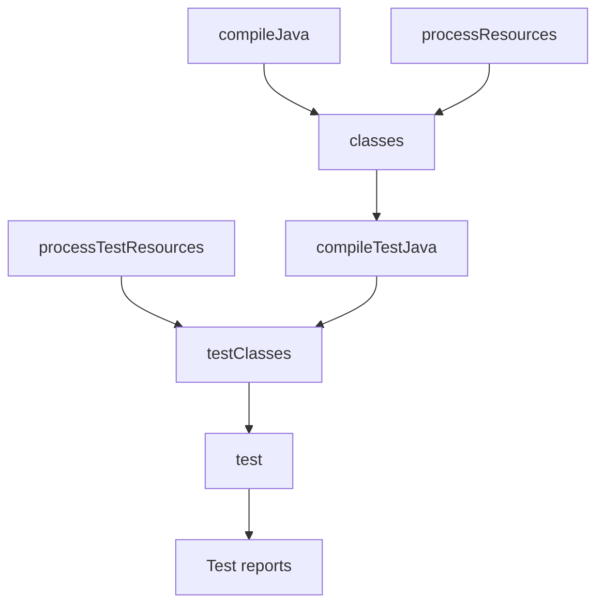
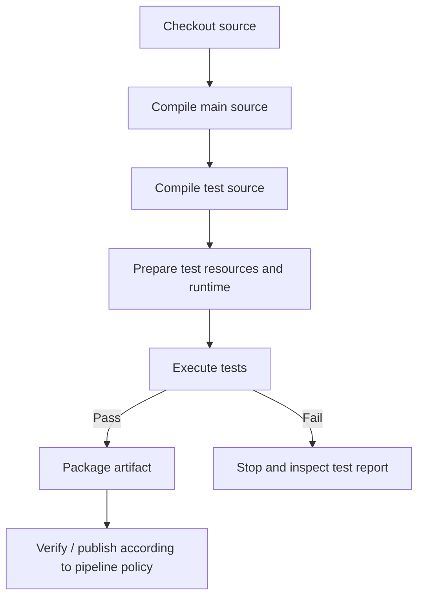

# Phân biệt biên dịch mã kiểm thử với thực thi kiểm thử

Trong một dự án Java, mã kiểm thử cũng là mã nguồn. Nó phải được biên dịch trước khi máy ảo Java có thể nạp và chạy các test. Tuy nhiên, **biên dịch mã kiểm thử (test compilation)** và **thực thi kiểm thử (test execution)** là hai công việc khác nhau, có đầu vào, classpath và mục tiêu riêng.

Biên dịch kiểm thử xác nhận rằng các file test có cú pháp và kiểu hợp lệ, các lớp được tham chiếu có thể được tìm thấy trên compile classpath, và mã test có thể chuyển thành bytecode. Thực thi kiểm thử nạp bytecode đó, tìm các phương thức hoặc lớp được đánh dấu là test, gọi test engine, chạy mã và đánh giá kết quả.

Vì vậy, một dự án có thể biên dịch test thành công nhưng vẫn có test thất bại khi chạy. Ngược lại, nếu mã test không biên dịch được, bước thực thi test không thể chạy những test đó. Hiểu ranh giới này giúp đọc build log chính xác, chọn đúng task khi cần kiểm tra và xác định lỗi thuộc compiler hay thuộc quá trình chạy chương trình.

## 1. Hai công việc có mục tiêu khác nhau

| Khía cạnh | Biên dịch mã kiểm thử | Thực thi kiểm thử |
|---|---|---|
| Mục tiêu | Chuyển mã nguồn test thành bytecode | Chạy các test và đánh giá hành vi |
| Đầu vào chính | File `.java` trong source set test, main output, compile classpath và compiler options | Bytecode test/main, test runtime classpath, test engine và môi trường chạy |
| Công cụ trực tiếp | Java compiler (`javac`) thông qua build tool | Test runner và test engine như JUnit Platform/Jupiter hoặc TestNG |
| Kết quả | File `.class` của test | Kết quả pass/fail/skip, báo cáo và log |
| Lỗi tiêu biểu | Sai cú pháp, không tìm thấy symbol, thiếu test API trên compile classpath | Assertion thất bại, exception, thiếu runtime dependency, không tìm thấy test engine |
| Có chạy method test không? | Không | Có |

Ví dụ, compiler có thể xác nhận rằng lời gọi `assertEquals(expected, actual)` hợp lệ và class `OrderService` tồn tại. Nó không gọi `OrderService.createOrder()` để kiểm tra kết quả thực tế. Việc gọi method, thực hiện assertion và ghi nhận pass/fail chỉ xảy ra khi test được thực thi.

## 2. Mã kiểm thử nằm ở đâu?

Với Gradle Java plugin và Maven, quy ước phổ biến là đặt mã kiểm thử trong `src/test/java` và tài nguyên kiểm thử trong `src/test/resources`:

```text
order-service/
└── src/
    ├── main/
    │   ├── java/
    │   │   └── com/example/OrderService.java
    │   └── resources/
    │       └── application.properties
    └── test/
        ├── java/
        │   └── com/example/OrderServiceTest.java
        └── resources/
            └── fixtures/order.json
```

`src/main/java` chứa mã nguồn ứng dụng. `src/test/java` chứa mã nguồn chỉ phục vụ kiểm thử. `src/test/resources` chứa fixture, dữ liệu mẫu và cấu hình dành riêng cho test.

Build tool tổ chức chúng thành hai source set hoặc nhóm đầu ra riêng. Nhờ đó, các lớp và thư viện chỉ dành cho test không tự động trở thành dependency runtime thông thường của ứng dụng được phát hành.

Các thư mục trên là quy ước mặc định, không phải giới hạn bắt buộc. Gradle có thể cấu hình `sourceSets`; Maven có thể cấu hình source/test source directory trong POM hoặc qua plugin.

## 3. Giai đoạn biên dịch mã kiểm thử

### 3.1. Compiler làm gì?

Java compiler đọc mã nguồn test và kiểm tra các điều kiện cần thiết để tạo bytecode:

- Cú pháp Java hợp lệ.
- Kiểu dữ liệu và chữ ký method được sử dụng đúng.
- Các lớp, interface, method và field được tham chiếu có thể được phân giải.
- Các import trỏ đến package và kiểu có trong compile classpath hoặc module path phù hợp.
- Các tùy chọn ngôn ngữ và phiên bản bytecode tương thích với cấu hình compiler.

Ví dụ test:

```java
package com.example;

import org.junit.jupiter.api.Test;

import static org.junit.jupiter.api.Assertions.assertEquals;

class OrderServiceTest {
    @Test
    void createsOrderWithExpectedStatus() {
        OrderService service = new OrderService();

        String status = service.createOrder();

        assertEquals("CREATED", status);
    }
}
```

Khi biên dịch, compiler kiểm tra rằng `OrderService` có thể được tìm thấy, `createOrder()` tồn tại với kiểu trả về phù hợp, JUnit API có trên compile classpath, và các lời gọi assertion hợp lệ. Compiler không gọi `createOrder()` và không so sánh giá trị trả về với chuỗi `CREATED`.

Nếu method `createOrder()` thực tế trả về `PENDING`, mã test vẫn có thể biên dịch thành công. Sai khác chỉ được phát hiện khi test chạy và assertion được thực thi.

### 3.2. Compile classpath của test

Mã test thường sử dụng cả lớp chính của ứng dụng lẫn thư viện kiểm thử. Vì vậy, test compile classpath thường bao gồm:

- Đầu ra đã biên dịch của mã nguồn chính.
- Dependency cần để biên dịch mã nguồn test.
- Các dependency compile khác mà cấu hình test kế thừa theo quy tắc build tool.

Ví dụ, test gọi `new OrderService()` nên cần nhìn thấy class `OrderService`. Test import `org.junit.jupiter.api.Test` nên cần JUnit API trên compile classpath.

Nếu JUnit chỉ có trong runtime classpath nhưng không có trên compile classpath, compiler sẽ báo lỗi không tìm thấy package hoặc symbol khi xử lý import và annotation. Ngược lại, nếu một test chỉ biên dịch mà thiếu test engine ở runtime, vấn đề có thể chỉ xuất hiện khi chạy test.

### 3.3. Tài nguyên kiểm thử được xử lý riêng

Test có thể cần file JSON, CSV hoặc properties. Build tool xử lý `src/test/resources` và đặt chúng vào test output để test có thể tìm bằng classpath resource API.

Ví dụ:

```java
try (var input = getClass().getResourceAsStream("/fixtures/order.json")) {
    if (input == null) {
        throw new IllegalStateException("Missing test fixture");
    }
    // Đọc dữ liệu fixture
}
```

Xử lý resource kiểm thử và biên dịch mã kiểm thử là hai công việc riêng. Một task tổng hợp có thể yêu cầu cả hai hoàn tất trước khi test chạy.

### 3.4. Đầu ra của biên dịch kiểm thử

Với Gradle Java plugin, lớp test được đặt mặc định trong `build/classes/java/test`, còn test resource được xử lý vào `build/resources/test`. Với Maven, đầu ra thường nằm trong `target/test-classes`.

Ví dụ Gradle:

```text
build/
├── classes/java/main/
│   └── com/example/OrderService.class
├── resources/main/
│   └── application.properties
├── classes/java/test/
│   └── com/example/OrderServiceTest.class
└── resources/test/
    └── fixtures/order.json
```

Các file `.class` trong `classes/java/test` là đầu ra của compiler. Chúng chưa phải kết quả pass/fail và cũng không chứng minh test đã chạy.

## 4. Giai đoạn thực thi kiểm thử

### 4.1. Test runner và test engine

Sau khi test đã được biên dịch, test runner chịu trách nhiệm khởi chạy quá trình kiểm thử. Runner cần biết cách tìm test, framework nào xử lý test và classpath nào cung cấp các thành phần runtime.

Với JUnit 5, JUnit Platform cung cấp nền tảng chạy test và JUnit Jupiter là test engine xử lý các test viết bằng API Jupiter như `@Test`, `@BeforeEach` và `@AfterEach`. Các framework khác có thể dùng engine hoặc provider tương ứng.

Quá trình thực thi thường gồm các bước:

1. Tạo test runtime classpath hoặc module path.
2. Khởi động test runner.
3. Khám phá các test phù hợp với engine, tên lớp, annotation và filter.
4. Tạo instance test và thực hiện lifecycle callback theo framework.
5. Gọi method test.
6. Đánh giá assertion và ghi nhận kết quả.
7. Thu thập log, exception và báo cáo.

Một test có thể biên dịch thành công nhưng không được phát hiện nếu tên lớp hoặc method không phù hợp quy tắc discovery, filter loại bỏ test, hoặc engine cần thiết không có trên runtime classpath.

### 4.2. Runtime classpath của test

Runtime classpath có thể chứa các thành phần mà compiler không cần để kiểm tra mã nguồn nhưng test runner cần khi thực thi. Ví dụ:

- JUnit engine hoặc TestNG runtime.
- Thư viện hỗ trợ test chỉ cần khi chạy.
- Driver database hoặc client kết nối dịch vụ cho integration test.
- Thư viện mock, fixture hoặc assertion có phần runtime.
- Các dependency runtime của ứng dụng.

Một dependency có thể nằm trên compile classpath mà không có nghĩa mọi thành phần runtime đã sẵn sàng. Vì vậy cần phân biệt `testCompileClasspath` với `testRuntimeClasspath` trong Gradle, hoặc scope test và dependency tree trong Maven.

### 4.3. Assertion chỉ được đánh giá khi test chạy

Assertion là điều kiện mà test dùng để so sánh kết quả thực tế với kết quả mong đợi. Ví dụ:

```java
assertEquals("CREATED", status);
```

Compiler chỉ kiểm tra lời gọi `assertEquals` có hợp lệ về kiểu và chữ ký hay không. Khi test runner gọi method test, JUnit mới thực thi assertion. Nếu giá trị thực tế không bằng giá trị mong đợi, test được ghi nhận là thất bại.

Tương tự, exception do code ứng dụng ném ra, timeout, lỗi kết nối database hoặc lỗi cấu hình môi trường chỉ được quan sát trong lúc chạy test, trừ khi chúng gây ra lỗi ngay trong quá trình biên dịch (điều hiếm gặp với các vấn đề runtime thông thường).

### 4.4. Kết quả thực thi

Test runner ghi nhận trạng thái của từng test, thường gồm:

- **Passed:** test chạy và các điều kiện mong đợi đều đạt.
- **Failed:** test chạy nhưng assertion hoặc điều kiện xác minh không đạt.
- **Aborted/Skipped:** test bị hủy hoặc bỏ qua theo điều kiện/framework/configuration.
- **Error:** test không hoàn tất do exception hoặc lỗi môi trường không được xử lý như một assertion failure.

Tên trạng thái cụ thể và cách hiển thị phụ thuộc test framework và build tool. Báo cáo giúp xác định test nào chạy, test nào thất bại và stack trace hoặc thông tin liên quan.

## 5. Hai bước trong Gradle Java plugin

Gradle Java plugin tạo task riêng cho biên dịch test, xử lý test resource và thực thi test. Các task thường gặp:

| Task | Công việc |
|---|---|
| `compileJava` | Biên dịch mã nguồn chính |
| `processResources` | Xử lý tài nguyên chính |
| `classes` | Gom các đầu ra chính cần thiết |
| `compileTestJava` | Biên dịch mã nguồn test |
| `processTestResources` | Xử lý tài nguyên test |
| `testClasses` | Gom đầu ra đã biên dịch và tài nguyên của test source set |
| `test` | Thực thi các test được phát hiện |

Task graph khái quát:



Sơ đồ minh họa quan hệ tiêu biểu của Java plugin. Task graph thực tế có thể có thêm task, dependency và cấu hình do plugin khác hoặc build script bổ sung.

### 5.1. Chỉ biên dịch mã test

Chạy:

```bash
./gradlew compileTestJava
```

Gradle thực hiện các task tiền đề cần thiết để có main output và compile classpath, sau đó biên dịch mã test. Lệnh này không yêu cầu task `test` chạy các method test.

Nếu mã test có lỗi cú pháp hoặc không tìm thấy JUnit API, lệnh có thể thất bại tại `compileTestJava`. Nếu biên dịch thành công, ta chỉ biết test source có thể được chuyển thành bytecode theo cấu hình hiện tại.

### 5.2. Xử lý đầy đủ test classes nhưng chưa thực thi test

Chạy:

```bash
./gradlew testClasses
```

Task tổng hợp `testClasses` yêu cầu đầu ra của các task như `compileTestJava` và `processTestResources`. Nó chuẩn bị test output để runner sử dụng, nhưng không thực thi test.

Đây là lệnh hữu ích khi muốn xác nhận mã test và fixture đã được chuẩn bị mà chưa cần khởi động test runner hoặc dịch vụ tích hợp.

### 5.3. Thực thi test

Chạy:

```bash
./gradlew test
```

Task `test` phụ thuộc vào test classes và runtime classpath. Gradle khởi chạy test execution, phát hiện test phù hợp và ghi kết quả. Nếu test source không biên dịch được, các task tiền đề thất bại nên test không thể thực thi.

Có thể lọc một nhóm test:

```bash
# Chỉ chạy các test có tên phù hợp
./gradlew test --tests "com.example.OrderServiceTest"

# Chạy một test method cụ thể
./gradlew test --tests "com.example.OrderServiceTest.createsOrderWithExpectedStatus"
```

Filter chỉ tác động đến test được thực thi; nó không biến `compileTestJava` thành một bước chạy assertion. Mã test cần được biên dịch trước khi runner có thể gọi nó.

### 5.4. Cấu hình JUnit Jupiter trong Gradle

Ví dụ Groovy DSL:

```groovy
plugins {
    id 'java'
}

repositories {
    mavenCentral()
}

dependencies {
    testImplementation 'org.junit.jupiter:junit-jupiter:5.10.3'
    testRuntimeOnly 'org.junit.platform:junit-platform-launcher'
}

tasks.named('test') {
    useJUnitPlatform()
}
```

Ở đây:

- `testImplementation` cung cấp JUnit API cho biên dịch test và các dependency cần thiết trong test configuration.
- `testRuntimeOnly` cung cấp launcher chỉ cần khi chạy test.
- `useJUnitPlatform()` cấu hình task `test` sử dụng JUnit Platform để khám phá và thực thi test.

Nếu thiếu JUnit API trên compile classpath, `compileTestJava` có thể lỗi với thông báo không tìm thấy `org.junit.jupiter.api`. Nếu thiếu engine hoặc thành phần runtime cần thiết, mã test có thể biên dịch được nhưng test execution không chạy đúng hoặc không phát hiện test. Cần phân tích lỗi ở đúng task và runtime classpath.

### 5.5. Báo cáo test của Gradle

Sau khi `test` chạy, Gradle Java plugin thường tạo báo cáo HTML trong:

```text
build/reports/tests/test/index.html
```

Kết quả XML thường nằm trong:

```text
build/test-results/test/
```

Đường dẫn có thể được tùy chỉnh. Báo cáo cho biết test nào pass, fail hoặc bị bỏ qua; khi thất bại, có thể xem assertion message và stack trace để xác định nguyên nhân.

## 6. Biên dịch test và thực thi test trong Maven

Maven tổ chức build theo lifecycle và phase. Với default lifecycle, các phase liên quan đến kiểm thử xuất hiện theo thứ tự:

```text
process-resources
        |
        v
compile
        |
        v
process-test-resources
        |
        v
test-compile
        |
        v
test
```

Mỗi phase có thể kích hoạt một hoặc nhiều plugin goal. Với dự án Java Maven thông thường:

| Phase | Công việc tiêu biểu |
|---|---|
| `process-test-resources` | Sao chép/xử lý tài nguyên test |
| `test-compile` | Biên dịch mã nguồn trong test source directory |
| `test` | Chạy unit test qua Maven Surefire Plugin |

### 6.1. Chỉ biên dịch mã test với Maven

Chạy:

```bash
./mvnw test-compile
```

Maven thực thi các phase trước đó của default lifecycle đến `test-compile`, bao gồm biên dịch mã nguồn chính, xử lý test resources và biên dịch mã nguồn test. Lệnh này chưa đi tới phase `test`, vì vậy Surefire chưa chạy unit test theo lifecycle thông thường.

Nếu test source có lỗi compiler, Maven dừng tại bước `test-compile`. Nếu lệnh thành công, điều đó xác nhận mã test đã biên dịch, không xác nhận assertion đã chạy.

### 6.2. Thực thi test với Maven

Chạy:

```bash
./mvnw test
```

Maven đi qua các phase cần thiết trước `test`, bao gồm `test-compile`, sau đó thực thi goal của Maven Surefire Plugin được gắn vào phase `test`. Surefire tìm và chạy các test theo cấu hình và quy tắc discovery của nó.

Vì vậy, `mvn test` thường vừa biên dịch mã test vừa chạy test. Nếu muốn tách riêng hai công việc để điều tra, có thể chạy `mvn test-compile` trước, sau đó `mvn test`.

### 6.3. Cấu hình JUnit 5 trong Maven

Ví dụ phần liên quan trong `pom.xml`:

```xml
<properties>
    <maven.compiler.release>21</maven.compiler.release>
    <junit.version>5.10.3</junit.version>
</properties>

<dependencies>
    <dependency>
        <groupId>org.junit.jupiter</groupId>
        <artifactId>junit-jupiter</artifactId>
        <version>${junit.version}</version>
        <scope>test</scope>
    </dependency>
</dependencies>

<build>
    <plugins>
        <plugin>
            <groupId>org.apache.maven.plugins</groupId>
            <artifactId>maven-surefire-plugin</artifactId>
            <version>3.5.2</version>
        </plugin>
    </plugins>
</build>
```

Dependency JUnit có scope `test`, nên nó phục vụ biên dịch và thực thi test của project. Maven Surefire chịu trách nhiệm chạy unit test trong phase `test`. Phiên bản plugin và cấu hình thực tế nên được quản lý theo chính sách của dự án, ví dụ qua parent POM hoặc `pluginManagement`.

### 6.4. Báo cáo Surefire

Maven Surefire thường ghi báo cáo trong:

```text
target/surefire-reports/
```

Các file báo cáo giúp xác định số test chạy, test thất bại, lỗi và thời gian thực thi. Nếu `test-compile` thành công nhưng `test` thất bại, hãy mở báo cáo Surefire để biết lỗi xảy ra trong test nào.

## 7. So sánh lệnh Gradle và Maven

| Mục tiêu | Gradle Java plugin | Maven default lifecycle |
|---|---|---|
| Biên dịch mã nguồn chính | `compileJava` | `compile` |
| Xử lý test resources | `processTestResources` | `process-test-resources` |
| Biên dịch mã test | `compileTestJava` | `test-compile` phase |
| Chuẩn bị toàn bộ test output | `testClasses` | Không có một phase mặc định riêng tương đương hoàn toàn; `test-compile` hoàn tất các bước chuẩn bị trước test |
| Thực thi unit test | `test` | `test` phase qua Surefire |
| Xem các công việc có thể chạy | `./gradlew tasks --all` | `./mvnw help:describe` hoặc xem lifecycle/plugin goal |

Khác biệt về cách tổ chức:

- Gradle cho phép gọi task riêng. `compileTestJava` chỉ biên dịch test; `test` là task thực thi test và phụ thuộc vào các task chuẩn bị cần thiết.
- Maven dùng phase theo thứ tự. Gọi `test-compile` chạy các phase trước đó đến biên dịch test; gọi `test` tiếp tục đến phase thực thi test.

Không nên suy luận hai lệnh chỉ vì tên gần giống nhau. Hãy xác định phase hoặc task mà lệnh yêu cầu và các công việc được nối vào nó.

## 8. Phân loại lỗi theo đúng giai đoạn

### 8.1. Lỗi biên dịch mã test

Ví dụ thông báo:

```text
error: cannot find symbol
    OrderService service = new OrderService();
    ^
```

Hoặc:

```text
package org.junit.jupiter.api does not exist
```

Đây là lỗi compiler. Các nguyên nhân có thể gồm:

- Tên lớp hoặc method trong test không đúng.
- Thiếu import hoặc sai package.
- Dependency chứa API test chưa có trong test compile classpath.
- Mã nguồn chính chưa được đưa vào classpath test.
- Cấu hình source set hoặc test source directory sai.
- Compiler options hoặc Java version không tương thích với mã nguồn.

Hướng điều tra là xem task compile test, source file và compile classpath. Chạy lại test runner không giải quyết được lỗi compiler.

### 8.2. Test biên dịch thành công nhưng không tìm thấy test

Một số nguyên nhân:

- Tên lớp hoặc method không phù hợp quy tắc discovery.
- Annotation test không thuộc framework/engine đang được cấu hình.
- JUnit Platform chưa được chọn trong Gradle `Test` task.
- Test engine thiếu trên runtime classpath.
- Test filter loại bỏ lớp hoặc method.
- Test source set không nằm trong task đang chạy.

Trong trường hợp này, hãy kiểm tra cấu hình runner, engine, runtime classpath và test filter. Không nên mặc định rằng test đã chạy chỉ vì file `.class` tồn tại.

### 8.3. Test được phát hiện nhưng thất bại

Ví dụ:

```text
expected: <CREATED> but was: <PENDING>
```

Đây là assertion failure. Mã test đã được biên dịch, runner đã gọi test và điều kiện kiểm tra không đạt. Cần đọc assertion, dữ liệu đầu vào và logic ứng dụng để tìm nguyên nhân.

### 8.4. Test lỗi do môi trường runtime

Ví dụ test cần kết nối database nhưng CI chưa khởi động database. Mã test có thể biên dịch thành công, nhưng khi thực thi sẽ nhận `Connection refused` hoặc timeout.

Đây là lỗi runtime/test environment. Cần kiểm tra dịch vụ phụ trợ, biến môi trường, port, credentials và cấu hình integration test.

### 8.5. Bảng phân biệt nhanh

| Dấu hiệu | Giai đoạn có vấn đề | Nên kiểm tra |
|---|---|---|
| `cannot find symbol` trong file test | Test compilation | Mã test, import, compile classpath |
| `package ... does not exist` với JUnit API | Test compilation | `testImplementation` hoặc Maven test dependency |
| `No tests found` | Test discovery/execution | Engine, naming convention, annotation và filter |
| `NoClassDefFoundError` khi test chạy | Test runtime | Runtime dependency và classpath |
| `expected ... but was ...` | Test execution | Assertion và hành vi ứng dụng |
| `Connection refused` | Test execution/environment | Dịch vụ tích hợp và cấu hình runtime |
| Test bị skip | Test execution/configuration | Điều kiện skip, assumption, filter và report |

## 9. Vì sao compile test thành công chưa chứng minh chất lượng?

Compiler chỉ kiểm tra một phần tính đúng đắn của chương trình. Nó không xác nhận rằng:

- Method được gọi trả về kết quả đúng.
- Database lưu dữ liệu chính xác.
- HTTP endpoint trả về status và body mong đợi.
- Race condition hoặc lỗi đồng thời không xảy ra.
- File cấu hình tồn tại trong môi trường triển khai.
- Test fixture có nội dung phù hợp.
- Tất cả test đã được phát hiện và thực thi.

Do đó, compile test là điều kiện cần để test có thể chạy, nhưng không thay thế test execution. Một lệnh chỉ biên dịch test hữu ích cho kiểm tra nhanh, song pipeline CI thường cần thực thi test trước khi coi build đã được kiểm chứng.

Ngược lại, thực thi test cũng không thay thế hoàn toàn biên dịch. Khi test source thay đổi, build cần biên dịch lại để runner sử dụng đúng bytecode tương ứng. Build tool liên kết hai bước để bảo đảm test được chạy từ source hiện tại.

## 10. Incremental build và trạng thái task

Gradle theo dõi input/output của task để quyết định khi nào cần chạy lại. Vì vậy, khi gọi `./gradlew test`, không nhất thiết mọi task compile test và mọi test đều phải thực hiện lại từ đầu.

Một số trạng thái thường gặp trong log Gradle:

- `SUCCESS`: task đã thực thi thành công.
- `UP-TO-DATE`: đầu vào và đầu ra hợp lệ nên task được bỏ qua.
- `FROM-CACHE`: đầu ra được khôi phục từ build cache.
- `NO-SOURCE`: không có source phù hợp để xử lý.
- `SKIPPED`: task bị bỏ qua theo điều kiện hoặc cấu hình.
- `FAILED`: task thất bại.

Nếu `compileTestJava` là `UP-TO-DATE`, điều đó có nghĩa Gradle không cần biên dịch lại mã test theo trạng thái input/output hiện tại. Nó không có nghĩa test đã chạy. Task `test` có trạng thái riêng và có thể được thực thi hoặc bỏ qua theo trạng thái của chính nó.

Tương tự, nếu test không có source hoặc không có test được phát hiện, task có thể báo `NO-SOURCE` hoặc kết quả không có test theo cấu hình. Hãy đọc trạng thái từng task và báo cáo thay vì chỉ nhìn dòng cuối `BUILD SUCCESSFUL`.

Với task tự viết, cần khai báo input/output chính xác. Nếu một biến môi trường ảnh hưởng đến test nhưng bị bỏ sót khỏi input của task liên quan, incremental build có thể không phản ánh thay đổi môi trường như mong muốn. Các task test chuẩn của Gradle đã quản lý nhiều đầu vào phổ biến, nhưng task tùy chỉnh và integration setup vẫn cần được mô hình hóa cẩn thận.

## 11. Chạy riêng từng bước để điều tra

Khi build lỗi, có thể tách bước để tìm ranh giới vấn đề.

### Gradle

```bash
# Chỉ biên dịch mã nguồn test
./gradlew compileTestJava

# Biên dịch và xử lý resource của test
./gradlew testClasses

# Thực thi test
./gradlew test

# Chạy test với log chi tiết hơn
./gradlew test --info

# Buộc task chạy lại để điều tra trạng thái up-to-date/cache
./gradlew test --rerun-tasks
```

### Maven

```bash
# Biên dịch mã test, chưa chạy test phase
./mvnw test-compile

# Biên dịch và chạy unit test
./mvnw test

# Chạy với log chi tiết
./mvnw -X test
```

`--rerun-tasks` của Gradle hữu ích khi cần xác nhận task bị bỏ qua do trạng thái incremental hay cache. `-X` của Maven tạo log rất chi tiết; chỉ nên dùng khi cần điều tra vì output có thể dài và chứa thông tin cấu hình cần xử lý cẩn thận.

## 12. Unit test và integration test trong quy trình

Phân biệt compile và execution cũng quan trọng khi dự án có nhiều nhóm test.

- **Unit test** thường kiểm tra logic nhỏ, chạy nhanh và ít phụ thuộc dịch vụ bên ngoài.
- **Integration test** kiểm tra nhiều thành phần phối hợp, có thể cần database, message broker, HTTP service hoặc container.

Cả hai nhóm đều có bước biên dịch mã test và bước thực thi test. Tuy nhiên, dự án có thể dùng source set/task riêng cho integration test để tách dependency, runtime classpath và điều kiện chạy.

Với Maven, Failsafe Plugin thường được dùng cho integration test ở các phase `integration-test` và `verify`. Việc tách verify giúp Maven tổng hợp kết quả sau khi các bước integration test và teardown hoàn tất. Unit test thông thường vẫn chạy qua Surefire ở phase `test`.

Với Gradle, có thể tạo source set và task `Test` riêng cho integration test. Task đó cần test classes, runtime classpath và các dịch vụ hỗ trợ thích hợp. Không nên giả định task `test` mặc định tự chạy mọi integration test của dự án.

## 13. Đưa hai bước vào CI pipeline

Một pipeline thường cần biên dịch mã test và thực thi test trước khi tạo artifact được coi là đã kiểm tra. Với Gradle Java plugin, lệnh `./gradlew build` mặc định gắn các bước kiểm tra và lắp ráp theo quy ước plugin; task `build` phụ thuộc vào `check` và `assemble`, trong đó `check` bao gồm test task chuẩn.

Với Maven, gọi `./mvnw verify` sẽ đi qua các phase trước đó của default lifecycle, gồm compile, test-compile, test và các bước verify được cấu hình.

Luồng khái quát:



Trong thực tế, xử lý resource test có thể chạy song song với compile test nếu task graph cho phép; sơ đồ trên thể hiện quan hệ logic cần hoàn tất trước khi test được chạy. Pipeline có thể bổ sung static analysis, coverage, integration test, security scan hoặc bước publish.

Điều quan trọng là lệnh CI phải thật sự yêu cầu task/phase thực thi test. Nếu pipeline chỉ gọi `compileTestJava` hoặc Maven `test-compile`, nó mới xác nhận mã test biên dịch được. Nó chưa xác nhận test pass.

## 14. Bài tập vận dụng

Một project Gradle có `OrderService.java` trong `src/main/java` và `OrderServiceTest.java` trong `src/test/java`. Test dùng JUnit Jupiter và đọc fixture `src/test/resources/fixtures/order.json`.

Hãy trả lời:

1. Task nào biên dịch `OrderService.java`?
2. Task nào biên dịch `OrderServiceTest.java`?
3. Task nào xử lý fixture `order.json`?
4. Nếu `./gradlew compileTestJava` thành công, ta đã biết điều gì và chưa biết điều gì?
5. Task nào thực sự gọi method `createsOrderWithExpectedStatus()`?
6. Nếu test biên dịch được nhưng không được phát hiện, cần kiểm tra những thành phần nào?
7. Nếu assertion báo `expected CREATED but was PENDING`, lỗi thuộc giai đoạn nào?
8. Trong Maven, lệnh nào dừng ở bước biên dịch test và lệnh nào tiếp tục chạy unit test?
9. Vì sao `BUILD SUCCESSFUL` sau `compileTestJava` không chứng minh test đã pass?

Có thể kiểm chứng bằng cách chạy lần lượt `./gradlew compileTestJava`, `./gradlew testClasses` và `./gradlew test`. Quan sát task nào xuất hiện trong log, thư mục output nào được tạo và báo cáo nào chỉ xuất hiện sau khi test execution chạy. Với Maven, so sánh `./mvnw test-compile` và `./mvnw test`, rồi xem thư mục `target/surefire-reports`.

Khi đọc build log, hãy luôn xác định lỗi xuất hiện ở task biên dịch test hay task thực thi test. Biên dịch xác nhận test source có thể trở thành bytecode; thực thi mới xác nhận test được phát hiện, chạy và cho kết quả. Hai bước liên kết với nhau trong build pipeline nhưng trả lời hai câu hỏi chất lượng khác nhau.
