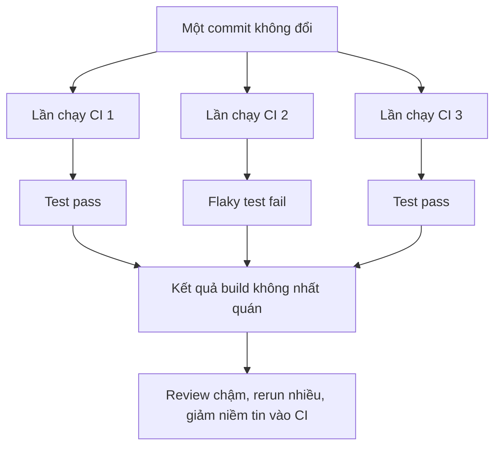

# Kiểm thử không ổn định và ảnh hưởng đến độ tin cậy của build

Một build đáng tin cậy cần cho nhóm phát triển biết liệu thay đổi mã nguồn có đáp ứng các yêu cầu đã kiểm tra hay không. Nếu cùng một commit, cùng một bộ test và cùng điều kiện chạy nhưng lúc thành công, lúc thất bại, kết quả build sẽ khó được tin tưởng. Hiện tượng đó thường được gọi là **flaky test** — kiểm thử không ổn định.

Flaky test có thể làm pipeline báo lỗi dù mã nguồn không thay đổi, khiến nhóm mất thời gian điều tra những lần thất bại giả. Nếu hệ thống tự động chạy lại test và chỉ giữ kết quả cuối cùng, nó có thể che giấu lỗi thật hoặc làm nhóm quen với việc bỏ qua cảnh báo. Cả hai tình huống đều làm giảm giá trị của build như một tín hiệu chất lượng.

Bài học này giải thích cách nhận diện flaky test, các nguồn gây không ổn định, ảnh hưởng đến build và CI, cách thiết kế test xác định được, cách điều tra và cách sử dụng retry hoặc quarantine có kiểm soát trong Gradle, Maven và pipeline.

## 1. Flaky test là gì?

Một **flaky test** là test có thể cho kết quả khác nhau giữa các lần chạy dù mã nguồn và điều kiện đầu vào được cho là không đổi. Test có thể lúc pass, lúc fail mà không có thay đổi tương ứng trong sản phẩm.

Ví dụ, một test kiểm tra dịch vụ xử lý đơn hàng:

```java
@Test
void shouldCreateOrder() {
    Order order = orderService.create(customerId);

    assertNotNull(order);
    assertEquals("CREATED", order.status());
}
```

Nếu test này chỉ thất bại khi một test khác chạy trước và để lại dữ liệu trong database dùng chung, kết quả của nó phụ thuộc vào thứ tự thực thi. Khi chạy riêng, test có thể luôn pass; khi chạy toàn bộ suite, nó có thể thất bại không ổn định.

Flaky test thường biểu hiện theo một số dạng:

- Cùng test, cùng commit nhưng pass ở máy lập trình viên và fail trên CI.
- Test pass khi chạy riêng nhưng fail khi chạy cùng toàn bộ suite.
- Test fail ở lần đầu, pass khi chạy lại mà không có thay đổi nào.
- Test chỉ fail vào một số thời điểm, ngày trong tuần hoặc khi máy chạy tải cao.
- Test chỉ fail khi chạy song song hoặc khi thứ tự test thay đổi.

Không phải mọi lỗi chỉ xảy ra một lần đều là flaky test. Một lỗi do service bên ngoài ngừng hoạt động, runner hết dung lượng hoặc dependency repository không truy cập được có thể là lỗi môi trường/hạ tầng. Tuy vậy, nếu test phụ thuộc vào các điều kiện ngoài tầm kiểm soát và vì thế cho kết quả thất thường, vấn đề vẫn cần được xử lý trong thiết kế test hoặc cách vận hành pipeline.

## 2. Vì sao flaky test làm giảm độ tin cậy của build?

Build và test thường được dùng làm cổng kiểm soát trước khi merge hoặc release. Khi một test thất thường, trạng thái xanh/đỏ của pipeline không còn phản ánh rõ chất lượng của commit.



### 2.1. False negative: build đỏ dù thay đổi không gây lỗi

Một flaky test có thể làm pipeline thất bại khi commit thực tế không gây ra regression. Nhóm phải mở log, chạy lại job, kiểm tra runner và xác minh xem có lỗi sản phẩm hay không.

Nếu hiện tượng lặp lại, thời gian review và merge tăng lên. Developer có thể phải rerun nhiều lần để lấy trạng thái xanh, trong khi nguyên nhân gốc vẫn tồn tại.

### 2.2. False positive: retry làm lỗi thật bị che giấu

Nếu pipeline tự động chạy lại test thất bại và chỉ báo thành công khi lần chạy sau pass, một lỗi thật nhưng không ổn định có thể bị bỏ qua. Ví dụ, một race condition chỉ xuất hiện khi hai request trùng thời điểm. Lần chạy lại không tái hiện lỗi nên pipeline xanh, nhưng người dùng vẫn có thể gặp lỗi khi ứng dụng chạy thật.

Retry làm giảm một số lần báo lỗi do nhiễu ngẫu nhiên, nhưng không chứng minh test ổn định hoặc sản phẩm đúng. Kết quả retry cần được ghi nhận như một tín hiệu riêng.

### 2.3. Chi phí thời gian và tài nguyên

Flaky test kéo dài pipeline vì nhóm phải chạy lại job, bật log chi tiết, tạo môi trường tái hiện và phân tích các lần chạy khác nhau. Nếu retry tự động, thời gian CI trung bình cũng tăng lên.

Một test chậm và không ổn định còn có thể chiếm runner, làm các job khác xếp hàng. Khi suite lớn, một số ít test flaky có thể gây ảnh hưởng đáng kể đến throughput của cả nhóm.

### 2.4. Mất niềm tin vào test suite

Khi developer thường xuyên thấy test fail giả, họ có xu hướng xem cảnh báo là nhiễu và bỏ qua kết quả đỏ. Điều này nguy hiểm vì một lỗi regression thật có thể bị quy nhầm là flaky. Test suite vẫn chạy nhưng không còn thực hiện tốt vai trò bảo vệ chất lượng.

## 3. Xác suất và tác động tích lũy

Một flaky test có xác suất thất bại giả nhỏ vẫn có thể tạo ra nhiều lần build đỏ khi pipeline chạy thường xuyên.

Giả sử một test có xác suất fail giả là 2% trong mỗi lần chạy, và tạm giả định các lần chạy độc lập. Xác suất test không gây false failure trong một lần chạy là 98%. Sau 100 lần chạy, xác suất test chưa từng gây false failure là:

\[
0.98^{100} \approx 0.1326
\]

Do đó, xác suất test gây ít nhất một false failure trong 100 lần chạy là:

\[
1 - 0.98^{100} \approx 86.7\%
\]

Đây là ví dụ xác suất minh họa, không phải dự báo cho mọi hệ thống. Các lần chạy thực tế có thể tương quan với nhau: một lỗi do tải cao có thể ảnh hưởng liên tiếp nhiều job; một lỗi theo timezone có thể lặp lại trên cùng runner.

Điều cần nhớ là flaky rate nhỏ ở cấp test vẫn có thể tạo ra chi phí đáng kể ở cấp pipeline nếu test được chạy hàng trăm hoặc hàng nghìn lần.

## 4. Những nguồn gây không ổn định thường gặp

Flakiness thường xuất phát từ việc test phụ thuộc vào một yếu tố không được kiểm soát hoặc giả định thứ tự/thời gian mà hệ thống không bảo đảm.

### 4.1. Phụ thuộc vào thời gian thực

Test dùng thời gian hiện tại có thể thất bại khi chạy gần ranh giới giây, phút, ngày hoặc múi giờ.

Ví dụ không ổn định:

```java
@Test
void shouldExpireTokenAfterOneMinute() {
    Token token = tokenService.issue();

    assertTrue(token.expiresAt().isAfter(Instant.now().plusSeconds(59)));
}
```

Test này phụ thuộc vào thời điểm thực thi và cách `expiresAt` được tính. Khi runner chậm hoặc lịch thực thi khác nhau, assertion có thể thất bại.

Một cách thiết kế tốt hơn là tiêm `Clock`:

```java
class TokenService {
    private final Clock clock;

    TokenService(Clock clock) {
        this.clock = clock;
    }

    Token issue() {
        Instant now = Instant.now(clock);
        return new Token(now, now.plusSeconds(60));
    }
}
```

Test dùng clock cố định:

```java
@Test
void shouldExpireTokenAfterOneMinute() {
    Instant fixedTime = Instant.parse("2026-01-01T10:00:00Z");
    Clock clock = Clock.fixed(fixedTime, ZoneOffset.UTC);
    TokenService service = new TokenService(clock);

    Token token = service.issue();

    assertEquals(fixedTime.plusSeconds(60), token.expiresAt());
}
```

Clock cố định làm test có đầu vào thời gian xác định. Với test cần kiểm tra thời gian trôi qua, có thể dùng clock giả có khả năng advance theo ý muốn.

### 4.2. Dùng dữ liệu ngẫu nhiên không kiểm soát

Test sinh dữ liệu ngẫu nhiên có thể gặp trường hợp biên hiếm, hoặc tạo dữ liệu trùng với trạng thái còn sót lại từ lần chạy trước.

```java
@Test
void shouldGenerateUniqueReference() {
    String reference = randomReference();
    assertFalse(repository.existsByReference(reference));
}
```

Nếu test dùng random seed khác nhau mỗi lần, lỗi có thể khó tái hiện. Khi cần random để kiểm tra nhiều trường hợp, hãy cố định seed hoặc ghi seed vào log để có thể chạy lại đúng trường hợp thất bại.

```java
long seed = 123456L;
Random random = new Random(seed);
```

Với property-based testing, framework thường hỗ trợ lưu seed và thu nhỏ dữ liệu đầu vào để tái hiện lỗi. Không nên loại bỏ hoàn toàn dữ liệu ngẫu nhiên nếu mục tiêu là khám phá nhiều đầu vào; hãy bảo đảm lỗi có thể được phát lại bằng seed cụ thể.

### 4.3. Phụ thuộc vào thứ tự test

Test nên độc lập và có thể chạy theo thứ tự bất kỳ. Nếu test A tạo dữ liệu mà test B ngầm sử dụng, suite có thể pass khi thứ tự thuận lợi và fail khi thứ tự thay đổi.

Các nguyên nhân phổ biến:

- Dùng chung database schema hoặc bảng mà không xóa dữ liệu.
- Dùng static mutable state hoặc singleton bị thay đổi trong test.
- Thay đổi system properties hoặc environment mà không khôi phục.
- Dùng chung file tạm, port hoặc tên tài nguyên.
- Test phụ thuộc vào một test khác đã khởi tạo cache hoặc service.

Hãy để mỗi test tự tạo dữ liệu cần thiết, dùng ID duy nhất, dọn trạng thái sau test và tránh chia sẻ mutable state nếu không cần.

### 4.4. Chạy song song và race condition

Test có thể pass khi chạy tuần tự nhưng fail khi chạy song song do tranh chấp tài nguyên dùng chung.

Ví dụ:

- Hai test cùng ghi một file `output.json`.
- Hai test cùng dùng port cố định `8080`.
- Hai test cùng xóa một record trong database.
- Một test thay đổi cấu hình toàn cục trong lúc test khác đang đọc.
- Test dùng chung một mock server hoặc container mà không đồng bộ vòng đời.

Giải pháp bền vững là cô lập tài nguyên, cấp port động, dùng thư mục tạm riêng, tạo dữ liệu riêng cho từng test và quản lý vòng đời service rõ ràng. Tắt chạy song song có thể giúp xác định race condition, nhưng không nhất thiết là cách sửa lâu dài nếu test cần chạy song song trong CI.

### 4.5. Sleep và chờ theo thời gian cố định

Một pattern dễ gây flakiness là:

```java
Thread.sleep(1000);
assertTrue(job.isFinished());
```

Một giây có thể đủ trên máy nhanh nhưng không đủ khi CI tải cao. Tăng lên 10 giây chỉ làm test chậm hơn và vẫn không bảo đảm hoàn thành.

Thay vào đó, hãy chờ điều kiện cụ thể với timeout hữu hạn:

```java
await()
    .atMost(Duration.ofSeconds(5))
    .until(job::isFinished);
```

Ví dụ dùng Awaitility để minh họa. Có thể dùng thư viện hoặc cơ chế chờ phù hợp với hệ thống. Cần tránh busy-wait không giới hạn; timeout phải tạo thông báo đủ rõ để biết điều kiện nào không đạt.

### 4.6. Mạng và dịch vụ bên ngoài

Test gọi trực tiếp API công khai, cloud service, email server hoặc hệ thống thanh toán phụ thuộc vào mạng, quota, rate limit, latency và trạng thái của bên thứ ba.

Một test unit không nên cần Internet để xác minh logic nội bộ. Hãy mock/fake ở ranh giới bên ngoài. Với integration test cần kiểm tra giao tiếp thật, dùng môi trường test được quản lý, dữ liệu cô lập, timeout hợp lý và khả năng quan sát request/response.

Nếu test phụ thuộc vào dịch vụ bên ngoài không kiểm soát được, cần phân loại nó là integration/contract test và đặt lịch hoặc điều kiện chạy phù hợp, thay vì để nó làm mọi build cục bộ thất thường.

### 4.7. Dữ liệu dùng chung và cleanup không đầy đủ

Test có thể tạo record, file hoặc queue message nhưng không xóa sau khi chạy. Lần chạy sau nhìn thấy trạng thái cũ và cho kết quả khác.

Hãy dùng fixture có vòng đời rõ ràng:

- Tạo dữ liệu trước test hoặc trước mỗi test case.
- Dùng namespace/test ID riêng.
- Dọn dữ liệu sau test kể cả khi assertion thất bại.
- Dùng transaction rollback khi phù hợp với loại test.
- Không phụ thuộc vào dữ liệu mẫu có thể bị một test khác sửa.

Cleanup cần an toàn khi chạy song song. Không xóa toàn bộ database dùng chung nếu các test khác vẫn đang chạy.

### 4.8. Khác biệt môi trường

Test có thể phụ thuộc vào:

- Múi giờ mặc định, locale hoặc charset của máy.
- Phiên bản JDK, hệ điều hành hoặc kiến trúc CPU.
- Đường dẫn file, phân biệt chữ hoa/chữ thường.
- Environment variable và system property.
- Quyền file, dung lượng ổ đĩa hoặc bộ nhớ.
- Cấu hình Docker, database, browser hoặc native library.

Hãy khai báo toolchain, cấu hình locale/timezone cần thiết và môi trường test một cách rõ ràng. Không giả định máy lập trình viên và runner CI có cùng cấu hình mặc định.

### 4.9. Assertion yếu hoặc phụ thuộc thứ tự không được bảo đảm

Test có thể kiểm tra collection mà không bảo đảm thứ tự, nhưng lại so sánh với danh sách có thứ tự. Hoặc test kiểm tra thời gian xử lý phải nhỏ hơn một ngưỡng quá chặt trên mọi loại máy.

Hãy xác định hợp đồng thực tế của API. Nếu thứ tự không được bảo đảm, so sánh tập hợp hoặc chuẩn hóa dữ liệu trước khi so sánh. Nếu kiểm tra hiệu năng, dùng benchmark hoặc ngưỡng phù hợp với môi trường được kiểm soát thay vì một unit test thông thường.

## 5. Phân biệt flaky test với các lỗi build khác

Không nên gắn nhãn flaky cho mọi lỗi không tái hiện được ngay. Cần phân biệt loại lỗi để chọn đúng người xử lý.

| Hiện tượng | Dấu hiệu | Hướng điều tra |
|---|---|---|
| Flaky test | Cùng commit/test có lúc pass, lúc fail; kết quả phụ thuộc thời gian, thứ tự, concurrency hoặc trạng thái. | Tái chạy có kiểm soát, tìm yếu tố không xác định và cô lập test. |
| Regression thật | Một thay đổi làm test thất bại ổn định hoặc có thể tái hiện theo điều kiện cụ thể. | Xem diff, assertion, stack trace và hành vi sản phẩm. |
| Lỗi hạ tầng CI | Nhiều test/job cùng fail do runner, mạng, disk, service hoặc container. | Kiểm tra runner, agent, network, resource và dịch vụ dùng chung. |
| Lỗi cấu hình môi trường | Một nhóm runner hoặc OS/JDK cụ thể luôn fail. | So sánh toolchain, env vars, locale, timezone, trust store và permissions. |
| Lỗi test data | Fail phụ thuộc dữ liệu còn sót, dữ liệu dùng chung hoặc thứ tự chạy. | Kiểm tra fixture, database, cleanup và namespace. |
| Test timeout | Thời gian thực thi vượt giới hạn, thường khi tải cao hoặc chờ điều kiện không hoàn thành. | Xem nguyên nhân chậm, đồng bộ, timeout và resource contention. |

Một test chỉ fail trên Linux nhưng pass trên Windows có thể là lỗi tương thích hệ điều hành chứ không phải flaky theo nghĩa hẹp. Tuy vậy, nếu build hỗ trợ cả hai hệ điều hành thì đây vẫn là vấn đề cần được xử lý trong test matrix.

## 6. Tác động tới build reliability và delivery

Độ tin cậy của build không chỉ là tỷ lệ build thành công. Nó còn là mức độ mà kết quả pass/fail phản ánh đúng chất lượng commit.

### 6.1. Tăng thời gian phản hồi

Pipeline đỏ vì flaky test buộc developer chờ rerun trước khi biết commit có vấn đề hay không. Nếu một pull request cần nhiều lần chạy lại, thời gian từ lúc tạo thay đổi đến lúc merge sẽ tăng.

### 6.2. Làm sai lệch quyết định merge

Nếu nhóm cho phép merge sau một lần rerun pass mà không điều tra, một test có thể che giấu regression. Ngược lại, nếu mọi lần fail đều chặn merge mà không có quy trình xử lý, một flaky test có thể ngăn thay đổi tốt được tích hợp.

### 6.3. Làm giảm chất lượng cảnh báo

Khi cảnh báo giả xuất hiện thường xuyên, người nhận có thể bỏ qua hoặc giảm mức ưu tiên cho cảnh báo thật. Đây là hiệu ứng cảnh báo mệt mỏi (alert fatigue).

### 6.4. Làm khó xác định nguyên nhân regression

Nếu test thường xuyên thất bại ngẫu nhiên, một regression mới có thể bị lẫn trong lịch sử fail vốn đã nhiều nhiễu. Nhóm khó xác định thời điểm lỗi xuất hiện và commit nào thực sự gây ra nó.

### 6.5. Làm giảm khả năng phát hành lặp lại

Build đáng tin cậy là một đầu vào của quy trình release. Nếu cùng source revision tạo ra trạng thái kiểm thử không nhất quán, nhóm khó chứng minh artifact đã được kiểm tra bằng một quy trình ổn định.

## 7. Cách thiết kế test xác định được

Mục tiêu là làm cho kết quả test phụ thuộc vào đầu vào được kiểm soát, không phụ thuộc vào trạng thái ngẫu nhiên bên ngoài.

### 7.1. Dùng test độc lập

Mỗi test nên tự thiết lập dữ liệu và trạng thái cần thiết. Test không nên dựa vào test khác chạy trước.

```java
@BeforeEach
void setUp() {
    repository.deleteAll();
    customer = repository.save(new Customer("test-customer"));
}
```

Đây là ví dụ đơn giản cho repository test. Trong hệ thống dùng chung, hãy dùng transaction, schema riêng hoặc dữ liệu có namespace để cleanup không ảnh hưởng test khác.

### 7.2. Kiểm soát thời gian và random

Tiêm `Clock` thay vì gọi `Instant.now()` ở nhiều nơi. Cố định random seed khi cần tái hiện trường hợp cụ thể. Ghi lại seed, input và cấu hình test khi một test thất bại.

### 7.3. Chờ theo điều kiện, không theo sleep cố định

Dùng polling hoặc callback với timeout hữu hạn. Khi timeout, thông báo lỗi nên ghi rõ điều kiện chờ, thời gian chờ và trạng thái quan sát được.

### 7.4. Cô lập tài nguyên

Mỗi test nên có file, port, database record, queue và container riêng hoặc dùng cơ chế đồng bộ an toàn. Dùng thư mục tạm do framework cấp thay vì một tên file cố định trong working directory.

### 7.5. Mock ở đúng ranh giới

Unit test nên tập trung vào logic và thay thế dịch vụ bên ngoài bằng fake/mock. Integration test nên kiểm tra các thành phần thật trong môi trường có thể kiểm soát. Tránh biến mọi test thành integration test phụ thuộc mạng hoặc dịch vụ đang hoạt động.

### 7.6. Không dựa vào thứ tự collection hoặc thread

Nếu API không đảm bảo thứ tự, test không nên kỳ vọng thứ tự đó. Nếu test kiểm tra xử lý concurrent, hãy dùng synchronization primitive và điều kiện hoàn tất rõ ràng thay vì dựa vào timing may rủi.

### 7.7. Thiết lập môi trường rõ ràng

Chọn JDK/toolchain, timezone, locale, charset và các environment variable cần thiết. Dùng wrapper để build tool version nhất quán. Trong CI, ghi lại phiên bản runtime và hệ điều hành để so sánh khi lỗi xảy ra.

## 8. Quy trình điều tra flaky test

Khi một test thất bại không ổn định, hãy giữ lại bằng chứng trước khi chạy lại quá nhiều lần.

### Bước 1: Ghi nhận chính xác lần thất bại

Lưu:

- Commit SHA và branch.
- Tên test đầy đủ, module và task.
- JDK, Gradle/Maven version, OS và runner.
- Thời điểm chạy, timezone và locale nếu có liên quan.
- Seed random, test data hoặc ID fixture.
- Stack trace, log test và báo cáo XML/HTML.
- Chạy riêng hay chạy trong suite, có bật parallel hay không.

Không chỉ lưu dòng `BUILD FAILED`. Cần có stack trace và log của test thất bại.

### Bước 2: Chạy lại test riêng

Chạy test riêng giúp xác định liệu lỗi có liên quan đến tương tác với test khác hay không.

Với Gradle:

```bash
./gradlew test --tests "com.example.OrderServiceTest.shouldCreateOrder"
```

Với Maven Surefire, có thể dùng thuộc tính `-Dtest`:

```bash
./mvnw -Dtest=OrderServiceTest#shouldCreateOrder test
```

Tên lớp và phương thức phải khớp test thực tế. Nếu test chỉ fail trong suite, hãy tập trung kiểm tra shared state, thứ tự, concurrency và cleanup.

### Bước 3: Lặp lại cùng test trong điều kiện giống nhau

Chạy lại một số lần với cùng commit, cùng seed và cùng môi trường. Nếu test luân phiên pass/fail, có bằng chứng về tính không ổn định. Không nên thay đổi đồng thời nhiều yếu tố vì sẽ khó xác định nguyên nhân.

Có thể lặp lại test bằng shell script hoặc CI rerun có giới hạn. Hãy lưu mọi kết quả, không chỉ lần chạy thành công cuối cùng.

### Bước 4: Thay đổi từng yếu tố để khoanh vùng

Thử các điều kiện có thể liên quan:

- Chạy test tuần tự thay vì song song.
- Chạy test riêng rồi chạy toàn suite.
- Dùng cùng seed rồi thay seed.
- Dùng clock cố định.
- Dùng database/schema mới.
- Chạy trên runner khác hoặc cùng loại runner với tải thấp.
- Tắt hoặc bật một service bên ngoài trong môi trường test.

Mỗi thay đổi giúp kiểm tra một giả thuyết. Ví dụ, nếu tắt parallel làm test ổn định, hãy tìm tài nguyên dùng chung hoặc race condition thay vì kết luận rằng test suite nên luôn chạy tuần tự.

### Bước 5: Sửa nguyên nhân gốc

Sửa test hoặc mã sản phẩm để kết quả xác định được. Thêm dữ liệu và điều kiện cần thiết, quản lý vòng đời tài nguyên, kiểm soát thời gian và random, hoặc sửa synchronization.

### Bước 6: Chạy xác nhận trong nhiều bối cảnh

Sau khi sửa, chạy test riêng, chạy toàn suite, chạy với parallel nếu CI dùng parallel, rồi chạy lại trên CI hoặc môi trường tương đương. Một lần pass không đủ để chứng minh test đã ổn định.

## 9. Retry: khi nào hữu ích và khi nào nguy hiểm?

Retry là chạy lại test hoặc job sau khi thất bại. Retry có thể hữu ích khi có lỗi hạ tầng tạm thời hoặc khi muốn thu thập thêm bằng chứng về flaky test. Nhưng retry không loại bỏ nguyên nhân gốc.

### 9.1. Vì sao retry có thể che giấu lỗi?

Giả sử một test có xác suất fail tạm thời `p` trong mỗi lần chạy. Nếu các lần chạy độc lập và chỉ cần một lần pass trong tối đa hai lần chạy, xác suất cuối cùng vẫn fail là `p²`.

Ví dụ, nếu `p = 0.05`, xác suất fail cuối cùng theo mô hình độc lập giảm từ 5% xuống 0.25%. Nhưng điều này chỉ nói về xác suất báo đỏ, không nói rằng test đã trở nên ổn định. Các lần fail được retry thành công vẫn là dữ liệu quan trọng cần theo dõi.

Trong thực tế, các lần fail thường không độc lập. Nếu nguyên nhân là test data hỏng, service mất kết nối hoặc race condition, lần retry có thể tiếp tục fail hoặc có thể pass tùy timing. Vì vậy, không nên dùng mô hình xác suất đơn giản để biện minh cho retry vô hạn.

### 9.2. Khi nào nên dùng retry?

Retry có thể phù hợp cho:

- Một số lỗi hạ tầng tạm thời đã được xác định và có giới hạn.
- Test integration phụ thuộc dịch vụ ngoài có chính sách retry rõ ràng.
- Giai đoạn điều tra để thu thập thêm bằng chứng về tính không ổn định.

Retry không nên được dùng để:

- Làm cho mọi test thất bại tự động trở thành xanh.
- Thay thế việc sửa race condition hoặc shared state.
- Bỏ qua assertion fail có ý nghĩa.
- Che giấu regression chỉ xuất hiện theo timing hoặc tải.
- Chạy lại vô hạn hoặc không ghi nhận lần fail ban đầu.

### 9.3. Ghi nhận kết quả retry

Nếu test fail ở lần đầu nhưng pass khi retry, pipeline nên ghi nhận trạng thái đó là flaky/retried hoặc ít nhất lưu lần fail đầu tiên. Báo cáo chỉ hiển thị trạng thái xanh cuối cùng sẽ làm mất thông tin cần để ưu tiên sửa test.

Một chính sách có thể là:

1. Lần fail đầu tiên được lưu cùng log và báo cáo.
2. Chạy lại tối đa một số lần nhỏ đã định trước.
3. Nếu retry pass, pipeline có thể tiếp tục theo chính sách nhưng tạo cảnh báo hoặc metric flaky.
4. Nếu retry tiếp tục fail, job vẫn thất bại.
5. Test có retry vượt ngưỡng được gán owner và deadline xử lý.

Đối với build release hoặc kiểm tra có mức rủi ro cao, nhóm có thể yêu cầu không chấp nhận trạng thái test chỉ pass sau retry. Chính sách phải phản ánh mức độ tin cậy cần có của artifact.

## 10. Retry trong Gradle

Gradle Test task có các thiết lập về số worker, fork và logging. Gradle core không tự cung cấp một chính sách retry flaky test tổng quát giống một số plugin bổ sung. Một cách phổ biến là dùng plugin retry chuyên dụng, ví dụ Gradle Test Retry plugin, với phiên bản được tổ chức phê duyệt.

Ví dụ cấu hình minh họa với plugin retry:

```groovy
plugins {
    id 'java'
    id 'org.gradle.test-retry' version '<approved-version>'
}

tasks.withType(Test).configureEach {
    retry {
        maxRetries = 1
        failOnPassedAfterRetry = true
    }
}
```

`<approved-version>` là placeholder; hãy chọn phiên bản plugin đã được kiểm tra và khóa trong build. `failOnPassedAfterRetry = true` thể hiện một chính sách nghiêm: test pass sau retry vẫn làm task thất bại để báo rõ flakiness. Nếu nhóm chọn cho phép pipeline tiếp tục, cần lưu trạng thái retry và theo dõi metric thay vì bỏ qua.

API và tên thuộc tính có thể thay đổi theo phiên bản plugin. Hãy kiểm tra tài liệu của đúng phiên bản trước khi áp dụng.

### 10.1. Cấu hình Test task để chẩn đoán

Ví dụ bật log test chi tiết hơn:

```groovy
tasks.withType(Test).configureEach {
    testLogging {
        events 'failed', 'skipped'
        exceptionFormat 'full'
        showStandardStreams = true
    }
}
```

Chỉ bật standard streams khi cần vì output có thể lớn hoặc chứa dữ liệu nhạy cảm. Trước khi lưu/chia sẻ log, hãy loại bỏ token, mật khẩu và dữ liệu cá nhân.

### 10.2. Giới hạn parallelism khi điều tra

Gradle Test task có thể chạy test trong nhiều fork:

```groovy
tasks.withType(Test).configureEach {
    maxParallelForks = 1
}
```

Giới hạn này có thể giúp xác định lỗi do tranh chấp tài nguyên giữa các fork. Nó không đảm bảo các test trong cùng JVM không chia sẻ state và cũng không sửa race condition trong ứng dụng. Sau khi tìm ra nguyên nhân, hãy thiết kế test an toàn khi chạy trong mức parallelism mà CI cần.

## 11. Retry trong Maven

Maven Surefire Plugin có tùy chọn `rerunFailingTestsCount` để chạy lại test thất bại. Ví dụ:

```xml
<build>
    <plugins>
        <plugin>
            <groupId>org.apache.maven.plugins</groupId>
            <artifactId>maven-surefire-plugin</artifactId>
            <version>3.5.2</version>
            <configuration>
                <rerunFailingTestsCount>1</rerunFailingTestsCount>
            </configuration>
        </plugin>
    </plugins>
</build>
```

Đây là ví dụ cấu hình; hãy dùng phiên bản plugin phù hợp với Maven/JDK và chính sách dự án. Surefire có thể ghi nhận test đã fail rồi pass khi chạy lại trong báo cáo. Cần xem report để không nhầm trạng thái đó với một test pass ổn định.

Với integration test chạy qua Maven Failsafe Plugin, hãy xem cấu hình retry và báo cáo của đúng plugin/version đang dùng. Không nên giả định cấu hình Surefire tự động áp dụng cho mọi integration test.

### 11.1. Test timeout và retry

Retry không thay thế timeout hợp lý. Nếu test chờ vô hạn hoặc phụ thuộc service không phản hồi, cần cấu hình timeout và cleanup. Test bị timeout nên lưu trạng thái và log cần thiết để xác định nó bị chậm, deadlock hay chờ điều kiện không xảy ra.

## 12. Quarantine: cách ly test không ổn định có thời hạn

**Quarantine** là đưa test flaky ra khỏi cổng kiểm soát chính trong một khoảng thời gian có kiểm soát, trong khi vẫn theo dõi nó để sửa. Quarantine không có nghĩa xóa test hoặc bỏ qua vô thời hạn.

Ví dụ, một integration test cần sandbox bên ngoài đang không ổn định. Nhóm có thể tạm chuyển test sang một job riêng chạy theo lịch hoặc trong pipeline chuyên biệt, để test suite chính vẫn cung cấp tín hiệu ổn định hơn.

Một quy trình quarantine nên có:

- Tên test và lý do cách ly.
- Owner chịu trách nhiệm điều tra.
- Ticket theo dõi và ngày hết hạn.
- Job hoặc lịch chạy thay thế để không mất hoàn toàn khả năng kiểm tra.
- Metric số lần pass/fail và thời gian cách ly.
- Điều kiện đưa test trở lại suite chính.

Nếu test bị quarantine không còn được chạy ở bất kỳ đâu, nhóm có thể mất bảo vệ đối với một hành vi quan trọng. Nếu quarantine không có deadline, nó dễ trở thành nơi chứa các test bị bỏ quên.

### 12.1. Chọn đúng phạm vi quarantine

Nên cách ly test cụ thể thay vì tắt cả test class hoặc toàn bộ suite nếu chỉ một trường hợp không ổn định. Càng giới hạn phạm vi, càng giữ lại được tín hiệu từ những test đang hoạt động tốt.

Nếu test bảo vệ hành vi bảo mật, thanh toán hoặc dữ liệu quan trọng, cần đánh giá rủi ro trước khi loại nó khỏi cổng merge/release. Có thể chuyển nó sang một gate riêng có kiểm soát thay vì loại bỏ.

## 13. Đo lường test flakiness và build reliability

Muốn cải thiện, cần đo lường thay vì chỉ dựa vào số lần developer phàn nàn.

### 13.1. Tỷ lệ flaky theo test

Một cách đo đơn giản là:

\[
\text{Flaky rate} =
\frac{\text{Số lần test có kết quả không nhất quán}}{\text{Tổng số lần test được quan sát}}
\]

Định nghĩa “không nhất quán” cần rõ ràng. Ví dụ, trong cùng một commit và điều kiện tương đương, test có cả pass lẫn fail trong một cửa sổ quan sát được xem là có dấu hiệu flaky.

### 13.2. Build rerun rate

Theo dõi tỷ lệ pipeline phải chạy lại do test fail không tái hiện được. Chỉ số này giúp thấy chi phí mà flakiness tạo ra ở cấp CI.

### 13.3. Retry pass rate

Đo tỷ lệ test fail lần đầu nhưng pass sau retry. Chỉ số cao có thể là dấu hiệu test không ổn định hoặc môi trường không ổn định. Nó không nên được xem là thành tích của test suite.

### 13.4. Thời gian quarantine

Theo dõi số test đang bị quarantine, tuổi trung bình của quarantine và số test quá hạn. Nếu danh sách tăng liên tục, nhóm đang chuyển nợ chất lượng sang tương lai.

### 13.5. Tác động tới pipeline

Các chỉ số hữu ích khác:

- Thời gian từ commit đến kết quả CI đáng tin cậy.
- Tỷ lệ job fail do test so với fail do hạ tầng.
- Số lần rerun trung bình trên pull request.
- Tỷ lệ test flaky theo module, runner, OS hoặc JDK.
- Thời gian từ lúc phát hiện flaky test đến lúc sửa.

Đừng tối ưu một metric đơn lẻ. Ví dụ, giảm rerun bằng cách bỏ qua mọi test thất bại có thể làm pipeline xanh nhanh hơn nhưng giảm khả năng phát hiện regression.

## 14. Tổ chức test suite theo loại và mức độ tin cậy

Một cách giảm ảnh hưởng của test phụ thuộc môi trường là phân loại test theo phạm vi:

| Loại test | Mục tiêu | Đặc điểm môi trường |
|---|---|---|
| Unit test | Kiểm tra một đơn vị logic nhỏ. | Nhanh, cô lập dependency bên ngoài, kết quả xác định. |
| Component test | Kiểm tra một thành phần cùng dependency được kiểm soát. | Có thể dùng database/container cục bộ hoặc fake service. |
| Integration test | Kiểm tra nhiều thành phần giao tiếp với nhau. | Cần môi trường và dữ liệu được quản lý. |
| Contract test | Kiểm tra hợp đồng giữa consumer và provider. | Dùng contract và provider state có thể tái hiện. |
| End-to-end test | Kiểm tra luồng người dùng xuyên suốt hệ thống. | Chậm hơn, phụ thuộc nhiều thành phần và cần quản lý dữ liệu. |

Unit test nên chiếm phần lớn vì thường nhanh và dễ cô lập. Integration và end-to-end test vẫn cần thiết, nhưng nên có môi trường, timeout, dữ liệu và lịch chạy phù hợp. Không nên dùng unit test để kiểm tra mạng thật hoặc dùng end-to-end test cho mọi nhánh logic nhỏ.

## 15. Quy trình quản lý flaky test trong nhóm

Một quy trình thực tế có thể gồm các bước:

1. **Phát hiện:** ghi nhận test fail rồi pass khi retry, hoặc cùng commit có kết quả khác nhau.
2. **Tạo ticket:** lưu test name, commit, runner, log, seed và mức ảnh hưởng.
3. **Phân loại:** xác định nguyên nhân thuộc test, sản phẩm, môi trường hay hạ tầng.
4. **Ưu tiên:** xét tần suất, mức độ quan trọng của hành vi được kiểm tra và tác động tới pipeline.
5. **Sửa:** cô lập state, kiểm soát thời gian/random, thay sleep, quản lý dữ liệu hoặc sửa synchronization.
6. **Xác nhận:** chạy nhiều lần, chạy cả suite, bật parallel và kiểm tra trên môi trường CI đại diện.
7. **Gỡ quarantine/retry:** đưa test trở lại gate chính sau khi đạt điều kiện ổn định.
8. **Theo dõi:** đo flakiness và thời gian xử lý để phát hiện vấn đề tái diễn.

Mỗi test flaky cần một owner. Nếu không có người chịu trách nhiệm và thời hạn, việc cách ly rất dễ kéo dài.

## 16. Ví dụ điều tra một flaky test trong ứng dụng Java

Giả sử test sau đôi khi thất bại:

```java
@Test
void shouldProcessPayment() throws Exception {
    paymentService.submit(payment);
    Thread.sleep(500);

    assertEquals("COMPLETED", paymentRepository.find(payment.id()).status());
}
```

Test gửi payment bất đồng bộ rồi chờ đúng 500 ms. Trên máy nhanh, xử lý hoàn tất trong khoảng đó; trên CI tải cao, xử lý có thể cần lâu hơn. Test vì thế phụ thuộc timing.

Một cách tốt hơn là chờ trạng thái có timeout:

```java
@Test
void shouldProcessPayment() {
    paymentService.submit(payment);

    await()
        .atMost(Duration.ofSeconds(5))
        .untilAsserted(() -> {
            Payment saved = paymentRepository.find(payment.id());
            assertEquals("COMPLETED", saved.status());
        });
}
```

Test vẫn cần bảo đảm `payment.id()` là duy nhất và database không chứa trạng thái cũ. Nếu nhiều test dùng chung database, hãy tạo dữ liệu riêng và cleanup an toàn.

Quy trình xác nhận:

1. Chạy test riêng nhiều lần để kiểm tra timing.
2. Chạy toàn suite để kiểm tra shared state.
3. Chạy với parallelism giống CI.
4. Ghi thời gian hoàn tất và trạng thái cuối khi timeout.
5. Chạy trên CI sau khi sửa.

## 17. Ví dụ chính sách CI cho test không ổn định

Một chính sách CI có thể quy định:

```text
Unit tests:
  - Không retry tự động trong gate merge chính.
  - Mọi failure đều cần được điều tra.

Integration tests:
  - Retry tối đa 1 lần cho một số lỗi hạ tầng đã phân loại.
  - Ghi nhận lần fail đầu tiên và trạng thái retry.
  - Không coi retry pass là test ổn định.

Quarantined tests:
  - Chạy trong job riêng hoặc lịch định kỳ.
  - Có owner, ticket và deadline.
  - Được đưa lại gate chính sau khi xác nhận ổn định.

Release:
  - Không phát hành nếu test quan trọng bị bỏ qua mà không có quyết định được phê duyệt.
```

Đây là ví dụ chính sách, không phải quy tắc bắt buộc cho mọi tổ chức. Nhóm cần xác định rõ test nào là gate bắt buộc, test nào có thể retry, ai có quyền quarantine và thời gian tối đa để sửa.

## 18. Những hiểu nhầm thường gặp

### “Test pass sau retry nghĩa là test đã ổn định”

Không. Nó chỉ cho biết lần chạy sau pass. Lần fail đầu tiên vẫn là bằng chứng về sự không ổn định và cần được lưu lại.

### “Tăng timeout là sửa được mọi flaky test”

Không. Timeout quá ngắn có thể gây false failure, nhưng tăng timeout không sửa shared state, race condition, dữ liệu cũ hoặc service bị lỗi. Cần xác định điều kiện test đang chờ.

### “Tắt parallel là cách sửa flaky test”

Tắt parallel có thể giúp khoanh vùng race condition, nhưng có thể chỉ che giấu việc test dùng chung tài nguyên. Nếu CI chạy song song, test cần được thiết kế an toàn trong điều kiện đó hoặc được cô lập có chủ đích.

### “Quarantine là xóa test khỏi suite”

Quarantine là cách ly có theo dõi, có owner và thời hạn. Test vẫn cần được chạy ở nơi phù hợp trong thời gian điều tra.

### “Mọi lỗi CI không tái hiện local đều là flaky test”

Không. Có thể là khác biệt JDK, OS, timezone, quyền file, network, container hoặc cấu hình runner. Hãy phân loại trước khi sửa.

### “Retry nhiều lần làm kết quả đáng tin cậy hơn”

Retry nhiều lần có thể làm xác suất pipeline báo đỏ giảm, nhưng cũng có thể che giấu lỗi thật và tăng thời gian build. Điều quan trọng là giữ lại mọi lần fail và sửa nguyên nhân gốc.

## 19. Thực hành: phát hiện và xử lý flaky test

Trong một project Java có Gradle Wrapper hoặc Maven Wrapper, hãy thử:

1. Chọn một test có thời gian, random hoặc tài nguyên dùng chung để làm ví dụ; không đưa test phá hoại vào pipeline dùng chung.
2. Chạy test riêng nhiều lần và lưu kết quả.
3. Chạy test trong toàn suite để quan sát ảnh hưởng của thứ tự và shared state.
4. Chạy tuần tự rồi chạy song song để kiểm tra race condition.
5. Ghi nhận JDK, OS, timezone, seed và môi trường dịch vụ.
6. Thay thời gian thực bằng `Clock` cố định nếu phù hợp.
7. Thay `Thread.sleep` bằng chờ điều kiện có timeout.
8. Tạo fixture riêng và cleanup an toàn.
9. Chạy lại nhiều lần sau khi sửa và xác nhận trên CI.
10. Nếu cần quarantine tạm thời, tạo ticket, gán owner, đặt deadline và cấu hình job theo dõi.

Với Gradle, dùng `--tests` để chạy test riêng và xem báo cáo Test task. Với Maven Surefire, dùng `-Dtest=ClassName#methodName` để lọc test; kiểm tra báo cáo XML khi cấu hình rerun.

Sau khi thực hành, hãy tự trả lời:

- Cùng một commit có kết quả pass/fail khác nhau gợi ý điều gì?
- Vì sao sleep cố định dễ gây flaky test?
- Cách dùng `Clock` và random seed giúp tái hiện test như thế nào?
- Vì sao test pass riêng nhưng fail trong suite?
- Retry khác với sửa nguyên nhân gốc ra sao?
- Quarantine cần những thông tin và thời hạn nào?
- Metric nào giúp đo ảnh hưởng của flaky test lên CI?

## 20. Kết luận

Flaky test là test cho kết quả không nhất quán trong điều kiện được cho là không đổi. Nó làm build phát ra tín hiệu sai, tăng rerun và thời gian phản hồi, gây alert fatigue và có thể che giấu regression khi retry được dùng thiếu kiểm soát.

Để tăng độ tin cậy, hãy thiết kế test độc lập và xác định được: kiểm soát clock và random, quản lý dữ liệu, cô lập tài nguyên, chờ theo điều kiện, tránh phụ thuộc thứ tự và giới hạn tương tác với dịch vụ bên ngoài. Khi phát hiện test không ổn định, lưu bằng chứng, tái hiện có kiểm soát, tìm nguyên nhân gốc và xác nhận trong môi trường gần CI. Retry chỉ nên có giới hạn và phải giữ lại lần fail; quarantine cần owner, deadline và kế hoạch đưa test trở lại. Khi đó, trạng thái build sẽ phản ánh chất lượng phần mềm đáng tin cậy hơn.
