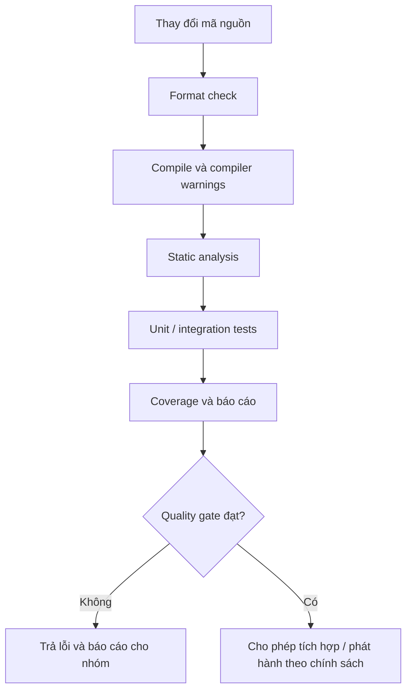
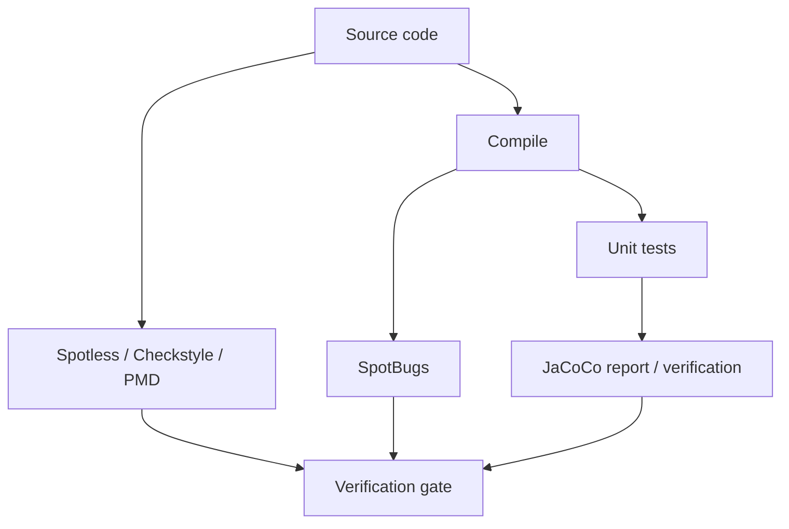
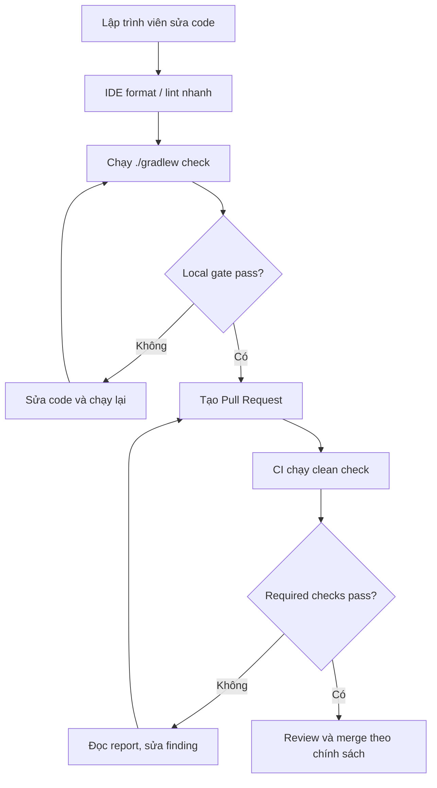

# Kiểm tra định dạng, phân tích tĩnh và các cổng chất lượng

Một dự án Java có thể biên dịch thành công nhưng vẫn chứa mã khó đọc, quy tắc đặt tên không thống nhất, lỗi tiềm ẩn hoặc rủi ro khó phát hiện bằng unit test thông thường. Vì vậy, quy trình build thường bổ sung các bước kiểm tra định dạng, phân tích tĩnh và các cổng chất lượng (quality gates). Những bước này giúp nhóm phát hiện vấn đề sớm, thống nhất tiêu chuẩn mã nguồn và quyết định khi nào một thay đổi đủ điều kiện được tích hợp hoặc phát hành.

Các công cụ này có mục đích khác nhau. Formatter tự động chuẩn hóa cách trình bày mã nguồn; linter và static analyzer tìm các mẫu code đáng ngờ hoặc vi phạm quy ước; test kiểm tra hành vi khi chương trình chạy; coverage đo phần mã được test thực thi; quality gate tổng hợp các điều kiện cần đạt và có thể làm build thất bại nếu vi phạm. Khi cấu hình đúng, terminal, IDE và CI thực hiện cùng một chính sách, còn báo cáo giúp lập trình viên hiểu và xử lý từng vấn đề.

## 1. Những lớp kiểm tra trong quy trình chất lượng

Không có một công cụ đơn lẻ nào chứng minh mã nguồn hoàn toàn đúng. Một quy trình chất lượng thường kết hợp nhiều lớp, mỗi lớp phát hiện một loại vấn đề.

| Lớp kiểm tra | Mục tiêu | Ví dụ công cụ/kỹ thuật |
|---|---|---|
| Formatting | Chuẩn hóa cách trình bày mã nguồn | Spotless, google-java-format, formatter của IDE |
| Style/lint | Kiểm tra quy ước và mẫu code không mong muốn | Checkstyle, PMD |
| Static analysis | Phát hiện lỗi tiềm ẩn mà không cần chạy ứng dụng | SpotBugs, Error Prone, SonarQube analyzers |
| Compile checks | Xác nhận source hợp lệ với compiler và cấu hình | `javac`, `-Xlint`, `-Werror` |
| Automated tests | Kiểm tra hành vi khi thực thi | JUnit, TestNG, integration tests |
| Coverage | Đo mức độ code được thực thi bởi test | JaCoCo |
| Dependency/security checks | Phát hiện dependency hoặc cấu hình có rủi ro | Dependency vulnerability scanners, dependency verification |
| Quality gate | Quyết định build có đạt điều kiện để tiếp tục hay không | Gradle `check`, Maven `verify`, SonarQube Quality Gate, CI rules |

Một số lớp có thể chạy ở nhiều thời điểm. Formatter có thể được chạy ngay khi lưu file; static analysis có thể chạy trong IDE hoặc CI; quality gate thường được áp dụng ở pull request và pipeline phát hành.



Sơ đồ là một luồng khái quát. Build thực tế có thể chạy một số bước song song hoặc theo task graph; điều quan trọng là gate cuối cùng phải đợi đủ kết quả mà chính sách yêu cầu.

## 2. Formatting: chuẩn hóa cách trình bày mã nguồn

Formatting là việc áp dụng quy tắc thống nhất cho khoảng trắng, thụt lề, dấu ngoặc, xuống dòng, import và cách bố trí code. Mục tiêu là giảm khác biệt trình bày giữa các thành viên, giúp review tập trung vào logic và tránh tranh luận lặp lại về phong cách cá nhân.

Ví dụ, hai đoạn code sau có thể có hành vi giống nhau nhưng hình thức khác nhau:

```java
public class PriceCalculator{public int total(int price,int quantity){return price*quantity;}}
```

```java
public class PriceCalculator {
    public int total(int price, int quantity) {
        return price * quantity;
    }
}
```

Formatter tự động đưa code về một kiểu trình bày đã chọn. Nó không chứng minh thuật toán đúng, không thay thế test và cũng không nhất thiết phát hiện lỗi logic.

### 2.1. Formatter và format check

Hai thao tác cần được phân biệt:

- **Format/apply:** sửa file để tuân theo quy tắc.
- **Format check:** chỉ kiểm tra file đã tuân theo quy tắc hay chưa; nếu chưa, trả lỗi và yêu cầu lập trình viên định dạng lại.

Trong môi trường phát triển, lập trình viên có thể chạy formatter để sửa tự động. Trong CI, thường dùng chế độ check để build không tự thay đổi source tree. Nhờ đó, một pull request không thể vượt qua gate khi code chưa được format theo chuẩn chung.

### 2.2. Chọn một formatter và pin phiên bản

Một nhóm nên chọn một formatter làm chuẩn, ví dụ google-java-format hoặc quy tắc Spotless đã cấu hình. Cần pin phiên bản formatter vì bản mới có thể thay đổi cách xuống dòng hoặc xử lý một số cấu trúc Java. Nếu mỗi IDE hoặc máy dùng phiên bản khác, cùng một file có thể bị thay đổi qua lại.

Nên lưu cấu hình formatter trong repository hoặc build logic dùng chung. IDE có thể tự động format khi lưu, nhưng cần dùng cùng formatter và phiên bản tương ứng với build.

### 2.3. `.editorconfig`

`.editorconfig` giúp chia sẻ một số thiết lập editor phổ biến như charset, line ending, indentation và khoảng trắng cuối dòng.

Ví dụ:

```ini
root = true

[*]
charset = utf-8
end_of_line = lf
insert_final_newline = true
trim_trailing_whitespace = true

[*.java]
indent_style = space
indent_size = 4

[*.yml]
indent_style = space
indent_size = 2
```

Editor hỗ trợ EditorConfig sẽ đọc các thiết lập này khi mở/lưu file. Tuy nhiên, `.editorconfig` không thay thế formatter: nó không định dạng lại toàn bộ cấu trúc Java như import, wrapping hay vị trí dấu ngoặc.

### 2.4. Dùng Spotless trong Gradle

Spotless cung cấp task áp dụng và kiểm tra formatting. Ví dụ Groovy DSL:

```groovy
plugins {
    id 'java'
    id 'com.diffplug.spotless' version '6.25.0'
}

spotless {
    java {
        googleJavaFormat()
        removeUnusedImports()
    }
}

tasks.named('check') {
    dependsOn('spotlessCheck')
}
```

Các task chính:

```bash
# Sửa source theo formatter
./gradlew spotlessApply

# Chỉ kiểm tra, không sửa source
./gradlew spotlessCheck

# Chạy các bước verification được nối vào lifecycle check
./gradlew check
```

Ví dụ dùng phiên bản plugin và formatter minh họa; hãy chọn phiên bản đã được nhóm kiểm thử. `spotlessApply` thay đổi file trong working tree. `spotlessCheck` là task phù hợp cho CI. Việc nối `spotlessCheck` vào `check` giúp một lệnh chuẩn của dự án bao gồm cả format gate.

Nếu build có nhiều module, hãy quyết định formatter được cấu hình ở root project hay trong convention plugin để tất cả module áp dụng cùng quy tắc. Không để một module dùng Google Java Format còn module khác dùng formatter riêng nếu không có lý do kiến trúc rõ ràng.

### 2.5. Dùng Spotless trong Maven

Spotless cũng có Maven plugin. Ví dụ cấu hình rút gọn:

```xml
<plugin>
    <groupId>com.diffplug.spotless</groupId>
    <artifactId>spotless-maven-plugin</artifactId>
    <version>2.43.0</version>
    <configuration>
        <java>
            <googleJavaFormat/>
            <removeUnusedImports/>
        </java>
    </configuration>
    <executions>
        <execution>
            <id>format-check</id>
            <phase>verify</phase>
            <goals>
                <goal>check</goal>
            </goals>
        </execution>
    </executions>
</plugin>
```

Chạy:

```bash
# Áp dụng formatting
./mvnw spotless:apply

# Kiểm tra formatting
./mvnw spotless:check

# Chạy lifecycle đến verify, bao gồm execution đã gắn vào phase
./mvnw verify
```

Tên goal và cấu hình chi tiết cần khớp với phiên bản plugin được pin trong dự án. Cũng như Gradle, chỉ nên dùng `apply` để sửa file ở môi trường phát triển; CI nên thực hiện `check`.

## 3. Style checking và lint

Style checker kiểm tra các quy ước mà nhóm muốn áp dụng cho source code: tên class/method, import, độ dài dòng, modifier, Javadoc, cấu trúc package hoặc các mẫu code bị cấm. Một số rule chỉ liên quan đến khả năng đọc; rule khác có thể ngăn lỗi phổ biến.

Style checker thường phân tích source code hoặc cấu trúc cú pháp. Nó không nhất thiết hiểu đầy đủ ngữ nghĩa runtime của ứng dụng.

### 3.1. Checkstyle

Checkstyle kiểm tra Java source theo bộ rule đã cấu hình. Các rule có thể bao gồm:

- Quy tắc đặt tên class, method, field và constant.
- Import không dùng hoặc import wildcard.
- Indentation, line length và khoảng trắng.
- Modifier và thứ tự khai báo.
- Javadoc và comment.
- Các quy ước cấu trúc source.

Một file cấu hình Checkstyle có thể được lưu tại `config/checkstyle/checkstyle.xml`. Ví dụ Gradle:

```groovy
plugins {
    id 'java'
    id 'checkstyle'
}

checkstyle {
    toolVersion = '10.17.0'
    configFile = rootProject.file('config/checkstyle/checkstyle.xml')
    ignoreFailures = false
    maxWarnings = 0
}
```

Gradle Checkstyle plugin tạo các task phân tích source set, thường gồm `checkstyleMain` và `checkstyleTest`, cùng các task report tương ứng. Plugin tích hợp các task kiểm tra vào lifecycle `check` theo convention của nó.

Có thể chạy riêng:

```bash
./gradlew checkstyleMain
./gradlew checkstyleTest
./gradlew check
```

Khi đặt `maxWarnings = 0`, warning vượt ngưỡng sẽ làm task thất bại. `ignoreFailures = false` giữ hành vi fail khi có vi phạm theo cấu hình task. Nếu nhóm mới áp dụng Checkstyle cho codebase cũ, nên có kế hoạch xử lý baseline thay vì bật một bộ rule quá nghiêm ngặt khiến hàng nghìn vi phạm cũ chặn mọi thay đổi.

### 3.2. Checkstyle trong Maven

Maven Checkstyle Plugin có goal `check` để kiểm tra vi phạm và có thể gắn vào phase `verify`:

```xml
<plugin>
    <groupId>org.apache.maven.plugins</groupId>
    <artifactId>maven-checkstyle-plugin</artifactId>
    <version>3.6.0</version>
    <configuration>
        <configLocation>config/checkstyle/checkstyle.xml</configLocation>
        <failOnViolation>true</failOnViolation>
        <includeTestSourceDirectory>true</includeTestSourceDirectory>
    </configuration>
    <executions>
        <execution>
            <id>checkstyle-verify</id>
            <phase>verify</phase>
            <goals>
                <goal>check</goal>
            </goals>
        </execution>
    </executions>
</plugin>
```

Chạy kiểm tra độc lập:

```bash
./mvnw checkstyle:check
```

Hoặc chạy `./mvnw verify` để thực hiện theo lifecycle đã cấu hình. Đường dẫn config có thể được chia sẻ qua parent POM hoặc một file trong repository. Cần bảo đảm CI dùng cùng file cấu hình và phiên bản plugin như local.

### 3.3. PMD

PMD phân tích source để tìm các mẫu code có thể gây vấn đề hoặc làm giảm chất lượng, ví dụ:

- Biến hoặc tham số không được sử dụng.
- Nhánh điều kiện hoặc code không thể đạt tới.
- Khối code quá phức tạp.
- Sử dụng API hoặc mẫu code đáng ngờ.
- Một số lỗi logic phổ biến và vi phạm quy ước.

PMD có các rule set mặc định và cho phép nhóm tự định nghĩa rule set. Không nên bật mọi rule chỉ vì chúng có sẵn; cần chọn rule phù hợp với ngôn ngữ, framework và mục tiêu của dự án.

Gradle ví dụ:

```groovy
plugins {
    id 'java'
    id 'pmd'
}

pmd {
    toolVersion = '7.5.0'
    ruleSets = []
    ruleSetFiles = files('config/pmd/ruleset.xml')
    ignoreFailures = false
    consoleOutput = true
}

tasks.withType(Pmd).configureEach {
    reports {
        html.required = true
        xml.required = true
    }
}
```

Gradle PMD plugin cung cấp task như `pmdMain`, `pmdTest`; task kiểm tra tương ứng được tích hợp vào lifecycle `check`. Report HTML giúp lập trình viên đọc vi phạm, còn XML thuận tiện cho CI hoặc hệ thống thu thập kết quả.

Maven ví dụ:

```xml
<plugin>
    <groupId>org.apache.maven.plugins</groupId>
    <artifactId>maven-pmd-plugin</artifactId>
    <version>3.26.0</version>
    <configuration>
        <failOnViolation>true</failOnViolation>
        <printFailingErrors>true</printFailingErrors>
    </configuration>
    <executions>
        <execution>
            <id>pmd-check</id>
            <phase>verify</phase>
            <goals>
                <goal>check</goal>
            </goals>
        </execution>
    </executions>
</plugin>
```

Có thể chạy `./mvnw pmd:check` hoặc `./mvnw verify` theo cấu hình. PMD cũng tạo report; hãy lưu report CI ngay cả khi gate thất bại để người phát triển biết rule nào bị vi phạm.

## 4. Static analysis: tìm lỗi tiềm ẩn mà không cần chạy ứng dụng

Static analysis phân tích source, bytecode hoặc metadata để phát hiện vấn đề mà compiler và test chưa chắc bắt được. Công cụ có thể tìm null dereference tiềm ẩn, tài nguyên không được đóng, điều kiện logic bất thường, lỗi equals/hashCode, xử lý exception không hợp lý hoặc các API nguy hiểm.

Kết quả là các **finding** hoặc **issue** với mức độ nghiêm trọng, vị trí file/dòng, rule và mô tả. Static analyzer không phải oracle tuyệt đối: có thể có false positive (cảnh báo không phải lỗi thật) và false negative (bỏ sót lỗi thật).

### 4.1. SpotBugs

SpotBugs phân tích Java bytecode để tìm các mẫu bug phổ biến. Vì nó phân tích class đã biên dịch, nó cần bước compile hoàn thành trước khi phân tích. Một số nhóm lỗi mà SpotBugs có thể phát hiện:

- Null pointer dereference có khả năng xảy ra.
- Sai sót trong `equals`/`hashCode`.
- Resource hoặc stream không được đóng đúng cách.
- Đồng bộ hóa thread không an toàn.
- Sử dụng API có khả năng gây lỗi.
- Một số vấn đề về serialization và bảo mật.

Gradle dùng plugin SpotBugs bên ngoài. Ví dụ cấu hình minh họa:

```groovy
plugins {
    id 'java'
    id 'com.github.spotbugs' version '6.0.26'
}

spotbugs {
    toolVersion = '4.8.6'
    ignoreFailures = false
    showStackTraces = true
}

tasks.withType(com.github.spotbugs.snom.SpotBugsTask).configureEach {
    reports {
        html.required = true
        xml.required = true
    }
}

tasks.named('check') {
    dependsOn('spotbugsMain')
}
```

Plugin version và SpotBugs engine version cần được chọn theo tương thích Gradle/JDK của dự án. Tên task/report API có thể khác giữa các thế hệ plugin; kiểm tra tài liệu của phiên bản đang dùng trước khi áp dụng cấu hình. Với dự án nhiều source set, cân nhắc thêm task cho test hoặc source set riêng nếu cần.

### 4.2. SpotBugs trong Maven

Maven có SpotBugs Plugin để phân tích bytecode. Có thể cấu hình goal kiểm tra trong lifecycle `verify`:

```xml
<plugin>
    <groupId>com.github.spotbugs</groupId>
    <artifactId>spotbugs-maven-plugin</artifactId>
    <version>4.8.6.6</version>
    <executions>
        <execution>
            <id>spotbugs-check</id>
            <phase>verify</phase>
            <goals>
                <goal>check</goal>
            </goals>
        </execution>
    </executions>
    <configuration>
        <effort>Max</effort>
        <threshold>Medium</threshold>
    </configuration>
</plugin>
```

Các giá trị version và threshold trong ví dụ là minh họa. Cần kiểm tra tài liệu plugin để xác nhận ngưỡng và goal phù hợp. Việc tăng `effort` có thể làm phân tích sâu hơn và tốn thời gian hơn; threshold thấp hơn thường phát hiện nhiều finding hơn và có thể tăng false positives.

### 4.3. Error Prone

Error Prone là công cụ phân tích được tích hợp với quá trình biên dịch Java, giúp phát hiện nhiều lỗi lập trình ở mức source/compile như so sánh chuỗi không đúng, sử dụng API sai hoặc các cấu trúc dễ gây bug. Nó có thể làm compiler báo lỗi đối với các pattern được cấu hình ở mức severity tương ứng.

Error Prone có thể được tích hợp qua compiler/plugin phù hợp với Gradle hoặc Maven. Vì nó can thiệp vào compiler, cần đồng bộ JDK, compiler args và version giữa local/CI. Không nên thêm Error Prone vào dự án mà chưa xác nhận tương thích với JDK và build tool đang sử dụng.

### 4.4. SonarQube

SonarQube phân tích mã nguồn và tổng hợp các loại issue như bug, vulnerability, code smell, coverage và duplication tùy ngôn ngữ, plugin và cấu hình. SonarQube Server có thể áp dụng **Quality Gate** để quyết định một analysis có đạt điều kiện hay không.

Một số điều kiện gate thường gặp:

- Không có bug mới ở mức nghiêm trọng đã chọn.
- Không có vulnerability mới chưa được xử lý.
- Coverage trên code mới đạt ngưỡng tối thiểu.
- Duplication trên code mới nằm dưới ngưỡng.
- Reliability/Security/Maintainability rating đạt yêu cầu.

Không nên chỉ nhìn một điểm số tổng hợp. Cần hiểu metric nào đang làm gate thất bại, issue nằm ở code mới hay code cũ, và cách tổ chức đặt quality profile/quality gate.

## 5. Tests và coverage trong bức tranh chất lượng

Static analysis kiểm tra cấu trúc và các pattern mà không cần chạy ứng dụng. Test thực thi code với input cụ thể để kiểm tra kết quả. Coverage đo phần code được thực thi trong quá trình test; nó không đo trực tiếp chất lượng assertion hoặc khả năng phát hiện bug.

### 5.1. Unit test và integration test

Unit test kiểm tra một đơn vị nhỏ với phụ thuộc được kiểm soát. Integration test xác nhận các thành phần phối hợp, ví dụ repository với database, API với message broker hoặc module với dịch vụ ngoài.

Một quality gate có thể yêu cầu:

- Tất cả unit test thành công.
- Integration test cần thiết chạy trong CI.
- Không có test bị bỏ qua ngoài danh sách được chấp nhận.
- Test report được lưu để xem chi tiết khi thất bại.

Không nên dùng static analysis thay cho test hoặc dùng coverage cao để kết luận chương trình không có bug. Hai phương pháp bổ sung cho nhau.

### 5.2. JaCoCo và coverage threshold

JaCoCo đo coverage cho Java bytecode. Các metric thường dùng gồm:

- Instruction coverage: tỷ lệ bytecode instruction được thực thi.
- Branch coverage: tỷ lệ nhánh điều kiện được thực thi.
- Line coverage: tỷ lệ dòng có bytecode được thực thi.
- Method/class coverage: mức độ method/class được chạm tới.

Gradle ví dụ:

```groovy
plugins {
    id 'java'
    id 'jacoco'
}

jacoco {
    toolVersion = '0.8.12'
}

tasks.test {
    finalizedBy(tasks.jacocoTestReport)
}

jacocoTestReport {
    reports {
        html.required = true
        xml.required = true
    }
}

jacocoTestCoverageVerification {
    violationRules {
        rule {
            limit {
                counter = 'LINE'
                value = 'COVEREDRATIO'
                minimum = 0.80
            }
        }
    }
}

tasks.named('check') {
    dependsOn(tasks.named('jacocoTestCoverageVerification'))
}
```

Ví dụ yêu cầu line coverage tối thiểu 80% cho phạm vi rule mặc định. Ngưỡng thực tế cần dựa trên baseline và mục tiêu của nhóm. Task coverage verification cần có execution data; nếu dự án có nhiều test task/source set, hãy cấu hình report và verification cho đúng phạm vi. `jacocoTestReport` tạo báo cáo; `jacocoTestCoverageVerification` kiểm tra ngưỡng và có thể làm build thất bại.

Maven JaCoCo Plugin có các goal như `prepare-agent`, `report` và `check`. `prepare-agent` cấu hình agent cho test JVM; `report` tạo báo cáo; `check` đánh giá rule coverage. Ví dụ cấu hình rule:

```xml
<plugin>
    <groupId>org.jacoco</groupId>
    <artifactId>jacoco-maven-plugin</artifactId>
    <version>0.8.12</version>
    <executions>
        <execution>
            <goals>
                <goal>prepare-agent</goal>
            </goals>
        </execution>
        <execution>
            <id>report-and-check</id>
            <phase>verify</phase>
            <goals>
                <goal>report</goal>
                <goal>check</goal>
            </goals>
            <configuration>
                <rules>
                    <rule>
                        <element>BUNDLE</element>
                        <limits>
                            <limit>
                                <counter>LINE</counter>
                                <value>COVEREDRATIO</value>
                                <minimum>0.80</minimum>
                            </limit>
                        </limits>
                    </rule>
                </rules>
            </configuration>
        </execution>
    </executions>
</plugin>
```

Trong dự án thực tế, có thể tách cấu hình `report` và `check` hoặc đặt configuration ở vị trí plugin phù hợp với phiên bản đang dùng. Chạy `./mvnw verify` để thực hiện lifecycle đến phase `verify`.

### 5.3. Vì sao coverage cao chưa chắc test tốt?

Một test có thể thực thi 100% dòng code nhưng không kiểm tra kết quả quan trọng. Ví dụ, test gọi một method rồi không assert gì; code được chạy nhưng bug vẫn không bị phát hiện.

Coverage nên được dùng như tín hiệu để tìm vùng chưa được kiểm tra, kết hợp với chất lượng assertion, test boundary cases, error paths và integration behavior. Không nên viết test vô nghĩa chỉ để tăng phần trăm coverage.

### 5.4. Đặt gate cho code mới

Codebase cũ có thể có coverage thấp hoặc nhiều issue tồn đọng. Nếu áp ngưỡng tổng thể ngay lập tức, mọi thay đổi nhỏ có thể bị chặn bởi vấn đề lịch sử không liên quan. Nhiều nhóm áp quality gate tập trung vào code mới hoặc yêu cầu thay đổi mới không làm giảm baseline.

Điều này giúp nâng chất lượng dần theo từng pull request. Các issue cũ vẫn cần kế hoạch xử lý, nhưng không nhất thiết phải giải quyết toàn bộ trước khi nhóm có thể áp dụng gate cho thay đổi mới.

## 6. Quality gate là gì?

Quality gate là tập hợp điều kiện có thể đo được để quyết định một thay đổi hoặc build có đạt tiêu chuẩn chất lượng hay không. Gate có thể được thực hiện bởi task build, plugin phân tích, server phân tích chất lượng hoặc chính sách CI.

Một gate tốt trả lời rõ:

- Kiểm tra nào bắt buộc phải chạy?
- Mức vi phạm nào làm build thất bại?
- Áp dụng cho toàn bộ code hay chỉ code mới?
- Report được lưu ở đâu?
- Ai có thể xem hoặc xử lý finding?
- Có ngoại lệ không, ai phê duyệt và thời hạn xử lý là gì?

Ví dụ một gate cho pull request:

| Điều kiện | Tiêu chuẩn minh họa | Kết quả khi không đạt |
|---|---|---|
| Compile | Không có compile error | Build fail |
| Formatting | Không có file lệch formatter | Build fail, yêu cầu format lại |
| Checkstyle | Không có violation vượt ngưỡng | Build fail |
| Static analysis | Không có bug mới ở mức blocker/critical | Build fail hoặc yêu cầu xử lý |
| Unit test | Tất cả test bắt buộc pass | Build fail |
| Coverage code mới | Line coverage đạt ngưỡng nhóm chọn | Build fail hoặc cần exception được duyệt |
| Dependency/security | Không có lỗ hổng vượt mức chấp nhận | Chặn merge hoặc phát hành |

Các ngưỡng trên chỉ là ví dụ. Mỗi nhóm cần xác định mức độ rủi ro, loại ứng dụng và chi phí kiểm tra để chọn tiêu chuẩn phù hợp.

### 6.1. Gate cục bộ trong Gradle

Gradle có lifecycle task `check` dành cho verification. Các plugin như Java, Checkstyle, PMD và JaCoCo có thể cung cấp task riêng rồi nối vào `check`.

Ví dụ:

```groovy
tasks.named('check') {
    dependsOn('spotlessCheck')
    dependsOn('checkstyleMain')
    dependsOn('pmdMain')
    dependsOn('jacocoTestCoverageVerification')
}
```

Nếu plugin đã nối một task vào `check`, không cần thêm dependency trùng lặp. Cần kiểm tra task graph và tên task thực tế theo plugin/version. Lệnh:

```bash
./gradlew check
```

trở thành một điểm vào thống nhất để chạy các bước verification.

### 6.2. Gate trong Maven lifecycle

Maven lifecycle có các phase như `test`, `package`, `verify`, `install` và `deploy`. Plugin goal có thể được gắn vào phase thích hợp. Ví dụ, formatting check, Checkstyle, PMD, SpotBugs và coverage check có thể được cấu hình để chạy ở `verify`.

```bash
./mvnw clean verify
```

Lệnh này chạy các phase trước `verify` trong default lifecycle và thực hiện các goal đã được gắn vào chúng. Một plugin chỉ được khai báo nhưng không có execution/goal phù hợp có thể không chạy khi gọi lifecycle; hãy kiểm tra effective POM và log để xác nhận.

### 6.3. SonarQube Quality Gate

SonarQube có thể tổng hợp analysis từ scanner và đánh giá Quality Gate ở phía server. Build scanner có thể hoàn tất upload analysis trước khi server xử lý xong; pipeline cần chờ kết quả gate nếu chính sách yêu cầu quyết định đó chặn merge.

Một dự án có thể dùng Gradle SonarQube plugin hoặc Maven Sonar scanner, sau đó để CI đợi quality gate result. Cách cấu hình cụ thể phụ thuộc phiên bản scanner, SonarQube Server/Cloud và CI provider. Không nên chỉ chạy scanner rồi giả định gate đã được áp dụng; cần xác nhận pipeline nhận được trạng thái pass/fail và dùng trạng thái đó làm điều kiện merge/release.

## 7. Tổ chức rule, mức độ nghiêm trọng và ngưỡng

Một công cụ có thể phát hiện rất nhiều vấn đề. Nếu mọi finding đều bị coi là lỗi nghiêm trọng, nhóm dễ bị quá tải và bắt đầu bỏ qua báo cáo. Chính sách nên phân loại theo tác động và đặt ngưỡng phù hợp.

### 7.1. Severity

Các công cụ có hệ thống severity khác nhau, nhưng thường có thể quy về các mức:

- **Blocker/Critical:** có nguy cơ gây lỗi nghiêm trọng, lỗ hổng bảo mật hoặc làm hệ thống không hoạt động.
- **Major/High:** vấn đề có ảnh hưởng đáng kể và cần xử lý sớm.
- **Minor/Medium:** vấn đề về chất lượng, khả năng bảo trì hoặc bug tiềm ẩn ít nghiêm trọng hơn.
- **Info/Low:** khuyến nghị hoặc cảnh báo để cải thiện.

Không nên so sánh trực tiếp tên severity giữa hai công cụ. Hãy đọc định nghĩa rule và mức ảnh hưởng trong ngữ cảnh dự án.

### 7.2. Ngưỡng và baseline

Baseline là trạng thái chất lượng được chấp nhận hoặc kết quả phân tích tại một thời điểm. Nó giúp nhóm phân biệt issue đã tồn tại với issue mới phát sinh.

Ví dụ:

- Không tăng số bug mức critical so với baseline.
- Không tạo issue blocker mới.
- Coverage trên code mới không thấp hơn ngưỡng.
- Không tăng duplication vượt giới hạn.
- Không có dependency mới chứa vulnerability vượt mức được phép.

Gate trên code mới giúp nhóm cải thiện dần mà không phải chặn toàn bộ tiến độ vì nợ kỹ thuật cũ. Tuy nhiên, baseline không nên trở thành cách hợp thức hóa vấn đề tồn đọng mãi mãi; cần theo dõi xu hướng và có kế hoạch giảm nợ kỹ thuật.

### 7.3. Rule profile

Rule profile là bộ quy tắc được bật cho một dự án hoặc nhóm dự án. Profile nên được quản lý tập trung và review khi thay đổi. Khi nâng phiên bản công cụ, rule mới có thể xuất hiện hoặc kết quả phân tích thay đổi; cần đánh giá tác động trước khi áp dụng rộng.

## 8. Suppression và ngoại lệ

Không phải finding nào cũng là lỗi thật. Có trường hợp analyzer không hiểu invariant của ứng dụng, hoặc code phải tuân theo API/framework đặc biệt. Khi cần bỏ qua một finding, hãy dùng suppression có phạm vi hẹp và giải thích lý do.

### 8.1. Suppression theo dòng hoặc thành phần

Một số công cụ hỗ trợ annotation hoặc comment suppression. Ví dụ với SpotBugs:

```java
@SuppressFBWarnings(
    value = "EI_EXPOSE_REP",
    justification = "The returned object is immutable."
)
public ImmutableValue value() {
    return value;
}
```

Annotation và tên rule phải khớp công cụ/phiên bản đang dùng. Suppression nên kèm justification để reviewer hiểu vì sao finding không cần xử lý.

### 8.2. Không tắt rule trên toàn dự án chỉ để bỏ một cảnh báo

Nếu chỉ một vị trí có ngoại lệ, tránh vô hiệu hóa rule trên toàn module hoặc toàn repository. Ngoại lệ rộng làm giảm khả năng phát hiện lỗi tương tự ở nơi khác.

### 8.3. Quản lý suppression theo thời hạn

Với vấn đề tạm thời, có thể ghi issue ID, người phụ trách hoặc thời hạn xem xét. Suppression không nên tồn tại vô thời hạn mà không có lý do. Khi code được sửa, hãy xóa suppression để analyzer tiếp tục bảo vệ vùng code đó.

## 9. Tích hợp kiểm tra vào terminal, IDE và CI

Một chính sách chất lượng chỉ hữu ích khi mọi môi trường thực hiện nó nhất quán.

### 9.1. Terminal

Lập trình viên có thể chạy các task riêng trong lúc phát triển:

```bash
# Format source
./gradlew spotlessApply

# Kiểm tra format và style
./gradlew spotlessCheck checkstyleMain pmdMain

# Chạy toàn bộ verification
./gradlew check
```

Với Maven:

```bash
# Áp dụng formatter
./mvnw spotless:apply

# Chạy quality gate theo lifecycle
./mvnw clean verify
```

Nên có lệnh chuẩn trong README/CONTRIBUTING để thành viên mới biết cần chạy gì trước khi mở pull request.

### 9.2. IDE

IDE có thể hiển thị lỗi Checkstyle, PMD hoặc Sonar trực tiếp trong editor nếu cài plugin phù hợp. Formatter có thể chạy khi lưu file. Điều này giúp phát hiện vấn đề sớm, nhưng không nên coi kết quả IDE là bằng chứng duy nhất vì plugin IDE có thể dùng rule profile hoặc phiên bản khác với CI.

Để đồng bộ:

- Import cấu hình từ repository khi plugin IDE hỗ trợ.
- Dùng cùng formatter và phiên bản formatter.
- Đồng bộ rule profile Checkstyle/PMD hoặc analyzer tương ứng.
- Dùng Gradle/Maven Wrapper khi chạy task chuẩn.
- Xác nhận CI là nơi thực thi gate bắt buộc cho pull request.

### 9.3. CI pipeline

CI nên checkout source sạch, chọn JDK/toolchain, chạy Wrapper và lưu report. Ví dụ GitHub Actions cho Gradle:

```yaml
name: Quality checks

on:
  pull_request:
  push:
    branches: [ main ]

jobs:
  quality:
    runs-on: ubuntu-latest
    steps:
      - uses: actions/checkout@v4

      - uses: actions/setup-java@v4
        with:
          distribution: temurin
          java-version: '21'

      - name: Verify
        run: ./gradlew clean check

      - name: Upload reports
        if: always()
        uses: actions/upload-artifact@v4
        with:
          name: quality-reports
          path: |
            **/build/reports/**
            **/build/test-results/**
          if-no-files-found: ignore
```

JDK version chỉ là ví dụ; thay bằng version mà Wrapper, plugin và toolchain của dự án yêu cầu. `if: always()` giúp upload report ngay cả khi bước kiểm tra thất bại, miễn là runner còn hoạt động và file report đã được tạo.

Với Maven, bước verify có thể là:

```yaml
- name: Verify
  run: ./mvnw --batch-mode --no-transfer-progress clean verify
```

CI cần lưu test report, static analysis report và coverage report để người phát triển xem được nguyên nhân fail. Chỉ hiển thị một dòng “build failed” sẽ khiến việc sửa lỗi khó hơn.

### 9.4. Gate phải chặn đúng điểm

Một quality gate cho pull request cần trả trạng thái về hệ thống quản lý source control để branch protection có thể yêu cầu check đó thành công trước khi merge. Nếu scanner chỉ upload report nhưng pipeline không chờ gate result, pull request có thể được merge dù quality gate trên server đang fail.

Với release pipeline, gate có thể yêu cầu thêm integration test, security scan hoặc coverage. Nên phân biệt gate nhanh cho pull request và gate sâu hơn trước khi phát hành để cân bằng tốc độ phản hồi và mức độ bảo đảm.

## 10. Thứ tự chạy và tích hợp vào build lifecycle

Các bước chất lượng cần có prerequisite phù hợp:

- Formatter check có thể chạy trực tiếp trên source, không cần compile.
- Checkstyle và PMD thường phân tích source nên có thể chạy độc lập với compile nếu plugin không yêu cầu output bytecode.
- SpotBugs cần class đã biên dịch.
- Unit test cần class test và runtime classpath.
- JaCoCo cần execution data từ test.
- Sonar analysis có thể cần compile output, test report và coverage report tùy cấu hình.

Gradle task graph và Maven lifecycle giúp thể hiện thứ tự này. Không nên gắn mọi task vào mọi task khác. Hãy dùng lifecycle `check`/`verify` làm điểm tập hợp và khai báo prerequisite đúng theo dữ liệu mà công cụ cần.

Ví dụ sơ đồ:



Trong build thật, các task có thể chạy song song khi không phụ thuộc lẫn nhau. Nếu một task report cần kết quả của test, phải khai báo quan hệ output/prerequisite để Gradle/Maven không chạy report trước khi dữ liệu sẵn sàng.

## 11. Multi-module build và quy tắc chất lượng dùng chung

Với dự án nhiều module, có hai cách tổ chức phổ biến:

1. Mỗi module tự áp dụng plugin và rule set nhưng lấy cấu hình từ một nguồn dùng chung.
2. Dùng convention plugin hoặc parent POM để áp dụng quy tắc cho toàn bộ module.

Không nên để mỗi module tự chọn formatter/rule version. Điều đó làm cho một thay đổi có thể pass ở module này nhưng fail ở module khác chỉ vì chính sách khác nhau.

### 11.1. Gradle convention plugin

Build logic dùng chung có thể áp dụng plugin Java, Checkstyle, PMD, Spotless và cấu hình task. Các module chỉ cần áp dụng convention plugin thay vì lặp lại nhiều đoạn cấu hình. Cách này đặc biệt hữu ích trong monorepo.

### 11.2. Maven parent POM

Parent POM có thể khai báo plugin trong `pluginManagement` để quản lý version/configuration. Để goal thực sự chạy trong module, cần khai báo plugin trong `<build><plugins>` hoặc cấu hình execution phù hợp theo cấu trúc parent. `pluginManagement` quản lý mặc định; tự nó không phải lúc nào cũng kích hoạt plugin goal.

### 11.3. Module ngoại lệ

Một module sinh mã, module legacy hoặc module chứa API đặc thù có thể cần rule riêng. Hãy giới hạn ngoại lệ ở module đó, ghi rõ lý do và tránh làm yếu gate toàn repository.

## 12. Báo cáo và cách đọc finding

Report giúp chuyển kết quả phân tích thành công việc có thể xử lý. Một finding hữu ích thường có:

- Tên rule và mô tả vấn đề.
- Severity hoặc priority.
- File và vị trí dòng.
- Đoạn code hoặc đường đi dữ liệu liên quan.
- Lý do công cụ đánh giá đây là vấn đề.
- Cách khắc phục hoặc tham chiếu tài liệu rule.

Khi xem report, hãy xác định vấn đề là bug thật, vi phạm style, cảnh báo cần điều tra hay false positive. Không nên sửa code chỉ để làm report sạch nếu chưa hiểu rule. Ngược lại, không nên bỏ qua một finding chỉ vì ứng dụng chưa từng gặp lỗi; analyzer có thể phát hiện đường đi chưa được test.

### 12.1. Report Gradle

Report của Gradle plugin thường được lưu trong thư mục `build/reports/`, ví dụ:

```text
build/reports/
├── checkstyle/
├── pmd/
├── spotbugs/
├── jacoco/
└── tests/
```

Đường dẫn cụ thể phụ thuộc plugin và task. Test result dạng XML thường nằm trong `build/test-results/`. Khi CI thất bại, hãy lưu các thư mục report làm artifact để có thể xem sau khi job kết thúc.

### 12.2. Report Maven

Maven plugin thường tạo report dưới `target/`, chẳng hạn `target/site/` hoặc các file XML/HTML trong `target/`. Đường dẫn chính xác phụ thuộc plugin và goal. Nếu pipeline chỉ thu thập `build/reports/**`, report Maven có thể bị bỏ sót; cần cấu hình upload cả `target/**` theo phạm vi cần thiết.

### 12.3. Tách lỗi công cụ khỏi finding của mã nguồn

Build có thể thất bại vì analyzer không khởi động được, thiếu JDK, không tải được plugin hoặc report output không ghi được. Đây là lỗi hạ tầng/tool configuration, khác với việc analyzer chạy thành công và phát hiện vi phạm. Hãy đọc log để xác định task thất bại ở giai đoạn nào.

## 13. Quản lý false positives và nợ chất lượng

Static analysis có thể báo vấn đề không áp dụng cho một đoạn code cụ thể. Cần xử lý có trách nhiệm:

1. Đọc rule và hiểu đường đi/điều kiện tạo finding.
2. Kiểm tra code và invariant thực tế.
3. Nếu là lỗi thật, sửa nguyên nhân và thêm test phù hợp.
4. Nếu là false positive, dùng suppression hẹp, có justification.
5. Nếu rule không phù hợp với dự án, điều chỉnh profile sau khi review tác động.
6. Theo dõi số lượng suppression và issue cũ để tránh tích lũy nợ chất lượng.

Không nên tắt toàn bộ analyzer khi một rule gây nhiều cảnh báo. Có thể tạm hạ severity hoặc áp baseline trong giai đoạn chuyển đổi, nhưng cần đặt mục tiêu và thời hạn để tăng lại mức kiểm soát.

## 14. Tối ưu tốc độ mà vẫn giữ gate đáng tin cậy

Chạy nhiều analyzer có thể làm build chậm, đặc biệt ở monorepo. Một số cách tối ưu:

- Chạy formatter/style check trên file thay đổi trong pre-commit hoặc IDE để phản hồi nhanh.
- Dùng incremental build và cache khi task khai báo input/output đúng.
- Tách test nhanh cho pull request và test tích hợp sâu cho pipeline phù hợp.
- Chạy các analyzer độc lập song song khi build tool hỗ trợ.
- Chỉ phân tích module bị ảnh hưởng khi có cơ chế xác định dependency chính xác.
- Pin version tool/plugin để cache và kết quả ổn định.
- Lưu report và log để tránh phải chạy lại chỉ nhằm tìm nguyên nhân.

Không nên bỏ một gate bắt buộc chỉ để rút ngắn build mà không đánh giá rủi ro. Nếu analyzer quá chậm, hãy đo thời gian từng task và xem có thể giảm phạm vi, cache hoặc tách lịch chạy mà vẫn giữ được điều kiện merge/release cần thiết hay không.

## 15. Những hiểu nhầm thường gặp

| Hiểu nhầm | Thực tế |
|---|---|
| Formatter chứng minh code đúng | Formatter chỉ chuẩn hóa hình thức, không kiểm tra logic |
| Checkstyle, PMD và SpotBugs giống nhau | Chúng dùng kỹ thuật và rule set khác nhau; SpotBugs chủ yếu phân tích bytecode |
| Static analysis thay thế unit test | Static analysis và test phát hiện các loại vấn đề khác nhau |
| Coverage 100% nghĩa là không còn bug | Coverage đo phần code được thực thi, không đo chất lượng assertion |
| Khai báo plugin là plugin tự chạy | Cần task/goal và quan hệ lifecycle phù hợp |
| Có report nghĩa là gate đã chặn merge | CI/branch protection phải nhận và yêu cầu trạng thái pass/fail |
| Tắt warning là cách giải quyết vấn đề | Có thể che giấu lỗi thật và làm giảm giá trị analyzer |
| Chạy gate trên máy cá nhân là đủ | CI cần chạy lại trên môi trường sạch để bảo đảm tính nhất quán |
| Một ngưỡng coverage phù hợp cho mọi module | Mức hợp lý phụ thuộc loại code, baseline và rủi ro |

## 16. Ví dụ một chính sách chất lượng thực tế

Giả sử nhóm phát triển một dịch vụ Java với Gradle. Nhóm thống nhất:

- Spotless dùng Google Java Format và được kiểm tra trong `check`.
- Checkstyle áp dụng rule set chung cho source chính và test.
- PMD chạy với rule set được nhóm lựa chọn.
- SpotBugs phân tích bytecode sau compile.
- Unit test phải pass.
- JaCoCo kiểm tra coverage line tối thiểu trên phạm vi đã thống nhất.
- CI lưu HTML/XML reports ngay cả khi gate thất bại.
- Pull request không được merge khi required quality check chưa pass.

Một workflow phát triển có thể là:



CI là nguồn quyết định cuối cùng cho trạng thái gate vì nó chạy trên checkout và môi trường đã được quản lý. Kết quả local giúp phản hồi sớm, nhưng không thay thế required checks.

## 17. Checklist vận hành chất lượng cho dự án

Khi thiết lập hoặc thay đổi quality gate, hãy xác định:

- Formatter nào là chuẩn và phiên bản nào được pin?
- `.editorconfig` có thống nhất charset, line ending và indentation không?
- Checkstyle/PMD/SpotBugs dùng rule set nào và ai sở hữu cấu hình?
- Các plugin được nối vào `check` hoặc `verify` đúng cách chưa?
- Test và coverage report có được tạo và lưu không?
- Ngưỡng gate áp dụng cho toàn code hay code mới?
- Severity nào được phép, severity nào chặn build?
- Suppression có justification và phạm vi hẹp không?
- IDE, terminal và CI có dùng cùng Wrapper/JDK/config không?
- Branch protection có yêu cầu đúng CI status checks không?
- Khi gate fail, người phát triển có truy cập được report không?
- Có quy trình nâng phiên bản analyzer và review thay đổi rule không?

Formatting, static analysis, test và quality gate giải quyết những phần khác nhau của chất lượng phần mềm. Formatter tạo phong cách trình bày nhất quán; Checkstyle/PMD kiểm tra quy ước và mẫu code; SpotBugs hoặc SonarQube tìm lỗi tiềm ẩn ở mức sâu hơn; test kiểm tra hành vi; coverage cho biết vùng code chưa được thực thi. Quality gate kết hợp các kết quả này thành điều kiện có thể kiểm soát trong build và CI. Khi rule, ngưỡng, phiên bản công cụ và report được quản lý rõ ràng, nhóm có thể phát hiện vấn đề sớm, review hiệu quả và giữ chất lượng ổn định qua từng thay đổi.
