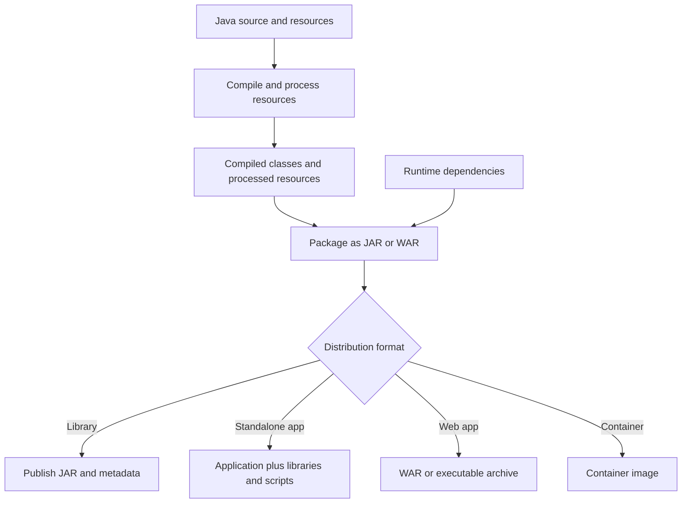
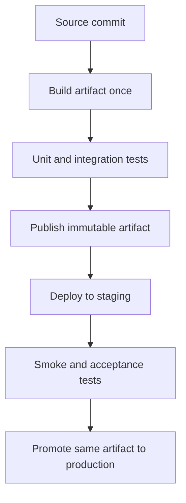

# Đầu ra biên dịch và artifact phân phối khác nhau như thế nào

Sau khi biên dịch một dự án Java, ta thường nhìn thấy các file `.class` trong thư mục output và có thể nghĩ rằng ứng dụng đã sẵn sàng để chuyển cho người khác. Thực tế, **đầu ra biên dịch** và **artifact phân phối** phục vụ hai mục đích khác nhau.

Đầu ra biên dịch là kết quả trung gian mà compiler và các bước build tiếp theo sử dụng. Nó thường gồm bytecode `.class` và tài nguyên đã được xử lý, nằm trong một hoặc nhiều thư mục output. Artifact phân phối là sản phẩm được đóng gói để triển khai, cài đặt, phát hành hoặc chia sẻ cho hệ thống khác. Nó có thể là JAR, WAR, ZIP, TAR, image hoặc một gói chứa ứng dụng, dependency, cấu hình và script khởi chạy.

Một JAR có thể được tạo từ đầu ra biên dịch, nhưng không phải mọi đầu ra biên dịch đều đã là một gói có thể triển khai. Một JAR thông thường cũng không tự động chứa toàn bộ dependency runtime. Vì vậy, khi thiết kế bước đóng gói, cần xác định rõ ai sẽ sử dụng sản phẩm, môi trường chạy cung cấp những gì và artifact cần mang theo thành phần nào.

## 1. Đầu ra biên dịch là gì?

Đầu ra biên dịch là các file được tạo trong quá trình chuyển mã nguồn và tài nguyên thành dạng mà JVM hoặc các bước build khác có thể sử dụng.

Với một dự án Java thông thường, đầu ra chính gồm:

- **Bytecode `.class`:** kết quả biên dịch từ file `.java`.
- **Resource đã xử lý:** file cấu hình, template, XML, JSON hoặc tài nguyên khác được copy/filter từ source resource.
- **Generated source hoặc generated resource:** mã nguồn/tài nguyên do annotation processor, code generator hoặc task tùy chỉnh tạo ra; chúng có thể được biên dịch hoặc đóng gói ở bước sau.
- **Metadata trung gian:** thông tin phục vụ compiler, test runner hoặc packaging task.

Ví dụ cấu trúc output thường gặp:

```text
project/
├── src/
│   └── main/
│       ├── java/
│       └── resources/
├── target/                  # Maven
│   └── classes/
│       ├── com/example/App.class
│       └── application.properties
└── build/                   # Gradle
    ├── classes/java/main/
    │   └── com/example/App.class
    └── resources/main/
        └── application.properties
```

Maven thường đặt class và resource chính trong `target/classes`. Gradle Java Plugin thường tách class output ở `build/classes/java/main` và resource output ở `build/resources/main`. Các đường dẫn có thể được tùy chỉnh bởi cấu hình project.

### 1.1. File `.class` chưa phải ứng dụng hoàn chỉnh

File `.class` chứa bytecode cho một lớp Java. Nó có thể cần các lớp khác, thư viện runtime, tài nguyên và cấu hình để hoạt động. Một lớp `OrderService.class` có thể tham chiếu `ObjectMapper`, `Logger`, một interface trong module khác hoặc resource trên classpath.

Compiler có thể tạo được `.class` khi compile classpath có đủ API cần thiết. Nhưng điều đó không chứng minh runtime classpath sẽ có mọi thư viện cần thiết khi ứng dụng chạy. Ví dụ, driver JDBC có thể chỉ được cần khi mở kết nối, hoặc một thư viện được nạp bằng reflection có thể không xuất hiện trong compile classpath.

Do đó, compile thành công chỉ chứng minh bước biên dịch đã hoàn thành theo cấu hình. Nó chưa chứng minh ứng dụng có thể được triển khai và chạy trong môi trường đích.

### 1.2. Output directory là vùng làm việc của build

Thư mục `target/` hoặc `build/` thường chứa kết quả trung gian và sản phẩm cuối. Build tool có thể xóa các thư mục này trong task `clean`, sau đó tái tạo chúng từ source và cấu hình.

Không nên xem mọi file trong `target/` hoặc `build/` là artifact phát hành. Chúng có thể chứa:

- class files;
- resource đã copy;
- file tạm;
- báo cáo test;
- mã nguồn được sinh;
- JAR/WAR cuối;
- ZIP/TAR phân phối;
- metadata và file phụ trợ.

Khi cần chia sẻ sản phẩm, hãy xác định chính xác file hoặc thư mục phân phối được tạo ra, thay vì gửi toàn bộ thư mục build một cách tùy tiện.

## 2. Artifact phân phối là gì?

Artifact phân phối là sản phẩm được tạo để một bên khác có thể tiêu thụ, cài đặt, triển khai hoặc phát hành. Tùy loại ứng dụng, artifact có thể bao gồm nhiều thành phần hơn bytecode.

Ví dụ:

| Artifact | Mục đích | Nội dung thường có |
|---|---|---|
| JAR thư viện | Được project khác khai báo làm dependency | Class, resource, manifest và metadata cần thiết |
| JAR ứng dụng thông thường | Chứa class và resource của ứng dụng | Class, resource, manifest; dependency ngoài có thể phải cung cấp riêng |
| Executable/fat JAR | Chạy ứng dụng theo launcher hoặc cấu trúc đóng gói riêng | Application classes, resource và dependency được đóng gói theo quy ước plugin |
| WAR | Triển khai ứng dụng web | Class, resource, thư viện trong `WEB-INF/lib`, metadata web |
| ZIP/TAR distribution | Phân phối ứng dụng cùng thư viện và script | JAR ứng dụng, thư mục `lib`, script, README, cấu hình mẫu |
| Container image | Chạy ứng dụng trong môi trường container | Runtime base image, ứng dụng, dependency và cấu hình cần thiết |
| Installer hoặc native package | Cài ứng dụng theo nền tảng | Runtime, file ứng dụng, launcher, metadata cài đặt và tài nguyên |

Artifact cần phản ánh cách ứng dụng được triển khai. Một thư viện Java thường chỉ cần JAR và metadata dependency. Một ứng dụng command-line có thể cần ZIP gồm JAR, thư viện, script chạy và tài liệu. Một ứng dụng web có thể cần WAR hoặc executable JAR. Một ứng dụng containerized có thể được phân phối dưới dạng image.

### 2.1. Artifact là hợp đồng giữa nhóm build và người triển khai

Người nhận artifact cần biết:

- file nào là entry point hoặc cách khởi chạy;
- Java runtime phiên bản nào được yêu cầu;
- dependency đã được đóng gói hay phải cung cấp bên ngoài;
- cấu hình nào được nhúng và cấu hình nào phải truyền lúc chạy;
- tài nguyên nào được đặt ở đâu;
- version và nguồn gốc artifact;
- cách kiểm tra tính toàn vẹn hoặc chữ ký nếu quy trình yêu cầu.

Nếu những thông tin này không rõ, artifact có thể build thành công nhưng khó triển khai hoặc không thể tái lập môi trường chạy.

## 3. Quan hệ giữa compile output, package và distribution

Một quy trình điển hình có thể được mô tả như sau:



Compile tạo output trung gian. Package gom những thành phần cần thiết vào một định dạng artifact. Distribution có thể bổ sung thư viện, script, tài liệu, cấu hình mẫu, runtime hoặc metadata triển khai. Không phải mọi dự án đều cần một bước distribution riêng; một JAR hoặc WAR có thể chính là artifact cuối nếu phù hợp với môi trường tiêu thụ.

### 3.1. Package không nhất thiết nhúng dependency

Một JAR thông thường có thể chứa class và resource của project nhưng không chứa tất cả JAR dependency. Nếu chạy bằng:

```bash
java -jar application.jar
```

JVM cần biết cách tìm dependency runtime. Nếu dependency không được nhúng, không được tham chiếu qua manifest hoặc không được cung cấp bởi môi trường, ứng dụng có thể báo `ClassNotFoundException` hoặc `NoClassDefFoundError`.

Một artifact có thể được đóng gói theo một trong các mô hình:

- **Thin JAR:** chỉ chứa class/resource của ứng dụng; dependency được cung cấp qua classpath hoặc thư mục bên cạnh.
- **Executable/fat JAR:** chứa hoặc tổ chức dependency theo định dạng mà launcher/plugin hiểu.
- **Distribution directory/ZIP:** chứa JAR ứng dụng, thư mục `lib` với dependency và script khởi chạy.
- **WAR:** chứa application classes/resources và các thư viện web được đóng gói theo quy tắc WAR; thư viện do container cung cấp có thể bị loại khỏi archive.

Hãy chọn mô hình theo cách triển khai thực tế, không chỉ theo việc file có đuôi `.jar` hay `.war`.

## 4. JAR thông thường: cấu trúc và giới hạn

JAR là một file archive theo định dạng ZIP, có quy ước thư mục và metadata cho Java. Một JAR thư viện đơn giản có thể chứa:

```text
catalog-core-1.4.0.jar
├── META-INF/
│   └── MANIFEST.MF
└── com/
    └── example/
        └── catalog/
            ├── Catalog.class
            └── CatalogEntry.class
```

JAR có thể chứa resource như `META-INF/services/...`, file cấu hình mặc định, schema hoặc dữ liệu cần thiết. Một JAR thư viện không nhất thiết có `Main-Class`, vì nó không phải ứng dụng độc lập.

### 4.1. Manifest

Manifest thường nằm tại `META-INF/MANIFEST.MF`. Nó có thể chứa metadata như:

```text
Manifest-Version: 1.0
Implementation-Title: Catalog Application
Implementation-Version: 1.4.0
Main-Class: com.example.catalog.Main
```

`Main-Class` chỉ định lớp có phương thức `public static void main(String[] args)` mà launcher `java -jar` sẽ gọi. Có `Main-Class` không có nghĩa dependency runtime đã được đóng gói.

Manifest có thể chứa thuộc tính khác do build plugin hoặc dự án tạo ra. Khi thêm metadata, cần kiểm tra định dạng manifest và giới hạn dòng theo quy tắc JAR manifest.

### 4.2. Chạy JAR với classpath bên ngoài

Nếu artifact là thin JAR, có thể chạy bằng classpath tường minh:

```bash
java -cp "application.jar:lib/*" com.example.catalog.Main
```

Trên Windows:

```powershell
java -cp "application.jar;lib\*" com.example.catalog.Main
```

Lệnh này yêu cầu thư mục `lib` chứa các dependency runtime. Nếu gửi riêng `application.jar` mà không gửi dependency hoặc hướng dẫn cách resolve chúng, người nhận có thể không chạy được ứng dụng.

### 4.3. `java -jar` và `-cp` có khác nhau không?

`java -jar application.jar` yêu cầu JVM chạy JAR theo manifest của archive. Khi dùng chế độ này, classpath do người gọi truyền qua `-cp` không được sử dụng theo cách thông thường để bổ sung application classpath; việc khai báo dependency bên ngoài thường dựa vào manifest `Class-Path`, launcher riêng hoặc cơ chế đóng gói.

Nếu muốn điều khiển classpath trực tiếp, dùng `-cp`/`--class-path` và chỉ định main class:

```bash
java -cp "application.jar:lib/*" com.example.catalog.Main
```

Với ứng dụng được tạo bởi framework có executable archive riêng, hãy dùng launcher và cấu trúc được framework quy định.

## 5. Executable JAR và fat/uber JAR

Một executable JAR có thể được cấu trúc để chạy trực tiếp, nhưng cách tổ chức dependency phụ thuộc plugin hoặc framework.

Các thuật ngữ thường gặp:

- **Executable JAR:** JAR có cách khởi chạy được định nghĩa, thường qua manifest hoặc launcher.
- **Fat JAR:** archive chứa application classes cùng nhiều dependency.
- **Uber JAR:** thường là một JAR hợp nhất nội dung của project và dependency.

Các thuật ngữ này đôi khi được dùng thay thế nhau trong thực tế, nhưng cách đóng gói có thể khác. Một fat JAR có thể giữ dependency lồng trong cấu trúc riêng và dùng launcher để nạp; một uber JAR có thể giải nén và hợp nhất class từ nhiều dependency.

### 5.1. Ưu điểm

- triển khai bằng một file hoặc một gói đơn giản hơn;
- không cần tự quản lý danh sách JAR bên cạnh trong một số mô hình;
- phù hợp với ứng dụng command-line hoặc service nhỏ;
- dễ gắn với một version artifact và chuyển qua pipeline.

### 5.2. Hạn chế

- kích thước artifact có thể lớn;
- class trùng lặp giữa dependency có thể gây xung đột khi hợp nhất;
- metadata `META-INF/services`, chữ ký JAR và resource có thể cần xử lý đặc biệt;
- nâng cấp một dependency thường đòi hỏi tạo lại toàn bộ archive;
- cần hiểu launcher và cấu trúc archive của plugin.

Không nên tự giải nén mọi JAR rồi ghép vào một thư mục mà không xử lý service descriptors, signature files, license và resource trùng tên. Hãy dùng plugin đóng gói được duy trì và kiểm tra kết quả.

## 6. WAR: artifact cho ứng dụng web

WAR (Web Application Archive) là định dạng đóng gói ứng dụng web Java. Một cấu trúc WAR điển hình:

```text
inventory.war
├── META-INF/
│   └── MANIFEST.MF
├── WEB-INF/
│   ├── classes/
│   │   ├── com/example/web/InventoryServlet.class
│   │   └── application.properties
│   ├── lib/
│   │   ├── jackson-databind.jar
│   │   └── application-service.jar
│   └── web.xml                 # nếu ứng dụng sử dụng descriptor này
```

`WEB-INF/classes` chứa class và resource của ứng dụng. `WEB-INF/lib` chứa thư viện được đóng gói cùng WAR. Servlet container hoặc application server cung cấp một số API/runtime, chẳng hạn Servlet API, nên dependency được khai báo `provided` thường không được đưa vào `WEB-INF/lib`.

WAR thường được triển khai lên servlet container như Tomcat hoặc một application server. Môi trường đó chịu trách nhiệm cung cấp các API và dịch vụ nền tảng mà ứng dụng yêu cầu.

### 6.1. Vì sao WAR không chỉ là thư mục class output?

WAR gom nhiều thành phần cần cho triển khai web:

- compiled classes;
- processed resources;
- dependency runtime cần đóng gói;
- web descriptors hoặc metadata framework;
- thư mục và cấu trúc mà container hiểu.

Vì thế, copy `target/classes` vào server không tương đương triển khai một WAR đúng cấu trúc. Cần đóng gói cùng các dependency và metadata cần thiết.

## 7. Distribution ZIP/TAR: ứng dụng kèm thư viện và script

Với ứng dụng command-line hoặc service Java, nhóm có thể phân phối một thư mục có cấu trúc:

```text
inventory-service-1.4.0/
├── bin/
│   ├── inventory-service
│   └── inventory-service.bat
├── lib/
│   ├── inventory-service-1.4.0.jar
│   ├── jackson-databind.jar
│   └── logging.jar
├── conf/
│   └── application.example.properties
├── README.md
└── LICENSE
```

Distribution này có thể cung cấp:

- launcher cho Linux/macOS và Windows;
- ứng dụng JAR;
- thư viện runtime trong `lib`;
- cấu hình mẫu không chứa secret;
- hướng dẫn chạy, version và license.

Sau đó đóng gói thư mục thành ZIP hoặc TAR. Người dùng tải một gói, giải nén và chạy script. Script thiết lập classpath từ `lib/*` hoặc gọi launcher phù hợp. Đây là một artifact phân phối rõ ràng hơn việc gửi một thư mục `build/classes`.

### 7.1. Script khởi chạy

Một script Unix đơn giản có thể là:

```bash
#!/usr/bin/env sh
APP_HOME="$(CDPATH= cd -- "$(dirname -- "$0")/.." && pwd)"
exec java -cp "$APP_HOME/lib/*" com.example.inventory.Main "$@"
```

Script Windows có thể thiết lập đường dẫn tương ứng:

```bat
@echo off
set "APP_HOME=%~dp0.."
java -cp "%APP_HOME%\lib\*" com.example.inventory.Main %*
```

Đây là ví dụ tối giản. Script sản xuất cần xử lý đường dẫn có khoảng trắng, log, exit code, biến JVM options và cách xác định Java runtime. Không nên giả định `java` luôn có trong PATH hoặc đúng phiên bản.

## 8. Maven: từ compile output đến artifact

Maven tổ chức công việc qua lifecycle. Với packaging `jar`, các plugin mặc định gắn công việc vào các phase như `process-resources`, `compile`, `test`, `package` và các phase sau.

### 8.1. `mvn compile`

```bash
./mvnw compile
```

Lệnh này biên dịch mã nguồn chính và tạo output trong `target/classes`. Nó không có nghĩa đã tạo artifact phân phối JAR/WAR cuối cùng.

### 8.2. `mvn package`

```bash
./mvnw package
```

Maven chạy các phase trước `package` trong default lifecycle, sau đó plugin packaging tạo artifact theo kiểu project. Với packaging `jar`, JAR thường được đặt trong `target/`; với `war`, WAR được đặt trong `target/`.

Ví dụ tọa độ:

```xml
<groupId>com.example</groupId>
<artifactId>inventory-service</artifactId>
<version>1.4.0</version>
<packaging>jar</packaging>
```

Artifact mặc định thường có tên:

```text
target/inventory-service-1.4.0.jar
```

Tên có thể thay đổi theo `finalName`, classifier và cấu hình plugin.

### 8.3. `mvn verify`

```bash
./mvnw verify
```

`verify` chạy qua các phase trước đó và thực hiện các bước xác minh đã được cấu hình sau package, chẳng hạn integration test qua Failsafe hoặc kiểm tra artifact. Đây thường là mục tiêu phù hợp cho CI khi cần xác nhận build rộng hơn compile.

Tuy nhiên, `verify` không tự động bao gồm mọi kiểm tra của tổ chức. Những bước như quét lỗ hổng, kiểm tra license hoặc smoke test chỉ chạy nếu plugin/task được gắn vào lifecycle hoặc pipeline gọi riêng.

### 8.4. `mvn install` và `mvn deploy`

```bash
./mvnw install
```

`install` đưa artifact vào local Maven repository để project khác trên cùng máy có thể sử dụng.

```bash
./mvnw deploy
```

`deploy` publish artifact lên remote repository được cấu hình trong `distributionManagement`. Đây là hành động chia sẻ hoặc phát hành artifact, không chỉ là biên dịch.

### 8.5. Cấu hình final name

Có thể điều khiển tên file artifact qua `finalName`:

```xml
<build>
    <finalName>inventory-service</finalName>
</build>
```

Khi package JAR, tên file có thể là `target/inventory-service.jar`. Cần cân nhắc việc bỏ version khỏi tên file: tọa độ/version vẫn nằm trong metadata, nhưng tên file không còn thể hiện version trực tiếp. Trong distribution, tên có version thường giúp người vận hành nhận diện binary rõ hơn.

## 9. Maven: tạo executable JAR hoặc distribution

Maven mặc định có thể tạo JAR chứa classes/resources của project, nhưng không tự động nhúng toàn bộ dependency runtime vào JAR thông thường.

### 9.1. Khai báo main class trong manifest

Maven JAR Plugin có thể cấu hình `Main-Class`:

```xml
<plugin>
    <groupId>org.apache.maven.plugins</groupId>
    <artifactId>maven-jar-plugin</artifactId>
    <version>3.4.2</version>
    <configuration>
        <archive>
            <manifest>
                <mainClass>com.example.inventory.Main</mainClass>
            </manifest>
        </archive>
    </configuration>
</plugin>
```

Sau khi package, có thể gọi:

```bash
java -jar target/inventory-service-1.4.0.jar
```

Điều này chỉ thiết lập entry point trong manifest. Dependency runtime vẫn phải được cung cấp bằng cách khác nếu JAR không nhúng chúng.

### 9.2. Tạo distribution bằng Maven Assembly Plugin

Maven Assembly Plugin có thể gom JAR ứng dụng, dependency, script và tài liệu vào một gói. Ví dụ cấu hình rút gọn:

```xml
<plugin>
    <groupId>org.apache.maven.plugins</groupId>
    <artifactId>maven-assembly-plugin</artifactId>
    <version>3.7.1</version>
    <configuration>
        <archive>
            <manifest>
                <mainClass>com.example.inventory.Main</mainClass>
            </manifest>
        </archive>
        <descriptorRefs>
            <descriptorRef>jar-with-dependencies</descriptorRef>
        </descriptorRefs>
    </configuration>
    <executions>
        <execution>
            <id>make-distribution</id>
            <phase>package</phase>
            <goals>
                <goal>single</goal>
            </goals>
        </execution>
    </executions>
</plugin>
```

Descriptor `jar-with-dependencies` tạo một uber JAR cơ bản. Với dự án có resource trùng tên, service loader, signature hoặc cấu trúc phức tạp, cần cấu hình merge/filters phù hợp. Không phải mọi plugin assembly đều tự xử lý mọi trường hợp như một framework executable archive.

Nếu muốn distribution có thư mục `bin`, `lib`, `conf`, hãy dùng assembly descriptor tùy chỉnh để mô tả layout và cách copy từng thành phần. Điều này thường dễ vận hành hơn một JAR lớn khi cần script, cấu hình mẫu và tài liệu đi kèm.

### 9.3. Maven WAR Plugin

Với project có `<packaging>war</packaging>`, Maven WAR Plugin tạo WAR theo quy tắc web application. Có thể cấu hình plugin để điều chỉnh web resources, web descriptor và archive. Dependency scope ảnh hưởng việc JAR nào được đặt trong `WEB-INF/lib`.

Đừng đóng gói Servlet API hoặc thư viện do container cung cấp vào WAR nếu môi trường đã quản lý chúng và project khai báo scope phù hợp. Kiểm tra archive sau package để xác nhận cấu trúc đúng.

## 10. Gradle: từ compile output đến artifact

Gradle Java Plugin tạo các task riêng cho compile, resource, classes và package.

### 10.1. `compileJava` và `classes`

```bash
./gradlew compileJava
```

Task `compileJava` tạo class output trong `build/classes/java/main` theo cấu hình mặc định.

```bash
./gradlew classes
```

Task `classes` thường gom output của compile và xử lý resource, tức bao gồm các công việc cần thiết để tạo output chính của source set main. Nó vẫn là đầu ra trung gian; chưa nhất thiết tạo JAR phân phối.

### 10.2. `jar`

```bash
./gradlew jar
```

Task `jar` đóng gói output của source set main thành JAR, thường nằm ở `build/libs/`. Nó có thể phụ thuộc vào `classes` để bảo đảm class và resource đã được tạo.

Ví dụ cấu hình manifest:

```kotlin
tasks.jar {
    manifest {
        attributes[
            "Main-Class" to "com.example.inventory.Main",
            "Implementation-Version" to project.version.toString()
        ]
    }
}
```

Manifest có `Main-Class` cho phép Java xác định entry point khi gọi `java -jar`, nhưng JAR vẫn có thể là thin JAR. Dependency runtime không tự động được nhúng chỉ vì manifest đã có main class.

### 10.3. `assemble` và `build`

```bash
./gradlew assemble
```

`assemble` là lifecycle task dùng để tạo các artifact của project. Với plugin Java, nó thường phụ thuộc vào `jar`.

```bash
./gradlew build
```

`build` thường gom `assemble` và `check`, do đó vừa tạo artifact vừa chạy các kiểm tra được nối vào lifecycle verification. Task cụ thể phụ thuộc plugin và cấu hình của project.

### 10.4. `clean`

```bash
./gradlew clean build
```

`clean` xóa output build cũ, rồi `build` tái tạo artifact và chạy các bước kiểm tra theo task graph. Đây là cách kiểm tra quy trình không dựa vào file output còn sót từ lần trước.

## 11. Gradle Application Plugin: tạo distribution có cấu trúc

Nếu project là ứng dụng Java có main class và cần gói kèm dependency, Gradle Application Plugin cung cấp các task như `run`, `installDist`, `distZip` và `distTar`.

Ví dụ:

```kotlin
plugins {
    application
}

application {
    mainClass = "com.example.inventory.Main"
}

dependencies {
    implementation("com.fasterxml.jackson.core:jackson-databind:2.17.2")
    runtimeOnly("org.postgresql:postgresql:42.7.3")
}
```

Application Plugin dùng runtime classpath của application để tạo distribution. Các task thường gặp:

| Task | Kết quả |
|---|---|
| `run` | Chạy ứng dụng trong môi trường phát triển bằng runtime classpath |
| `installDist` | Tạo distribution directory có cấu trúc `bin` và `lib` |
| `distZip` | Tạo ZIP của distribution |
| `distTar` | Tạo TAR của distribution |
| `startScripts` | Tạo script khởi chạy phù hợp hệ điều hành |

Chạy:

```bash
./gradlew installDist
```

Output mặc định thường nằm dưới:

```text
build/install/inventory-service/
├── bin/
│   ├── inventory-service
│   └── inventory-service.bat
└── lib/
    ├── inventory-service-1.4.0.jar
    ├── jackson-databind-2.17.2.jar
    └── postgresql-42.7.3.jar
```

Có thể chạy script trong `bin` để khởi động ứng dụng. Distribution ZIP được tạo bằng:

```bash
./gradlew distZip
```

File ZIP thường nằm trong `build/distributions/`. Có thể dùng `distTar` nếu quy trình triển khai cần TAR.

### 11.1. Thêm file cấu hình và tài liệu vào distribution

Gradle Application Plugin cho phép bổ sung nội dung vào thư mục distribution:

```kotlin
distributions {
    main {
        contents {
            from("src/dist")
        }
    }
}
```

Ví dụ đặt file mẫu trong `src/dist/conf` và tài liệu trong `src/dist/docs`. Chúng sẽ được copy vào distribution theo cấu trúc tương ứng. Hãy bảo đảm file cấu hình mẫu không chứa secret và tài liệu nêu rõ cách cung cấp cấu hình runtime.

## 12. WAR trong Gradle

Gradle có plugin `war` để tạo Web Application Archive:

```kotlin
plugins {
    war
}

dependencies {
    providedCompile("jakarta.servlet:jakarta.servlet-api:6.0.0")
    implementation("com.fasterxml.jackson.core:jackson-databind:2.17.2")
}
```

Các configuration `providedCompile`/`providedRuntime` có trong mô hình War Plugin của Gradle; cách cấu hình có thể khác nếu dự án dùng plugin hoặc convention riêng. Hãy xác nhận phiên bản Gradle và plugin đang dùng.

Task `war` tạo archive, thường nằm ở `build/libs/`. WAR bao gồm web resources, class output và dependency phù hợp. Dependency được cung cấp bởi servlet container không nên bị đóng gói trùng nếu container chịu trách nhiệm cung cấp nó.

## 13. Những thành phần nào nên có trong artifact phân phối?

Không có một danh sách chung cho mọi ứng dụng. Hãy dựa trên mô hình triển khai.

| Thành phần | Thư viện JAR | Ứng dụng command-line | WAR | Container image |
|---|---:|---:|---:|---:|
| Compiled classes | Có | Có | Có | Có, thường ở trong JAR/WAR hoặc thư mục app |
| Processed resources | Có nếu thư viện cần | Có | Có | Có |
| Runtime dependencies | Metadata mô tả; thường consumer resolve | Có thể đóng gói trong `lib` hoặc fat JAR | Thư viện ứng dụng trong `WEB-INF/lib` | Có trong image hoặc được cung cấp bởi base/runtime image |
| Main launcher/script | Thường không | Thường có | Do container khởi chạy | Entry point hoặc command trong image |
| Cấu hình môi trường | Giá trị mặc định không nhạy cảm nếu cần | Cấu hình mẫu; cấu hình thật thường ngoài artifact | Cấu hình mẫu hoặc externalized config | Thường truyền qua environment/secret/config mount |
| README/license | Metadata hoặc license phù hợp | Thường có | Tùy quy trình phân phối | Có thể có trong metadata hoặc tài liệu đi kèm |
| Java runtime | Thường không nhúng | Thường yêu cầu người dùng cài JDK/JRE tương thích | Container/application server cung cấp | Có thể nằm trong base image |
| Version/provenance | Có metadata | Có metadata và thông tin phát hành | Có metadata | Có tag/digest và provenance |

Một thư viện JAR thường không nên đóng gói runtime JDK. Người dùng thư viện sẽ dùng build tool để resolve dependency. Một ứng dụng command-line phân phối trực tiếp cho người vận hành có thể cần `lib` và launcher. Một container image thường chứa runtime để triển khai nhất quán.

## 14. Runtime dependency và trách nhiệm của môi trường

Khi thiết kế artifact, cần quyết định dependency nào được đóng gói và dependency nào do môi trường cung cấp.

Ví dụ:

- Một JAR thư viện thường công bố dependency qua POM hoặc Gradle metadata để consumer resolve.
- Một ứng dụng Spring Boot executable JAR có thể đóng gói dependency theo định dạng riêng của plugin.
- Một WAR có thể loại Servlet API vì container cung cấp.
- Một ZIP distribution có thể đặt runtime dependency vào `lib` và tạo script xây classpath.
- Một container image có thể dùng JRE/JDK từ base image và copy application artifact vào image.

Không nên đóng gói cùng một API nền tảng hai lần nếu môi trường triển khai đã cung cấp nó. Điều này có thể gây xung đột classloader, đặc biệt với servlet API, application server API hoặc thư viện do nền tảng quản lý.

### 14.1. Thin artifact và external dependencies

Thin JAR phù hợp với thư viện hoặc ứng dụng có cơ chế phân phối dependency rõ ràng. Nếu người dùng lấy JAR từ repository, build tool đọc metadata để resolve dependency. Nếu ứng dụng chạy trực tiếp, cần script, classpath hoặc launcher để cung cấp các JAR cần thiết.

### 14.2. Fat artifact và dependency đóng gói

Fat JAR phù hợp khi muốn phân phối một gói đơn giản. Tuy nhiên, cần xử lý resource trùng, service descriptors, chữ ký và license. Việc nhúng dependency cũng có nghĩa mọi dependency được đóng gói vào artifact; hãy kiểm tra license và chính sách phân phối.

### 14.3. Externalized configuration

Không nên nhúng password, token, private key hoặc thông tin môi trường production vào artifact. Hãy để runtime nhận cấu hình qua biến môi trường, file mount, secret manager hoặc hệ thống cấu hình. Artifact nên có cấu hình mặc định an toàn và file mẫu nếu cần.

## 15. Version, tọa độ và tên file artifact

Artifact phát hành nên có version rõ ràng. Với Maven, tọa độ thường gồm `groupId:artifactId:version`; Gradle publication cũng có các giá trị group, artifact và version.

Ví dụ:

```text
com.example:inventory-service:1.4.0
```

Tên file có thể là `inventory-service-1.4.0.jar`, nhưng tên file không phải toàn bộ danh tính artifact. Metadata repository, classifier, packaging và checksum cũng có thể quan trọng.

Một số quy tắc:

- release version nên bất biến sau khi publish;
- thay đổi nội dung cần version mới;
- sources/Javadoc có thể được publish như artifact có classifier;
- tên distribution nên cho biết tên ứng dụng và version;
- không dùng `latest` làm định danh triển khai nếu cần biết chính xác binary nào được chạy.

Trong CI, ghi nhận commit, version, build number và nguồn artifact giúp truy vết khi cần điều tra lỗi hoặc tái tạo bản phát hành.

## 16. Build một lần, promote cùng artifact qua các môi trường

Một thực hành triển khai hữu ích là build và kiểm thử một artifact, sau đó promote chính artifact đó qua các môi trường. Không build lại cùng source cho từng môi trường nếu mục tiêu là bảo đảm binary đã test cũng là binary được triển khai.

Luồng ví dụ:



Khác biệt cấu hình môi trường nên được cung cấp lúc deploy/runtime thay vì tạo binary khác nhau, nếu ứng dụng hỗ trợ. Cách này giúp giảm khả năng staging chạy một JAR còn production chạy một JAR khác dù cùng version source.

Nếu artifact thực sự phải khác theo môi trường, hãy ghi nhận rõ tham số build và tạo version/metadata đủ để phân biệt. Không nên publish hai nội dung khác nhau dưới cùng tọa độ/version bất biến.

## 17. Tính tái lập và tính toàn vẹn của artifact

Artifact phân phối nên được tạo theo cách có thể giải thích và kiểm chứng.

Các yếu tố ảnh hưởng:

- phiên bản JDK/compiler và build tool;
- dependency và plugin version;
- resource filtering và property môi trường;
- timestamp hoặc thứ tự file trong archive;
- manifest và metadata build;
- cấu hình packaging và classifier;
- hệ điều hành hoặc toolchain native nếu có.

Để cải thiện khả năng tái lập:

1. Khóa phiên bản dependency và plugin.
2. Dùng Maven Wrapper hoặc Gradle Wrapper để thống nhất build tool.
3. Quản lý JDK/toolchain và Java release mục tiêu.
4. Không dùng version dependency động trong release build nếu không có kiểm soát.
5. Hạn chế timestamp ngẫu nhiên và đường dẫn tuyệt đối trong archive.
6. Dùng resource filtering có cấu hình rõ ràng.
7. Lưu checksum, provenance và build metadata khi quy trình yêu cầu.
8. Build từ workspace sạch trong CI ở các mốc phát hành.

Hai artifact được build từ cùng source không nhất thiết có checksum giống nhau nếu archive chứa timestamp hoặc metadata thay đổi. Nếu cần reproducible builds ở mức byte-for-byte, cần cấu hình công cụ và plugin hỗ trợ chuẩn hóa timestamp, thứ tự file và các nguồn biến thiên khác.

## 18. Kiểm tra artifact sau khi đóng gói

Không nên chỉ nhìn thông báo `BUILD SUCCESS`. Hãy kiểm tra artifact được tạo đúng loại, đúng nội dung và đúng cách chạy.

### 18.1. Xác nhận file được tạo

Maven:

```text
target/inventory-service-1.4.0.jar
```

Gradle:

```text
build/libs/inventory-service-1.4.0.jar
```

Distribution:

```text
build/distributions/inventory-service-1.4.0.zip
```

Tên và vị trí thực tế phụ thuộc cấu hình. Hãy xem output của plugin/task hoặc liệt kê thư mục artifact.

### 18.2. Liệt kê nội dung JAR/WAR

```bash
jar --list --file target/inventory-service-1.4.0.jar
```

Với WAR:

```bash
jar --list --file target/inventory-service-1.4.0.war
```

Kiểm tra:

- class output có mặt không;
- resource cần thiết có được đưa vào không;
- `META-INF/MANIFEST.MF` có main class/version đúng không;
- dependency được nhúng có đúng không;
- dependency do container cung cấp có bị đóng gói nhầm không;
- test fixture hoặc file nội bộ không mong muốn có bị đưa vào artifact không.

### 18.3. Xem manifest

Có thể trích xuất manifest:

```bash
jar --extract --file target/inventory-service-1.4.0.jar META-INF/MANIFEST.MF
```

Đọc file `META-INF/MANIFEST.MF` được trích xuất. Xác nhận `Main-Class`, `Implementation-Version` và các thuộc tính mà launcher hoặc hệ thống vận hành cần.

### 18.4. Thử chạy trong môi trường gần production

Nếu artifact là executable JAR, chạy bằng đúng Java runtime mục tiêu. Nếu là ZIP distribution, giải nén vào thư mục mới và chạy script trong `bin`. Nếu là WAR, triển khai lên container tương thích. Nếu là container image, chạy image theo cấu hình tương đương môi trường triển khai.

Không chỉ chạy từ IDE vì IDE có thể bổ sung classpath, resource hoặc biến môi trường mà artifact phân phối không có.

### 18.5. Kiểm tra checksum

Có thể tính SHA-256 để ghi nhận chính xác file được chuyển giữa các pipeline:

```bash
sha256sum target/inventory-service-1.4.0.jar
```

Trên Windows PowerShell:

```powershell
Get-FileHash target/inventory-service-1.4.0.jar -Algorithm SHA256
```

Nếu artifact được upload rồi tải xuống ở bước sau, so sánh checksum để xác nhận file không thay đổi trong quá trình chuyển. Checksum không chứng minh nguồn phát hành đáng tin cậy nếu giá trị checksum đến từ cùng nguồn không được xác minh; chữ ký/provenance có thể cần thiết cho quy trình nghiêm ngặt hơn.

## 19. Chẩn đoán lỗi thường gặp

| Triệu chứng | Nguyên nhân có thể | Cách kiểm tra và xử lý |
|---|---|---|
| `compile` thành công nhưng `java -jar` báo thiếu class | JAR không chứa dependency runtime hoặc manifest/classpath không đúng | Kiểm tra runtime dependencies, manifest và mô hình đóng gói |
| JAR chạy trong IDE nhưng không chạy khi tải về | IDE đã thêm dependency/resource ngoài artifact | Thử chạy artifact trong thư mục sạch, kiểm tra distribution và classpath |
| WAR thiếu API hoặc bị xung đột với container | Scope dependency không phù hợp hoặc container cung cấp phiên bản khác | Kiểm tra `WEB-INF/lib`, dependency `provided` và phiên bản container |
| JAR không có main manifest attribute | Chưa cấu hình `Main-Class` hoặc artifact là thư viện | Cấu hình manifest nếu cần executable JAR; thư viện không cần main class |
| ZIP distribution thiếu script | Chưa cấu hình distribution contents hoặc plugin task | Kiểm tra `installDist`, `distZip` và source directory bổ sung |
| Artifact chứa test classes hoặc fixture | Packaging lấy nhầm output/test resource | Kiểm tra source set, include/exclude và cấu hình plugin |
| Artifact quá lớn | Nhúng dependency không cần thiết hoặc resource thừa | Kiểm tra nội dung archive và dependency runtime |
| Hai lần build cùng version cho nội dung khác nhau | Release artifact bị ghi đè hoặc build phụ thuộc môi trường | Dùng version mới, khóa input và kiểm tra reproducibility |
| File resource thiếu trong archive | Resource chưa được copy/đăng ký hoặc packaging bỏ qua | Kiểm tra `process-resources`/`processResources` và nội dung JAR/WAR |
| Chạy distribution cần JDK khác dự kiến | Script không kiểm tra runtime hoặc Java trên PATH khác | Kiểm tra `java -version`, toolchain yêu cầu và script launcher |

### 19.1. `no main manifest attribute`

Lỗi này thường xuất hiện khi chạy `java -jar` trên JAR không có thuộc tính `Main-Class` hợp lệ trong manifest. Có thể JAR đó là thư viện, hoặc plugin chưa cấu hình main class.

Nếu artifact được thiết kế là ứng dụng độc lập, cấu hình main class trong Maven JAR Plugin hoặc Gradle `jar` manifest. Nếu JAR là thư viện, không cần thêm main class; hãy chạy ứng dụng consumer hoặc chương trình có entry point riêng.

### 19.2. `ClassNotFoundException` sau khi package

Compile output có thể chứa class của project nhưng JAR thông thường không chứa dependency ngoài. Hãy xem class bị thiếu thuộc artifact nào, dependency đó có trong runtime classpath không và mô hình distribution có cung cấp nó không.

Nếu ứng dụng cần chạy độc lập, chọn một cách phân phối rõ ràng: fat/executable JAR, ZIP gồm `lib` và script, hoặc container image. Đừng chỉ thêm dependency vào compile classpath rồi giả định packaging sẽ tự nhúng.

### 19.3. WAR hoạt động ở local nhưng lỗi trên server

IDE hoặc local server có thể cung cấp thư viện không có trên production server. Ngược lại, production container có thể cung cấp API version khác local. Hãy so sánh container version, dependency trong `WEB-INF/lib`, scope `provided` và cấu hình classloader.

## 20. Chọn artifact theo loại sản phẩm

| Loại project | Artifact thường phù hợp | Người tiêu thụ |
|---|---|---|
| Thư viện Java dùng chung | JAR, POM/Gradle metadata, có thể kèm sources/Javadoc | Các ứng dụng hoặc thư viện khác qua dependency resolution |
| Ứng dụng command-line | ZIP/TAR distribution hoặc executable JAR | Người vận hành hoặc hệ thống chạy batch |
| Web application cho servlet container | WAR | Tomcat hoặc application server |
| Spring Boot service | Executable JAR hoặc container image | JVM/container platform |
| Ứng dụng triển khai bằng container | Container image được tag và nhận diện bằng digest | Container runtime/orchestrator |
| Công cụ desktop | Distribution có launcher/runtime hoặc installer | Máy người dùng cuối |

Một dự án có thể publish nhiều artifact, ví dụ JAR thư viện, sources JAR, Javadoc JAR và ZIP distribution. Mỗi artifact cần có tên, version, classifier hoặc metadata đủ rõ để người dùng chọn đúng sản phẩm.

## 21. Quy trình đóng gói đề xuất

Khi chuẩn bị artifact phân phối, có thể thực hiện theo trình tự:

1. **Xác định người tiêu thụ:** project khác, servlet container, người vận hành, container platform hay người dùng cuối.
2. **Chọn định dạng:** JAR thư viện, executable JAR, WAR, ZIP/TAR hoặc container image.
3. **Xác định runtime contract:** phiên bản Java, thư viện do môi trường cung cấp và cách truyền cấu hình.
4. **Tạo compile output:** biên dịch mã chính và xử lý resource.
5. **Chạy kiểm tra:** unit test, integration test và các kiểm tra được yêu cầu.
6. **Package:** gom class/resource và dependency theo định dạng đã chọn.
7. **Bổ sung metadata:** main class, version, manifest, script, README và license khi cần.
8. **Kiểm tra archive:** liệt kê nội dung và xác nhận file cần thiết có mặt.
9. **Thử triển khai:** chạy trong môi trường gần production, không dựa vào classpath IDE.
10. **Ghi nhận artifact:** version, commit, checksum và provenance cần thiết.
11. **Publish/promote:** chuyển đúng artifact đã kiểm thử đến repository hoặc môi trường tiếp theo.

## 22. Bài tập thực hành

### Bài 1 — So sánh compile output và JAR

Trong dự án Maven hoặc Gradle, chạy bước compile rồi xem thư mục output. Sau đó chạy package hoặc `jar`. Liệt kê file `.class` và resource trong output directory, rồi so sánh với nội dung JAR.

Ghi lại file nào chỉ là output trung gian và file nào được đưa vào artifact.

### Bài 2 — Tạo thin JAR

Tạo một ứng dụng Java có dependency bên ngoài. Cấu hình main class trong manifest, package JAR và thử `java -jar`. Quan sát lỗi nếu dependency không được cung cấp. Sau đó chạy bằng classpath tường minh có thư mục `lib`.

### Bài 3 — Tạo distribution Gradle

Áp dụng Application Plugin, cấu hình main class và runtime dependencies. Chạy:

```bash
./gradlew installDist
./gradlew distZip
```

Khám phá thư mục `bin` và `lib`, giải nén ZIP vào một thư mục mới rồi chạy script. Xác nhận ứng dụng chạy mà không cần IDE.

### Bài 4 — Tạo WAR

Tạo một project web nhỏ, cấu hình servlet API là dependency do container cung cấp và thêm một thư viện runtime. Package WAR, liệt kê nội dung archive và xác nhận API do container cung cấp không bị đóng gói trùng.

### Bài 5 — Kiểm tra artifact trong CI

Tạo pipeline khái niệm gồm compile, test, package, kiểm tra nội dung archive và tính SHA-256. Chuyển đúng file artifact giữa các stage thay vì build lại ở stage deploy. Ghi nhận version và commit tương ứng.

### Bài 6 — Phân tích lỗi runtime

Tạo một thin JAR thiếu dependency runtime, chạy và ghi lại lỗi. Sau đó bổ sung dependency bằng classpath hoặc tạo distribution có thư mục `lib`. Giải thích vì sao compile vẫn thành công ở cả hai trường hợp.

## 23. Câu hỏi tự kiểm tra

1. Đầu ra biên dịch gồm những loại file nào?
2. Vì sao thư mục `target/classes` hoặc `build/classes/java/main` chưa nhất thiết là artifact phân phối?
3. Artifact phân phối cần mô tả những thông tin gì cho người tiêu thụ?
4. JAR thông thường có tự động chứa dependency runtime không?
5. Manifest `Main-Class` giải quyết vấn đề gì và không giải quyết vấn đề gì?
6. Thin JAR khác fat/uber JAR như thế nào?
7. WAR tổ chức application classes, resources và dependency ở những thư mục nào?
8. Khi nào nên tạo ZIP/TAR distribution thay vì chỉ gửi JAR?
9. Maven `compile`, `package`, `verify`, `install` và `deploy` khác nhau ở kết quả nào?
10. Gradle `compileJava`, `classes`, `jar`, `assemble` và `build` phục vụ mục đích gì?
11. Application Plugin của Gradle tạo những loại distribution nào?
12. Vì sao dependency do servlet container cung cấp thường không được đóng gói vào WAR?
13. Làm thế nào kiểm tra nội dung JAR/WAR và manifest?
14. Vì sao nên build một lần rồi promote cùng artifact qua các môi trường?
15. Checksum giúp kiểm tra điều gì và không chứng minh điều gì?

Khi phân biệt được đầu ra biên dịch với artifact phân phối, bạn sẽ biết lúc nào cần thư mục class output, lúc nào cần JAR/WAR và lúc nào cần một gói đầy đủ gồm dependency, script, cấu hình và tài liệu. Đây là nền tảng để đóng gói sản phẩm Java đúng với môi trường tiêu thụ, kiểm tra artifact độc lập với IDE và chuyển cùng một sản phẩm đã kiểm thử qua các bước phát hành, triển khai.
