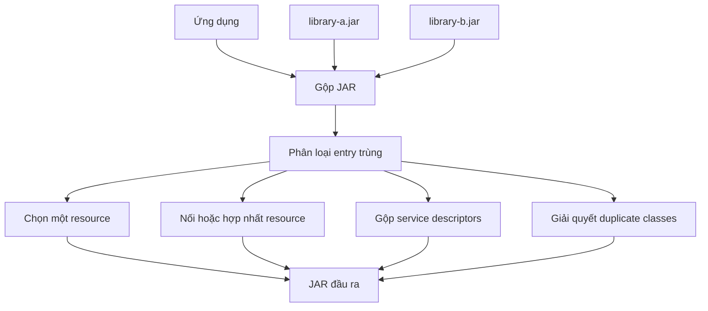

# Xung đột tài nguyên, tệp dịch vụ và lớp trùng khi gộp JAR

Khi đóng gói ứng dụng Java thành một JAR chứa cả dependency (thường gọi là *fat JAR* hoặc *uber JAR*), build tool phải kết hợp nội dung từ nhiều JAR đầu vào. Mỗi JAR có thể chứa lớp Java, resource, manifest và metadata riêng. Hai thư viện có thể cùng chứa một đường dẫn như `config/default.properties`, `META-INF/services/com.example.spi.PaymentProvider` hoặc thậm chí cùng một tệp lớp `.class`.

Việc gộp các archive vì thế có thể tạo ra xung đột. Một số resource cần chọn một bản; một số cần nối hoặc hợp nhất theo định dạng; tệp service descriptor thường phải gộp danh sách provider; còn hai lớp Java có cùng tên đầy đủ không thể được giải quyết bằng cách nối nội dung. Nếu chỉ dùng thao tác copy ZIP và bỏ qua khác biệt này, ứng dụng có thể thiếu provider, đọc nhầm cấu hình, nạp sai lớp hoặc không khởi động được.

Bài học này giải thích các loại xung đột thường gặp khi gộp JAR, cách chọn chính sách xử lý, cách cấu hình Gradle Shadow và Maven Shade, cũng như cách kiểm tra artifact sau đóng gói.

## 1. Vì sao gộp JAR tạo ra xung đột?

Một JAR là một archive ZIP có cấu trúc chuẩn. Bên trong có thể chứa:

- Bytecode `.class` của các package Java.
- Resource mà ứng dụng đọc qua classpath.
- `META-INF/MANIFEST.MF` chứa metadata của JAR.
- Tệp đăng ký service provider trong `META-INF/services/`.
- Metadata framework, module, chữ ký, license và các tệp đặc biệt khác.

Giả sử ứng dụng phụ thuộc vào hai thư viện:

```text
application.jar
├── app classes and resources
├── library-a.jar
│   ├── com/example/a/Client.class
│   ├── config/default.properties
│   └── META-INF/services/com.example.spi.PaymentProvider
└── library-b.jar
    ├── com/example/b/Client.class
    ├── config/default.properties
    └── META-INF/services/com.example.spi.PaymentProvider
```

Khi gộp, cả hai dependency đều có entry `config/default.properties` và cùng có service descriptor cho `PaymentProvider`. Nếu hai thư viện chứa lớp trùng tên đầy đủ, ví dụ cùng có `org/example/common/Helper.class`, archive đầu ra cũng có thể gặp duplicate class entry.



Điểm quan trọng là **trùng đường dẫn không có nghĩa mọi loại tệp đều cần cùng một cách xử lý**. Một tệp cấu hình có thể cần hợp nhất theo cú pháp riêng; một service descriptor cần giữ tất cả provider; một class file cần chọn implementation tương thích hoặc đổi namespace. Chính sách `exclude` chung cho mọi duplicate có thể làm mất thông tin quan trọng.

## 2. JAR thông thường và fat JAR khác nhau

Một JAR thông thường do Java plugin tạo thường đóng gói output của chính project: class và resource của source set `main`. Dependency được khai báo riêng và nằm trên classpath khi chạy.

Ví dụ:

```groovy
plugins {
    id 'java'
}

dependencies {
    implementation 'org.example:library-a:1.2.0'
}
```

Task `jar` đóng gói output của project. Nó không mặc nhiên bung mọi dependency rồi gộp nội dung của chúng vào cùng một archive.

Một fat JAR/uber JAR thường bung nội dung dependency rồi kết hợp vào một archive duy nhất. Cách này thuận tiện khi triển khai ứng dụng cần một tệp phân phối, nhưng làm phát sinh các vấn đề về duplicate entries, service metadata, manifest, chữ ký và module metadata.

Hai hướng đóng gói phổ biến:

1. **Fat JAR:** đưa class và resource của dependency vào cùng JAR với ứng dụng.
2. **JAR kèm thư mục lib hoặc launcher:** giữ các JAR dependency riêng và cấu hình classpath khi chạy.

Nếu môi trường triển khai hỗ trợ classpath hoặc container image, giữ dependency thành các JAR riêng có thể tránh một số xung đột khi gộp. Fat JAR vẫn hữu ích khi cần một artifact tự chứa, nhưng phải có chính sách xử lý nội dung rõ ràng.

## 3. Phân loại các xung đột khi gộp archive

| Loại entry trùng | Ví dụ | Cách xử lý thường dùng |
|---|---|---|
| Resource cấu hình | `application.properties`, `reference.conf` | Chọn một bản, nối hoặc merge theo định dạng và thứ tự ưu tiên rõ ràng. |
| Service descriptor | `META-INF/services/com.example.spi.PaymentProvider` | Gộp danh sách provider, loại dòng trùng nếu phù hợp. |
| Lớp Java | `org/example/common/Helper.class` | Chọn một phiên bản tương thích hoặc relocate package của một dependency. Không nối bytecode. |
| Manifest | `META-INF/MANIFEST.MF` | Tạo manifest cuối cùng có chủ đích; không nối nguyên manifest của từng dependency. |
| Chữ ký JAR | `META-INF/*.SF`, `*.RSA`, `*.DSA`, `*.EC` | Loại chữ ký cũ khi archive bị biến đổi; ký lại artifact cuối nếu quy trình yêu cầu. |
| License/NOTICE | `META-INF/LICENSE`, `META-INF/NOTICE` | Giữ và hợp nhất thông tin theo yêu cầu phân phối; không loại bỏ tùy tiện. |
| Module descriptor | `module-info.class` | Xử lý theo mô hình module; không gộp nhiều descriptor như resource thông thường. |
| Metadata framework | Spring, native-image, logging hoặc plugin metadata | Dùng transformer hoặc quy tắc merge theo đúng định dạng. |
| Resource đa phiên bản | `META-INF/versions/9/...` và các phiên bản khác | Giữ đúng cấu trúc multi-release JAR và metadata liên quan. |

Trước khi chọn cách xử lý, hãy xác định entry thuộc loại nào và thành phần nào sử dụng nó. Cùng một đường dẫn có thể được framework đọc theo quy tắc riêng mà build tool không thể tự suy ra.

## 4. Duplicate resource: chọn, nối hay hợp nhất?

Resource không phải bytecode. Khi hai dependency chứa cùng một đường dẫn resource, classloader hoặc framework có thể đọc một bản, nhiều bản hoặc yêu cầu một cấu trúc đặc biệt. Kết quả phụ thuộc cách resource được truy cập.

### 4.1. Chọn một bản

Một số resource có ý nghĩa chỉ có một cấu hình hiệu lực, ví dụ file mặc định mà ứng dụng chủ động ghi đè bằng cấu hình riêng. Khi đó, cần xác định nguồn nào có quyền ưu tiên.

Ví dụ:

```text
library-a.jar: config/default.properties
application:   config/default.properties
```

Nếu ứng dụng phải dùng file cấu hình của chính nó, build có thể loại resource cùng đường dẫn từ dependency hoặc tổ chức lại vị trí resource để tránh trùng. Cần xác nhận code thực sự đọc đúng resource mong muốn.

Không nên dựa vào thứ tự ZIP entry hoặc thứ tự dependency mà không có hợp đồng rõ ràng. Thứ tự tìm kiếm trên classpath có thể ảnh hưởng kết quả, nhưng đó không phải chính sách merge đáng tin cậy cho một fat JAR.

### 4.2. Nối nội dung

Một số resource là danh sách nhiều dòng hoặc tập khai báo độc lập, nên có thể nối nội dung. Ví dụ, `reference.conf` của Typesafe Config thường được nối để các thư viện đóng góp cấu hình mặc định.

Tuy nhiên, nối chỉ an toàn khi định dạng cho phép. Nối hai tệp JSON object hoàn chỉnh thường tạo ra nội dung không hợp lệ:

```json
{"featureA": true}
{"featureB": true}
```

Nếu cần gộp JSON, phải parse và merge theo cấu trúc, quy tắc xung đột key và kiểu dữ liệu. Nối văn bản một cách mù quáng không phải là merge JSON.

### 4.3. Merge theo định dạng

Một số metadata cần transformer hiểu cấu trúc. Ví dụ:

- Danh sách service provider cần hợp nhất theo dòng.
- Manifest cần chọn main class và kết hợp một số attribute hợp lệ.
- File cấu hình framework có thể cần nối, parse hoặc hợp nhất theo schema.
- Native image metadata có thể chứa JSON cần kết hợp theo quy tắc GraalVM.

Nếu plugin đóng gói không có transformer phù hợp, có thể cần task tùy chỉnh để đọc, parse và tạo resource cuối cùng. Hãy giữ logic merge rõ ràng, có thể tái hiện và có kiểm tra đầu ra.

## 5. Tệp `META-INF/services`: vì sao cần merge?

Java SPI (Service Provider Interface) cho phép một thành phần định nghĩa interface dịch vụ và các thư viện đăng ký implementation. `ServiceLoader` tìm provider thông qua tệp có đường dẫn:

```text
META-INF/services/<fully-qualified-service-interface-name>
```

Ví dụ, interface:

```java
package com.example.spi;

public interface PaymentProvider {
    String name();
}
```

Thư viện A đăng ký:

```text
META-INF/services/com.example.spi.PaymentProvider
```

Nội dung:

```text
com.example.payments.card.CardPaymentProvider
```

Thư viện B cũng đăng ký cùng service nhưng cung cấp provider khác:

```text
com.example.payments.wallet.WalletPaymentProvider
```

Khi chạy trên classpath với hai JAR riêng, `ServiceLoader` có thể tìm thấy các provider descriptor ở cả hai JAR. Nhưng khi gộp chúng vào một fat JAR, cả hai descriptor có cùng đường dẫn. Nếu chỉ giữ một file, provider còn lại có thể biến mất.

Kết quả mong muốn sau khi merge thường là một descriptor chứa cả hai provider:

```text
com.example.payments.card.CardPaymentProvider
com.example.payments.wallet.WalletPaymentProvider
```

Mỗi dòng là tên lớp provider đầy đủ. Dòng trống và comment bắt đầu bằng `#` có thể xuất hiện trong descriptor; transformer cần xử lý đúng định dạng và encoding.

### 5.1. Điều gì xảy ra nếu không merge service descriptor?

Ứng dụng có thể:

- Không tìm thấy provider mà một thư viện cần.
- Chỉ nạp provider của một dependency.
- Khởi tạo framework thất bại vì thiếu implementation.
- Có hành vi khác nhau giữa chạy bằng nhiều JAR riêng và chạy bằng fat JAR.

Lỗi có thể xuất hiện khi framework khởi động chứ không nhất thiết tại thời điểm compile. Vì vậy, build thành công không chứng minh service metadata đã được gộp đúng.

### 5.2. Cần kiểm tra provider class có thật sự tồn tại

Gộp descriptor chỉ giải quyết danh sách provider. Nó không bảo đảm lớp provider còn tồn tại sau shading/relocation hoặc không bị loại khỏi artifact. Sau khi đóng gói, cần xác nhận:

- Descriptor cuối chứa các provider mong đợi.
- Mỗi tên provider ánh xạ tới một class có trong JAR.
- Provider có constructor hoặc cơ chế khởi tạo phù hợp với `ServiceLoader` và module mode đang dùng.
- Nếu dùng relocation, tên lớp trong descriptor đã được cập nhật tương ứng.

## 6. Gộp service descriptor bằng Gradle Shadow

Gradle Shadow plugin tạo fat JAR và cung cấp transformer cho một số resource. `mergeServiceFiles()` là thao tác quan trọng khi dependency có cùng `META-INF/services/...`.

Ví dụ Groovy DSL:

```groovy
plugins {
    id 'application'
    id 'com.gradleup.shadow' version '<approved-version>'
}

application {
    mainClass = 'com.example.Main'
}

tasks.named('shadowJar') {
    mergeServiceFiles()
}
```

`<approved-version>` là placeholder; hãy thay bằng phiên bản Shadow plugin đã được dự án phê duyệt và khóa trong build. `mergeServiceFiles()` đăng ký transformer để kết hợp nội dung service descriptor từ các dependency.

Với Kotlin DSL, cách gọi tương đương thường có dạng:

```kotlin
plugins {
    application
    id("com.gradleup.shadow") version "<approved-version>"
}

application {
    mainClass = "com.example.Main"
}

tasks.named<com.github.jengelman.gradle.plugins.shadow.tasks.ShadowJar>("shadowJar") {
    mergeServiceFiles()
}
```

Tên package của task type có thể thay đổi theo dòng plugin. Nếu không muốn phụ thuộc import cụ thể, có thể cấu hình task theo tên với DSL phù hợp phiên bản plugin được dùng. Hãy kiểm tra tài liệu của phiên bản Shadow đang khóa trong dự án.

### 6.1. Chính sách duplicate trong Shadow

Gradle CopySpec và Shadow có `DuplicatesStrategy` để quyết định cách xử lý entry trùng. Các lựa chọn thường gặp:

| Strategy | Ý nghĩa |
|---|---|
| `FAIL` | Dừng task khi phát hiện duplicate. |
| `EXCLUDE` | Bỏ entry trùng theo quy tắc copy. |
| `INCLUDE` | Cho phép nhiều entry cùng đường dẫn được đưa vào output. |
| `WARN` | Cảnh báo và vẫn đưa entry theo hành vi include. |
| `INHERIT` | Kế thừa chiến lược từ CopySpec cha. |

Đối với fat JAR, nên coi duplicate bất ngờ là lỗi cần điều tra. Service descriptor là trường hợp đặc biệt cần transformer merge. Cách phối hợp `duplicatesStrategy` và transformer có thể phụ thuộc phiên bản Gradle/Shadow vì strategy có thể quyết định duplicate có được chuyển tới transformer hay không.

Không nên đặt `INCLUDE` toàn cục rồi xem như đã xử lý xong mọi xung đột. Điều đó có thể để lại nhiều entry cùng đường dẫn, bao gồm cả class file. Hãy theo hướng dẫn của plugin để cho phép transformer nhận đúng những resource cần merge, đồng thời giữ chính sách nghiêm cho các duplicate còn lại.

Ví dụ về ý định cấu hình, cần điều chỉnh theo phiên bản plugin:

```groovy
tasks.named('shadowJar') {
    mergeServiceFiles()

    // Chọn duplicate strategy có chủ đích cho dự án.
    // Không dùng INCLUDE toàn cục nếu chưa kiểm soát các entry còn lại.
}
```

Sau khi chạy task, kiểm tra nội dung `META-INF/services` trong JAR đầu ra thay vì chỉ dựa vào việc task thành công.

## 7. Gộp service descriptor bằng Maven Shade

Maven Shade Plugin có `ServicesResourceTransformer` để merge service descriptor.

Ví dụ cấu hình trong `pom.xml`:

```xml
<build>
    <plugins>
        <plugin>
            <groupId>org.apache.maven.plugins</groupId>
            <artifactId>maven-shade-plugin</artifactId>
            <version>3.6.0</version>
            <executions>
                <execution>
                    <phase>package</phase>
                    <goals>
                        <goal>shade</goal>
                    </goals>
                    <configuration>
                        <transformers>
                            <transformer implementation="org.apache.maven.plugins.shade.resource.ServicesResourceTransformer"/>
                        </transformers>
                    </configuration>
                </execution>
            </executions>
        </plugin>
    </plugins>
</build>
```

`ServicesResourceTransformer` kết hợp các descriptor `META-INF/services`. Nó cũng có thể xử lý tên provider khi Shade relocation thay đổi package, giúp nội dung descriptor trỏ tới lớp đã relocate.

Nếu cần khai báo main class, có thể thêm `ManifestResourceTransformer`:

```xml
<transformers>
    <transformer implementation="org.apache.maven.plugins.shade.resource.ServicesResourceTransformer"/>
    <transformer implementation="org.apache.maven.plugins.shade.resource.ManifestResourceTransformer">
        <mainClass>com.example.Main</mainClass>
    </transformer>
</transformers>
```

Maven Shade có nhiều transformer khác nhau. Chọn transformer theo định dạng resource, không dùng một transformer tổng quát cho mọi file trong `META-INF`.

## 8. Duplicate class: không thể merge bytecode

Hai dependency có thể cùng chứa class cùng tên đầy đủ:

```text
library-a.jar: org/example/common/Helper.class
library-b.jar: org/example/common/Helper.class
```

Đây là duplicate class. Hai file `.class` là hai implementation bytecode riêng biệt. Không có phép nối nội dung nào tạo ra một class hợp lệ từ cả hai.

Nếu fat JAR chứa hai ZIP entry cùng đường dẫn class, kết quả có thể phụ thuộc cách archive được tạo và cách classloader đọc entry. Một số công cụ chọn bản đầu, bản cuối hoặc báo lỗi. Dựa vào hành vi tình cờ này làm build không đáng tin cậy.

### 8.1. Chọn phiên bản dependency tương thích

Giải pháp ưu tiên thường là tìm một bộ dependency không chứa duplicate class hoặc chỉ có một phiên bản của module đó trong graph.

Các bước:

1. Xác định hai JAR nào chứa cùng class.
2. Xem dependency graph để biết vì sao cả hai JAR được đưa vào.
3. Nâng dependency cha, loại một dependency không cần thiết hoặc quản lý version theo BOM/constraint.
4. Xác nhận API mà các thư viện khác sử dụng tương thích với phiên bản được chọn.
5. Build lại và kiểm tra archive không còn duplicate class.

Đây thường là hướng tốt nhất vì nó giải quyết xung đột ở dependency graph thay vì che giấu nó trong bước đóng gói.

### 8.2. Exclude một dependency không cần thiết

Nếu một thư viện đóng gói một bản copy của module mà ứng dụng đã cung cấp ở nơi khác, có thể exclusion dependency bắc cầu hoặc loại artifact khỏi tập dependency được đưa vào fat JAR. Chỉ làm vậy khi đã xác nhận thư viện không cần phiên bản bị loại hoặc phiên bản còn lại tương thích.

Exclusion ở dependency graph và filter ở bước shading không hoàn toàn giống nhau:

- Dependency exclusion ngăn module được phân giải qua một nhánh dependency.
- Shade filter có thể loại một số entry hoặc artifact khỏi archive đầu ra trong khi dependency vẫn tồn tại trong graph.

Nếu chỉ filter một class khỏi JAR mà thư viện khác cần class đó, ứng dụng có thể lỗi lúc chạy. Hãy hiểu consumer nào cần class trước khi loại.

### 8.3. Relocation package

Khi hai thư viện cần giữ hai phiên bản khác nhau của cùng một package, shading relocation có thể đổi namespace của một dependency để tránh đụng tên lớp.

Ví dụ, ứng dụng dùng `org.legacy:json-core` nhưng một thư viện cũ cũng đóng gói package `com.fasterxml...` của một phiên bản khác. Có thể relocate package của dependency cũ sang namespace riêng:

```groovy
tasks.named('shadowJar') {
    relocate 'org.example.legacy', 'com.example.internal.shaded.legacy'
}
```

Ví dụ Maven Shade:

```xml
<relocations>
    <relocation>
        <pattern>org.example.legacy</pattern>
        <shadedPattern>com.example.internal.shaded.legacy</shadedPattern>
    </relocation>
</relocations>
```

Relocation thay đổi tên package trong bytecode và có thể cập nhật một số resource liên quan tùy công cụ. Nhưng không phải mọi tham chiếu đều có thể được nhận diện tĩnh. Các trường hợp cần xem xét:

- Tên lớp được tạo bằng reflection từ chuỗi.
- Tệp cấu hình chứa fully qualified class name.
- Service descriptor và provider class name.
- Serialization format lưu tên lớp.
- JNI hoặc native code tham chiếu tên lớp.
- Package name được framework quét hoặc suy ra từ metadata.

Sau relocation, cần test các đường chạy reflection, serialization, SPI và framework integration. Relocation cũng làm API package thay đổi; không nên dùng với thư viện mà ứng dụng cần expose trực tiếp như một phần API công khai nếu không có chủ đích.

## 9. Resource framework cần transformer riêng

Không phải mọi resource trùng đều là service descriptor. Một số framework có metadata riêng cần merge theo định dạng.

### 9.1. `reference.conf`

Nhiều thư viện dùng Typesafe Config đóng góp mặc định trong resource `reference.conf`. Các file này thường cần được nối để cấu hình của từng thư viện đều có mặt.

Gradle Shadow hỗ trợ append resource:

```groovy
tasks.named('shadowJar') {
    append('reference.conf')
    mergeServiceFiles()
}
```

Với Maven Shade, có thể dùng `AppendingTransformer`:

```xml
<transformers>
    <transformer implementation="org.apache.maven.plugins.shade.resource.AppendingTransformer">
        <resource>reference.conf</resource>
    </transformer>
    <transformer implementation="org.apache.maven.plugins.shade.resource.ServicesResourceTransformer"/>
</transformers>
```

Append phù hợp vì định dạng và thư viện được thiết kế để đọc nhiều phần cấu hình. Với resource khác, hãy xác minh framework có quy tắc tương tự hay không.

### 9.2. Spring metadata

Các thư viện Spring có thể đóng góp metadata như:

- `META-INF/spring.factories` trong các phiên bản Spring Boot cũ.
- `META-INF/spring/org.springframework.boot.autoconfigure.AutoConfiguration.imports` trong cơ chế auto-configuration mới.
- `META-INF/spring.handlers` và `META-INF/spring.schemas` trong một số tích hợp XML cũ.

Các file này có dạng và quy tắc xử lý riêng. Nếu gộp chúng, cần dùng transformer hoặc cách merge đúng với phiên bản Spring đang sử dụng. Chọn một file duy nhất có thể làm mất auto-configuration hoặc schema mapping của thư viện khác.

### 9.3. Native image metadata

GraalVM Native Image có thể sử dụng JSON metadata trong `META-INF/native-image/`. Nhiều dependency có thể cung cấp metadata riêng. Việc merge cần hiểu schema và cách Native Image builder diễn giải các file. Không nên nối JSON tùy tiện hoặc loại toàn bộ thư mục này chỉ để task shading thành công.

### 9.4. License và NOTICE

Nhiều dependency mang theo `META-INF/LICENSE`, `META-INF/NOTICE` hoặc các file license ở vị trí khác. Khi gộp JAR, những tệp cùng tên có thể bị trùng. Hãy giữ thông tin license/notice cần thiết và hợp nhất theo nghĩa vụ phân phối của từng dependency.

Không nên cấu hình `exclude 'META-INF/**'` một cách tổng quát để làm biến mất duplicate. Cách này có thể xóa service descriptor, license, native metadata, framework configuration hoặc các tệp cần thiết khác.

## 10. Manifest: chỉ nên có một manifest cuối cùng

Mỗi JAR có thể có `META-INF/MANIFEST.MF`. Manifest chứa main attributes như:

- `Main-Class` cho ứng dụng chạy bằng `java -jar`.
- `Class-Path` trong một số kiểu đóng gói.
- `Implementation-Version`, `Specification-Version`.
- `Automatic-Module-Name` hoặc thuộc tính khác do dự án sử dụng.
- `Multi-Release: true` cho multi-release JAR.

Khi gộp nhiều JAR, không nên nối nguyên manifest của tất cả dependency. Một số attribute chỉ có một giá trị hợp lệ; một số mô tả riêng từng JAR gốc và không còn chính xác sau khi nội dung được gộp.

Hãy tạo manifest cuối cùng dựa trên yêu cầu của artifact:

```groovy
tasks.named('shadowJar') {
    manifest {
        attributes(
            'Main-Class': 'com.example.Main',
            'Implementation-Version': project.version
        )
    }
}
```

Với Maven Shade, dùng `ManifestResourceTransformer` để thiết lập main class và các thuộc tính cần thiết. Kiểm tra manifest cuối bằng `unzip -p` hoặc công cụ đọc JAR.

`Class-Path` trong manifest của JAR đầu vào có thể trỏ tới các file dependency bên ngoài. Sau khi dependency được gộp vào fat JAR, giá trị cũ có thể sai hoặc không cần thiết. Hãy xác định có cần `Class-Path` hay không thay vì giữ nguyên từ một dependency.

## 11. Chữ ký JAR và vì sao cần loại signature cũ

Một JAR được ký có thể chứa các tệp trong `META-INF` như:

```text
META-INF/DEPENDENCY.SF
META-INF/DEPENDENCY.RSA
META-INF/DEPENDENCY.DSA
META-INF/DEPENDENCY.EC
```

Các tệp này liên kết chữ ký với nội dung archive gốc. Khi build tool bung JAR, thay đổi entry rồi tạo archive mới, digest và nội dung đã ký không còn khớp với artifact mới.

Vì vậy, fat JAR thường phải loại signature metadata của dependency đầu vào. Với Maven Shade, có thể cấu hình filter loại signature files:

```xml
<filters>
    <filter>
        <artifact>*:*</artifact>
        <excludes>
            <exclude>META-INF/*.SF</exclude>
            <exclude>META-INF/*.DSA</exclude>
            <exclude>META-INF/*.RSA</exclude>
            <exclude>META-INF/*.EC</exclude>
        </excludes>
    </filter>
</filters>
```

Tên và pattern cần được điều chỉnh theo nội dung thực tế của dependency. Không nên loại toàn bộ `META-INF`, vì có thể làm mất metadata hợp lệ.

Nếu tổ chức yêu cầu JAR cuối được ký, hãy ký **artifact sau khi đã gộp và hoàn tất mọi bước biến đổi** bằng quy trình ký của tổ chức. Chữ ký của các JAR đầu vào không còn xác nhận tính toàn vẹn của fat JAR mới.

## 12. Module descriptor và multi-release JAR

### 12.1. `module-info.class`

Java module descriptor thường được đặt tại root JAR với tên `module-info.class`. Nó khai báo module name, exported package, required module và service use/provide.

Hai JAR có thể cùng có `module-info.class`, nhưng chúng mô tả hai module khác nhau. Gộp chúng vào một fat JAR không thể giải quyết bằng cách chọn ngẫu nhiên một descriptor. Việc flatten dependency vào một archive cũng có thể làm thay đổi cách ứng dụng được sử dụng trên module path.

Nếu triển khai trên classpath, một số công cụ shading loại hoặc xử lý module descriptor theo chính sách riêng. Nếu cần hỗ trợ module path, hãy dùng công cụ và cấu hình hiểu module descriptor, hoặc giữ dependency thành các module/JAR riêng thay vì flatten một cách tùy tiện.

### 12.2. Multi-release JAR

Multi-release JAR có thể chứa các implementation theo phiên bản Java trong:

```text
META-INF/versions/9/
META-INF/versions/11/
META-INF/versions/17/
```

Manifest của archive cần có:

```text
Multi-Release: true
```

Khi gộp một multi-release JAR, phải giữ đúng cấu trúc versioned entries và metadata. Nếu chỉ lấy các class ở root hoặc loại `META-INF/versions/**`, ứng dụng có thể mất implementation được tối ưu cho runtime Java tương ứng. Ngược lại, nếu gộp nhiều dependency có versioned entry cùng đường dẫn, vẫn cần xử lý duplicate theo đúng semantics của multi-release JAR.

Không coi `META-INF/versions/**` là thư mục tạm có thể xóa hàng loạt.

## 13. Duplicate handling trong Gradle

Gradle có `DuplicatesStrategy` cho các task copy/archive. Các giá trị phổ biến gồm:

| Giá trị | Hành vi |
|---|---|
| `FAIL` | Báo lỗi khi gặp entry trùng. |
| `EXCLUDE` | Bỏ entry trùng theo quy tắc xử lý copy. |
| `INCLUDE` | Cho phép entry trùng được đưa vào output. |
| `WARN` | Cảnh báo nhưng vẫn cho phép include. |
| `INHERIT` | Kế thừa strategy từ spec cha. |

Đối với archive chứa output project đơn giản, `FAIL` thường là lựa chọn hữu ích để phát hiện resource bị đóng gói trùng ngoài dự kiến. Đối với fat JAR, một số duplicate cần transformer xử lý trước khi đưa vào archive. Cấu hình chính xác phụ thuộc task và plugin.

### 13.1. Không dùng `EXCLUDE` như cách sửa mọi lỗi

`EXCLUDE` có thể khiến build thành công bằng cách giữ lại một entry và bỏ entry trùng. Nhưng nếu entry bị bỏ là service provider hoặc resource cấu hình của dependency khác, hành vi ứng dụng có thể thay đổi.

### 13.2. Không dùng `INCLUDE` mà không kiểm soát

`INCLUDE` cho phép nhiều entry cùng tên xuất hiện trong archive. Với class file hoặc resource chỉ nên có một bản, điều này có thể tạo artifact không xác định được entry nào được đọc. Hãy dùng transformer cho resource cần merge và giữ kiểm tra nghiêm cho duplicate còn lại.

### 13.3. Shadow và duplicate strategy

Shadow là plugin riêng có các transformer như `mergeServiceFiles()` và `append(...)`. Với một số phiên bản Gradle/Shadow, duplicate strategy có thể ngăn transformer nhận entry trùng nếu strategy loại bỏ hoặc fail quá sớm. Khi cấu hình fat JAR:

1. Xác định những đường dẫn cần transformer.
2. Theo tài liệu đúng phiên bản plugin để cho phép transformer nhận các entry đó.
3. Đặt policy nghiêm cho duplicate class và resource chưa có quy tắc merge.
4. Kiểm tra archive cuối để xác nhận transformer đã tạo đúng kết quả.

Không có một giá trị strategy toàn cục phù hợp cho mọi project. Mục tiêu là merge các loại entry đã biết và phát hiện duplicate bất ngờ.

## 14. Cấu hình Maven Shade cho một fat JAR

Ví dụ sau kết hợp service descriptor, manifest, lọc chữ ký và một resource có thể nối. Đây là cấu hình minh họa; hãy điều chỉnh transformer theo framework và dependency thực tế.

```xml
<build>
    <plugins>
        <plugin>
            <groupId>org.apache.maven.plugins</groupId>
            <artifactId>maven-shade-plugin</artifactId>
            <version>3.6.0</version>
            <executions>
                <execution>
                    <phase>package</phase>
                    <goals>
                        <goal>shade</goal>
                    </goals>
                    <configuration>
                        <createDependencyReducedPom>true</createDependencyReducedPom>
                        <filters>
                            <filter>
                                <artifact>*:*</artifact>
                                <excludes>
                                    <exclude>META-INF/*.SF</exclude>
                                    <exclude>META-INF/*.DSA</exclude>
                                    <exclude>META-INF/*.RSA</exclude>
                                    <exclude>META-INF/*.EC</exclude>
                                </excludes>
                            </filter>
                        </filters>
                        <transformers>
                            <transformer implementation="org.apache.maven.plugins.shade.resource.ServicesResourceTransformer"/>
                            <transformer implementation="org.apache.maven.plugins.shade.resource.AppendingTransformer">
                                <resource>reference.conf</resource>
                            </transformer>
                            <transformer implementation="org.apache.maven.plugins.shade.resource.ManifestResourceTransformer">
                                <mainClass>com.example.Main</mainClass>
                            </transformer>
                        </transformers>
                    </configuration>
                </execution>
            </executions>
        </plugin>
    </plugins>
</build>
```

Lưu ý về ví dụ:

- `ServicesResourceTransformer` merge service provider descriptors.
- `AppendingTransformer` chỉ phù hợp với resource như `reference.conf` có semantics nối nội dung.
- `ManifestResourceTransformer` tạo manifest với main class cho artifact cuối.
- Filter loại chữ ký cũ vì nội dung archive bị biến đổi.
- `createDependencyReducedPom` điều chỉnh POM được publish trong một số trường hợp Shade; hãy xác định có phù hợp với cách project phân phối thư viện hay không.

Nếu artifact là thư viện được các project khác dùng làm dependency, cần cân nhắc kỹ dependency-reduced POM và cách consumer nhận dependency. Fat JAR phù hợp cho ứng dụng tự chạy, nhưng không phải lúc nào cũng phù hợp làm library publication.

## 15. Kiểm tra duplicate trước và sau khi gộp

Đừng đợi đến lúc ứng dụng lỗi mới tìm entry trùng. Có thể kiểm tra nội dung JAR đầu vào và archive đầu ra bằng công cụ JDK.

### 15.1. Liệt kê entry trong JAR

```bash
jar tf library-a.jar
jar tf library-b.jar
jar tf build/libs/application-all.jar
```

Lệnh `jar tf` liệt kê entry trong archive. Dùng `grep`, `findstr` hoặc lọc trong shell để tìm các đường dẫn cần quan tâm.

### 15.2. Tìm duplicate class trên nhiều JAR

Trên Bash, nếu các dependency nằm trong thư mục `lib`:

```bash
for file in lib/*.jar; do
    jar tf "$file" | grep '\.class$'
done | sort | uniq -d
```

Lệnh trên gom tên class entry từ tất cả JAR, sắp xếp và in các đường dẫn xuất hiện nhiều lần. Nó giúp tìm candidate duplicate class, nhưng chưa cho biết hai class có bytecode giống nhau hay không và cũng không phân tích dependency graph.

Trên PowerShell:

```powershell
$entries = Get-ChildItem .\lib -Filter *.jar | ForEach-Object {
    & jar tf $_.FullName | Where-Object { $_ -like '*.class' }
}

$entries | Group-Object | Where-Object { $_.Count -gt 1 } | Select-Object Name, Count
```

Đường dẫn trùng là dấu hiệu cần điều tra. Có thể hai JAR cố ý cung cấp cùng một class do shaded/relocated artifact hoặc do một module bị đóng gói lặp. Hãy tìm nguồn gốc từng JAR trước khi loại.

### 15.3. Đọc service descriptor

Nếu muốn kiểm tra provider descriptor trong một JAR:

```bash
unzip -p library-a.jar META-INF/services/com.example.spi.PaymentProvider
```

Sau khi gộp:

```bash
unzip -p build/libs/application-all.jar META-INF/services/com.example.spi.PaymentProvider
```

Nếu môi trường không có `unzip`, có thể dùng `jar tf` để xác nhận entry tồn tại và dùng công cụ ZIP/JAR phù hợp để trích xuất nội dung.

### 15.4. Kiểm tra manifest và module

```bash
unzip -p build/libs/application-all.jar META-INF/MANIFEST.MF
jar --describe-module --file build/libs/application-all.jar
```

Lệnh `jar --describe-module` cần JDK có hỗ trợ module system. Nếu archive là classpath-oriented fat JAR và không có descriptor, kết quả có thể cho biết automatic module hoặc trạng thái không phải named module tùy cấu trúc.

## 16. Kiểm tra hành vi runtime sau khi merge

Một archive không có duplicate entry vẫn có thể sai về semantics. Sau khi đóng gói, hãy kiểm tra các luồng sử dụng metadata đặc biệt.

### 16.1. Kiểm tra ServiceLoader

Ví dụ kiểm tra tất cả provider:

```java
ServiceLoader<PaymentProvider> providers =
    ServiceLoader.load(PaymentProvider.class);

for (PaymentProvider provider : providers) {
    System.out.println(provider.name());
}
```

Chạy ứng dụng hoặc test trên chính fat JAR để xác nhận provider mong đợi xuất hiện. Chỉ kiểm tra file descriptor bằng mắt chưa đủ nếu provider class đã bị loại hoặc relocate sai.

### 16.2. Kiểm tra resource được chọn

Nếu ứng dụng dùng:

```java
try (InputStream input = getClass().getClassLoader()
        .getResourceAsStream("config/default.properties")) {
    // Đọc cấu hình
}
```

hãy xác nhận nội dung được đọc là bản đã chọn theo chính sách. Có thể thêm test kiểm tra một giá trị cấu hình đặc trưng để phát hiện trường hợp resource của dependency vô tình thắng resource của ứng dụng.

### 16.3. Kiểm tra main class và startup

Chạy thử:

```bash
java -jar build/libs/application-all.jar
```

Lệnh này kiểm tra manifest `Main-Class` và đường chạy khởi động cơ bản. Nó không thay thế integration test, nhưng có thể phát hiện manifest thiếu hoặc class/resource quan trọng không được đóng gói.

### 16.4. Kiểm tra relocation

Nếu đã relocate package, test các điểm sau:

- Code gọi trực tiếp lớp đã relocate.
- Reflection hoặc class name được đọc từ cấu hình.
- ServiceLoader provider.
- Serialization/deserialization nếu lưu tên lớp.
- Framework scan và native integration.

## 17. Lỗi thường gặp khi gộp JAR

| Triệu chứng | Nguyên nhân có thể | Hướng xử lý |
|---|---|---|
| `ServiceLoader` không tìm thấy provider | Một descriptor bị bỏ khi merge hoặc provider class không có trong archive. | Dùng service transformer, kiểm tra nội dung descriptor và class tương ứng. |
| Chỉ có một trong nhiều provider được nạp | Descriptor trùng bị chọn một bản thay vì merge. | Gộp `META-INF/services/**` theo định dạng SPI. |
| Ứng dụng đọc sai cấu hình | Hai resource cùng đường dẫn và bản không mong muốn được giữ lại. | Đặt policy chọn resource rõ ràng, kiểm tra classpath và archive. |
| `NoSuchMethodError` sau khi gộp | Hai dependency không tương thích hoặc duplicate class chọn sai version. | Kiểm tra dependency graph, chọn version tương thích hoặc relocate dependency cô lập. |
| `ClassNotFoundException` sau exclusion | Class bị loại nhưng một thư viện vẫn cần nó. | Khôi phục dependency hoặc cung cấp implementation tương thích. |
| `SecurityException: invalid signature` | Giữ chữ ký cũ sau khi thay đổi nội dung JAR. | Loại signature metadata dependency trước khi tạo archive; ký lại artifact cuối nếu cần. |
| Ứng dụng không chạy bằng `java -jar` | Manifest thiếu hoặc sai `Main-Class`. | Tạo manifest cuối bằng cấu hình archive/transformer. |
| Framework không tự cấu hình | Metadata framework bị bỏ hoặc merge sai. | Dùng transformer đúng framework/version và kiểm tra resource sau merge. |
| License/NOTICE bị thiếu | Filter loại toàn bộ `META-INF` hoặc duplicate strategy bỏ thông tin. | Giữ và tổng hợp thông tin license/notice theo yêu cầu phân phối. |
| Lỗi khi chạy trên module path | Nhiều `module-info.class` hoặc metadata module không phù hợp sau flatten. | Giữ dependency riêng hoặc xử lý module descriptor có chủ đích. |
| Native image thiếu cấu hình | JSON metadata trong `META-INF/native-image` bị ghi đè hoặc loại. | Merge theo schema/tooling GraalVM phù hợp. |

## 18. Quy trình xử lý duplicate có kiểm soát

Khi build báo duplicate hoặc ứng dụng lỗi sau khi tạo fat JAR, hãy làm theo trình tự:

1. **Xác định loại archive.** Là JAR thường hay fat JAR? Plugin nào đang gộp dependency?
2. **Liệt kê nguồn.** Xác định JAR nào đóng góp entry trùng và dependency graph đưa chúng vào vì sao.
3. **Phân loại entry.** Class, resource cấu hình, service descriptor, manifest, signature, license hay metadata framework?
4. **Chọn policy theo định dạng.** Chọn một bản, append, merge bằng transformer, exclude dependency hoặc relocate package.
5. **Giữ kiểm tra nghiêm.** Duplicate class/resource chưa được xử lý có chủ đích cần làm build fail hoặc ít nhất tạo cảnh báo có thể điều tra.
6. **Build lại artifact.** Xác nhận entry cuối đúng và không còn duplicate bất ngờ.
7. **Kiểm tra runtime.** Test ServiceLoader, resource lookup, framework startup, reflection và `java -jar`.
8. **Kiểm tra license và signature.** Bảo đảm metadata phân phối được giữ đúng và artifact cuối được ký theo yêu cầu.
9. **Lưu quy tắc trong build.** Transformer và filter phải được version control để local và CI tạo ra cùng một archive policy.

## 19. Nguyên tắc thiết kế chính sách merge

- **Không dùng một quy tắc cho mọi file.** Resource cần merge theo semantics riêng.
- **Service descriptor phải được hợp nhất khi nhiều dependency đăng ký provider.** Giữ provider class và descriptor đồng bộ.
- **Không merge bytecode.** Duplicate class cần chọn phiên bản, loại dependency hoặc relocate.
- **Giữ manifest cuối có chủ đích.** Chỉ đặt các attribute đúng với archive đầu ra.
- **Loại chữ ký cũ khi archive bị biến đổi.** Nếu cần chữ ký, ký lại artifact cuối.
- **Không loại toàn bộ `META-INF`.** Nhiều framework và thư viện dựa vào metadata ở đó.
- **Giữ license và NOTICE.** Kiểm tra nghĩa vụ phân phối của các dependency.
- **Cẩn thận với module và multi-release metadata.** Flatten JAR có thể làm thay đổi semantics của module system.
- **Ưu tiên dependency graph sạch.** Giải quyết version conflict ở dependency management trước khi xử lý duplicate trong archive.
- **Kiểm tra artifact cuối.** Build thành công không đồng nghĩa nội dung JAR và hành vi runtime đúng.

## 20. Ví dụ tổng hợp: fat JAR cho ứng dụng sử dụng SPI

Giả sử ứng dụng `payment-app` sử dụng hai provider `CardPaymentProvider` và `WalletPaymentProvider` từ hai thư viện khác nhau. Cả hai đều đăng ký trong:

```text
META-INF/services/com.example.spi.PaymentProvider
```

Ứng dụng cũng cần một `reference.conf` do nhiều dependency đóng góp. Dùng Gradle Shadow, cấu hình ý tưởng có thể là:

```groovy
plugins {
    id 'application'
    id 'com.gradleup.shadow' version '<approved-version>'
}

application {
    mainClass = 'com.example.Main'
}

tasks.named('shadowJar') {
    mergeServiceFiles()
    append('reference.conf')

    manifest {
        attributes(
            'Main-Class': application.mainClass.get(),
            'Implementation-Version': project.version
        )
    }
}
```

Trong cấu hình thực tế, bổ sung duplicate strategy theo phiên bản Shadow/Gradle đang dùng để service transformer nhận được descriptor trùng và các duplicate không được xử lý vẫn bị phát hiện. Không đặt `INCLUDE` toàn cục mà không kiểm tra class/resource còn lại.

Sau khi tạo artifact, kiểm tra:

```bash
jar tf build/libs/payment-app-all.jar
unzip -p build/libs/payment-app-all.jar META-INF/services/com.example.spi.PaymentProvider
unzip -p build/libs/payment-app-all.jar META-INF/MANIFEST.MF
java -jar build/libs/payment-app-all.jar
```

Test runtime nên gọi `ServiceLoader.load(PaymentProvider.class)` và xác nhận cả hai provider xuất hiện. Nếu một provider biến mất, kiểm tra transformer, descriptor cuối và class provider.

## 21. Thực hành: tìm và xử lý xung đột khi gộp JAR

Trong một project Java thử nghiệm, hãy tạo hoặc sử dụng hai dependency có một số resource trùng đường dẫn và một service interface chung.

1. Liệt kê nội dung từng dependency bằng `jar tf`.
2. Tìm resource trùng tên như `config/default.properties`.
3. Tìm các tệp `META-INF/services/**` và đọc danh sách provider.
4. Kiểm tra duplicate class bằng cách gom class entry từ các JAR và tìm đường dẫn lặp.
5. Tạo fat JAR với Shadow hoặc Maven Shade.
6. Cấu hình service transformer để merge provider descriptor.
7. Cấu hình append/merge cho resource có semantics phù hợp, chẳng hạn `reference.conf`.
8. Chọn policy rõ ràng cho resource cấu hình chỉ được giữ một bản.
9. Xử lý duplicate class bằng dependency version, exclusion hoặc relocation sau khi xác định tính tương thích.
10. Kiểm tra manifest, signature files, license/notice và module metadata.
11. Liệt kê nội dung JAR cuối, đọc service descriptor và chạy ứng dụng bằng `java -jar`.
12. Chạy test runtime để xác nhận mọi provider và resource cần thiết hoạt động.

Sau khi thực hành, hãy tự trả lời:

- Vì sao một duplicate resource có thể cần append, còn duplicate class không thể merge?
- `META-INF/services` chứa thông tin gì và vì sao cần merge?
- `DuplicatesStrategy.EXCLUDE` có thể làm mất dữ liệu nào?
- Khi nào relocation package phù hợp và nó có thể ảnh hưởng reflection ra sao?
- Vì sao chữ ký của dependency không còn hợp lệ sau khi gộp JAR?
- Manifest cuối cần được tạo như thế nào?
- Vì sao không nên loại toàn bộ `META-INF/**`?
- Cần kiểm tra những gì sau khi tạo fat JAR ngoài việc task build thành công?

## 22. Kết luận

Gộp JAR là quá trình kết hợp class, resource và metadata từ nhiều archive, vì vậy duplicate entry phải được xử lý theo đúng loại nội dung. Resource cấu hình có thể cần chọn một bản hoặc merge theo định dạng; `META-INF/services` cần hợp nhất danh sách provider; duplicate class cần chọn phiên bản tương thích, loại dependency không cần thiết hoặc relocate package. Manifest phải được tạo cho artifact cuối, chữ ký cũ cần được loại khi nội dung archive thay đổi, còn license, framework metadata, module descriptor và multi-release entries phải được xử lý có chủ đích.

Gradle Shadow và Maven Shade cung cấp transformer cho service descriptor và một số resource phổ biến. Hãy dùng transformer đúng định dạng, giữ policy nghiêm cho duplicate chưa được xử lý, kiểm tra archive cuối và chạy test runtime. Như vậy, fat JAR không chỉ được tạo thành công mà còn giữ đúng hành vi mà ứng dụng và các thư viện phụ thuộc mong đợi.
