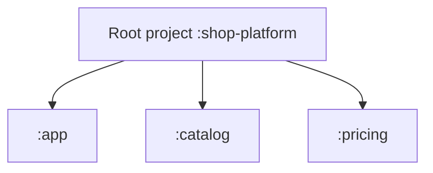
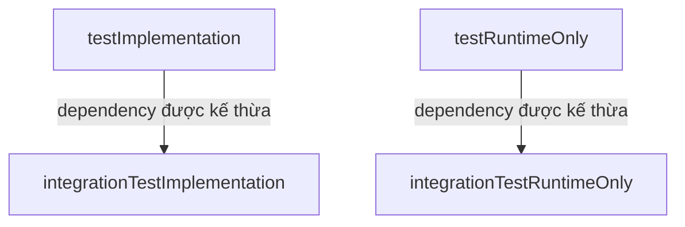
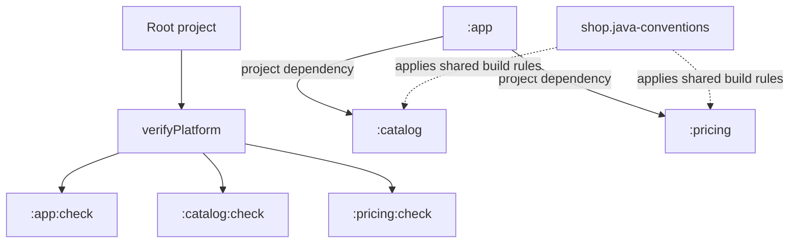

# Phân biệt tổng hợp mô-đun với kế thừa cấu hình

Trong một dự án Gradle nhiều mô-đun, các module thường cần được build cùng nhau, chia sẻ một số quy ước và có thể phụ thuộc vào output của nhau. Những nhu cầu này dễ khiến người mới nhầm rằng module con tự động kế thừa toàn bộ cấu hình từ project gốc. Thực tế, việc đưa các project vào cùng một build, việc nối task để tổng hợp công việc và việc chia sẻ cấu hình là những quan hệ khác nhau.

Gradle dùng settings file để xác định các project thuộc một multi-project build. Task dependency và project dependency mô tả công việc hoặc artifact cần dùng giữa các project. Cấu hình dùng chung có thể được áp dụng qua convention plugin hoặc các khối cấu hình nhiều project. Riêng `Configuration.extendsFrom` mô tả quan hệ kế thừa dependency giữa các configuration trong cùng mô hình dependency. Hiểu rõ từng cơ chế giúp build có cấu trúc rõ ràng và tránh phụ thuộc ngầm.

## 1. Một multi-project build gồm những gì?

Gradle multi-project build là một build gồm root project và một hoặc nhiều subproject. Settings file xác định tên build và những project nào tham gia.

Ví dụ cấu trúc:

```text
shop-platform/
├── settings.gradle
├── build.gradle
├── app/
│   └── build.gradle
├── catalog/
│   └── build.gradle
└── pricing/
    └── build.gradle
```

`settings.gradle`:

```groovy
rootProject.name = 'shop-platform'

include 'app', 'catalog', 'pricing'
```

Khai báo `include` làm cho các project `:app`, `:catalog` và `:pricing` trở thành thành viên của build. Gradle tạo một project hierarchy:



Project path là định danh trong build. Root project có path `:`, còn các subproject có path như `:app` hoặc `:catalog`. Có thể xem các project bằng task `projects`:

```bash
./gradlew projects
```

Việc `include` một project chỉ xác định project đó thuộc build. Nó không tự động tạo mọi quan hệ dependency giữa các project, không tự nối tất cả task và cũng không có nghĩa build script của root được kế thừa nguyên vẹn bởi từng subproject.

## 2. Tổng hợp mô-đun (aggregation) là gì?

Tổng hợp mô-đun là tổ chức nhiều project thành một build có thể được điều phối từ một điểm chung. Root project thường là nơi đặt các task cấp build như kiểm tra tổng thể, tạo báo cáo hợp nhất hoặc gọi các tác vụ build của các module.

Ví dụ, một nhóm muốn có task `buildAll` để build tất cả module:

```groovy
// build.gradle ở root project
tasks.register('buildAll') {
    group = 'build'
    description = 'Builds all application modules.'
    dependsOn(':app:build', ':catalog:build', ':pricing:build')
}
```

Khi chạy:

```bash
./gradlew buildAll
```

Gradle đưa task `build` của các project được liệt kê vào task graph. Mỗi task đó lại kéo theo các dependency task của module tương ứng, ví dụ compile, test và assemble theo plugin đã áp dụng.

Một task tổng hợp có thể điều phối nhiều loại công việc:

```groovy
tasks.register('verifyAllModules') {
    group = 'verification'
    description = 'Runs verification for all modules.'
    dependsOn(':app:check', ':catalog:check', ':pricing:check')
}
```

Task tổng hợp thường không cần tự biên dịch mã hoặc xử lý file. Vai trò của nó là nối các task có sẵn thành một điểm gọi chung. Nếu một module chưa có task `check` vì không áp dụng plugin phù hợp, task path đó cần được điều chỉnh theo cấu trúc thực tế.

### 2.1. Aggregation không đồng nghĩa với project dependency

Có hai nhu cầu khác nhau:

- **Aggregation:** muốn một lệnh gọi nhiều task ở nhiều module.
- **Project dependency:** một module cần sử dụng artifact hoặc output của module khác.

Ví dụ `app` sử dụng code từ `catalog`:

```groovy
// app/build.gradle
dependencies {
    implementation project(':catalog')
    implementation project(':pricing')
}
```

Quan hệ này cho Gradle biết `app` cần component do `catalog` và `pricing` cung cấp. Gradle chọn variant phù hợp và nối task producer cần thiết vào graph để tạo artifact được tiêu thụ.

Đây không có nghĩa `app` phụ thuộc vào toàn bộ task của `catalog`. Nó phụ thuộc vào component/variant cần dùng. Chẳng hạn, để biên dịch `app`, Gradle cần output tương ứng của `catalog`; nó không nhất thiết phải chạy mọi task kiểm tra, tài liệu hoặc publish của `catalog`.

### 2.2. Root project không tự động là aggregator cho mọi công việc

Root project là project gốc trong cấu trúc build. Việc nó có task tổng hợp nào phụ thuộc vào plugin và build logic đã áp dụng. Có thể định nghĩa task riêng để thể hiện rõ phạm vi tổng hợp thay vì dựa vào tên task trùng nhau.

Gradle hỗ trợ task path tuyệt đối như `:catalog:test` để gọi chính xác task trong một project. Khi chạy task name không kèm path, Gradle có cơ chế task name matching trong project hierarchy; điều đó có thể khiến task cùng tên ở nhiều project được chọn. Tuy nhiên, task name matching không thay thế một task aggregate có ý nghĩa nghiệp vụ rõ ràng. Với pipeline cần một hợp đồng ổn định, nên định nghĩa task tổng hợp bằng dependency tường minh hoặc convention plugin.

## 3. Kế thừa cấu hình không tự phát sinh từ project hierarchy

Một hiểu nhầm phổ biến là vì `:app` và `:catalog` nằm dưới root project nên chúng tự nhận `repositories`, `dependencies`, plugin hoặc mọi thuộc tính trong `build.gradle` của root.

Gradle không áp dụng cơ chế kế thừa build script kiểu parent POM chỉ vì project là subproject. Mỗi project có build script và plugin riêng. Cấu hình root chỉ tác động đến subproject nếu build logic chủ động áp dụng hoặc cấu hình nó.

Ví dụ:

```groovy
// Root build.gradle
plugins {
    id 'base'
}

repositories {
    mavenCentral()
}
```

Block `repositories` trên chỉ cấu hình repository handler của root project. Nó không tự động khai báo repository cho từng subproject. Tương tự, plugin `base` được áp dụng ở root không tự áp dụng Java Plugin cho `:app`, `:catalog` hoặc `:pricing`.

Nếu muốn chia sẻ cấu hình, phải chọn cơ chế phù hợp và thể hiện rõ phạm vi.

## 4. Chia sẻ cấu hình bằng `allprojects` và `subprojects`

Gradle cung cấp các block tiện dụng trong root build script:

- `allprojects { ... }` cấu hình root project và tất cả subproject.
- `subprojects { ... }` cấu hình tất cả subproject, không gồm root project.

Ví dụ:

```groovy
allprojects {
    group = 'com.example.shop'
    version = '1.0.0'
}

subprojects {
    repositories {
        mavenCentral()
    }
}
```

Ở đây, mọi project nhận cùng `group` và `version`; mọi subproject được cấu hình repository Maven Central. Đây là cấu hình được root build script áp dụng vào các project khác, không phải việc subproject kế thừa build script của root theo một quan hệ cha-con tự động.

### 4.1. Áp dụng cấu hình có điều kiện theo plugin

Không phải subproject nào cũng là Java project. Có thể cấu hình các project sau khi chúng áp dụng Java Plugin:

```groovy
subprojects {
    plugins.withId('java') {
        tasks.withType(JavaCompile).configureEach {
            options.encoding = 'UTF-8'
        }
    }
}
```

`plugins.withId` đăng ký cấu hình khi plugin tương ứng đã được áp dụng. Cách này tránh giả định mọi subproject đều có task `JavaCompile` hoặc Java extension.

### 4.2. Giới hạn của cấu hình chéo project

`allprojects` và `subprojects` có thể hữu ích cho build nhỏ hoặc cấu hình đơn giản. Khi dự án lớn, chúng dễ tạo ra một số vấn đề:

- Build script root biết quá nhiều chi tiết của từng subproject.
- Cấu hình bị phân tán giữa root và module, khó xác định nơi một giá trị được đặt.
- Một module vô tình nhận cấu hình không phù hợp với vai trò của nó.
- Thứ tự áp dụng plugin và cấu hình có thể làm logic khó đọc.
- Cấu hình chéo project có thể gây khó khăn cho configuration cache và khả năng bảo trì.

Vì vậy, với quy ước dùng chung lâu dài, convention plugin thường là lựa chọn rõ ràng hơn.

## 5. Convention plugin cho cấu hình dùng chung

Convention plugin đóng gói quy ước build của tổ chức hoặc repository thành plugin có thể tái sử dụng. Module chỉ cần áp dụng plugin để nhận cấu hình đã được chuẩn hóa.

Một cấu trúc thường gặp:

```text
shop-platform/
├── settings.gradle
├── build.gradle
├── build-logic/
│   ├── settings.gradle
│   └── build.gradle
├── app/
│   └── build.gradle
├── catalog/
│   └── build.gradle
└── pricing/
    └── build.gradle
```

Root settings có thể đưa `build-logic` vào build bằng included build:

```groovy
// settings.gradle
pluginManagement {
    includeBuild('build-logic')
}

rootProject.name = 'shop-platform'
include 'app', 'catalog', 'pricing'
```

Trong `build-logic/build.gradle`:

```groovy
plugins {
    id 'groovy-gradle-plugin'
}
```

Convention plugin có thể được đặt trong `build-logic/src/main/groovy`, ví dụ `shop.java-conventions.gradle`:

```groovy
plugins {
    id 'java-library'
}

java {
    toolchain {
        languageVersion = JavaLanguageVersion.of(21)
    }
}

tasks.withType(JavaCompile).configureEach {
    options.encoding = 'UTF-8'
    options.release = 17
}

tasks.withType(Test).configureEach {
    useJUnitPlatform()
}

dependencies {
    testImplementation 'org.junit.jupiter:junit-jupiter:5.11.0'
}
```

Module cần dùng quy ước chỉ cần áp dụng:

```groovy
plugins {
    id 'shop.java-conventions'
}
```

Như vậy, Java toolchain, encoding, release target và cấu hình test được đóng gói trong một nơi. Khi nâng phiên bản Java hoặc thay quy tắc test, nhóm cập nhật convention plugin thay vì sửa từng module.

### 5.1. Tách convention theo vai trò module

Không nên ép mọi module dùng cùng một convention nếu chúng có vai trò khác nhau. Có thể định nghĩa:

- `shop.java-library-conventions` cho thư viện dùng `java-library`.
- `shop.application-conventions` cho ứng dụng có main class và application plugin.
- `shop.integration-test-conventions` cho source set/task kiểm thử tích hợp.
- `shop.publishing-conventions` cho module cần publish artifact.

Module `catalog` có thể áp dụng library convention; module `app` áp dụng application convention; module chỉ chứa cấu hình hoặc tài liệu không cần áp dụng Java convention.

## 6. Phân biệt ba loại quan hệ giữa các module

Trong Gradle, một build nhiều module có thể chứa nhiều quan hệ cùng lúc. Cần gọi đúng tên để tránh cấu hình quá rộng.

| Quan hệ | Cơ chế thường dùng | Mục đích |
|---|---|---|
| Thành viên của cùng build | `include` trong settings | Khai báo project thuộc multi-project build. |
| Module tiêu thụ module khác | `implementation project(':catalog')`, `api project(':shared')` | Dùng artifact/variant của project khác và nối task producer cần thiết. |
| Điều phối nhiều module | Root aggregate task với `dependsOn` | Chạy một tập task trên nhiều project từ một điểm gọi. |
| Chia sẻ quy ước build | Convention plugin, hoặc `subprojects`/`allprojects` | Áp dụng cấu hình build thống nhất cho nhóm module. |
| Kế thừa dependency giữa configuration | `extendsFrom` | Một configuration nhận dependency được khai báo trong configuration khác. |

Các quan hệ này có thể phối hợp nhưng không thay thế nhau. Ví dụ, `include 'catalog'` không khiến `app` tự có dependency vào `catalog`; `implementation project(':catalog')` không tự biến `app` thành aggregator cho mọi task của `catalog`; convention plugin không tự thêm project dependency nếu plugin không khai báo điều đó.

## 7. Configuration trong Gradle là gì?

Configuration là một tập dependency và thuộc tính được dùng cho một mục đích resolve cụ thể. Ví dụ Java Plugin tạo các configuration như `implementation`, `compileClasspath`, `runtimeClasspath`, `testImplementation` và `testRuntimeOnly`.

Các configuration có thể có quan hệ kế thừa dependency thông qua `extendsFrom`. Khi configuration A extends configuration B, dependency được khai báo trong B cũng được xem xét trong A theo quy tắc của configuration. Đây là kế thừa dependency giữa các configuration, không phải kế thừa project hoặc build script.

Ví dụ tạo configuration dùng cho integration test:

```groovy
sourceSets {
    integrationTest {
        java.srcDir file('src/integrationTest/java')
        resources.srcDir file('src/integrationTest/resources')
    }
}

configurations {
    integrationTestImplementation.extendsFrom testImplementation
    integrationTestRuntimeOnly.extendsFrom testRuntimeOnly
}
```

Source set `integrationTest` tạo các configuration tương ứng. `integrationTestImplementation` nhận các dependency đã khai báo trong `testImplementation`; `integrationTestRuntimeOnly` nhận dependency từ `testRuntimeOnly`. Việc này giúp integration test dùng lại JUnit hoặc thư viện test mà không phải khai báo lại từng dependency.

### 7.1. `extendsFrom` không sao chép toàn bộ cấu hình task

`extendsFrom` tác động đến dependency của configuration. Nó không tự sao chép:

- Plugin đã áp dụng.
- Task và task action.
- Java toolchain hoặc compiler option.
- Repository handler của project.
- Task dependency hoặc project hierarchy.
- Mọi thuộc tính tùy ý trong build script.

Nếu muốn integration test dùng cùng encoding hoặc compiler option với main/test, cần cấu hình task hoặc convention plugin tương ứng. Nếu muốn module khác dùng chung dependency policy, cần platform, version catalog, convention plugin hoặc cơ chế dependency management phù hợp.

### 7.2. Quan hệ extendsFrom có hướng

Khi `integrationTestImplementation.extendsFrom(testImplementation)`, dependency của `testImplementation` được kế thừa vào `integrationTestImplementation`. Điều đó không có nghĩa dependency chỉ có trong `integrationTestImplementation` sẽ chảy ngược về `testImplementation`.



Đây là quan hệ một chiều từ parent configuration sang configuration extends nó. Nếu cần nhiều nhóm dependency dùng chung, hãy thiết kế quan hệ rõ ràng thay vì nối mọi configuration với nhau.

## 8. Phân biệt `extendsFrom` với project dependency và task dependency

Ba cơ chế sau thường bị nhầm vì đều có từ “dependency”:

| Cơ chế | Ví dụ | Nó nối điều gì? |
|---|---|---|
| Configuration inheritance | `integrationTestImplementation.extendsFrom(testImplementation)` | Tập dependency giữa các configuration. |
| Project dependency | `implementation project(':catalog')` | Consumer project với component/variant của producer project. |
| Task dependency | `dependsOn(':catalog:check')` | Task graph: một task cần task khác hoàn tất trước. |

Ví dụ, `app` có thể cần thư viện `catalog` để compile:

```groovy
dependencies {
    implementation project(':catalog')
}
```

Nếu root cần chạy kiểm tra tất cả module:

```groovy
tasks.register('checkAll') {
    dependsOn(':app:check', ':catalog:check', ':pricing:check')
}
```

Nếu integration test cần kế thừa dependency test:

```groovy
configurations {
    integrationTestImplementation.extendsFrom testImplementation
}
```

Ba khai báo giải quyết ba nhu cầu khác nhau. Dùng `extendsFrom` để cố nối project là sai tầng; dùng `dependsOn` để chia sẻ dependency cũng sai mục đích; dùng project dependency chỉ để ép chạy mọi task của module producer là quá rộng.

## 9. Ví dụ tổng hợp: ứng dụng, thư viện và cấu hình dùng chung

Giả sử hệ thống có:

- `:app`: ứng dụng khởi chạy.
- `:catalog`: thư viện danh mục sản phẩm.
- `:pricing`: thư viện tính giá.

Settings:

```groovy
rootProject.name = 'shop-platform'
include 'app', 'catalog', 'pricing'
```

Trong `catalog/build.gradle` và `pricing/build.gradle`, áp dụng convention plugin thư viện:

```groovy
plugins {
    id 'shop.java-conventions'
}
```

Trong `app/build.gradle`:

```groovy
plugins {
    id 'shop.application-conventions'
}

dependencies {
    implementation project(':catalog')
    implementation project(':pricing')
}
```

Trong root `build.gradle`, định nghĩa task tổng hợp:

```groovy
tasks.register('verifyPlatform') {
    group = 'verification'
    description = 'Verifies all platform modules.'
    dependsOn(':app:check', ':catalog:check', ':pricing:check')
}
```

Các quan hệ có thể hình dung:



Khi chạy `verifyPlatform`, các task check của ba module được điều phối. Khi compile `app`, project dependency khiến Gradle xây dựng component cần thiết của `catalog` và `pricing`. Convention plugin áp dụng quy ước Java cho module tương ứng. Không cơ chế nào trong ba cơ chế thay thế hai cơ chế còn lại.

## 10. So sánh với Maven aggregator và parent POM

Nếu đã biết Maven, có thể dùng hai khái niệm Maven để hiểu sự phân biệt này:

- **Aggregator POM** liệt kê các module trong phần tử `<modules>` để Maven reactor xây dựng chúng cùng nhau.
- **Parent POM** cung cấp cấu hình, dependency management, plugin management hoặc thuộc tính để POM con kế thừa khi khai báo `<parent>`.

Một POM có thể vừa là aggregator vừa là parent, nhưng hai vai trò là khác nhau. Việc một module được liệt kê trong `<modules>` không tự nó là cơ chế kế thừa cấu hình; phần tử `<parent>` mới diễn tả quan hệ parent-child của POM.

Trong Gradle, `include` trong settings gần với việc khai báo các project tham gia build/reactor. Nó không tạo ra cơ chế kế thừa build script tương tự parent POM. Muốn chia sẻ quy ước, Gradle thường dùng convention plugin, settings plugin, version catalog hoặc cấu hình chéo project có kiểm soát.

| Nhu cầu | Maven | Gradle |
|---|---|---|
| Đưa module vào cùng build | `<modules>` trong aggregator POM | `include` trong settings. |
| Chia sẻ cấu hình từ parent | `<parent>` và cấu hình kế thừa trong POM | Convention plugin hoặc cấu hình được áp dụng có chủ đích. |
| Quản lý version dependency tập trung | `dependencyManagement`/BOM | Platform/BOM, dependency constraints, version catalog. |
| Điều phối task/module | Maven reactor và lifecycle | Task graph, project dependency và aggregate task. |

Sự tương đồng này chỉ giúp định hướng tư duy. Cơ chế thực thi và mô hình cấu hình của Maven và Gradle không giống nhau hoàn toàn.

## 11. Những lỗi thiết kế thường gặp

### 11.1. Nghĩ rằng root repository tự áp dụng cho subproject

Kết quả là subproject không resolve được thư viện dù root build script có `mavenCentral()`. Cách xử lý là cấu hình repository tại từng project, hoặc tập trung trong `dependencyResolutionManagement` của settings theo chính sách dự án.

### 11.2. Nghĩ rằng plugin ở root tự áp dụng cho mọi module

Nếu chỉ khai báo `plugins { id 'java' }` trong root build script, các subproject không tự động có Java Plugin. Hãy áp dụng plugin trong từng module hoặc dùng convention plugin phù hợp.

### 11.3. Dùng `allprojects` để ép mọi module nhận mọi dependency

Điều này làm classpath của các module phình to, tăng nguy cơ version conflict và làm mờ ranh giới module. Hãy khai báo dependency ở module thực sự cần dùng; dùng platform hoặc version catalog để thống nhất version, không dùng cấu hình chéo project để đưa mọi thư viện vào mọi nơi.

### 11.4. Dùng `dependsOn` thay cho project dependency

`dependsOn(':catalog:build')` có thể làm catalog build trước app, nhưng không mô tả artifact/variant mà app tiêu thụ. Nếu app cần thư viện catalog, hãy khai báo `implementation project(':catalog')`. Nếu cần chạy kiểm tra catalog, hãy dùng task dependency riêng.

### 11.5. Dùng `extendsFrom` để nối dependency giữa project

`extendsFrom` chỉ nối dependency giữa configuration trong mô hình configuration của project. Nó không thay thế `implementation project(':catalog')` và không làm một module kế thừa build script của module khác.

### 11.6. Định nghĩa aggregate task quá rộng

Một task tổng hợp có thể vô tình gọi publish, deploy hoặc tác vụ có side effect khi nhóm chỉ muốn compile/test. Hãy đặt tên và mô tả task theo mục tiêu, ví dụ `verifyAll` cho kiểm tra và `publishAll` cho phát hành. Chỉ nối các task cần thiết.

## 12. Cách kiểm tra cấu trúc và quan hệ trong build

Một số lệnh giúp quan sát multi-project build:

```bash
./gradlew projects
./gradlew tasks --all
./gradlew :app:tasks --all
./gradlew :app:dependencies --configuration runtimeClasspath
./gradlew verifyPlatform --dry-run
```

Ý nghĩa:

- `projects` hiển thị project hierarchy và project path.
- `tasks --all` cho biết task nào được đăng ký ở build.
- `:app:tasks --all` tập trung vào task của project `app`.
- `:app:dependencies` cho biết dependency graph của configuration trong `app`.
- `--dry-run` hiển thị task graph dự kiến cho task tổng hợp mà không thực thi action.

Khi task aggregate không chạy module mong đợi, kiểm tra dependency path được khai báo. Khi một module không nhận cấu hình chung, kiểm tra plugin đã áp dụng, convention plugin có được resolve không và cấu hình `subprojects`/`allprojects` có phạm vi đúng không. Khi dependency test không xuất hiện trong integration test, kiểm tra quan hệ `extendsFrom` của đúng configuration.

## 13. Nguyên tắc tổ chức multi-project build

- Dùng `include` để khai báo project thành viên trong settings.
- Dùng project dependency khi một module thực sự tiêu thụ component của module khác.
- Dùng task dependency hoặc aggregate task để điều phối công việc nhiều module.
- Dùng convention plugin để chia sẻ quy ước build và giữ cấu hình gần với vai trò module.
- Chỉ dùng `allprojects`/`subprojects` cho cấu hình chéo project đơn giản, có phạm vi rõ ràng.
- Dùng `Configuration.extendsFrom` để chia sẻ dependency giữa các configuration, chẳng hạn test và integration test.
- Dùng platform/BOM hoặc version catalog để quản lý version tập trung; không nhầm chúng với project aggregation.
- Không giả định root build script tự được kế thừa bởi subproject.
- Giữ task aggregate có mục tiêu rõ ràng, tránh kéo theo publish/deploy ngoài ý muốn.
- Dùng task path đầy đủ khi cần điều khiển chính xác project và task.

Tổng hợp mô-đun xác định những project nào được điều phối trong cùng build và những task nào được gọi từ một điểm chung. Kế thừa cấu hình là cách chia sẻ quy ước hoặc dependency theo một cơ chế cụ thể. Trong Gradle, project hierarchy, project dependency, task dependency, convention plugin và `Configuration.extendsFrom` là những công cụ khác nhau. Khi chọn đúng công cụ cho đúng quan hệ, multi-project build dễ hiểu, dễ mở rộng và ít phụ thuộc vào cấu hình ngầm hơn.
