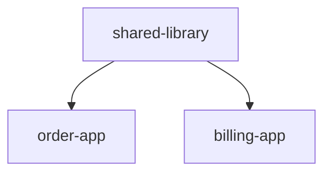
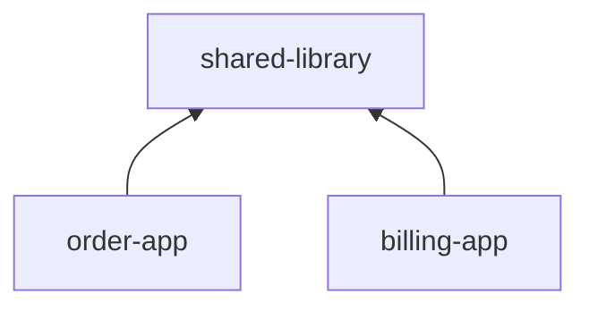
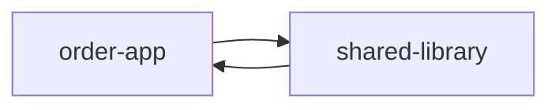
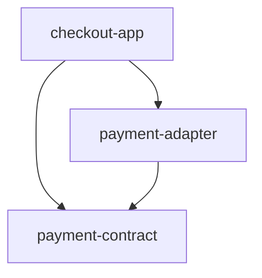
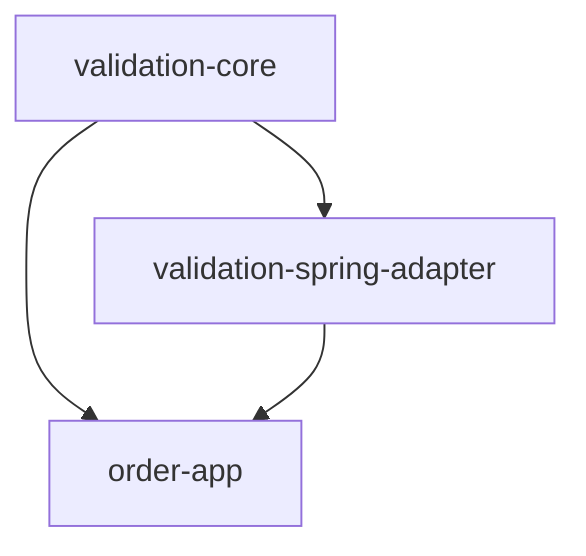
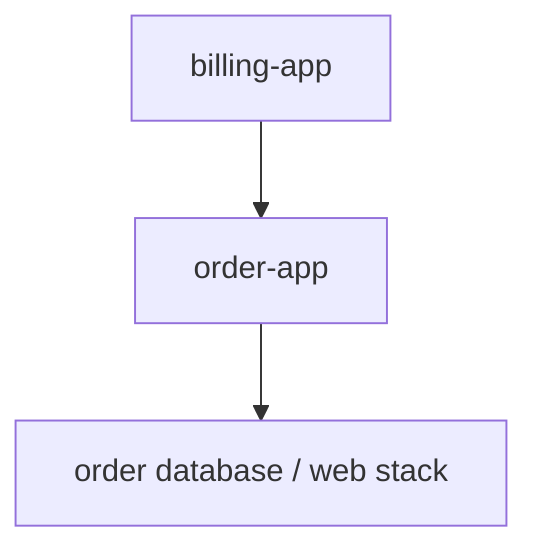
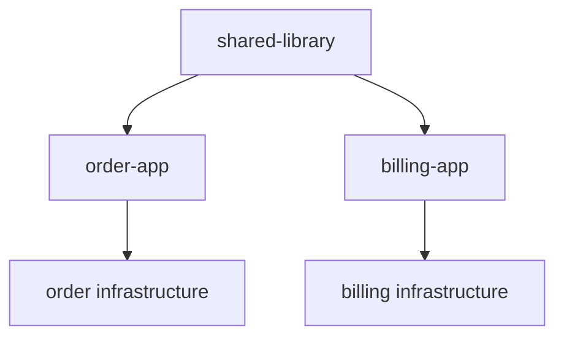

# Tách thư viện dùng chung khỏi ứng dụng sử dụng nó

Khi một dự án Java phát triển, nhiều ứng dụng hoặc module thường cần cùng một chức năng: kiểu dữ liệu dùng chung, quy tắc kiểm tra đầu vào, xử lý ngày giờ, client gọi API, mã hóa dữ liệu hoặc các tiện ích nền tảng. Cách nhanh nhất ban đầu có thể là đặt code đó trong một ứng dụng rồi để ứng dụng khác tham chiếu trực tiếp. Nhưng khi số consumer tăng lên, cách tổ chức này khiến thư viện dùng chung bị gắn chặt với ứng dụng đầu tiên: thay đổi ở ứng dụng có thể buộc các module khác phải build lại, dependency graph dễ tạo vòng và trách nhiệm của từng module trở nên khó hiểu.

Giải pháp là xác định phần nào thực sự là khả năng dùng chung, đưa nó vào một module thư viện độc lập và để các ứng dụng phụ thuộc vào thư viện đó theo một chiều. Thư viện sở hữu API ổn định và những dependency cần cho chức năng của chính nó; ứng dụng sử dụng API ấy và chịu trách nhiệm cho cấu hình, giao diện, triển khai hoặc quy trình riêng của ứng dụng. Cách tách này làm build graph dễ đọc, cho phép kiểm thử và phát hành thư viện độc lập, đồng thời giảm nguy cơ phụ thuộc vòng giữa các module.

## 1. Vì sao cần tách thư viện dùng chung?

Giả sử một tổ chức có hai ứng dụng Java: `order-app` và `billing-app`. Cả hai đều cần chuẩn hóa mã tiền tệ, kiểm tra mã khách hàng và chuyển đổi một số kiểu dữ liệu. Ban đầu các class này được đặt trong `order-app`, sau đó `billing-app` muốn dùng lại nên tham chiếu trực tiếp output hoặc source của ứng dụng đó.

```text
Thiết kế ban đầu dễ gây liên kết:

billing-app  --->  order-app
                      |
                      +-- CustomerCode
                      +-- MoneyFormatter
                      +-- CurrencyRules
                      +-- OrderController
                      +-- OrderRepository
```

`billing-app` chỉ cần một số quy tắc và kiểu dữ liệu, nhưng lại phụ thuộc vào toàn bộ module ứng dụng. Khi `order-app` thay đổi controller, cấu hình web hoặc repository, dependency của `billing-app` có thể bị ảnh hưởng dù chức năng dùng chung không thay đổi.

Một cấu trúc hợp lý hơn:



Thư viện dùng chung nằm ở một module độc lập. Cả hai ứng dụng phụ thuộc vào thư viện, còn thư viện không phụ thuộc vào ứng dụng nào. Thay đổi trong phần dùng chung được quản lý tại một nơi; ứng dụng vẫn có thể phát triển các phần riêng mà không kéo chúng vào classpath của nhau.

### 1.1. Lợi ích ở cấp build

- **Dependency graph một chiều:** ứng dụng là consumer, thư viện là producer; tránh quan hệ A phụ thuộc B rồi B lại phụ thuộc A.
- **Build độc lập hơn:** có thể compile, test và đóng gói thư viện mà không cần build toàn bộ ứng dụng.
- **Tái sử dụng có kiểm soát:** nhiều ứng dụng sử dụng cùng API mà không copy source hoặc phụ thuộc vào chi tiết nội bộ của nhau.
- **Classpath nhỏ và rõ:** ứng dụng chỉ nhận những thư viện mà module dùng chung thực sự công bố.
- **Quản lý version rõ ràng:** có thể phát hành thư viện theo version và kiểm soát thời điểm consumer nâng cấp.
- **Kiểm thử tập trung:** quy tắc dùng chung được kiểm tra một lần ở module sở hữu chúng, sau đó được kiểm chứng thêm qua integration test của từng ứng dụng.

### 1.2. Lợi ích ở cấp thiết kế

Việc tách module buộc nhóm xác định API nào ổn định và trách nhiệm nào thuộc ứng dụng. Điều này giúp giảm sự phụ thuộc vào controller, database schema, framework configuration hoặc class nội bộ của một ứng dụng cụ thể.

Tuy nhiên, không phải mọi class được sử dụng ở hai nơi đều cần trở thành thư viện riêng. Một module dùng chung cũng có chi phí: phải đặt tên, quản lý API, version, test, phát hành và tương thích. Chỉ tách khi có một ranh giới trách nhiệm đủ rõ và nhu cầu tái sử dụng thực tế.

## 2. Xác định phần nào nên trở thành thư viện

Trước khi tạo module mới, hãy phân loại code theo trách nhiệm. Một thư viện tốt đóng gói một khả năng có ý nghĩa, thay vì trở thành nơi chứa mọi class chưa biết đặt ở đâu.

| Loại code | Có thể đưa vào thư viện dùng chung? | Lý do |
|---|---|---|
| Kiểu dữ liệu/DTO được nhiều module trao đổi | Có, nếu hợp đồng thực sự chung | Các consumer cần cùng cấu trúc dữ liệu |
| Value object và quy tắc nghiệp vụ ổn định | Có, nếu thuộc domain dùng chung | Quy tắc có một nơi sở hữu và kiểm thử |
| Hàm tiện ích thuần, không phụ thuộc ứng dụng | Có | Dễ tái sử dụng và ít ràng buộc môi trường |
| Client giao tiếp với một dịch vụ bên ngoài | Có thể | Nhiều ứng dụng cần cùng giao thức, retry hoặc serialization |
| Adapter cho một database cụ thể của một ứng dụng | Thường không | Có thể thuộc infrastructure riêng của ứng dụng |
| Controller, route và giao diện người dùng | Thường không | Gắn với cách ứng dụng tiếp xúc người dùng |
| Cấu hình deployment hoặc secret | Không | Phụ thuộc môi trường và quyền truy cập của từng ứng dụng |
| Class chỉ được dùng một lần | Chưa cần | Tách module có thể tạo thêm chi phí không cần thiết |
| Class phụ thuộc trực tiếp vào một ứng dụng | Không nên đặt trong thư viện nền | Làm dependency direction bị đảo ngược |

### 2.1. Thư viện nên sở hữu một trách nhiệm có tên gọi

Tên như `shared`, `common` hoặc `utils` rất dễ bắt đầu, nhưng theo thời gian có thể biến thành module chứa đủ loại code không liên quan. Hãy ưu tiên tên thể hiện năng lực hoặc hợp đồng, ví dụ:

- `customer-contracts`: DTO và API contract liên quan đến customer.
- `money-domain`: value object và quy tắc tiền tệ.
- `http-client`: client HTTP được nhiều ứng dụng sử dụng.
- `logging-support`: cấu hình hoặc adapter logging dùng chung.
- `validation-core`: các validator độc lập với giao diện ứng dụng.

Tên module nên giúp người đọc hiểu vì sao một ứng dụng cần dependency đó. Nếu một module có nhiều nhóm chức năng không liên quan, cân nhắc tách thành các module nhỏ hơn khi ranh giới đã rõ.

### 2.2. Không biến thư viện thành bản sao của ứng dụng

Một thư viện dùng chung không nên kéo theo toàn bộ cấu hình runtime, controller, database migration hoặc bootstrap logic của ứng dụng gốc. Nếu consumer chỉ cần một class nhưng phải đưa hàng chục dependency framework vào classpath, có thể module đã chứa quá nhiều chi tiết triển khai.

Hãy tách phần API/logic cần chia sẻ khỏi phần tích hợp riêng. Ví dụ, `customer-contracts` có thể chứa `CustomerId` và `CustomerCreated`; `customer-service` chứa xử lý nghiệp vụ và database; `customer-web` chứa REST controller. Consumer cần hợp đồng không phải phụ thuộc vào cả web application.

## 3. Hướng phụ thuộc: thư viện là producer, ứng dụng là consumer

Một quy tắc hữu ích cho build nhiều module là dependency nên đi theo hướng từ thành phần cụ thể sử dụng một khả năng đến thành phần cung cấp khả năng đó.



Trong sơ đồ, mũi tên biểu diễn consumer phụ thuộc producer. `order-app` và `billing-app` biết API của `shared-library`. Thư viện không cần biết ứng dụng nào đang sử dụng nó.

### 3.1. Điều gì xảy ra nếu thư viện phụ thuộc ngược vào ứng dụng?

Giả sử `shared-library` gọi một service trong `order-app`, còn `order-app` khai báo dependency đến `shared-library`:



Quan hệ này tạo chu trình. Trong Gradle, task graph có thể không sắp xếp được các task compile/package liên quan. Trong Maven reactor, quan hệ module cũng có thể không thể sắp xếp theo dependency order. Ngay cả khi build tool có cách xử lý một số tình huống cụ thể, thiết kế vẫn cho thấy ranh giới module không ổn định.

Nếu thư viện cần gọi hành vi do ứng dụng cung cấp, hãy xem xét định nghĩa interface ở phía abstraction mà thư viện sở hữu hoặc ở một module contract độc lập. Ứng dụng triển khai interface đó và truyền implementation vào thư viện. Khi ấy dependency compile vẫn một chiều.

### 3.2. Dependency Inversion ở mức module

Dependency Inversion Principle khuyến khích phần cấp cao và cấp thấp cùng phụ thuộc vào abstraction thay vì phần cấp cao gọi trực tiếp implementation cụ thể. Trong build nhiều module, có thể áp dụng bằng cách đặt interface/hợp đồng tại một module ổn định:



`checkout-app` sử dụng abstraction từ `payment-contract`. `payment-adapter` triển khai abstraction và có thể phụ thuộc vào SDK hoặc hệ thống bên ngoài. Cả hai phụ thuộc vào contract, còn contract không phụ thuộc vào adapter hay ứng dụng.

Trong một số kiến trúc, application module có thể chứa interface và adapter module phụ thuộc vào application API. Điều đó vẫn có thể tạo hướng dependency một chiều nếu module chứa interface không phụ thuộc adapter. Điều quan trọng là không để abstraction bị đặt trong module vốn cần implementation đó.

## 4. Cấu trúc Gradle multi-project build

Gradle multi-project build cho phép nhiều project/module cùng nằm trong một build và được điều phối bởi root project. Đây là lựa chọn thuận tiện khi các module cùng repository, cần build và test phối hợp.

Ví dụ cấu trúc:

```text
shop-platform/
├── settings.gradle
├── build.gradle
├── gradlew
├── gradlew.bat
├── shared-library/
│   ├── build.gradle
│   └── src/
│       ├── main/java/
│       └── test/java/
├── order-app/
│   ├── build.gradle
│   └── src/
│       ├── main/java/
│       └── test/java/
└── billing-app/
    ├── build.gradle
    └── src/
        ├── main/java/
        └── test/java/
```

### 4.1. Khai báo project trong `settings.gradle`

```groovy
rootProject.name = 'shop-platform'

include 'shared-library'
include 'order-app'
include 'billing-app'
```

File settings xác định các project thuộc build. Mỗi thư mục có thể chứa build script riêng. Root project có thể quản lý plugin version, repository hoặc cấu hình dùng chung.

### 4.2. Cấu hình thư viện dùng chung

`shared-library/build.gradle`:

```groovy
plugins {
    id 'java-library'
}

group = 'com.example.shop'
version = '1.0.0'

java {
    toolchain {
        languageVersion = JavaLanguageVersion.of(21)
    }
}

dependencies {
    testImplementation 'org.junit.jupiter:junit-jupiter:5.10.2'
}

tasks.test {
    useJUnitPlatform()
}
```

Thư viện dùng `java-library` khi cần phân biệt API công khai và implementation dependency. Nếu chỉ cần Java plugin cơ bản, `java` cũng có thể đủ; `java-library` bổ sung mô hình `api`/`implementation` hữu ích cho module thư viện.

Ví dụ class thuộc thư viện:

```java
package com.example.shop.money;

import java.math.BigDecimal;
import java.util.Currency;
import java.util.Objects;

public record Money(BigDecimal amount, Currency currency) {
    public Money {
        Objects.requireNonNull(amount, "amount");
        Objects.requireNonNull(currency, "currency");
    }
}
```

`Money` là value object có ý nghĩa độc lập với controller, database hoặc framework của một ứng dụng. Các consumer có thể sử dụng nó mà không cần biết cách module tạo REST endpoint hay lưu dữ liệu.

### 4.3. Ứng dụng khai báo project dependency

`order-app/build.gradle`:

```groovy
plugins {
    id 'application'
}

dependencies {
    implementation project(':shared-library')
}

application {
    mainClass = 'com.example.shop.order.OrderApplication'
}
```

`billing-app/build.gradle`:

```groovy
plugins {
    id 'application'
}

dependencies {
    implementation project(':shared-library')
}

application {
    mainClass = 'com.example.shop.billing.BillingApplication'
}
```

`project(':shared-library')` biểu diễn project dependency trong cùng Gradle build. Gradle biết module ứng dụng cần output của thư viện và tự tổ chức task graph để build thư viện trước khi compile hoặc package ứng dụng.

### 4.4. Kiểm tra cấu trúc và build từng module

Từ build root:

```bash
# Liệt kê project trong build
./gradlew projects

# Build riêng thư viện
./gradlew :shared-library:build

# Build một ứng dụng và các prerequisite cần thiết
./gradlew :order-app:build

# Build cả hệ thống
./gradlew build
```

Trên Windows:

```powershell
.\gradlew.bat projects
.\gradlew.bat :shared-library:build
.\gradlew.bat :order-app:build
.\gradlew.bat build
```

Khi build `:order-app:build`, Gradle có thể thực hiện task cần thiết của `:shared-library`. Không cần chạy một lệnh copy JAR thủ công giữa hai module.

## 5. API và implementation dependency trong Gradle

Với plugin `java-library`, Gradle phân biệt dependency được công bố qua API của thư viện và dependency chỉ cần nội bộ khi triển khai.

### 5.1. `api`

Dùng `api` khi kiểu hoặc API của dependency xuất hiện trong public API của thư viện và consumer cần dependency đó trên compile classpath để biên dịch mã sử dụng thư viện.

Ví dụ:

```groovy
dependencies {
    api 'com.example:money-types:2.0.0'
}
```

Nếu public method của `shared-library` nhận/trả về kiểu thuộc `money-types`, consumer có thể cần kiểu đó khi compile. Công bố dependency bằng `api` thể hiện rằng dependency này là một phần của API mà consumer nhìn thấy.

### 5.2. `implementation`

Dùng `implementation` khi dependency chỉ được thư viện dùng bên trong và không xuất hiện trong public API cần consumer biên dịch.

```groovy
dependencies {
    implementation 'org.apache.commons:commons-text:1.12.0'
}
```

Nếu thư viện dùng `StringEscapeUtils` nội bộ nhưng không để kiểu của Commons Text xuất hiện trong public signature, consumer không cần dependency này trên compile classpath chỉ để biên dịch với API thư viện. Dependency vẫn có thể cần trên runtime classpath khi chạy code của thư viện.

### 5.3. Vì sao không nên dùng `api` cho mọi dependency?

Khai báo `api` quá rộng làm dependency graph của consumer phình ra và khiến implementation detail trở thành một phần của hợp đồng công khai. Consumer có thể bị ảnh hưởng khi thư viện đổi một dependency nội bộ, dù public API không thay đổi.

Ưu tiên `implementation`; chỉ công bố `api` khi consumer thực sự cần dependency đó để sử dụng public API. Điều này giúp giảm compile classpath, giảm liên kết và làm cho thay đổi nội bộ ít ảnh hưởng tới consumer.

### 5.4. Các configuration khác

| Configuration | Mục đích phổ biến |
|---|---|
| `api` | Dependency xuất hiện trong public API của thư viện |
| `implementation` | Dependency nội bộ cần cho compile/runtime của module |
| `compileOnly` | Cần khi compile nhưng không được cung cấp tự động ở runtime |
| `runtimeOnly` | Chỉ cần khi chạy, ví dụ JDBC driver |
| `testImplementation` | Dependency chỉ dùng để biên dịch và chạy test |
| `annotationProcessor` | Annotation processor chạy khi compile |

Chọn configuration đúng giúp consumer chỉ nhận dependency cần thiết. Đừng khai báo JUnit bằng `implementation` trong thư viện nếu JUnit chỉ dùng để viết test của chính thư viện.

## 6. Cấu trúc Maven multi-module

Maven dùng POM aggregator để nhóm nhiều module trong một reactor build. Một module có thể được build riêng hoặc cùng các module khác theo cấu hình aggregator và quan hệ dependency.

Ví dụ:

```text
shop-platform/
├── pom.xml
├── shared-library/
│   └── pom.xml
├── order-app/
│   └── pom.xml
└── billing-app/
    └── pom.xml
```

### 6.1. POM aggregator

`shop-platform/pom.xml`:

```xml
<project xmlns="http://maven.apache.org/POM/4.0.0"
         xmlns:xsi="http://www.w3.org/2001/XMLSchema-instance"
         xsi:schemaLocation="http://maven.apache.org/POM/4.0.0
         https://maven.apache.org/xsd/maven-4.0.0.xsd">
    <modelVersion>4.0.0</modelVersion>

    <groupId>com.example.shop</groupId>
    <artifactId>shop-platform</artifactId>
    <version>1.0.0</version>
    <packaging>pom</packaging>

    <modules>
        <module>shared-library</module>
        <module>order-app</module>
        <module>billing-app</module>
    </modules>
</project>
```

`packaging` là `pom` vì module này đóng vai trò aggregator/parent. Nó liệt kê các module con; việc liệt kê module không tự động có nghĩa mỗi module phụ thuộc vào tất cả module còn lại.

### 6.2. POM của thư viện

`shared-library/pom.xml`:

```xml
<project xmlns="http://maven.apache.org/POM/4.0.0"
         xmlns:xsi="http://www.w3.org/2001/XMLSchema-instance"
         xsi:schemaLocation="http://maven.apache.org/POM/4.0.0
         https://maven.apache.org/xsd/maven-4.0.0.xsd">
    <modelVersion>4.0.0</modelVersion>

    <parent>
        <groupId>com.example.shop</groupId>
        <artifactId>shop-platform</artifactId>
        <version>1.0.0</version>
        <relativePath>../pom.xml</relativePath>
    </parent>

    <artifactId>shared-library</artifactId>
    <packaging>jar</packaging>
</project>
```

Module thư viện tạo JAR với tọa độ `com.example.shop:shared-library:1.0.0`. Parent POM quản lý cấu hình chung; nó không đồng nghĩa với dependency runtime/compile của ứng dụng.

### 6.3. Ứng dụng khai báo dependency vào thư viện

Trong `order-app/pom.xml`:

```xml
<dependencies>
    <dependency>
        <groupId>com.example.shop</groupId>
        <artifactId>shared-library</artifactId>
        <version>${project.version}</version>
    </dependency>
</dependencies>
```

`billing-app/pom.xml` khai báo dependency tương tự. Maven reactor nhận ra dependency giữa các module trong cùng reactor và sắp xếp thứ tự build để thư viện được xử lý trước consumer.

### 6.4. Chạy build

Từ thư mục aggregator:

```bash
# Build toàn bộ reactor
./mvnw clean verify

# Build một module và các dependency trong reactor
./mvnw -pl order-app -am verify

# Build riêng thư viện
./mvnw -pl shared-library verify
```

`-pl` chọn project/module trong reactor; `-am` (also make) yêu cầu Maven build thêm các project mà module được chọn phụ thuộc. Khi chạy module con mà không có aggregator hoặc dependency đã được cài/publish, Maven có thể cần artifact tương ứng trong repository.

### 6.5. Parent POM và dependency là hai quan hệ khác nhau

Parent POM cung cấp cấu hình kế thừa như properties, plugin management và dependency management. Dependency khai báo trong `<dependencies>` thể hiện module cần thư viện đó để compile/runtime/test theo scope.

Một module có thể kế thừa cùng parent với module khác nhưng không phụ thuộc vào module đó. Ngược lại, module có thể dùng một artifact mà không kế thừa parent của artifact đó. Đừng dùng quan hệ parent chỉ để biểu diễn quan hệ sử dụng thư viện.

## 7. API contract và implementation: tách đúng phần chia sẻ

Khi nhiều ứng dụng cần trao đổi dữ liệu hoặc gọi cùng một khả năng, hãy quyết định phần nào là hợp đồng và phần nào là implementation.

Ví dụ:

```text
shop-platform/
├── customer-contracts/
├── customer-domain/
├── customer-persistence/
├── order-app/
└── billing-app/
```

Một cách tổ chức có thể là:

- `customer-contracts`: DTO, event schema, interface hoặc kiểu dữ liệu trao đổi.
- `customer-domain`: logic và value object thuộc domain customer.
- `customer-persistence`: adapter lưu trữ, phụ thuộc vào database framework/driver.
- `order-app`: use case và giao diện của ứng dụng order.
- `billing-app`: use case và giao diện của ứng dụng billing.

Không phải dự án nào cũng cần năm module như vậy. Chỉ tách khi trách nhiệm và vòng đời của các phần khác nhau đủ rõ. Nếu `customer-contracts` chỉ chứa một DTO và không có nhu cầu tái sử dụng độc lập, việc tạo module riêng có thể chưa cần thiết.

### 7.1. Hợp đồng không nên chứa implementation detail

Một contract module thường nên tránh phụ thuộc vào web framework, ORM hoặc SDK cụ thể nếu consumer không cần chúng. DTO có thể dùng kiểu Java chuẩn; interface có thể mô tả hành vi mà adapter triển khai. Điều này giúp consumer không bị buộc phải mang toàn bộ implementation framework vào compile classpath.

### 7.2. Không chia sẻ entity database một cách mặc định

Database entity thường phản ánh schema và mapping của một ứng dụng. Nếu hai ứng dụng dùng chung entity chỉ để trao đổi dữ liệu, thay đổi schema có thể gây ảnh hưởng dây chuyền. Cân nhắc tạo DTO/contract ổn định cho giao tiếp và giữ entity ở module sở hữu persistence.

Chỉ chia sẻ entity khi các module thực sự thuộc cùng một bounded context và cùng chấp nhận vòng đời thay đổi schema. Nếu hai ứng dụng có quyền sở hữu dữ liệu riêng, contract tách biệt thường giúp giảm coupling.

### 7.3. Tránh phụ thuộc framework không cần thiết

Nếu một thư viện chỉ chứa value object hoặc thuật toán thuần, không nên thêm Spring Boot starter, servlet API hoặc ORM chỉ vì ứng dụng đầu tiên đang dùng chúng. Dependency framework làm thư viện nặng hơn và hạn chế nơi có thể sử dụng.

Nếu thư viện thực sự cần framework integration, có thể tách core và adapter:



Consumer chỉ cần core có thể không phải kéo Spring adapter. Ứng dụng dùng Spring có thể thêm adapter riêng.

## 8. Kiểm soát API công khai của thư viện

Một khi module được nhiều ứng dụng sử dụng, public API trở thành hợp đồng giữa producer và consumer. Thay đổi API có thể ảnh hưởng nhiều repository hoặc pipeline.

### 8.1. Giữ public API nhỏ

Chỉ public những class, method và type consumer cần. Những helper nội bộ nên để package-private hoặc nằm trong package không được công bố. API nhỏ giúp thư viện dễ bảo trì và giảm phạm vi tương thích phải giữ.

### 8.2. Ưu tiên kiểu dữ liệu ổn định

Public API nên tránh để lộ implementation class hoặc framework detail không cần thiết. Ví dụ, trả về `List<Customer>` thường linh hoạt hơn trả về một collection implementation cụ thể. Interface và immutable value object có thể giúp consumer ít phụ thuộc vào cách thư viện triển khai bên trong.

### 8.3. Thay đổi tương thích

Các thay đổi sau thường có nguy cơ phá vỡ consumer:

- Xóa hoặc đổi tên public class/method.
- Đổi kiểu tham số hoặc kiểu trả về.
- Giảm visibility của API.
- Thay đổi semantics hoặc exception contract.
- Đổi dependency public sang version không tương thích.
- Thay đổi serialization format hoặc schema của DTO/event.

Khi cần thay đổi lớn, cân nhắc deprecate API cũ trước, cung cấp đường chuyển đổi hoặc phát hành major version mới theo chính sách versioning.

### 8.4. Semantic Versioning

Nếu thư viện được phát hành độc lập, Semantic Versioning là một quy ước hữu ích:

- **MAJOR:** thay đổi không tương thích.
- **MINOR:** thêm chức năng tương thích ngược.
- **PATCH:** sửa lỗi tương thích ngược.

SemVer chỉ có ý nghĩa khi nhóm định nghĩa rõ public API và tuân thủ quy tắc. Thay đổi hành vi hoặc dependency public có thể phá vỡ consumer dù chữ ký Java không đổi.

## 9. Kiểm thử thư viện và kiểm thử tích hợp với ứng dụng

Tách module giúp kiểm thử riêng, nhưng không loại bỏ nhu cầu kiểm thử khi thư viện được sử dụng trong ứng dụng.

### 9.1. Unit test trong thư viện

Thư viện nên kiểm tra quy tắc và hành vi thuộc trách nhiệm của nó. Ví dụ, `Money` cần test:

- Không chấp nhận amount/currency null nếu hợp đồng không cho phép.
- So sánh hoặc tính toán tiền tệ theo quy tắc đã định nghĩa.
- Xử lý rounding/scale đúng nếu thư viện sở hữu logic đó.
- Không phụ thuộc vào locale/timezone của máy.

Test của thư viện chạy trong module thư viện, không cần khởi động toàn bộ ứng dụng.

### 9.2. Consumer test

Ứng dụng cần test cách nó sử dụng thư viện: mapping dữ liệu, gọi API, xử lý lỗi hoặc tích hợp với framework. Những test này xác nhận contract và implementation phối hợp đúng trong ngữ cảnh thực tế.

### 9.3. Contract test khi có nhiều consumer

Nếu nhiều ứng dụng phụ thuộc vào cùng một API hoặc schema, contract test có thể xác nhận producer vẫn đáp ứng yêu cầu của consumer. Khi thư viện thay đổi, pipeline có thể chạy các consumer test liên quan hoặc kiểm tra compatibility trước khi publish version mới.

### 9.4. Không để test dependency rò sang consumer

Trong Gradle, JUnit của thư viện nên ở `testImplementation`; trong Maven, dùng scope `test`. Consumer không cần nhận test framework của thư viện chỉ vì nó phụ thuộc vào JAR runtime.

## 10. Versioning và phát hành thư viện dùng chung

Trong một Gradle multi-project build, project dependency giúp module dùng output trực tiếp trong cùng build. Khi thư viện được sử dụng bởi nhiều repository hoặc phát hành độc lập, cần publish artifact lên repository để consumer resolve theo tọa độ/version.

### 10.1. Khi nào dùng project dependency?

Dùng project dependency khi:

- Các module cùng thuộc một build và thường được thay đổi đồng bộ.
- Cần build/test toàn hệ thống trong một task graph.
- Muốn Gradle tự sắp xếp prerequisite giữa module.
- Version của thư viện và consumer được quản lý cùng nhau.

### 10.2. Khi nào dùng published dependency?

Dùng artifact đã publish khi:

- Consumer nằm ở repository khác.
- Thư viện có vòng đời phát hành riêng.
- Nhiều nhóm cần chọn version độc lập.
- Muốn tái sử dụng artifact đã build/test thay vì source project.
- Cần lưu lịch sử release và kiểm soát compatibility.

Ví dụ dependency được publish:

```groovy
dependencies {
    implementation 'com.example.shop:shared-library:1.2.0'
}
```

Maven:

```xml
<dependency>
    <groupId>com.example.shop</groupId>
    <artifactId>shared-library</artifactId>
    <version>1.2.0</version>
</dependency>
```

### 10.3. Publish từ Gradle

Gradle Maven Publish plugin có thể publish JAR và metadata:

```groovy
plugins {
    id 'java-library'
    id 'maven-publish'
}

group = 'com.example.shop'
version = '1.2.0'

publishing {
    publications {
        library(MavenPublication) {
            from components.java
        }
    }
    repositories {
        maven {
            name = 'internal'
            url = uri(layout.buildDirectory.dir('repo'))
        }
    }
}
```

Ví dụ dùng thư mục `build/repo` để minh họa repository đích cục bộ; repository production thường là URL nội bộ và cần credentials được cung cấp an toàn. Không ghi token/password vào build script được commit.

### 10.4. Publish từ Maven

Maven có thể cài artifact vào local repository bằng:

```bash
./mvnw install
```

Và publish lên remote repository đã cấu hình bằng:

```bash
./mvnw deploy
```

`install` chỉ làm artifact sẵn có trong local Maven repository trên máy hiện tại. `deploy` đưa artifact lên remote repository theo cấu hình distribution management và credentials. Đây là hai hành động khác nhau.

### 10.5. Consumer nên nâng version có chủ đích

Không nên để mọi ứng dụng tự động dùng version mới nhất của thư viện trong production. Consumer nên khai báo version rõ hoặc dùng BOM/platform/central dependency management. Khi nâng version, cần xem release notes, compatibility, dependency graph và chạy test của consumer.

## 11. Tránh dependency bắc cầu không cần thiết

Thư viện dùng chung có thể làm consumer nhận thêm dependency bắc cầu. Một dependency nội bộ không nên trở thành public chỉ vì build script khai báo sai configuration hoặc scope.

### 11.1. Gradle: API hay implementation

Nếu public signature của thư viện dùng kiểu từ dependency khác, dùng `api` khi consumer cần type đó trên compile classpath. Nếu dependency chỉ dùng bên trong, dùng `implementation`. Kiểm tra bằng:

```bash
./gradlew :order-app:dependencies --configuration compileClasspath
./gradlew :order-app:dependencies --configuration runtimeClasspath
```

So sánh compile và runtime classpath để biết dependency nào được consumer nhìn thấy ở từng giai đoạn.

### 11.2. Maven: scope và dependency management

Maven scope như `compile`, `provided`, `runtime` và `test` quyết định dependency xuất hiện trong classpath và được truyền tiếp ra sao. Dependency management quản lý version/scope mặc định nhưng không tự thêm artifact vào graph.

Kiểm tra:

```bash
./mvnw -pl order-app dependency:tree
```

Nếu consumer nhận một thư viện không cần thiết, lần theo nhánh kéo nó vào rồi sửa scope hoặc thiết kế module ở nơi sở hữu dependency. Không thêm exclusion ở consumer chỉ để che một dependency leak có thể sửa tại producer.

### 11.3. Tránh phụ thuộc vào implementation của consumer

Nếu thư viện dùng chung cần gọi một service do ứng dụng cung cấp, khai báo interface hoặc callback phù hợp và để ứng dụng truyền implementation. Đừng thêm dependency từ thư viện về application chỉ để truy cập class đó.

Ví dụ contract:

```java
package com.example.shop.contract;

public interface CustomerLookup {
    CustomerSummary findById(String customerId);
}
```

Ứng dụng có thể triển khai:

```java
package com.example.shop.order;

import com.example.shop.contract.CustomerLookup;
import com.example.shop.contract.CustomerSummary;

public class OrderCustomerLookup implements CustomerLookup {
    @Override
    public CustomerSummary findById(String customerId) {
        // Tìm customer qua service/repository thuộc order application.
        return null;
    }
}
```

Ví dụ chỉ minh họa hướng phụ thuộc; implementation thật cần trả kết quả hoặc xử lý trường hợp không tìm thấy theo contract. Module chứa interface không cần biết `OrderCustomerLookup` tồn tại.

## 12. Khi thư viện dùng chung trở thành điểm nghẽn

Một module dùng chung quá lớn có thể trở thành “god module”: mọi ứng dụng phụ thuộc vào nó, mọi thay đổi đều tác động nhiều consumer và release thường xuyên gây rủi ro.

Các dấu hiệu:

- Module chứa nhiều chức năng không liên quan.
- Một thay đổi nhỏ buộc tất cả ứng dụng nâng version.
- Dependency graph có nhiều framework và driver mà consumer không cần.
- Public API thay đổi thường xuyên.
- Các ứng dụng dùng những phần hoàn toàn khác nhau nhưng phải nhận cùng một artifact lớn.
- Không rõ team nào sở hữu module hoặc ai phê duyệt thay đổi.

Hướng xử lý:

1. Tách theo trách nhiệm và bounded context, không tách theo từng class.
2. Tạo module contract nhỏ nếu nhiều consumer chỉ cần API/data type.
3. Đẩy adapter/framework integration ra module riêng.
4. Giảm public API và chuyển helper nội bộ thành package-private.
5. Quản lý version và compatibility theo nhóm consumer.
6. Xác định owner, release policy và quy trình deprecation.

Không nên tách module quá vụn. Mỗi module thêm vào build tạo thêm cấu hình, test, dependency resolution và chi phí bảo trì. Hãy tìm ranh giới ổn định có ý nghĩa thay vì biến mỗi package thành một project riêng.

## 13. Những lựa chọn kiến trúc liên quan

### 13.1. Shared library hay service dùng chung?

Một thư viện Java được nhúng vào ứng dụng qua classpath. Mỗi ứng dụng có bản copy dependency trong artifact/runtime của mình. Nếu cần chia sẻ trạng thái hoặc một quy trình chạy tập trung qua mạng, có thể cần một service độc lập thay vì thư viện.

| Shared library | Shared service |
|---|---|
| Chạy trong process của consumer | Chạy độc lập qua network/process riêng |
| Consumer nâng version để nhận thay đổi | Consumer gọi endpoint/protocol ổn định |
| Không có network latency cho lời gọi nội bộ | Có latency, timeout, retry và lỗi mạng |
| Có thể tạo coupling ở compile/runtime dependency | Coupling chuyển sang API/protocol và vận hành |
| Phù hợp logic/contract có thể nhúng | Phù hợp khả năng cần tập trung hoặc chia sẻ trạng thái |

Không nên tạo một service chỉ để tránh dependency module, cũng không nên nhúng một thư viện nếu yêu cầu thực tế cần một điểm xử lý tập trung.

### 13.2. Monorepo hay repository riêng?

Thư viện có thể nằm trong cùng monorepo với ứng dụng hoặc được phát hành từ repository riêng. Monorepo thuận tiện cho thay đổi đồng bộ và project dependency. Repository riêng tạo ranh giới release rõ hơn nhưng cần publish, versioning và quy trình cập nhật consumer.

Có thể bắt đầu bằng multi-project build khi nhóm cần phát triển cùng nhau, sau đó chuyển sang artifact publish khi thư viện có consumer và vòng đời độc lập. Không cần tách repository chỉ vì đã tách module.

### 13.3. Module Java (JPMS) và build module

Gradle/Maven project module là đơn vị build. Java Platform Module System (JPMS) với `module-info.java` là cơ chế module ở mức ngôn ngữ/runtime. Hai khái niệm liên quan nhưng không đồng nhất.

Một Gradle subproject có thể không khai báo `module-info.java`; một JAR có thể là automatic module hoặc classpath artifact. Khi dự án dùng JPMS, cần quản lý thêm `requires`, `exports` và module path. Việc tách shared library ở cấp build vẫn cần dependency direction rõ ràng dù có dùng JPMS hay không.

## 14. Quy trình tách một thư viện khỏi ứng dụng hiện có

Giả sử `order-app` đang chứa `Money`, `CurrencyRules` và `CustomerCode`, còn `billing-app` muốn sử dụng các class này. Có thể thực hiện theo các bước:

### Bước 1: Xác định phần thực sự dùng chung

Tìm class được nhiều consumer cần và xem chúng phụ thuộc vào gì. Nếu `Money` chỉ dùng Java standard library, dễ tách. Nếu `CustomerCode` phụ thuộc vào Spring repository hoặc database entity của `order-app`, cần tách abstraction hoặc định nghĩa lại contract trước.

### Bước 2: Xác định API công khai

Chọn class, constructor, method và type mà consumer cần. Giữ helper nội bộ ở package-private. Xác định nullability, exception, mutability và semantics để consumer hiểu hợp đồng.

### Bước 3: Tạo module mới

Thêm `shared-library` vào Gradle settings hoặc Maven aggregator. Di chuyển code và test thuộc trách nhiệm của thư viện. Cập nhật package nếu cần, nhưng cân nhắc compatibility với code đã sử dụng package cũ.

### Bước 4: Loại dependency ngược

Kiểm tra import và build file. Nếu thư viện còn phụ thuộc `order-app`, xác định phần nào cần interface/contract độc lập hoặc phần nào nên ở lại ứng dụng. Không giữ dependency ngược chỉ để tránh phải thiết kế lại API.

### Bước 5: Khai báo consumer dependency

Thêm `implementation project(':shared-library')` trong Gradle hoặc tọa độ dependency trong Maven. Xóa bản source copy cũ để tránh hai implementation cùng tồn tại.

### Bước 6: Kiểm tra compile và dependency graph

Build riêng thư viện, sau đó build từng consumer. Xem compile/runtime classpath để bảo đảm thư viện không kéo dependency không cần thiết. Xác nhận task/project graph không có chu trình.

### Bước 7: Chạy test ở cả producer và consumer

Chạy unit test của thư viện và integration/consumer test của ứng dụng. Nếu API thay đổi, cập nhật consumer cùng một thay đổi hoặc phát hành version tương thích.

### Bước 8: Quyết định vòng đời release

Nếu module chỉ dùng trong cùng build, project dependency có thể đủ. Nếu consumer độc lập, publish artifact và thiết lập versioning, repository, release notes và compatibility policy.

## 15. Ví dụ dependency graph trước và sau khi tách

Trước khi tách:



`billing-app` bị buộc phụ thuộc vào application module cùng các dependency của nó.

Sau khi tách:



Các ứng dụng cùng sử dụng library, nhưng infrastructure riêng vẫn thuộc từng ứng dụng. Build có thể compile thư viện trước, rồi build từng consumer theo dependency graph.

## 16. Các lỗi thường gặp khi tách module

| Triệu chứng | Nguyên nhân có thể | Hướng xử lý |
|---|---|---|
| Gradle báo circular dependency | Library và app phụ thuộc ngược nhau | Chuyển abstraction sang module độc lập, bỏ cạnh ngược |
| Maven reactor không sắp xếp được module | Module dependency tạo vòng | Xem lại `<dependencies>` giữa các module |
| Consumer không compile được kiểu trong API thư viện | Gradle dependency nội bộ cần công bố qua `api`, hoặc Maven scope/metadata chưa phù hợp | Kiểm tra public signature và compile classpath |
| Consumer thiếu class khi chạy | Dependency bị khai báo sai scope/configuration hoặc artifact thiếu dependency runtime | Kiểm tra runtime classpath và publication metadata |
| Consumer kéo framework không cần thiết | Library công bố dependency implementation như API hoặc module chứa quá nhiều integration | Chuyển sang `implementation`, tách adapter |
| Hai bản class cùng tồn tại | Source cũ chưa xóa hoặc dependency trỏ đến version cũ | Loại source copy và kiểm tra dependency tree |
| Build module con riêng thất bại | Thiếu project dependency trong reactor hoặc artifact chưa cài/publish | Dùng `-am`, project dependency hoặc publish/install đúng quy trình |
| Một thay đổi nhỏ buộc nhiều ứng dụng nâng version | Public API hoặc module dùng chung quá rộng | Thu hẹp API, tách trách nhiệm, quản lý compatibility |

## 17. Các lệnh hữu ích khi làm việc với shared library

Gradle:

```bash
# Xem các project trong build
./gradlew projects

# Build thư viện
./gradlew :shared-library:build

# Build consumer và prerequisite
./gradlew :order-app:build

# Xem compile classpath của consumer
./gradlew :order-app:dependencies --configuration compileClasspath

# Xem runtime classpath của consumer
./gradlew :order-app:dependencies --configuration runtimeClasspath

# Xem lý do một dependency xuất hiện
./gradlew :order-app:dependencyInsight \\
    --dependency shared-library \\
    --configuration runtimeClasspath
```

Maven:

```bash
# Build toàn reactor
./mvnw clean verify

# Build order-app cùng các module nó phụ thuộc
./mvnw -pl order-app -am verify

# Xem dependency tree của consumer
./mvnw -pl order-app dependency:tree

# Cài thư viện vào local repository nếu cần dùng ngoài reactor
./mvnw -pl shared-library install
```

Các lệnh giả định tên module và cấu trúc build như ví dụ. Trong dự án thật, dùng đúng Gradle project path hoặc Maven module path được khai báo.

## 18. Nguyên tắc duy trì thư viện dùng chung lâu dài

- Giữ dependency direction từ ứng dụng đến thư viện, không phụ thuộc ngược.
- Đặt code dùng chung theo trách nhiệm và contract rõ ràng.
- Giữ public API nhỏ và ổn định.
- Dùng `api` trong Gradle chỉ khi dependency thực sự xuất hiện trong public API; ưu tiên `implementation` cho dependency nội bộ.
- Chọn Maven scope phù hợp và quản lý version tập trung bằng parent/BOM khi cần.
- Tách core library khỏi framework adapter nếu consumer có nhu cầu khác nhau.
- Test thư viện độc lập và test cách consumer tích hợp nó.
- Dùng project dependency trong một build chung; dùng published artifact khi consumer có vòng đời độc lập.
- Pin version và ghi release notes để consumer nâng cấp có chủ đích.
- Theo dõi dependency graph để phát hiện vòng, dependency leak và module quá lớn.
- Xác định owner và quy trình deprecation/compatibility cho thư viện.

Tách thư viện dùng chung khỏi ứng dụng sử dụng nó là việc thiết kế một ranh giới có trách nhiệm rõ ràng. Thư viện nên chứa API và logic có thể tái sử dụng mà không cần biết ứng dụng nào gọi nó; ứng dụng phụ thuộc vào thư viện để sử dụng khả năng đó và giữ lại các chi tiết giao diện, persistence, cấu hình và triển khai riêng. Trong Gradle, project dependency và `api`/`implementation` thể hiện quan hệ này trong multi-project build; trong Maven, aggregator, reactor dependency và artifact coordinates giúp build theo cùng hướng. Khi dependency graph đi một chiều, API được kiểm soát và version được quản lý có chủ đích, các module có thể build, test và phát hành độc lập hơn mà vẫn tái sử dụng được chức năng chung.
