# Thứ tự build theo phụ thuộc và phát hiện vòng phụ thuộc

Trong một dự án Java nhiều mô-đun, các module thường sử dụng kết quả của nhau. Module `application` có thể cần thư viện `domain`; module `persistence` cũng có thể cần `domain`; một module `integration-test` có thể cần cả ứng dụng và cơ sở dữ liệu thử nghiệm. Khi build, Gradle phải xác định module nào cần được xử lý trước, task nào cần chạy để tạo artifact đầu vào và task nào có thể chạy độc lập.

Thứ tự đó được quyết định bởi **quan hệ phụ thuộc** trong project graph và task graph, không phải bởi thứ tự thư mục hay thứ tự người viết liệt kê module trong file settings. Khi các quan hệ tạo thành một chuỗi khép kín, Gradle có thể phát hiện **vòng phụ thuộc** (circular dependency). Vòng này thường cho thấy ranh giới module hoặc cách khai báo task chưa hợp lý.

Hiểu cách Gradle lập kế hoạch build giúp tổ chức module thành một đồ thị có hướng không chu trình, tận dụng được thực thi song song và chẩn đoán lỗi vòng phụ thuộc nhanh hơn.

## 1. Dự án nhiều mô-đun và quan hệ giữa các project

Một multi-project build là một build Gradle có nhiều project được khai báo trong settings. Mỗi project có thể có build script, source set, dependency và task riêng.

Ví dụ một hệ thống quản lý đơn hàng:

```text
order-system/
├── settings.gradle.kts
├── build.gradle.kts
├── domain/
│   └── build.gradle.kts
├── persistence/
│   └── build.gradle.kts
├── application/
│   └── build.gradle.kts
└── integration-test/
    └── build.gradle.kts
```

Có thể khai báo project trong `settings.gradle.kts`:

```kotlin
rootProject.name = "order-system"

include(
    ":domain",
    ":persistence",
    ":application",
    ":integration-test"
)
```

Mỗi chuỗi như `:domain` hoặc `:application` là một project path trong build. Gradle mặc định ánh xạ project path tới thư mục tương ứng, nhưng có thể cấu hình `projectDir` nếu cấu trúc repository khác.

Ví dụ:

```kotlin
include(":domain", ":application")

project(":domain").projectDir = file("modules/business-domain")
project(":application").projectDir = file("services/order-api")
```

Khai báo `include` giúp Gradle biết những project nào thuộc build. Nó không tự nói project nào phụ thuộc project nào. Quan hệ phụ thuộc cần được khai báo riêng trong dependency configuration hoặc task.

## 2. Khai báo project dependency

Khi một module cần sử dụng code của module khác, có thể khai báo project dependency.

Ví dụ `persistence` sử dụng các kiểu domain:

```kotlin
// persistence/build.gradle.kts
plugins {
    `java-library`
}

dependencies {
    implementation(project(":domain"))
}
```

Module `application` sử dụng cả domain và persistence:

```kotlin
// application/build.gradle.kts
plugins {
    application
}

dependencies {
    implementation(project(":domain"))
    implementation(project(":persistence"))
}
```

Khai báo `project(":domain")` nói rằng dependency được cung cấp bởi project có path `:domain` trong cùng build. Gradle không cần tải module đó từ Maven repository; nó có thể lấy variant phù hợp do project producer cung cấp và lên kế hoạch chạy các task cần thiết để tạo artifact tương ứng.

Với ví dụ trên, quan hệ phụ thuộc ở cấp module là:

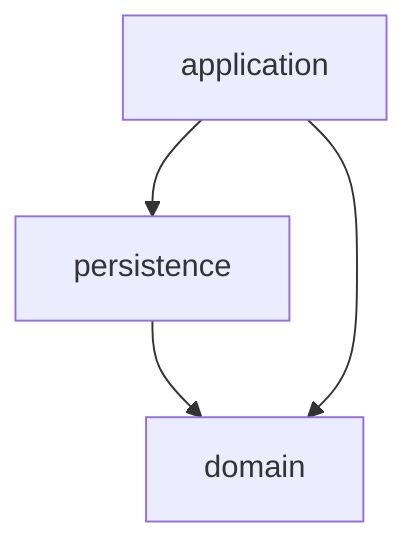

Mũi tên trong sơ đồ này có nghĩa **module ở đầu mũi tên khai báo phụ thuộc vào module ở cuối mũi tên**. Do đó `application` cần `persistence`, còn `persistence` cần `domain`.

Khi nói về thứ tự thực thi, chiều mũi tên thường được diễn giải ngược lại: producer phải tạo output trước consumer. Có thể vẽ theo thứ tự build:

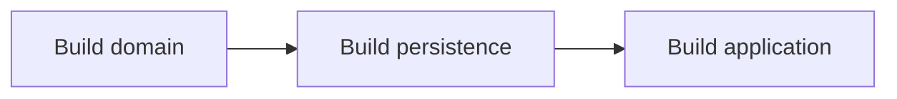

Phân biệt hai cách biểu diễn này tránh nhầm giữa chiều khai báo dependency và chiều thực hiện build.

## 3. Project graph và task graph là hai lớp khác nhau

Gradle làm việc với nhiều loại quan hệ. Trong bối cảnh multi-project, cần phân biệt:

- **Project dependency graph:** thể hiện project nào sử dụng component/variant của project nào.
- **Task graph:** thể hiện những task cụ thể cần chạy và quan hệ thực thi giữa chúng trong một build invocation.

Một project dependency không có nghĩa mọi task của project được phụ thuộc đều phải chạy. Gradle chỉ đưa vào task graph những task cần thiết để tạo variant hoặc artifact mà consumer yêu cầu, cùng các task phụ thuộc của chúng.

Ví dụ, khi chạy:

```bash
./gradlew :application:compileJava
```

Gradle cần resolve compile classpath của `:application`. Nếu classpath chứa project dependency từ `:domain` và `:persistence`, Gradle sẽ lên kế hoạch cho các task cần thiết để tạo những artifact/variant tương ứng trước khi biên dịch `:application`.

Nếu `:application` không phụ thuộc `:integration-test`, các task của module integration test không cần xuất hiện chỉ vì module đó có trong settings.

### Task graph được tạo từ task được yêu cầu

Task graph bắt đầu từ những task người dùng yêu cầu trên command line hoặc từ tooling. Gradle lần theo các quan hệ như `dependsOn`, các task dependency phát sinh từ input/output và những quan hệ khác để xác định công việc cần thực hiện.

Ví dụ:

```bash
./gradlew :application:build
```

Lệnh này yêu cầu task `build` của project `:application`. Các task cần thiết cho build của application và project dependency của nó sẽ được đưa vào graph. Những module không liên quan không tự động phải build chỉ vì chúng nằm trong cùng repository.

Ngược lại:

```bash
./gradlew build
```

Task selector không ghi project path có thể chọn task cùng tên ở nhiều project trong build nơi task đó tồn tại. Nếu cần giới hạn phạm vi chính xác, hãy dùng đường dẫn đầy đủ như `:application:build` hoặc `:domain:jar`.

## 4. Thứ tự build được xác định từ quan hệ phụ thuộc

Nguyên tắc chung là **task tạo dữ liệu cần thiết phải hoàn thành trước task sử dụng dữ liệu đó**.

Giả sử:

- `:domain` tạo class và JAR của domain model.
- `:persistence` cần domain API để biên dịch và tạo persistence library.
- `:application` cần persistence library và domain API để biên dịch ứng dụng.

Một luồng build khái niệm:

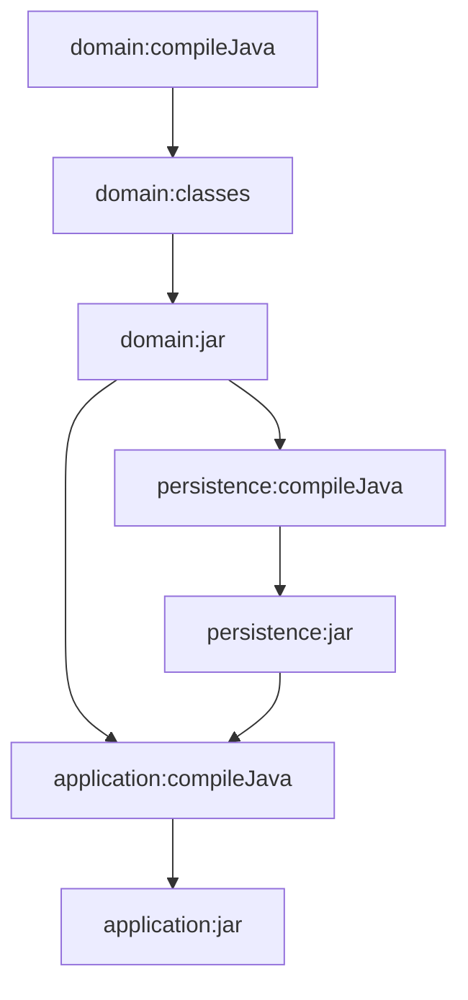

Sơ đồ đơn giản hóa task graph. Task thực tế phụ thuộc plugin, variant được chọn, resource processing, annotation processing và cấu hình của từng project. Điều cần nhớ là Gradle dùng dependency metadata để biết task producer nào cần chạy trước task consumer.

Không cần tự viết một chuỗi lệnh thủ công kiểu:

```bash
./gradlew :domain:build
./gradlew :persistence:build
./gradlew :application:build
```

nếu project dependency đã được khai báo đúng. Có thể yêu cầu task ở consumer, và Gradle sẽ lên kế hoạch cho các task producer cần thiết. Chạy riêng từng lệnh có thể build lặp lại nhiều phần và làm mất lợi ích của một task graph thống nhất.

## 5. `api` và `implementation` trong project dependency

Với Java Library Plugin, `api` và `implementation` kiểm soát dependency nào được công khai cho consumer, đặc biệt là compile classpath của module sử dụng thư viện.

Ví dụ `persistence` dùng `domain` trong implementation nội bộ:

```kotlin
plugins {
    `java-library`
}

dependencies {
    implementation(project(":domain"))
}
```

Consumer của `persistence` không nhất thiết cần nhìn thấy domain dependency trên compile classpath chỉ vì persistence dùng nó nội bộ. Nếu public API của persistence expose các kiểu từ domain và consumer cần compile với những kiểu đó, có thể cần khai báo `api(project(":domain"))`.

```kotlin
dependencies {
    api(project(":domain"))
}
```

| Configuration | Ý nghĩa đối với project sử dụng thư viện |
|---|---|
| `api` | Dependency thuộc public API của library và được công bố cho compile classpath của consumer |
| `implementation` | Dependency phục vụ nội bộ implementation; không được đưa vào compile API của consumer theo cùng cách |
| `compileOnly` | Cần khi biên dịch project hiện tại nhưng không tự đưa vào runtime dependency |
| `runtimeOnly` | Cần khi chạy nhưng không cần để biên dịch source hiện tại |

`api` và `implementation` ảnh hưởng visibility và dependency metadata; chúng không phải công cụ sắp xếp thứ tự task. Cả hai loại project dependency đều có thể khiến Gradle phải build project producer khi variant của nó được consumer yêu cầu.

Không nên đổi `implementation` thành `api` chỉ để “ép module chạy trước”. Nếu mục tiêu là tạo quan hệ build, hãy khai báo đúng project dependency hoặc task dependency. Nếu mục tiêu là công khai kiểu dữ liệu, mới dùng `api`.

## 6. Thứ tự trong task graph: dependency và ordering rule

Gradle có nhiều cơ chế liên kết task. Chúng không thể thay thế tùy tiện cho nhau.

| Cơ chế | Đưa task kia vào graph? | Ý nghĩa |
|---|---|---|
| `dependsOn` | Có | Task hiện tại cần task phụ thuộc hoàn thành trước |
| `mustRunAfter` | Không | Nếu cả hai task đã nằm trong graph, task hiện tại phải chạy sau task được chỉ định |
| `shouldRunAfter` | Không | Gợi ý thứ tự mềm; Gradle có thể bỏ qua trong một số tình huống |
| `finalizedBy` | Có, như task kết thúc/finalizer | Đăng ký công việc cần chạy sau task được finalize |

### `dependsOn`: dependency thực sự

Dùng `dependsOn` khi task cần output hoặc điều kiện hoàn tất của task khác.

```kotlin
tasks.register("verifyDistribution") {
    dependsOn(":domain:jar")
    dependsOn(":application:jar")
}
```

Khi chạy `verifyDistribution`, Gradle đưa các task JAR được chỉ định cùng prerequisite của chúng vào graph. Task `verifyDistribution` chỉ được thực hiện sau khi dependency task hoàn tất thành công theo graph.

### `mustRunAfter`: chỉ sắp xếp task đã được chọn

Ví dụ muốn integration test chạy sau unit test khi cả hai cùng được yêu cầu:

```kotlin
tasks.named("integrationTest") {
    mustRunAfter(tasks.named("test"))
}
```

Quan hệ này không khiến `test` tự chạy khi người dùng chỉ gọi:

```bash
./gradlew integrationTest
```

Nếu `test` không được yêu cầu và cũng không được task khác đưa vào graph, nó không chạy. `mustRunAfter` không tạo prerequisite.

### `shouldRunAfter`: thứ tự mong muốn

```kotlin
tasks.named("integrationTest") {
    shouldRunAfter(tasks.named("test"))
}
```

Đây là gợi ý. Gradle có thể không tuân theo nếu việc đó gây xung đột với các dependency/order rule khác hoặc cản trở thực thi song song. Không dùng `shouldRunAfter` khi task thực sự cần output của task kia.

### `finalizedBy`: công việc sau khi task kết thúc

```kotlin
tasks.named("integrationTest") {
    finalizedBy("stopTestEnvironment")
}
```

Finalizer phù hợp cho dọn dẹp hoặc thu thập kết quả sau task. Nó không thay thế dependency giữa producer và consumer.

## 7. Không dùng thứ tự khai báo module để điều khiển build

Một hiểu lầm thường gặp là nghĩ project được liệt kê trước trong `settings.gradle` sẽ luôn build trước project được liệt kê sau.

Ví dụ:

```kotlin
include(":application", ":domain", ":persistence")
```

Thứ tự này không phải một quy tắc build order. Nếu `application` phụ thuộc `persistence`, và `persistence` phụ thuộc `domain`, Gradle dựa trên dependency graph để sắp xếp công việc theo quan hệ cần thiết.

Tương tự, thứ tự các dòng `dependencies` trong build script không phải cơ chế kiểm soát thứ tự task. Hãy mô tả dependency bằng project dependency hoặc task dependency phù hợp.

### Project evaluation order không phải task execution order

Gradle có giai đoạn cấu hình (configuration) trước khi thực thi task. Một số API cũ như `evaluationDependsOn(":other")` ảnh hưởng thứ tự evaluate/configure project, không phải cách chuẩn để nói task nào cần chạy trước.

Ví dụ:

```groovy
evaluationDependsOn(':domain')
```

Dòng này không thay thế:

```groovy
dependencies {
    implementation project(':domain')
}
```

Cấu hình project và thứ tự thực thi task là hai vấn đề khác nhau. Trong build hiện đại, nên dùng plugin, provider và dependency model thay vì dựa vào việc project nào được evaluate trước.

## 8. Thực thi song song trong dự án nhiều mô-đun

Khi Gradle biết rõ quan hệ phụ thuộc, những task không phụ thuộc lẫn nhau có thể được thực thi song song nếu build bật parallel execution và các task an toàn với cách thực thi đó.

Ví dụ `:domain:jar` và một task tạo tài liệu độc lập có thể chạy cùng lúc nếu không có dependency hoặc ordering constraint bắt buộc giữa chúng.

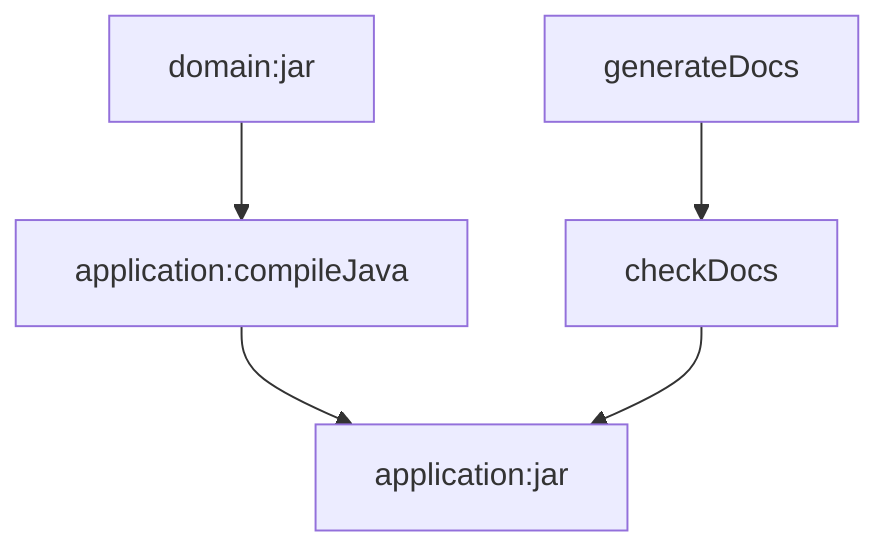

Trong graph trên, nhánh `domain` và `generateDocs` độc lập có thể tiến hành song song; task tổng hợp cuối chỉ chạy khi các prerequisite cần thiết hoàn tất.

Có thể bật parallel execution bằng command line:

```bash
./gradlew build --parallel
```

Hoặc cấu hình trong `gradle.properties`:

```properties
org.gradle.parallel=true
```

Gradle còn giới hạn số worker thực thi theo cấu hình hoặc tham số `--max-workers`. Việc bật parallel không có nghĩa tất cả task sẽ chạy đồng thời; dependency graph, loại task, tài nguyên và giới hạn worker quyết định mức song song thực tế.

### Điều kiện để parallel build an toàn

- Task không ghi đè output của task khác.
- Mỗi task sở hữu output directory rõ ràng.
- Không dựa vào thứ tự tình cờ của task độc lập.
- Không dùng file tạm chung mà không có cơ chế đồng bộ.
- Không sửa cùng một trạng thái bên ngoài theo cách xung đột.
- Custom task khai báo input/output và dependency chính xác.

Nếu build chỉ chạy đúng khi tắt parallel, có thể có race condition hoặc output dùng chung. Tắt parallel có thể giúp khoanh vùng, nhưng cần sửa task hoặc dữ liệu dùng chung thay vì dựa lâu dài vào thứ tự tình cờ.

## 9. Vòng phụ thuộc là gì?

Một đồ thị dependency hợp lệ cần có thể sắp xếp các node sao cho mọi prerequisite được xử lý trước consumer. Nếu đi theo các cạnh và quay lại node ban đầu, ta có **cycle** (vòng phụ thuộc).

Ví dụ hai project phụ thuộc lẫn nhau:

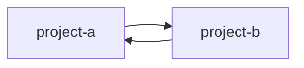

Theo chiều khai báo dependency:

- `project-a` khai báo phụ thuộc `project-b`.
- `project-b` lại khai báo phụ thuộc `project-a`.

Không có điểm bắt đầu hợp lệ để tạo output cho một project trước project kia nếu các task compile/artifact của chúng cần kết quả của nhau.

Vòng phụ thuộc cũng có thể xuất hiện ở cấp task dù project graph không có cycle. Ví dụ:

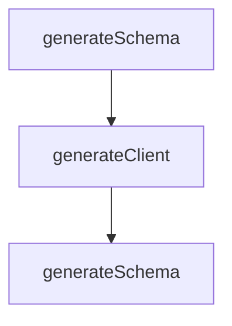

Task `generateSchema` cần output của `generateClient`, trong khi `generateClient` lại cần output của `generateSchema`. Gradle không thể thực hiện cả hai theo thứ tự prerequisite vì mỗi task chờ task còn lại.

## 10. Vòng phụ thuộc giữa các project Java

Giả sử `service-a` cần class từ `service-b`:

```kotlin
// service-a/build.gradle.kts
dependencies {
    implementation(project(":service-b"))
}
```

Sau đó `service-b` cũng khai báo:

```kotlin
// service-b/build.gradle.kts
dependencies {
    implementation(project(":service-a"))
}
```

Cả hai project có thể tạo ra một chuỗi phụ thuộc producer/consumer khép kín. Với Java Plugin, task biên dịch hoặc tạo variant của một project có thể cần artifact của project kia, dẫn tới task graph có vòng và Gradle báo circular dependency.

Một dạng lỗi có thể hiển thị như:

```text
Circular dependency between the following tasks:
:service-a:compileJava
\--- :service-b:jar
     \--- :service-b:compileJava
          \--- :service-a:jar
               \--- :service-a:compileJava
```

Đây là log minh họa. Tên task thực tế phụ thuộc plugin và variant mà Gradle chọn.

### Vì sao vòng này khó giải quyết?

- `service-a` cần class từ `service-b` để compile.
- `service-b` cần class từ `service-a` để compile.
- Không module nào có thể hoàn thành prerequisite của module kia trước.
- Đổi `implementation` thành `api` không loại bỏ quan hệ phụ thuộc.
- Thêm `mustRunAfter` không giải quyết dependency cycle; nó chỉ đặt thứ tự cho task đã có trong graph.

Vòng phụ thuộc thường là dấu hiệu hai module đang chia sẻ trách nhiệm không rõ ràng hoặc ranh giới module được tách sai.

## 11. Vòng phụ thuộc giữa các task trong cùng project

Một task có thể được đăng ký với dependency tạo cycle trực tiếp:

```kotlin
tasks.register("prepareReport") {
    dependsOn("generateReport")
}

tasks.register("generateReport") {
    dependsOn("prepareReport")
}
```

Khi gọi một trong hai task, Gradle lần theo dependency và quay lại task ban đầu. Task graph không thể sắp xếp nên build thất bại với thông báo circular dependency.

Một vòng khác có thể xuất hiện gián tiếp qua nhiều task:

```text
compileJava
  -> generateSources
      -> validateSchema
          -> packageMetadata
              -> compileJava
```

Không nhất thiết hai task khai báo trực tiếp phụ thuộc nhau; cycle có thể đi qua nhiều tầng. Cần đọc toàn bộ chuỗi Gradle báo ra thay vì chỉ sửa cạnh cuối cùng nhìn thấy.

### Vòng qua input/output

Custom task có thể tạo cycle nếu:

- Task A đọc output của B.
- Task B đọc output của C.
- Task C lại đọc output của A.

Khi nối provider/file collection, Gradle có thể suy ra task dependency từ output producer sang consumer. Đây là hành vi hữu ích khi graph đúng, nhưng nếu dữ liệu đầu vào/đầu ra tạo vòng thì task graph cũng có thể tạo vòng.

## 12. Cách phát hiện vòng phụ thuộc

Gradle thường phát hiện task dependency cycle khi xây dựng task graph, trước khi thực thi những task bị mắc trong cycle. Thông báo lỗi thường chứa danh sách task tham gia vòng.

Một quy trình chẩn đoán:

1. Đọc toàn bộ thông báo `Circular dependency` và ghi lại task path.
2. Phân loại node thuộc project nào và task nào.
3. Mở build script của các project liên quan, tìm project dependency và task `dependsOn`.
4. Kiểm tra task input/output provider có tạo dependency ngầm không.
5. Vẽ lại cạnh dependency theo một chiều thống nhất.
6. Xác định module hoặc task nào đang gánh hai trách nhiệm cần tách.
7. Sửa quan hệ và kiểm tra lại graph bằng `--dry-run` hoặc build phù hợp.

Các lệnh hỗ trợ:

```bash
./gradlew projects
./gradlew tasks --all
./gradlew :application:build --dry-run
./gradlew :application:build --info
```

- `projects` liệt kê project path trong build.
- `tasks --all` giúp tìm task được đăng ký ở các project.
- `--dry-run` hiển thị các task dự kiến chạy mà không thực thi action.
- `--info` cung cấp thêm thông tin về quá trình cấu hình và thực thi.

Nếu graph có cycle, `--dry-run` vẫn có thể thất bại khi Gradle không thể tạo execution plan. Điều đó vẫn hữu ích vì lỗi graph được phát hiện trước khi chạy task action.

### Xem dependency của module

Để hiểu một project lấy thư viện từ đâu, dùng:

```bash
./gradlew :application:dependencies --configuration compileClasspath
./gradlew :application:dependencyInsight --dependency domain --configuration compileClasspath
```

Các lệnh này hiển thị dependency graph của configuration, không phải toàn bộ task graph. Chúng giúp tìm project/module dependency và version resolution, còn `--dry-run` giúp quan sát task execution graph.

## 13. Cách phá vòng phụ thuộc ở cấp kiến trúc module

Cách sửa tốt thường là thay đổi ranh giới module để dependency chỉ đi theo một hướng.

### Tách hợp đồng dùng chung thành module thứ ba

Nếu `service-a` và `service-b` cùng cần một số interface hoặc model, chuyển phần dùng chung vào module nhỏ hơn, ví dụ `service-contract`:

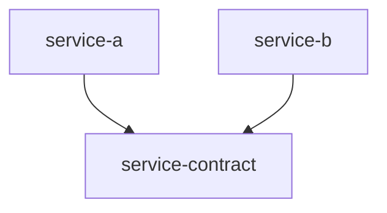

Cả hai service phụ thuộc contract, không phụ thuộc trực tiếp lẫn nhau. Module contract chỉ chứa API ổn định, DTO hoặc interface cần thiết, không chứa implementation kéo ngược về hai service.

Cấu trúc:

```text
system/
├── service-contract/
├── service-a/
└── service-b/
```

Dependency:

```kotlin
// service-a/build.gradle.kts
dependencies {
    implementation(project(":service-contract"))
}
```

```kotlin
// service-b/build.gradle.kts
dependencies {
    implementation(project(":service-contract"))
}
```

### Dependency inversion

Nếu `service-a` cần gọi chức năng của `service-b`, có thể đưa interface vào module contract hoặc domain abstraction. `service-a` phụ thuộc interface; implementation được cung cấp ở composition root hoặc module tích hợp.

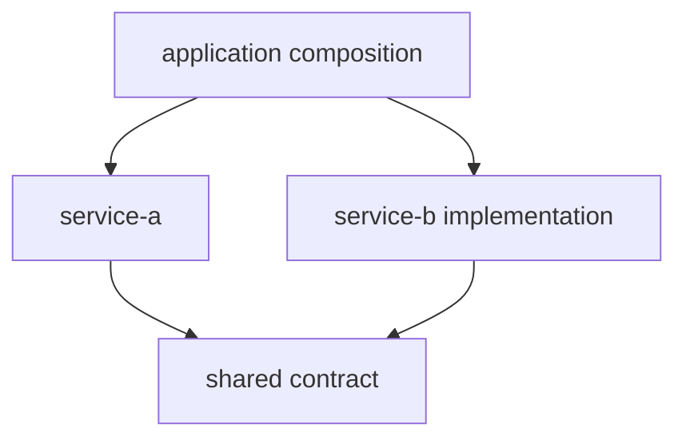

Mục tiêu là module cấp thấp hoặc module contract không phụ thuộc ngược vào module triển khai cấp cao.

### Tách module theo chiều trách nhiệm

Một module có thể đang vừa chứa domain model, vừa chứa persistence implementation, vừa gọi service khác. Tách các phần đó thành module có trách nhiệm rõ giúp dependency chỉ đi theo hướng:

```text
domain
  ↑
persistence-adapter
  ↑
application
```

Sơ đồ biểu diễn dependency theo chiều consumer phụ thuộc producer. Khi cần mô tả thứ tự build, producer được xử lý trước consumer.

### Không tạo module chung quá lớn

Tách contract không có nghĩa gom mọi class vào một `common` module. Module contract nên nhỏ, có mục đích và API ổn định. Nếu nó phụ thuộc lại các implementation module, cycle chỉ được chuyển sang nơi khác.

## 14. Cách phá vòng phụ thuộc ở cấp task

Khi cycle nằm trong custom task graph, hãy xác định dữ liệu thực sự cần truyền và chia trách nhiệm.

Giả sử:

- `generateSchema` tạo schema file.
- `generateClient` đọc schema để sinh client source.
- `validateSchema` cần kiểm tra schema trước khi generator chạy.

Graph đúng có thể là:

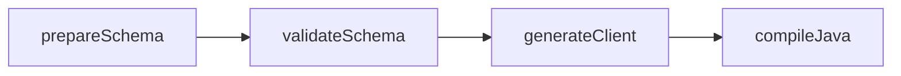

Task `prepareSchema` không được phụ thuộc ngược vào `generateClient`. Nếu cần thông tin từ generated client để kiểm tra, hãy tách bước kiểm tra thành một task sau generation, hoặc thiết kế một input schema độc lập.

Một số cách sửa:

- Tách task có nhiều trách nhiệm thành các task nhỏ hơn.
- Chọn một nguồn dữ liệu chuẩn, không để hai task cùng sinh output phụ thuộc lẫn nhau.
- Dùng output provider của task producer làm input của consumer.
- Tránh khai báo `dependsOn` chỉ để ép thứ tự khi không có quan hệ dữ liệu.
- Không để hai task ghi chung một output directory.
- Đưa thao tác dọn dẹp vào finalizer nếu nó phải chạy sau task chính.

Nếu hai task chỉ cần chạy theo thứ tự khi cả hai cùng được yêu cầu, `mustRunAfter` có thể phù hợp. Nhưng nếu B cần output do A tạo ra, hãy dùng dependency và nối input/output rõ ràng.

## 15. Phân biệt vòng project dependency với vòng ordering rule

Không phải mọi quan hệ thứ tự vòng đều tương đương dependency cycle.

- `dependsOn` đưa task vào graph và tạo prerequisite. Vòng dependency là vấn đề khiến Gradle không thể xác định thứ tự thực thi.
- `mustRunAfter` và `shouldRunAfter` không đưa task vào graph. Chúng chỉ tác động tới thứ tự khi task đã được yêu cầu.
- `finalizedBy` đưa finalizer vào graph sau task được finalize.

Ví dụ, nếu task A `mustRunAfter` B nhưng B không được yêu cầu, Gradle không tự chạy B. Vì vậy, không thể dùng ordering rule để thay thế prerequisite.

Khi Gradle báo vòng, hãy xem các task path trong thông báo và xác định cạnh nào là dependency thật, cạnh nào là ordering constraint. Không xóa một dependency dữ liệu cần thiết chỉ để làm graph hết cycle; hãy sửa thiết kế dữ liệu hoặc tách trách nhiệm.

## 16. Composite build khác multi-project build như thế nào?

Multi-project build dùng một settings file để khai báo nhiều project thuộc cùng build:

```kotlin
include(":domain", ":application")
```

Composite build đưa một build Gradle độc lập vào build khác bằng `includeBuild`:

```kotlin
includeBuild("../shared-build-logic")
```

Included build có settings, project graph và lifecycle riêng. Composite build thường dùng để phát triển plugin/build logic hoặc thay thế một external module bằng source build trong quá trình phát triển.

Không nên nhầm `includeBuild` với `include`:

| Cú pháp | Ý nghĩa |
|---|---|
| `include(":domain")` | Thêm project `:domain` vào cùng multi-project build |
| `includeBuild("../shared-library")` | Kết hợp một build độc lập vào composite build |

Composite build cũng có dependency substitution và quan hệ build riêng. Nó không phải cách tự động sửa mọi vòng phụ thuộc giữa các module trong cùng một multi-project build. Nếu hai module vẫn cần API của nhau theo vòng khép kín, cần sửa ranh giới hoặc dependency model.

## 17. Các lỗi thiết kế thường tạo cycle

| Dấu hiệu | Nguyên nhân có thể | Hướng xử lý |
|---|---|---|
| Hai project cùng khai báo `implementation(project(...))` về phía nhau | Module phụ thuộc lẫn nhau | Tách contract/API chung hoặc đảo dependency |
| Task A và B `dependsOn` nhau | Khai báo task dependency hai chiều | Chọn một chiều prerequisite, tách task nếu cần |
| Compile task của module A cần JAR B và compile B cần JAR A | Project dependency cycle lan xuống task graph | Chỉnh lại module boundaries |
| Generator đọc output do chính nó hoặc task phụ thuộc tạo | Input/output dependency vòng | Chọn nguồn dữ liệu độc lập và tách giai đoạn |
| Root task phụ thuộc subproject task, subproject lại phụ thuộc root task | Aggregate task bị nối ngược | Đặt aggregate ở một phía và không tạo dependency ngược |
| Build chỉ chạy được khi tắt parallel | Có thể có output dùng chung hoặc race condition | Tách output, khai báo dependency và loại trạng thái dùng chung |
| Thêm `mustRunAfter` nhưng task prerequisite vẫn không chạy | Nhầm ordering với dependency | Dùng `dependsOn` khi cần prerequisite thực sự |
| Dùng `evaluationDependsOn` để cố điều khiển build order | Nhầm configuration order với task execution | Khai báo project/task dependency đúng nghĩa |

## 18. Thực hành thiết kế dependency graph dễ bảo trì

- **Giữ hướng phụ thuộc rõ ràng:** module ứng dụng có thể phụ thuộc domain và adapter; domain không phụ thuộc ngược vào ứng dụng.
- **Tách API khỏi implementation:** interface/DTO dùng chung có thể nằm trong module contract nhỏ.
- **Không để module cấp thấp biết module cấp cao:** áp dụng dependency inversion khi cần giao tiếp hai chiều về mặt nghiệp vụ.
- **Dùng project dependency cho quan hệ giữa module:** để Gradle chọn variant và task producer phù hợp.
- **Dùng task dependency cho công việc build riêng:** không dùng project dependency để thay cho quan hệ task không liên quan đến component.
- **Chỉ thêm ordering rule khi cần:** dependency thừa làm graph phức tạp và hạn chế parallelism.
- **Mỗi task sở hữu output riêng:** tránh nhiều task ghi chung một thư mục.
- **Khai báo input/output chính xác:** Gradle có thể suy ra quan hệ producer/consumer và kiểm tra tính hợp lệ.
- **Không dựa vào thứ tự include hoặc thứ tự dòng script:** graph phải mô tả đúng dependency thực tế.
- **Giữ module contract nhỏ:** tránh biến module chung thành nơi chứa mọi loại code.

## 19. Quy trình chẩn đoán và xử lý một vòng phụ thuộc

Khi Gradle báo circular dependency, có thể làm theo quy trình:

1. **Đọc thông báo đầy đủ:** ghi lại tất cả project path và task path trong cycle.
2. **Xác định tầng lỗi:** project dependency cycle, task dependency cycle hay quan hệ input/output tạo cycle.
3. **Vẽ graph:** dùng mũi tên thống nhất, ghi rõ mũi tên biểu diễn “consumer depends on producer” hay “producer runs before consumer”.
4. **Tìm cạnh tạo vòng:** xem `dependencies`, `dependsOn`, provider/output và custom plugin.
5. **Xác định nhu cầu thật:** module/task nào thực sự cần dữ liệu nào?
6. **Tách trách nhiệm:** tạo contract module, chuyển interface hoặc chia task thành các bước một chiều.
7. **Xóa dependency không cần:** bỏ quan hệ được thêm chỉ để ép thứ tự nếu không có dữ liệu cần thiết.
8. **Kiểm tra lại task graph:** dùng `--dry-run` hoặc chạy task nhỏ nhất liên quan.
9. **Kiểm tra module khác:** build consumer và các project bị ảnh hưởng để bảo đảm thay đổi không làm mất dependency cần thiết.
10. **Giữ graph có hướng và không chu trình:** mọi dependency phải có thể lần theo tới một producer nền tảng.

Lệnh thường dùng:

```bash
./gradlew projects
./gradlew tasks --all
./gradlew :application:compileJava --dry-run
./gradlew :application:build --info
./gradlew :application:dependencies --configuration compileClasspath
```

Nếu cycle xuất hiện ở task cụ thể, hãy gọi đúng task path nhỏ nhất có thể để rút gọn graph cần phân tích. Nếu lỗi chỉ xảy ra khi chạy root `build`, kiểm tra aggregate task và các dependency được thêm ở root build script.

## 20. Ví dụ tổng hợp: từ vòng phụ thuộc tới graph một chiều

Ban đầu, hai module phụ thuộc lẫn nhau:

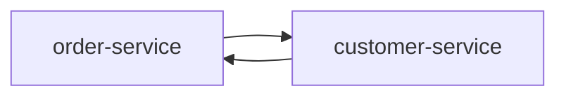

`order-service` cần `Customer` model từ `customer-service`, trong khi `customer-service` lại cần `OrderLookup` từ `order-service`. Cả hai module đang trộn domain model với service implementation.

Tách các hợp đồng dùng chung:

```text
order-system/
├── customer-contract/
├── order-domain/
├── customer-service/
└── order-service/
```

Định hướng dependency mới:

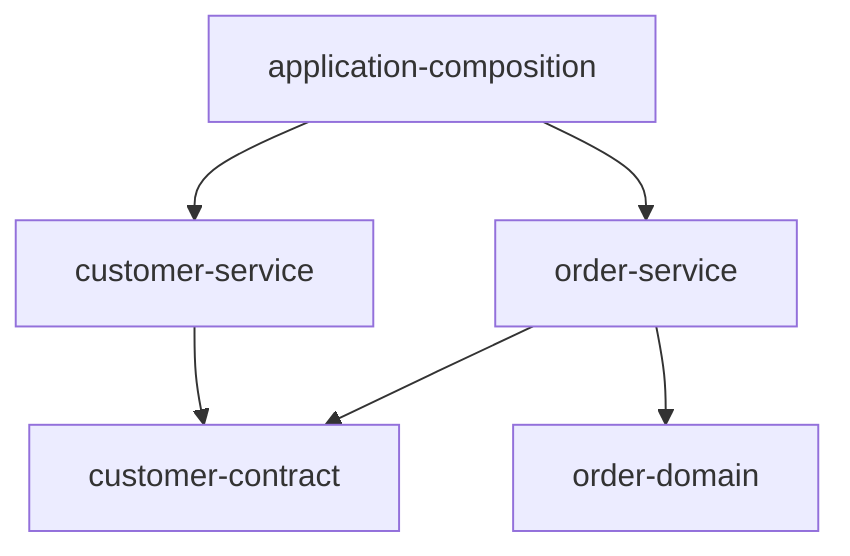

`customer-contract` chứa kiểu dữ liệu/interface mà hai bên cần trao đổi. `order-domain` chứa mô hình nghiệp vụ order. `customer-service` và `order-service` triển khai các chức năng riêng. Module composition kết nối các implementation ở cấp ứng dụng.

Thứ tự build theo dependency mới có thể bắt đầu từ contract và domain, tiếp đến các service, rồi tới module composition. Mỗi consumer chỉ cần artifact của producer ở tầng thấp hơn.

## 21. Nguyên tắc cần ghi nhớ

Gradle không xây dựng module theo thứ tự xuất hiện trong settings hay thứ tự dòng dependency. Nó lập task graph từ task được yêu cầu, project dependency, task dependency và quan hệ input/output. Project dependency cho Gradle biết module consumer cần component của module producer; task graph sau đó xác định những task cần chạy để tạo component đó.

Một graph hợp lệ phải có thể sắp xếp prerequisite trước consumer. Nếu project hoặc task phụ thuộc lẫn nhau theo vòng khép kín, Gradle không thể tạo execution plan và sẽ báo circular dependency. Cách sửa bền vững là xác định dữ liệu thực sự cần chia sẻ, tách contract/API hoặc chia task thành các bước một chiều. Dùng `dependsOn` cho dependency thực sự, `mustRunAfter`/`shouldRunAfter` cho thứ tự giữa task đã được chọn và `finalizedBy` cho công việc sau task. Khi graph rõ ràng và output được tách riêng, Gradle có thể build đúng thứ tự, phát hiện lỗi sớm và chạy song song những phần độc lập.
