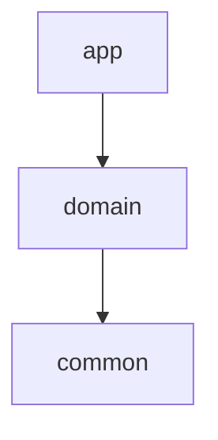

# Build một mô-đun cùng các đầu vào nội bộ cần thiết

Trong một dự án nhiều mô-đun, mỗi module có thể được phát triển và build riêng, nhưng kết quả của module này thường là đầu vào của module khác. Ví dụ, ứng dụng `app` sử dụng thư viện `domain`, còn `domain` sử dụng `common`. Khi chỉ muốn build `app`, build tool vẫn phải có các module nội bộ cần thiết để biên dịch, kiểm thử hoặc đóng gói đúng phiên bản đang có trong cùng checkout.

Điều quan trọng là phân biệt **module được yêu cầu build** với **các module cần được build để cung cấp đầu vào cho nó**. Bạn có thể yêu cầu một task hoặc một module cụ thể, còn Gradle hoặc Maven sẽ dựa vào quan hệ dependency đã khai báo để xác định phần công việc cần thiết. Nếu quan hệ nội bộ bị khai báo thiếu, build tool có thể lấy nhầm artifact cũ từ local repository hoặc không biết phải tạo đầu vào trước.

Bài học này trình bày cách build một module có các dependency nội bộ trong Gradle multi-project build và Maven reactor, cách kiểm tra phạm vi thực thi, cách xử lý generated/custom inputs và các lỗi thường gặp.

## 1. Mô hình dự án nhiều mô-đun

Giả sử một hệ thống bán hàng được chia thành ba module:

```text
shop/
├── settings.gradle
├── build.gradle
├── gradlew
├── app/
│   ├── build.gradle
│   └── src/main/java/...
├── domain/
│   ├── build.gradle
│   └── src/main/java/...
└── common/
    ├── build.gradle
    └── src/main/java/...
```

Quan hệ sử dụng:



`app` cần API của `domain`; `domain` cần API của `common`. Nếu build `app`, đầu vào cần thiết có thể bao gồm output đã biên dịch của cả `domain` và `common`.

Trong một multi-module build, các module có thể có build script, source set, dependency và task riêng. Root project hoặc aggregator project tổ chức chúng thành một build thống nhất. Build tool cần biết cả cấu trúc module lẫn quan hệ dependency để chọn đúng thứ tự và phạm vi công việc.

## 2. Module, dependency và đầu vào nội bộ

Một **module dependency nội bộ** là quan hệ mà một module sử dụng artifact hoặc output của module khác trong cùng build/repository mã nguồn.

Ví dụ:

- `app` dùng class `OrderService` do `domain` cung cấp.
- `domain` dùng class `Money` do `common` cung cấp.
- `app` có thể cần resource hoặc generated class do một module khác tạo ra.
- Một module có thể cần plugin hoặc convention build nội bộ để cấu hình các task.

Các quan hệ này cần được mô tả bằng cơ chế build tool hiểu được. Với Gradle, thường dùng project dependency hoặc variant-aware dependency. Với Maven, dùng dependency giữa các project trong reactor và khai báo các module trong aggregator POM.

Không nên chỉ dựa vào việc thư mục module nằm cạnh nhau. Build tool không thể tự suy ra mọi quan hệ từ tên thư mục hoặc từ việc một module import package của module khác nếu dependency chưa được khai báo.

## 3. Gradle: khai báo các project trong build

Gradle multi-project build thường khai báo module trong `settings.gradle` hoặc `settings.gradle.kts`.

Ví dụ Groovy DSL:

```groovy
// settings.gradle
rootProject.name = 'shop'

include 'app', 'domain', 'common'
```

Gradle nhận diện các project với project path:

```text
:           root project
:app        project app
:domain     project domain
:common     project common
```

Project path là định danh của project trong build. Với cấu trúc lồng nhau, path có thể là `:services:orders` hoặc `:libraries:common`. Project path giúp chỉ định chính xác task cần chạy.

Nếu thư mục vật lý không trùng với tên project path, `settings.gradle` có thể ánh xạ project tới thư mục khác bằng `projectDir`. Điều đó không làm thay đổi nguyên tắc: build tool cần khai báo project trong settings trước khi có thể chọn task của nó.

### 3.1. Khai báo dependency giữa các Gradle project

Trong `app/build.gradle`:

```groovy
plugins {
    id 'application'
}

dependencies {
    implementation project(':domain')
}
```

Trong `domain/build.gradle`:

```groovy
plugins {
    id 'java-library'
}

dependencies {
    api project(':common')
}
```

Ở đây, `app` phụ thuộc `domain`, còn `domain` công khai dependency `common` qua configuration `api`. Gradle có thể dùng quan hệ project dependency để phân giải variant và đưa output cần thiết của các module vào classpath của consumer.

Với Java Library plugin, `api` thường được dùng khi dependency là một phần của API mà consumer cần nhìn thấy trên compile classpath; `implementation` dùng cho dependency nội bộ của module mà không cần expose trực tiếp qua compile API. Chọn configuration đúng giúp tránh làm classpath của module downstream rộng hơn cần thiết.

Nếu `domain` chỉ dùng `common` bên trong implementation, có thể khai báo:

```groovy
dependencies {
    implementation project(':common')
}
```

Hãy chọn `api` hay `implementation` theo cách API của module được sử dụng, không chỉ theo mong muốn làm cho build một module chạy được.

## 4. Gradle: build một module bằng project path

Khi muốn build riêng `app`, từ thư mục root của build, chạy:

```bash
./gradlew :app:build
```

Trên Windows:

```powershell
.\gradlew.bat :app:build
```

Task path `:app:build` chỉ định task `build` của project `:app`. Nó giúp tránh nhầm lẫn với task `build` cùng tên ở root hoặc các project khác.

Một số lệnh có phạm vi nhỏ hơn:

```bash
# Chỉ biên dịch mã chính của app
./gradlew :app:compileJava

# Chạy test của app
./gradlew :app:test

# Tạo artifact của app
./gradlew :app:assemble

# Chạy đầy đủ nhóm kiểm tra và đóng gói của app
./gradlew :app:build
```

### 4.1. Gradle tự đưa project dependency cần thiết vào task graph

Khi `app` khai báo `implementation project(':domain')`, Gradle biết output của `domain` là một đầu vào của `app`. Khi chạy `:app:build`, Gradle đưa các task sản xuất output cần thiết của `domain` vào task graph. Nếu `domain` phụ thuộc `common`, các task cần thiết để tạo output của `common` cũng có thể được đưa vào graph.

Ví dụ khái quát:

```text
Yêu cầu: :app:build

Đầu vào project dependency:
  :app
    └── :domain
          └── :common

Các đầu ra cần thiết:
  :common:classes
      ↓
  :domain:compileJava / :domain:classes
      ↓
  :app:compileJava / :app:classes
      ↓
  :app:test, :app:jar, ...
```

Đây là sơ đồ khái quát. Task cụ thể phụ thuộc vào plugin, variant được chọn, configuration và loại artifact mà consumer cần. Gradle không nhất thiết chạy toàn bộ task `build` của từng project upstream chỉ vì một module khác phụ thuộc vào nó.

### 4.2. Build module dependency không đồng nghĩa build đầy đủ mọi module upstream

Điểm này rất quan trọng khi đọc kết quả:

- `:app:build` yêu cầu build task tổng hợp của `app`.
- Để tạo classpath/output cho `app`, Gradle chạy các producer task cần thiết của `domain` và `common`.
- Các task test hoặc kiểm tra riêng của `domain` và `common` không nhất thiết được chạy chỉ vì `app` sử dụng output của chúng.

Ví dụ, Gradle có thể chạy `:domain:compileJava` và `:domain:processResources` để tạo output cần cho `app`, nhưng không chạy `:domain:test` nếu task graph của `app` không khai báo dependency tới task test đó.

Nếu chính sách yêu cầu test của tất cả module upstream phải pass trước khi build `app`, cần thiết kế task graph hoặc pipeline để yêu cầu các task kiểm tra tương ứng. Không nên suy luận rằng project dependency tự động kéo theo toàn bộ `build` của mọi module.

### 4.3. Chạy nhiều module được chọn

Có thể yêu cầu nhiều task path trong cùng invocation:

```bash
./gradlew :domain:build :app:build
```

Gradle hợp nhất các task được yêu cầu vào một task graph và chỉ thực hiện task cần thiết một lần trong invocation. Nếu hai module cùng phụ thuộc `common`, các producer task của `common` không cần được thực hiện lặp lại chỉ vì có hai nhánh dependency.

## 5. Vì sao project dependency quan trọng hơn chỉ khai báo file JAR?

Một cách kém rõ ràng là dùng đường dẫn file output của module khác:

```groovy
dependencies {
    implementation files('../domain/build/libs/domain.jar')
}
```

Khai báo file dependency chỉ nói rằng `app` cần một file ở đường dẫn đó. Nó không tự diễn tả rằng Gradle phải build project `:domain` để tạo file. Nếu JAR chưa tồn tại hoặc đã cũ, `app` có thể thất bại hoặc dùng artifact stale.

Với project dependency:

```groovy
dependencies {
    implementation project(':domain')
}
```

Gradle hiểu quan hệ giữa project và có thể chọn output variant phù hợp, đồng thời nối các task producer vào graph.

| Khai báo | Build tool hiểu gì? | Rủi ro |
|---|---|---|
| `implementation project(':domain')` | Dependency giữa hai project trong cùng Gradle build. | Cần khai báo project trong settings và cấu hình variant/plugin phù hợp. |
| `implementation files('../domain/build/libs/domain.jar')` | Một file dependency ở đường dẫn cụ thể. | Không tự tạo task dependency tới project tạo file; có thể dùng file cũ hoặc không tồn tại. |
| `implementation 'com.example:domain:1.0'` | Module được phân giải từ repository. | Có thể dùng bản đã publish/local cache thay vì mã nguồn trong checkout hiện tại. |

File dependency vẫn có chỗ dùng trong một số tình huống đặc biệt, nhưng không nên dùng nó thay project dependency khi cả hai module thuộc cùng multi-project build.

## 6. Các đầu vào nội bộ ngoài project dependency

Không phải mọi đầu vào nội bộ đều là thư viện project. Một module có thể cần:

- Source hoặc resource được sinh từ schema trong module khác.
- File cấu hình hoặc dữ liệu do task nội bộ tạo ra.
- Convention plugin hoặc build logic dùng chung.
- Artifact được tạo trong một project khác nhưng không được mô hình hóa như dependency library.
- Generated source, generated resource hoặc metadata cần có trước compile/package.

Build tool chỉ tự sắp xếp công việc khi quan hệ đầu vào/đầu ra được khai báo rõ. Việc hai thư mục nằm trong cùng repository không tự tạo ra dependency giữa task.

### 6.1. Gradle: khai báo task dependency cho generated input

Giả sử `app` cần file schema do task `:schema:generateSchema` tạo ra. Nếu task app đọc file này, hãy khai báo output của producer và đưa output đó thành input của consumer bằng Provider/task output API.

Ví dụ minh họa trong build script phù hợp:

```groovy
// Trong project :schema
def generatedSchema = layout.buildDirectory.file('generated/schema/orders.json')

tasks.register('generateSchema') {
    outputs.file(generatedSchema)
    doLast {
        def file = generatedSchema.get().asFile
        file.parentFile.mkdirs()
        file.text = '{"schemaVersion": 1}'
    }
}
```

Trong `app`, nếu dùng output đó như một input task:

```groovy
def schemaFile = project(':schema').tasks.named('generateSchema').map {
    it.outputs.files.singleFile
}

tasks.register('validateSchema') {
    inputs.file(schemaFile)
    doLast {
        println "Validating ${schemaFile.get().asFile.name}"
    }
}
```

Đây là ví dụ khái niệm về việc nối producer output với consumer input; trong build thực tế nên định nghĩa task type có property `RegularFileProperty`/`DirectoryProperty` và expose output provider rõ ràng. Tránh truy cập `outputs.files.singleFile` trong build logic phức tạp khi task có nhiều output hoặc output chưa được khai báo ổn định.

Khi một task consumer nhận `TaskProvider` hoặc Provider output của producer làm input, Gradle có thể suy ra quan hệ cần thiết và sắp xếp task graph. Nếu chỉ hard-code đường dẫn `schema/build/generated/schema/orders.json`, Gradle không thể luôn biết task nào phải tạo file đó trước.

### 6.2. Gradle: dùng project dependency cho artifact nội bộ

Nếu đầu vào nội bộ là thư viện Java, hãy ưu tiên project dependency và variant. Ví dụ:

```groovy
dependencies {
    implementation project(':schema-model')
}
```

Nếu đầu vào là artifact không phải Java hoặc có nhiều variant, hãy xem xét outgoing configuration và artifact publication nội bộ của Gradle. Cần khai báo attribute, artifact và producer task phù hợp để consumer nhận đúng đầu ra.

### 6.3. Build logic và convention plugin

Build có thể có `buildSrc` hoặc included build chứa convention plugin. Đây là đầu vào của quá trình cấu hình build, khác với project dependency của ứng dụng.

Ví dụ, convention plugin áp dụng Java toolchain, test logging và repository policy cho các module. Nếu build logic nằm trong `buildSrc` hoặc included build, Gradle xử lý nó trong quá trình cấu hình. Khi thay đổi plugin nội bộ, các project áp dụng plugin có thể cần được cấu hình lại hoặc build lại theo dependency của build logic.

Không nên nhầm `buildSrc` với một thư viện runtime mà ứng dụng sử dụng. Code trong build logic phục vụ Gradle, không tự động được đóng gói vào artifact của app.

## 7. Maven: cấu trúc aggregator và reactor

Maven multi-module build thường dùng một POM gốc có packaging `pom` để liệt kê module con.

Ví dụ:

```text
shop/
├── pom.xml
├── app/
│   └── pom.xml
├── domain/
│   └── pom.xml
└── common/
    └── pom.xml
```

POM gốc:

```xml
<project>
    <modelVersion>4.0.0</modelVersion>
    <groupId>com.example.shop</groupId>
    <artifactId>shop-parent</artifactId>
    <version>1.0.0</version>
    <packaging>pom</packaging>

    <modules>
        <module>common</module>
        <module>domain</module>
        <module>app</module>
    </modules>
</project>
```

Maven reactor thu thập các project trong build và sắp xếp chúng theo quan hệ phụ thuộc để build đúng thứ tự. Thứ tự khai báo `<modules>` không phải cơ chế duy nhất quyết định thứ tự khi có dependency; reactor có thể sắp xếp module dựa trên quan hệ giữa chúng.

Trong `domain/pom.xml`, khai báo dependency nội bộ:

```xml
<dependencies>
    <dependency>
        <groupId>com.example.shop</groupId>
        <artifactId>common</artifactId>
        <version>${project.version}</version>
    </dependency>
</dependencies>
```

Trong `app/pom.xml`:

```xml
<dependencies>
    <dependency>
        <groupId>com.example.shop</groupId>
        <artifactId>domain</artifactId>
        <version>${project.version}</version>
    </dependency>
</dependencies>
```

Khi root aggregator và các module cùng thuộc reactor, Maven có thể dùng project hiện tại trong reactor để cung cấp dependency nội bộ theo thứ tự phù hợp, thay vì yêu cầu developer phải cài từng module vào local repository trước.

## 8. Maven: chọn module bằng `-pl` và bao gồm dependency bằng `-am`

Để build module `app` cùng các module trong reactor mà `app` cần, chạy từ thư mục chứa root aggregator POM:

```bash
./mvnw -pl app -am verify
```

Ý nghĩa:

- `-pl app` (`--projects app`) chọn project `app` trong reactor.
- `-am` (`--also-make`) yêu cầu Maven thêm các project trong reactor mà project được chọn cần phụ thuộc.
- `verify` chạy lifecycle của các project được chọn và các project được thêm, đến phase `verify`.

Với sơ đồ `app -> domain -> common`, Maven có thể chọn `common`, `domain` và `app`, rồi build theo thứ tự dependency. Nhờ đó, dependency nội bộ được lấy từ đúng checkout hiện tại.

Trên Windows, Maven Wrapper vẫn dùng cú pháp tương tự trong PowerShell:

```powershell
.\mvnw.cmd -pl app -am verify
```

Tên script wrapper có thể là `mvnw` hoặc `mvnw.cmd` tùy repository và hệ điều hành.

### 8.1. Các tùy chọn reactor thường dùng

| Tùy chọn | Ý nghĩa | Trường hợp dùng |
|---|---|---|
| `-pl` / `--projects` | Chọn project hoặc danh sách project trong reactor. | Build một hoặc vài module cụ thể. |
| `-am` / `--also-make` | Thêm các project mà project được chọn phụ thuộc vào. | Build module cùng dependency nội bộ upstream. |
| `-amd` / `--also-make-dependents` | Thêm các project phụ thuộc vào project được chọn. | Kiểm tra ảnh hưởng của một thư viện tới module downstream. |
| `-N` / `--non-recursive` | Không đi vào các module con. | Chỉ chạy trên aggregator/root project. |
| `-rf` / `--resume-from` | Tiếp tục reactor từ project được chỉ định. | Tiếp tục sau khi xử lý lỗi ở module trước đó, trong điều kiện phù hợp. |

Ví dụ:

```bash
# Chỉ chọn app; không tự thêm module upstream
./mvnw -pl app verify

# Chọn app và thêm dependency nội bộ cần thiết
./mvnw -pl app -am verify

# Chọn common và thêm các module downstream phụ thuộc vào nó
./mvnw -pl common -amd verify

# Build từ một module trở đi trong reactor
./mvnw -rf app verify
```

`-rf` không thay thế cho `-am`. Nó dùng để tiếp tục reactor từ vị trí được chỉ định, vì vậy cần hiểu những module trước đó đã được build thành công và artifact cần thiết đã sẵn có.

### 8.2. Chọn module bằng đường dẫn hoặc tọa độ

`-pl` có thể nhận đường dẫn module tương đối với aggregator hoặc một định danh project được Maven hỗ trợ. Ví dụ:

```bash
./mvnw -pl app -am verify
```

hoặc chọn theo artifact ID:

```bash
./mvnw -pl :app -am verify
```

Với module lồng nhau, có thể dùng đường dẫn tương đối như `services/orders`. Khi project có artifact ID trùng nhau hoặc cấu trúc phức tạp, đường dẫn rõ ràng giúp tránh chọn nhầm.

## 9. Vì sao `-pl app` có thể không đủ?

Nếu chỉ chạy:

```bash
./mvnw -pl app verify
```

Maven chỉ chọn `app` và các project được chọn theo cấu hình. Nó không yêu cầu thêm các module upstream trong reactor như `-am`.

Nếu `app` phụ thuộc `domain`, Maven có thể phân giải `domain` từ local repository hoặc repository đã cấu hình. Nếu local repository chứa một bản `domain` cũ cùng version, build có thể thành công nhưng không sử dụng mã nguồn `domain` mới nhất trong checkout hiện tại.

Đây là một nguồn gây nhầm lẫn:

```text
Checkout hiện tại:
  domain version 1.0.0 (đã sửa mã)

Local Maven repository:
  domain version 1.0.0 (artifact cũ)

Lệnh -pl app không thêm domain vào reactor:
  app có thể resolve artifact đã cài trước đó.
```

Dùng:

```bash
./mvnw -pl app -am verify
```

giúp Maven đưa các dependency nội bộ có mặt trong reactor vào build và dùng output từ checkout hiện tại.

Không phải lúc nào `-pl app` cũng thất bại. Nó có thể thành công nếu dependency đã có trong local/remote repository. Điều cần kiểm tra là dependency được lấy từ nguồn nào và có đúng revision mong muốn hay không.

## 10. Khác biệt quan trọng giữa Gradle và Maven khi build một module

Cả hai công cụ đều có thể build một module cùng đầu vào nội bộ, nhưng cơ chế chọn công việc và phạm vi task upstream khác nhau.

| Nội dung | Gradle multi-project | Maven reactor |
|---|---|---|
| Chọn module | Task path như `:app:build`. | `-pl app` hoặc `-pl :app`. |
| Khai báo dependency nội bộ | `implementation project(':domain')`. | Dependency GAV trỏ tới module cùng reactor. |
| Bao gồm đầu vào upstream | Task producer cần cho project dependency được đưa vào task graph. | `-am` thêm project upstream cần thiết vào reactor selection. |
| Phạm vi upstream | Thường chỉ các task tạo variant/output mà consumer cần; không tự động chạy toàn bộ `build` của upstream. | Khi dùng `-am verify`, Maven chạy lifecycle đến `verify` cho các project upstream được thêm. |
| Xác minh dependency graph | `dependencies`, `dependencyInsight`. | `dependency:tree`, reactor summary/log. |
| Nguy cơ artifact cũ | Dùng file dependency hoặc module repository thay vì project dependency. | Chọn `-pl` không `-am` và lấy dependency từ local repository. |

Ví dụ: `./gradlew :app:build` có thể biên dịch `domain` và `common` để tạo classpath cho `app`, nhưng không nhất thiết chạy test của hai module upstream. Ngược lại, `./mvnw -pl app -am verify` yêu cầu Maven chạy lifecycle tới `verify` cho cả các module upstream được thêm vào reactor, vì vậy test của chúng thường được thực hiện theo cấu hình plugin.

Đây là khác biệt cần nhớ khi so sánh thời gian build hoặc trạng thái test giữa hai công cụ.

## 11. Build từ thư mục module hay từ root?

Với Gradle, wrapper thường được đặt ở root của build. Cách rõ ràng là chạy wrapper từ root và dùng task path đầy đủ:

```bash
./gradlew :app:build
```

Nếu cần chỉ rõ project directory, có thể dùng `-p`:

```bash
./gradlew -p /path/to/shop :app:build
```

Với Maven, nên chạy từ root aggregator để Maven biết toàn bộ reactor:

```bash
./mvnw -pl app -am verify
```

Nếu chạy trực tiếp từ `app/pom.xml`, Maven có thể không thu thập các module sibling vào reactor như khi chạy từ root. Khi đó dependency sibling có thể được lấy từ local repository hoặc repository bên ngoài.

Nếu module có parent POM nằm trong cùng checkout, chạy từ root aggregator cũng giúp Maven xử lý quan hệ parent/module theo reactor. Hãy bảo đảm parent POM và module được khai báo đúng.

## 12. Internal dependency không có trong reactor/build

Một module có thể phụ thuộc vào thư viện nội bộ được quản lý trong repository riêng nhưng không nằm trong cùng multi-module build. Khi đó, nó không thể được build tự động chỉ bằng `:app:build` hoặc `-pl app -am`.

Ví dụ:

```text
shop build:
  app -> domain -> company-security-sdk:2.5.0

company-security-sdk:
  được phát hành từ repository riêng, không nằm trong checkout shop
```

Gradle/Maven phải phân giải `company-security-sdk` từ repository đã cấu hình. Nếu artifact chưa được publish hoặc repository không truy cập được, build sẽ thất bại.

Phân biệt:

- **Module trong cùng build/reactor:** build tool có thể tạo output từ source hiện tại khi quan hệ dependency được khai báo.
- **Artifact nội bộ đã publish ở repository:** build tool tải artifact theo tọa độ và metadata.
- **File nội bộ tùy chỉnh:** cần khai báo input/output và task dependency hoặc cơ chế tích hợp phù hợp.

Nếu một dependency được quản lý ở build khác, có thể dùng Gradle composite build hoặc publish/install artifact theo quy trình dự án. Maven thường dùng reactor khi các module cùng aggregator; nếu không, dependency cần có trong repository/local repository.

## 13. Gradle composite build và included build

Gradle composite build cho phép một build sử dụng project từ build khác thông qua `includeBuild`. Đây là cách kết nối các build độc lập, không phải cùng một khái niệm với subproject được khai báo bằng `include` trong settings.

Ví dụ:

```groovy
// settings.gradle của shop
rootProject.name = 'shop'

include 'app'
includeBuild('../shared-libraries')
```

Nếu included build cung cấp module có tọa độ khớp với dependency được yêu cầu, Gradle có thể thay thế module repository bằng project trong included build theo cơ chế dependency substitution.

Ví dụ dependency trong `app`:

```groovy
dependencies {
    implementation 'com.example.shared:validation:1.2.0'
}
```

Nếu `shared-libraries` publish project có group/name/version tương ứng, composite build có thể dùng source project thay cho artifact đã publish. Điều này hữu ích khi phát triển song song nhiều repository.

Composite build có các quy tắc riêng về substitution, project identity và task. Hãy kiểm tra dependency insight và log để xác nhận dependency đang được lấy từ included build hay repository.

## 14. Chạy đúng nhóm kiểm thử của module

Khi yêu cầu build một module, cần phân biệt mục tiêu compile/package với việc kiểm tra các module upstream.

### 14.1. Gradle

```bash
# Build đầy đủ app
./gradlew :app:build

# Build đầy đủ domain và app
./gradlew :domain:build :app:build

# Chạy test của các module được chỉ định
./gradlew :common:test :domain:test :app:test
```

Nếu muốn `:app:build` luôn yêu cầu test của `domain` và `common`, cần thêm quan hệ task rõ ràng hoặc tạo một task/pipeline cấp cao hơn để yêu cầu các task đó. Tránh gắn dependency test một cách vô tình vào mọi compile task vì có thể làm vòng dependency hoặc tăng thời gian build không cần thiết.

### 14.2. Maven

```bash
# Build app cùng dependency upstream đến verify
./mvnw -pl app -am verify

# Build app cùng dependency upstream nhưng bỏ qua thực thi test
./mvnw -pl app -am -DskipTests package
```

`-DskipTests` thường bỏ qua việc chạy test nhưng vẫn biên dịch test source. `-Dmaven.test.skip=true` có thể bỏ cả compile và run test, nên phạm vi khác nhau. Không nên dùng các cờ skip trong gate chất lượng hoặc release nếu không có lý do và chính sách rõ ràng.

## 15. Chẩn đoán phạm vi build trong Gradle

Trước khi thay đổi build script, hãy quan sát project và task graph.

### 15.1. Liệt kê project

```bash
./gradlew projects
```

Lệnh này cho biết project nào thuộc build và project path tương ứng.

### 15.2. Xem task của module

```bash
./gradlew :app:tasks --all
```

Lệnh này liệt kê task của project `:app`. Có thể dùng `:domain:tasks` để xem task của module upstream.

### 15.3. Xem dependency graph

```bash
./gradlew :app:dependencies --configuration compileClasspath
./gradlew :app:dependencies --configuration runtimeClasspath
```

Hai lệnh giúp xác định project/module và external dependency trên compile/runtime classpath của app.

Để tìm lý do một module được đưa vào graph:

```bash
./gradlew :app:dependencyInsight \
    --dependency domain \
    --configuration compileClasspath
```

Task `dependencyInsight` hữu ích khi cần biết version, đường dẫn và lý do dependency được chọn.

### 15.4. Xem task graph trước khi thực thi

```bash
./gradlew :app:build --dry-run
```

`--dry-run` hiển thị các task sẽ được thực hiện mà không chạy task actions. Dùng nó để kiểm tra Gradle có đưa task producer của module nội bộ vào graph hay không.

Nếu cần log chi tiết hơn:

```bash
./gradlew :app:build --info
```

Log `--info` có thể giúp xác định task nào up-to-date, task nào chạy và dependency nào được phân giải. Không chia sẻ log chưa rà soát nếu nó chứa đường dẫn, URL nội bộ hoặc thông tin nhạy cảm.

## 16. Chẩn đoán Maven reactor

### 16.1. Xem các module được Maven chọn

Chạy:

```bash
./mvnw -pl app -am validate
```

Quan sát thứ tự reactor trong log. Maven thường in danh sách module và trạng thái build cho từng module. Nếu `common` hoặc `domain` không xuất hiện dù `app` cần chúng, kiểm tra:

- Các module có được khai báo trong `<modules>` của aggregator không?
- Dependency GAV có khớp groupId, artifactId và version của module nội bộ không?
- Dependency có được khai báo trong `<dependencies>` hay chỉ nằm trong `dependencyManagement`?
- Bạn có đang chạy từ root aggregator đúng không?

### 16.2. Xem dependency tree

```bash
./mvnw -pl app dependency:tree
```

Lệnh này giúp xem dependency mà `app` nhận được. Nếu cần tìm một artifact:

```bash
./mvnw -pl app dependency:tree -Dincludes=com.example.shop:domain
```

### 16.3. Phân biệt reactor dependency và local repository dependency

Nếu `-pl app` chạy thành công nhưng `-am` lại build thêm `domain`, điều đó có thể cho thấy `app` trước đó lấy được artifact từ local/remote repository. Hãy kiểm tra version và nguồn artifact, vì nó có thể không phải output từ source hiện tại.

Để xác minh một thay đổi trong checkout, thường dùng:

```bash
./mvnw -pl app -am clean verify
```

Lệnh này chọn app và dependency upstream trong reactor, dọn output và chạy đến verify cho các project được chọn. Đây là cách hữu ích để tránh phụ thuộc vào output cũ trong thư mục `target/`.

## 17. Build một module khi có generated sources hoặc task nội bộ

Project dependency không tự động giải quyết mọi generated input. Ví dụ, module `app` có thể cần source được sinh từ schema trong project `schema-tools`. Cần xác định loại quan hệ:

| Đầu vào | Cách mô hình hóa phù hợp |
|---|---|
| Java library của module khác | Gradle project dependency hoặc Maven project dependency trong reactor. |
| Generated source thuộc cùng module | Kết nối generator task với compile task và đăng ký output source directory. |
| Generated resource | Kết nối generator với processResources và khai báo output/input. |
| Artifact do project khác tạo | Expose output qua configuration/variant hoặc task output provider; tránh hard-code đường dẫn. |
| Build convention/plugin | Đưa vào build logic như `buildSrc` hoặc included build theo cơ chế Gradle. |
| Dependency nội bộ đã publish | Khai báo tọa độ và repository; quản lý version rõ ràng. |

Nếu consumer cần một file do producer task tạo, task graph phải có quan hệ producer/consumer. Nếu không, một build trên máy có output cũ có thể thành công nhưng build sạch trên CI thất bại.

## 18. Các lỗi thường gặp khi build một module

| Triệu chứng | Nguyên nhân có thể | Cách xử lý |
|---|---|---|
| Gradle báo không tìm thấy project path | Project chưa được `include` hoặc path sai. | Kiểm tra `settings.gradle` và chạy `gradlew projects`. |
| `:app:compileJava` không tìm thấy class của `domain` | Chưa khai báo project dependency hoặc dependency nằm sai configuration. | Kiểm tra `dependencies` và `compileClasspath`. |
| Gradle dùng file JAR cũ của module nội bộ | Dùng file dependency/repository dependency thay project dependency. | Khai báo `implementation project(':domain')` nếu cùng build. |
| Task generator không chạy trước compile | Output được hard-code bằng path, thiếu quan hệ task. | Khai báo task input/output và dependency/provider đúng. |
| `:app:build` pass nhưng test của `domain` chưa chạy | Project dependency chỉ kéo task producer cần thiết. | Yêu cầu `:domain:test` hoặc tạo verification task/pipeline phù hợp. |
| Maven không tìm thấy sibling module | Module không thuộc reactor hoặc aggregator không được dùng. | Chạy từ root POM và dùng `-pl app -am`. |
| Maven dùng artifact local cũ | Chọn `-pl app` mà không thêm upstream module vào reactor. | Dùng `-am` và build sạch. |
| Maven module không được chọn bởi `-pl` | Sai module path/artifact ID hoặc không nằm trong aggregator. | Kiểm tra `<modules>` và dùng selector chính xác. |
| Maven dependency không được build dù có trong `dependencyManagement` | `dependencyManagement` chỉ quản lý metadata/version, không thêm dependency. | Khai báo dependency trong `<dependencies>` của module cần dùng. |
| Build module từ thư mục con thất bại | Root aggregator hoặc wrapper không được sử dụng; parent/module context thiếu. | Chạy từ root build với project path hoặc `-pl` phù hợp. |
| CI build module khác local | Khác JDK, profile, property, environment hoặc artifact cache. | So sánh lệnh, toolchain, active profiles, properties và nguồn dependency. |

## 19. Quy trình thực hiện build module có đầu vào nội bộ

Một quy trình có thể áp dụng cho cả Gradle và Maven:

1. **Xác định module đích.** Tìm đúng project path hoặc module path/artifact ID.
2. **Đọc dependency khai báo.** Xác định các module nội bộ trực tiếp và bắc cầu mà module đích sử dụng.
3. **Xác nhận chúng thuộc cùng build.** Với Gradle, kiểm tra `settings.gradle`; với Maven, kiểm tra `<modules>` trong aggregator.
4. **Kiểm tra quan hệ dependency.** Dùng project dependency/variant của Gradle hoặc GAV dependency trong Maven.
5. **Xác định đầu vào ngoài dependency graph.** Generated files, resource hoặc custom task cần quan hệ producer/consumer rõ ràng.
6. **Chọn lệnh có phạm vi chính xác.** Gradle dùng task path; Maven dùng `-pl` cùng `-am` khi cần upstream modules.
7. **Quan sát kế hoạch thực thi.** Dùng Gradle `--dry-run` hoặc Maven reactor summary/log.
8. **Build từ output sạch khi cần xác minh.** Dùng `clean` để phát hiện phụ thuộc vào artifact cũ.
9. **Kiểm tra test coverage của upstream.** Xác nhận test nào thực sự chạy; không giả định compile dependency kéo theo test task.
10. **Lưu lại lệnh build.** Dùng cùng wrapper và lệnh rõ ràng trong tài liệu hoặc CI để các thành viên tái hiện được.

## 20. Ví dụ hoàn chỉnh với Gradle

Giả sử cấu trúc:

```text
shop/
├── settings.gradle
├── app/build.gradle
├── domain/build.gradle
└── common/build.gradle
```

`settings.gradle`:

```groovy
rootProject.name = 'shop'
include 'app', 'domain', 'common'
```

`app/build.gradle`:

```groovy
plugins {
    id 'application'
}

dependencies {
    implementation project(':domain')
}

application {
    mainClass = 'com.example.shop.Main'
}
```

`domain/build.gradle`:

```groovy
plugins {
    id 'java-library'
}

dependencies {
    api project(':common')
}
```

`common/build.gradle`:

```groovy
plugins {
    id 'java-library'
}
```

Build riêng app:

```bash
./gradlew :app:build
```

Quan sát task graph:

```bash
./gradlew :app:build --dry-run
```

Nếu muốn kiểm tra cả test của ba module:

```bash
./gradlew :common:test :domain:test :app:test
```

Ba lệnh phục vụ ba mục tiêu khác nhau: build artifact của app cùng producer inputs; xem kế hoạch task; và yêu cầu test của từng module. Hãy chọn lệnh theo mức xác minh cần thiết.

## 21. Ví dụ hoàn chỉnh với Maven

Root `pom.xml`:

```xml
<project>
    <modelVersion>4.0.0</modelVersion>
    <groupId>com.example.shop</groupId>
    <artifactId>shop-parent</artifactId>
    <version>1.0.0</version>
    <packaging>pom</packaging>

    <modules>
        <module>common</module>
        <module>domain</module>
        <module>app</module>
    </modules>
</project>
```

`domain/pom.xml` khai báo dependency `common`, còn `app/pom.xml` khai báo dependency `domain` với cùng group/version phù hợp.

Build app cùng dependency upstream:

```bash
./mvnw -pl app -am clean verify
```

Maven chọn các module cần thiết trong reactor, dọn output và chạy lifecycle tới `verify` cho từng module được chọn. Xem reactor summary để xác nhận module nào đã được build.

Nếu chỉ muốn xem dependency tree của app:

```bash
./mvnw -pl app dependency:tree
```

Nếu muốn build app và các module downstream phụ thuộc vào một module common vừa thay đổi:

```bash
./mvnw -pl common -amd verify
```

`-amd` hữu ích khi đánh giá ảnh hưởng của thay đổi thư viện tới các module sử dụng nó. Nó có thể đưa nhiều module downstream vào reactor, nên hãy xem danh sách project được chọn trước khi chạy trên build lớn.

## 22. Tổ chức lệnh build trong CI

Pipeline thường không cần build toàn bộ repository cho mọi thay đổi nếu có thể xác định module bị ảnh hưởng. Tuy nhiên, việc chọn module phải tính cả dependency upstream và downstream theo mục tiêu kiểm tra.

Ví dụ chính sách:

| Loại thay đổi | Phạm vi build gợi ý |
|---|---|
| Chỉ thay đổi module app | Build app cùng các dependency nội bộ upstream cần thiết. |
| Thay đổi module domain | Build/test domain và các module downstream bị ảnh hưởng như app. |
| Thay đổi module common | Build/test common và các module downstream phụ thuộc vào nó. |
| Thay đổi root build logic hoặc convention plugin | Có thể cần cấu hình/build nhiều hoặc toàn bộ module vì nhiều project bị ảnh hưởng. |
| Thay đổi shared schema/generator | Build generator và mọi module tiêu thụ generated output. |

Trong Gradle, project dependency và task graph giúp tự nối producer tasks, nhưng pipeline vẫn cần quyết định test/verification scope. Trong Maven, `-am` và `-amd` hỗ trợ chọn upstream/downstream trong reactor. Cần cẩn thận với bộ lọc module tự động: nếu bỏ sót một consumer, pipeline có thể xanh dù thay đổi làm hỏng module đó.

### 22.1. Lệnh build phải có thể tái hiện

Hãy lưu lệnh và tool version cùng pipeline:

```bash
./gradlew :app:build
```

hoặc:

```bash
./mvnw -pl app -am verify
```

CI nên dùng wrapper của repository, JDK/toolchain đã xác định và profile/property rõ ràng. Tránh dùng lệnh khác nhau giữa local và CI mà không giải thích phạm vi.

## 23. Những hiểu nhầm thường gặp

### “Build một module nghĩa là chỉ chạy task của module đó”

Không hoàn toàn. Build tool vẫn phải tạo hoặc phân giải đầu vào cần thiết từ module khác. Gradle đưa producer task của project dependency vào task graph; Maven `-am` thêm upstream modules vào reactor.

### “Gradle `:app:build` tự chạy toàn bộ test của mọi project upstream”

Không. Gradle thường chạy các task tạo output mà `app` cần. Test task của upstream chỉ chạy khi được yêu cầu qua task graph hoặc pipeline.

### “Maven `-pl app` luôn build các sibling dependency”

Không. `-pl` chọn module; `-am` mới yêu cầu thêm các project mà module đó cần trong reactor. Nếu thiếu `-am`, Maven có thể lấy artifact đã cài trong local repository.

### “Chỉ cần liệt kê module trong settings/POM là dependency tự xuất hiện”

Không. Việc include module làm nó thuộc build/reactor. Consumer vẫn phải khai báo dependency tới module đó để build tool hiểu quan hệ sử dụng.

### “Dùng đường dẫn JAR nội bộ cũng giống project dependency”

Không. File dependency không tự tạo quan hệ producer task. Nó có thể trỏ tới file cũ hoặc chưa tồn tại.

### “Dependency trong dependencyManagement tự được build”

Không. Maven `dependencyManagement` quản lý metadata và version. Dependency phải được khai báo trong `<dependencies>` để được sử dụng.

### “Build thành công module đích nghĩa là mọi module liên quan đều đã được test”

Không. Cần xem task graph hoặc reactor execution và xác nhận test task/phase có thực sự được chạy.

## 24. Thực hành: build một module cùng đầu vào nội bộ

Trong một multi-module project nhỏ có ba module `app`, `domain` và `common`, hãy thực hiện:

1. Khai báo cả ba module trong Gradle settings hoặc Maven aggregator POM.
2. Khai báo `app` phụ thuộc `domain`, và `domain` phụ thuộc `common`.
3. Chạy lệnh build chỉ định module đích: `./gradlew :app:build` hoặc `./mvnw -pl app -am verify`.
4. Quan sát các module và task được đưa vào build.
5. Thử chạy Gradle `:app:build --dry-run` để xem producer tasks cần thiết.
6. Với Maven, thử `-pl app` rồi so sánh với `-pl app -am`; kiểm tra artifact nào được lấy từ local repository và module nào thuộc reactor.
7. Thay đổi một class trong `common` rồi build lại app để xác nhận dependency nội bộ được cập nhật từ checkout hiện tại.
8. Kiểm tra xem test của `domain` và `common` có chạy hay không. Nếu chưa, yêu cầu rõ các test task hoặc dùng Maven lifecycle phù hợp.
9. Thêm một generated file làm đầu vào cho module đích và khai báo quan hệ producer/consumer.
10. Chạy build từ output sạch để phát hiện dependency vào artifact cũ.

Sau khi thực hành, hãy tự trả lời:

- Project path Gradle và module path Maven dùng để làm gì?
- Vì sao project dependency của Gradle tốt hơn hard-code đường dẫn JAR trong cùng build?
- `:app:build` đưa những task upstream nào vào graph và vì sao không nhất thiết chạy test upstream?
- `-pl` và `-am` khác nhau thế nào?
- Vì sao `-pl app` có thể dùng artifact local cũ?
- Khi nào cần `-amd`?
- Làm sao khai báo task producer cho generated input?
- Khi dependency không nằm trong cùng build/reactor, build tool lấy artifact từ đâu?

## 25. Kết luận

Build một module trong dự án nhiều mô-đun vẫn cần các đầu vào nội bộ mà module đó sử dụng. Trong Gradle, hãy khai báo project dependency và yêu cầu task bằng project path như `:app:build`; Gradle sẽ đưa các producer task cần thiết của dependency vào task graph. Trong Maven, hãy chạy từ root aggregator, chọn module bằng `-pl` và thêm dependency upstream bằng `-am`, ví dụ `./mvnw -pl app -am verify`.

Hãy phân biệt task tạo output với task kiểm thử của module upstream: Gradle project dependency không tự động chạy toàn bộ test của mọi module phụ thuộc. Maven reactor với `-am verify` có thể chạy lifecycle tới verify cho các module được thêm. Với generated file hoặc đầu vào tùy chỉnh, cần khai báo rõ producer, output và consumer input để build sạch trên máy lập trình viên lẫn CI đều tái tạo được. Quan sát task graph hoặc reactor summary giúp xác nhận build đã chọn đúng module và đúng đầu vào.
