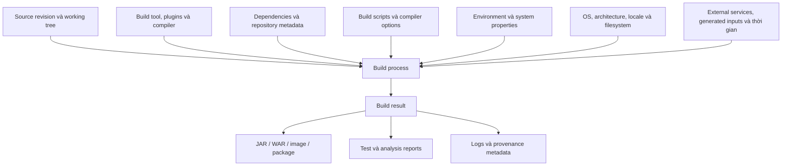

# Những đầu vào cần cố định để giải thích một kết quả build

Khi một lần build thành công trên máy lập trình viên nhưng thất bại trên CI, hoặc hai lần build từ cùng một commit tạo ra artifact khác nhau, câu hỏi đầu tiên thường là: **những đầu vào nào đã tham gia tạo ra kết quả này?** Mã nguồn chỉ là một phần của câu trả lời. Kết quả còn phụ thuộc vào build tool, JDK, compiler options, plugin, dependency, repository metadata, biến môi trường, hệ điều hành, dữ liệu bên ngoài và cách các task được thực thi.

Muốn giải thích và tái tạo một kết quả build, cần xác định các đầu vào có ảnh hưởng, cố định phiên bản hoặc giá trị của chúng khi phù hợp, đồng thời lưu lại thông tin đủ để truy vết. Không phải mọi chi tiết của máy đều cần giống nhau; cần phân biệt yếu tố có thể làm thay đổi kết quả với yếu tố chỉ ảnh hưởng đến tốc độ hoặc cách hiển thị log. Mục tiêu là biết artifact được tạo từ source nào, bằng công cụ nào, với dependency và cấu hình nào, trong môi trường nào.

## 1. Kết quả build phụ thuộc vào nhiều đầu vào

Một lần build có thể được nhìn như một hàm nhận nhiều đầu vào và tạo ra một hoặc nhiều đầu ra:



Nếu một đầu vào thay đổi, kết quả có thể thay đổi. Ví dụ, cùng source nhưng JDK khác có thể tạo bytecode khác; cùng build script nhưng dependency dynamic được resolve sang version mới có thể thay đổi classpath; cùng dependency nhưng biến môi trường khác có thể khiến ứng dụng đóng gói endpoint khác nhau.

### 1.1. Hai loại kết quả cần phân biệt

Khi nói “kết quả build”, có thể đang nói đến hai điều:

- **Kết quả thực thi:** build thành công hay thất bại, task nào chạy, test nào pass/fail, warning nào xuất hiện và thời gian chạy.
- **Nội dung sản phẩm:** bytecode, resource, JAR/WAR, container image, báo cáo hoặc checksum được tạo ra.

Một thay đổi môi trường có thể làm build thất bại mà chưa tạo artifact. Ngược lại, build có thể thành công nhưng archive khác byte-for-byte do timestamp, thứ tự entry hoặc metadata đóng gói. Khi điều tra, hãy nêu rõ cần tái hiện trạng thái pass/fail, logic runtime hay chính xác từng byte của artifact.

### 1.2. Reproducible build và repeatable build

Các thuật ngữ đôi khi được dùng khác nhau giữa tổ chức, nhưng có thể phân biệt thực dụng:

- **Repeatable:** cùng một môi trường hoặc quy trình có thể chạy lại và cho kết quả tương đương.
- **Reproducible:** một bên khác có thể sử dụng cùng các đầu vào đã xác định để tái tạo kết quả, lý tưởng là tạo artifact giống hệt từng byte.

Một build chạy lại thành công trên cùng máy chưa chứng minh nó reproducible. Máy đó có thể đang dùng cache, file chưa commit, JDK cài cục bộ hoặc biến môi trường mà repository không ghi nhận. Muốn tăng độ tái lập, cần loại bỏ các phụ thuộc ngầm và lưu lại đầu vào cần thiết.

## 2. Cố định source revision và trạng thái working tree

Source revision là đầu vào nền tảng. Một số thông tin cần lưu:

- Git commit SHA đầy đủ.
- Branch và tag liên quan, nếu có.
- Trạng thái working tree tại thời điểm build.
- Các thay đổi chưa commit, file untracked hoặc patch được áp dụng thêm.
- Submodule commit và Git LFS object nếu repository sử dụng.
- Source archive hoặc snapshot chính xác được đưa vào build.

### 2.1. Commit SHA không phải lúc nào cũng đủ

Commit SHA xác định nội dung đã commit trong Git tree. Nhưng nếu build chạy trên working tree có thay đổi chưa commit, artifact có thể chứa code không có trong commit đó. File untracked được script đọc hoặc generated source còn sót từ lần chạy trước cũng có thể ảnh hưởng kết quả.

Trước khi build để phát hành, nên xác nhận working tree sạch hoặc ghi nhận patch bổ sung. Các lệnh hữu ích:

```bash
git rev-parse HEAD
git status --short
git diff --binary
git submodule status --recursive
```

`git status --short` cho biết file đã sửa, staged hoặc untracked. `git diff --binary` giúp lưu patch của thay đổi chưa commit khi cần tái hiện. Với thay đổi đã staged, cần xem thêm `git diff --cached`.

### 2.2. Submodule và Git LFS

Nếu repository dùng Git submodule, commit cha chỉ ghi nhận commit được tham chiếu; cần checkout đúng commit submodule. `git submodule update --init --recursive` thường được dùng trong pipeline để lấy đúng trạng thái đã ghi nhận.

Với Git LFS, Git tree có thể chứa pointer file còn nội dung thật được tải từ LFS storage. Build cần lấy đúng LFS objects. Một checkout thiếu LFS object có thể khiến build thất bại hoặc vô tình xử lý pointer như dữ liệu thật.

### 2.3. Generated source và file được tạo trước build

Source được sinh từ OpenAPI, Protocol Buffers, schema, template hoặc annotation processor cũng là đầu vào/đầu ra của quy trình. Cần ghi nhận:

- File schema/specification nguồn và version của nó.
- Generator/tool version.
- Generator options và template.
- Cách output được đưa vào source set hoặc compiler input.
- Generated file có được commit hay được tạo lại trong mỗi build.

Không nên để build phụ thuộc vào generated source cũ còn sót trên máy. Nếu output được sinh tự động, task cần khai báo input/output để build có thể xác định khi nào phải chạy lại.

## 3. Cố định build tool và Wrapper

Gradle hoặc Maven điều phối task/phase, resolve dependency và gọi compiler/plugin. Phiên bản build tool có thể thay đổi cách cấu hình, resolution, task execution hoặc đóng gói.

### 3.1. Gradle Wrapper

Nên commit các file Wrapper và dùng Wrapper thay vì phụ thuộc vào Gradle cài toàn cục:

```text
gradlew
gradlew.bat
gradle/wrapper/gradle-wrapper.jar
gradle/wrapper/gradle-wrapper.properties
```

Trong `gradle-wrapper.properties`, pin distribution URL:

```properties
distributionUrl=https\://services.gradle.org/distributions/gradle-8.10.2-bin.zip
```

Khi cần xác minh distribution, có thể khai báo `distributionSha256Sum` theo checksum chính thức của đúng gói Gradle. Điều này giúp phát hiện file distribution không đúng nội dung dự kiến.

Chạy:

```bash
./gradlew --version
./gradlew clean build
```

`--version` cho biết Gradle version và JVM đang chạy. Ghi nhận cả hai thông tin vì Wrapper cố định Gradle nhưng JDK khởi chạy Gradle vẫn là một đầu vào riêng.

### 3.2. Maven Wrapper

Với Maven, commit `mvnw`, `mvnw.cmd` và thư mục `.mvn/wrapper/` chứa cấu hình Wrapper. Dùng:

```bash
./mvnw --version
./mvnw clean verify
```

Không dùng `mvn` toàn cục làm lệnh chuẩn nếu repository đã cung cấp Maven Wrapper. `mvn -version` hoặc `./mvnw --version` cho biết Maven version và Java runtime mà Maven đang sử dụng.

### 3.3. Plugin và build extensions cũng phải được cố định

Wrapper chỉ pin phiên bản Gradle/Maven. Plugin và extension có thể thay đổi kết quả build nên cần quản lý riêng:

- Gradle plugin version trong `plugins {}` hoặc plugin management/convention plugin.
- Plugin marker và plugin artifact repository.
- Maven build plugin version trong `<build><plugins>` hoặc `pluginManagement`.
- Build extension, compiler plugin, test plugin, packaging plugin và plugin sinh mã.
- Dependency của chính plugin hoặc build logic.

Một POM không pin plugin version có thể nhận plugin khác theo thời gian hoặc theo cấu hình Maven; Gradle plugin version không nên để thay đổi ngoài ý muốn. Hãy quản lý plugin version tập trung và review nâng cấp như một thay đổi build có chủ đích.

## 4. Cố định JDK, compiler và Java release

Java version có thể chỉ nhiều thứ khác nhau:

1. JDK dùng để chạy Gradle/Maven.
2. JDK toolchain được chọn cho compile/test hoặc task Java khác.
3. Java release mà mã nguồn hướng tới.
4. Runtime Java dùng để chạy artifact trong môi trường đích.

Các giá trị này có thể khác nhau. Ví dụ, Gradle chạy trên JDK 21, compiler toolchain là JDK 21, nhưng source/bytecode/API mục tiêu là Java 17.

### 4.1. Gradle toolchain và release

```groovy
java {
    toolchain {
        languageVersion = JavaLanguageVersion.of(21)
    }
}

tasks.withType(JavaCompile).configureEach {
    options.release = 17
    options.encoding = 'UTF-8'
}
```

Toolchain cố định JDK compiler được yêu cầu; `options.release` kiểm soát ngôn ngữ, bytecode và Java API mục tiêu. Khi cần tái tạo build, ghi nhận cả JDK vendor/version và release level.

### 4.2. Maven compiler release

```xml
<properties>
    <maven.compiler.release>17</maven.compiler.release>
    <project.build.sourceEncoding>UTF-8</project.build.sourceEncoding>
</properties>
```

Maven có thể dùng Maven Toolchains để chọn JDK compiler riêng với JDK chạy Maven. Nếu không dùng toolchains, hãy ghi nhận `JAVA_HOME`/JDK thực tế trong runner và cấu hình release rõ ràng.

### 4.3. Ghi nhận môi trường Java

Các lệnh:

```bash
java -version
javac -version
./gradlew --version
# Hoặc:
./mvnw --version
```

Trong CI, log các phiên bản này ở đầu job giúp giải thích khác biệt khi compiler hoặc plugin hành xử khác. Đừng chỉ lưu `java.version`; vendor, patch version và toolchain cũng có thể quan trọng.

## 5. Cố định dependency graph

Dependency graph gồm dependency trực tiếp, dependency bắc cầu, constraint, variant, classifier và metadata từ repository. Chỉ ghi lại danh sách dependency trực tiếp chưa đủ để xác định chính xác classpath cuối cùng.

### 5.1. Tránh version động trong build phát hành

Các khai báo như `1.+`, `latest.release`, version range hoặc snapshot mutable khiến kết quả resolution có thể thay đổi theo thời gian. Nếu repository publish version mới, lần build sau có thể lấy artifact khác dù source không đổi.

Ưu tiên version tường minh cho release build. Nếu cần version động trong quá trình phát triển, hãy kiểm soát TTL, ghi lại version thực tế đã resolve và không dùng kết quả chưa khóa làm đầu vào phát hành quan trọng.

### 5.2. Gradle dependency locking

Gradle dependency locking ghi nhận phiên bản đã resolve cho các configuration được bật locking. Ví dụ:

```groovy
dependencyLocking {
    lockAllConfigurations()
}
```

Sau đó tạo hoặc cập nhật lock state:

```bash
./gradlew build --write-locks
```

Lockfile giúp những lần build sau sử dụng cùng các version đã khóa. Khi nâng dependency, review thay đổi lock state cùng với source/test. Locking không tự khóa nội dung artifact nếu repository thay file tại cùng tọa độ; có thể kết hợp dependency verification để xác minh checksum/signature.

### 5.3. Gradle dependency verification

Gradle hỗ trợ dependency verification qua file metadata, thường là `gradle/verification-metadata.xml`. File này có thể chứa checksum hoặc thông tin chữ ký của dependency/plugin cần xác minh.

Ví dụ tạo metadata lần đầu:

```bash
./gradlew --write-verification-metadata sha256 help
```

Lệnh trên minh họa việc tạo checksum metadata cho các artifact được resolve trong lần chạy. Cần review file sinh ra và commit nó; không nên chấp nhận checksum mới một cách mù quáng nếu có dấu hiệu artifact bị thay thế trái phép.

Locking trả lời “version nào được chọn”; verification trả lời “artifact có nội dung đúng với checksum/signature được tin cậy không”. Hai cơ chế bổ sung cho nhau.

### 5.4. Maven quản lý dependency version

Maven không có cơ chế dependency locking cốt lõi giống Gradle. Để giữ dependency graph ổn định, có thể:

- Khai báo version rõ ràng cho dependency trực tiếp.
- Dùng parent POM và `dependencyManagement`.
- Import BOM đã được quản lý version.
- Tránh snapshot/dynamic range trong release build.
- Dùng Maven Enforcer để kiểm tra convergence và các quy tắc version.
- Lưu dependency tree/effective POM hoặc SBOM của lần build phát hành.

Ví dụ quản lý version bằng BOM:

```xml
<dependencyManagement>
    <dependencies>
        <dependency>
            <groupId>com.example.platform</groupId>
            <artifactId>platform-bom</artifactId>
            <version>5.2.0</version>
            <type>pom</type>
            <scope>import</scope>
        </dependency>
    </dependencies>
</dependencyManagement>
```

BOM cần có version bất biến và được kiểm thử. Khi build phát hành, lưu dependency tree của đúng configuration/scope giúp giải thích những artifact bắc cầu thực tế đã được chọn.

### 5.5. Ghi nhận repository và metadata

Dependency version có thể giống nhau nhưng artifact đến từ repository khác nhau. Nên ghi nhận repository/mirror được dùng, metadata source và checksum của artifact quan trọng. Repository manager có thể cache snapshot hoặc metadata; build cần chính sách rõ về update/TTL và không dựa vào một trạng thái cache không được ghi nhận.

## 6. Cố định build configuration và compiler options

Build script cũng là source code và cần nằm trong cùng revision với ứng dụng. Những thay đổi sau có thể làm kết quả khác:

- Gradle `build.gradle`, `build.gradle.kts`, `settings.gradle`, convention plugin và `gradle.properties`.
- Maven `pom.xml`, parent POM, profile, `.mvn/maven.config`, `.mvn/jvm.config` và `settings.xml` liên quan.
- Compiler flags như `--release`, `-encoding`, `-parameters`, `-g`, `-Xlint` và `-Werror`.
- Annotation processor, generator options, test framework và test runner.
- Resource filtering, archive manifest, file permissions và packaging rules.
- Task inputs/outputs, environment variables và system properties.

### 6.1. Không để cấu hình quan trọng chỉ nằm trong IDE

Nếu IDE đặt language level hoặc compiler option riêng nhưng build script không khai báo, local build có thể khác CI. Cấu hình ảnh hưởng artifact hoặc kết quả kiểm tra nên được thể hiện trong build logic dùng chung. IDE chỉ nên bổ sung trải nghiệm phát triển và đồng bộ với cấu hình đó.

### 6.2. Profile và project properties

Maven profile và Gradle project properties có thể bật các nhánh cấu hình khác nhau. Cần ghi lại profile/property đã truyền:

```bash
./mvnw -Pproduction-like verify
./gradlew -PbuildProfile=ci build
```

Tên profile/property ở ví dụ là minh họa. Một build report hữu ích nên ghi lại tên các profile/flags có ảnh hưởng, nhưng không ghi giá trị secret.

### 6.3. Task custom cần khai báo input/output

Gradle incremental build và build cache dựa trên input/output được khai báo. Nếu task đọc một file, biến môi trường hoặc dữ liệu ngoài mà không khai báo, Gradle có thể coi task vẫn up-to-date dù đầu vào đã đổi. Kết quả được cache khi đó không đáng tin cậy.

Task custom nên khai báo file input, property, environment input phù hợp và output. Với task type tái sử dụng, dùng annotation như `@Input`, `@InputFile`, `@InputDirectory`, `@OutputFile`, `@OutputDirectory` theo đúng ý nghĩa. Không khai báo output giả hoặc bỏ qua đầu vào chỉ để cache hit nhiều hơn.

## 7. Cố định biến môi trường và system properties

Environment variables và JVM system properties thường ảnh hưởng đến cấu hình build hoặc ứng dụng.

Ví dụ:

```bash
APP_PROFILE=staging ./gradlew build
./gradlew -Duser.timezone=UTC test
```

Trên PowerShell:

```powershell
$env:APP_PROFILE = 'staging'
.\gradlew.bat build
```

Những biến cần xác định có thể gồm:

- Profile ứng dụng/build.
- Endpoint hoặc repository mirror.
- Feature flag ảnh hưởng resource/package.
- Locale, timezone và encoding.
- Đường dẫn đến SDK, native tools hoặc generator.
- Cấu hình proxy và certificate store.
- Các cờ bật/tắt test, integration hoặc packaging.

### 7.1. Secret cần được quản lý nhưng không được ghi lộ

Credential có thể quyết định build có truy cập được repository hoặc dịch vụ hay không. Khi giải thích kết quả, cần ghi nhận credential identity/permission hoặc tên secret được dùng và version/rotation context nếu liên quan, nhưng không ghi token, password hay private key vào log/provenance công khai.

Nếu secret được dùng để ký artifact hoặc giải mã nội dung, giá trị secret có thể ảnh hưởng đầu ra. Khi ấy cần ghi nhận key identifier, certificate fingerprint hoặc signing service identity, không lưu private key vào báo cáo build.

### 7.2. Working directory và đường dẫn tương đối

Đường dẫn tương đối được phân giải theo quy tắc của shell, Gradle/Maven hoặc ứng dụng. Cùng một lệnh chạy từ hai thư mục khác nhau có thể đọc file cấu hình khác nhau. Ghi lại working directory hoặc chỉ định project root rõ ràng khi chạy build trong monorepo.

Với Java runtime, `user.dir` thường phản ánh working directory của JVM. Với Gradle, project directory/root directory và shell CWD là các khái niệm riêng. Với Maven, POM được chọn xác định project base directory. Đừng giả định tất cả đường dẫn tương đối đều tính từ repository root.

## 8. Cố định hệ điều hành, kiến trúc và môi trường thực thi

Không phải build nào cũng cần cùng hệ điều hành. Nhưng nếu kết quả phụ thuộc OS hoặc CPU architecture, cần ghi lại và có thể cố định môi trường bằng container/runner image.

Các yếu tố thường liên quan:

- OS và version/kernel.
- CPU architecture, ví dụ x86_64 hoặc ARM64.
- JDK vendor/version và native libraries.
- Filesystem case sensitivity, symbolic links và permission.
- Line endings (`LF`/`CRLF`).
- Locale, timezone và default charset.
- Shell và version của công cụ hệ thống.
- Native compiler, Docker/BuildKit hoặc SDK bên ngoài.

### 8.1. Container image nên dùng digest khi cần cố định nội dung

Tag như `eclipse-temurin:21` có thể được cập nhật theo thời gian. Nếu cần môi trường build có nội dung cố định, dùng image digest:

```text
eclipse-temurin:21-jdk@sha256:<image-digest>
```

Digest phải được lấy từ registry đáng tin cậy và được cập nhật có chủ đích. Pin digest giúp xác định chính xác image, nhưng không tự cố định network input, mounted files, host kernel hoặc secrets.

### 8.2. GitHub Actions và CI actions

Workflow có thể tham chiếu action bằng tag như `@v4`. Tag có thể được cập nhật theo chính sách của maintainer. Với pipeline có yêu cầu supply-chain nghiêm ngặt, có thể pin action bằng commit SHA đầy đủ và cập nhật định kỳ theo quy trình review.

Tương tự, runner label như `ubuntu-latest` có thể chuyển sang phiên bản Ubuntu mới. Nếu OS image ảnh hưởng kết quả, cần dùng runner/container image được kiểm soát và ghi lại version thực tế trong log.

### 8.3. File system và tên file

Build có thể hoạt động trên filesystem không phân biệt chữ hoa/chữ thường nhưng thất bại trên Linux vì import hoặc đường dẫn không khớp chính xác. Quyền executable, symbolic link, path length và line ending cũng có thể ảnh hưởng script. Cần kiểm tra các yếu tố này nếu local và CI khác hệ điều hành.

## 9. Cố định thời gian, tính ngẫu nhiên và dữ liệu bên ngoài

Build có thể đọc những dữ liệu không nằm trong Git:

- API schema được tải từ server.
- Database schema hoặc dữ liệu test.
- Dependency được publish trong lúc build đang chạy.
- Thời gian hiện tại, random seed hoặc generated UUID.
- HTTP response, remote config hoặc feature flag.
- Native tool, package manager hoặc container base image.

Những đầu vào này cần được version hóa, snapshot hoặc ghi nhận nếu chúng ảnh hưởng kết quả.

### 9.1. Timestamp và build metadata

Nhiều công cụ ghi thời gian tạo file vào JAR/ZIP, manifest hoặc generated source. Hai lần build ở thời điểm khác nhau có thể tạo archive khác checksum dù class file giống nhau.

Maven hỗ trợ property `project.build.outputTimestamp` để các plugin đóng gói có hỗ trợ có thể tạo archive với timestamp ổn định:

```xml
<properties>
    <project.build.outputTimestamp>2026-01-01T00:00:00Z</project.build.outputTimestamp>
</properties>
```

Giá trị trong ví dụ chỉ minh họa. Trong thực tế có thể dùng timestamp được xác định từ source revision hoặc quy tắc release. Cần xác nhận các plugin đóng gói đang dùng hỗ trợ property này.

Gradle archive tasks có các tùy chọn như `preserveFileTimestamps` và `reproducibleFileOrder` để tạo archive ổn định hơn:

```groovy
tasks.withType(AbstractArchiveTask).configureEach {
    preserveFileTimestamps = false
    reproducibleFileOrder = true
}
```

Các tùy chọn này giúp chuẩn hóa timestamp và thứ tự entry trong archive. Chúng không bảo đảm toàn bộ build reproducible nếu bytecode, resource, manifest hoặc plugin vẫn nhúng dữ liệu thay đổi theo thời gian.

### 9.2. Randomness và test

Test dùng random data, UUID hoặc thứ tự collection không xác định có thể pass/fail khác nhau. Nếu random cần thiết, hãy ghi nhận seed và cho phép tái chạy với seed đó. Nếu test phụ thuộc thời gian hiện tại, cân nhắc tiêm `Clock` để test kiểm soát thời điểm.

Không nên thay toàn bộ thời gian hệ thống của runner nếu chỉ một test cần thời gian giả lập. Kiểm soát clock ở cấp ứng dụng/test giúp kết quả rõ ràng hơn.

### 9.3. Dịch vụ ngoài và dữ liệu test

Integration test có thể phụ thuộc database, message broker, API hoặc container. Để tái tạo kết quả, cần ghi nhận:

- Version image/dịch vụ và digest khi có thể.
- Schema/migration version.
- Dataset hoặc fixture được nạp.
- Cấu hình network, port và timeout.
- Response giả lập hoặc external API version.
- Cách reset trạng thái trước và sau test.

Test gọi một API công khai có dữ liệu thay đổi theo thời gian không thể tái lập chỉ bằng source commit. Hãy dùng fixture, mock server hoặc snapshot có version khi mục tiêu là kiểm tra logic ổn định.

## 10. Dependency repository, cache và nguồn artifact

Để giải thích classpath, cần biết không chỉ version mà cả nguồn artifact và metadata đã được dùng.

### 10.1. Release và snapshot

Release artifact nên bất biến: một tọa độ/version chỉ đại diện cho một nội dung. Snapshot hoặc changing module có thể thay đổi nội dung theo thời gian và do đó cần metadata/TTL. Nếu build phụ thuộc snapshot, hãy ghi lại timestamp/build number hoặc checksum của artifact thực tế đã resolve.

### 10.2. Cache có thể che giấu đầu vào chưa cố định

Máy đã cache dependency có thể build thành công dù repository không còn cung cấp artifact. Máy mới hoặc CI cache trống sẽ thất bại. Vì vậy cần kiểm tra build từ môi trường sạch định kỳ và không coi cache cục bộ là nguồn artifact chính thức.

Gradle `--refresh-dependencies` và Maven `-U` yêu cầu kiểm tra lại trạng thái dependency theo cơ chế từng công cụ. Chúng không sửa version sai, artifact chưa publish hoặc permission bị từ chối.

### 10.3. Ghi nhận checksum và nguồn gốc

Checksum như SHA-256 giúp xác nhận nội dung artifact. Dependency verification của Gradle có thể kiểm tra checksum/signature. Với Maven, có thể thu thập checksum/SBOM và sử dụng các công cụ verification phù hợp trong pipeline.

Một manifest build có thể ghi:

- Tọa độ dependency.
- Version đã resolve.
- Repository URL hoặc repository ID.
- SHA-256 của file artifact.
- Metadata/variant nếu cần.

Điều này giúp phân biệt trường hợp cùng tọa độ nhưng file trên repository bị thay đổi trái chính sách.

## 11. Build cache không đồng nghĩa với reproducible build

Build cache và incremental build tối ưu thời gian bằng cách tái sử dụng output khi đầu vào được đánh giá là không đổi. Chúng hữu ích nhưng không thay thế việc cố định đầu vào.

### 11.1. Gradle up-to-date checking

Gradle so sánh input/output của task với lần chạy trước. Nếu task được đánh giá up-to-date, Gradle có thể bỏ qua action. Nếu task đọc biến môi trường hoặc file nhưng không khai báo nó là input, thay đổi đó có thể không được phát hiện.

### 11.2. Gradle build cache

Build cache có thể phục hồi output của task từ cache local hoặc remote. Để cache an toàn, task cần khai báo input/output chính xác và có hành vi phù hợp với caching. Task phụ thuộc vào thời gian, random, network response hoặc trạng thái máy mà không khai báo sẽ có nguy cơ nhận output cũ.

### 11.3. Configuration cache

Gradle configuration cache lưu kết quả cấu hình build để giảm thời gian cấu hình ở lần chạy sau. Nó không khóa dependency version hoặc bảo đảm artifact giống nhau. Configuration cache và build cache có mục đích khác nhau; không nên coi việc bật cache là bằng chứng build reproducible.

### 11.4. Clean build là phép kiểm tra, không phải chính sách tái lập đầy đủ

`clean` xóa output của project trước khi build. Nó hữu ích để phát hiện output cũ bị sót, nhưng không xóa mọi dependency cache, không cố định JDK, plugin, repository metadata hay external service. Một clean build vẫn có thể cho kết quả khác nếu đầu vào bên ngoài thay đổi.

## 12. Cách thu thập thông tin để giải thích một lần build

Một báo cáo build nên đủ thông tin để người khác xác định các đầu vào mà không cần đoán từ máy của người chạy.

### 12.1. Source và build configuration

Ghi nhận:

- Repository URL/identity và commit SHA.
- Branch/tag và trạng thái working tree.
- Submodule/LFS state nếu có.
- Đường dẫn build root/module được chọn.
- Build script revision và profile/property đã bật.
- Lệnh build chính xác.

### 12.2. Toolchain

Ghi nhận:

- Gradle/Maven Wrapper version.
- JDK vendor, version và runtime dùng chạy build tool.
- JDK toolchain/compiler thực tế.
- Java release/source/target.
- OS, version, architecture và container image digest nếu có.
- Phiên bản plugin, compiler, annotation processor và generator quan trọng.

### 12.3. Dependency

Ghi nhận:

- Dependency graph đã resolve theo configuration/scope quan trọng.
- Lockfile hoặc effective POM/BOM.
- Repository/mirror ID và metadata policy.
- Checksum/signature của artifact quan trọng hoặc SBOM.
- Snapshot timestamp hoặc dynamic version thực tế nếu còn sử dụng.

### 12.4. Environment và external inputs

Ghi nhận:

- Tên profile và các biến môi trường có ảnh hưởng, không ghi secret value.
- System properties và JVM arguments liên quan.
- Working directory.
- Locale, timezone, encoding.
- Dịch vụ ngoài, image digest, schema/data fixture và version.
- Random seed hoặc build timestamp nếu chúng ảnh hưởng output.

### 12.5. Output và provenance

Ghi nhận:

- Build status và task/phase kết thúc.
- Test/static analysis report.
- Artifact coordinates, file name, size và SHA-256.
- Build start/end time.
- CI run ID hoặc build number.
- Người/identity hoặc service account tạo artifact.
- Quan hệ giữa artifact và source commit.

## 13. Ví dụ manifest mô tả đầu vào build

Một manifest đơn giản có thể được lưu cùng artifact hoặc trong hệ thống build metadata. Ví dụ JSON minh họa:

```json
{
  "source": {
    "repository": "https://example.com/org/shop-platform.git",
    "commit": "<full-commit-sha>",
    "workingTreeClean": true
  },
  "build": {
    "tool": "Gradle",
    "wrapperVersion": "8.10.2",
    "command": "./gradlew clean build",
    "javaRelease": 17
  },
  "runtime": {
    "jdkVendor": "Eclipse Temurin",
    "jdkVersion": "21",
    "os": "Linux",
    "architecture": "x86_64"
  },
  "dependencies": {
    "lockState": "gradle.lockfile",
    "verificationMetadata": "gradle/verification-metadata.xml"
  },
  "artifact": {
    "file": "shop-app-1.0.0.jar",
    "sha256": "<sha256-of-artifact>"
  }
}
```

Các giá trị trong dấu ngoặc nhọn là placeholder. Manifest thực tế nên được tạo tự động từ build/CI, không nhập tay. Không đưa secret, token, private key hoặc thông tin nhạy cảm vào manifest công khai. Nếu cần truy vết credential, ghi identity hoặc reference an toàn tới secret manager.

## 14. Quy trình tái tạo một kết quả build

Khi cần giải thích một artifact cũ hoặc tái hiện lỗi CI, có thể thực hiện theo trình tự:

1. Lấy commit SHA và xác định working tree có thay đổi bổ sung hay không.
2. Checkout đúng commit, lấy submodule/LFS objects tương ứng.
3. Chọn đúng Gradle/Maven Wrapper từ repository.
4. Cài/chọn JDK và toolchain đúng vendor/version/release.
5. Khôi phục build scripts, profiles, project properties và compiler options.
6. Resolve dependency từ đúng repository/mirror; dùng lockfile/verification metadata nếu có.
7. Cấp environment variables và services cần thiết theo cách an toàn.
8. Chạy đúng lệnh, build root, module path và working directory.
9. Lưu log, test/analysis reports và dependency graph.
10. Tính checksum artifact và so sánh với artifact cần tái tạo.

Nếu kết quả khác, hãy so sánh từng lớp đầu vào. Không nên thay đổi đồng thời JDK, dependency, plugin và profile vì sẽ khó xác định yếu tố gây khác biệt.

## 15. Reproducible artifact và kiểm tra checksum

Hai artifact có cùng tên không nhất thiết có cùng nội dung. Checksum giúp xác định chính xác file:

```bash
sha256sum build/libs/shop-app-1.0.0.jar
```

Trên PowerShell:

```powershell
Get-FileHash -Algorithm SHA256 -LiteralPath 'build/libs/shop-app-1.0.0.jar'
```

Nếu hai lần build tạo checksum giống nhau, hai file giống nhau theo SHA-256 với xác suất va chạm cực thấp. Nếu checksum khác, cần so sánh nội dung archive, entry timestamp, manifest, class file và resource để tìm khác biệt.

### 15.1. Kiểm tra nội dung JAR

```bash
jar tf build/libs/shop-app-1.0.0.jar
```

Có thể giải nén hai archive và so sánh file sau khi bỏ qua metadata đã biết là biến động. Tuy nhiên, nếu mục tiêu là byte-for-byte reproducibility, không nên bỏ qua khác biệt timestamp hay manifest; cần cấu hình build để tạo output ổn định ngay từ đầu.

### 15.2. SBOM và provenance

Software Bill of Materials (SBOM) liệt kê các thành phần phần mềm trong sản phẩm, thường gồm dependency và version. SBOM giúp biết artifact chứa thư viện nào và hỗ trợ phân tích lỗ hổng.

Provenance mô tả artifact được tạo từ source nào, bằng quy trình/công cụ nào và trong môi trường nào. Một provenance tốt liên kết artifact digest với source revision, build definition và identity của hệ thống build. SBOM trả lời “có những thành phần nào”; provenance trả lời “sản phẩm này được tạo ra như thế nào”. Hai loại metadata bổ sung cho nhau.

## 16. Ví dụ thiết lập một build có đầu vào được kiểm soát

Giả sử dự án Gradle muốn kiểm soát các đầu vào chính:

- Gradle Wrapper pin một phiên bản cụ thể và có distribution checksum.
- Java toolchain cố định JDK compiler.
- Java release và encoding được khai báo.
- Plugin version được pin.
- Dependency locking và verification metadata được commit.
- CI chạy từ commit sạch trong container image được xác định.
- Artifact checksum và build provenance được lưu.

Một phần build script có thể như sau:

```groovy
plugins {
    id 'java'
}

java {
    toolchain {
        languageVersion = JavaLanguageVersion.of(21)
    }
}

tasks.withType(JavaCompile).configureEach {
    options.release = 17
    options.encoding = 'UTF-8'
}

dependencyLocking {
    lockAllConfigurations()
}
```

Đây chỉ là một phần của cấu hình. Cần pin plugin version trong nơi áp dụng plugin, bật dependency verification, cấu hình repository và kiểm soát các task custom/external input. Trong CI, dùng Wrapper, chọn JDK 21, checkout đúng commit và chạy lệnh build đã thống nhất.

Với Maven, một phần cấu hình có thể là:

```xml
<properties>
    <maven.compiler.release>17</maven.compiler.release>
    <project.build.sourceEncoding>UTF-8</project.build.sourceEncoding>
    <project.build.outputTimestamp>2026-01-01T00:00:00Z</project.build.outputTimestamp>
</properties>
```

Kết hợp với Maven Wrapper, plugin version được pin, parent/BOM được quản lý và dependency version rõ ràng. `outputTimestamp` chỉ có tác dụng với plugin đóng gói hỗ trợ; timestamp cần được sinh theo quy tắc dự án thay vì dùng một giá trị tùy tiện.

## 17. Những đầu vào không nhất thiết phải cố định

Không cần khóa mọi thứ ở mức tuyệt đối. Một số khác biệt chỉ ảnh hưởng hiệu năng hoặc cách quan sát, không làm thay đổi artifact hoặc quyết định pass/fail.

Ví dụ có thể không ảnh hưởng nội dung artifact nếu được cấu hình đúng:

- Số worker/parallelism, nếu task độc lập và không có race condition.
- Mức log (`--info`, `--debug`) nếu chỉ thay đổi lượng thông tin được in.
- Thư mục cache, nếu cache hợp lệ và không trở thành nguồn dữ liệu ngầm.
- Thời gian thực thi, nếu timestamp không được nhúng vào output.
- Vị trí cài JDK, nếu toolchain version/vendor được chọn và đường dẫn không được nhúng vào artifact.

Tuy nhiên, cần kiểm chứng giả định. Parallel execution có thể làm lộ race condition; cache có thể che đầu vào thiếu khai báo; log debug có thể chứa thông tin nhạy cảm. Khi điều tra một build khác thường, ghi nhận thêm những yếu tố này để loại trừ nguyên nhân.

## 18. Các hiểu nhầm thường gặp

| Hiểu nhầm | Thực tế |
|---|---|
| Có commit SHA là đủ tái tạo build | Cần cả working tree, submodule/LFS, toolchain, dependency và environment liên quan |
| Dùng Wrapper là build đã reproducible | Wrapper pin build tool, nhưng JDK, plugin, dependency và external input vẫn có thể thay đổi |
| Dependency version cố định nghĩa là artifact bất biến | Repository có thể bị ghi đè; cần checksum/verification và release policy |
| Lockfile bảo đảm mọi byte artifact giống nhau | Lockfile chủ yếu khóa version được resolve; compiler, timestamp, environment và plugin vẫn ảnh hưởng output |
| Build cache làm build đáng tin cậy hơn tự động | Cache chỉ an toàn khi input/output được khai báo đúng |
| `clean build` loại bỏ mọi trạng thái cũ | `clean` xóa output project, không xóa mọi cache hoặc external state |
| Cùng JDK major là đủ | Vendor, patch, toolchain, compiler options và runtime target có thể khác |
| Cùng source và dependency thì archive chắc chắn giống | Timestamp, archive order, manifest và generated metadata có thể khác |
| SBOM chứng minh artifact được tạo từ commit nào | SBOM liệt kê thành phần; provenance liên kết artifact với nguồn và quy trình tạo |
| Cần ghi mọi secret vào báo cáo để tái tạo | Chỉ ghi identity/reference và cách cấp secret; không ghi giá trị nhạy cảm |

## 19. Checklist đầu vào cho một lần build cần truy vết

Khi cần giải thích vì sao một build cho kết quả cụ thể, hãy thu thập các nhóm thông tin sau:

| Nhóm | Thông tin cần lưu |
|---|---|
| Source | Repository, commit SHA, trạng thái working tree, submodule/LFS, generated source |
| Build tool | Wrapper version, distribution checksum, build command, build root |
| Java toolchain | JDK vendor/version, compiler/toolchain, Java release, runtime baseline |
| Build logic | Build scripts, plugin/extension version, compiler flags, profile/property |
| Dependency | Dependency graph, lockfile/BOM, repository/mirror, checksum, snapshot/dynamic resolution |
| Environment | OS, architecture, container digest, environment variable names, system properties, working directory |
| Locale/data | Encoding, locale, timezone, random seed, external fixture/schema/service version |
| Execution | Task/phase, cache mode, parallelism nếu liên quan, test/analysis results |
| Output | Artifact path, size, SHA-256, SBOM, provenance, CI run ID |

Không phải dự án nào cũng cần lưu mọi trường ở mọi lần build. Hãy chọn mức chi tiết theo mục đích: build local để phát triển cần ít metadata hơn một artifact phát hành production hoặc một build phục vụ điều tra sự cố bảo mật.

Một kết quả build chỉ có thể được giải thích đầy đủ khi ta biết source revision, build tool và plugin, JDK/compiler, dependency graph, cấu hình, môi trường và các dữ liệu bên ngoài đã tham gia. Wrapper, toolchain, lockfile, dependency verification, timestamp ổn định và provenance giúp biến các đầu vào quan trọng thành thông tin có thể kiểm soát và truy vết. Khi cần tái tạo một artifact hoặc điều tra khác biệt giữa local và CI, hãy so sánh từng lớp đầu vào và checksum đầu ra thay vì chỉ nhìn mã nguồn hoặc kết luận rằng hai máy “đều dùng Java 21”.
