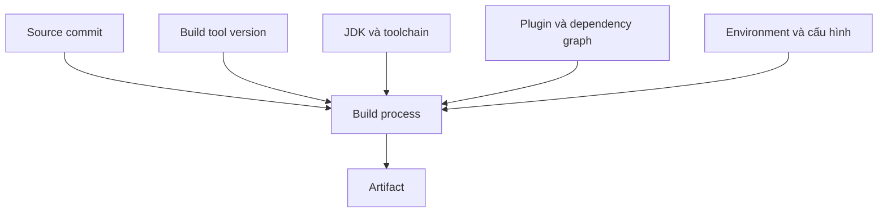
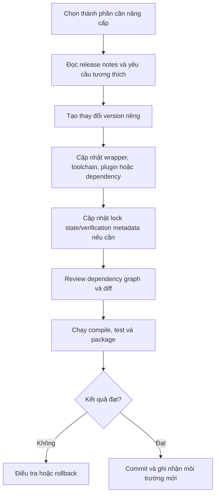

# Cố định công cụ build, JDK, plugin và phiên bản thư viện

Một dự án Java có thể build thành công trên máy của người này nhưng thất bại trên máy của người khác, dù cả hai cùng lấy một commit. Nguyên nhân thường nằm ở những đầu vào chưa được kiểm soát: phiên bản Maven hoặc Gradle, JDK, plugin, thư viện bắc cầu, repository, hệ điều hành hoặc cấu hình môi trường.

Muốn build có thể tái lập, nhóm cần xác định rõ các đầu vào ảnh hưởng đến kết quả và quản lý chúng cùng với mã nguồn hoặc trong môi trường CI có phiên bản cố định. Việc chỉ cố định dependency trực tiếp là chưa đủ. Build tool, JDK, plugin và dependency bắc cầu cũng có thể làm thay đổi kết quả.

Bài học này giải thích những thành phần cần cố định, cách cấu hình Maven và Gradle, cách quản lý phiên bản thư viện, cách kiểm tra môi trường và cách nâng cấp các công cụ có kiểm soát.

## 1. Build có thể tái lập là gì?

Một build có thể tái lập là build mà khi sử dụng cùng mã nguồn và cùng tập đầu vào đã kiểm soát, nhóm có thể tạo lại kết quả tương đương một cách đáng tin cậy.

Tập đầu vào của build không chỉ gồm file Java. Nó có thể bao gồm:

- Commit hoặc source archive được build.
- Phiên bản Maven hoặc Gradle.
- JDK chạy build và JDK dùng để biên dịch.
- Phiên bản plugin và extension.
- Dependency trực tiếp và bắc cầu.
- Repository cung cấp artifact.
- Cấu hình, biến môi trường và tham số build.
- Hệ điều hành, kiến trúc CPU và công cụ hệ thống.
- Các file được sinh ra hoặc tải về trong quá trình build.

Có thể hình dung:



Nếu một trong các đầu vào thay đổi mà không được ghi nhận, artifact có thể khác dù source commit không đổi.

### 1.1. Tái lập không luôn có nghĩa là byte-for-byte giống hệt

Có hai mức thường được nhắc đến:

- **Repeatable build:** cùng đầu vào được kiểm soát tạo ra kết quả có hành vi hoặc nội dung tương đương theo tiêu chí của dự án.
- **Reproducible build theo nghĩa nghiêm ngặt:** các lần build độc lập có thể tạo ra artifact giống từng byte.

Một JAR có thể chạy giống nhau nhưng hash khác nhau do timestamp, thứ tự file trong archive hoặc metadata được ghi vào artifact. Vì vậy, nếu yêu cầu là byte-for-byte reproducibility, nhóm còn phải chuẩn hóa cách tạo archive và loại bỏ các nguồn không xác định.

### 1.2. Tái lập khác với hermetic build

Hermetic build là build chỉ sử dụng những đầu vào được khai báo và kiểm soát, không âm thầm lấy dữ liệu từ trạng thái bên ngoài không xác định.

Một build có thể chạy offline nhưng vẫn không hermetic nếu task đọc file ngoài repository hoặc phụ thuộc vào biến môi trường tùy máy. Ngược lại, kiểm soát đầy đủ đầu vào và môi trường giúp tiến gần hơn đến cả hai mục tiêu: build tái lập và build hermetic.

## 2. Những phiên bản cần cố định

Khi nói đến việc cố định môi trường build Java, cần xem xét ít nhất bốn nhóm phiên bản chính.

| Thành phần | Cần kiểm soát điều gì? | Cách thường dùng |
|---|---|---|
| Build tool | Phiên bản Maven hoặc Gradle | Maven Wrapper hoặc Gradle Wrapper |
| JDK | JVM chạy build và JDK compiler/toolchain | CI image, JAVA_HOME, Java toolchain, Maven Toolchains |
| Plugin | Plugin biên dịch, test, đóng gói, kiểm tra và plugin bên ngoài | Khai báo version tường minh |
| Thư viện | Dependency trực tiếp và bắc cầu | Version cố định, BOM/platform, constraints, lockfile |

Ngoài ra, nhóm cần kiểm soát repository, hệ điều hành, biến môi trường, file cấu hình và các công cụ phụ trợ.

Một quy tắc thực hành hữu ích là: nếu thay đổi một thành phần có thể làm thay đổi dependency graph, bytecode, nội dung artifact hoặc kết quả test, hãy xác định cách ghi nhận phiên bản của nó.

## 3. Cố định phiên bản build tool bằng Wrapper

### 3.1. Vì sao cần Wrapper?

Nếu mỗi lập trình viên cài một phiên bản Gradle hoặc Maven khác nhau, build có thể dùng plugin API, mặc định hoặc quy tắc xử lý dependency khác nhau.

Wrapper đặt script khởi chạy và cấu hình phiên bản build tool trong repository. Mọi người dùng cùng wrapper để khởi chạy phiên bản được dự án chỉ định.

Ví dụ:

```bash
./gradlew clean build
./mvnw clean verify
```

Trên Windows:

```powershell
.\gradlew.bat clean build
.\mvnw.cmd clean verify
```

Không nên hướng dẫn thành viên nhóm dùng lệnh toàn cục nếu dự án đã cung cấp wrapper.

### 3.2. Gradle Wrapper

Các tệp wrapper thường được commit:

```text
gradlew
gradlew.bat
gradle/wrapper/gradle-wrapper.jar
gradle/wrapper/gradle-wrapper.properties
```

Tệp gradle-wrapper.properties chứa URL của bản phân phối Gradle:

```properties
distributionUrl=https\://services.gradle.org/distributions/gradle-8.14.3-bin.zip
distributionSha256Sum=<sha256-cua-distribution-tuong-ung>
```

Trong ví dụ, phiên bản Gradle được chọn là 8.14.3. Giá trị checksum chỉ là placeholder; cấu hình thật cần dùng checksum chính thức của đúng file distribution.

Các nguyên tắc:

- Commit script, wrapper JAR và properties do Gradle tạo.
- Dùng URL distribution rõ ràng, trỏ đến nguồn tin cậy.
- Có thể cấu hình checksum để xác minh distribution.
- Không commit Gradle User Home hoặc cache distribution.
- Xem diff wrapper khi nâng phiên bản.

Kiểm tra phiên bản wrapper:

```bash
./gradlew --version
```

Nâng wrapper bằng task wrapper:

```bash
./gradlew wrapper --gradle-version 8.14.3 --distribution-type bin
```

Sau đó xem các file thay đổi và chạy lại build. Tùy trạng thái wrapper hiện tại, có thể cần chạy task wrapper thêm lần nữa để cập nhật đầy đủ các thành phần wrapper. Hãy kiểm tra diff thực tế.

### 3.3. Maven Wrapper

Các tệp thường gặp:

```text
mvnw
mvnw.cmd
.mvn/wrapper/maven-wrapper.properties
.mvn/wrapper/maven-wrapper.jar
```

Tệp maven-wrapper.properties xác định Maven distribution, thường qua thuộc tính distributionUrl:

```properties
distributionUrl=https://repo.maven.apache.org/maven2/org/apache/maven/apache-maven/3.9.9/apache-maven-3.9.9-bin.zip
```

Chạy wrapper:

```bash
./mvnw -v
./mvnw clean verify
```

Trên Windows:

```powershell
.\mvnw.cmd -v
.\mvnw.cmd clean verify
```

Maven Wrapper có thể được tạo bằng Maven Wrapper Plugin. Khi cập nhật, dùng phiên bản plugin và cách tạo wrapper phù hợp với dự án, sau đó commit các file wrapper được tạo.

### 3.4. Wrapper không cố định mọi thứ

Wrapper cố định phiên bản Maven hoặc Gradle mà script khởi chạy. Nó không tự cố định:

- JDK dùng để chạy build tool.
- JDK dùng để biên dịch nếu toolchain được cấu hình riêng.
- Phiên bản plugin.
- Phiên bản thư viện.
- Hệ điều hành hoặc kiến trúc CPU.
- Biến môi trường và dịch vụ bên ngoài.

Do đó, Wrapper là lớp đầu tiên của môi trường tái lập, không phải toàn bộ giải pháp.

## 4. Cố định JDK chạy build và JDK biên dịch

Một dự án Java có thể sử dụng nhiều khái niệm JDK khác nhau. Cần phân biệt chúng để tránh cấu hình sai.

### 4.1. JVM chạy build tool

Maven và Gradle đều cần JVM để khởi động. Phiên bản JDK này phải đáp ứng yêu cầu của phiên bản build tool đang dùng.

Có thể kiểm tra Java runtime mà công cụ sử dụng:

```bash
java -version
./gradlew --version
./mvnw -version
```

Gradle có thể dùng một JVM để chạy Gradle daemon, còn Java toolchain chọn một JDK khác để biên dịch mã nguồn.

### 4.2. JDK/toolchain dùng để biên dịch

Toolchain xác định JDK dùng cho các task Java như compile hoặc test theo cấu hình của build.

Ví dụ, nhóm có thể chạy Gradle bằng JDK 21 nhưng dùng JDK 17 làm compiler toolchain. Việc chọn toolchain giúp giảm phụ thuộc vào JDK mặc định trên từng máy.

### 4.3. Java release đích

Java release đích xác định mức ngôn ngữ, bytecode và API Java SE mà mã nguồn được phép sử dụng.

Với compiler hiện đại, nên dùng --release để giới hạn cả ba yếu tố:

```bash
javac --release 17 -d out src/main/java/com/example/Main.java
```

Trong Maven có thể dùng maven.compiler.release; trong Gradle có thể dùng options.release.

Không nên nhầm Java toolchain 21 với release đích 17. Toolchain chọn JDK compiler, còn release xác định mức tương thích đầu ra.

### 4.4. Cố định JDK trong CI

Một cách phổ biến là chọn CI image có JDK version rõ ràng và kiểm tra phiên bản trước khi build.

Ví dụ khái niệm:

```bash
java -version
./gradlew clean build
```

Không nên dùng image tag trôi nổi như latest nếu cần tái lập nghiêm ngặt. Có thể dùng tag version cụ thể hoặc digest bất biến của container image theo chính sách của nền tảng CI.

Nếu dùng JDK tự cài, hãy ghi rõ vendor, release, patch level và kiến trúc cần thiết. Chỉ đặt languageVersion trong Gradle toolchain thường xác định major Java release; nó không nhất thiết cố định patch build hoặc mọi chi tiết của vendor. Khi yêu cầu nghiêm ngặt, hãy kiểm soát JDK distribution trong CI hoặc công cụ provision được nhóm quản lý.

## 5. Cấu hình Java toolchain trong Gradle

Ví dụ Groovy DSL:

```groovy
plugins {
    id 'java'
}

java {
    toolchain {
        languageVersion = JavaLanguageVersion.of(17)
    }
}

tasks.withType(JavaCompile).configureEach {
    options.release = 17
}
```

Ví dụ Kotlin DSL:

```kotlin
plugins {
    java
}

java {
    toolchain {
        languageVersion.set(JavaLanguageVersion.of(17))
    }
}

tasks.withType<JavaCompile>().configureEach {
    options.release.set(17)
}
```

Cấu hình trên yêu cầu toolchain Java 17 và compile theo release 17. Nếu muốn compiler JDK mới hơn nhưng output vẫn tương thích Java 17, có thể chọn toolchain 21 và giữ options.release ở 17, với điều kiện compiler hỗ trợ release đó.

Gradle có thể tìm JDK đã cài hoặc sử dụng cơ chế provisioning nếu được cấu hình. Để build ngoại tuyến hoặc tái lập, hãy chuẩn bị đúng JDK và không để việc tự tải toolchain trở thành một đầu vào không kiểm soát.

Có thể cấu hình vendor khi cần:

```groovy
java {
    toolchain {
        languageVersion = JavaLanguageVersion.of(17)
        vendor = JvmVendorSpec.ADOPTIUM
    }
}
```

Vendor constraint giúp chọn đúng nhóm JDK, nhưng nếu cần cố định cả patch build, hãy kiểm soát distribution cụ thể trong CI.

## 6. Cố định JDK compiler trong Maven

Maven thường chạy bằng JDK được chọn qua JAVA_HOME hoặc môi trường khởi chạy. Maven Compiler Plugin có thể sử dụng compiler của JDK đó.

Đặt Java release trong POM:

```xml
<properties>
    <maven.compiler.release>17</maven.compiler.release>
    <project.build.sourceEncoding>UTF-8</project.build.sourceEncoding>
</properties>
```

Khai báo phiên bản Maven Compiler Plugin rõ ràng:

```xml
<build>
    <plugins>
        <plugin>
            <groupId>org.apache.maven.plugins</groupId>
            <artifactId>maven-compiler-plugin</artifactId>
            <version>3.13.0</version>
        </plugin>
    </plugins>
</build>
```

Nếu cần dùng JDK compiler khác với JDK chạy Maven, có thể cấu hình Maven Toolchains. Toolchain cho phép project yêu cầu một JDK phù hợp mà không phụ thuộc hoàn toàn vào JAVA_HOME hiện tại.

Ví dụ phần yêu cầu toolchain trong POM:

```xml
<plugin>
    <groupId>org.apache.maven.plugins</groupId>
    <artifactId>maven-toolchains-plugin</artifactId>
    <version>3.2.0</version>
    <executions>
        <execution>
            <goals>
                <goal>toolchain</goal>
            </goals>
        </execution>
    </executions>
    <configuration>
        <toolchains>
            <jdk>
                <version>17</version>
            </jdk>
        </toolchains>
    </configuration>
</plugin>
```

Máy phát triển hoặc CI cần có toolchains.xml khai báo JDK tương ứng. File này thường nằm trong Maven user settings area và có thể chứa đường dẫn cài đặt cục bộ; không nên commit đường dẫn riêng của một máy vào project.

Cần kiểm tra cả hai phiên bản:

- JDK chạy Maven.
- JDK được Maven Toolchains chọn cho compiler hoặc plugin hỗ trợ toolchain.

## 7. Cố định phiên bản plugin

Plugin là một phần của build logic. Plugin mới có thể thay đổi cách biên dịch, chạy test, xử lý resource, tạo JAR hoặc phân tích mã nguồn. Vì vậy, plugin cũng cần được quản lý phiên bản rõ ràng.

### 7.1. Plugin trong Gradle

Với plugin bên ngoài, khai báo version tường minh:

```groovy
plugins {
    id 'java'
    id 'org.springframework.boot' version '3.4.3'
}
```

Plugin core như java được cung cấp bởi Gradle nên không cần version riêng trong block plugins. Plugin bên ngoài cần được quản lý rõ.

Có thể tập trung plugin version trong settings.gradle:

```groovy
pluginManagement {
    repositories {
        gradlePluginPortal()
        mavenCentral()
    }

    plugins {
        id 'org.springframework.boot' version '3.4.3'
    }
}
```

Các module có thể áp dụng plugin theo cấu hình đã quản lý:

```groovy
plugins {
    id 'org.springframework.boot'
}
```

Với cách dùng buildscript classpath cũ hoặc convention plugin trong build-logic, cũng cần cố định version của plugin dependency. Đừng chỉ kiểm soát plugin được khai báo trong module chính mà quên buildSrc hoặc included build.

### 7.2. Plugin trong Maven

Khai báo version tường minh trong build/plugins:

```xml
<build>
    <plugins>
        <plugin>
            <groupId>org.apache.maven.plugins</groupId>
            <artifactId>maven-compiler-plugin</artifactId>
            <version>3.13.0</version>
        </plugin>
        <plugin>
            <groupId>org.apache.maven.plugins</groupId>
            <artifactId>maven-surefire-plugin</artifactId>
            <version>3.5.2</version>
        </plugin>
    </plugins>
</build>
```

Với dự án multi-module, parent POM có thể dùng pluginManagement để quản lý phiên bản và cấu hình chung:

```xml
<build>
    <pluginManagement>
        <plugins>
            <plugin>
                <groupId>org.apache.maven.plugins</groupId>
                <artifactId>maven-compiler-plugin</artifactId>
                <version>3.13.0</version>
            </plugin>
        </plugins>
    </pluginManagement>
</build>
```

pluginManagement quản lý version/configuration mặc định cho plugin khi plugin được khai báo hoặc được kích hoạt trong module. Nó không có nghĩa mọi plugin được khai báo trong pluginManagement đều tự động chạy.

Maven có các plugin gắn với lifecycle mặc định qua cấu hình Maven và packaging type. Nếu cần build tái lập nghiêm ngặt, hãy xem xét khai báo version rõ ràng cho các plugin quan trọng của lifecycle thay vì phụ thuộc vào mặc định có thể thay đổi theo môi trường hoặc phiên bản Maven.

### 7.3. Không bỏ quên plugin phụ trợ

Các plugin thường bị bỏ sót:

- Compiler plugin.
- Test plugin.
- Resource plugin.
- JAR/WAR plugin.
- Code generation plugin.
- Static analysis và formatting plugin.
- Coverage plugin.
- Packaging hoặc shading plugin.
- Plugin triển khai hoặc tạo release.
- Plugin được dùng trong CI nhưng không xuất hiện ở task build thông thường.

Một build chỉ cố định compiler plugin nhưng để test hoặc packaging plugin thay đổi vẫn có thể tạo kết quả khác.

## 8. Cố định phiên bản thư viện trực tiếp

Thư viện được khai báo trực tiếp nên dùng version rõ ràng hoặc được quản lý bởi một cơ chế version tập trung.

Ví dụ Gradle:

```groovy
dependencies {
    implementation 'com.fasterxml.jackson.core:jackson-databind:2.18.3'
    testImplementation 'org.junit.jupiter:junit-jupiter:5.11.4'
}
```

Ví dụ Maven:

```xml
<dependencies>
    <dependency>
        <groupId>com.fasterxml.jackson.core</groupId>
        <artifactId>jackson-databind</artifactId>
        <version>2.18.3</version>
    </dependency>
    <dependency>
        <groupId>org.junit.jupiter</groupId>
        <artifactId>junit-jupiter</artifactId>
        <version>5.11.4</version>
        <scope>test</scope>
    </dependency>
</dependencies>
```

Tránh khai báo version linh hoạt cho build phát hành, chẳng hạn:

- 2.+
- latest.release
- Version range.
- SNAPSHOT có thể thay đổi nội dung.

Các dạng này có thể hữu ích trong một số quy trình phát triển, nhưng khiến kết quả resolution thay đổi theo thời gian hoặc metadata repository.

## 9. Quản lý phiên bản bằng BOM, platform và version catalog

Khi dự án dùng nhiều thư viện thuộc cùng hệ sinh thái, khai báo version riêng từng module dễ tạo ra lệch phiên bản.

### 9.1. Maven BOM

Maven BOM quản lý một tập version trong dependencyManagement.

```xml
<dependencyManagement>
    <dependencies>
        <dependency>
            <groupId>com.fasterxml.jackson</groupId>
            <artifactId>jackson-bom</artifactId>
            <version>2.18.3</version>
            <type>pom</type>
            <scope>import</scope>
        </dependency>
    </dependencies>
</dependencyManagement>
```

Sau đó module khai báo dependency mà không cần lặp version:

```xml
<dependency>
    <groupId>com.fasterxml.jackson.core</groupId>
    <artifactId>jackson-databind</artifactId>
</dependency>
```

BOM giúp các thành phần liên quan dùng version tương thích theo chính sách của nhà phát hành. Khi nâng BOM, cần kiểm tra tất cả module sử dụng các thư viện thuộc BOM vì nhiều version có thể thay đổi cùng lúc.

### 9.2. Gradle platform

Gradle có thể dùng Maven BOM như platform:

```groovy
dependencies {
    implementation platform('com.fasterxml.jackson:jackson-bom:2.18.3')
    implementation 'com.fasterxml.jackson.core:jackson-databind'
}
```

Platform cung cấp constraints cho các dependency thuộc hệ sinh thái tương ứng.

### 9.3. Gradle Version Catalog

File gradle/libs.versions.toml:

```toml
[versions]
jackson = "2.18.3"
junit = "5.11.4"

[libraries]
jackson-databind = { module = "com.fasterxml.jackson.core:jackson-databind", version.ref = "jackson" }
junit-jupiter = { module = "org.junit.jupiter:junit-jupiter", version.ref = "junit" }
```

Dùng trong build.gradle.kts:

```kotlin
dependencies {
    implementation(libs.jackson.databind)
    testImplementation(libs.junit.jupiter)
}
```

Version catalog giúp tập trung version và alias. Nó không tự khóa toàn bộ dependency graph và không thay thế dependency locking.

## 10. Kiểm soát dependency bắc cầu

Pin version direct dependency chưa đủ để bảo đảm dependency graph luôn giống nhau. Một thư viện trực tiếp có thể kéo theo nhiều dependency bắc cầu, và những dependency đó có thể thay đổi theo phiên bản của thư viện cha.

### 10.1. Gradle dependency locking

Bật locking cho các configuration cần quản lý:

```groovy
dependencyLocking {
    lockAllConfigurations()
}
```

Tạo hoặc cập nhật lock state:

```bash
./gradlew build --write-locks
```

Cập nhật có chọn lọc một module:

```bash
./gradlew build --update-locks org.slf4j:slf4j-api
```

Lockfile thường là gradle.lockfile. Commit lockfile cùng build configuration và review diff mỗi khi cập nhật.

Locking ghi lại phiên bản đã được chọn cho configuration được khóa. Nó không chứa nội dung JAR và không thay thế việc xác minh artifact.

### 10.2. Kiểm tra dependency resolution trong Gradle

Xem runtime classpath:

```bash
./gradlew dependencies --configuration runtimeClasspath
```

Xem lý do một version được chọn:

```bash
./gradlew dependencyInsight --dependency jackson-databind --configuration runtimeClasspath
```

Các lệnh này giúp phát hiện dependency bắc cầu, conflict resolution và constraint đang tác động đến phiên bản cuối cùng.

### 10.3. Maven dependencyManagement và Enforcer

Maven thường quản lý dependency version qua dependencyManagement hoặc BOM. Để phát hiện các nhánh yêu cầu nhiều phiên bản khác nhau, có thể dùng Maven Enforcer Plugin với rule dependencyConvergence.

Ví dụ:

```xml
<plugin>
    <groupId>org.apache.maven.plugins</groupId>
    <artifactId>maven-enforcer-plugin</artifactId>
    <version>3.5.0</version>
    <executions>
        <execution>
            <id>dependency-convergence</id>
            <goals>
                <goal>enforce</goal>
            </goals>
            <configuration>
                <rules>
                    <dependencyConvergence/>
                </rules>
            </configuration>
        </execution>
    </executions>
</plugin>
```

Xem dependency tree:

```bash
./mvnw dependency:tree
```

Maven dependencyManagement, BOM và Enforcer giúp kiểm soát version và phát hiện conflict. Chúng không phải là lockfile tự động tương đương Gradle dependency locking. Vì vậy, cần quản lý version cố định và kiểm tra dependency tree theo quy trình của nhóm.

## 11. Cố định repository và nguồn artifact

Cùng một tọa độ dependency có thể được tìm thấy qua nhiều repository. Repository metadata, mirror, thứ tự repository và artifact có thể thay đổi theo thời gian.

Để giảm bất định:

- Khai báo repository tin cậy.
- Dùng repository nội bộ hoặc mirror được nhóm quản lý khi phù hợp.
- Tránh repository không rõ nguồn gốc.
- Tránh dùng SNAPSHOT hoặc artifact mutable trong build phát hành.
- Không để cùng một tọa độ release bị ghi đè bằng nội dung khác.
- Kiểm soát credentials qua settings hoặc secret store.
- Kiểm tra checksum hoặc chữ ký artifact khi quy trình yêu cầu.

### 11.1. Gradle repository configuration

Ví dụ:

```groovy
repositories {
    mavenCentral()
}
```

Trong dự án multi-project, có thể tập trung repository ở settings.gradle để tránh mỗi module khai báo một nguồn khác nhau:

```groovy
dependencyResolutionManagement {
    repositories {
        mavenCentral()
    }
}
```

Cách cấu hình tập trung cần phù hợp với repositoriesMode của dự án. Nếu project cho phép module tự thêm repository, cần kiểm soát để tránh dependency được resolve từ nguồn ngoài dự kiến.

### 11.2. Maven mirror

Maven có thể khai báo mirror trong settings.xml để chuyển yêu cầu tới repository nội bộ:

```xml
<settings>
    <mirrors>
        <mirror>
            <id>company-mirror</id>
            <mirrorOf>*</mirrorOf>
            <url>https://repo.example.org/maven-public</url>
        </mirror>
    </mirrors>
</settings>
```

URL chỉ là ví dụ. Cấu hình thật cần dùng địa chỉ repository được tổ chức quản lý. Không commit password hoặc token vào settings mẫu.

## 12. Xác minh tính toàn vẹn của artifact

Cố định version cho biết build tool chọn artifact nào, nhưng chưa tự chứng minh file tải về có nội dung đúng.

Gradle dependency verification hỗ trợ kiểm tra checksum hoặc chữ ký. Có thể khởi tạo metadata checksum:

```bash
./gradlew --write-verification-metadata sha256 help
```

Gradle tạo hoặc cập nhật file gradle/verification-metadata.xml. Hãy review nguồn và checksum trước khi commit. Không nên chấp nhận một checksum mới chỉ vì build báo thiếu metadata.

Với Maven, cần sử dụng repository tin cậy và chính sách kiểm tra checksum/chữ ký phù hợp với hạ tầng. Nếu tổ chức có repository manager, có thể áp dụng kiểm tra và lưu trữ artifact ở một nơi tập trung.

Ba lớp kiểm soát cần phân biệt:

| Cơ chế | Câu hỏi được trả lời |
|---|---|
| Version declaration/lockfile | Phiên bản nào được chọn? |
| Repository policy | Artifact được lấy từ nguồn nào? |
| Checksum/signature verification | Artifact tải về có khớp nội dung hoặc chữ ký mong đợi không? |

## 13. Cố định môi trường CI

Dù build file đã cố định dependency và plugin, CI vẫn có thể tạo kết quả khác nếu môi trường chạy thay đổi.

Các thành phần nên kiểm soát:

- Runner image hoặc container image.
- JDK vendor, release và patch level theo yêu cầu.
- Hệ điều hành và kiến trúc.
- Locale và timezone.
- Encoding mặc định.
- Environment variables.
- Working directory.
- Công cụ hệ thống như zip, shell, native compiler hoặc Docker.
- Cấu hình mạng và repository.
- Commit chính xác được checkout.

### 13.1. Dùng image có phiên bản rõ ràng

Trong CI, nên chọn image có version cụ thể hoặc digest bất biến thay vì latest. Nếu dùng image tag, cần hiểu chính sách cập nhật tag của registry.

Ví dụ lệnh kiểm tra trước build:

```bash
java -version
./gradlew --version
git rev-parse HEAD
```

Có thể ghi các thông tin này vào build log hoặc build metadata để truy vết artifact được tạo từ commit và môi trường nào.

### 13.2. Kiểm soát biến môi trường

Không để build phụ thuộc ngầm vào biến môi trường cá nhân. Những giá trị ảnh hưởng đến build nên được khai báo rõ hoặc đặt trong CI configuration.

Ví dụ:

- TZ để thống nhất timezone.
- LANG hoặc encoding phù hợp.
- JAVA_HOME hoặc toolchain.
- Build profile.
- Feature flags ảnh hưởng đến việc sinh artifact.

Secret cần được inject an toàn, không ghi vào artifact hoặc log.

### 13.3. Tránh task tự tải dữ liệu không được kiểm soát

Custom task có thể tải schema, code generator, frontend bundle hoặc file cấu hình từ URL. Nếu URL trỏ đến nội dung thay đổi theo thời gian, build có thể tạo kết quả khác.

Nên:

- Cố định version hoặc commit của dữ liệu được tải.
- Xác minh checksum.
- Lưu artifact trong repository được quản lý.
- Khai báo đầu vào và đầu ra của task.
- Không phụ thuộc vào nội dung từ URL mutable.

## 14. Chuẩn hóa nội dung artifact

Ngay cả khi source, JDK, plugin và dependency đã được cố định, artifact vẫn có thể khác byte-for-byte do metadata không xác định.

Ví dụ:

- Timestamp của file trong ZIP/JAR.
- Thứ tự file trong archive.
- Build timestamp được ghi vào manifest.
- Đường dẫn tuyệt đối của máy build.
- Nội dung generated file có chứa thời gian hiện tại.
- Locale hoặc timezone ảnh hưởng đến định dạng output.

### 14.1. Gradle archive tasks

Gradle archive task có thể cấu hình thứ tự file và timestamp:

```groovy
tasks.withType(AbstractArchiveTask).configureEach {
    preserveFileTimestamps = false
    reproducibleFileOrder = true
}
```

Cấu hình này giúp giảm khác biệt do timestamp và thứ tự entry trong archive. Tuy nhiên, task khác hoặc nội dung file được tạo ra vẫn có thể chứa dữ liệu không xác định.

### 14.2. Maven output timestamp

Một số Maven archive plugin hỗ trợ thuộc tính outputTimestamp. Có thể khai báo một timestamp cố định trong POM:

```xml
<properties>
    <project.build.outputTimestamp>2025-01-01T00:00:00Z</project.build.outputTimestamp>
</properties>
```

Các plugin đóng gói cần hỗ trợ thuộc tính này và phải được quản lý phiên bản phù hợp. Không phải mọi plugin đều tự động sử dụng thuộc tính chỉ vì nó có trong POM.

### 14.3. Không ghi đường dẫn máy vào artifact

Tránh tạo resource hoặc manifest chứa đường dẫn như:

```text
C:\Users\developer\workspace\project
/home/alice/work/project
```

Nếu cần metadata build, ưu tiên ghi commit ID, version và thông tin có ý nghĩa chung thay vì đường dẫn cá nhân.

## 15. Kiểm tra khả năng tái lập bằng hai lần build

Một cách thực tế để xác nhận là tạo artifact từ cùng commit trong hai môi trường sạch hoặc hai lần build độc lập với đầu vào được kiểm soát.

Quy trình:

1. Checkout đúng commit.
2. Dùng cùng wrapper, JDK, plugin và dependency state.
3. Build sạch.
4. Lưu artifact và tính checksum.
5. Xóa workspace hoặc dùng môi trường sạch thứ hai.
6. Lặp lại build.
7. So sánh checksum và điều tra khác biệt nếu có.

Ví dụ:

```bash
sha256sum build/libs/my-app.jar
```

Trên Windows PowerShell:

```powershell
Get-FileHash build/libs/my-app.jar -Algorithm SHA256
```

Nếu hash giống nhau, hai file giống từng byte theo thuật toán hash được dùng, với xác suất va chạm cực nhỏ. Nếu hash khác nhau, không nên kết luận ngay rằng build sai; hãy kiểm tra nội dung archive, timestamp, metadata và file generated để tìm nguồn khác biệt.

Một build chỉ được xác nhận tái lập trong phạm vi các đầu vào và môi trường đã kiểm tra. Nó không tự chứng minh mọi máy, mọi hệ điều hành hoặc mọi lần build tương lai đều cho kết quả giống nhau.

## 16. Quy trình thay đổi phiên bản có kiểm soát

Không nên cố định phiên bản rồi không bao giờ cập nhật. Công cụ và thư viện cần được nâng cấp để nhận bản vá bảo mật, sửa lỗi và hỗ trợ nền tảng mới.

Điều quan trọng là cập nhật có chủ đích:



Khi cập nhật, nên ghi:

- Phiên bản cũ và mới.
- Lý do nâng cấp.
- Release notes hoặc advisory liên quan.
- Thay đổi dependency bắc cầu.
- Thay đổi JDK/toolchain.
- Kết quả test và build.
- Những rủi ro còn lại.

Không nên trộn nhiều thay đổi lớn không liên quan vào một commit. Nếu build thất bại, phạm vi thay đổi nhỏ giúp tìm nguyên nhân dễ hơn.

## 17. Những lỗi thường gặp

| Hiện tượng | Nguyên nhân có thể | Cách xử lý |
|---|---|---|
| Máy lập trình viên build được nhưng CI lỗi | Dùng JDK hoặc build tool khác | Dùng wrapper và cố định JDK/toolchain |
| Cùng commit nhưng dependency khác phiên bản | Dynamic version, SNAPSHOT hoặc dependency graph chưa khóa | Dùng version rõ ràng, BOM/constraints và lockfile |
| Plugin chạy khác giữa các máy | Plugin version không được khai báo rõ | Pin plugin version trong Gradle hoặc Maven |
| Wrapper giống nhau nhưng build vẫn khác | JDK, OS, environment hoặc repository khác | Ghi nhận và kiểm soát các đầu vào còn lại |
| Dependency version đã pin nhưng JAR vẫn thay đổi | Dependency bắc cầu hoặc artifact mutable thay đổi | Kiểm tra graph, locking và verification |
| Toolchain tự tải JDK khi offline | JDK yêu cầu chưa được provision | Cài sẵn đúng JDK hoặc chuẩn bị toolchain cache |
| Artifact hash khác dù test đều pass | Timestamp, file order hoặc generated metadata khác | Chuẩn hóa archive và đầu vào sinh file |
| Maven module dùng plugin version khác nhau | Parent POM không quản lý plugin tập trung | Dùng pluginManagement và khai báo plugin cần chạy |
| Gradle subproject dùng repository riêng | Repository được khai báo rải rác | Tập trung repository policy ở settings khi phù hợp |
| Build cần mạng dù bật offline | Custom task hoặc chương trình con tự truy cập mạng | Kiểm soát task và cung cấp dữ liệu local |

## 18. Một cấu hình mẫu cho dự án Gradle

Ví dụ rút gọn minh họa cách kết hợp wrapper, toolchain, release, plugin, dependency và locking.

File build.gradle:

```groovy
plugins {
    id 'java'
    id 'application'
}

group = 'com.example'
version = '1.0.0'

repositories {
    mavenCentral()
}

java {
    toolchain {
        languageVersion = JavaLanguageVersion.of(17)
    }
}

tasks.withType(JavaCompile).configureEach {
    options.release = 17
}

dependencies {
    implementation 'com.fasterxml.jackson.core:jackson-databind:2.18.3'
    testImplementation 'org.junit.jupiter:junit-jupiter:5.11.4'
}

tasks.test {
    useJUnitPlatform()
}

application {
    mainClass = 'com.example.Main'
}

dependencyLocking {
    lockAllConfigurations()
}

tasks.withType(AbstractArchiveTask).configureEach {
    preserveFileTimestamps = false
    reproducibleFileOrder = true
}
```

Các phần cần được quản lý cùng repository:

- Gradle Wrapper scripts và distribution URL.
- Build script.
- Version catalog nếu sử dụng.
- gradle.lockfile sau khi tạo lock state.
- gradle/verification-metadata.xml nếu bật dependency verification.
- CI configuration và yêu cầu JDK.

Ví dụ trên không cố định mọi chi tiết của hệ điều hành hoặc JDK patch. CI vẫn cần chọn JDK distribution và môi trường runner theo chính sách dự án.

## 19. Một cấu hình mẫu cho dự án Maven

Ví dụ POM rút gọn:

```xml
<project>
    <modelVersion>4.0.0</modelVersion>

    <groupId>com.example</groupId>
    <artifactId>sample-app</artifactId>
    <version>1.0.0</version>

    <properties>
        <maven.compiler.release>17</maven.compiler.release>
        <project.build.sourceEncoding>UTF-8</project.build.sourceEncoding>
        <project.build.outputTimestamp>2025-01-01T00:00:00Z</project.build.outputTimestamp>
    </properties>

    <dependencies>
        <dependency>
            <groupId>com.fasterxml.jackson.core</groupId>
            <artifactId>jackson-databind</artifactId>
            <version>2.18.3</version>
        </dependency>
    </dependencies>

    <build>
        <plugins>
            <plugin>
                <groupId>org.apache.maven.plugins</groupId>
                <artifactId>maven-compiler-plugin</artifactId>
                <version>3.13.0</version>
            </plugin>
            <plugin>
                <groupId>org.apache.maven.plugins</groupId>
                <artifactId>maven-surefire-plugin</artifactId>
                <version>3.5.2</version>
            </plugin>
            <plugin>
                <groupId>org.apache.maven.plugins</groupId>
                <artifactId>maven-jar-plugin</artifactId>
                <version>3.4.2</version>
            </plugin>
        </plugins>
    </build>
</project>
```

Cấu hình này minh họa việc cố định Java release, dependency trực tiếp, plugin và timestamp cho archive plugin hỗ trợ thuộc tính. Dự án thực tế còn cần Maven Wrapper, parent POM/BOM, repository policy, JDK provisioning và các plugin khác mà lifecycle sử dụng.

## 20. Checklist cho một build có thể tái lập

Trước khi tuyên bố môi trường build đã được cố định, nhóm có thể xem xét:

- [ ] Repository có Maven Wrapper hoặc Gradle Wrapper.
- [ ] Wrapper distribution URL trỏ đến phiên bản cụ thể.
- [ ] Wrapper scripts và cấu hình đã được commit.
- [ ] JDK chạy build được ghi rõ.
- [ ] JDK/toolchain dùng để biên dịch được cấu hình.
- [ ] Java release đích được xác định.
- [ ] Plugin quan trọng có version tường minh.
- [ ] Dependency trực tiếp có version hoặc version policy rõ ràng.
- [ ] Dependency bắc cầu được kiểm soát bằng BOM, constraints hoặc locking phù hợp.
- [ ] Không dùng dynamic version hoặc SNAPSHOT trong artifact phát hành nếu không có lý do.
- [ ] Repository và mirror được kiểm soát.
- [ ] Checksum hoặc chữ ký artifact được xác minh khi cần.
- [ ] CI runner/image và biến môi trường được quản lý.
- [ ] Custom task không phụ thuộc dữ liệu ngoài không xác định.
- [ ] Archive được chuẩn hóa nếu cần byte-for-byte reproducibility.
- [ ] Có thể build lại từ commit sạch và so sánh artifact.

Checklist giúp xác định các đầu vào còn thiếu. Một dự án chỉ nên tuyên bố mức tái lập phù hợp với những môi trường và điều kiện đã thực sự kiểm chứng.

## 21. Ghi nhớ

- Build có thể tái lập cần kiểm soát source, build tool, JDK, plugin, dependency và môi trường.
- Maven Wrapper và Gradle Wrapper cố định phiên bản build tool, không tự cố định JDK.
- JDK chạy build và JDK/toolchain dùng để compile có thể khác nhau.
- Java toolchain chọn JDK; release đích kiểm soát ngôn ngữ, bytecode và API Java SE.
- Plugin là một phần của build logic và cần version rõ ràng.
- Dependency trực tiếp cần version hoặc version policy rõ; dependency bắc cầu cần được kiểm soát bằng BOM, constraints hoặc lock state phù hợp.
- Gradle dependency locking ghi lại phiên bản đã resolve; Maven thường dùng BOM, dependencyManagement, Enforcer và dependency tree.
- Repository, artifact checksum và nguồn phân phối cũng ảnh hưởng độ tin cậy của build.
- CI cần kiểm soát JDK, runner image, OS, locale, timezone và biến môi trường.
- Byte-for-byte reproducibility còn cần chuẩn hóa timestamp, thứ tự archive và dữ liệu generated.
- Cố định phiên bản không có nghĩa ngừng nâng cấp; hãy nâng cấp có kiểm soát và kiểm thử lại.

## 22. Tự kiểm tra

1. Build có thể tái lập là gì?
2. Repeatable build khác byte-for-byte reproducible build như thế nào?
3. Vì sao wrapper không đủ để cố định toàn bộ môi trường build?
4. JDK chạy Gradle/Maven khác Java toolchain ở điểm nào?
5. Vì sao nên dùng javac --release hoặc cấu hình release tương ứng?
6. Plugin version có thể ảnh hưởng đến kết quả build ra sao?
7. BOM và version catalog giúp quản lý phiên bản thư viện như thế nào?
8. Dependency locking kiểm soát phần nào của dependency graph?
9. Vì sao repository và checksum artifact cũng cần được kiểm soát?
10. Những đầu vào môi trường nào có thể làm artifact khác nhau dù source commit không đổi?
11. Tại sao build offline không tự chứng minh build là hermetic?
12. Làm thế nào để so sánh hai artifact được tạo từ cùng một commit?

Khi có thể cố định build tool, JDK, plugin, dependency và môi trường, đồng thời kiểm tra artifact được tạo lại từ cùng đầu vào, bạn đã nắm được nền tảng để xây dựng quy trình build Java có thể tái lập.

