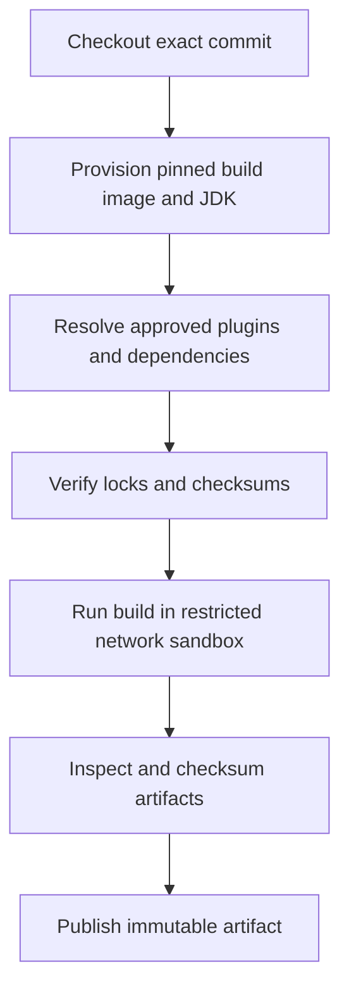

# Build cô lập (hermetic build) và kiểm soát đầu vào bên ngoài

Một dự án Java có thể build thành công trên máy lập trình viên nhưng thất bại trên CI, hoặc tạo artifact khác dù mã nguồn không đổi. Nguyên nhân có thể đến từ JDK khác phiên bản, dependency được cập nhật ngầm, plugin khác nguồn, biến môi trường khác nhau, file cục bộ còn sót, thời gian hệ thống, công cụ native hoặc dịch vụ mạng thay đổi.

**Hermetic build** (build cô lập) là cách tổ chức build sao cho kết quả chỉ phụ thuộc vào tập đầu vào đã được xác định và kiểm soát. Build không vô tình dựa vào trạng thái máy, dịch vụ bên ngoài hoặc dữ liệu không được khai báo. Khi cùng tập đầu vào và công cụ được sử dụng, build có thể tạo kết quả nhất quán và dễ tái lập hơn.

Với Gradle, để tiến gần tới một build hermetic, cần kiểm soát dependency, plugin, Gradle Wrapper, JDK/toolchain, cấu hình, biến môi trường, công cụ ngoài, file system và network access. Đồng thời, task cần khai báo đầy đủ input/output để Gradle hiểu dữ liệu nào ảnh hưởng kết quả.

## 1. Hermetic build là gì?

Một build được xem là hermetic khi quá trình tạo artifact chỉ đọc những đầu vào đã được xác định, không phụ thuộc ngầm vào trạng thái không được kiểm soát bên ngoài phạm vi build.

```text
Đầu vào đã kiểm soát
  ├── Source code và resources
  ├── Build scripts và plugin versions
  ├── Dependency versions và metadata
  ├── Gradle distribution và JDK/toolchain
  ├── Compiler options và task configuration
  ├── Environment values được khai báo
  └── Công cụ ngoài đã pin phiên bản
             |
             v
       Hermetic build
             |
             v
       Artifact đã xác định
```

Một build không hermetic có thể vô tình đọc:

- File cấu hình nằm trong thư mục home của developer.
- Dependency có version động vừa được cập nhật trên repository.
- Biến môi trường trên máy CI nhưng không được khai báo trong build.
- Thời gian hiện tại hoặc timezone của máy.
- Executable cài global có version khác nhau giữa các máy.
- Nội dung tải từ URL `latest` trong lúc chạy task.
- File output cũ còn nằm trong workspace.

Những yếu tố này có thể làm kết quả khác nhau mà người chạy không nhận ra nguyên nhân.

## 2. Phân biệt hermetic, deterministic và reproducible build

Ba thuật ngữ có liên quan nhưng mô tả các thuộc tính khác nhau.

| Khái niệm | Câu hỏi chính | Ý nghĩa |
|---|---|---|
| Hermetic build | Build có dùng đầu vào ngoài danh sách đã kiểm soát không? | Cô lập build khỏi trạng thái và dịch vụ không được khai báo |
| Deterministic build | Với cùng đầu vào, một lần chạy có luôn đưa ra cùng kết quả không? | Loại bỏ sự ngẫu nhiên hoặc phụ thuộc thời điểm trong hành vi build |
| Reproducible build | Người khác có thể build lại từ cùng đầu vào và nhận cùng output không? | Kết quả có thể tái tạo, thường hướng tới artifact giống byte-for-byte |

Build hermetic tạo điều kiện cho reproducibility, nhưng không tự động bảo đảm artifact giống hệt byte-for-byte. Ví dụ, task vẫn ghi timestamp hiện tại vào JAR dù dependency và toolchain đã được pin. Khi đó đầu vào đã kiểm soát nhưng output vẫn thay đổi theo thời gian.

Ngược lại, hai lần build trên cùng một máy có thể tình cờ tạo cùng output dù build vẫn phụ thuộc vào một file local không được khai báo. Kết quả giống nhau trong vài lần chạy chưa chứng minh build hermetic.

Trong thực tế, nên hướng tới cả ba thuộc tính: xác định và cô lập đầu vào; làm cho task có hành vi xác định với những đầu vào đó; kiểm tra môi trường khác có thể tái tạo artifact tương ứng.

## 3. Vì sao cần cô lập build?

Hermetic build hữu ích trong nhiều tình huống:

- **CI đáng tin cậy:** build không phụ thuộc phần mềm hoặc file riêng trên một runner cụ thể.
- **Tái lập lỗi:** có thể tạo lại điều kiện gây lỗi bằng cùng phiên bản dependency và toolchain.
- **Bảo mật chuỗi cung ứng:** giảm khả năng build bị thay đổi bởi dependency hoặc script tải ngầm từ nguồn không được kiểm soát.
- **Build cache chính xác:** cache chỉ an toàn khi các đầu vào ảnh hưởng output được mô tả đầy đủ.
- **Phát hành có thể truy vết:** biết artifact được tạo từ commit, dependency, plugin, JDK và cấu hình nào.
- **Phát triển nhóm:** máy developer và CI có môi trường gần nhau, giảm lỗi kiểu “máy tôi chạy được”.
- **Kiểm toán:** có thể giải thích nguồn gốc và cách tạo artifact.

Hermetic build đặc biệt quan trọng với thư viện, ứng dụng phát hành thường xuyên và hệ thống có yêu cầu tuân thủ. Những nguyên tắc cơ bản cũng hữu ích với project nhỏ: pin version, dùng Wrapper, khai báo task inputs và tránh đọc trạng thái máy tùy tiện.

## 4. Kiểm kê các đầu vào bên ngoài

Trước khi cô lập build, hãy liệt kê dữ liệu có thể ảnh hưởng kết quả. Với dự án Java/Gradle, có thể chia thành các nhóm:

| Nhóm đầu vào | Ví dụ | Cách kiểm soát |
|---|---|---|
| Build tool | Gradle distribution, plugin versions | Gradle Wrapper, version cố định, checksum |
| Java toolchain | JDK vendor, version, implementation | Java toolchain và môi trường toolchain được quản lý |
| Dependency | JAR, POM, Gradle Module Metadata | Version xác định, platform, locking, verification |
| Repository | Maven Central, kho nội bộ, Maven local | Repository allowlist, mirror, content filters |
| Environment | Biến môi trường, system/project properties | Cung cấp rõ ràng, khai báo task input khi ảnh hưởng output |
| File system | File trong home, working directory, file tạm | Chỉ đọc file được khai báo, dùng project/build directory |
| Network | HTTP API, URL `latest`, Git remote | Tải trước, pin dữ liệu, giới hạn network |
| Công cụ ngoài | Docker, protoc, Node, native compiler | Pin version, checksum/image digest và đường dẫn tool |
| Thời gian | Timestamp, timezone, ngày hiện tại | Cố định nguồn thời gian hoặc loại timestamp khỏi output |
| Hệ điều hành | Locale, encoding, line ending, permissions | Chuẩn hóa môi trường và cách xử lý file |
| Trạng thái cục bộ | Cache, output cũ, Maven local | Kiểm soát cache, workspace sạch, tránh nguồn không khai báo |

Một dữ liệu chỉ cần được đưa vào danh sách nếu nó thực sự ảnh hưởng cấu hình, task hoặc artifact. Khi task đọc dữ liệu bên ngoài, cần xác định dữ liệu đến từ đâu và có thể thay đổi giữa các lần chạy hay không.

## 5. Khóa phiên bản Gradle bằng Wrapper

Nếu mỗi developer cài một Gradle version khác nhau, hành vi build có thể khác do thay đổi trong Gradle, plugin API hoặc dependency resolution. Gradle Wrapper giúp project xác định distribution cần dùng.

Các file thường được commit:

```text
gradlew
gradlew.bat
gradle/wrapper/gradle-wrapper.jar
gradle/wrapper/gradle-wrapper.properties
```

Trong `gradle-wrapper.properties`:

```properties
distributionUrl=https\://services.gradle.org/distributions/gradle-8.10.2-bin.zip
# Add distributionSha256Sum with the official checksum for this distribution.
```

Version `8.10.2` chỉ là ví dụ. Project cần chọn phiên bản phù hợp với plugin và JDK được hỗ trợ. Khi có checksum chính thức của distribution, khai báo `distributionSha256Sum` giúp Wrapper xác minh file tải về.

Chạy build qua Wrapper:

```bash
./gradlew build
```

Trên Windows:

```powershell
.\gradlew.bat build
```

Wrapper không tự pin JDK, plugin hoặc dependency; đó là những đầu vào riêng cần được kiểm soát.

## 6. Khóa plugin và build logic

Plugin Gradle có thể thêm task, thay đổi dependency resolution hoặc tác động cách đóng gói. Nếu plugin không có version rõ ràng hoặc được lấy từ repository không ổn định, build có thể thay đổi theo thời gian.

Với plugin DSL, khai báo version cụ thể:

```kotlin
plugins {
    java
    id("org.springframework.boot") version "3.3.5"
}
```

Có thể quản lý version ở settings:

```kotlin
pluginManagement {
    repositories {
        gradlePluginPortal()
        mavenCentral()
    }
    plugins {
        id("org.springframework.boot") version "3.3.5"
    }
}
```

Nếu sử dụng convention plugin trong `build-logic` hoặc `buildSrc`, cần quản lý version dependency của chính build logic. Không để build logic phụ thuộc plugin version động hoặc một JAR chỉ tồn tại trên máy developer.

Included build cũng là đầu vào của build. Nếu plugin được phát triển từ source trong cùng workspace, cần kiểm soát commit của source build và dependency mà nó sử dụng.

## 7. Pin Java toolchain và compiler

Gradle Java toolchain giúp khai báo phiên bản Java cần dùng cho các task Java:

```kotlin
java {
    toolchain {
        languageVersion.set(JavaLanguageVersion.of(21))
        // Chỉ định vendor nếu chính sách yêu cầu.
        // vendor.set(JvmVendorSpec.ADOPTIUM)
    }
}
```

Toolchain giúp Gradle chọn JDK phù hợp cho compiler/test tasks. Để build nhất quán, cần quan tâm thêm:

- Vendor và implementation nếu chúng ảnh hưởng kết quả hoặc chính sách runtime.
- Nguồn cung cấp JDK trên CI và máy developer.
- Cách toolchain được cài đặt hoặc tải xuống.
- Phiên bản Java dùng để chạy Gradle, vì nó có thể khác toolchain dùng để compile.
- Compiler options như `--release`, encoding và lint flags.

Ví dụ:

```kotlin
tasks.withType<JavaCompile>().configureEach {
    options.encoding = "UTF-8"
    options.release.set(21)
}
```

`languageVersion` giúp chọn toolchain, còn `options.release` xác định API/language target mà compiler dùng để biên dịch. Hai thuộc tính có vai trò liên quan nhưng không giống nhau.

Nếu CI tự tải JDK, cần kiểm soát repository/toolchain resolver và version được tải. Nếu JDK đã được cài trong container image, hãy pin image bằng digest hoặc dùng image version bất biến.

## 8. Kiểm soát dependency và metadata

Dependency là một nguồn biến động phổ biến. Tránh version động trong build cần tái lập:

```groovy
// Không ổn định cho build phát hành
implementation 'com.example:client:1.+'
implementation 'com.example:client:latest.release'

// Phiên bản cụ thể
implementation 'com.example:client:1.4.2'
```

Version cụ thể giảm việc dependency được nâng ngầm theo thời gian. Với nhiều thư viện có quan hệ phiên bản, dùng BOM hoặc Gradle platform để quản lý đồng bộ:

```kotlin
dependencies {
    implementation(platform("org.springframework.boot:spring-boot-dependencies:3.3.5"))
    implementation("org.springframework.boot:spring-boot-starter-web")
}
```

Platform đưa constraints vào dependency graph. Nó không tự đảm bảo mọi artifact được giữ nguyên nếu không có lock hoặc policy tương ứng.

### Dependency locking

Dependency locking ghi lại version thực tế được chọn cho các configuration đã bật locking:

```kotlin
dependencyLocking {
    lockAllConfigurations()
}
```

Sau khi resolve các configuration cần thiết, có thể ghi lock state:

```bash
./gradlew build --write-locks
```

Lockfile được quản lý trong version control giúp lần resolve sau dùng lại version đã chốt theo chính sách. Khi nâng BOM hoặc dependency, review diff của lockfile như một phần thay đổi mã nguồn.

### Dependency verification

Gradle có thể kiểm tra checksum hoặc chữ ký của artifact theo metadata verification. Ví dụ tạo metadata checksum ban đầu:

```bash
./gradlew --write-verification-metadata sha256 help
```

File `gradle/verification-metadata.xml` được tạo/cập nhật cần được kiểm tra và commit. Không coi checksum tự thu thập từ một nguồn chưa xác minh là bằng chứng nguồn đó đáng tin; cần xác nhận artifact và checksum theo quy trình của tổ chức.

Locking trả lời “version nào đã được chọn?”, còn verification trả lời “artifact tải về có khớp metadata tin cậy không?”. Hai cơ chế bổ sung cho nhau.

## 9. Kiểm soát repository và tránh nguồn dependency ẩn

Một build có thể resolve dependency từ Maven Central, repository nội bộ, Maven local hoặc repository được thêm bởi plugin. Nếu mỗi máy dùng repository khác nhau, cùng tọa độ dependency có thể cho kết quả khác.

Trong multi-project build, có thể quản lý repository tập trung trong settings:

```kotlin
dependencyResolutionManagement {
    repositoriesMode.set(RepositoriesMode.FAIL_ON_PROJECT_REPOS)
    repositories {
        mavenCentral()
        maven {
            name = "companyMirror"
            url = uri("https://repo.example.com/repository/maven-public/")
        }
    }
}
```

Chọn repository có chủ đích và dùng content filters hoặc `exclusiveContent` để giới hạn namespace nội bộ. Tránh khai báo `mavenLocal()` trong build phát hành nếu không có lý do rõ ràng, vì Maven local repository là trạng thái riêng của từng máy và có thể chứa artifact chưa được publish chính thức.

Với dependency từ file local, đặt file trong repository hoặc một vị trí được kiểm soát và khai báo rõ:

```kotlin
dependencies {
    implementation(files("libs/vendor-client-1.4.2.jar"))
}
```

File local cần được quản lý trong version control hoặc cung cấp qua artifact store có version và checksum rõ ràng. Không tham chiếu đường dẫn tùy ý như `C:/Users/name/Desktop/client.jar`.

## 10. Offline mode: hữu ích nhưng chưa đủ để tạo hermetic build

Gradle hỗ trợ offline mode:

```bash
./gradlew build --offline
```

Ở chế độ này, Gradle chỉ sử dụng dependency đã có trong cache cục bộ; nếu thiếu artifact cần thiết, dependency resolution sẽ thất bại thay vì tải từ repository.

Offline mode hữu ích để kiểm tra build có thể resolve dependency từ dữ liệu đã cache hay không. Nhưng nó không tự chặn mọi network access trong build:

- Custom task có thể gọi HTTP client trực tiếp.
- Plugin có thể thực hiện network request trong code riêng.
- Script có thể chạy `curl`, `git fetch` hoặc công cụ ngoài.
- Process con có thể truy cập mạng mà Gradle không kiểm soát.

Vì vậy, offline mode là một lớp kiểm soát dependency resolution, không phải sandbox network hoàn chỉnh. Để kiểm tra hermeticity mạnh hơn, hãy chạy build trong container/VM hoặc sandbox có network policy chặn truy cập ngoài, sau khi dependency cần thiết đã được cung cấp.

## 11. Kiểm soát network và dữ liệu tải từ bên ngoài

Một task tải schema, OpenAPI document, package hoặc dữ liệu cấu hình từ URL trong lúc build làm kết quả phụ thuộc trạng thái dịch vụ từ xa.

Ví dụ thiết kế không ổn định:

```groovy
tasks.register('downloadSchema') {
    doLast {
        new URL('https://example.com/schema/latest.json').withInputStream { input ->
            file("$buildDir/schema.json").withOutputStream { output ->
                output << input
            }
        }
    }
}
```

URL `latest` có thể trả nội dung khác ở lần build tiếp theo. Task cũng không khai báo remote content là input; Gradle khó biết khi nào output cần cập nhật hoặc cache còn hợp lệ.

Các cách cải thiện:

- Lấy dữ liệu trước build và đưa vào source-controlled input hoặc artifact repository có version.
- Pin version hoặc commit/hash của dữ liệu từ xa.
- Kiểm tra checksum/signature trước khi sử dụng.
- Tách bước fetch có kiểm soát khỏi bước compile/package.
- Đưa file đã tải vào task qua `@InputFile` hoặc `@InputFiles`.
- Chặn network trong giai đoạn build chính để phát hiện truy cập ngoài không được khai báo.

Nếu bắt buộc phải tải dữ liệu, hãy coi quá trình tải là một bước riêng có nguồn, version, checksum, timeout và policy rõ ràng. Không để compiler task hoặc task đóng gói tự truy cập Internet.

## 12. Khai báo biến môi trường và project property thành task input

Biến môi trường là đầu vào bên ngoài nếu task đọc giá trị đó và dùng để tạo output. Nếu task lấy `BUILD_LABEL` nhưng không khai báo giá trị là input, Gradle có thể đánh giá output vẫn hợp lệ dù biến môi trường đã thay đổi.

Ví dụ custom task với input tường minh:

```kotlin
abstract class GenerateBuildInfo : DefaultTask() {
    @get:Input
    abstract val buildLabel: Property<String>

    @get:OutputFile
    abstract val outputFile: RegularFileProperty

    @TaskAction
    fun generate() {
        val output = outputFile.get().asFile
        output.parentFile.mkdirs()
        output.writeText("buildLabel=" + buildLabel.get() + "\n")
    }
}

tasks.register<GenerateBuildInfo>("generateBuildInfo") {
    buildLabel.convention(
        providers.environmentVariable("BUILD_LABEL").orElse("local")
    )
    outputFile.set(layout.buildDirectory.file("generated/build-info.properties"))
}
```

`buildLabel` được đánh dấu `@Input`, nên giá trị lấy từ environment provider tham gia kiểm tra trạng thái task. Khi `BUILD_LABEL` đổi, Gradle có thể nhận ra input thay đổi và thực hiện lại task.

Nếu giá trị đến từ project property:

```bash
./gradlew generateBuildInfo -PbuildLabel=release-2026-11
```

Có thể nối provider tương ứng vào property của task. Tránh đọc `System.getenv()` tùy tiện bên trong `@TaskAction` mà không mô tả nó trong input property.

### Phân biệt cấu hình build và task input

Một biến môi trường có thể được đọc trong configuration phase để quyết định task nào được đăng ký, hoặc được đọc trong task action để tạo output. Hai trường hợp cần được xử lý theo đúng API Gradle và yêu cầu configuration cache.

Ưu tiên Provider API để lấy giá trị, truyền giá trị qua property có kiểu và tránh đọc global process state tùy tiện. Nếu một giá trị thay đổi task graph, nó là một phần của cấu hình build; nếu nó chỉ thay đổi output của task, khai báo nó là task input.

Không đưa secret vào file output hoặc log. Credentials dùng để xác thực thường không nên ảnh hưởng nội dung artifact; nếu task cần secret để truy cập dịch vụ, hãy cấp qua secret store và tránh cache hoặc ghi lại giá trị đó.

## 13. Kiểm soát file system và working directory

Build có thể vô tình phụ thuộc vào file nằm ngoài repository:

```groovy
tasks.register('readLocalConfig') {
    doLast {
        def config = new File(System.getProperty('user.home'), '.app/config.yml')
        println config.text
    }
}
```

Task này đọc file khác nhau trên mỗi máy. File đó không được khai báo là input, nên build không thể tái lập chỉ từ repository.

Thay vào đó, đặt file cấu hình cần thiết trong project hoặc cung cấp qua property/input được xác định rõ:

```kotlin
abstract class ValidateConfig : DefaultTask() {
    @get:InputFile
    abstract val configFile: RegularFileProperty

    @TaskAction
    fun validate() {
        val config = configFile.get().asFile
        check(config.isFile) { "Configuration file is missing: " + config }
    }
}

tasks.register<ValidateConfig>("validateConfig") {
    configFile.set(layout.projectDirectory.file("config/build.yml"))
}
```

Dùng `layout.projectDirectory`, `layout.buildDirectory` và Provider API để biểu diễn đường dẫn theo project thay vì ghép chuỗi tuyệt đối phụ thuộc máy. Tránh ghi output ra thư mục home, working directory hoặc thư mục dùng chung không được task sở hữu.

Đường dẫn tuyệt đối có thể xuất hiện trong log hoặc metadata nếu tool ghi chúng vào artifact. Với mục tiêu reproducible build, tránh nhúng đường dẫn workspace cụ thể vào output hoặc dùng cơ chế path normalization của công cụ.

## 14. Kiểm soát thời gian, locale, encoding và thứ tự file

Một build có thể phụ thuộc vào thời gian hiện tại mà không nhận ra:

```java
String generatedAt = java.time.Instant.now().toString();
```

Nếu giá trị này được ghi vào generated source hoặc resource, hai lần build cùng commit sẽ tạo output khác nhau. Những yếu tố khác cũng có thể gây khác biệt:

- Timezone hệ thống.
- Locale ảnh hưởng định dạng số/ngày hoặc sắp xếp chuỗi.
- Default charset của JVM.
- Line endings của file.
- Thứ tự duyệt file từ filesystem.
- Timestamp và metadata trong archive.
- Quyền file hoặc owner được ghi vào package.

Một số cách kiểm soát:

```kotlin
tasks.withType<JavaCompile>().configureEach {
    options.encoding = "UTF-8"
}
```

Sắp xếp danh sách file trước khi tạo output:

```kotlin
val sourceNames = fileTree("src/main/java")
    .files
    .map { it.relativeTo(projectDir).invariantSeparatorsPath }
    .sorted()
```

Với archive task, Gradle cung cấp thuộc tính hỗ trợ output có thứ tự và timestamp ổn định:

```groovy
tasks.withType(AbstractArchiveTask).configureEach {
    preserveFileTimestamps = false
    reproducibleFileOrder = true
}
```

Kiểm tra Gradle version và loại archive task đang dùng; các thuộc tính này kiểm soát metadata/order của archive nhưng không loại bỏ mọi nguồn không xác định trong file bên trong.

Nếu cần timestamp trong artifact, dùng giá trị được kiểm soát như build metadata đã cung cấp rõ ràng, hoặc cơ chế `SOURCE_DATE_EPOCH` khi tool đang sử dụng hỗ trợ. Không giả định mọi plugin tự hiểu biến này.

## 15. Kiểm soát công cụ ngoài và process con

Task có thể gọi `docker`, `protoc`, `node`, `npm`, `git`, compiler native hoặc shell script. Nếu chỉ dựa vào tên executable trong `PATH`, máy khác có thể chạy một phiên bản khác.

Ví dụ rủi ro:

```groovy
tasks.register('generateProto', Exec) {
    commandLine 'protoc', '--java_out=build/generated', 'src/main/proto/api.proto'
}
```

Lệnh trên phụ thuộc executable `protoc` nào xuất hiện đầu tiên trong `PATH`. Phiên bản có thể khác giữa developer và CI.

Để kiểm soát:

- Dùng plugin hoặc toolchain chuyên dụng có version xác định nếu có.
- Pin version của tool và nguồn phân phối.
- Xác minh checksum của binary hoặc container image.
- Đưa executable vào môi trường build đã pin, ví dụ container image theo digest.
- Khai báo binary, input files, options và output directories của task.
- Tránh gọi `git describe` hoặc đọc trạng thái working tree nếu giá trị đó không được đưa vào build metadata một cách tường minh.

`Exec` task phù hợp cho một số thao tác đơn giản, nhưng với task quan trọng cần cân nhắc custom task type có property input/output đầy đủ. Gradle cần biết cả phiên bản tool và dữ liệu mà tool đọc để đánh giá output đúng.

## 16. Container và sandbox cho build

Container image có thể cung cấp môi trường thống nhất: hệ điều hành, JDK, công cụ native và một số thiết lập. Ví dụ CI có thể chạy build trong image đã pin:

```text
registry.example.com/build/java21-gradle:2026.11@sha256:<image-digest>
```

Dùng digest giúp tham chiếu nội dung image cụ thể; tag như `latest` có thể trỏ tới image khác theo thời gian. Image cần được build, scan và quản lý version như một đầu vào của build.

Container một mình chưa chắc tạo ra hermetic build. Container vẫn có thể:

- Truy cập Internet và tải dependency mới.
- Mount thư mục host chứa file không được kiểm soát.
- Đọc biến môi trường khác nhau từ runner.
- Dùng volume cache có trạng thái cũ.
- Gọi dịch vụ ngoài qua network.
- Ghi output phụ thuộc thời gian hoặc thứ tự file.

Sandbox chặt hơn còn kiểm soát filesystem mount, network access, environment variables, process permissions và toolchain. Trong giai đoạn build chính, có thể cho phép đọc source, toolchain và dependency cache đã chuẩn bị, đồng thời chặn network hoặc truy cập thư mục host không cần thiết.

### Chuẩn bị dependency trước khi chạy sandbox offline

Một quy trình thường dùng:

1. Resolve và tải dependency/plugin cần thiết trong bước chuẩn bị có kiểm soát.
2. Lưu dependency cache hoặc mirror đã xác minh.
3. Khởi chạy build trong môi trường có network access bị giới hạn.
4. Chạy Gradle với `--offline` để dependency resolution không truy cập repository.
5. Kiểm tra task/plugin/custom scripts không tạo network request ngoài cơ chế dependency resolution.

Nếu dependency chưa có trong cache, build offline sẽ thất bại. Đó là tín hiệu đầu vào chưa được chuẩn bị đầy đủ, không phải lý do để âm thầm bật lại network trong bước build phát hành.

## 17. Build cache và hermeticity

Gradle build cache lưu output của task để tái sử dụng khi task có cùng input theo cache key. Điều này tăng tốc build, nhưng cache chỉ đáng tin khi task khai báo đủ input/output và action tạo kết quả xác định.

Ví dụ task có lỗi vì đọc đầu vào ẩn:

```kotlin
abstract class GenerateVersionFile : DefaultTask() {
    @get:OutputFile
    abstract val outputFile: RegularFileProperty

    @TaskAction
    fun generate() {
        // Không tốt: giá trị này chưa được khai báo là input.
        val version = System.getenv("APP_VERSION") ?: "local"
        outputFile.get().asFile.writeText("version=" + version + "\n")
    }
}
```

Nếu `APP_VERSION` đổi nhưng Gradle không biết đó là input, task có thể bị coi là `UP-TO-DATE` hoặc output cache được tái sử dụng không phù hợp.

Sửa bằng cách chuyển giá trị thành property `@Input` như ví dụ ở phần trước. Khi task input được khai báo đầy đủ, Gradle có thể tính trạng thái/cache key dựa trên dữ liệu đó.

Hermeticity và build cache không đồng nghĩa:

- Hermeticity kiểm soát nguồn dữ liệu mà build được phép sử dụng.
- Build cache tái sử dụng output dựa trên input đã khai báo.
- Task không hermetic có thể làm cache trả output sai nếu input ẩn không nằm trong cache key.
- Tắt cache không làm task tự trở nên hermetic; nó chỉ buộc thực thi action thay vì tái sử dụng output cache.

Với remote build cache, chỉ dùng cache server có quyền truy cập và nguồn gốc đáng tin cậy. Output được cache có thể trở thành đầu vào của build khác, vì vậy cần kiểm soát ai có quyền ghi và đọc cache.

## 18. Configuration cache và tính cô lập

Gradle Configuration Cache lưu kết quả cấu hình build để lần chạy sau có thể bỏ qua một phần configuration phase. Nó không phải dependency cache hoặc build cache.

Configuration cache hoạt động tốt hơn khi build logic dùng Provider API, tránh truy cập global state tùy tiện và không giữ các đối tượng Gradle không được hỗ trợ trong task action. Ví dụ, truyền giá trị qua task property thay vì để task action truy cập trực tiếp `Project` hoặc đọc environment rải rác.

Có thể thử kiểm tra:

```bash
./gradlew build --configuration-cache
```

Nếu build logic không tương thích, Gradle có thể báo những vị trí cần sửa. Configuration cache giúp kiểm soát và tăng tốc configuration; bật nó không chứng minh build hermetic hoặc reproducible.

Cũng cần phân biệt hermetic build với Gradle Isolated Projects. Isolated Projects liên quan tới cô lập cấu hình giữa các project trong multi-project build và khả năng cấu hình song song; nó không thay thế việc pin dependency, toolchain, environment hoặc chặn network.

## 19. Kiểm chứng build có thực sự cô lập

Không thể kết luận build hermetic chỉ bằng cách đọc một file build script. Cần thử build trong môi trường sạch và quan sát các nguồn đầu vào.

### Mức 1: môi trường mới

- Dùng checkout sạch của commit cần kiểm tra.
- Dùng Gradle Wrapper và JDK/toolchain đã xác định.
- Không dùng Maven local hoặc file riêng trong home.
- Không restore build output cũ không được kiểm soát.

### Mức 2: offline dependency resolution

```bash
./gradlew clean build --offline
```

Lệnh này xác nhận dependency cần thiết có sẵn trong cache và Gradle không cần truy cập repository trong quá trình resolve. Nó chưa chứng minh custom task hoặc process con không truy cập mạng.

### Mức 3: sandbox/network restriction

Chạy build trong container hoặc runner không có quyền truy cập Internet, chỉ mount các thư mục cần thiết. Nếu build thất bại vì cố tải dữ liệu hoặc đọc file host, đó là dấu hiệu có input bên ngoài chưa được kiểm soát.

### Mức 4: build hai lần từ môi trường độc lập

Tạo hai workspace sạch, cùng commit và cùng bộ tool/dependency. So sánh artifact:

```bash
sha256sum build/libs/application.jar
```

Nếu checksum khác, điều tra timestamp, thứ tự entry, generated metadata, đường dẫn tuyệt đối, compiler/tool version hoặc dữ liệu môi trường. Nếu checksum giống nhau, đó là bằng chứng tốt hơn về reproducibility trong điều kiện đã thử, nhưng không chứng minh mọi môi trường và mọi input đều đã được kiểm soát.

### Mức 5: kiểm tra nguồn gốc

Lưu lại commit, Gradle version, JDK vendor/version, plugin versions, lockfiles, verification metadata, container digest và checksum artifact. Thông tin này giúp người khác tái tạo và kiểm tra nguồn gốc build.

## 20. Ví dụ cấu hình một build Java có đầu vào rõ ràng

Ví dụ dưới đây kết hợp một số cơ chế thường dùng. Version cụ thể cần được chọn theo compatibility matrix của project.

```kotlin
plugins {
    java
}

repositories {
    mavenCentral()
}

java {
    toolchain {
        languageVersion.set(JavaLanguageVersion.of(21))
    }
}

dependencyLocking {
    lockAllConfigurations()
}

dependencies {
    testImplementation("org.junit.jupiter:junit-jupiter:5.10.2")
}

tasks.withType<JavaCompile>().configureEach {
    options.encoding = "UTF-8"
    options.release.set(21)
}

tasks.withType<Test>().configureEach {
    useJUnitPlatform()
}

tasks.withType<AbstractArchiveTask>().configureEach {
    isPreserveFileTimestamps = false
    isReproducibleFileOrder = true
}
```

Cùng với cấu hình này, project cần:

- Commit Gradle Wrapper và khai báo checksum distribution phù hợp.
- Pin plugin version nếu dùng plugin bên ngoài.
- Tạo, review và commit dependency lockfiles.
- Tạo và review dependency verification metadata.
- Cấp JDK 21 từ nguồn toolchain được kiểm soát.
- Tránh task đọc file ngoài repository hoặc tải dữ liệu `latest`.
- Khai báo input/output cho custom task.
- Chạy build trong môi trường CI được pin và giới hạn network.

Một đoạn build script tốt là một phần của hermetic build; môi trường và cách pipeline thực thi cũng cần được kiểm soát.

## 21. Thiết kế quy trình CI cho build cô lập

Một pipeline có thể chia thành các giai đoạn:



Một số nguyên tắc:

1. **Checkout commit xác định:** không build từ branch có thể thay đổi giữa các bước.
2. **Pin môi trường:** dùng image digest, Wrapper, JDK/toolchain và tool versions xác định.
3. **Resolve từ nguồn được duyệt:** dùng repository mirror và dependency verification.
4. **Không cập nhật dependency ngầm:** tránh dynamic version hoặc snapshot trong build phát hành nếu chưa có quy trình kiểm soát.
5. **Giới hạn network:** sau khi chuẩn bị đầu vào, chặn network trong bước compile/package nếu quy trình cho phép.
6. **Không tái sử dụng workspace không kiểm soát:** cache chỉ giữ dữ liệu có cơ chế key và ownership rõ.
7. **Kiểm tra artifact:** tạo checksum, metadata build và kiểm tra nội dung cần thiết.
8. **Publish artifact bất biến:** không ghi đè release version đã công bố.

Nếu CI cần upload kết quả, publish nên là bước tách biệt có credentials tối thiểu. Credentials không nên được cấp cho task compile/test không cần quyền ghi repository.

## 22. Chẩn đoán khi build local và CI khác nhau

Khi cùng commit nhưng hai môi trường tạo kết quả khác, hãy so sánh đầu vào theo nhóm:

| Dấu hiệu | Đầu vào cần kiểm tra |
|---|---|
| Compile error chỉ trên CI | JDK/toolchain, compiler options, environment, dependency resolution |
| Test pass local nhưng fail CI | Timezone, locale, service ngoài, port, dữ liệu test và thứ tự thực thi |
| Artifact khác checksum | Timestamp, archive ordering, generated metadata, compiler/tool versions, absolute paths |
| Dependency khác version | Lockfiles, dynamic versions, repository order, metadata cache, platform/constraints |
| Task `UP-TO-DATE` dù output đáng lẽ đổi | Task input khai báo thiếu, file/environment input bị ẩn |
| Build offline thất bại | Dependency/plugin/tool chưa được cache hoặc task đang tải dữ liệu ngoài |
| Build chỉ chạy được trên máy developer | File trong home, Maven local, executable trong PATH hoặc credentials riêng |
| Build cache trả output không đúng | Task input/output không đầy đủ hoặc cache server không đáng tin |
| Plugin resolution khác nhau | Plugin versions, plugin repositories và settings configuration |

Các lệnh hỗ trợ:

```bash
./gradlew --version
./gradlew dependencies --configuration runtimeClasspath
./gradlew dependencyInsight --dependency some-library --configuration runtimeClasspath
./gradlew build --offline --info
./gradlew build --configuration-cache
```

Đừng vội xóa mọi cache khi gặp khác biệt. Trước tiên ghi lại version và graph đang được resolve; xóa cache có thể làm biến mất bằng chứng về trạng thái đã gây lỗi. Sau đó mới thử clean hoặc chạy trong workspace mới để phân biệt output cũ với input không ổn định.

## 23. Các mức độ cô lập và cách triển khai thực tế

Không phải mọi dự án đều cần sandbox nghiêm ngặt ngay từ đầu. Có thể nâng mức kiểm soát theo nhu cầu:

| Mức | Thực hành | Giá trị mang lại |
|---|---|---|
| Cơ bản | Wrapper, version cụ thể, toolchain, encoding | Giảm khác biệt giữa máy |
| Có kiểm soát dependency | Platform/BOM, locking, verification, repository policy | Dependency graph và artifact rõ nguồn |
| Task-aware | Khai báo đầy đủ input/output, bỏ file/env ẩn | Incremental build và cache chính xác hơn |
| Môi trường cố định | Container image digest, tool versions, workspace sạch | Giảm khác biệt môi trường |
| Network-restricted | Chuẩn bị dependency trước, build offline trong sandbox | Phát hiện và ngăn truy cập mạng ngoài dự kiến |
| Reproducibility verification | Build độc lập hai lần, so checksum và provenance | Có bằng chứng artifact tái tạo được |

Có thể bắt đầu bằng những thay đổi ít tốn công nhưng có tác động lớn: commit Wrapper, pin plugin/dependency, dùng Java toolchain, khai báo task input/output và loại `mavenLocal()` khỏi build phát hành. Sau đó mới bổ sung container digest, network sandbox và kiểm chứng byte-for-byte.

## 24. Những nhầm lẫn thường gặp

| Nhầm lẫn | Cách hiểu chính xác |
|---|---|
| Dùng Gradle Wrapper là build đã hermetic | Wrapper chỉ pin Gradle distribution; JDK, plugin, dependency, environment và network vẫn cần kiểm soát. |
| Chạy `--offline` là chặn toàn bộ network | Offline mode ảnh hưởng dependency resolution của Gradle; custom task và process con vẫn có thể truy cập mạng. |
| Dùng container là đủ | Container vẫn có thể dùng network, mount file host và nhận environment thay đổi. |
| Pin dependency version bảo đảm artifact không đổi | Cùng version có thể bị thay nội dung ở repository không tuân thủ immutability; cần verification và nguồn tin cậy. |
| Dependency locking thay thế dependency verification | Locking chốt version được chọn; verification kiểm tra nội dung artifact. |
| Build cache làm build hermetic | Cache dựa vào input khai báo; input ẩn có thể khiến cache trả output sai. |
| `clean` làm mọi đầu vào trở nên xác định | Clean xóa build output; nó không pin toolchain, dependency hoặc network data. |
| Hai checksum giống nhau chứng minh build luôn reproducible | Chỉ chứng minh hai artifact trong hai lần thử cụ thể giống byte; cần xác định phạm vi môi trường và đầu vào đã thử. |
| Cùng source commit luôn tạo cùng output | Plugin, dependency, JDK, environment, timestamp và công cụ ngoài có thể khác. |
| Mọi biến môi trường đều cần đưa vào mọi task | Chỉ giá trị thực sự ảnh hưởng cấu hình hoặc output mới cần khai báo ở phạm vi tương ứng. |

## 25. Quy trình xây dựng hermetic build cho một dự án Java

Có thể triển khai theo thứ tự sau:

1. **Lập danh sách đầu vào:** source, resources, settings/build scripts, plugin, dependency, toolchain, environment, file system, network và tool ngoài.
2. **Pin build tool:** commit Wrapper, cố định Gradle version và xác minh distribution checksum.
3. **Pin plugin và JDK:** dùng plugin version rõ ràng, Java toolchain và nguồn cung cấp toolchain được kiểm soát.
4. **Ổn định dependency:** dùng version cụ thể, platform/BOM, dependency locking và verification metadata.
5. **Giới hạn repository:** dùng nguồn được duyệt, mirror nội bộ, content filters và tránh dependency từ local machine.
6. **Khai báo task input/output:** mọi file, property, environment value và tool ảnh hưởng output phải được mô tả.
7. **Loại bỏ network ẩn:** tải dữ liệu trước, pin version/hash và không gọi URL `latest` trong task build chính.
8. **Chuẩn hóa môi trường:** encoding, locale, timezone, filesystem path, container image và công cụ native.
9. **Kiểm soát output:** archive order/timestamps, generated files, workspace và staging directory.
10. **Thử offline và sandbox:** chạy build với dependency đã chuẩn bị và network policy giới hạn.
11. **So sánh artifact độc lập:** build từ hai workspace sạch và so checksum.
12. **Ghi provenance:** lưu commit, toolchain, dependency locks, verification metadata, image digest và artifact checksum.

Không cần giải quyết tất cả trong một lần. Hãy bắt đầu từ nguồn đầu vào gây khác biệt thực tế nhất, sau đó mở rộng phạm vi kiểm soát.

## 26. Nguyên tắc cần ghi nhớ

Hermetic build bảo đảm quá trình build chỉ sử dụng những đầu vào đã xác định và kiểm soát. Muốn đạt điều đó, cần pin Gradle Wrapper, plugin, JDK/toolchain, dependency và công cụ ngoài; quản lý repository và credentials; khai báo rõ file, property và environment values mà task đọc; loại bỏ network request và trạng thái máy không được kiểm soát.

`--offline`, container, dependency locking, verification và build cache là các công cụ hỗ trợ những phần khác nhau. Không công cụ đơn lẻ nào tự làm build hermetic. Build cache chỉ đáng tin khi task inputs đầy đủ; offline mode không chặn process con; container vẫn có thể nhận dữ liệu ngoài; clean không sửa đầu vào động. Khi build chạy trong môi trường giới hạn, từ tập đầu vào đã pin và có thể tái tạo, nhóm có cơ sở tốt hơn để tạo artifact ổn định, truy vết được và kiểm chứng reproducibility.
