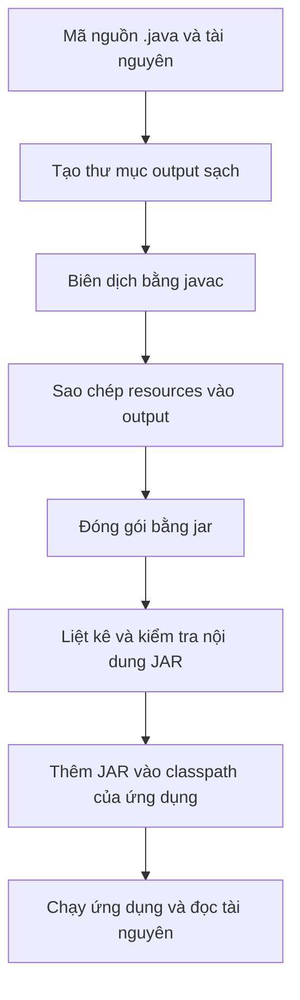

# Sao chép tài nguyên và đóng gói một thư viện JAR đơn giản

Một chương trình Java thường có nhiều thành phần ngoài mã nguồn `.java`: tệp cấu hình, mẫu nội dung, hình ảnh, dữ liệu mẫu hoặc các tệp cần được đọc khi chạy. Những tệp này được gọi chung là **tài nguyên (resources)**. Khi biên dịch và đóng gói một thư viện Java, ta cần đưa cả lớp đã biên dịch lẫn tài nguyên vào đúng vị trí để ứng dụng sử dụng thư viện có thể tìm thấy chúng.

Bài học này thực hiện quy trình bằng các công cụ có sẵn trong JDK: biên dịch mã nguồn, sao chép tài nguyên vào thư mục đầu ra, tạo JAR và kiểm tra JAR. Qua ví dụ, bạn sẽ hiểu cấu trúc thư mục, đường dẫn tài nguyên trên classpath và cách một dự án khác sử dụng thư viện vừa tạo.

## 1. Tài nguyên trong dự án Java là gì?

Mã nguồn Java được viết trong các tệp `.java`. Khi biên dịch, `javac` chuyển mã nguồn thành bytecode và lưu trong các tệp `.class`. Tuy nhiên, chương trình có thể cần đọc thêm nhiều loại tệp khác trong lúc chạy, chẳng hạn:

- `.properties`: cấu hình hoặc thông điệp.
- `.json`, `.xml`: dữ liệu hoặc cấu hình có cấu trúc.
- `.txt`, `.html`: văn bản, mẫu nội dung.
- `.png`, `.jpg`, `.svg`: hình ảnh.
- Các tệp dữ liệu nhị phân hoặc mẫu khác.

Những tệp này không phải mã nguồn Java nên `javac` không tự biên dịch chúng thành `.class`. Nếu chương trình cần sử dụng chúng, ta phải bảo đảm chúng được đặt ở vị trí mà ứng dụng có thể tìm thấy khi chạy.

Một cấu trúc thư mục phổ biến của dự án Java là:

```text
greeting-library/
├── src/
│   └── main/
│       ├── java/
│       │   └── com/
│       │       └── example/
│       │           └── greeting/
│       │               └── Greeter.java
│       └── resources/
│           └── com/
│               └── example/
│                   └── greeting/
│                       └── messages.properties
└── build/
```

Đây là quy ước thư mục thường dùng trong các dự án Java, trong đó:

- `src/main/java` chứa mã nguồn Java.
- `src/main/resources` chứa tài nguyên cần có trên classpath khi chạy.
- `build` là thư mục đầu ra do ta tạo để chứa kết quả biên dịch và JAR.

JDK không bắt buộc dự án phải có đúng cấu trúc này. Khi tự build thủ công, ta có thể chọn cấu trúc khác, miễn là các lệnh biên dịch, sao chép và đóng gói sử dụng đúng đường dẫn. Maven và Gradle thường nhận biết các thư mục theo quy ước này khi dùng cấu hình mặc định.

## 2. Vì sao phải sao chép tài nguyên vào thư mục đầu ra?

Giả sử ta biên dịch `Greeter.java` vào `build/classes`:

```bash
javac -d build/classes src/main/java/com/example/greeting/Greeter.java
```

Sau lệnh này, thư mục đầu ra có thể chứa:

```text
build/
└── classes/
    └── com/
        └── example/
            └── greeting/
                └── Greeter.class
```

Tệp `messages.properties` vẫn nằm trong `src/main/resources`, bởi `javac` chỉ xử lý mã nguồn được đưa vào lệnh. Nếu ta tạo JAR chỉ từ `build/classes`, tài nguyên sẽ không có trong JAR.

Vì vậy, quy trình thủ công cần thêm bước sao chép nội dung của thư mục resources vào thư mục đầu ra. Sau khi sao chép, cấu trúc cần có là:

```text
build/
└── classes/
    └── com/
        └── example/
            └── greeting/
                ├── Greeter.class
                └── messages.properties
```

Hãy chú ý vị trí tương đối của tệp. Tài nguyên nằm trong `com/example/greeting` vì lớp `Greeter` thuộc package `com.example.greeting` và ví dụ sẽ tải tài nguyên theo đường dẫn tương đối với package đó.

Nguyên tắc quan trọng là: **cấu trúc đường dẫn của tài nguyên bên trong thư mục đầu ra phải khớp với cách mã Java tìm tài nguyên**. Chỉ cần sao chép tệp vào sai cấp thư mục, ứng dụng có thể không tìm thấy tệp dù tệp vẫn tồn tại trên máy.

## 3. Tạo thư viện Java có sử dụng tài nguyên

Ta sẽ tạo một thư viện nhỏ có tên `greeting-library`. Thư viện cung cấp lớp `Greeter` với phương thức tạo lời chào. Nội dung mẫu của lời chào được đọc từ tệp `messages.properties`, thay vì viết cố định trong mã nguồn.

### 3.1. Viết lớp Greeter

Tạo tệp `src/main/java/com/example/greeting/Greeter.java`:

```java
package com.example.greeting;

import java.io.IOException;
import java.io.InputStream;
import java.io.InputStreamReader;
import java.io.Reader;
import java.io.UncheckedIOException;
import java.nio.charset.StandardCharsets;
import java.text.MessageFormat;
import java.util.Properties;

public final class Greeter {

    private Greeter() {
    }

    public static String greet(String name) {
        Properties messages = new Properties();

        try (InputStream input =
                     Greeter.class.getResourceAsStream("messages.properties")) {

            if (input == null) {
                throw new IllegalStateException(
                    "Cannot find messages.properties"
                );
            }

            try (Reader reader =
                         new InputStreamReader(input, StandardCharsets.UTF_8)) {
                messages.load(reader);
            }
        } catch (IOException exception) {
            throw new UncheckedIOException(
                "Cannot read greeting messages",
                exception
            );
        }

        String pattern = messages.getProperty("greeting", "Hello, {0}!");
        return MessageFormat.format(pattern, name);
    }
}
```

Lớp này dùng `Greeter.class.getResourceAsStream("messages.properties")` để mở tài nguyên. Vì đường dẫn không bắt đầu bằng dấu `/`, Java tìm tệp tương đối với package của lớp `Greeter`. Do đó, đường dẫn tài nguyên tương ứng là:

```text
com/example/greeting/messages.properties
```

Phương thức trả về `null` nếu không tìm thấy tài nguyên. Vì thế, ví dụ kiểm tra `input == null` và báo lỗi rõ ràng thay vì tiếp tục đọc một luồng không tồn tại.

Tệp được đọc bằng `InputStreamReader` với `StandardCharsets.UTF_8`. Cách này giúp ta chủ động quy định encoding của nội dung văn bản. `Properties.load(InputStream)` có quy tắc encoding riêng dựa trên ISO-8859-1; dùng overload nhận `Reader` giúp ví dụ đọc văn bản UTF-8 một cách tường minh.

### 3.2. Tạo tệp tài nguyên

Tạo tệp `src/main/resources/com/example/greeting/messages.properties`:

```properties
greeting=Hello, {0}!
```

Trong đó:

- `greeting` là tên thuộc tính.
- `Hello, {0}!` là mẫu thông điệp.
- `{0}` là vị trí được `MessageFormat` thay bằng tham số đầu tiên.

Khi gọi `Greeter.greet("Linh")`, kết quả sẽ là `Hello, Linh!`.

Ta đặt tài nguyên trong cùng cấu trúc package với lớp sử dụng nó. Cách tổ chức này giúp tên tài nguyên dễ hiểu và tránh nhầm lẫn khi dự án có nhiều tệp cùng tên.

## 4. Sao chép tài nguyên và biên dịch mã nguồn

Bây giờ ta cần chuẩn bị thư mục đầu ra sạch, biên dịch lớp Java và sao chép tài nguyên vào đúng vị trí.

### 4.1. Trên macOS hoặc Linux

Từ thư mục gốc `greeting-library`, chạy:

```bash
rm -rf build/classes
mkdir -p build/classes

javac -d build/classes \
  src/main/java/com/example/greeting/Greeter.java

cp -R src/main/resources/. build/classes/
```

Giải thích:

- `rm -rf build/classes` xóa kết quả cũ để tránh tài nguyên hoặc lớp cũ còn sót lại.
- `mkdir -p build/classes` tạo thư mục đầu ra.
- `javac -d build/classes ...` biên dịch lớp và giữ cấu trúc package bên dưới thư mục đầu ra.
- `cp -R src/main/resources/. build/classes/` sao chép toàn bộ nội dung của thư mục resources, bao gồm các thư mục con, vào thư mục đầu ra.

Dấu `.` ở cuối đường dẫn nguồn có ý nghĩa sao chép nội dung bên trong `resources`. Kết quả là thư mục `com` được đặt trực tiếp dưới `build/classes`.

### 4.2. Trên Windows PowerShell

Nếu đang dùng PowerShell, có thể chạy các lệnh tương đương:

```powershell
Remove-Item build/classes -Recurse -Force -ErrorAction SilentlyContinue
New-Item -ItemType Directory -Force -Path build/classes | Out-Null

javac -d build/classes src/main/java/com/example/greeting/Greeter.java

Copy-Item -Path src/main/resources/* -Destination build/classes -Recurse -Force
```

Lệnh `Copy-Item` sao chép các tệp và thư mục con trong resources vào thư mục đầu ra. Nếu dự án có các tệp ẩn hoặc cách tổ chức tài nguyên đặc biệt, cần kiểm tra rằng tất cả đầu vào cần thiết đều đã được sao chép.

Sau các bước này, hãy kiểm tra cấu trúc thư mục. Cả `Greeter.class` và `messages.properties` phải nằm dưới:

```text
build/classes/com/example/greeting/
```

Không đặt toàn bộ thư mục `resources` vào bên trong `build/classes`, vì khi đó đường dẫn trong classpath sẽ trở thành `resources/com/example/greeting/messages.properties`, khác với đường dẫn mà lớp `Greeter` đang tìm.

## 5. Đóng gói thành một thư viện JAR

**JAR (Java Archive)** là định dạng tệp lưu trữ dùng để gom các lớp Java, tài nguyên và metadata vào một tệp. Về cấu trúc, JAR dựa trên định dạng ZIP và có thể được Java sử dụng như một mục trên classpath.

Sau khi đã có các tệp trong `build/classes`, chạy lệnh sau từ thư mục gốc dự án:

```bash
jar --create --file build/greeting-library.jar -C build/classes .
```

Ý nghĩa các thành phần:

- `jar` gọi công cụ đóng gói đi kèm JDK.
- `--create` yêu cầu tạo một JAR mới.
- `--file build/greeting-library.jar` chỉ định đường dẫn và tên tệp đầu ra.
- `-C build/classes` yêu cầu công cụ chuyển vào thư mục `build/classes` trước khi lấy các tệp.
- `.` chọn toàn bộ nội dung của thư mục hiện tại để đưa vào JAR.

Tùy chọn `-C` rất quan trọng. Nhờ nó, các đường dẫn bên trong JAR bắt đầu từ package `com/`, thay vì chứa cả tiền tố `build/classes/`. Khi Java tìm lớp hoặc tài nguyên trên classpath, cấu trúc tương đối này phải chính xác.

Một JAR được tạo theo cách trên thường có cấu trúc tương tự:

```text
greeting-library.jar
├── META-INF/
│   └── MANIFEST.MF
└── com/
    └── example/
        └── greeting/
            ├── Greeter.class
            └── messages.properties
```

Công cụ `jar` tự tạo manifest cơ bản nếu cần. Đây là một thư viện JAR nên ta không cần khai báo `Main-Class`: thư viện cung cấp lớp và tài nguyên để một chương trình khác sử dụng, chứ không nhất thiết là ứng dụng có thể chạy độc lập bằng `java -jar`.

Nếu đang dùng JDK cũ không hỗ trợ dạng tùy chọn dài, có thể dùng cú pháp truyền thống:

```bash
jar cf build/greeting-library.jar -C build/classes .
```

## 6. Kiểm tra nội dung của JAR

Đóng gói thành công chưa đủ để biết tài nguyên đã được đưa vào đúng vị trí. Ta có thể liệt kê nội dung JAR bằng:

```bash
jar --list --file build/greeting-library.jar
```

Với cú pháp cũ:

```bash
jar tf build/greeting-library.jar
```

Kết quả cần có các đường dẫn tương tự:

```text
META-INF/
META-INF/MANIFEST.MF
com/
com/example/
com/example/greeting/
com/example/greeting/Greeter.class
com/example/greeting/messages.properties
```

Công cụ có thể hiển thị thêm hoặc lược bớt các mục thư mục tùy cách tạo archive. Hai mục cần chú ý là:

- `com/example/greeting/Greeter.class`: lớp đã biên dịch của thư viện.
- `com/example/greeting/messages.properties`: tài nguyên mà lớp cần đọc.

Nếu JAR chỉ có `Greeter.class` mà không có `messages.properties`, chương trình sẽ không tải được mẫu lời chào. Khi đó, hãy quay lại kiểm tra bước sao chép tài nguyên và lệnh đóng gói.

## 7. Sử dụng thư viện JAR từ một dự án khác

Một thư viện chỉ hữu ích khi ứng dụng khác có thể tìm thấy nó. Ta có thể đặt `greeting-library.jar` vào classpath của chương trình sử dụng.

Ví dụ, tạo tệp `src/consumer/java/demo/App.java`:

```java
package demo;

import com.example.greeting.Greeter;

public class App {
    public static void main(String[] args) {
        System.out.println(Greeter.greet("Linh"));
    }
}
```

Giả sử chương trình tiêu thụ và thư viện nằm trong cùng workspace như sau:

```text
workspace/
├── greeting-library/
│   └── build/
│       └── greeting-library.jar
└── consumer/
    └── src/
        └── consumer/
            └── java/
                └── demo/
                    └── App.java
```

Sau khi biên dịch thư viện, chuyển đến thư mục `consumer` và biên dịch ứng dụng với JAR trên classpath:

```bash
mkdir -p build/classes

javac -cp ../greeting-library/build/greeting-library.jar \
  -d build/classes \
  src/consumer/java/demo/App.java
```

Khi chạy, classpath phải chứa cả lớp của ứng dụng lẫn thư viện:

```bash
java -cp "build/classes:../greeting-library/build/greeting-library.jar" demo.App
```

Trên Windows, dấu phân cách các mục classpath là dấu chấm phẩy `;`, còn trên macOS và Linux là dấu hai chấm `:`. Lệnh chạy trên Windows sẽ là:

```powershell
java -cp "build/classes;../greeting-library/build/greeting-library.jar" demo.App
```

Kết quả dự kiến:

```text
Hello, Linh!
```

Kết quả này cho thấy ứng dụng đã tìm thấy lớp `Greeter` trong JAR, và lớp đó cũng đọc được `messages.properties` từ cùng JAR. Khi tài nguyên nằm trên classpath, ta không cần biết JAR được lưu ở thư mục nào bên trong thư viện; Java tìm tài nguyên qua cơ chế classpath.

Nếu một thư viện phụ thuộc vào các thư viện khác, những dependency đó cũng phải có mặt trên classpath lúc biên dịch hoặc chạy theo nhu cầu. JAR vừa tạo ở đây chỉ chứa lớp và tài nguyên của chính thư viện, không tự đóng gói mọi dependency bên ngoài.

## 8. Đường dẫn tài nguyên trong Java

Một lỗi phổ biến là nhầm lẫn giữa đường dẫn tương đối với package và đường dẫn tính từ gốc classpath. Java cung cấp một số cách tải tài nguyên, mỗi cách có quy tắc riêng.

| Cách gọi | Cách diễn giải đường dẫn |
|---|---|
| `Greeter.class.getResourceAsStream("messages.properties")` | Tương đối với package của lớp `Greeter` |
| `Greeter.class.getResourceAsStream("/com/example/greeting/messages.properties")` | Tính từ gốc classpath |
| `Greeter.class.getClassLoader().getResourceAsStream("com/example/greeting/messages.properties")` | Tính từ gốc classpath; không thêm dấu `/` ở đầu |

Ví dụ, hai cách sau trỏ đến cùng tài nguyên:

```java
Greeter.class.getResourceAsStream("messages.properties");

Greeter.class.getResourceAsStream(
    "/com/example/greeting/messages.properties"
);
```

Khi dùng `ClassLoader.getResourceAsStream`, không đặt dấu `/` ở đầu đường dẫn:

```java
Greeter.class.getClassLoader().getResourceAsStream(
    "com/example/greeting/messages.properties"
);
```

Đường dẫn trong JAR sử dụng dấu gạch chéo xuôi `/` để phân tách thư mục. Ta nên dùng tên tài nguyên tương đối trên classpath thay vì ghép đường dẫn tuyệt đối của máy phát triển, chẳng hạn `C:\project\src\main\resources\...`. Đường dẫn tuyệt đối trên máy phát triển sẽ không còn đúng khi thư viện được sử dụng ở máy khác hoặc được tải trực tiếp từ JAR.

## 9. Những lỗi thường gặp khi sao chép và đóng gói

| Hiện tượng | Nguyên nhân có thể | Cách kiểm tra hoặc khắc phục |
|---|---|---|
| `getResourceAsStream` trả về `null` | Tệp không được đóng gói hoặc đường dẫn sai | Dùng `jar tf` để xem vị trí tài nguyên; so sánh với đường dẫn trong mã |
| Lớp chạy được khi dùng thư mục nhưng lỗi khi dùng JAR | Tài nguyên chỉ nằm ở thư mục nguồn hoặc bị sao chép sai cấp | Đảm bảo resource được sao chép vào classpath output trước khi tạo JAR |
| JAR chứa đường dẫn `build/classes/com/...` | Đóng gói từ thư mục gốc mà không dùng `-C` đúng cách | Dùng `jar ... -C build/classes .` để lấy nội dung từ thư mục đầu ra |
| Chương trình báo không tìm thấy lớp thư viện | JAR chưa được thêm vào classpath | Thêm đường dẫn JAR vào `-cp` khi biên dịch và chạy |
| Nội dung tiếng Việt hoặc ký tự đặc biệt bị lỗi | Encoding lúc ghi và đọc không thống nhất | Chọn UTF-8 rõ ràng và đọc bằng `InputStreamReader` với `StandardCharsets.UTF_8` |
| Kết quả vẫn chứa tệp cũ đã xóa khỏi source | Thư mục output còn kết quả build của lần trước | Xóa thư mục output rồi biên dịch và sao chép lại từ đầu |
| Chạy được trên một hệ điều hành nhưng không chạy trên hệ điều hành khác | Sai dấu phân cách classpath hoặc phụ thuộc vào đường dẫn riêng của máy | Dùng `;` trên Windows, `:` trên macOS/Linux và tránh đường dẫn tuyệt đối |

Đặc biệt, việc tạo lại JAR từ thư mục output cũ có thể vô tình đưa vào những tệp không còn tồn tại trong source. Vì vậy, khi thực hiện build thủ công, nên làm sạch thư mục đầu ra trước khi biên dịch và sao chép tài nguyên.

## 10. Quy trình hoàn chỉnh cần nhớ

Với thư viện Java đơn giản có tài nguyên, quy trình thủ công có thể tóm tắt thành chuỗi thao tác:



Mỗi bước giải quyết một phần của quy trình:

1. **Biên dịch** tạo các tệp `.class` từ mã nguồn.
2. **Sao chép tài nguyên** đưa những tệp không phải mã nguồn vào classpath output.
3. **Đóng gói** gom lớp và tài nguyên thành một JAR.
4. **Kiểm tra** xác nhận JAR có đúng các tệp và đường dẫn cần thiết.
5. **Sử dụng** thêm JAR vào classpath để chương trình khác truy cập lớp và tài nguyên.

Khi dự án lớn hơn, các thao tác này có thể trở nên dài và dễ sai. Build tool như Maven hoặc Gradle có thể tự động hóa việc biên dịch, sao chép tài nguyên và đóng gói theo cấu hình dự án. Tuy nhiên, hiểu quy trình thủ công giúp ta biết build tool cần thực hiện những gì và dễ tìm nguyên nhân khi một tài nguyên không xuất hiện trong sản phẩm build.

## 11. Tự kiểm tra

1. Vì sao `javac` không tự đưa tệp `.properties` vào thư mục chứa các lớp đã biên dịch?
2. Nếu lớp `Greeter` thuộc package `com.example.greeting`, đường dẫn tương đối nào được dùng để tải `messages.properties`?
3. Vì sao cần sao chép nội dung của `src/main/resources` vào thư mục đầu ra trước khi đóng gói?
4. Tùy chọn `-C build/classes .` trong lệnh `jar` có tác dụng gì đối với đường dẫn bên trong JAR?
5. Một ứng dụng khác cần làm gì để gọi được `Greeter.greet("Linh")` từ thư viện JAR?
6. Vì sao một thư viện JAR đơn giản không nhất thiết phải có thuộc tính `Main-Class` trong manifest?

Nếu trả lời được các câu hỏi này và giải thích được vì sao lớp Java vẫn cần tìm thấy tài nguyên sau khi chuyển từ thư mục output sang JAR, bạn đã nắm được quy trình sao chép tài nguyên và đóng gói một thư viện Java đơn giản.

