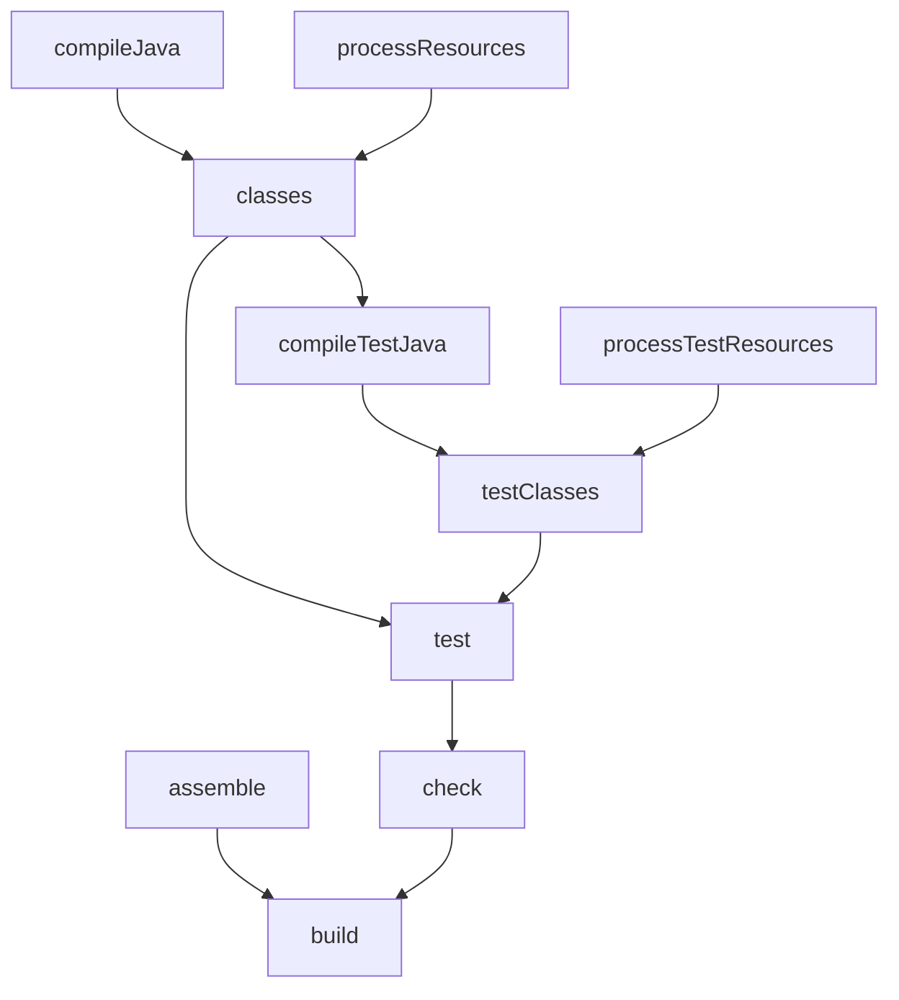

# Chạy kiểm thử trong chuỗi build: đầu vào và kết quả

Kiểm thử là một bước xác minh trong quy trình build. Khi chạy `test`, Gradle chuẩn bị mã nguồn và tài nguyên dành cho kiểm thử, tạo classpath cần thiết, tìm các test phù hợp, thực thi chúng rồi thu thập kết quả. Vì vậy, kết quả của một lần chạy phụ thuộc vào cả nội dung mã nguồn, cấu hình build và môi trường thực thi.

Để đọc đúng kết quả, cần phân biệt ba việc: **đầu vào nào được dùng**, **những task nào đã chạy trong task graph**, và **kết quả kiểm thử nói lên điều gì**. Một dòng `BUILD SUCCESSFUL` chỉ cho biết các task được thực thi trong lần build đó đã hoàn tất thành công; cần xem trạng thái của task `test` và báo cáo để biết kiểm thử thực sự đã chạy đến đâu.

## 1. Vị trí của kiểm thử trong chuỗi build

Trong một dự án Java dùng Gradle Java Plugin, mã kiểm thử thường nằm trong source set `test`, tách biệt với mã ứng dụng ở source set `main`:

```text
src/
├── main/
│   ├── java/          # Mã nguồn chính
│   └── resources/     # Tài nguyên dùng khi chạy ứng dụng
└── test/
    ├── java/          # Mã nguồn kiểm thử
    └── resources/     # Tài nguyên dành riêng cho kiểm thử
```

Gradle cung cấp các task để xử lý hai nhóm nguồn này. Với cấu hình Java thông thường, chuỗi phụ thuộc có thể hình dung như sau:



Ý nghĩa của các task chính:

| Task | Vai trò |
|---|---|
| `compileJava` | Biên dịch mã nguồn chính trong `src/main/java`. |
| `processResources` | Sao chép và xử lý tài nguyên của source set `main`. |
| `classes` | Gom các bước cần thiết để tạo đầu ra của mã nguồn chính. |
| `compileTestJava` | Biên dịch mã nguồn trong `src/test/java` bằng classpath kiểm thử. |
| `processTestResources` | Chuẩn bị tài nguyên trong `src/test/resources`. |
| `testClasses` | Gom đầu ra đã biên dịch và tài nguyên của source set `test`. |
| `test` | Thực thi các kiểm thử được phát hiện theo cấu hình. |
| `check` | Task vòng đời dành cho kiểm tra chất lượng; với Java Plugin, task này phụ thuộc vào `test` và có thể nhận thêm các kiểm tra khác. |
| `build` | Task build tổng hợp; phụ thuộc vào việc đóng gói (`assemble`) và kiểm tra (`check`). |

Sơ đồ biểu diễn quan hệ phụ thuộc để dễ theo dõi, không phải cam kết rằng Gradle luôn chạy mọi task theo một danh sách tuyến tính cố định. Gradle xây dựng một đồ thị task từ yêu cầu đầu vào và các quan hệ `dependsOn`; task độc lập có thể được thực thi theo thứ tự khác hoặc song song nếu cấu hình cho phép.

Khi yêu cầu `test`, Gradle chỉ cần thực hiện các task nằm trong đồ thị phụ thuộc của `test`. Khi yêu cầu `check`, `test` trở thành một phần của quy trình kiểm tra. Khi yêu cầu `build`, Gradle thực hiện cả nhánh đóng gói và nhánh kiểm tra. Vì thế, chạy `test`, `check` và `build` có phạm vi công việc khác nhau.

## 2. Đầu vào của một lần chạy kiểm thử

Đầu vào không chỉ là file test. Có thể chia chúng thành các nhóm sau.

### 2.1. Mã nguồn chính và đầu ra đã biên dịch

Test thường kiểm tra hành vi của mã nguồn chính. Gradle cần biên dịch source set `main` và đưa đầu ra của nó vào classpath của kiểm thử. Nếu mã nguồn chính không biên dịch được, các bước kiểm thử phụ thuộc vào nó không thể chạy bình thường.

Ví dụ, một lớp nghiệp vụ trong `src/main/java` có thể được gọi từ test:

```java
public class PriceCalculator {
    public int total(int unitPrice, int quantity) {
        return unitPrice * quantity;
    }
}
```

Test dùng lớp đã biên dịch để kiểm tra hành vi:

```java
import static org.junit.jupiter.api.Assertions.assertEquals;

import org.junit.jupiter.api.Test;

class PriceCalculatorTest {
    @Test
    void calculatesTotal() {
        PriceCalculator calculator = new PriceCalculator();

        assertEquals(600, calculator.total(200, 3));
    }
}
```

Ví dụ sử dụng JUnit Jupiter. Dự án phải khai báo dependency và cấu hình test engine tương ứng thì Gradle mới có thể phát hiện và chạy test này. Chỉ đặt annotation `@Test` trong file không tự động bảo đảm framework đã được cấu hình.

### 2.2. Mã nguồn kiểm thử

Các file trong `src/test/java` mô tả tình huống cần xác minh, dữ liệu đầu vào, thao tác gọi mã cần kiểm tra và điều kiện xác nhận kết quả.

Khi biên dịch test, compiler cần nhìn thấy:

- Các lớp và phương thức mà test gọi.
- Các API của framework kiểm thử, chẳng hạn JUnit.
- Các thư viện phụ trợ mà test sử dụng, chẳng hạn thư viện tạo dữ liệu hoặc mock.
- Các kiểu dữ liệu và dependency khác có mặt trên test compile classpath.

Lỗi cú pháp, import không hợp lệ hoặc thiếu dependency có thể làm `compileTestJava` thất bại trước khi Gradle bắt đầu thực thi test. Đây là lỗi biên dịch test, chưa phải một assertion thất bại.

### 2.3. Tài nguyên kiểm thử

File trong `src/test/resources` được chuẩn bị cho runtime của test. Chúng có thể là JSON, XML, file cấu hình, dữ liệu mẫu, template hoặc file dùng để so sánh kết quả.

Ví dụ, test đọc `sample-order.json` từ classpath:

```java
try (var stream = getClass().getResourceAsStream("/sample-order.json")) {
    if (stream == null) {
        throw new IllegalStateException("Missing test resource");
    }
    // Đọc và kiểm tra dữ liệu mẫu
}
```

Nếu resource bị đặt sai thư mục, sai tên hoặc không được đưa vào test runtime classpath, test có thể thất bại dù mã Java đã biên dịch thành công.

### 2.4. Dependency dành cho compile và runtime

Gradle phân biệt dependency cần khi biên dịch test và dependency cần khi thực thi test. Với Java Plugin, các cấu hình thường gặp gồm:

| Configuration | Mục đích |
|---|---|
| `testImplementation` | Thư viện mà mã test cần khi biên dịch và sử dụng trong test. |
| `testCompileOnly` | Thư viện chỉ cần để biên dịch test, không được đưa vào runtime classpath theo cấu hình này. |
| `testRuntimeOnly` | Thư viện cần khi chạy test, ví dụ test engine hoặc thành phần runtime của framework. |

Ví dụ cấu hình JUnit Jupiter trong Gradle Groovy DSL:

```groovy
dependencies {
    testImplementation 'org.junit.jupiter:junit-jupiter:5.x.x'
    testRuntimeOnly 'org.junit.platform:junit-platform-launcher:1.x.x'
}

tasks.named('test') {
    useJUnitPlatform()
}
```

Các phiên bản trong ví dụ chỉ là ký hiệu minh họa; dự án thực tế cần chọn phiên bản tương thích và có thể quản lý chúng bằng version catalog hoặc cơ chế tập trung khác. `useJUnitPlatform()` yêu cầu Gradle chạy test thông qua JUnit Platform. Nếu dự án dùng framework hoặc engine khác, cấu hình phải tương ứng với framework đó.

Thiếu thư viện có thể gây lỗi ở hai thời điểm khác nhau:

- Thiếu dependency trên compile classpath: test không biên dịch được, thường thất bại tại `compileTestJava`.
- Thiếu engine hoặc lớp cần thiết trên runtime classpath: test có thể biên dịch nhưng không được phát hiện hoặc không chạy được khi task `test` khởi động.

### 2.5. Cấu hình phát hiện và lựa chọn test

Task `test` cần biết framework nào sẽ chạy, lớp nào được đưa vào phạm vi, và cách khởi tạo tiến trình kiểm thử. Phạm vi có thể chịu ảnh hưởng bởi:

- Test engine và cấu hình framework.
- Quy tắc include/exclude hoặc tag của framework.
- Bộ lọc truyền từ dòng lệnh, chẳng hạn `--tests`.
- Cấu hình riêng của task trong build script.
- Các điều kiện khiến task bị tắt hoặc bị bỏ qua.

Ví dụ chỉ chạy một lớp test:

```bash
./gradlew test --tests "com.example.PriceCalculatorTest"
```

Trên Windows có thể dùng wrapper `gradlew.bat`:

```powershell
.\gradlew.bat test --tests "com.example.PriceCalculatorTest"
```

Bộ lọc giúp khoanh vùng lỗi và rút ngắn vòng lặp phát triển. Tuy nhiên, kết quả của một lần chạy có lọc chỉ phản ánh các test khớp bộ lọc; nó không chứng minh toàn bộ test suite đều đạt.

### 2.6. Môi trường thực thi

Test chạy trong một môi trường cụ thể. Những yếu tố có thể ảnh hưởng đến kết quả gồm:

- Phiên bản JDK và các tùy chọn JVM.
- Hệ điều hành, kiến trúc, locale, timezone và encoding mặc định.
- Biến môi trường, system properties và working directory.
- File, thư mục tạm, quyền truy cập và cổng mạng.
- Database, message broker, HTTP service hoặc hệ thống ngoài mà integration test cần.
- Dữ liệu tồn tại từ lần chạy trước và trạng thái dùng chung giữa các test.

Một test chỉ chạy ổn trên máy của một lập trình viên có thể thất bại trong CI nếu môi trường CI thiếu service, dùng cấu hình khác hoặc không có biến môi trường cần thiết. Với test cần dịch vụ ngoài, phải xác định rõ ai khởi động dịch vụ, cấu hình kết nối lấy từ đâu và dữ liệu được tạo, dọn dẹp như thế nào.

Đầu vào môi trường nên được khai báo và kiểm soát rõ ràng. Test đơn vị thường nên tránh phụ thuộc mạng hoặc dịch vụ đang chạy bên ngoài; test tích hợp có thể dùng các dịch vụ thật hoặc môi trường thử nghiệm, nhưng cần có bước chuẩn bị và thu hồi tài nguyên tương ứng.

## 3. Gradle xử lý đầu vào như thế nào?

Khi nhận yêu cầu chạy task, Gradle thực hiện cấu hình build để xác định project, plugin, task và quan hệ phụ thuộc. Sau đó Gradle tạo task graph cho yêu cầu hiện tại và thực thi các task cần thiết.

Đối với kiểm thử, luồng khái quát là:

1. Gradle cấu hình task và các dependency liên quan.
2. Mã nguồn chính được biên dịch và tài nguyên chính được chuẩn bị khi cần.
3. Mã nguồn test được biên dịch; tài nguyên test được chuẩn bị.
4. Task `test` tạo môi trường thực thi và classpath cho test.
5. Framework hoặc test engine phát hiện các test thuộc phạm vi.
6. Các test được thực thi; Gradle nhận sự kiện và kết quả từ tiến trình test.
7. Gradle ghi kết quả và tạo báo cáo theo cấu hình.
8. Kết quả của `test` được truyền về các task phụ thuộc như `check` và `build`.

Gradle thường thực thi test trong tiến trình worker riêng để tách việc chạy test khỏi tiến trình điều phối build. Cấu hình của task có thể điều chỉnh cách chia tiến trình, số lượng fork và mức song song. Nếu test dùng chung file, cổng hoặc dữ liệu mutable, chạy song song có thể làm lộ lỗi tranh chấp mà chạy tuần tự chưa thể hiện.

### 3.1. Đầu vào task và tính up-to-date

Gradle theo dõi các đầu vào và đầu ra mà task khai báo. Với những task có đầu vào và đầu ra được mô tả phù hợp, Gradle có thể xác định task có cần chạy lại hay không.

Ví dụ, khi mã nguồn test, mã nguồn chính, tài nguyên hoặc dependency liên quan thay đổi, task kiểm thử có thể cần thực thi lại. Nếu đầu vào không đổi và đầu ra hợp lệ, Gradle có thể đánh dấu task `UP-TO-DATE`. Nếu build cache được cấu hình và có kết quả phù hợp, Gradle có thể khôi phục đầu ra từ cache (`FROM-CACHE`).

Điều này có nghĩa một lần chạy build không nhất thiết thực thi lại mọi test. Cần đọc trạng thái task để phân biệt test vừa chạy với đầu ra được tái sử dụng từ lần chạy trước. Muốn yêu cầu chạy lại task để điều tra, có thể dùng:

```bash
./gradlew test --rerun-tasks
```

Lệnh này buộc task được yêu cầu thực thi lại, nhưng không tự sửa được test phụ thuộc vào trạng thái ngoài hoặc có tính ngẫu nhiên.

Gradle chỉ có thể đưa ra quyết định chính xác trong phạm vi đầu vào/đầu ra mà build khai báo và công cụ nhận biết. Nếu test đọc một file ngoài project, gọi dịch vụ từ xa hoặc phụ thuộc vào dữ liệu ẩn mà không thể hiện trong cấu hình task, thay đổi của dữ liệu đó có thể không được phản ánh đầy đủ trong quyết định up-to-date/cache. Vì vậy, test nên hạn chế trạng thái ẩn và khai báo rõ các điều kiện môi trường cần thiết.

## 4. Kết quả của một lần chạy kiểm thử

Kết quả cần được đọc ở nhiều mức. Không nên chỉ nhìn một dòng tổng kết ở cuối terminal.

### 4.1. Kết quả của từng test

Framework kiểm thử thường báo trạng thái cho từng test case:

| Trạng thái | Ý nghĩa |
|---|---|
| Passed | Test chạy và các điều kiện xác nhận đều đạt. |
| Failed | Test đã chạy nhưng assertion hoặc thao tác trong test phát sinh lỗi. |
| Skipped/Disabled | Test không được thực thi theo điều kiện hoặc cấu hình của framework. |

Tên trạng thái và cách hiển thị chi tiết phụ thuộc framework. Một test bị skip không tương đương với một test đã pass: nó không cung cấp bằng chứng rằng hành vi được kiểm tra đang đúng.

### 4.2. Kết quả của task `test`

Gradle tổng hợp kết quả thực thi thành trạng thái task. Các trạng thái thường gặp:

| Trạng thái task | Cách hiểu |
|---|---|
| `SUCCESS` | Task đã thực thi và hoàn tất thành công. Với `test`, không có test failure làm task thất bại. |
| `FAILED` | Task thất bại, có thể do test fail hoặc lỗi trong quá trình chuẩn bị/thực thi. |
| `UP-TO-DATE` | Gradle xác định đầu ra hiện tại còn hợp lệ nên không cần thực thi lại task. |
| `FROM-CACHE` | Gradle khôi phục đầu ra phù hợp từ build cache. |
| `NO-SOURCE` | Task không có nguồn phù hợp để xử lý. Cần kiểm tra vì có thể dự án chưa có test hoặc source set không được đặt/cấu hình như dự kiến. |
| `SKIPPED` | Task không chạy do điều kiện, cấu hình hoặc bị loại khỏi yêu cầu thực thi. |

Các trạng thái này mô tả task, không phải trạng thái của từng test case. Chẳng hạn `UP-TO-DATE` không có nghĩa các test vừa được chạy lại; `SKIPPED` cũng không thể được diễn giải thành “mọi test đều đạt”.

### 4.3. Báo cáo kiểm thử

Với cấu hình Java Plugin mặc định, task `test` thường tạo hai loại đầu ra chính trong thư mục `build/`:

```text
build/
├── test-results/
│   └── test/                 # Kết quả dạng XML và dữ liệu kiểm thử
└── reports/
    └── tests/
        └── test/
            └── index.html    # Báo cáo HTML để xem trong trình duyệt
```

Đường dẫn có thể thay đổi nếu build script tùy chỉnh `Test` task hoặc report destination. Báo cáo HTML thuận tiện để đọc tổng quan, đi vào từng lớp/test và xem stack trace. Báo cáo XML phù hợp cho CI server hoặc hệ thống tổng hợp kết quả tự động.

Khi task thất bại, báo cáo vẫn có thể chứa các test đã chạy trước thời điểm lỗi. Vì vậy, hãy mở báo cáo để xem số lượng test, test thất bại, test bị bỏ qua và nguyên nhân chi tiết. Không suy luận rằng không có báo cáo đồng nghĩa với mọi test đều đạt; task có thể đã dừng trước khi đến giai đoạn thực thi hoặc báo cáo.

### 4.4. Mã thoát của lệnh build

Khi chạy Gradle từ terminal hoặc CI, tiến trình trả về mã thoát:

- Mã `0`: lệnh Gradle hoàn tất thành công.
- Mã khác `0`: lệnh thất bại; cần đọc log và báo cáo để tìm task gây lỗi.

Nếu `test` thất bại, task `check` và `build` phụ thuộc vào nó thường cũng thất bại. Điều này giúp CI chặn việc coi build là đạt khi kiểm thử bắt buộc không đạt.

Tuy nhiên, mã `0` chỉ có ý nghĩa trong phạm vi các task thực sự được yêu cầu và thực thi. Nếu người chạy loại `test` khỏi task graph, cấu hình khiến task bị skip, hoặc bộ lọc chỉ chạy một phần test, build có thể thành công mà không xác nhận toàn bộ test suite. Khi đánh giá CI, cần xem lệnh được gọi, task graph, trạng thái `test` và báo cáo.

## 5. Chạy kiểm thử theo từng phạm vi

Các lệnh sau minh họa cách chọn phạm vi kiểm thử. Hãy dùng Gradle Wrapper của repository để thống nhất phiên bản Gradle giữa máy lập trình viên và CI.

Chạy toàn bộ test của project hiện tại:

```bash
./gradlew test
```

Chạy task kiểm tra tổng hợp:

```bash
./gradlew check
```

Chạy build, bao gồm các nhánh assemble và check:

```bash
./gradlew build
```

Chạy test của một Gradle subproject:

```bash
./gradlew :service-api:test
```

Chạy một lớp hoặc một phương thức test theo bộ lọc của Gradle:

```bash
./gradlew test --tests "com.example.PriceCalculatorTest"
./gradlew test --tests "com.example.PriceCalculatorTest.calculatesTotal"
```

Tăng mức log để quan sát task và quá trình thực thi:

```bash
./gradlew test --info
```

In stack trace khi cần điều tra lỗi:

```bash
./gradlew test --stacktrace
```

Trên Windows, thay `./gradlew` bằng `gradlew.bat` hoặc `.\gradlew.bat` theo shell đang sử dụng. Tên project, package và test trong ví dụ là dữ liệu minh họa; cần thay bằng tên thực tế của repository.

## 6. Đọc lỗi theo đúng giai đoạn

Không phải mọi lỗi xuất hiện khi chạy `test` đều là lỗi assertion. Hãy xác định task cuối cùng hoàn tất và task đầu tiên thất bại.

| Dấu hiệu | Giai đoạn có thể gặp lỗi | Hướng kiểm tra |
|---|---|---|
| `compileJava` thất bại | Biên dịch mã nguồn chính | Cú pháp Java, kiểu dữ liệu, dependency và JDK. |
| `processResources` thất bại | Chuẩn bị tài nguyên chính | Đường dẫn, quyền đọc/ghi và cấu hình xử lý resource. |
| `compileTestJava` thất bại | Biên dịch mã kiểm thử | Import, annotation, API test, test compile classpath và tương thích JDK. |
| `processTestResources` hoặc test báo thiếu file | Chuẩn bị/đọc tài nguyên test | Tên file, vị trí trong `src/test/resources`, classpath và encoding. |
| Không phát hiện test | Khám phá test | Test engine, cấu hình `useJUnitPlatform()`, quy tắc include/exclude, tên lớp và bộ lọc. |
| Assertion thất bại | Thực thi test | Giá trị đầu vào, kết quả mong đợi, logic ứng dụng và dữ liệu test. |
| Kết nối service thất bại | Thiết lập môi trường hoặc integration test | Service có chạy không, host/port, credential, biến môi trường và readiness. |
| Chỉ thất bại khi chạy song song | Tương tác giữa test hoặc tài nguyên dùng chung | File, port, database, dữ liệu mutable, thứ tự và cleanup. |
| Chỉ thất bại trên CI | Khác biệt môi trường | JDK, OS, timezone, locale, secret, service và đường dẫn. |

Một quy trình điều tra thực tế có thể thực hiện theo thứ tự:

1. Đọc task đầu tiên báo `FAILED` trong log; xác định lỗi nằm ở biên dịch, chuẩn bị hay thực thi.
2. Nếu lỗi nằm trong `test`, mở báo cáo HTML và tìm test case thất bại.
3. Đọc assertion message và stack trace để xác định đầu vào, kết quả thực tế và điểm phát sinh lỗi.
4. Chạy riêng test liên quan bằng `--tests` để rút ngắn vòng lặp.
5. Nếu lỗi không ổn định, kiểm tra trạng thái dùng chung, dữ liệu, thời gian, tính song song và phụ thuộc môi trường.
6. Sau khi sửa, chạy lại test liên quan rồi chạy phạm vi kiểm tra mà pipeline yêu cầu, chẳng hạn `check` hoặc `build`.

Không nên sửa assertion chỉ để làm test xanh khi chưa xác định yêu cầu nghiệp vụ và nguyên nhân. Test có thể đang phát hiện lỗi thật trong mã nguồn hoặc dữ liệu.

## 7. Đảm bảo đầu vào kiểm thử đáng tin cậy

Kết quả test chỉ có giá trị khi đầu vào và điều kiện thực thi có thể hiểu, kiểm soát và lặp lại. Một số nguyên tắc hữu ích:

- **Dữ liệu rõ ràng:** mỗi test tự tạo hoặc nạp dữ liệu mà nó cần; tránh phụ thuộc vào dữ liệu còn sót từ test trước.
- **Không phụ thuộc thứ tự:** test phải có thể chạy riêng và không cần một test khác chạy trước để chuẩn bị trạng thái.
- **Dọn dẹp tài nguyên:** đóng stream, connection, server, container và xóa file tạm sau khi dùng.
- **Cô lập trạng thái:** tránh dùng chung mutable static state; nếu phải dùng chung database hoặc thư mục, cần quy tắc đặt tên và dọn dữ liệu riêng cho mỗi test.
- **Kiểm soát thời gian:** không giả định test luôn chạy ở timezone hoặc thời điểm cố định; dùng clock có thể kiểm soát khi logic phụ thuộc thời gian.
- **Giảm phụ thuộc ngoài:** dùng mock hoặc fake cho test đơn vị; dành kết nối thật cho test tích hợp có chuẩn bị môi trường rõ ràng.
- **Ghi nhận cấu hình:** tài liệu hóa JDK, biến môi trường và service cần có để người khác và CI có thể tái tạo lần chạy.
- **Phân biệt pass và skip:** theo dõi test bị vô hiệu hóa hoặc bị loại khỏi phạm vi để không nhầm việc thiếu kiểm tra với kết quả đạt.

Khi tăng số lượng worker hoặc bật chạy song song, cần kiểm tra lại khả năng cô lập. Một test chạy đúng khi đứng riêng nhưng thất bại khi chạy cùng test khác thường cho thấy có tài nguyên hoặc trạng thái đang bị chia sẻ.

## 8. Ví dụ đọc một lần chạy từ đầu đến cuối

Giả sử một project có lớp `PriceCalculator` và `PriceCalculatorTest`. Người phát triển gọi:

```bash
./gradlew test
```

Gradle phân tích yêu cầu, tạo task graph và kiểm tra đầu vào của các task liên quan. Nếu cần, Gradle biên dịch mã chính, chuẩn bị tài nguyên chính, biên dịch test và chuẩn bị tài nguyên test. Sau đó task `test` khởi chạy test engine đã cấu hình.

Giả sử test truyền `unitPrice = 200`, `quantity = 3` và mong đợi tổng tiền là `600`. Có ba trường hợp tiêu biểu:

**Trường hợp A — Test pass:** phương thức trả về `600`, assertion đạt. Task `test` hoàn tất thành công và báo cáo ghi nhận test đã pass.

**Trường hợp B — Test fail:** phương thức trả về `500`, assertion mong đợi `600`. Test được thực thi nhưng assertion thất bại; Gradle đánh dấu task `test` là `FAILED`, báo cáo ghi lại expected/actual và build trả về mã thoát khác `0`.

**Trường hợp C — Test không chạy:** task không có test phù hợp, bị skip hoặc đầu ra được Gradle xác định là up-to-date. Khi đó không thể kết luận rằng test vừa được thực thi và pass. Cần xem task outcome, bộ lọc, cấu hình và báo cáo để hiểu lý do.

Ba trường hợp cho thấy phải đọc đồng thời kết quả của test case, trạng thái task và kết quả tổng thể của lệnh Gradle.

## 9. Checklist khi đọc kết quả trên máy cá nhân hoặc CI

Trước khi kết luận một build đã được kiểm thử thành công, hãy xác nhận:

- [ ] Lệnh Gradle được gọi có bao gồm `test`, `check` hoặc `build` theo yêu cầu của pipeline.
- [ ] Đúng project/subproject và đúng bộ lọc test đã được chọn.
- [ ] Mã nguồn test được biên dịch và test engine được nạp.
- [ ] Task `test` đã chạy, hoặc trạng thái `UP-TO-DATE`/`FROM-CACHE` có lý do hợp lệ.
- [ ] Không có test thất bại; số lượng test bị skip/disabled được hiểu rõ.
- [ ] Báo cáo XML/HTML có thể truy cập và phản ánh lần chạy đang đánh giá.
- [ ] Các service, biến môi trường và cấu hình cần thiết đã có trong CI.
- [ ] Mã thoát của lệnh Gradle được CI sử dụng để quyết định pass/fail.

Kiểm thử trong chuỗi build là một phép xác minh có đầu vào, phạm vi và đầu ra cụ thể. Đầu vào xác định test nào có thể biên dịch và chạy; task graph xác định công việc nào được thực hiện; báo cáo cùng trạng thái task cho biết điều gì đã được kiểm chứng. Đọc đủ ba phần này giúp phân biệt một build thực sự đã chạy và đạt kiểm thử với một build chỉ hoàn tất vì task kiểm thử không nằm trong phạm vi thực thi.
