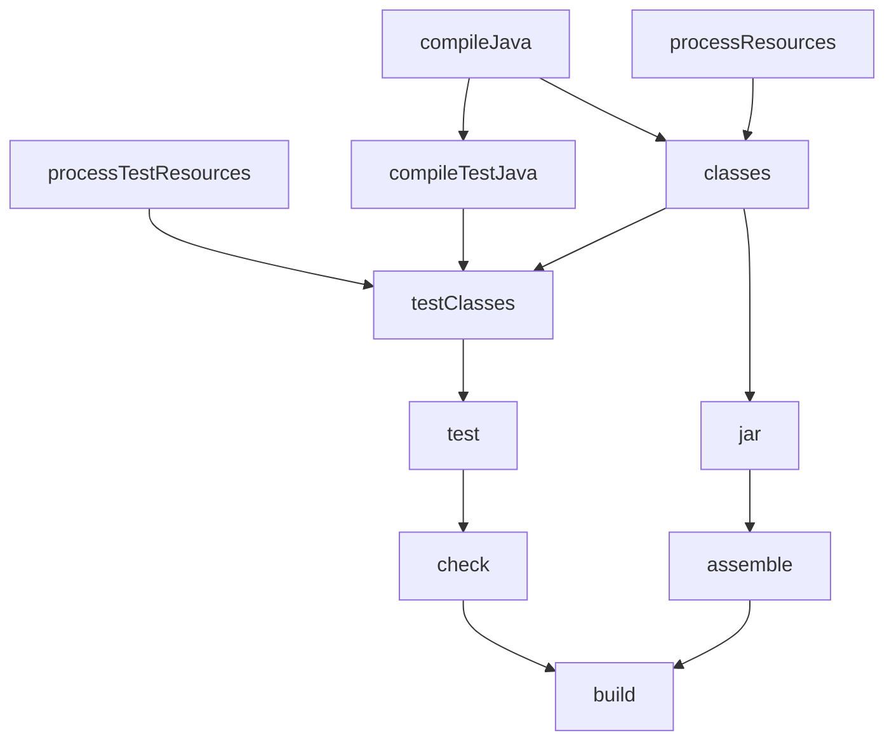
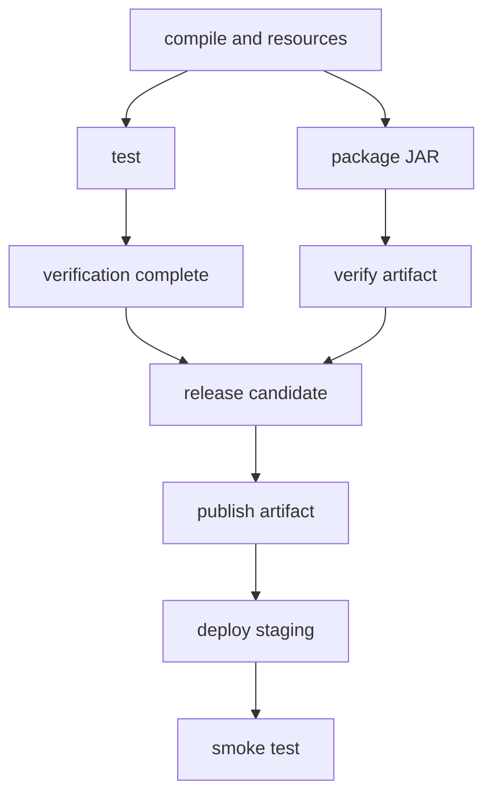

# Chuyển quy trình thủ công thành các bước build có quan hệ rõ ràng

Khi một dự án Java còn nhỏ, nhóm phát triển có thể hoàn thành công việc bằng cách ghi nhớ và chạy lần lượt nhiều lệnh: biên dịch mã nguồn, chạy kiểm thử, tạo JAR, sao chép tệp, tải artifact lên kho dùng chung rồi triển khai lên môi trường. Cách làm này dễ bắt đầu, nhưng quy trình nằm trong trí nhớ của người thực hiện. Khi có thêm thành viên, thêm loại kiểm thử hoặc thêm môi trường triển khai, rất dễ xảy ra tình trạng chạy thiếu bước, chạy sai thứ tự hoặc mỗi người làm theo một cách khác nhau.

Gradle giúp chuyển chuỗi thao tác đó thành các **task có quan hệ được khai báo rõ ràng**. Mỗi task đại diện cho một công việc có thể gọi và theo dõi độc lập. Các quan hệ giữa task mô tả điều kiện cần có trước khi một công việc được thực hiện. Từ một task đầu vào như `build` hoặc `releaseCandidate`, Gradle dựng đồ thị công việc và tự xác định những task cần chạy theo đúng quan hệ.

Mục tiêu của việc chuyển đổi không chỉ là gom nhiều lệnh vào một lệnh dài. Mục tiêu là mô tả được công việc nào cần kết quả của công việc nào, công việc nào chỉ cần chạy sau một công việc khác nếu cả hai cùng được yêu cầu, và công việc nào cần chạy để dọn dẹp sau khi một tác vụ kết thúc.

## 1. Nhận diện vấn đề trong quy trình thủ công

Hãy hình dung một quy trình phát hành ứng dụng Java được ghi trong tài liệu nội bộ như sau:

1. Xóa thư mục build cũ.
2. Biên dịch mã nguồn chính.
3. Biên dịch mã nguồn kiểm thử.
4. Chạy unit test và integration test.
5. Tạo JAR.
6. Đổi tên và sao chép JAR vào thư mục bàn giao.
7. Tải JAR lên kho artifact.
8. Cập nhật môi trường staging để sử dụng phiên bản mới.
9. Kiểm tra ứng dụng trên staging.

Danh sách trên có thể giúp một người làm theo từng bước, nhưng nó chưa diễn tả đầy đủ cấu trúc của quy trình:

- Bước tạo JAR cần các lớp đã biên dịch và tài nguyên cần thiết.
- Kiểm thử cần mã chính và mã kiểm thử đã được biên dịch.
- Việc công bố artifact cần có gói đầu ra hợp lệ.
- Triển khai staging cần biết chính xác artifact và phiên bản sẽ đưa lên môi trường.
- Nếu kiểm thử thất bại, các bước phát hành tiếp theo cần dừng.
- Nếu kiểm thử tạo ra môi trường tạm, bước dọn dẹp cần được thực hiện kể cả khi kiểm thử gặp lỗi.

Một danh sách đánh số thường chỉ thể hiện thứ tự mà người viết mong muốn. Nó không nhất thiết cho biết quan hệ phụ thuộc thật sự. Ví dụ, tạo JAR và chạy một bộ kiểm tra độc lập có thể cùng cần kết quả biên dịch, nhưng không nhất thiết phải chạy nối tiếp nhau. Nếu chúng không ghi kết quả vào cùng một nơi và không phụ thuộc lẫn nhau, Gradle có thể xem xét thực hiện chúng song song.

Quy trình thủ công còn có một số rủi ro khác:

- **Thiếu tính lặp lại:** người thực hiện quên một bước hoặc dùng lệnh khác với lần trước.
- **Khó biết nguyên nhân thất bại:** log của nhiều lệnh rời rạc không thể hiện rõ task nào phụ thuộc vào task nào.
- **Lãng phí thời gian:** có thể biên dịch hoặc chạy kiểm thử lại dù đầu vào không thay đổi.
- **Khó mở rộng:** thêm một loại kiểm thử hoặc một môi trường mới khiến tài liệu hướng dẫn ngày càng dài.
- **Khó tự động hóa:** CI cần một điểm bắt đầu ổn định và biết khi nào có thể chuyển sang công đoạn tiếp theo.

Để giải quyết, trước tiên cần tách quy trình thành các công việc có đầu vào, đầu ra và trách nhiệm rõ ràng. Sau đó mới mô tả các quan hệ giữa chúng.

## 2. Task và task graph trong Gradle

Trong Gradle, **task** là một đơn vị công việc của build. Ví dụ, `compileJava` biên dịch mã nguồn Java chính, `test` chạy kiểm thử, `jar` tạo JAR và `check` gom các bước xác minh được cấu hình cho dự án.

Khi yêu cầu Gradle chạy một task, Gradle không chỉ nhìn vào tên task đó. Nó còn xem các task phụ thuộc cần thiết để hoàn thành công việc. Tập hợp task và quan hệ giữa chúng tạo thành **task graph** (đồ thị task).

Có thể biểu diễn một phần quy trình Java đơn giản như sau:



Sơ đồ minh họa các quan hệ thường gặp của Java Plugin. Cấu hình dự án và plugin bổ sung có thể mở rộng task graph.

Task graph có một số đặc điểm quan trọng:

- **Task là nút:** mỗi task biểu diễn một công việc cụ thể hoặc một điểm gom nhiều công việc.
- **Quan hệ là cạnh:** một cạnh cho biết một task cần hoặc phải được sắp xếp trước một task khác theo loại quan hệ đã khai báo.
- **Gradle lập kế hoạch trước khi thực thi:** Gradle xác định những task nằm trong graph từ task được yêu cầu và các quan hệ của nó, sau đó sắp xếp thứ tự thực hiện phù hợp.
- **Task không cần chạy lại nếu không cần thiết:** với task khai báo đầu vào và đầu ra đúng cách, Gradle có thể bỏ qua task khi kết quả vẫn còn hợp lệ.
- **Task độc lập có thể chạy song song:** nếu không có quan hệ thứ tự bắt buộc và task an toàn khi chạy đồng thời, Gradle có thể thực hiện chúng song song khi chế độ song song được bật.

Đồ thị phụ thuộc cần không có chu trình. Nếu task A phụ thuộc task B, đồng thời task B lại phụ thuộc task A, Gradle không thể xác định thứ tự hợp lệ và sẽ báo lỗi chu trình task.

## 3. Chuyển từng thao tác thành một task có trách nhiệm rõ ràng

Không phải mỗi dòng lệnh thủ công đều cần trở thành một custom task. Trước tiên hãy kiểm tra Gradle và các plugin đã cung cấp task phù hợp hay chưa. Dùng task có sẵn giúp tận dụng cách Gradle quản lý đầu vào, đầu ra, phụ thuộc và tính tăng dần.

Với một dự án Java sử dụng Java Plugin, các task thường có sẵn gồm:

| Công việc | Task thường dùng | Ý nghĩa |
|---|---|---|
| Biên dịch mã nguồn chính | `compileJava` | Tạo bytecode từ mã nguồn chính |
| Xử lý tài nguyên chính | `processResources` | Sao chép/xử lý tài nguyên của source set chính |
| Biên dịch mã kiểm thử | `compileTestJava` | Tạo bytecode từ mã nguồn kiểm thử |
| Chạy kiểm thử | `test` | Thực thi test đã cấu hình |
| Kiểm tra tổng hợp | `check` | Chạy các task verification được gắn vào lifecycle này |
| Tạo JAR | `jar` | Đóng gói output của source set chính |
| Tạo artifact | `assemble` | Gom các artifact được cấu hình |
| Build tổng hợp | `build` | Kết hợp kiểm tra và tạo artifact theo lifecycle của plugin |

Ví dụ, thay vì tự viết lệnh `javac` rồi tự tìm thư mục chứa `.class`, có thể để Java Plugin quản lý việc biên dịch. Thay vì tự chạy một lệnh JUnit riêng, có thể cấu hình test framework và dùng task `test`.

Chỉ tạo custom task khi dự án thực sự có một công việc riêng mà task có sẵn chưa đáp ứng, chẳng hạn sinh một tệp metadata, kiểm tra cấu trúc artifact hoặc chuẩn bị dữ liệu cho một bước tiếp theo.

Một task nên có trách nhiệm dễ mô tả bằng một câu. Ví dụ:

- `generateBuildInfo`: tạo thông tin build từ phiên bản và commit đã được cung cấp.
- `verifyDistribution`: kiểm tra nội dung gói phân phối.
- `copyReleaseNotes`: chuẩn bị release notes cho phiên bản.
- `deployToStaging`: triển khai một artifact đã được xác định tới staging.

Nếu một task vừa biên dịch, vừa kiểm thử, vừa upload, vừa triển khai và vừa gửi thông báo, rất khó biết lỗi thuộc công việc nào và khó tái sử dụng từng phần. Hãy chia thành những task có đầu ra và trách nhiệm riêng, sau đó kết nối chúng bằng quan hệ phù hợp.

## 4. Khai báo quan hệ phụ thuộc bằng `dependsOn`

Quan hệ thường dùng nhất là **phụ thuộc**. Nếu task B cần kết quả do task A tạo ra, B nên phụ thuộc A. Trong Gradle, dùng `dependsOn` để khai báo quan hệ này.

Ví dụ, Java Plugin cung cấp task `jar`. Ta muốn tạo một task lifecycle tên `releaseCandidate` để yêu cầu Gradle chạy kiểm tra và tạo JAR:

```groovy
tasks.register('releaseCandidate') {
    group = 'distribution'
    description = 'Runs verification and assembles the Java release candidate.'

    dependsOn(tasks.named('check'))
    dependsOn(tasks.named('jar'))
}
```

Đoạn cấu hình trên khai báo rằng khi chạy `releaseCandidate`, Gradle cần đưa `check` và `jar` vào task graph. Các task phụ thuộc sâu hơn của chúng cũng được đưa vào graph. Chẳng hạn, `check` có thể kéo theo `test`, còn `jar` cần output của lớp chính.

Chạy:

```bash
./gradlew releaseCandidate
```

Gradle tự xây dựng task graph. Người dùng không cần nhớ phải chạy `compileJava` trước `test`, rồi chạy `jar` sau đó. Các quan hệ đã được khai báo trong build.

`dependsOn` có ý nghĩa lớn hơn việc sắp xếp thứ tự: nó **đưa task phụ thuộc vào graph**. Nếu gọi task B và B phụ thuộc A, Gradle sẽ lên kế hoạch cho A trước B theo quan hệ phụ thuộc. Nếu chỉ gọi B mà không có quan hệ nào đưa A vào graph, A không tự nhiên được chạy.

Nên dùng `TaskProvider` thông qua `tasks.named(...)` hoặc `tasks.register(...)` trong cấu hình thông thường. Cách này hỗ trợ cơ chế configuration avoidance của Gradle: Gradle có thể trì hoãn cấu hình task cho tới khi task thực sự cần thiết. Tránh gọi `.get()` chỉ để lấy task sớm khi không có lý do cần thiết.

### Task lifecycle và task thực hiện công việc

Một số task chủ yếu dùng để gom những task khác. Chúng thường được gọi là **lifecycle task**. Ví dụ `build` gom các bước kiểm tra và tạo artifact; `releaseCandidate` trong ví dụ trên cũng là một lifecycle task do dự án định nghĩa.

Lifecycle task giúp người dùng có một điểm bắt đầu ổn định, trong khi các task thực hiện công việc vẫn có thể được gọi riêng khi cần. Ví dụ:

```bash
./gradlew test
./gradlew jar
./gradlew releaseCandidate
```

Task lifecycle thường không cần tự thực hiện thao tác file hay gọi công cụ bên ngoài. Trách nhiệm của nó là biểu diễn một mục tiêu và kết nối những task cần thiết cho mục tiêu đó.

## 5. Phân biệt phụ thuộc với quan hệ thứ tự

Một lỗi thiết kế phổ biến là dùng `dependsOn` cho mọi trường hợp muốn task này chạy trước task kia. Trong Gradle, phụ thuộc và thứ tự là hai ý nghĩa khác nhau.

| Cơ chế | Có đưa task kia vào graph không? | Ý nghĩa |
|---|---|---|
| `dependsOn` | Có | Task hiện tại cần task phụ thuộc hoàn thành trước |
| `mustRunAfter` | Không | Nếu cả hai task cùng nằm trong graph, task hiện tại phải chạy sau task được chỉ định |
| `shouldRunAfter` | Không | Đề nghị thứ tự nếu có thể; Gradle có thể bỏ qua trong một số tình huống để tránh xung đột hoặc bế tắc |
| `finalizedBy` | Có, như task kết thúc/finalizer | Đăng ký task cần chạy sau task được hoàn tất để dọn dẹp hoặc thực hiện công việc kết thúc |

### `dependsOn`: cần kết quả của task khác

Dùng khi task sau không thể hoàn thành nếu thiếu kết quả của task trước. Ví dụ, task kiểm tra artifact cần artifact được tạo ra:

```groovy
tasks.register('verifyJar') {
    dependsOn(tasks.named('jar'))
}
```

Khi gọi `verifyJar`, Gradle sẽ đưa `jar` vào graph. Đây là quan hệ phụ thuộc thực sự.

### `mustRunAfter`: chỉ yêu cầu thứ tự khi cả hai đã được chọn

Giả sử dự án có task `test` và task `integrationTest` độc lập. Khi một lệnh yêu cầu chạy cả hai, ta muốn `integrationTest` chạy sau `test`:

```groovy
tasks.named('integrationTest') {
    mustRunAfter(tasks.named('test'))
}
```

Quan hệ này không khiến `test` tự chạy khi người dùng chỉ gọi:

```bash
./gradlew integrationTest
```

Nếu `test` không được yêu cầu và cũng không được task khác kéo vào graph, nó không chạy. `mustRunAfter` chỉ sắp xếp các task đã có trong graph.

### `shouldRunAfter`: thứ tự ưu tiên mềm

`shouldRunAfter` diễn tả thứ tự mong muốn nhưng không bắt buộc tuyệt đối. Gradle có thể không tuân theo đề nghị này khi việc tuân theo gây ra vấn đề về thứ tự hoặc làm giảm khả năng thực hiện song song.

```groovy
tasks.named('integrationTest') {
    shouldRunAfter(tasks.named('test'))
}
```

Hãy dùng cơ chế này khi thứ tự chỉ mang tính thuận tiện. Nếu task thực sự cần output của task khác, hãy khai báo dependency hoặc quan hệ đầu vào phù hợp, không dựa vào một gợi ý thứ tự.

### `finalizedBy`: công việc cần thực hiện sau khi task kết thúc

Một số công việc cần chạy để dọn dẹp hoặc thu thập thông tin sau một task. Ví dụ, integration test khởi động một môi trường kiểm thử tạm và cần dừng môi trường đó sau khi test kết thúc:

```groovy
tasks.named('integrationTest') {
    finalizedBy(tasks.named('stopTestEnvironment'))
}
```

Task finalizer được lên lịch sau task được finalize và được thực hiện ngay cả khi task đó thất bại. Đây là cơ chế hữu ích cho việc dọn dẹp tài nguyên. Tuy nhiên, finalizer không thay thế cho dependency: nếu công việc B cần kết quả của A để thực hiện, hãy dùng `dependsOn`.

## 6. Mô hình hóa quy trình Java thành một đồ thị

Quay lại ví dụ phát hành. Có thể chia công việc thành các giai đoạn sau:

1. **Verification:** biên dịch và chạy các kiểm thử cần thiết.
2. **Assembly:** tạo JAR hoặc artifact cần bàn giao.
3. **Artifact verification:** kiểm tra artifact được tạo có đúng định dạng, tên và metadata.
4. **Publication:** công bố artifact lên repository hoặc registry.
5. **Deployment:** đưa đúng artifact đã chọn vào môi trường staging.
6. **Post-deployment verification:** kiểm tra dịch vụ sau khi triển khai.

Một task graph ở mức khái niệm có thể là:



Không phải mọi task đều phải phụ thuộc vào task đứng ngay trước nó trong sơ đồ tuyến tính. Quan hệ cần dựa trên dữ liệu và điều kiện thực tế. Chẳng hạn, test và tạo JAR có thể cùng phụ thuộc vào lớp đã biên dịch. Nếu không có lý do kỹ thuật bắt buộc, không cần ép tạo JAR phải chờ test kết thúc hoặc ngược lại. Task gom `releaseCandidate` có thể phụ thuộc cả `check` và `jar`, qua đó đảm bảo cả hai hoàn thành trước khi coi ứng viên phát hành đã sẵn sàng.

Với Java Plugin, ví dụ `releaseCandidate` ở trên đã biểu diễn được phần kiểm tra và đóng gói. Các bước publish và deploy phụ thuộc plugin, repository và hạ tầng cụ thể. Khi bổ sung chúng, cần khai báo dependency rõ ràng để task publish không chạy trước khi artifact được tạo và xác minh; task deploy cũng cần tham chiếu đúng phiên bản artifact đã công bố hoặc được chọn.

Không nên đưa toàn bộ thao tác bên ngoài vào một `doLast` lớn chỉ để tái tạo danh sách lệnh thủ công. Hãy sử dụng plugin phù hợp hoặc custom task có input/output rõ ràng. Với thao tác phát hành và triển khai có tác động tới hệ thống bên ngoài, cần cân nhắc quyền truy cập, thông tin xác thực, môi trường đích và cơ chế xác nhận của pipeline.

## 7. Khai báo đầu vào và đầu ra để Gradle hiểu công việc

Task graph cho Gradle biết thứ tự và tập hợp công việc. Để Gradle có thể kiểm tra tính hợp lệ của kết quả và tránh thực hiện lại những công việc không cần thiết, task còn cần mô tả **đầu vào (inputs)** và **đầu ra (outputs)**.

Ví dụ, một task tạo báo cáo từ các tệp nguồn có thể được mô tả như sau:

```groovy
abstract class GenerateSourceReport extends DefaultTask {
    @InputFiles
    @PathSensitive(PathSensitivity.RELATIVE)
    abstract ConfigurableFileCollection getSourceFiles()

    @OutputFile
    abstract RegularFileProperty getReportFile()

    @TaskAction
    void generate() {
        File output = reportFile.get().asFile
        output.parentFile.mkdirs()
        output.text = sourceFiles.files
            .sort { it.path }
            .collect { it.name }
            .join(System.lineSeparator())
    }
}

tasks.register('generateSourceReport', GenerateSourceReport) {
    sourceFiles.from(fileTree('src/main/java') {
        include '**/*.java'
    })
    reportFile.set(layout.buildDirectory.file('reports/source-files.txt'))
}
```

Đây là ví dụ minh họa một custom task có input và output:

- `@InputFiles` cho Gradle biết tập hợp tệp nguồn ảnh hưởng đến kết quả.
- `@PathSensitive(PathSensitivity.RELATIVE)` khai báo cách đường dẫn tệp được xét khi so sánh input.
- `@OutputFile` cho Gradle biết tệp mà task tạo ra.
- `@TaskAction` đánh dấu phương thức thực hiện công việc của task.
- `layout.buildDirectory` đặt output trong thư mục build của dự án.

Khi input không đổi và output vẫn hợp lệ, Gradle có thể đánh dấu task là `UP-TO-DATE` và bỏ qua việc thực thi lại. Khi task khai báo đầy đủ input/output và đáp ứng các điều kiện của build cache, Gradle còn có thể tái sử dụng output đã lưu trong cache.

Nếu task đọc một tệp cấu hình nhưng không khai báo nó là input, Gradle có thể không nhận ra rằng thay đổi tệp đó cần chạy lại task. Nếu task ghi ra một tệp nhưng không khai báo output, Gradle khó theo dõi trạng thái kết quả. Vì vậy, input/output là một phần của mô hình công việc, không chỉ là metadata trang trí.

Đầu ra của một task cũng có thể là đầu vào của task khác. Khi đó nên dùng các property và provider của Gradle để nối dữ liệu thay vì tự đoán đường dẫn hoặc tự sao chép giá trị cấu hình ở nhiều nơi. Việc nối đầu ra với đầu vào làm cho quan hệ dữ liệu và task dependency rõ ràng hơn.

## 8. Chọn điểm bắt đầu phù hợp cho người dùng và CI

Sau khi đã mô hình hóa các task, hãy tạo một số điểm bắt đầu có ý nghĩa với người sử dụng build. Ví dụ:

| Mục tiêu | Lệnh có thể dùng |
|---|---|
| Chỉ chạy unit test | `./gradlew test` |
| Chạy các kiểm tra được cấu hình | `./gradlew check` |
| Chỉ tạo JAR | `./gradlew jar` |
| Kiểm tra và tạo artifact | `./gradlew build` hoặc task lifecycle riêng như `releaseCandidate` |
| Xem các task có trong dự án | `./gradlew tasks --all` |
| Xem task graph dự kiến mà không thực thi | `./gradlew releaseCandidate --dry-run` |

Điểm bắt đầu nên phản ánh mục tiêu rõ ràng. Một lập trình viên sửa code có thể chỉ cần `test`; CI có thể chạy `check` hoặc `build`; pipeline phát hành có thể yêu cầu một task lifecycle riêng rồi mới thực hiện publish/deploy theo chính sách của tổ chức.

Không nên buộc tất cả task luôn phụ thuộc vào `clean`. `clean` xóa output build và thường làm mất lợi ích của incremental build hoặc build cache. Chỉ chạy clean khi cần xóa trạng thái sinh ra cũ hoặc khi có lý do cụ thể để tái tạo output từ đầu.

Một điểm bắt đầu duy nhất cũng không có nghĩa mọi môi trường phải dùng chung một cấu hình bí mật. Thông tin xác thực và cấu hình triển khai nên được cung cấp qua cơ chế phù hợp của môi trường CI hoặc hệ thống quản lý secret, không ghi cứng trong build script.

## 9. Kiểm tra task graph và chẩn đoán quan hệ sai

Khi chuyển quy trình thủ công sang task graph, cần quan sát xem Gradle đã hiểu các quan hệ như dự kiến hay chưa. Một số lệnh hữu ích:

```bash
./gradlew tasks --all
./gradlew releaseCandidate --dry-run
./gradlew releaseCandidate --info
```

- `tasks --all` liệt kê task có thể gọi, bao gồm task do plugin và dự án đăng ký.
- `--dry-run` hiển thị các task nằm trong kế hoạch chạy mà không thực thi action của chúng.
- `--info` cung cấp thêm thông tin trong quá trình Gradle cấu hình và thực hiện build.

Khi đọc kết quả, hãy đặt một số câu hỏi:

1. Task đầu vào có đưa đủ prerequisite vào graph không?
2. Task nào chỉ cần sắp xếp thứ tự nhưng đang bị khai báo nhầm thành dependency?
3. Có task nào xuất hiện hai lần do được nhiều nhánh phụ thuộc cùng yêu cầu không? Gradle graph thông thường chỉ thực hiện một task một lần trong cùng một build invocation.
4. Có quan hệ vòng khiến graph không thể sắp xếp không?
5. Task nào đáng lẽ cần chạy nhưng lại không có trong graph vì chỉ dùng `mustRunAfter` hoặc `shouldRunAfter`?
6. Task nào có thể chạy song song nhưng đang bị nối dependency không cần thiết?

Một số dấu hiệu thường gặp:

| Hiện tượng | Nguyên nhân có thể | Hướng xử lý |
|---|---|---|
| Chạy task đóng gói nhưng task tạo artifact đầu vào không chạy | Chưa khai báo dependency hoặc đầu vào task chưa được nối đúng | Khai báo quan hệ phụ thuộc và đầu vào/đầu ra |
| Chỉ gọi task B nhưng mong task A cũng chạy vì có `mustRunAfter` | Nhầm quan hệ thứ tự với dependency | Dùng `dependsOn` nếu B thực sự cần A |
| Một task chạy trước dù không cần output của nó | Khai báo dependency chỉ để ép thứ tự | Xem xét `mustRunAfter` hoặc bỏ quan hệ nếu không cần |
| Gradle báo circular dependency | Các quan hệ phụ thuộc tạo thành chu trình | Xem lại trách nhiệm và chiều phụ thuộc của từng task |
| Task luôn chạy lại dù input không đổi | Thiếu hoặc khai báo sai input/output, hoặc action không đáp ứng điều kiện up-to-date | Mô tả đầy đủ input/output và kiểm tra tính xác định của action |
| Build chậm do nhiều task không liên quan chạy nối tiếp | Có quan hệ thứ tự/phụ thuộc thừa hoặc task chưa được thiết kế độc lập | Chỉ giữ các quan hệ cần thiết và đảm bảo task an toàn khi chạy song song |

`--dry-run` hữu ích để hiểu graph nhưng không xác nhận nội dung artifact hoặc hành vi thực tế của ứng dụng. Muốn xác nhận kết quả, cần chạy các bước cần thiết trong môi trường phù hợp và kiểm tra output tương ứng.

## 10. Nguyên tắc thiết kế task graph dễ bảo trì

Khi thiết kế hoặc cải tiến build, có thể áp dụng các nguyên tắc sau:

### Mỗi task có một trách nhiệm dễ hiểu

Tên task, mô tả, input và output nên giúp người khác hiểu task làm gì. Tách các công việc độc lập để có thể chạy và chẩn đoán riêng.

### Phụ thuộc theo nhu cầu dữ liệu

Nếu task B cần artifact do A tạo ra, hãy biểu diễn quan hệ đó. Không tạo dependency chỉ vì danh sách thao tác thủ công từng đặt A trước B. Dependency thừa có thể làm build chậm và hạn chế khả năng chạy song song.

### Phân biệt task lifecycle với task có action

Task lifecycle gom các bước thành mục tiêu lớn. Task thực hiện công việc tạo hoặc kiểm tra output. Tách hai vai trò giúp người dùng có lệnh cấp cao mà vẫn giữ được các bước nhỏ có thể tái sử dụng.

### Khai báo input/output đầy đủ

Gradle cần biết dữ liệu nào ảnh hưởng đến kết quả và kết quả được ghi ở đâu. Khai báo đúng giúp build tăng dần, kiểm tra trạng thái và sử dụng cache hiệu quả.

### Giữ task có kết quả xác định khi có thể

Với cùng input, task nên tạo kết quả tương đương. Tránh phụ thuộc ngầm vào thời gian hiện tại, thư mục làm việc tùy tiện, biến môi trường không khai báo hoặc trạng thái máy cá nhân. Nếu các giá trị đó thực sự ảnh hưởng kết quả, cần đưa chúng vào cấu hình/input một cách minh bạch.

### Quản lý tác động bên ngoài một cách có chủ đích

Upload artifact, phát hành phiên bản và triển khai có thể thay đổi hệ thống bên ngoài. Hãy làm rõ môi trường đích, phiên bản, credentials và điều kiện cho phép thực hiện. Không để một lệnh build thông thường vô tình phát hành hoặc triển khai chỉ vì người dùng muốn biên dịch và chạy test.

### Dùng task có sẵn trước khi tự viết task mới

Các plugin Gradle thường đã cung cấp task với input/output và dependency được tích hợp. Tận dụng chúng giúp giảm mã build tự quản lý và hạn chế lỗi.

## 11. Lộ trình chuyển đổi từ thủ công sang tự động

Có thể thực hiện chuyển đổi theo từng bước để không làm gián đoạn cách làm hiện tại:

1. **Ghi lại quy trình đang chạy:** liệt kê lệnh, người thực hiện, đầu vào, đầu ra và điều kiện dừng của từng bước.
2. **Tìm task có sẵn:** đối chiếu các thao tác với task của Gradle và plugin đang dùng.
3. **Chia công việc còn thiếu:** tạo custom task cho những bước chưa có task phù hợp, mỗi task có trách nhiệm cụ thể.
4. **Mô tả input/output:** xác định tệp, cấu hình và dữ liệu ảnh hưởng kết quả của mỗi task.
5. **Khai báo dependency thật:** nối task tạo dữ liệu với task sử dụng dữ liệu đó bằng `dependsOn` hoặc provider đầu vào/đầu ra.
6. **Bổ sung quan hệ thứ tự khi cần:** dùng `mustRunAfter` hoặc `shouldRunAfter` chỉ khi cả hai task có thể được yêu cầu độc lập nhưng cần một thứ tự nhất định.
7. **Bổ sung finalizer:** dùng `finalizedBy` cho công việc kết thúc như dừng môi trường kiểm thử tạm hoặc giải phóng tài nguyên.
8. **Tạo lifecycle task:** cung cấp điểm bắt đầu có ý nghĩa như `verify`, `releaseCandidate` hoặc mục tiêu tương ứng với quy trình của nhóm.
9. **Quan sát graph:** dùng `tasks --all` và `--dry-run` để xem task nào được đưa vào kế hoạch và thứ tự dự kiến.
10. **Đưa vào CI:** cho pipeline gọi điểm bắt đầu đã ổn định, lưu log và artifact, rồi quản lý publish/deploy theo điều kiện của môi trường.

Không cần chuyển toàn bộ quy trình trong một lần. Có thể bắt đầu bằng việc thay các lệnh biên dịch và kiểm thử thủ công bằng task chuẩn, sau đó gom chúng vào lifecycle task. Tiếp theo mới tự động hóa đóng gói, kiểm tra artifact, phát hành và triển khai.

## 12. Kết luận về cách suy nghĩ khi xây dựng task graph

Khi nhìn một quy trình thủ công, đừng chỉ chuyển từng dòng lệnh thành một task rồi nối tất cả theo thứ tự đánh số. Hãy hỏi mỗi công việc cần dữ liệu nào, tạo ra kết quả gì, và công việc tiếp theo có thực sự cần kết quả đó hay chỉ cần chạy sau nó khi cả hai cùng được chọn.

Nếu task sau cần output của task trước, biểu diễn dependency. Nếu hai task độc lập nhưng cần thứ tự, dùng quan hệ thứ tự phù hợp. Nếu cần dọn dẹp sau khi task kết thúc, dùng finalizer. Nếu nhiều task cùng tạo thành một mục tiêu, gom chúng bằng lifecycle task. Khi input/output được khai báo đầy đủ, Gradle có thể quản lý việc thực thi, bỏ qua công việc không cần chạy lại và tận dụng khả năng song song ở những nơi an toàn.

Kết quả là quy trình Java trở nên dễ gọi, dễ quan sát, dễ tái sử dụng và dễ tích hợp vào CI/CD. Người thực hiện chỉ cần yêu cầu mục tiêu mong muốn; Gradle dựa trên task graph để xác định các công việc cần thiết và thứ tự thực hiện theo những quan hệ đã được mô tả trong build.
