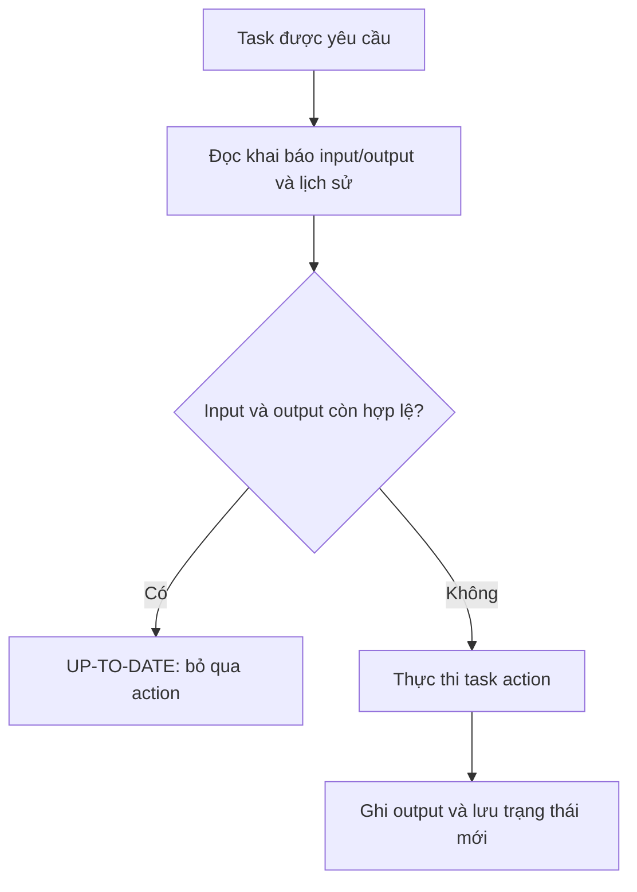

# Kiểm tra đầu vào và đầu ra để bỏ qua tác vụ không cần chạy

Một build Java có thể thực hiện hàng trăm tác vụ: biên dịch mã nguồn, xử lý resource, tạo mã sinh tự động, chạy kiểm thử, đóng gói và tạo báo cáo. Nếu mỗi lần gọi Gradle đều thực hiện lại tất cả công việc, build sẽ chậm và tiêu tốn tài nguyên. Gradle có cơ chế kiểm tra trạng thái tác vụ (up-to-date checking) để bỏ qua task khi đầu vào không thay đổi và đầu ra trước đó vẫn còn hợp lệ.

Cơ chế này chỉ đáng tin khi task mô tả đầy đủ dữ liệu mà nó đọc và những kết quả mà nó tạo ra. Gradle cần biết **input nào ảnh hưởng đến kết quả, output nào thuộc quyền sở hữu của task và những thay đổi nào buộc task phải chạy lại**. Nếu bỏ sót một input hoặc không khai báo output, Gradle có thể giữ lại kết quả cũ không còn đúng. Nếu khai báo sai, task có thể chạy thừa hoặc bị bỏ qua khi đáng lẽ phải chạy.

## 1. Up-to-date checking hoạt động như thế nào?

Gradle lưu trạng thái thực thi của task, gồm thông tin về task implementation, input và output đã được khai báo. Khi task được yêu cầu ở lần build tiếp theo, Gradle so sánh trạng thái hiện tại với snapshot đã lưu từ lần chạy trước.

Một task có thể được đánh dấu `UP-TO-DATE` khi:

- Task đã có lịch sử thực thi phù hợp.
- Các input đã khai báo không thay đổi theo cách ảnh hưởng đến task.
- Các output được khai báo vẫn tồn tại và có nội dung/trạng thái như Gradle mong đợi.
- Implementation và những yếu tố liên quan đến task không làm mất hiệu lực kết quả trước đó.

Khi những điều kiện cần thiết không còn đúng, Gradle thực thi task action để tạo lại output. Việc so sánh dựa trên snapshot/fingerprint của input và output, không chỉ dựa vào việc file có timestamp mới hơn hay không. Gradle có thể dùng thông tin hệ thống file và cache snapshot để tối ưu việc phát hiện thay đổi, nhưng nội dung và thuộc tính được khai báo mới là cơ sở cho tính đúng đắn.

Ví dụ, task `compileJava` phụ thuộc vào mã nguồn, classpath biên dịch và các tùy chọn compiler. Nếu các đầu vào này không thay đổi và class output vẫn hợp lệ, Gradle có thể bỏ qua việc biên dịch. Nếu một file Java thay đổi, dependency trên compile classpath thay đổi hoặc output class bị xóa, task cần được thực thi lại hoặc thực hiện biên dịch tăng dần theo khả năng của task.



`UP-TO-DATE` có nghĩa Gradle không cần chạy lại task trong lần build hiện tại. Nó không có nghĩa Gradle vừa chạy test hoặc vừa biên dịch lại mã nguồn.

## 2. Input và output là hợp đồng của task

Task input là mọi dữ liệu có thể làm thay đổi kết quả task. Task output là những file hoặc thư mục được task tạo ra và chịu trách nhiệm cập nhật.

Ví dụ task chuẩn hóa một file văn bản:

```text
src/data/input.txt
       |
       v
  normalizeText
       |
       v
build/generated/normalized.txt
```

Trong ví dụ này:

- `src/data/input.txt` là input.
- Giá trị cấu hình như chế độ chuẩn hóa là input nếu nó ảnh hưởng nội dung kết quả.
- `build/generated/normalized.txt` là output.

Nếu task còn đọc một file cấu hình hoặc biến môi trường nhưng không khai báo chúng, Gradle không biết thay đổi đó có thể làm output khác đi. Ngược lại, nếu khai báo một file không thực sự được sử dụng làm input, task có thể chạy lại không cần thiết khi file đó thay đổi.

### 2.1. Những loại input phổ biến

| Loại input | Ví dụ | Cách khai báo thường gặp |
|---|---|---|
| Một file bắt buộc | File schema, file cấu hình, mã nguồn đơn. | `@InputFile` hoặc `inputs.file(...)`. |
| Nhiều file | Danh sách source, file template, thư viện. | `@InputFiles` hoặc `inputs.files(...)`. |
| Một thư mục | Cây file nguồn hoặc thư mục resource. | `@InputDirectory` hoặc `inputs.dir(...)`. |
| Giá trị scalar | Mode, phiên bản schema, tên profile. | `@Input` hoặc `inputs.property(...)`. |
| Dependency classpath | JAR và class cần thiết để biên dịch/chạy. | `@Classpath`, `@CompileClasspath` hoặc file collection thích hợp. |
| Nhóm thuộc tính có cấu trúc | Một object chứa nhiều property đầu vào. | `@Nested` kết hợp các annotation input ở object con. |

### 2.2. Những loại output phổ biến

| Loại output | Ví dụ | Cách khai báo thường gặp |
|---|---|---|
| Một file | JAR, JSON report, file đã chuyển đổi. | `@OutputFile` hoặc `outputs.file(...)`. |
| Một thư mục | Class files, generated sources, resource đã xử lý. | `@OutputDirectory` hoặc `outputs.dir(...)`. |
| Nhiều file được xác định riêng | Một nhóm artifact có tên cố định. | Nhiều output file property hoặc `outputs.files(...)`. |

Gradle cần biết output nào do task sở hữu để xác định output có còn tồn tại và hợp lệ hay không. Một task ghi file vào thư mục tùy ý nhưng không khai báo output có thể chạy lại mỗi lần hoặc không được quản lý đúng theo kỳ vọng.

## 3. Khai báo input/output bằng API của task

Với task tự định nghĩa, có thể khai báo input và output bằng annotation trên property. Đây là cách rõ ràng khi muốn tái sử dụng task type trong nhiều project.

Ví dụ task chuyển nội dung thành chữ thường:

```groovy
import org.gradle.api.DefaultTask
import org.gradle.api.file.RegularFileProperty
import org.gradle.api.provider.Property
import org.gradle.api.tasks.CacheableTask
import org.gradle.api.tasks.Input
import org.gradle.api.tasks.InputFile
import org.gradle.api.tasks.OutputFile
import org.gradle.api.tasks.PathSensitive
import org.gradle.api.tasks.PathSensitivity
import org.gradle.api.tasks.TaskAction

import java.util.Locale

@CacheableTask
abstract class NormalizeTextTask extends DefaultTask {
    @InputFile
    @PathSensitive(PathSensitivity.RELATIVE)
    abstract RegularFileProperty getSourceFile()

    @Input
    abstract Property<String> getMode()

    @OutputFile
    abstract RegularFileProperty getOutputFile()

    @TaskAction
    void normalize() {
        File source = sourceFile.get().asFile
        File target = outputFile.get().asFile
        target.parentFile.mkdirs()

        String text = source.getText('UTF-8')
        if (mode.get() == 'trim-lowercase') {
            text = text.trim().toLowerCase(Locale.ROOT)
        }

        target.setText(text, 'UTF-8')
    }
}

tasks.register('normalizeText', NormalizeTextTask) {
    sourceFile.set(layout.projectDirectory.file('src/data/input.txt'))
    mode.set('trim-lowercase')
    outputFile.set(layout.buildDirectory.file('generated/normalized.txt'))
}
```

Các annotation mô tả hợp đồng:

- `@InputFile` nói rằng task cần một file đầu vào bắt buộc.
- `@PathSensitive(PathSensitivity.RELATIVE)` xác định cách đường dẫn được tính khi Gradle snapshot file.
- `@Input` nói rằng giá trị `mode` ảnh hưởng đến kết quả.
- `@OutputFile` nói rằng task sở hữu file kết quả.
- `@CacheableTask` cho phép task tham gia build cache nếu task thực sự có thể tái tạo output từ các input đã khai báo và không có side effect ẩn.

Nếu nội dung `input.txt` hoặc `mode` thay đổi, Gradle nhận ra fingerprint input khác và chạy lại task. Nếu input không đổi nhưng output bị xóa hoặc sửa, task cũng phải chạy lại để khôi phục output đúng.

### 3.1. Khai báo bằng `inputs` và `outputs` trong task registration

Với task đơn giản, có thể khai báo trực tiếp trong build script:

```groovy
def sourceFile = layout.projectDirectory.file('src/data/input.txt')
def resultFile = layout.buildDirectory.file('generated/normalized.txt')
def mode = providers.gradleProperty('normalizeMode').orElse('standard')

tasks.register('normalizeData') {
    inputs.file(sourceFile)
        .withPropertyName('sourceFile')
        .withPathSensitivity(PathSensitivity.RELATIVE)

    inputs.property('mode', mode)
    outputs.file(resultFile)

    doLast {
        File source = sourceFile.asFile
        File target = resultFile.get().asFile
        target.parentFile.mkdirs()

        String content = source.getText('UTF-8')
        if (mode.get() == 'trim-lowercase') {
            content = content.trim().toLowerCase(Locale.ROOT)
        }
        target.setText(content, 'UTF-8')
    }
}
```

`inputs.file`, `inputs.property` và `outputs.file` cho Gradle biết dữ liệu nào cần theo dõi. `Provider` của Gradle cho phép lấy giá trị cấu hình theo cách lazy; task chỉ cần đọc giá trị khi action thực thi.

Nếu dùng file hoặc thư mục do task khác tạo ra, hãy truyền output provider của producer vào input của consumer để Gradle vừa nhận biết dữ liệu vừa suy ra quan hệ task dependency khi provider giữ metadata producer.

## 4. Khai báo đầy đủ mọi yếu tố ảnh hưởng kết quả

Một nguyên tắc quan trọng là: nếu thay đổi một giá trị có thể làm output khác đi, giá trị đó cần được mô hình hóa như input hoặc được xử lý bằng một cơ chế tracking phù hợp.

Ví dụ task đọc file cấu hình:

```groovy
def source = layout.projectDirectory.file('src/data/input.json')
def config = layout.projectDirectory.file('config/transform.properties')
def output = layout.buildDirectory.file('generated/output.json')

tasks.register('transformJson') {
    inputs.file(source)
    inputs.file(config)
    outputs.file(output)

    doLast {
        // Đọc cả source và config để tạo output.
    }
}
```

Nếu task đọc `config/transform.properties` nhưng chỉ khai báo `source`, khi config thay đổi Gradle có thể vẫn đánh dấu task `UP-TO-DATE`. Đó là lỗi khai báo input.

Những yếu tố dễ bị bỏ sót:

- File cấu hình, template hoặc schema được đọc từ ngoài source directory.
- Property truyền qua command line hoặc Gradle property.
- Biến môi trường như profile, locale hoặc endpoint nếu nó làm thay đổi nội dung output.
- Phiên bản công cụ bên ngoài mà task gọi.
- Compiler option, encoding, target release hoặc annotation processor.
- Nội dung dependency/classpath được dùng để tạo output.
- File được sinh bởi task khác hoặc một bước chuẩn bị ngoài build.

Không phải mọi biến môi trường đều phải khai báo. Chỉ những giá trị thực sự ảnh hưởng đến output hoặc hành vi được mô hình hóa của task mới cần làm input. Nếu task đọc một environment variable, hãy cân nhắc chuyển nó thành `Provider` rồi khai báo qua `inputs.property`.

Ví dụ:

```groovy
def buildProfile = providers.environmentVariable('BUILD_PROFILE').orElse('dev')

tasks.register('generateProfileConfig') {
    inputs.property('buildProfile', buildProfile)
    outputs.file(layout.buildDirectory.file('generated/profile.txt'))

    doLast {
        def target = layout.buildDirectory.file('generated/profile.txt').get().asFile
        target.parentFile.mkdirs()
        target.setText(buildProfile.get(), 'UTF-8')
    }
}
```

Khi `BUILD_PROFILE` đổi từ `dev` sang `prod`, input property đổi và task phải thực thi lại.

## 5. Path sensitivity: đường dẫn file có phải là input không?

Với file input, Gradle không chỉ cần biết nội dung mà còn cần biết đường dẫn có ý nghĩa với task hay không. `PathSensitivity` quyết định mức độ đường dẫn tham gia fingerprint.

| Path sensitivity | Gradle tính đến điều gì? | Khi nào dùng? |
|---|---|---|
| `ABSOLUTE` | Đường dẫn tuyệt đối của file. | Khi vị trí tuyệt đối thực sự ảnh hưởng kết quả. |
| `RELATIVE` | Đường dẫn tương đối bên trong root input. | Khi cấu trúc thư mục quan trọng nhưng workspace có thể nằm ở vị trí khác. |
| `NAME_ONLY` | Tên file, không giữ cấu trúc thư mục đầy đủ. | Khi task chỉ quan tâm tên file. |
| `NONE` | Bỏ qua đường dẫn, chỉ xét nội dung file theo cách chuẩn hóa phù hợp. | Khi output chỉ phụ thuộc nội dung và không phụ thuộc tên/vị trí. |

Ví dụ, một task đóng gói cây tài nguyên cần giữ cấu trúc tương đối nên `RELATIVE` thường phù hợp. Một task chỉ tính checksum nội dung có thể không cần đường dẫn. Chọn sai sensitivity có thể làm task chạy lại thừa hoặc làm Gradle bỏ qua khi đường dẫn có ý nghĩa đã thay đổi.

Với classpath, nên dùng `@Classpath` hoặc `@CompileClasspath` thay vì khai báo như một tập file thông thường. Các annotation này dùng quy tắc normalization phù hợp với dependency classpath, tránh việc vị trí cài đặt JAR trên máy khác nhau làm mất tính tái sử dụng không cần thiết.

## 6. Optional input, file collection và nested properties

Không phải input nào cũng bắt buộc có mặt. Một property tùy chọn có thể được khai báo bằng `@Optional` kết hợp annotation input phù hợp.

Ví dụ:

```groovy
abstract class OptionalConfigTask extends DefaultTask {
    @InputFile
    @Optional
    @PathSensitive(PathSensitivity.RELATIVE)
    abstract RegularFileProperty getConfigFile()

    @OutputFile
    abstract RegularFileProperty getOutputFile()

    @TaskAction
    void runTask() {
        // Xử lý trường hợp configFile không được cung cấp.
    }
}
```

`@Optional` cho Gradle biết input có thể không được thiết lập. Task action phải xử lý trường hợp đó; annotation không tự tạo giá trị mặc định.

Với nhiều file, dùng `@InputFiles`. Nếu task cần thư mục tồn tại, dùng `@InputDirectory`. Nếu tập file có thể rỗng và muốn task được bỏ qua khi không có nguồn, cân nhắc `@SkipWhenEmpty`.

Ví dụ khai báo nhiều file:

```groovy
abstract class MergeReportsTask extends DefaultTask {
    @InputFiles
    @PathSensitive(PathSensitivity.RELATIVE)
    abstract ConfigurableFileCollection getReportFiles()

    @OutputFile
    abstract RegularFileProperty getMergedReport()
}
```

Với nhóm input có cấu trúc, `@Nested` cho phép Gradle snapshot các property input bên trong object. Cách này hữu ích khi task nhận một cấu hình phức tạp gồm nhiều giá trị, nhưng từng property con vẫn cần được chú thích đúng loại input.

## 7. Output phải được khai báo và thuộc quyền sở hữu của task

Gradle dùng output để xác định task có thể bỏ qua hay cần tạo lại dữ liệu. Nếu task tạo một file nhưng không khai báo nó là output, Gradle không có hợp đồng rõ ràng để kiểm tra file đó còn hợp lệ hay không.

Một task có input nhưng không khai báo output thường không thể được đánh dấu up-to-date dựa trên trạng thái output; task sẽ thực thi lại khi được yêu cầu (trừ các điều kiện skip khác). Vì vậy, task chỉ ghi file nên khai báo output file/directory tương ứng.

### 7.1. Output bị xóa hoặc sửa

Giả sử lần trước task tạo `build/generated/result.json`. Trước lần build tiếp theo:

- Nếu file bị xóa, Gradle thấy output không còn và chạy task để tạo lại.
- Nếu file bị sửa thủ công, snapshot output khác và task chạy lại.
- Nếu input đổi, task chạy lại dù output vẫn tồn tại.
- Nếu cả input và output không đổi, task có thể `UP-TO-DATE`.

Điều này chỉ đúng khi output đã được khai báo chính xác và task thực sự sở hữu output đó.

### 7.2. Không để nhiều task cùng sở hữu một output

Nếu hai task cùng ghi vào một file hoặc cùng khai báo một output directory, Gradle khó xác định quyền sở hữu và tính đúng đắn của từng kết quả. Build có thể gặp race condition, output bị ghi đè hoặc up-to-date checking không còn đáng tin.

Mỗi output nên có một producer rõ ràng. Nếu cần nhiều task cập nhật cùng artifact, hãy tổ chức chúng thành một pipeline: task trước tạo file trung gian riêng, task sau tổng hợp thành output cuối cùng.

### 7.3. Output directory và file cũ

Khi task tạo nhiều file trong output directory, cần quyết định rõ cách xử lý file không còn được tạo ở lần chạy mới. Một task chỉ copy file mới mà không xóa file cũ có thể để lại artifact lỗi thời. Với task xử lý tăng dần, phải xử lý cả `REMOVED` file change hoặc làm sạch output khi cần full rebuild.

## 8. Kết quả task: `UP-TO-DATE`, `FROM-CACHE` và các trạng thái khác

Các trạng thái task thường gặp trên terminal có ý nghĩa khác nhau:

| Trạng thái | Ý nghĩa |
|---|---|
| `SUCCESS` | Task đã thực thi và hoàn tất thành công. |
| `UP-TO-DATE` | Gradle xác định input không đổi và output trước đó còn hợp lệ, nên bỏ qua action. |
| `FROM-CACHE` | Gradle lấy output phù hợp từ build cache thay vì thực thi task action. |
| `NO-SOURCE` | Task không có source/input file phù hợp để xử lý theo cấu hình. |
| `SKIPPED` | Task bị bỏ qua do điều kiện hoặc cấu hình, chẳng hạn `onlyIf` không thỏa. |
| `FAILED` | Task thực thi hoặc validation thất bại. |

`UP-TO-DATE` và `FROM-CACHE` đều có thể giúp tránh thực thi task action, nhưng cơ chế khác nhau:

- `UP-TO-DATE` dùng lịch sử task và snapshot cục bộ để xác định output hiện tại đã đúng.
- `FROM-CACHE` khôi phục output từ build cache khi cache key khớp, kể cả khi workspace hiện tại chưa có output đó.

Task có thể được `UP-TO-DATE` mà không bật build cache. Ngược lại, task cacheable có thể được khôi phục từ cache trên một workspace mới.

`NO-SOURCE` không có nghĩa test đã pass hoặc mọi output đã được tạo. Nó chỉ nói task không có source phù hợp để xử lý. `SKIPPED` cũng không chứng minh task đã thực hiện kiểm tra. Khi đọc CI log, hãy xem task outcome chứ không chỉ nhìn dòng `BUILD SUCCESSFUL`.

## 9. Phân biệt up-to-date checking với incremental execution

Up-to-date checking trả lời câu hỏi: “Có cần chạy task lần này không?”. Nếu toàn bộ input/output còn hợp lệ, Gradle bỏ qua task action.

Incremental execution trả lời câu hỏi khác: “Nếu task phải chạy, có thể chỉ xử lý phần input thay đổi hay không?”. Một task incremental vẫn được thực thi, nhưng nhận danh sách file đã thêm, sửa hoặc xóa để xử lý phần thay đổi.

Ví dụ:

- Không có file nào thay đổi: task có thể `UP-TO-DATE`, action không chạy.
- Một file trong source directory thay đổi: task incremental chạy và chỉ xử lý file đó.
- Task chạy lần đầu hoặc mất lịch sử trạng thái: task thực hiện full processing.
- Output bị xóa hoặc task implementation thay đổi: task có thể phải full rebuild.

Gradle không tự động làm mọi task thành incremental chỉ vì input/output đã khai báo. Task type cần hỗ trợ incremental execution và xử lý file changes đúng cách.

## 10. Viết task incremental bằng `InputChanges`

Với task xử lý nhiều file, Gradle cung cấp `InputChanges` để task biết file nào được thêm, sửa hoặc xóa. File input cần được đánh dấu `@Incremental` cùng `@InputDirectory` hoặc `@InputFiles` phù hợp.

Ví dụ task đồng bộ một cây file nguồn sang output directory:

```groovy
import org.gradle.api.DefaultTask
import org.gradle.api.file.DirectoryProperty
import org.gradle.api.file.FileType
import org.gradle.api.tasks.CacheableTask
import org.gradle.api.tasks.Incremental
import org.gradle.api.tasks.InputDirectory
import org.gradle.api.tasks.OutputDirectory
import org.gradle.api.tasks.PathSensitive
import org.gradle.api.tasks.PathSensitivity
import org.gradle.api.tasks.TaskAction
import org.gradle.work.ChangeType
import org.gradle.work.InputChanges

import java.nio.file.Files
import java.nio.file.StandardCopyOption

@CacheableTask
abstract class SyncSourceFilesTask extends DefaultTask {
    @Incremental
    @InputDirectory
    @PathSensitive(PathSensitivity.RELATIVE)
    abstract DirectoryProperty getSourceDirectory()

    @OutputDirectory
    abstract DirectoryProperty getDestinationDirectory()

    @TaskAction
    void sync(InputChanges changes) {
        File sourceRoot = sourceDirectory.get().asFile
        File destinationRoot = destinationDirectory.get().asFile

        if (!changes.incremental) {
            destinationRoot.deleteDir()
        }
        destinationRoot.mkdirs()

        changes.getFileChanges(sourceDirectory).each { change ->
            if (change.fileType != FileType.FILE) {
                return
            }

            File target = new File(destinationRoot, change.normalizedPath)

            if (change.changeType == ChangeType.REMOVED) {
                Files.deleteIfExists(target.toPath())
            } else {
                File source = new File(sourceRoot, change.normalizedPath)
                target.parentFile.mkdirs()
                Files.copy(
                    source.toPath(),
                    target.toPath(),
                    StandardCopyOption.REPLACE_EXISTING
                )
            }
        }
    }
}

tasks.register('syncSourceFiles', SyncSourceFilesTask) {
    sourceDirectory.set(layout.projectDirectory.dir('src/data'))
    destinationDirectory.set(layout.buildDirectory.dir('synced/data'))
}
```

Ví dụ thể hiện các nguyên tắc chính:

1. `@Incremental` đánh dấu directory input có thể cung cấp file changes.
2. `@PathSensitive(RELATIVE)` giữ cấu trúc tương đối của file trong cây nguồn.
3. `@OutputDirectory` xác định nơi task sở hữu các file đã đồng bộ.
4. Khi `changes.incremental` là `false`, task làm sạch output rồi xử lý lại toàn bộ input.
5. Khi có thay đổi, task xử lý `ADDED`, `MODIFIED` và `REMOVED` tương ứng.

Trong một lần chạy không incremental, Gradle có thể cung cấp các file hiện tại như những file cần được xử lý lại. Vì output đã được làm sạch, task có thể tái tạo toàn bộ nội dung. Trong lần chạy incremental, task cần xóa output tương ứng khi input bị xóa để không để lại file cũ.

Ví dụ dùng `File.deleteDir()` để làm rõ thao tác xóa output trong task action mà không cần truy cập `Project` ở execution phase. Với task type dùng lâu dài, nên tiếp tục ưu tiên các API/service file system phù hợp và tránh lưu hoặc truy cập trạng thái project không cần thiết trong execution phase.

## 11. `@SkipWhenEmpty` và task không có source

Một số task chỉ có ý nghĩa khi có file đầu vào. Có thể đánh dấu input file collection hoặc input directory bằng `@SkipWhenEmpty` để Gradle bỏ qua task khi không có file phù hợp.

Ví dụ:

```groovy
abstract class GenerateDocsTask extends DefaultTask {
    @SkipWhenEmpty
    @InputFiles
    @PathSensitive(PathSensitivity.RELATIVE)
    abstract ConfigurableFileCollection getSourceFiles()

    @OutputDirectory
    abstract DirectoryProperty getOutputDirectory()
}
```

Khi collection rỗng, task có thể được đánh dấu `NO-SOURCE`. Điều này hữu ích cho task compile hoặc generate khi source set không có file tương ứng.

`@SkipWhenEmpty` khác với `onlyIf`:

- `@SkipWhenEmpty` dựa trên việc tập file input có nội dung để xử lý hay không.
- `onlyIf` bỏ qua task dựa trên một điều kiện logic tùy ý.

Không nên dùng `onlyIf` để che giấu một input chưa được khai báo. Nếu biến môi trường hoặc property ảnh hưởng việc task có cần chạy hay không, hãy mô hình hóa điều kiện và input rõ ràng.

## 12. `@Internal`, `@LocalState` và dữ liệu không tham gia fingerprint

Task property cần được phân loại đúng:

- `@Input`/`@InputFile`/`@InputFiles`/... tham gia xác định trạng thái input.
- `@OutputFile`/`@OutputDirectory`/... xác định output do task tạo.
- `@Internal` nói rằng property không phải input/output được Gradle theo dõi.
- `@LocalState` mô tả dữ liệu trạng thái cục bộ có thể được task dùng nhưng không phải output có thể chia sẻ qua build cache.

Nếu một giá trị được đánh dấu `@Internal` nhưng thực tế ảnh hưởng đến output, Gradle sẽ không đưa giá trị đó vào fingerprint. Task có thể bị đánh dấu `UP-TO-DATE` dù kết quả cần thay đổi. Chỉ dùng `@Internal` cho thông tin không ảnh hưởng kết quả được mô hình hóa.

`@LocalState` phù hợp với dữ liệu trung gian hoặc trạng thái cục bộ giúp task chạy hiệu quả hơn nhưng có thể tái tạo khi cần. Không nên dùng local state làm sản phẩm cuối mà consumer khác cần đọc; sản phẩm đó phải được khai báo output.

## 13. Task có side effect không nên bị bỏ qua sai cách

Một task có thể gửi HTTP request, upload artifact, cập nhật database hoặc triển khai ứng dụng. Nếu Gradle chỉ nhìn thấy một file output đánh dấu không đổi, task có thể bị `UP-TO-DATE` dù trạng thái hệ thống bên ngoài đã thay đổi.

Ví dụ task publish có thể tạo một file `published.txt` sau khi upload. Lần sau Gradle thấy file đó còn nguyên và bỏ qua task, trong khi artifact trên server có thể đã bị xóa hoặc cần publish lại.

Với task có side effect:

- Không khai báo output giả để làm task có vẻ up-to-date.
- Không đánh dấu task cacheable nếu khôi phục output không tái tạo được side effect.
- Mô hình hóa trạng thái ngoài như input khi có thể xác định và kiểm soát được.
- Nếu task bắt buộc phải thực hiện mỗi lần được gọi, có thể dùng điều kiện up-to-date phù hợp, ví dụ `outputs.upToDateWhen { false }`.
- Thiết kế thao tác ngoài có tính idempotent, retry và logging phù hợp.

Ví dụ buộc task luôn chạy:

```groovy
tasks.register('publishExternalArtifact') {
    outputs.upToDateWhen { false }

    doLast {
        // Thực hiện publish tới hệ thống bên ngoài.
    }
}
```

Đây là lựa chọn có chủ đích cho task cần thực hiện mỗi lần. Không dùng `outputs.upToDateWhen { false }` như cách sửa chung cho task bị khai báo input/output sai; nó làm mất lợi ích up-to-date checking và che đi lỗi mô hình hóa.

## 14. Build cache khác với up-to-date checking

Hai cơ chế cùng giảm công việc nhưng giải quyết tình huống khác nhau.

| Cơ chế | Điều kiện điển hình | Kết quả |
|---|---|---|
| Up-to-date checking | Task đã chạy trong workspace và input/output hiện tại khớp trạng thái trước đó. | Bỏ qua task action, giữ output hiện tại. |
| Build cache | Task cacheable, cache key khớp và có output trong cache. | Khôi phục output từ cache. |
| Incremental execution | Task hỗ trợ `InputChanges` và chỉ một phần file input thay đổi. | Chạy task action nhưng chỉ xử lý phần thay đổi. |

Task cacheable cần có output xác định và kết quả có thể tái tạo từ input đã khai báo. `@CacheableTask` là annotation dùng cho task type tùy chỉnh có thể cache. Không phải task nào cũng nên cache; task phụ thuộc thời gian hiện tại, random value, trạng thái máy hoặc hệ thống ngoài mà không khai báo đầy đủ sẽ tạo kết quả không đáng tin.

Có thể bật build cache khi chạy:

```bash
./gradlew build --build-cache
```

Hoặc cấu hình trong `gradle.properties`:

```properties
org.gradle.caching=true
```

Build cache không thay thế khai báo input/output. Cache key chỉ đáng tin khi task mô tả đầy đủ những yếu tố ảnh hưởng kết quả.

## 15. Cách quan sát task outcome và kiểm tra khai báo

Khi muốn hiểu vì sao task được chạy hoặc bị bỏ qua, hãy dùng log và task outcome.

Chạy task với log chi tiết:

```bash
./gradlew normalizeText --info
```

Gradle thường giải thích task được thực thi hay `UP-TO-DATE`, và trong nhiều trường hợp cho biết input/output nào làm task cần chạy lại.

Yêu cầu chạy lại task dù trạng thái trước đó còn hợp lệ:

```bash
./gradlew normalizeText --rerun-tasks
```

`--rerun-tasks` hữu ích để so sánh một lần thực thi mới, nhưng không sửa khai báo input/output sai. Nó cũng không tự đưa vào task graph những producer chưa được nối dependency.

Xem task graph mà không chạy action:

```bash
./gradlew build --dry-run
```

`--dry-run` cho biết task nào dự kiến được gọi; nó không xác minh nội dung file hoặc kết quả up-to-date thực tế.

Một số câu hỏi khi điều tra:

- Task có khai báo mọi file, property và classpath ảnh hưởng kết quả không?
- Output có được khai báo và có đúng vị trí task thực sự ghi không?
- Task có đọc biến môi trường hoặc file ngoài mà Gradle không biết không?
- Path sensitivity có phù hợp với cách task dùng file không?
- Có output bị sửa hoặc xóa sau lần chạy trước không?
- Có task khác ghi vào cùng output không?
- Task có side effect ngoài mà up-to-date checking không thể quan sát không?
- Nếu là incremental task, có xử lý cả file bị xóa và trường hợp full rebuild không?

## 16. Các lỗi mô hình hóa thường gặp

| Sai sót | Hệ quả | Cách xử lý |
|---|---|---|
| Không khai báo file cấu hình được đọc | Task có thể `UP-TO-DATE` dù config đổi. | Khai báo config là input file. |
| Không khai báo giá trị mode/profile | Thay đổi property không làm task chạy lại. | Đưa giá trị vào `inputs.property` hoặc `@Input`. |
| Không khai báo output file | Gradle không có output để xác định trạng thái hợp lệ. | Khai báo `outputs.file` hoặc `@OutputFile`. |
| Khai báo output sai vị trí | Task ghi file ở nơi khác với nơi Gradle theo dõi. | Dùng cùng provider cho output declaration và task action. |
| Dùng `@Internal` cho giá trị ảnh hưởng output | Thay đổi giá trị không làm fingerprint đổi. | Dùng annotation input phù hợp. |
| Path sensitivity không phù hợp | Build chạy lại thừa hoặc bỏ qua khi path có ý nghĩa thay đổi. | Chọn `ABSOLUTE`, `RELATIVE`, `NAME_ONLY` hoặc `NONE` theo semantics. |
| Nhiều task cùng ghi output | Race condition và trạng thái up-to-date không rõ. | Mỗi output có một producer sở hữu. |
| Incremental task không xử lý `REMOVED` | File đã xóa ở input vẫn còn trong output. | Xóa output tương ứng hoặc full rebuild. |
| Task publish có output marker giả | Gradle có thể bỏ qua publish khi hệ thống ngoài đã thay đổi. | Tách side effect hoặc buộc task chạy theo chính sách rõ ràng. |
| Nhầm `UP-TO-DATE` với `FROM-CACHE` | Đọc sai lý do task action không chạy. | Xem task outcome và build cache configuration. |

## 17. Quy trình thiết kế task có thể bỏ qua an toàn

Khi viết task mới hoặc cải thiện task hiện có, có thể làm theo trình tự:

1. Liệt kê mọi dữ liệu task đọc: file, thư mục, property, classpath và môi trường.
2. Xác định dữ liệu nào thực sự làm thay đổi output.
3. Khai báo input bằng property/API phù hợp, chọn path sensitivity đúng.
4. Xác định file hoặc thư mục do task sở hữu và khai báo output.
5. Bảo đảm task action chỉ ghi vào output đã khai báo và không để nhiều task tranh chấp cùng output.
6. Nếu xử lý nhiều file, cân nhắc incremental execution bằng `InputChanges` và xử lý cả `ADDED`, `MODIFIED`, `REMOVED`.
7. Nếu không có source, dùng `@SkipWhenEmpty` khi phù hợp; nếu có side effect, thiết kế chính sách chạy riêng.
8. Chỉ đánh dấu task cacheable khi kết quả tái tạo được từ tập input đầy đủ.
9. Chạy task hai lần để quan sát lần đầu thực thi và lần sau có thể `UP-TO-DATE`.
10. Thay đổi lần lượt từng input và output để xác nhận task được thực thi lại đúng lúc.

## 18. Ví dụ kiểm chứng hành vi up-to-date

Với task `normalizeText` ở phần trước, có thể quan sát các trường hợp:

| Thao tác | Kết quả mong đợi |
|---|---|
| Chạy lần đầu | Task thực thi và tạo output. |
| Chạy lại không thay đổi gì | Task có thể `UP-TO-DATE`. |
| Sửa nội dung `src/data/input.txt` | Task thực thi lại. |
| Đổi property `normalizeMode` | Task thực thi lại. |
| Xóa output `build/generated/normalized.txt` | Task thực thi lại để tạo output. |
| Sửa output thủ công | Task thực thi lại để khôi phục output theo input. |
| Chạy trên workspace mới có cache phù hợp | Task có thể `FROM-CACHE` nếu được đánh dấu cacheable và cache hit. |

Để quan sát:

```bash
./gradlew normalizeText --info
./gradlew normalizeText --info
```

Sau lần đầu, lần chạy thứ hai không thay đổi input/output thường cho thấy `UP-TO-DATE`. Nếu task luôn chạy, hãy kiểm tra output đã khai báo chưa, có input nào thay đổi mỗi lần không, task có được cấu hình `outputs.upToDateWhen { false }` không và task có side effect khiến không thể bỏ qua không.

## 19. Nguyên tắc cần nhớ

- Up-to-date checking chỉ chính xác khi task khai báo đầy đủ input và output.
- Input bao gồm file, thư mục, property, classpath và mọi giá trị ảnh hưởng đến kết quả.
- Output phải là sản phẩm thực sự do task sở hữu, được ghi đúng nơi đã khai báo.
- Gradle so sánh snapshot/fingerprint của trạng thái task; không chỉ dựa vào timestamp.
- `UP-TO-DATE` khác `FROM-CACHE`, `NO-SOURCE` và `SKIPPED`.
- Incremental execution khác up-to-date checking: task incremental vẫn chạy nhưng chỉ xử lý file thay đổi.
- Task incremental phải xử lý file thêm, sửa, xóa và trường hợp full rebuild.
- `@Internal` không được dùng cho giá trị có ảnh hưởng đến output.
- Side effect bên ngoài cần chính sách riêng; không để output giả khiến Gradle bỏ qua thao tác cần thiết.
- Chỉ bật build cache cho task có kết quả xác định từ input đã khai báo đầy đủ.

Gradle có thể bỏ qua một task an toàn khi nó biết dữ liệu nào quyết định kết quả và có thể xác nhận output trước đó vẫn hợp lệ. Khai báo input/output là hợp đồng giữa task và build engine: input đầy đủ giúp phát hiện thay đổi, output rõ ràng giúp xác nhận kết quả còn dùng được. Khi cần xử lý một phần file thay đổi, `InputChanges` bổ sung khả năng thực thi tăng dần. Phân biệt đúng up-to-date checking, incremental execution và build cache giúp build nhanh hơn mà vẫn giữ kết quả đáng tin cậy.
