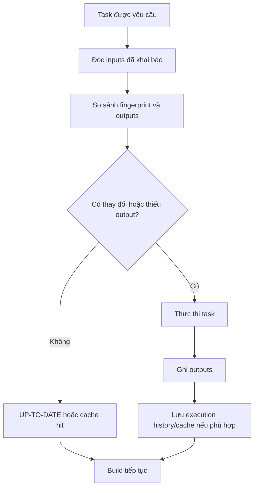

# Đầu vào ẩn gây kết quả sai dù tác vụ được coi là đã cập nhật

Build tăng dần giúp tiết kiệm thời gian bằng cách chỉ thực hiện lại những tác vụ có đầu vào thay đổi hoặc chưa có đầu ra hợp lệ. Cơ chế này chỉ đáng tin cậy khi build tool biết đầy đủ những gì ảnh hưởng đến kết quả của từng tác vụ.

Một tác vụ có thể đọc thêm biến môi trường, system property, file ngoài source tree, kết quả Git, thời gian hiện tại hoặc dữ liệu từ mạng mà không khai báo những giá trị đó là đầu vào. Khi các giá trị này thay đổi, Gradle có thể vẫn đánh dấu task là `UP-TO-DATE` hoặc lấy output cũ từ build cache. Build kết thúc thành công nhưng artifact chứa dữ liệu lỗi thời.

Đó là vấn đề **đầu vào ẩn (hidden input)**: tác vụ sử dụng một giá trị có ảnh hưởng đến output nhưng build tool không theo dõi giá trị đó. Bài học này giải thích cách hiện tượng xảy ra, cách mô hình hóa đầy đủ inputs/outputs và cách điều tra khi một task được coi là đã cập nhật nhưng kết quả không đúng.

## 1. Build tăng dần dựa trên những gì được khai báo

Để quyết định có cần chạy lại task hay không, build tool cần biết:

- Task đọc những đầu vào nào.
- Task tạo ra những đầu ra nào.
- Đầu vào hiện tại có khác với lần chạy trước không.
- Đầu ra hiện tại có còn tồn tại và phù hợp không.
- Có thể dùng lại kết quả đã lưu trong build cache hay không.

Với Gradle, task có thể khai báo inputs và outputs bằng API hoặc annotation. Gradle snapshot các thuộc tính được khai báo và dùng chúng để xác định task có cần thực thi lại hoặc có thể lấy output từ cache.



Sơ đồ chỉ thể hiện nguyên tắc. Gradle còn xét task implementation, classpath, loại task, trạng thái cache và các điều kiện thực thi khác. Nhưng điểm cốt lõi vẫn là: **Gradle chỉ có thể theo dõi chính xác những đầu vào được mô hình hóa trong build**.

Nếu task đọc một biến môi trường nhưng không khai báo nó, Gradle không thể biết biến đó đã thay đổi. Nếu task đọc file bên ngoài nhưng không khai báo file đó là input, thay đổi nội dung file có thể không làm task chạy lại. Nếu task ghi ra một file không khai báo là output, Gradle không thể quản lý đúng vòng đời và trạng thái của file đó.

## 2. Phân biệt `UP-TO-DATE`, build cache và configuration cache

Ba khái niệm thường bị nhầm lẫn:

| Cơ chế | Mục đích | Điều được tái sử dụng |
|---|---|---|
| Incremental build / up-to-date checking | Tránh thực thi lại task khi inputs và outputs được theo dõi không thay đổi. | Output đang có trong workspace của build. |
| Build cache | Tái sử dụng output của task từ local hoặc remote cache khi cache key phù hợp. | Output của task đã chạy trong một lần build khác. |
| Configuration cache | Tái sử dụng kết quả cấu hình build để giảm thời gian configuration. | Trạng thái cấu hình build, không phải output của task. |

Đầu vào ẩn có thể làm sai cả up-to-date checking và build cache vì cả hai phụ thuộc vào mô hình inputs/outputs. Configuration cache là cơ chế khác; một build có thể gặp vấn đề configuration cache do truy cập trạng thái không được hỗ trợ, nhưng đó không phải cùng một lỗi với task output bị stale.

### 2.1. `UP-TO-DATE`

Task có thể được đánh dấu `UP-TO-DATE` khi Gradle xác định inputs được theo dõi không đổi và outputs vẫn hợp lệ so với lần thực thi trước. Task không chạy lại action.

Nếu action đọc một giá trị ẩn đã thay đổi, kết luận `UP-TO-DATE` có thể sai về mặt ngữ nghĩa: Gradle thấy những gì nó biết vẫn giống nhau, trong khi task thực tế cần tạo output khác.

### 2.2. `FROM-CACHE`

Task có thể nhận output từ build cache nếu Gradle tìm thấy kết quả có cache key phù hợp. Cache key được tạo từ task implementation và các inputs được khai báo cùng các yếu tố Gradle theo dõi.

Nếu một input ảnh hưởng đến output bị bỏ sót, hai lần chạy với giá trị ẩn khác nhau có thể có cùng cache key. Khi đó, Gradle có thể trả về output của lần chạy trước dù kết quả đúng phải khác.

### 2.3. `NO-SOURCE`, `SKIPPED` và `SUCCESS`

Các trạng thái khác cũng cần được hiểu đúng:

- `NO-SOURCE`: task không có source phù hợp để xử lý.
- `SKIPPED`: task bị bỏ qua theo điều kiện hoặc cấu hình.
- `SUCCESS`: task đã thực thi và hoàn tất thành công.
- `UP-TO-DATE`: task không cần thực thi lại theo các inputs/outputs được theo dõi.
- `FROM-CACHE`: output được lấy từ build cache.

Task hiển thị `SUCCESS` cũng không chứng minh mọi đầu vào đều được khai báo. Nếu task chạy nhưng đọc một input ẩn, nó vẫn có thể tạo output không tái lập hoặc không thể cache an toàn.

## 3. Đầu vào ẩn là gì?

Một đầu vào là ẩn khi task phụ thuộc vào giá trị đó nhưng build tool không nhận biết nó là input cần fingerprint hoặc theo dõi.

Ví dụ task tạo file build information:

```groovy
tasks.register('writeBuildInfo') {
    outputs.file(layout.buildDirectory.file('generated/build-info.txt'))

    doLast {
        def version = project.version
        def branch = System.getenv('GIT_BRANCH')
        def output = layout.buildDirectory.file('generated/build-info.txt').get().asFile
        output.parentFile.mkdirs()
        output.text = "version=${version}\nbranch=${branch}\n"
    }
}
```

Task khai báo output nhưng không khai báo `project.version` hoặc `GIT_BRANCH` là inputs. Nếu branch thay đổi mà những inputs đã khai báo không thay đổi, Gradle có thể coi task là up-to-date và giữ nội dung branch cũ.

Task này có thể chạy đúng lần đầu, nên lỗi không xuất hiện ngay. Vấn đề chỉ lộ ra khi một giá trị ẩn thay đổi trong lúc Gradle vẫn quyết định không cần thực thi lại.

## 4. Các nguồn đầu vào ẩn thường gặp

### 4.1. Biến môi trường

Ví dụ:

```groovy
def environmentName = System.getenv('APP_ENV')
```

Task có thể tạo cấu hình khác nhau cho `dev`, `staging` và `production`. Nếu `APP_ENV` không được khai báo là input, Gradle không biết output phải thay đổi khi biến này đổi.

Các biến thường bị bỏ sót:

- `APP_ENV`, `DEPLOY_ENV`, `REGION`.
- `GIT_COMMIT`, `GIT_BRANCH`, `BUILD_NUMBER`.
- `JAVA_HOME`, biến trỏ tới compiler hoặc tool ngoài.
- Biến locale, timezone hoặc encoding.
- Biến điều khiển feature flag hay endpoint.

### 4.2. System properties và Gradle properties

Task có thể đọc:

```groovy
System.getProperty('app.mode')
project.findProperty('releaseVersion')
```

Nếu các giá trị này ảnh hưởng đến output, chúng cần được đưa vào mô hình input của task. Chỉ vì property được truyền qua `-D` hoặc `-P` không có nghĩa mọi task tùy chỉnh tự động theo dõi nó.

### 4.3. File nằm ngoài source root

Một task có thể đọc file ở thư mục home, thư mục cấu hình cá nhân, workspace khác hoặc đường dẫn tuyệt đối:

```groovy
def config = new File(System.getProperty('user.home'), '.company/build.properties')
```

Nếu file thay đổi mà không được khai báo là input, task có thể giữ output cũ. File ngoài project thường khó kiểm soát và có thể khác giữa máy local và CI.

### 4.4. Trạng thái Git

Task có thể gọi `git rev-parse HEAD`, đọc branch hiện tại, tag hoặc trạng thái dirty của working tree. Nếu kết quả Git ảnh hưởng đến manifest, resource hoặc version, nó là input.

Một ví dụ thường gặp là task ghi commit SHA vào `build-info.properties` nhưng không khai báo revision là input. Khi chuyển sang commit khác, file build information có thể vẫn chứa SHA cũ.

Tên branch cũng không phải định danh source revision ổn định: branch có thể di chuyển mà tên vẫn giữ nguyên. Nếu cần truy vết artifact, dùng commit SHA thực tế và đưa nó vào inputs.

### 4.5. Thời gian hiện tại và dữ liệu ngẫu nhiên

Task có thể ghi timestamp hoặc random ID vào output:

```groovy
def generatedAt = java.time.Instant.now()
```

Nếu thời gian không được khai báo, Gradle có thể tái sử dụng output cũ dù task được kỳ vọng tạo timestamp mới. Nếu khai báo thời gian hiện tại là input, giá trị sẽ đổi liên tục và task gần như luôn cần chạy lại; output cũng khó tái lập.

Hãy quyết định rõ mục tiêu:

- Nếu timestamp không cần thiết, bỏ nó khỏi artifact.
- Nếu cần thời điểm phát hành, truyền một giá trị build timestamp cố định từ pipeline và khai báo là input.
- Nếu cần random nhưng phải tái hiện được, truyền seed cố định và khai báo seed là input.
- Nếu task thật sự cần tạo giá trị mới mỗi lần, không đánh dấu task là cacheable và không giả định output có thể được tái sử dụng.

### 4.6. Nội dung từ mạng hoặc dịch vụ bên ngoài

Task có thể tải schema, gọi API, đọc remote configuration hoặc lấy dữ liệu từ một dịch vụ. URL không đủ để mô tả nội dung response nếu dữ liệu tại URL có thể thay đổi.

Nếu task chỉ khai báo URL nhưng không theo dõi phiên bản/checksum của nội dung, cache key có thể không thay đổi dù dữ liệu server đã đổi. Với download task, hãy mô hình hóa URL và các tham số request là inputs, file tải về là output, đồng thời dùng checksum, version hoặc cơ chế revalidation phù hợp để xác định nội dung.

Không nên cache tùy tiện task có side effect hoặc phụ thuộc dịch vụ ngoài không ổn định. Ví dụ task publish artifact, tạo ticket hoặc cập nhật trạng thái trên server không phải task thuần tạo file có thể cache như compile task.

### 4.7. Tool ngoài và cấu hình runtime

Task có thể gọi executable ngoài như `protoc`, `node`, `docker`, compiler native hoặc script shell. Đường dẫn executable, phiên bản tool, arguments và cấu hình của nó có thể ảnh hưởng đến output.

Nếu task chỉ theo dõi source file mà không theo dõi tool version hoặc tool configuration, thay đổi executable có thể không làm task chạy lại. Dùng Gradle toolchain hoặc dependency/plugin được quản lý khi có thể; với tool ngoài, khai báo version/path hoặc một file metadata làm input phù hợp.

### 4.8. Danh sách file và trạng thái thư mục

Task có thể quét thư mục bằng API Java hoặc shell nhưng chỉ khai báo một vài file cụ thể. Khi file mới được thêm hoặc xóa, output có thể phải thay đổi dù inputs đã khai báo không phản ánh đầy đủ tập file.

Hãy khai báo file collection hoặc directory input thay vì tự quét một thư mục không được theo dõi. Directory input cho phép Gradle theo dõi nội dung và tập file theo cấu hình sensitivity.

### 4.9. Dữ liệu do task khác tạo ra

Task B có thể đọc file do task A tạo ra nhưng chỉ tham chiếu một đường dẫn cứng. Nếu không khai báo quan hệ producer/consumer, Gradle có thể chạy B trước A hoặc không nhận biết output A là input của B.

Dùng task output provider làm input của task tiêu thụ để Gradle biết dữ liệu đến từ đâu và có thể suy ra dependency giữa các task.

## 5. Đầu ra ẩn cũng làm build tăng dần sai

Vấn đề không chỉ nằm ở input. Nếu task tạo hoặc sửa file nhưng không khai báo file đó là output, Gradle không thể quản lý trạng thái output một cách đầy đủ.

Ví dụ:

```groovy
tasks.register('generateReport') {
    doLast {
        file("${buildDir}/reports/custom/report.txt").text = 'report'
    }
}
```

Task không khai báo `outputs.file(...)`. Gradle không biết file report là output được quản lý của task. Điều này ảnh hưởng đến up-to-date checking, build cache và quan hệ dữ liệu với task khác.

Khai báo output:

```groovy
tasks.register('generateReport') {
    def reportFile = layout.buildDirectory.file('reports/custom/report.txt')
    outputs.file(reportFile)

    doLast {
        def output = reportFile.get().asFile
        output.parentFile.mkdirs()
        output.text = 'report'
    }
}
```

Task cũng cần tránh ghi ra các file ngoài output đã khai báo. Nếu hai task cùng ghi một thư mục hoặc cùng sửa một file mà không có quan hệ rõ ràng, kết quả có thể phụ thuộc thứ tự chạy và làm cache không an toàn.

## 6. Khai báo inputs và outputs trong Gradle

Gradle cung cấp API khai báo inputs/outputs trong task action DSL và annotation cho custom task type.

### 6.1. Các loại input thường dùng

| API/annotation | Mục đích |
|---|---|
| `inputs.property(...)` / `@Input` | Giá trị scalar như version, environment, flag hoặc seed. |
| `inputs.file(...)` / `@InputFile` | Một file đầu vào. |
| `inputs.files(...)` / `@InputFiles` | Một tập file đầu vào. |
| `inputs.dir(...)` / `@InputDirectory` | Một thư mục đầu vào. |
| `@Classpath` | Classpath đầu vào cần fingerprint theo semantics classpath. |
| `@CompileClasspath` | Classpath biên dịch, dùng normalization phù hợp cho compile task. |
| `@Nested` | Một object lồng chứa các property đầu vào được annotate. |
| `@Internal` | Property không tham gia fingerprint; không dùng cho giá trị thực sự ảnh hưởng output. |

### 6.2. Các loại output thường dùng

| API/annotation | Mục đích |
|---|---|
| `outputs.file(...)` / `@OutputFile` | Một file được task tạo ra. |
| `outputs.files(...)` / `@OutputFiles` | Nhiều file output. |
| `outputs.dir(...)` / `@OutputDirectory` | Thư mục output do task quản lý. |
| `@LocalState` | Trạng thái cục bộ không phải output có thể cache/phân phối. |

Đầu vào và đầu ra phải mô tả đúng những gì task thực sự đọc và ghi. Không khai báo một thư mục lớn làm output nếu task chỉ sở hữu một file trong đó và task khác cũng ghi chung thư mục; phạm vi output chồng lấn làm khó xác định quyền sở hữu và tính đúng đắn.

### 6.3. Khai báo property với Provider API

Gradle Provider API giúp kết nối property với giá trị đến từ project, environment hoặc task khác. Ví dụ:

```groovy
def appEnvironment = providers.environmentVariable('APP_ENV').orElse('dev')
def outputFile = layout.buildDirectory.file('generated/app-config.properties')

tasks.register('generateAppConfig') {
    inputs.property('appEnvironment', appEnvironment)
    outputs.file(outputFile)

    doLast {
        def file = outputFile.get().asFile
        file.parentFile.mkdirs()
        file.text = "app.environment=${appEnvironment.get()}\n"
    }
}
```

Khi `APP_ENV` thay đổi từ `dev` sang `staging`, giá trị provider được dùng làm input thay đổi, nên task có thể được đánh giá cần chạy lại. Output file cũng được khai báo rõ để Gradle kiểm tra và quản lý.

Không đọc `System.getenv('APP_ENV')` trực tiếp bên trong `doLast` mà bỏ qua khai báo input như ví dụ lỗi ở phần trước.

## 7. Custom task type với `@Input` và `@OutputFile`

Với task phức tạp hoặc dùng lại nhiều nơi, nên tạo task type có property được annotate rõ ràng.

Ví dụ trong `build.gradle.kts`:

```kotlin
import org.gradle.api.DefaultTask
import org.gradle.api.file.RegularFileProperty
import org.gradle.api.provider.Property
import org.gradle.api.tasks.Input
import org.gradle.api.tasks.OutputFile
import org.gradle.api.tasks.TaskAction

abstract class GenerateEnvironmentFile : DefaultTask() {
    @get:Input
    abstract val environmentName: Property<String>

    @get:OutputFile
    abstract val outputFile: RegularFileProperty

    @TaskAction
    fun generate() {
        val target = outputFile.get().asFile
        target.parentFile.mkdirs()
        target.writeText("environment=${environmentName.get()}\n")
    }
}

tasks.register<GenerateEnvironmentFile>("generateEnvironmentFile") {
    environmentName.set(
        providers.environmentVariable("APP_ENV").orElse("dev")
    )
    outputFile.set(
        layout.buildDirectory.file("generated/environment.properties")
    )
}
```

Trong ví dụ:

- `environmentName` là input scalar vì giá trị này ảnh hưởng nội dung file.
- `outputFile` là output vì task tạo file tại đường dẫn đó.
- Giá trị environment được nối qua Provider API, không bị đọc ngầm trong action.
- Gradle có thể so sánh input giữa các lần chạy và biết output thuộc task nào.

Nếu task được thiết kế xác định (deterministic), chỉ dùng inputs đã khai báo và không có side effect ngoài output, có thể cân nhắc đánh dấu `@CacheableTask`. Chỉ nên làm vậy sau khi xác nhận task có thể tái sử dụng output an toàn trên máy khác hoặc remote cache.

## 8. `@Internal` không có nghĩa là input không quan trọng

`@Internal` nói với Gradle rằng property đó không tham gia fingerprint của task. Nó phù hợp cho property dùng để giữ tham chiếu hoặc giá trị không ảnh hưởng đến kết quả. Nếu property có ảnh hưởng đến output mà bị đánh dấu `@Internal`, task có thể bị coi là up-to-date hoặc cache hit sai.

Ví dụ không phù hợp:

```kotlin
@get:Internal
abstract val environmentName: Property<String>
```

Nếu `environmentName` quyết định nội dung file được sinh, nó phải là `@Input`. Dùng `@Internal` để tránh Gradle theo dõi một giá trị thay đổi không làm task đúng hơn; nó chỉ che thông tin khỏi mô hình incremental build.

## 9. File inputs và path sensitivity

Khi task đọc file hoặc directory, Gradle cần biết có nên xem đường dẫn file là một phần của input fingerprint hay chỉ quan tâm nội dung.

Với API task input, có thể cấu hình path sensitivity:

| Path sensitivity | Ý nghĩa khái quát |
|---|---|
| `ABSOLUTE` | Đường dẫn tuyệt đối được tính vào fingerprint. |
| `RELATIVE` | Đường dẫn tương đối trong input root được tính vào fingerprint. |
| `NAME_ONLY` | Chỉ tên file được tính, không dùng toàn bộ đường dẫn tương đối. |
| `NONE` | Đường dẫn không được tính; nội dung file vẫn được fingerprint. |

Ví dụ với Groovy DSL:

```groovy
import org.gradle.api.tasks.PathSensitivity

tasks.register('processTemplates') {
    inputs.files(fileTree('src/templates'))
        .withPropertyName('templates')
        .withPathSensitivity(PathSensitivity.RELATIVE)

    outputs.dir(layout.buildDirectory.dir('generated/templates'))

    doLast {
        // Xử lý các template đã khai báo làm input.
    }
}
```

`RELATIVE` thường hữu ích khi output không phụ thuộc vị trí tuyệt đối của checkout. Nếu task thật sự tạo output khác nhau dựa trên đường dẫn tuyệt đối, phải chọn cách khai báo phản ánh đúng semantics thay vì bỏ qua đường dẫn để tăng cache hit.

Path sensitivity không thay thế việc khai báo file input. Nếu task quét `src/templates` nhưng không khai báo directory/file collection đó, Gradle vẫn không biết nội dung hoặc tập file đã thay đổi.

## 10. File do task khác tạo ra: nối producer với consumer

Giả sử task `generateSchema` tạo file JSON và task `validateSchema` đọc file đó. Cách tốt là dùng output provider của task producer làm input của consumer.

```kotlin
import org.gradle.api.DefaultTask
import org.gradle.api.file.RegularFileProperty
import org.gradle.api.tasks.InputFile
import org.gradle.api.tasks.OutputFile
import org.gradle.api.tasks.TaskAction

abstract class GenerateSchema : DefaultTask() {
    @get:OutputFile
    abstract val outputFile: RegularFileProperty

    @TaskAction
    fun generate() {
        val file = outputFile.get().asFile
        file.parentFile.mkdirs()
        file.writeText("{\"version\":1}\n")
    }
}

abstract class ValidateSchema : DefaultTask() {
    @get:InputFile
    abstract val schemaFile: RegularFileProperty

    @TaskAction
    fun validate() {
        val content = schemaFile.get().asFile.readText()
        check(content.contains("version"))
    }
}

val generateSchema = tasks.register<GenerateSchema>("generateSchema") {
    outputFile.set(layout.buildDirectory.file("generated/schema.json"))
}

tasks.register<ValidateSchema>("validateSchema") {
    schemaFile.set(generateSchema.flatMap { it.outputFile })
}
```

Khi `schemaFile` nhận output provider từ `generateSchema`, Gradle có thể suy ra quan hệ producer/consumer và chạy task tạo schema trước task validate. Đồng thời, file được mô hình hóa là input của `validateSchema`, nên thay đổi nội dung có thể làm task validate cần chạy lại.

Tránh chỉ viết:

```kotlin
schemaFile.set(layout.buildDirectory.file("generated/schema.json"))
```

nếu file đó thực sự được tạo bởi task khác trong cùng build và bạn không khai báo dependency producer. Hard-code đường dẫn cho Gradle biết nơi đọc file, nhưng không nhất thiết cho biết task nào phải tạo nó trước.

## 11. Toolchain và executable cũng có thể là inputs

Nếu task dùng JDK, compiler hoặc tool ngoài, kết quả có thể thay đổi theo version của tool. Gradle Java toolchain giúp chọn JDK một cách rõ ràng:

```groovy
java {
    toolchain {
        languageVersion = JavaLanguageVersion.of(21)
    }
}
```

Với task custom gọi executable bên ngoài, hãy xác định cách theo dõi version/path của executable và các arguments. Ví dụ task gọi generator `protoc` cần biết version generator và file `.proto` đầu vào; chỉ theo dõi `.proto` mà bỏ qua version tool có thể làm output cũ được tái sử dụng sau khi nâng generator.

Ưu tiên plugin hoặc task type chuyên dụng vì chúng thường đã khai báo tool classpath, inputs và outputs. Nếu tự dùng `Exec` hoặc gọi process trong `doLast`, hãy đưa executable, arguments và file cấu hình ảnh hưởng đến kết quả vào mô hình task.

## 12. Khi nào task không nên được cache?

Không phải mọi task đều là tác vụ tạo output thuần túy. Một số task thực hiện side effect như:

- Publish artifact lên repository.
- Upload file lên server.
- Gửi thông báo hoặc tạo ticket.
- Cập nhật database hoặc hệ thống ngoài.
- Triển khai ứng dụng.
- Gọi API để thay đổi trạng thái từ xa.

Các thao tác này không thể được tái sử dụng an toàn chỉ vì inputs giống nhau: hành động bên ngoài có thể phải diễn ra mỗi lần yêu cầu. Không nên đánh dấu task như vậy là cacheable chỉ để tăng tốc.

Với custom task type, `@DisableCachingByDefault` có thể thể hiện rõ task không được cache theo mặc định. Điều này không tự giải quyết mọi vấn đề up-to-date; hãy thiết kế task và outputs theo semantics thực tế. Với một thao tác phải thực thi mỗi lần, cần tránh khai báo output khiến Gradle kết luận nó đã up-to-date, hoặc dùng điều kiện thực thi phù hợp sau khi hiểu tác động.

`outputs.upToDateWhen { false }` có thể buộc task không được coi là up-to-date, nhưng không nên dùng để che giấu inputs bị thiếu. Nếu task là tác vụ sinh file xác định, hãy khai báo input đầy đủ để incremental build hoạt động đúng. Nếu task có side effect, hãy thiết kế nó như tác vụ không thể tái sử dụng.

## 13. Đầu vào ẩn và remote build cache

Remote build cache cho phép nhiều developer hoặc CI runner dùng lại output của task. Điều này tiết kiệm thời gian nhưng làm yêu cầu về tính đúng đắn của task cao hơn.

Giả sử task sinh file cấu hình theo `APP_ENV` nhưng không khai báo biến này:

```text
Runner A:
  APP_ENV=staging
  task chạy và tạo app.properties cho staging
  output được lưu vào remote cache

Runner B:
  APP_ENV=production
  declared inputs giống Runner A
  Gradle tìm thấy cache entry giống nhau
  output staging được tái sử dụng cho production
```

Kết quả là build B có thể thành công nhưng chứa cấu hình staging. Đây là lỗi correctness nghiêm trọng hơn một task chạy thừa, vì cache phân phối output sai giữa các môi trường.

Trước khi đánh dấu custom task là cacheable, hãy xác nhận:

- Mọi giá trị ảnh hưởng output đều là input.
- Mọi output được khai báo và task chỉ ghi vào output do nó sở hữu.
- Output có tính xác định với cùng inputs.
- Không phụ thuộc vào trạng thái máy local không được mô hình hóa.
- Không có side effect cần thực hiện lại mỗi lần.
- Đường dẫn và file normalization được khai báo đúng để cache có thể tái sử dụng an toàn.

Nếu chưa chắc chắn, giữ task không cacheable cho đến khi mô hình inputs/outputs được làm rõ.

## 14. Đầu vào ẩn trong task kiểm thử

Test task cũng có thể phụ thuộc vào trạng thái ngoài classpath và test source:

- Database đang chứa dữ liệu gì.
- API sandbox trả về nội dung nào.
- Environment variable bật/tắt feature.
- Clock hoặc timezone hiện tại.
- File fixture nằm ngoài test resources.
- Credential hoặc endpoint được cấp cho runner.

Gradle theo dõi test classes, classpath và một số cấu hình task đã khai báo, nhưng không thể tự biết toàn bộ trạng thái dịch vụ ngoài mà test gọi. Nếu test đọc dữ liệu bên ngoài, cần quyết định cách quản lý: tạo fixture đầu vào, dùng test container, cô lập môi trường, hoặc không cache/không up-to-date task trong tình huống phù hợp.

Không nên dùng build cache để tái sử dụng kết quả test nếu test phụ thuộc vào trạng thái bên ngoài thay đổi mà không được mô hình hóa. Một test pass trong cache không chứng minh dịch vụ ngoài vẫn hoạt động ở thời điểm hiện tại.

## 15. Maven và đầu vào ẩn

Maven tổ chức build theo lifecycle phase và plugin goal, không dùng mô hình task graph/input-output tổng quát giống Gradle. Tuy vậy, cùng một vấn đề có thể xảy ra khi plugin hoặc quy trình build bỏ sót một đầu vào ảnh hưởng đến output.

Ví dụ resource filtering:

```xml
<properties>
    <deployment.environment>dev</deployment.environment>
</properties>

<build>
    <resources>
        <resource>
            <directory>src/main/filtered-resources</directory>
            <filtering>true</filtering>
        </resource>
    </resources>
</build>
```

Nếu output phụ thuộc property môi trường, property phải được cung cấp rõ trong profile, POM hoặc command line:

```bash
./mvnw -Ddeployment.environment=staging clean package
```

Plugin xử lý resource cần nhận đúng property để tạo output. Khi dùng cache bên ngoài hoặc plugin có cơ chế incremental riêng, cần xác nhận cache key/kiểm tra stale output có tính đến property đó.

### 15.1. Maven plugin và incremental behavior

Mỗi Maven plugin có cách quyết định công việc cần thực hiện. Compiler plugin, resources plugin, generator plugin hoặc plugin nội bộ có thể dựa vào timestamp, source roots, property hoặc metadata riêng để quyết định có xử lý lại hay không.

Nếu plugin custom đọc file, environment hoặc dữ liệu bên ngoài mà không khai báo/thể hiện nó trong parameter và logic stale detection, plugin có thể để lại output cũ. Với plugin tự phát triển, hãy:

- Khai báo parameters cho mọi giá trị cấu hình ảnh hưởng đến output.
- Xác định source roots, resource roots và output directories rõ ràng.
- Theo dõi file/parameter có thể thay đổi và buộc xử lý lại khi cần.
- Không dựa vào trạng thái machine-local không được mô tả.
- Kiểm tra kết quả từ `clean` build và incremental build.

Maven `clean` thường xóa `target/`, giúp phát hiện output cũ. Tuy nhiên, `clean package` thành công không tự chứng minh plugin incremental đúng; cần so sánh với build không clean sau khi thay đổi từng input.

### 15.2. Cẩn thận với `skipTests` và các profile

Maven profile, property và cờ skip có thể thay đổi tập công việc được thực hiện. Nếu local chạy `verify` với profile `dev` còn CI chạy profile `release`, output có thể khác dù cùng commit.

Hãy ghi nhận active profiles và properties trong log build, đồng thời đưa chúng vào quy trình release có thể tái hiện. Không nên so sánh hai kết quả build mà bỏ qua profile, JDK và tham số Maven.

## 16. Cách điều tra khi task bị `UP-TO-DATE` nhưng output sai

Khi nghi ngờ đầu vào ẩn, hãy điều tra theo từng bước thay vì xóa cache hoặc thêm `always run` ngay lập tức.

### Bước 1: Xác định output sai và task tạo ra nó

Tìm file hoặc artifact có nội dung cũ. Xác định task nào sở hữu output đó và task nào tiêu thụ nó.

### Bước 2: Quan sát trạng thái task

Chạy build với log chi tiết:

```bash
./gradlew generateAppConfig --info
```

Xem task được đánh dấu `UP-TO-DATE`, `FROM-CACHE`, `SUCCESS` hay `SKIPPED`. Trạng thái giúp xác định Gradle đã thực thi action hay tái sử dụng output.

### Bước 3: Thử bỏ qua up-to-date checking

```bash
./gradlew generateAppConfig --rerun-tasks
```

Nếu output trở nên đúng sau khi task chạy lại, có thể task đang bỏ sót input hoặc output declaration. Đây là phép thử chẩn đoán, không phải cách sửa cuối cùng.

### Bước 4: Thử tắt build cache

```bash
./gradlew generateAppConfig --no-build-cache
```

Nếu khác biệt chỉ xuất hiện khi cache bật, hãy kiểm tra cache key và inputs/outputs của task. `--no-build-cache` tắt việc dùng build cache cho invocation đó; nó không thay thế việc hiểu up-to-date checking trong workspace.

### Bước 5: Chạy clean build

```bash
./gradlew clean generateAppConfig
```

Nếu clean build đúng nhưng incremental build sai, hãy xem những file hoặc giá trị nào thay đổi sau lần chạy trước mà task không theo dõi.

### Bước 6: So sánh từng input thực tế

Lập danh sách mọi giá trị task đọc trong action:

- Property và environment variable.
- File và directory.
- Git revision và trạng thái source tree.
- Tool version và arguments.
- Network response hoặc external state.
- Time, random seed, locale, timezone.
- Output của task khác.

Đối chiếu từng mục với input declarations. Bất kỳ giá trị nào ảnh hưởng output nhưng chưa được khai báo đều là ứng viên đầu vào ẩn.

### Bước 7: Sửa mô hình task và xác nhận lại

Khai báo input/output, nối producer/consumer, xác định path sensitivity và cache policy. Sau đó chạy lại incremental build, clean build và build với cache theo các trường hợp cần hỗ trợ.

## 17. Những lệnh Gradle hữu ích khi chẩn đoán

| Lệnh | Mục đích |
|---|---|
| `./gradlew taskName --info` | Xem lý do task chạy hoặc được coi là up-to-date ở mức log chi tiết hơn. |
| `./gradlew taskName --rerun-tasks` | Buộc task chạy lại để so sánh với incremental result. |
| `./gradlew taskName --no-build-cache` | Tắt build cache cho lần chạy để khoanh vùng cache reuse. |
| `./gradlew clean taskName` | Xóa output cũ rồi thực thi task. |
| `./gradlew taskName --dry-run` | Xem task nào được lên lịch mà không chạy actions. |
| `./gradlew dependencies --configuration runtimeClasspath` | Xem dependency graph của configuration. |
| `./gradlew build --scan` | Tạo build scan nếu dự án/môi trường cho phép và người chạy chấp thuận điều khoản phù hợp. |

`--rerun-tasks` và `clean` hữu ích để chẩn đoán, nhưng không nên được thêm thường trực vào mọi lệnh để che vấn đề incremental. Mục tiêu là để task chạy đúng khi inputs thay đổi và bỏ qua an toàn khi inputs thực sự không đổi.

`--refresh-dependencies` chỉ yêu cầu Gradle làm mới dependency cache theo cơ chế resolution; nó không sửa việc một custom task đọc biến môi trường hoặc file ẩn mà không khai báo.

## 18. Bảng quyết định khi phát hiện đầu vào ẩn

| Đầu vào thực tế | Cách mô hình hóa gợi ý | Cần cân nhắc |
|---|---|---|
| Environment variable | Provider làm `@Input` hoặc `inputs.property`. | Không log giá trị nhạy cảm; secret không nên trở thành task input/output có thể cache tùy tiện. |
| Gradle/system property | Đưa giá trị đã phân giải vào task input. | Đảm bảo profile/property khác nhau tạo fingerprint khác nhau. |
| File cấu hình | `@InputFile`/`inputs.file`. | Chọn path sensitivity đúng. |
| Tập file/thư mục | `@InputFiles`/`@InputDirectory` hoặc file collection. | Theo dõi cả nội dung và tập file. |
| Git commit SHA | Property input lấy từ revision checkout thực tế. | Branch name không thay thế commit SHA. |
| Tool version | Toolchain, tool classpath hoặc version property. | Theo dõi executable và arguments nếu gọi tool ngoài. |
| Remote content | Version/checksum/ETag hoặc downloaded file input. | URL không đại diện cho nội dung nếu response thay đổi. |
| Thời gian hiện tại | Bỏ khỏi output hoặc truyền timestamp cố định làm input. | Timestamp mỗi lần chạy làm giảm khả năng cache/reproducibility. |
| Random value | Seed được khai báo làm input. | Ghi seed để tái hiện lỗi. |
| Task output khác | Dùng Provider output của producer làm consumer input. | Đảm bảo task dependency được suy ra đúng. |
| External side effect | Task không cacheable; thiết kế execution semantics rõ. | Không giả định output bên ngoài có thể tái sử dụng từ cache. |

## 19. Các hiểu nhầm thường gặp

### “Task được đánh dấu `UP-TO-DATE` nghĩa là mọi thứ task dùng đều không đổi”

Không. Nó chỉ có nghĩa các inputs và outputs Gradle theo dõi thỏa điều kiện up-to-date. Giá trị task đọc ngầm có thể đã thay đổi.

### “Khai báo output là đủ để build tăng dần đúng”

Không. Nếu thiếu input, Gradle không biết lúc nào cần tạo lại output. Cần mô hình hóa cả hai phía.

### “Tắt build cache sẽ sửa mọi lỗi stale output”

Không. Task vẫn có thể được đánh dấu up-to-date trong workspace. Cần phân biệt cache reuse với up-to-date checking.

### “Dùng `--rerun-tasks` trong CI là giải pháp lâu dài”

Không. Nó buộc thực thi lại và có thể che giấu khai báo input sai, làm build chậm. Hãy sửa mô hình task để incremental behavior đúng.

### “`@Internal` giúp Gradle bỏ qua property không ổn định mà không ảnh hưởng correctness”

Chỉ đúng nếu property đó không ảnh hưởng output. Nếu có ảnh hưởng, đánh dấu `@Internal` khiến Gradle không theo dõi một input quan trọng.

### “Task đọc URL thì URL đã là input đầy đủ”

Không. Nội dung tại URL có thể thay đổi. Cần theo dõi version/checksum hoặc kết quả tải theo chính sách phù hợp.

### “Task nào cũng nên cacheable”

Không. Task có side effect, phụ thuộc trạng thái ngoài hoặc output không xác định có thể không an toàn để cache. Chỉ cache task khi inputs/outputs và tính xác định được mô hình hóa đầy đủ.

### “Clean build pass chứng minh incremental build đúng”

Không. Clean build kiểm tra khả năng tạo output từ đầu. Cần thêm bài kiểm tra incremental: thay đổi từng input rồi xác nhận đúng task chạy lại và output được cập nhật.

## 20. Quy trình kiểm tra tính đúng đắn của task incremental

Với một task custom, có thể kiểm tra theo ma trận:

| Thao tác | Kết quả mong đợi |
|---|---|
| Chạy lần đầu | Task thực thi và tạo đủ output. |
| Chạy lại không đổi input | Task có thể `UP-TO-DATE` hoặc lấy từ cache nếu phù hợp. |
| Thay đổi một input đã khai báo | Task chạy lại hoặc lấy cache entry tương ứng với input mới. |
| Thay đổi một file trong input directory | Task chạy lại nếu file đó thuộc tập input. |
| Thêm hoặc xóa file trong input directory | Fingerprint thay đổi khi tập file ảnh hưởng output. |
| Thay đổi environment/property được khai báo | Task tạo output theo giá trị mới. |
| Xóa một output | Task chạy lại để tạo output bị thiếu. |
| Chạy trên workspace khác với cùng inputs | Cache chỉ được dùng nếu path sensitivity và task semantics cho phép. |
| Chạy với cache tắt | Task vẫn tạo đúng output từ inputs hiện tại. |
| Chạy clean build | Tất cả output cần thiết được tạo lại từ đầu vào được quản lý. |

Không cần mọi task có mọi loại input. Ma trận được chọn theo các yếu tố thực sự ảnh hưởng đến task.

## 21. Ví dụ thực hành: sửa task có đầu vào ẩn

Giả sử task sau tạo file theo environment nhưng không khai báo input:

```groovy
tasks.register('generateBanner') {
    outputs.file(layout.buildDirectory.file('generated/banner.txt'))

    doLast {
        def environment = System.getenv('APP_ENV') ?: 'dev'
        def output = layout.buildDirectory.file('generated/banner.txt').get().asFile
        output.parentFile.mkdirs()
        output.text = "Environment: ${environment}\n"
    }
}
```

Chạy lần đầu với `APP_ENV=dev`, sau đó đổi sang `APP_ENV=production` và chạy lại. Nếu Gradle đánh dấu task `UP-TO-DATE`, output có thể vẫn ghi `dev` vì environment không được khai báo.

Sửa bằng cách dùng Provider và khai báo property:

```groovy
def appEnvironment = providers.environmentVariable('APP_ENV').orElse('dev')
def bannerFile = layout.buildDirectory.file('generated/banner.txt')

tasks.register('generateBanner') {
    inputs.property('appEnvironment', appEnvironment)
    outputs.file(bannerFile)

    doLast {
        def output = bannerFile.get().asFile
        output.parentFile.mkdirs()
        output.text = "Environment: ${appEnvironment.get()}\n"
    }
}
```

Sau khi sửa:

1. Chạy với `APP_ENV=dev` và xác nhận output.
2. Chạy lại không đổi environment; task có thể up-to-date.
3. Đổi sang `APP_ENV=production`; task phải được đánh giá cần chạy lại.
4. Chạy lại lần nữa không đổi environment; output có thể được tái sử dụng.
5. Chạy `clean` rồi build để xác nhận output được tái tạo đúng.

Ví dụ trên dùng biến môi trường không nhạy cảm. Không nên đưa password hoặc token vào file output hoặc build cache. Nếu task cần xác thực với dịch vụ, thiết kế cách lấy secret riêng và tránh để secret xuất hiện trong fingerprint, log hoặc artifact.

## 22. Kết luận

Build tăng dần và build cache chỉ đúng khi task khai báo đầy đủ các giá trị ảnh hưởng đến output và các file mà task tạo ra. Biến môi trường, system property, file ngoài project, Git revision, tool version, thời gian, random seed, nội dung mạng và output của task khác đều có thể trở thành đầu vào ẩn nếu action đọc chúng mà không đưa vào mô hình inputs.

Khi task được đánh dấu `UP-TO-DATE` hoặc `FROM-CACHE` nhưng output sai, hãy phân biệt hai cơ chế, chạy lại có kiểm soát, tắt cache để khoanh vùng và so sánh clean với incremental build. Sửa đúng bằng cách khai báo inputs/outputs, nối producer với consumer, chọn path sensitivity và cache policy phù hợp. Không dùng `--rerun-tasks`, `clean` hoặc `@Internal` để che giấu đầu vào bị bỏ sót. Một task chỉ có thể được tái sử dụng an toàn khi build tool biết đầy đủ những yếu tố quyết định kết quả của nó.
