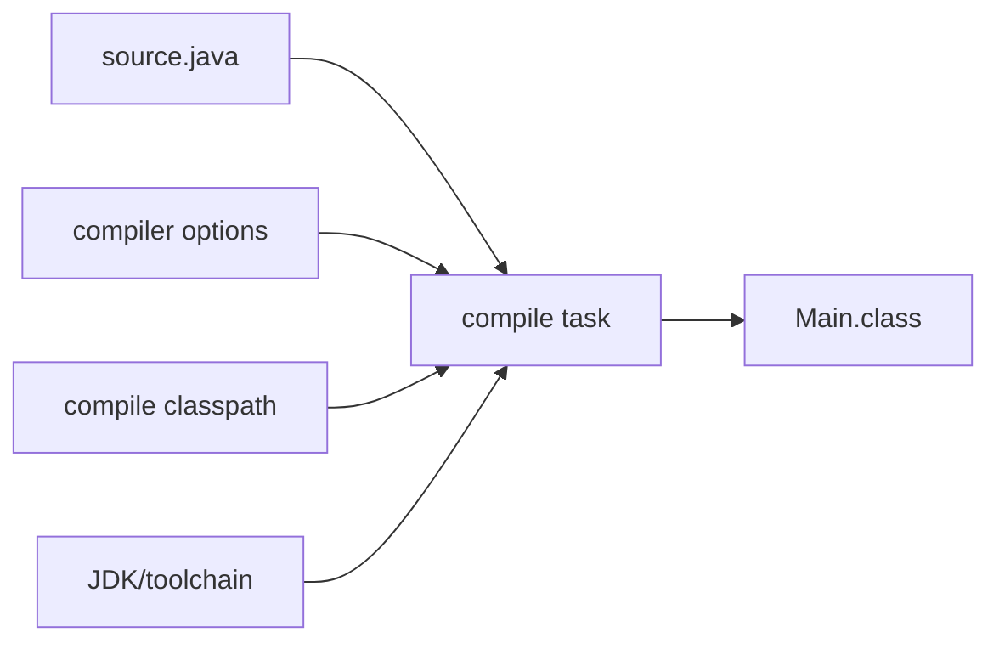
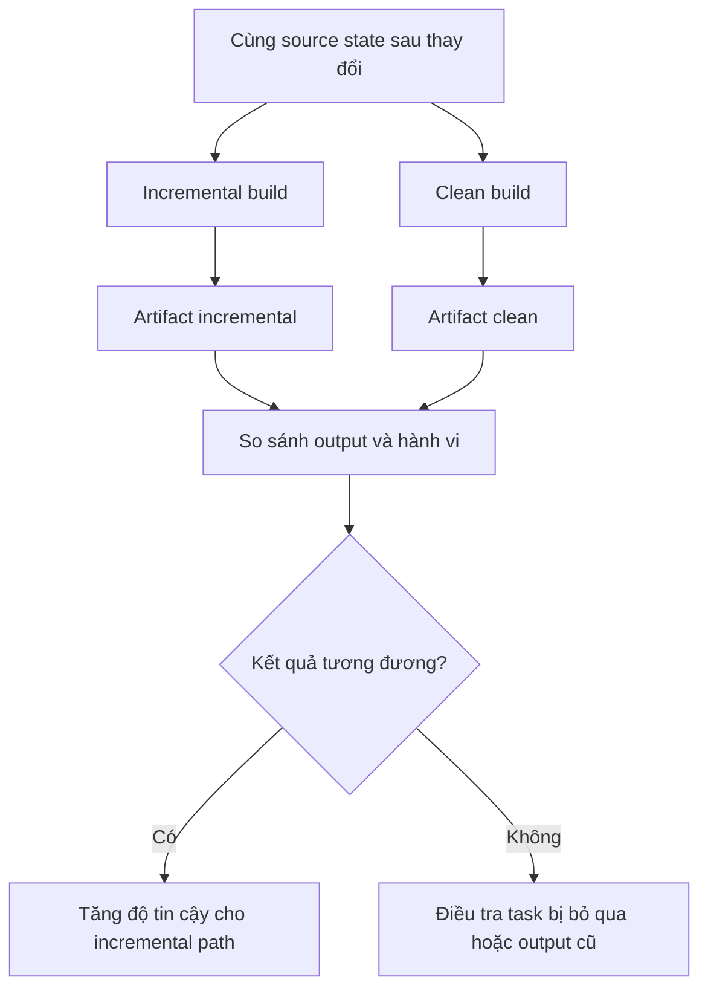

# Kiểm chứng tính đúng trước khi tối ưu tỷ lệ dùng cache

Build tăng dần và build cache giúp giảm thời gian chờ bằng cách bỏ qua công việc không cần chạy lại hoặc tái sử dụng kết quả đã được tạo trước đó. Nhưng một task bị bỏ qua sai có thể khiến ứng dụng dùng bytecode, resource hoặc artifact cũ. Vì vậy, tối ưu cache chỉ có ý nghĩa khi build tool luôn nhận ra đúng lúc nào kết quả còn hợp lệ và lúc nào phải thực hiện lại công việc.

Nguyên tắc quan trọng là: **xác nhận tính đúng của việc bỏ qua và tái sử dụng task trước; sau đó mới cải thiện tỷ lệ cache hit**. Một cache hit sai có thể làm build báo thành công với kết quả lỗi thời. Một cache miss không cần thiết chủ yếu làm build chậm hơn. Hai vấn đề này có mức độ nghiêm trọng khác nhau.

Bài học này giải thích cách build tăng dần hoạt động, cách phân biệt task up-to-date với cache hit, cách mô hình hóa input/output, cách thiết kế kiểm thử tính đúng và cách tối ưu hiệu quả sau khi đã có bằng chứng.

## 1. Build tăng dần và build cache giải quyết điều gì?

Một build gồm nhiều công việc: biên dịch mã nguồn, xử lý resource, sinh mã, chạy test, đóng gói và tạo báo cáo. Nếu mỗi lần thay đổi nhỏ đều chạy lại toàn bộ công việc, thời gian build sẽ tăng theo kích thước dự án.

Build tăng dần (incremental build) tận dụng thông tin về đầu vào và đầu ra để xác định công việc nào cần chạy lại.

Ví dụ, nếu chỉ sửa một file Java trong module A, build tool có thể chỉ biên dịch phần bị ảnh hưởng và những công việc phụ thuộc vào nó. Các task độc lập có đầu vào và đầu ra không đổi có thể được bỏ qua.

Build cache mở rộng khả năng tái sử dụng: nếu một task đã được thực hiện với cùng implementation và cùng tập input đã khai báo, build tool có thể lấy output đã lưu từ cache thay vì thực hiện lại task.

Hai cơ chế liên quan nhưng không giống nhau:

- **Incremental execution / up-to-date checking:** xác định task có cần chạy lại trong workspace hiện tại hay không.
- **Build cache:** tái sử dụng output đã tạo trước đó cho một task có cùng cache key.

## 2. Phân biệt UP-TO-DATE và FROM-CACHE trong Gradle

Khi chạy Gradle, trạng thái task cung cấp manh mối quan trọng về việc build đã làm gì.

| Trạng thái | Ý nghĩa | Task có thực thi action không? |
|---|---|---|
| SUCCESS | Task đã chạy và hoàn thành | Có |
| UP-TO-DATE | Input và output được xem là không đổi so với lần chạy trước trong workspace | Không |
| FROM-CACHE | Output được khôi phục từ local hoặc remote build cache | Không chạy action để tạo output |
| NO-SOURCE | Không có source input phù hợp để xử lý | Không |
| SKIPPED | Task bị bỏ qua theo điều kiện hoặc cấu hình | Tùy trường hợp |

Ví dụ output:

```text
> Task :compileJava UP-TO-DATE
> Task :processResources UP-TO-DATE
> Task :test
> Task :jar
```

UP-TO-DATE có nghĩa Gradle đã kiểm tra trạng thái của task và xác định không cần thực hiện lại trong workspace này.

Một ví dụ khác:

```text
> Task :compileJava FROM-CACHE
```

FROM-CACHE có nghĩa Gradle tìm thấy output tương ứng trong build cache và khôi phục nó.

Không nên coi UP-TO-DATE và FROM-CACHE là hai cách gọi cho cùng một việc. UP-TO-DATE dựa trên output hiện có và trạng thái input/output trong workspace. FROM-CACHE dùng output được lưu theo cache key, có thể đến từ một build khác hoặc một máy khác.

### 2.1. Clean build không đồng nghĩa với cache miss

Lệnh Gradle:

```bash
./gradlew clean build
```

xóa output của project trước khi build. Nếu build cache được bật và task cacheable, Gradle vẫn có thể khôi phục output từ cache. Do đó, một clean build có thể có task FROM-CACHE.

Muốn kiểm tra hành vi không dùng build cache:

```bash
./gradlew clean build --no-build-cache
```

Lệnh này tắt build cache cho lần chạy đó, nhưng up-to-date checking vẫn là cơ chế riêng. Khi cần buộc task chạy lại để làm baseline, có thể kết hợp các tùy chọn phù hợp, chẳng hạn:

```bash
./gradlew clean build --no-build-cache --rerun-tasks
```

Không nên dùng kết quả của một lần chạy đơn lẻ để kết luận cache đúng. Cần thử nhiều tình huống thay đổi input và so sánh output.

## 3. Vì sao phải kiểm chứng tính đúng trước?

Giả sử task generateConfig đọc một file cấu hình và tạo config.json. Nếu file cấu hình thay đổi nhưng task không khai báo file đó là input, Gradle có thể cho rằng task vẫn up-to-date hoặc tìm thấy output cache cũ.

Kết quả:

- Build kết thúc thành công.
- Không có lỗi compile hoặc test nhất thiết xuất hiện.
- config.json vẫn chứa giá trị cũ.
- Artifact đóng gói có thể dùng cấu hình không đúng.

Đây là **false cache hit** hoặc **false up-to-date**: build tool tái sử dụng hoặc bỏ qua task dù output không còn hợp lệ.

Ngược lại, nếu task khai báo một input không thực sự ảnh hưởng đến output, chẳng hạn một đường dẫn tạm thay đổi mỗi lần chạy, task có thể luôn bị thực hiện lại dù kết quả không đổi. Đây là **false cache miss** hoặc cache miss không cần thiết.

| Vấn đề | Điều gì xảy ra? | Hậu quả |
|---|---|---|
| False hit | Task bị bỏ qua hoặc output được lấy từ cache dù input ảnh hưởng đến kết quả đã thay đổi | Kết quả sai hoặc lỗi thời |
| False miss | Task chạy lại dù output cũ vẫn hợp lệ | Build chậm và tốn tài nguyên |
| Cache hit hợp lệ | Input đầy đủ, cache key đúng, output tương ứng | Tiết kiệm thời gian mà vẫn đúng |
| Task chạy lại hợp lệ | Có input hoặc điều kiện output thay đổi | Đảm bảo kết quả phản ánh trạng thái hiện tại |

False hit là lỗi tính đúng cần ưu tiên xử lý. Không được hy sinh tính đúng chỉ để tăng phần trăm cache hit.

## 4. Mô hình input và output đầy đủ

Để build tool quyết định đúng, task cần mô tả đầy đủ những gì nó đọc và những gì nó tạo.

Một task thường có:

- **Inputs:** source files, resource files, classpath, compiler arguments, version, flags, environment values hoặc cấu hình ảnh hưởng đến kết quả.
- **Outputs:** file hoặc thư mục được task tạo ra.
- **Implementation:** logic thực thi task và classpath của implementation.
- **Execution environment:** những điều kiện mà task phụ thuộc, nếu chúng ảnh hưởng đến kết quả.

Ví dụ:



Nếu một input có thể thay đổi output nhưng không được khai báo, build tool có thể bỏ qua task sai. Nếu output không được khai báo đúng, build tool khó theo dõi trạng thái hoặc khôi phục kết quả từ cache.

### 4.1. Các input thường bị bỏ sót

Những input dễ bị quên trong custom task:

- File cấu hình được đọc bằng đường dẫn hard-code.
- Biến môi trường.
- JVM system property.
- Compiler arguments hoặc tool options.
- Phiên bản generator.
- Classpath hoặc annotation processor.
- Locale, timezone hoặc encoding.
- File schema được tải từ thư mục khác.
- Version của dữ liệu đầu vào.
- Giá trị được lấy từ current working directory.
- Nội dung tải từ mạng hoặc service bên ngoài.

Không phải mọi yếu tố đều cần đưa vào cache key. Nhưng nếu yếu tố đó có thể làm thay đổi output, task phải mô hình hóa nó như input hoặc không được cache task đó.

### 4.2. Các output thường bị bỏ sót

Task có thể tạo nhiều file nhưng chỉ khai báo một output. Khi đó file còn lại có thể không được theo dõi hoặc không được khôi phục đầy đủ.

Ví dụ generator tạo:

- Java source files.
- Resource files.
- Metadata JSON.
- Index file.

Nếu task chỉ khai báo thư mục Java source mà quên resource hoặc metadata, cache restore có thể không tái tạo đầy đủ trạng thái mà task cần.

Hãy khai báo output file hoặc output directory bao phủ đúng những gì task chịu trách nhiệm tạo. Tránh để nhiều task cùng ghi vào một output directory mà không có ranh giới rõ ràng.

## 5. Khai báo input/output cho custom task trong Gradle

Gradle dùng các annotation trên task property để theo dõi input và output.

Một số annotation thường gặp:

| Annotation | Mục đích |
|---|---|
| @Input | Giá trị scalar như string, boolean, number hoặc property cấu hình |
| @InputFile | Một file input |
| @InputFiles | Một tập file input |
| @Classpath | Classpath mà nội dung và thứ tự entry có ý nghĩa theo quy tắc chuẩn hóa classpath |
| @CompileClasspath | Classpath dùng cho compile, với normalization phù hợp cho ABI |
| @OutputFile | Một file được task tạo |
| @OutputDirectory | Một thư mục output |
| @Nested | Một nhóm property có cấu trúc |
| @Internal | Property không được dùng làm input/output để theo dõi; chỉ dùng khi nó không ảnh hưởng đến kết quả hoặc được mô hình hóa ở nơi khác |

Ví dụ một task sinh báo cáo từ file nguồn và định dạng:

```kotlin
import org.gradle.api.DefaultTask
import org.gradle.api.file.ConfigurableFileCollection
import org.gradle.api.file.RegularFileProperty
import org.gradle.api.provider.Property
import org.gradle.api.tasks.Input
import org.gradle.api.tasks.InputFiles
import org.gradle.api.tasks.OutputFile
import org.gradle.api.tasks.PathSensitive
import org.gradle.api.tasks.PathSensitivity
import org.gradle.api.tasks.TaskAction
import org.gradle.api.tasks.CacheableTask

@CacheableTask
abstract class GenerateReport : DefaultTask() {

    @get:InputFiles
    @get:PathSensitive(PathSensitivity.NONE)
    abstract val sourceFiles: ConfigurableFileCollection

    @get:Input
    abstract val reportFormat: Property<String>

    @get:OutputFile
    abstract val outputFile: RegularFileProperty

    @TaskAction
    fun generate() {
        val output = outputFile.get().asFile
        output.parentFile.mkdirs()

        val content = sourceFiles.files
            .map { it.readText(Charsets.UTF_8) }
            .sorted()
            .joinToString("\n")

        val report = when (reportFormat.get()) {
            "upper" -> content.uppercase()
            else -> content
        }

        output.writeText(report, Charsets.UTF_8)
    }
}
```

Đây là ví dụ minh họa cách mô hình hóa task. Khi áp dụng trong dự án thật, cần bảo đảm mọi file được đọc đều thuộc sourceFiles, thứ tự xử lý được xác định, output không phụ thuộc trạng thái ẩn và encoding được quy định rõ.

Đăng ký task:

```kotlin
tasks.register<GenerateReport>("generateReport") {
    sourceFiles.from(fileTree("src/main/java") {
        include("**/*.java")
    })

    reportFormat.set("upper")
    outputFile.set(layout.buildDirectory.file("reports/source-report.txt"))
}
```

Nếu thay đổi reportFormat hoặc nội dung file nguồn, Gradle có thể nhận ra input thay đổi và thực hiện lại task. Nếu mọi input không đổi và output còn hợp lệ, task có thể là UP-TO-DATE hoặc lấy từ cache khi phù hợp.

### 5.1. Path sensitivity

Với file input, Gradle cần biết đường dẫn có ảnh hưởng đến kết quả hay không.

Một số lựa chọn:

- RELATIVE: xem đường dẫn tương đối trong tập input; hữu ích khi task cần giữ cấu trúc thư mục nhưng workspace có thể di chuyển.
- ABSOLUTE: đường dẫn tuyệt đối là một phần của trạng thái input; có thể làm giảm khả năng dùng cache giữa các workspace.
- NAME_ONLY: chỉ tên file được dùng trong normalization.
- NONE: chỉ nội dung file được xét, đường dẫn bị bỏ qua.

Chọn sensitivity theo cách task thực sự xử lý file. Nếu output ghi lại relative path, không được dùng normalization bỏ qua đường dẫn tương đối. Nếu task chỉ đọc nội dung và tên file không ảnh hưởng, có thể dùng normalization phù hợp hơn.

Không nên chọn NONE chỉ để tăng cache hit nếu tên hoặc vị trí file ảnh hưởng đến output.

### 5.2. Classpath phải được khai báo đúng loại

Nếu task dùng thư viện trên classpath, hãy khai báo classpath bằng property phù hợp thay vì chuyển nó thành một string tùy tiện. Gradle có cơ chế normalization cho classpath để giảm cache miss do những khác biệt không ảnh hưởng đến kết quả.

Với task biên dịch, Java plugin và compiler task đã mô hình hóa nhiều input cần thiết. Khi viết custom compiler hoặc code generator, cần mô hình hóa classpath và compiler options tương ứng.

## 6. Khi nào task đủ an toàn để cache?

Không phải task nào cũng nên đánh dấu cacheable.

Một task phù hợp với build cache khi:

- Output được xác định hoàn toàn từ input đã khai báo.
- Task có kết quả xác định với cùng input.
- Task không phụ thuộc vào trạng thái ẩn của máy.
- Task không tạo side effect bên ngoài output đã khai báo.
- Output có thể được tái sử dụng trên workspace khác nếu dùng remote cache.
- Task implementation và dependency của nó được kiểm soát.

### 6.1. Các yếu tố phá vỡ tính cacheable

Ví dụ task đọc thời gian hiện tại:

```groovy
tasks.register('generateBuildInfo') {
    outputs.file(layout.buildDirectory.file('generated/build-info.txt'))

    doLast {
        def file = layout.buildDirectory.file('generated/build-info.txt').get().asFile
        file.parentFile.mkdirs()
        file.text = "builtAt=" + new Date().toString()
    }
}
```

Output thay đổi theo thời điểm thực thi dù source không đổi. Nếu thời gian không được mô hình hóa như input, task không thể được tái sử dụng một cách đúng đắn theo cache key thông thường.

Các nguồn không xác định khác:

- Random number.
- Network response không cố định.
- Database state thay đổi.
- File ngoài project chưa khai báo.
- Biến môi trường không khai báo.
- Username hoặc home directory.
- Locale hoặc timezone không được kiểm soát.
- Nội dung phụ thuộc vào thứ tự duyệt file không xác định.
- Task ghi vào một dịch vụ hoặc database bên ngoài.

Có thể sửa bằng cách biến những yếu tố hợp lệ thành input rõ ràng, cố định môi trường hoặc loại task khỏi cache. Không nên ép cache một task chỉ vì muốn tăng tỷ lệ hit.

### 6.2. @CacheableTask và mặc định an toàn

Với custom task, annotation @CacheableTask tuyên bố rằng output có thể được lưu và tái sử dụng từ build cache. Chỉ dùng nó sau khi đã khai báo đầy đủ input/output và bảo đảm task có tính xác định.

Nếu chưa thể bảo đảm điều đó, để task không cacheable hoặc dùng @DisableCachingByDefault để ghi rõ lý do. Một task không cacheable vẫn có thể tham gia up-to-date checking nếu input/output được khai báo đúng.

### 6.3. Không dùng @Internal để che input

@Internal loại property khỏi cơ chế theo dõi input/output của Gradle. Nếu property đó thực sự ảnh hưởng đến output, dùng @Internal có thể khiến Gradle không nhận ra thay đổi.

Chỉ đánh dấu @Internal khi property không ảnh hưởng đến output hoặc giá trị đó đã được biểu diễn qua một input khác. Không dùng annotation này như cách né lỗi validation hoặc làm cache hit tăng giả tạo.

## 7. Kiểm chứng task không bỏ qua khi input thay đổi

Trước khi tối ưu cache, cần có bộ thử nghiệm cho những loại thay đổi có thể ảnh hưởng đến output.

Một ma trận cơ bản:

| Thay đổi | Kỳ vọng |
|---|---|
| Không thay đổi gì | Task có thể UP-TO-DATE |
| Sửa nội dung source | Task xử lý source phải chạy lại |
| Thêm file input | Task phải nhận file mới |
| Xóa file input | Output tương ứng phải được cập nhật hoặc xóa |
| Đổi compiler option | Task biên dịch phải chạy lại |
| Đổi dependency/classpath | Task phụ thuộc classpath phải được kiểm tra lại |
| Đổi resource | Task xử lý resource phải chạy lại |
| Đổi property ảnh hưởng output | Task liên quan phải chạy lại |
| Xóa output do task tạo | Task phải tạo lại output |
| Đổi task implementation | Kết quả cũ không được dùng nếu implementation key thay đổi |

Không phải mọi thay đổi đều phải chạy lại toàn bộ build. Kỳ vọng đúng là task bị ảnh hưởng và những task phụ thuộc cần chạy lại, còn task độc lập tiếp tục được bỏ qua.

### 7.1. Kiểm tra no-op build

Chạy build lần đầu:

```bash
./gradlew clean build
```

Chạy lại mà không thay đổi input:

```bash
./gradlew build
```

Những task đã có input/output ổn định có thể hiện UP-TO-DATE. Nếu task liên tục chạy lại, đó có thể là false miss hoặc task có chủ ý luôn chạy.

### 7.2. Sửa một input

Sửa một file source hoặc resource rồi chạy lại:

```bash
./gradlew build --info
```

Kiểm tra task liên quan có chạy lại không. Nếu task báo UP-TO-DATE hoặc FROM-CACHE trong khi output lẽ ra phải thay đổi, hãy điều tra input declaration và cache key.

### 7.3. Thêm, xóa và đổi tên file

Đừng chỉ thử sửa nội dung file. File addition, deletion và rename có thể bị bỏ sót nếu task chỉ khai báo một danh sách file không được cập nhật đúng.

Với generator, resource processor hoặc compiler tùy chỉnh, hãy kiểm tra cả ba trường hợp.

### 7.4. Xóa output

Nếu output bị xóa khỏi build directory nhưng input không đổi, task cần nhận ra output không còn đầy đủ và tạo lại.

Ví dụ, xóa file generated do task sở hữu rồi chạy task đó. Nếu task vẫn bị đánh dấu UP-TO-DATE và output không được tạo lại, khai báo output hoặc cách theo dõi task đang sai.

## 8. So sánh incremental build với clean build

Một cách mạnh để kiểm chứng là so sánh kết quả từ hai đường đi:

1. Thay đổi input và build tăng dần từ trạng thái trước đó.
2. Từ cùng source state, chạy clean build hoàn toàn.

Nếu cả hai đường đi tạo kết quả khác nhau về mặt chức năng hoặc nội dung quan trọng, incremental build có thể đang bỏ sót một công việc cần thiết.

Sơ đồ:



Không nhất thiết mọi byte trong JAR phải giống nếu archive chứa timestamp hoặc metadata không ổn định. Khi đó, so sánh các file class/resource quan trọng, nội dung giải nén, test result hoặc hành vi ứng dụng. Nếu dự án yêu cầu reproducible archive, hãy chuẩn hóa timestamp và thứ tự file trước khi so sánh hash.

## 9. Kiểm tra cache restore độc lập

Sau khi xác nhận up-to-date checking đúng, mới kiểm tra build cache.

Một thử nghiệm đơn giản:

```bash
./gradlew clean build --build-cache
./gradlew clean build --build-cache
```

Lần đầu thực hiện task và lưu output vào cache. Lần thứ hai clean xóa output trong workspace; task cacheable có cùng key có thể được khôi phục với trạng thái FROM-CACHE.

Quan sát output và dùng:

```bash
./gradlew clean build --build-cache --info
```

để xem thông tin cache chi tiết hơn.

Kết quả mong đợi không phải mọi task đều FROM-CACHE. Một số task không cacheable, luôn thực thi hoặc phụ thuộc vào trạng thái bên ngoài. Điều cần xác nhận là task được cache có output giống với lần thực thi trực tiếp và không bỏ qua input ảnh hưởng đến kết quả.

### 9.1. Kiểm tra cache giữa hai workspace

Remote cache có thể cho phép một workspace khôi phục output do workspace khác tạo. Để kiểm tra tính relocatable:

1. Build từ checkout A.
2. Đẩy output cache lên remote cache theo chính sách của nhóm.
3. Tạo checkout B ở đường dẫn khác nhưng cùng commit.
4. Chạy build ở B.
5. Xác nhận task phù hợp được khôi phục từ cache.
6. So sánh output với clean build tại B.

Nếu output phụ thuộc đường dẫn tuyệt đối của workspace, task có thể không an toàn để chia sẻ cache hoặc cần điều chỉnh path normalization.

## 10. Kiểm chứng remote cache và ranh giới tin cậy

Remote build cache giúp nhiều máy hoặc CI dùng chung output. Nhưng cache dùng chung cũng mở rộng ranh giới tin cậy.

Cần kiểm soát:

- Ai được đọc cache.
- Ai được ghi cache.
- Branch hoặc pipeline nào được phép publish.
- Cache key có phản ánh đầy đủ input không.
- Output có chứa secret hoặc dữ liệu riêng tư không.
- Cache artifact có được lưu ở hạ tầng tin cậy không.

Không nên để một pipeline không đáng tin cậy ghi output vào cache mà pipeline phát hành tin cậy sẽ sử dụng. Một cache entry sai hoặc bị đầu độc có thể khiến build tiêu thụ output không mong muốn.

Với cache dùng chung, cần tách quyền đọc và ghi theo chính sách, chỉ cho pipeline phù hợp publish output và xem xét cách phân vùng cache theo trust boundary.

## 11. Incremental build khác incremental task

Hai khái niệm này thường bị dùng lẫn.

- Incremental build: build tool bỏ qua task không cần chạy lại hoặc khôi phục output từ cache.
- Incremental task: một task thực sự chạy nhưng chỉ xử lý phần input đã thay đổi.

Ví dụ task phân tích hàng nghìn file có thể dùng API InputChanges của Gradle để nhận danh sách file thêm, sửa hoặc xóa và chỉ xử lý phần thay đổi.

Một task incremental vẫn cần khai báo toàn bộ input/output đúng. Nếu logic xử lý thay đổi không xử lý trường hợp file bị xóa hoặc đổi tên, output có thể chứa dữ liệu cũ.

Tối ưu incremental task chỉ nên thực hiện sau khi đã có một cách chạy đầy đủ làm chuẩn để so sánh kết quả.

## 12. Maven và tính đúng của incremental build

Maven có cơ chế build theo lifecycle và plugin goal. Nhiều plugin có logic riêng để xác định file nào cần xử lý lại, nhưng Maven core không cung cấp mô hình task graph và up-to-date/build cache tổng quát giống Gradle.

Ví dụ, Maven Compiler Plugin có thể kiểm tra source file và class output để quyết định việc biên dịch. Resources Plugin và plugin khác cũng có cách xử lý riêng.

Điều này có nghĩa:

- Hành vi incremental phụ thuộc vào plugin và phiên bản plugin.
- Một plugin có thể chạy lại toàn bộ công việc, plugin khác có thể bỏ qua output không đổi.
- Build cache cho Maven thường cần extension hoặc công cụ bổ sung; không nên giả định Maven core tự có cache task-level như Gradle.
- Khi thay plugin version, cần kiểm tra lại hành vi incremental của plugin đó.

### 12.1. Kiểm tra Maven với clean và non-clean build

Tạo baseline:

```bash
./mvnw clean verify
```

Chạy lại không clean:

```bash
./mvnw verify
```

Sau đó sửa, thêm hoặc xóa source/resource và chạy lại. Kiểm tra log của plugin để xác định file nào được xử lý lại.

Nếu kết quả incremental khác clean build, thử chạy clean để xác định liệu output cũ có đang bị giữ lại.

### 12.2. Kiểm tra sau khi đổi dependency hoặc plugin

Sau khi thay version plugin hoặc dependency:

```bash
./mvnw clean verify
```

Clean build giúp tránh dựa vào output cũ được tạo bởi plugin hoặc dependency trước đó. Với thay đổi quan trọng, nên chạy cả test tích hợp và kiểm tra artifact cuối cùng.

### 12.3. Maven build cache extension

Một số dự án Maven sử dụng extension hoặc plugin bổ sung để cache kết quả build. Khi dùng, cần hiểu:

- Extension nào đang quản lý cache.
- Input nào được đưa vào cache key.
- Plugin goal nào được hỗ trợ.
- Cách extension xử lý output, file xóa và dependency.
- Cache local hay remote.
- Cách kiểm tra cache restore và invalidation.

Không nên đánh đồng một extension cache với tính năng mặc định của Maven. Hãy đọc tài liệu của đúng extension và kiểm thử các tình huống thay đổi input tương tự như với Gradle.

## 13. Các lỗi thiết kế khiến cache sai

### 13.1. Đọc file nhưng không khai báo input

Task đọc file config bằng đường dẫn hard-code. Khi file đổi, Gradle không biết input đã thay đổi.

Cách sửa: đưa file thành @InputFile hoặc @InputFiles và cấu hình path sensitivity phù hợp.

### 13.2. Đọc biến môi trường nhưng không khai báo input

Task dùng biến môi trường để chọn output, nhưng giá trị không được đưa vào input property.

Cách sửa: truyền giá trị qua Property được đánh dấu @Input hoặc không cache task nếu không thể mô hình hóa an toàn.

### 13.3. Ghi output ngoài thư mục đã khai báo

Task khai báo một output nhưng ghi thêm file vào thư mục khác. Khi cache restore, file phụ có thể không được khôi phục.

Cách sửa: khai báo toàn bộ output thuộc trách nhiệm task và tránh side effect ngoài output.

### 13.4. Nhiều task cùng ghi một output

Hai task ghi vào cùng một file hoặc directory có thể tạo kết quả phụ thuộc thứ tự chạy.

Cách sửa: tách output riêng, tạo task tổng hợp rõ ràng hoặc khai báo quan hệ đúng.

### 13.5. Phụ thuộc vào thời gian hoặc thứ tự file không xác định

Task duyệt file theo thứ tự không ổn định hoặc ghi timestamp hiện tại vào output.

Cách sửa: sắp xếp input trước khi xử lý, chuẩn hóa timestamp hoặc đưa thời gian thành input rõ ràng nếu nghiệp vụ thực sự cần.

### 13.6. Đánh dấu cacheable quá sớm

Task được gắn @CacheableTask dù còn đọc mạng, trạng thái máy hoặc file ngoài.

Cách sửa: loại task khỏi cache cho đến khi input/output được mô hình hóa đầy đủ và kết quả có tính xác định.

## 14. False miss: tối ưu sau khi tính đúng đã được xác nhận

Khi đã kiểm chứng không có false hit, có thể tìm nguyên nhân khiến task chạy lại không cần thiết.

Một số nguồn false miss:

- Đưa đường dẫn tuyệt đối vào input trong khi chỉ cần relative path.
- Dùng timestamp hoặc build number không cần thiết làm input.
- Khai báo toàn bộ repository làm input thay vì chỉ file cần thiết.
- Dùng classpath normalization quá nghiêm ngặt.
- Task implementation thay đổi vì logic không liên quan.
- Output bị ghi thêm metadata ngẫu nhiên.
- Nhiều task có output chồng lấn.
- Task phụ thuộc vào biến môi trường thay đổi theo từng máy.

Cách cải thiện:

1. Xác định task tốn thời gian qua build scan hoặc log.
2. Kiểm tra lý do task không up-to-date hoặc không cache hit.
3. Phân biệt input thực sự ảnh hưởng output với dữ liệu chỉ mang tính môi trường.
4. Chọn normalization đúng.
5. Chuẩn hóa output.
6. Chia task lớn thành các task có trách nhiệm rõ nếu điều đó làm giảm phạm vi invalidation.
7. Chạy lại ma trận kiểm thử tính đúng sau mỗi thay đổi.

Không loại một input chỉ vì nó làm cache miss. Trước hết phải chứng minh input đó không ảnh hưởng đến output hoặc đã được biểu diễn ở nơi khác.

## 15. Đo hiệu quả cache đúng cách

Tỷ lệ cache hit là một chỉ số hữu ích nhưng không nên là mục tiêu duy nhất.

Có thể đo:

- Số task được khôi phục từ cache.
- Thời gian tiết kiệm được.
- Kích thước dữ liệu tải từ cache.
- Thời gian giải nén và khôi phục output.
- Task nào thường xuyên miss.
- Chi phí remote cache so với thực thi lại.
- Tỷ lệ task UP-TO-DATE.
- Thời gian build clean và incremental.

Ví dụ, cache hit cho một task mất 0,2 giây có thể ít giá trị hơn việc cải thiện một task compile mất 90 giây. Một cache hit lớn nhưng tải artifact chậm cũng có thể không tiết kiệm thời gian.

Hãy ưu tiên theo thời gian thực tế và tác động đến developer feedback loop, không chỉ theo phần trăm task.

### 15.1. Dùng Gradle Build Scan hoặc log

Có thể chạy với thông tin chi tiết:

```bash
./gradlew build --info
```

Build Scan có thể cung cấp thêm dữ liệu về task execution, cache và thời gian nếu dự án đã cấu hình dịch vụ phù hợp. Khi dùng dịch vụ bên ngoài, cần tuân thủ chính sách dữ liệu và quyền riêng tư của tổ chức.

## 16. Một ma trận kiểm chứng thực tế

Trước khi bật remote cache rộng rãi hoặc tối ưu hit rate, nên thực hiện tối thiểu các kịch bản:

| Kịch bản | Cách thực hiện | Điều cần xác nhận |
|---|---|---|
| Clean baseline | Clean và build không cache | Output đầy đủ và test đạt |
| No-op | Chạy lại không đổi input | Task phù hợp UP-TO-DATE |
| Source edit | Sửa một source file | Compile và task downstream cần thiết chạy lại |
| Resource edit | Sửa resource | Resource processing và artifact cập nhật |
| Input addition | Thêm file mới | File mới được nhận vào output |
| Input deletion | Xóa file nguồn | Output cũ tương ứng không còn |
| Config change | Đổi compiler option hoặc property | Task bị ảnh hưởng được invalidated |
| Dependency change | Đổi classpath/version | Task phụ thuộc classpath được thực hiện lại |
| Output deletion | Xóa output do task tạo | Task tạo lại output |
| Cache restore | Clean rồi build với cache | FROM-CACHE tạo output đúng |
| Workspace relocation | Build từ checkout khác đường dẫn | Cache hit vẫn đúng nếu task được thiết kế relocatable |
| Implementation change | Sửa logic task | Cache key thay đổi và output mới được tạo |

Khi phát hiện false hit, dừng tối ưu và sửa mô hình input/output trước. Khi tất cả trường hợp tính đúng đã đạt, mới xem xét cải thiện false miss.

## 17. Quy trình xử lý khi nghi ngờ cache trả kết quả sai

1. Ghi lại source commit, build tool, JDK và task có trạng thái đáng ngờ.
2. Chạy task với cache tắt và ép thực thi lại khi phù hợp.
3. So sánh output mới với output được khôi phục hoặc output cũ.
4. Kiểm tra input/output annotations hoặc khai báo task.
5. Tìm file, biến môi trường, classpath hoặc property chưa được khai báo.
6. Kiểm tra task có đọc mạng, thời gian, random hoặc trạng thái máy không.
7. Sửa mô hình task và thêm trường hợp kiểm thử tái hiện lỗi.
8. Xóa hoặc vô hiệu hóa cache entry sai theo quy trình của hạ tầng cache.
9. Chạy lại ma trận correctness trước khi bật cache trở lại.

Không nên chỉ xóa cache rồi kết luận lỗi đã hết. Nếu input vẫn bị khai báo thiếu, lỗi sẽ quay lại khi cache được tạo lại.

## 18. Checklist trước khi tối ưu cache hit rate

- [ ] Có clean build làm baseline.
- [ ] No-op build bỏ qua đúng các task không đổi.
- [ ] Sửa source làm task liên quan chạy lại.
- [ ] Thêm, xóa và đổi tên file được xử lý đúng.
- [ ] Thay compiler options, classpath hoặc config làm invalidation đúng.
- [ ] Xóa output buộc task tạo lại output.
- [ ] Incremental output tương đương clean output theo tiêu chí dự án.
- [ ] Task cacheable khai báo đầy đủ input và output.
- [ ] Không có input ẩn như environment, thời gian, network hoặc file ngoài.
- [ ] Task không xác định hoặc có side effect không được cache.
- [ ] Cache restore tạo output tương đương thực thi trực tiếp.
- [ ] Remote cache chỉ được ghi bởi pipeline đáng tin cậy.
- [ ] False hit đã được loại trừ trước khi xử lý false miss.
- [ ] Chỉ số cache được đánh giá theo thời gian tiết kiệm thực tế.

## 19. Ghi nhớ

- Incremental build bỏ qua công việc không cần chạy lại; build cache tái sử dụng output đã lưu.
- UP-TO-DATE và FROM-CACHE là hai trạng thái khác nhau.
- False hit có thể tạo kết quả sai; false miss chủ yếu làm build chậm.
- Task cần khai báo đầy đủ input và output để build tool quyết định đúng.
- Input ẩn như environment, file ngoài, thời gian, random và network có thể làm cache sai.
- Chỉ đánh dấu custom task cacheable khi output xác định từ input đã khai báo.
- Path sensitivity và classpath normalization phải phản ánh đúng cách task sử dụng dữ liệu.
- Kiểm tra source edit, resource edit, file addition/deletion, config change và output deletion.
- So sánh incremental build với clean build để phát hiện output lỗi thời.
- Kiểm tra FROM-CACHE riêng sau khi đã xác nhận up-to-date behavior.
- Maven incremental behavior phụ thuộc vào plugin; không mặc định nó có task cache tổng quát như Gradle.
- Chỉ tối ưu false miss sau khi đã kiểm chứng không có false hit.
- Đánh giá cache bằng thời gian tiết kiệm và độ tin cậy, không chỉ phần trăm hit.

## 20. Tự kiểm tra

1. UP-TO-DATE khác FROM-CACHE ở điểm nào?
2. Vì sao false cache hit nguy hiểm hơn false cache miss?
3. Nếu task đọc một file nhưng không khai báo file đó là input, điều gì có thể xảy ra?
4. Khi nào nên đánh dấu custom task bằng @CacheableTask?
5. PathSensitivity.RELATIVE khác ABSOLUTE như thế nào?
6. Vì sao không nên dùng @Internal cho property ảnh hưởng đến output?
7. Những trường hợp thay đổi nào cần đưa vào ma trận kiểm chứng incremental build?
8. Vì sao cần so sánh incremental build với clean build?
9. Làm thế nào để kiểm tra cache restore bằng FROM-CACHE?
10. Maven incremental behavior khác Gradle task up-to-date/build cache ra sao?
11. Vì sao một task đọc thời gian hiện tại thường không an toàn để cache?
12. Sau khi correctness đã được xác nhận, có thể tối ưu false miss bằng những cách nào?

Khi có thể chứng minh task chỉ được bỏ qua hoặc khôi phục cache khi toàn bộ input liên quan không đổi, và output incremental khớp với clean build, bạn đã có nền tảng an toàn để tối ưu tỷ lệ dùng cache.

