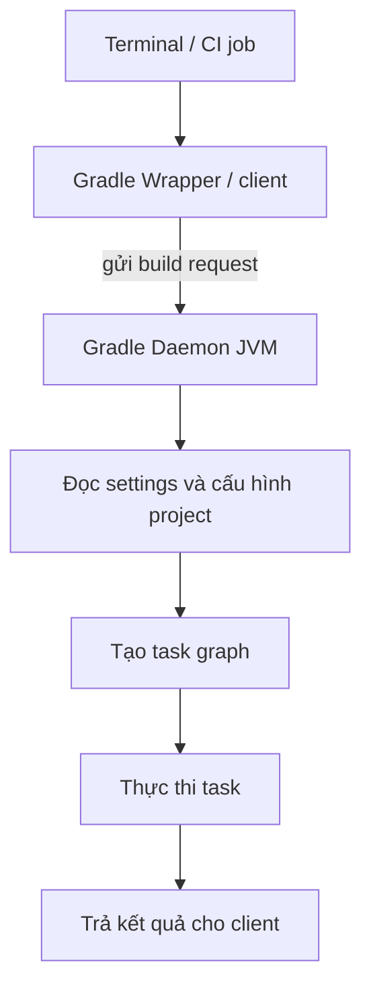
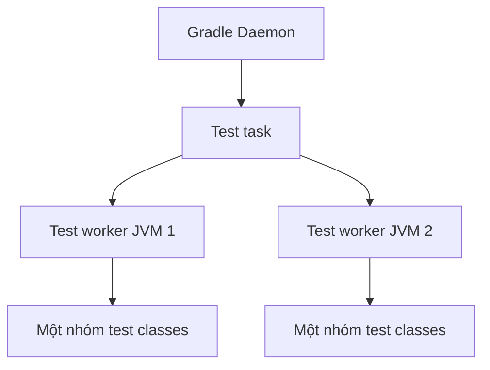
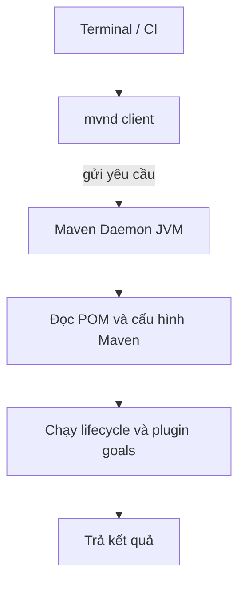

# Tiến trình chạy lâu dài, chi phí khởi động và tái sử dụng JVM

Mỗi lần chạy một công cụ build Java đều cần khởi tạo môi trường thực thi: tạo tiến trình, khởi động Java Virtual Machine (JVM), nạp lớp, đọc cấu hình và nạp plugin. Với một build lớn, chi phí này có thể nhỏ so với biên dịch và kiểm thử. Nhưng khi developer chạy nhiều lệnh build ngắn trong ngày, thời gian khởi động lặp lại có thể chiếm phần đáng kể trong tổng thời gian chờ.

Các công cụ như Gradle và Maven có cơ chế giúp giảm chi phí đó bằng cách tái sử dụng tiến trình JVM. Gradle dùng Gradle Daemon; Maven có thể chạy qua Apache Maven Daemon (`mvnd`). Ngoài tiến trình build chính, test runner, compiler hoặc worker cũng có thể chạy trong JVM riêng và có chính sách tái sử dụng khác nhau.

Hiểu đúng các tiến trình này giúp bạn chọn cấu hình phù hợp, giảm thời gian build, kiểm soát bộ nhớ và tránh nhầm lẫn giữa daemon, build cache, configuration cache và JVM chạy ứng dụng.

## 1. Vì sao khởi động JVM có chi phí?

Một lệnh như `./gradlew build` hoặc `./mvnw verify` không chỉ thực hiện biên dịch. Trước khi task hoặc goal bắt đầu, hệ điều hành và JVM phải chuẩn bị tiến trình để chạy công cụ build.

Một lần khởi động JVM thường gồm nhiều công việc:

1. Hệ điều hành tạo process và thiết lập bộ nhớ, file handle cùng môi trường ban đầu.
2. JVM khởi tạo runtime, heap, garbage collector, thread và các thành phần nền tảng.
3. JVM nạp các lớp cần thiết, khởi tạo classloader và thư viện nền tảng.
4. Công cụ build nạp Gradle/Maven core, plugin và build logic.
5. Build tool đọc cấu hình, phân giải một số metadata/dependency và chuẩn bị công việc.
6. Trong quá trình chạy, JVM có thể biên dịch mã thường dùng thành mã máy bằng Just-In-Time compiler (JIT).

Không phải mọi bước đều diễn ra theo một chuỗi hoàn toàn tuần tự; JVM và build tool có thể thực hiện một số việc song song. Tuy nhiên, chúng đều tạo ra chi phí trước khi công việc build chính bắt đầu.

### 1.1. Cold start và warm run

**Cold start** là lần chạy khi chưa có tiến trình build phù hợp đang hoạt động. Công cụ cần khởi động JVM và nạp các thành phần cần thiết.

**Warm run** là lần chạy tiếp theo có thể sử dụng tiến trình build đã tồn tại, class đã được nạp, JIT đã có cơ hội tối ưu và một số dữ liệu/cache đã sẵn sàng.

Ví dụ minh họa:

```text
Lần đầu:
  gọi Gradle Wrapper
    -> khởi động client JVM
    -> khởi động Gradle Daemon
    -> nạp Gradle và plugin
    -> cấu hình build
    -> thực thi task

Lần tiếp theo:
  gọi Gradle Wrapper
    -> kết nối Gradle Daemon còn hoạt động
    -> cấu hình invocation mới
    -> thực thi task
```

Daemon có thể giảm chi phí khởi động JVM và nạp công cụ. Nó không có nghĩa lần build sau bỏ qua mọi bước: mỗi invocation vẫn phải xử lý yêu cầu mới, cấu hình build theo cơ chế đang dùng và thực hiện các task cần thiết.

### 1.2. JVM warm-up và JIT

JVM có thể tối ưu những đoạn mã được thực thi thường xuyên bằng JIT compiler. Khi một process sống lâu, một số đường chạy của Gradle/Maven và plugin có thể được tối ưu dần. Điều này góp phần làm các lần chạy sau nhanh hơn.

Không nên hiểu warm-up như một bảo đảm rằng mọi build sau sẽ nhanh hơn. Build khác nhau có thể chạy những plugin hoặc code path khác nhau; một process mới vẫn phải nạp các lớp và làm nóng các đoạn mã cần thiết. Thời gian biên dịch, test, I/O và dependency resolution vẫn có thể chiếm phần lớn tổng thời gian.

## 2. Những phần nào tạo nên tổng thời gian build?

Thời gian một lệnh build có thể được chia thành các nhóm để phân tích:

| Nhóm chi phí | Ví dụ | Cơ chế có thể giúp |
|---|---|---|
| Khởi động process/JVM | Tạo process, khởi tạo JVM, nạp lớp nền tảng | Gradle Daemon hoặc Maven Daemon (`mvnd`). |
| Khởi tạo build tool | Nạp Gradle/Maven core, plugin và build logic | Tái sử dụng daemon; tránh plugin không cần thiết. |
| Configuration | Đọc settings, build scripts, POM, profile và cấu hình project | Gradle Configuration Cache; cấu hình Maven gọn và plugin phù hợp. |
| Dependency resolution | Tìm metadata, tải POM/module metadata và artifact | Dependency cache, repository mirror, version cố định và quản lý cache hợp lý. |
| Thực thi task/goal | Biên dịch, xử lý resource, test, đóng gói | Incremental build, build cache, parallelism và tối ưu task. |
| Khởi động worker/fork | JVM riêng cho test, compiler hoặc plugin | Tái sử dụng worker trong phạm vi hỗ trợ; giảm fork không cần thiết. |
| I/O và môi trường | Đọc/ghi file, network, container, database | Workspace/cache phù hợp, runner đủ tài nguyên và môi trường ổn định. |

Daemon chủ yếu tác động đến chi phí process/JVM và một phần khởi tạo build tool. Nó không thay thế configuration cache, build cache, dependency cache hay incremental compilation.

## 3. Gradle Daemon là gì?

Gradle Daemon là một tiến trình JVM nền chạy lâu dài để thực thi các build Gradle. Khi bạn chạy Gradle Wrapper, client khởi tạo hoặc tìm một daemon tương thích rồi gửi yêu cầu build đến daemon đó.

Trong mô hình thông thường:



Client chịu trách nhiệm khởi tạo kết nối và truyền yêu cầu. Daemon thực hiện phần lớn công việc build. Sau khi một invocation hoàn tất, daemon có thể tiếp tục ở trạng thái idle để phục vụ invocation khác.

### 3.1. Daemon không phải một build session duy nhất

Daemon sống lâu, nhưng mỗi lệnh Gradle vẫn là một build invocation riêng. Gradle không nên dựa vào biến static hoặc trạng thái tùy ý còn sót lại từ build trước để quyết định kết quả build sau.

Build script và plugin cần hoạt động đúng khi được gọi nhiều lần trong cùng daemon. Nếu plugin lưu mutable state trong static field hoặc giả định một process mới cho mỗi build, lỗi có thể chỉ xuất hiện khi daemon được tái sử dụng.

Gradle thiết kế daemon để hỗ trợ nhiều build invocation, đồng thời cung cấp các cơ chế cô lập build và quản lý trạng thái. Plugin vẫn phải tuân theo API và không được dựa vào trạng thái toàn cục ngoài hợp đồng.

### 3.2. Daemon được bật mặc định

Với các phiên bản Gradle hiện đại, daemon được bật mặc định. Bạn có thể kiểm tra hoặc cấu hình bằng:

```properties
# gradle.properties
org.gradle.daemon=true
```

Thông thường không cần thêm dòng này vì mặc định đã bật. Có thể tắt daemon cho một invocation bằng:

```bash
./gradlew build --no-daemon
```

Hoặc cấu hình:

```properties
org.gradle.daemon=false
```

Tắt daemon có thể hữu ích khi điều tra lỗi liên quan đến process lâu dài hoặc trong một số môi trường đặc biệt. Với phát triển hằng ngày, tái sử dụng daemon thường giúp giảm chi phí khởi động.

### 3.3. `--no-daemon` không phải lúc nào cũng có nghĩa chỉ dùng client JVM

Nếu Gradle cần JVM arguments khác với JVM của client, nó có thể tạo một **single-use daemon** cho invocation đó. Tiến trình này chỉ phục vụ build hiện tại rồi dừng.

Vì vậy, `--no-daemon` có nghĩa Gradle không tái sử dụng daemon nền thông thường cho invocation; nó không bảo đảm luôn tránh được việc tạo một JVM process khác. Khi chẩn đoán startup, hãy quan sát process thực tế và JVM options, không chỉ dựa vào tên cờ.

## 4. Gradle chọn daemon nào để tái sử dụng?

Gradle cần một daemon tương thích với yêu cầu hiện tại. Những yếu tố như phiên bản Gradle, Java home/runtime và JVM arguments ảnh hưởng đến khả năng tái sử dụng.

Ví dụ, các lệnh sau có thể cần daemon khác nhau:

```text
Build A:
  Gradle 8.x
  JDK 17
  -Xmx2g

Build B:
  Gradle 8.x
  JDK 21
  -Xmx4g
```

Hai invocation có yêu cầu JVM khác nhau nên không thể mặc nhiên dùng cùng một daemon. Gradle có thể khởi động daemon mới phù hợp; daemon cũ có thể tiếp tục idle cho đến khi hết thời gian chờ hoặc được dừng.

Nhiều cấu hình daemon khác nhau trên cùng máy có thể làm tồn tại nhiều daemon và tiêu thụ bộ nhớ. Vì vậy, nên chuẩn hóa Gradle version, JDK chạy Gradle và JVM arguments trong nhóm nếu có thể.

## 5. Cấu hình JVM chạy Gradle Daemon

Gradle phân biệt JVM chạy client với JVM chạy daemon. Một số cấu hình thường gặp:

| Cấu hình | Vai trò |
|---|---|
| `JAVA_HOME` | JDK/JRE mà script hoặc công cụ dùng làm mặc định để khởi chạy JVM, tùy cách cài đặt. |
| `org.gradle.java.home` | Chỉ định Java home cho Gradle build/daemon trong cấu hình Gradle. |
| `org.gradle.jvmargs` | JVM arguments cho Gradle Daemon, chẳng hạn heap, metaspace và system properties. |
| `GRADLE_OPTS` | JVM options cho Gradle client process trong các cách khởi chạy hỗ trợ biến này. |
| `JAVA_OPTS` | JVM options được script launcher hoặc môi trường sử dụng theo cách triển khai. |

Ví dụ trong `gradle.properties`:

```properties
org.gradle.jvmargs=-Xmx2g -XX:MaxMetaspaceSize=1g -Dfile.encoding=UTF-8
```

`-Xmx2g` đặt giới hạn heap tối đa 2 GB cho JVM được cấu hình; `MaxMetaspaceSize` giới hạn metaspace; `file.encoding` xác định encoding mặc định cho process theo cấu hình Java tương ứng.

Không nên sao chép nguyên một bộ JVM arguments lớn vào mọi máy. Heap quá thấp có thể gây `OutOfMemoryError`; heap quá cao có thể làm hệ thống thiếu RAM và khiến các test worker hoặc process khác bị ảnh hưởng. Hãy điều chỉnh theo kích thước build, số worker và bộ nhớ runner.

### 5.1. `org.gradle.java.home` và Java toolchain khác nhau

Hai khái niệm này thường bị nhầm:

- `org.gradle.java.home` chọn JDK dùng để chạy Gradle Daemon.
- Java toolchain chọn JDK/toolchain mà các task như compile hoặc test sử dụng theo cấu hình project.

Ví dụ:

```properties
# gradle.properties
org.gradle.java.home=C:/Java/jdk-21
```

Và trong build script:

```groovy
java {
    toolchain {
        languageVersion = JavaLanguageVersion.of(17)
    }
}
```

Trong ví dụ, Gradle chạy trên JDK 21 nhưng project yêu cầu toolchain Java 17 cho các task Java được hỗ trợ. Việc chọn toolchain không có nghĩa daemon tự chuyển sang JDK 17.

Tách hai cấu hình giúp build tool dùng runtime phù hợp trong khi project vẫn biên dịch/test theo Java version mà sản phẩm hỗ trợ.

## 6. Dừng và kiểm tra Gradle Daemon

Gradle daemon thường tự dừng sau một khoảng idle theo chính sách của Gradle. Bạn cũng có thể xem trạng thái hoặc yêu cầu dừng daemon.

```bash
# Liệt kê daemon đang chạy cho Gradle version hiện tại
./gradlew --status

# Dừng các daemon Gradle phù hợp với wrapper/version đang gọi
./gradlew --stop
```

Sau khi dừng, invocation tiếp theo có thể phải khởi động daemon mới và chịu lại chi phí cold start. Dừng daemon hữu ích khi:

- Thay đổi JDK hoặc JVM arguments và muốn loại bỏ process cũ.
- Điều tra plugin giữ state hoặc memory leak.
- Máy đang có nhiều daemon không còn cần thiết.
- Cần giải phóng bộ nhớ trước một tác vụ nặng.
- Thay đổi môi trường và muốn xác nhận build dùng process mới.

Không cần dừng daemon sau mọi lần build. Làm vậy loại bỏ lợi ích tái sử dụng và khiến các lệnh ngắn chậm hơn.

## 7. Gradle Daemon khác build cache và configuration cache

Daemon và các loại cache giải quyết những chi phí khác nhau.

| Cơ chế | Tái sử dụng điều gì? | Có bỏ qua việc khởi động JVM không? |
|---|---|---|
| Gradle Daemon | Tiến trình JVM và môi trường build tool đang hoạt động. | Có thể giảm chi phí khởi động JVM/build tool cho invocation sau. |
| Up-to-date checking | Output hiện có của task khi inputs/outputs không thay đổi. | Không. |
| Build cache | Output task đã lưu ở local hoặc remote cache. | Không. |
| Configuration cache | Kết quả cấu hình build đã lưu. | Không. |
| Dependency cache | Metadata và artifact dependency đã tải. | Không. |

Các cơ chế có thể cùng được sử dụng. Ví dụ, invocation chạy trong daemon đã ấm, Gradle nạp configuration cache, task compile được đánh dấu up-to-date và một task khác lấy output từ build cache. Mỗi cơ chế tiết kiệm một phần công việc khác nhau.

Nếu build vẫn chậm dù daemon đã được tái sử dụng, hãy xem configuration, dependency resolution và task execution thay vì chỉ tập trung vào JVM startup.

## 8. Tái sử dụng JVM cho test trong Gradle

Gradle Daemon không nhất thiết chạy test trực tiếp trong cùng JVM. Task `Test` thường khởi chạy một hoặc nhiều JVM worker riêng để chạy test.



Tách test process giúp cô lập một phần trạng thái JVM và cho phép chạy test song song. Các worker có thể được tái sử dụng cho nhiều test class trong phạm vi task theo cấu hình.

### 8.1. `maxParallelForks`

`maxParallelForks` giới hạn số JVM test worker chạy đồng thời cho một Test task.

```groovy
tasks.withType(Test).configureEach {
    maxParallelForks = 2
}
```

Tăng số fork có thể rút ngắn thời gian test nếu có đủ CPU và memory, nhưng mỗi JVM worker tiêu thụ tài nguyên riêng. Nếu mỗi worker cần heap lớn, tăng fork có thể làm máy hết RAM, gây swapping hoặc làm test chậm hơn.

### 8.2. `forkEvery`

`forkEvery` giới hạn số test classes được chạy trong một worker JVM trước khi Gradle tạo process mới.

```groovy
tasks.withType(Test).configureEach {
    forkEvery = 100
}
```

Giá trị `0` (mặc định) nghĩa là không giới hạn số test class theo ngưỡng này trong vòng đời worker của task. Đặt giá trị khác 0 có thể giúp hạn chế tác động của state bị rò rỉ giữa test classes hoặc memory leak trong test framework, nhưng tạo thêm chi phí khởi động JVM.

Không nên đặt `forkEvery = 1` chỉ để che flaky test. Điều đó tạo process mới cho mỗi test class và có thể làm suite chậm đáng kể. Hãy tìm nguyên nhân state leakage trước.

### 8.3. Cấu hình JVM của test worker

Test worker có thể có JVM arguments và heap riêng:

```groovy
tasks.withType(Test).configureEach {
    maxHeapSize = '1g'
    jvmArgs '-Dfile.encoding=UTF-8'
}
```

Đây là cấu hình cho JVM chạy test, không phải JVM của Gradle Daemon. Nếu daemon có heap 2 GB và hai test worker mỗi worker có heap tối đa 1 GB, tổng memory có thể lớn hơn 2 GB cộng thêm overhead của các process và hệ điều hành.

## 9. Gradle Worker API và process isolation

Plugin hoặc task có thể dùng Gradle Worker API để thực hiện công việc song song hoặc cô lập. Các isolation mode thường gặp:

- `noIsolation`: worker dùng chung JVM/classloader context phù hợp với task; ít chi phí process hơn nhưng cần chú ý state và thread safety.
- `classLoaderIsolation`: worker dùng classloader riêng, hữu ích khi cần cô lập classpath nhưng không cần process riêng.
- `processIsolation`: worker chạy trong process JVM riêng, có thể cấu hình JVM arguments và classpath riêng.

Process isolation tăng mức cô lập nhưng phải trả chi phí tạo process và bộ nhớ. Classloader isolation nhẹ hơn nhưng không tạo ranh giới process của hệ điều hành.

Worker API là cơ chế dành cho plugin/task, khác với Gradle Daemon và Test task. Không nên tạo process mới cho từng thao tác nhỏ nếu chi phí khởi động lớn hơn công việc thực hiện.

## 10. Tái sử dụng compiler process

Java compiler có thể chạy trong JVM của Gradle hoặc được fork ra process riêng tùy cấu hình task và plugin.

Ví dụ Gradle:

```groovy
tasks.withType(JavaCompile).configureEach {
    options.fork = true
    options.forkOptions.memoryMaximumSize = '1g'
}
```

`fork = true` yêu cầu compiler chạy trong process riêng theo cấu hình fork options. Điều này có thể giúp cô lập compiler memory hoặc tùy chọn runtime, nhưng thêm chi phí process. Với build nhỏ, fork có thể không đem lại lợi ích; với compile lớn hoặc cần JVM/compiler options riêng, nó có thể phù hợp.

Gradle có cơ chế worker/process quản lý việc thực thi compiler; cách process được giữ hoặc tái sử dụng phụ thuộc task, phiên bản và cấu hình. Đừng giả định compiler process luôn sống lâu như Gradle Daemon.

### 10.1. Toolchain và compiler process

Nếu project dùng Java toolchain, compiler được chọn theo toolchain thay vì mặc định phải là JDK chạy daemon. Điều này giúp build trên daemon JDK mới nhưng vẫn compile bằng target JDK đã chỉ định.

Khi điều tra compile chậm, hãy tách các yếu tố: daemon cold/warm, compiler process fork hay in-process, số source file, annotation processor, classpath, incremental compilation và I/O.

## 11. Maven: JVM của mỗi lần chạy Maven

Khi chạy Maven thông thường:

```bash
./mvnw clean verify
```

Maven Wrapper đảm bảo sử dụng phiên bản Maven được project khai báo/tải về, nhưng wrapper không tự biến Maven thành daemon chạy lâu dài. Một invocation Maven thông thường khởi chạy một JVM cho Maven process, thực hiện lifecycle rồi kết thúc process.

Nếu liên tục gọi nhiều lệnh Maven riêng biệt, ví dụ:

```bash
./mvnw validate
./mvnw test
./mvnw package
```

thì mỗi lệnh có thể phải khởi động Maven/JVM và cấu hình project lại. Nếu mục tiêu là thực hiện tuần tự các phase, thường có thể gộp thành một invocation:

```bash
./mvnw package
```

Maven sẽ đi qua các phase trước `package` trong default lifecycle. Gộp lệnh giúp tránh startup/configuration lặp lại và bảo đảm các phase chạy trong cùng một invocation.

## 12. Maven Daemon (`mvnd`)

Apache Maven Daemon, thường được gọi bằng lệnh `mvnd`, cung cấp tiến trình Maven chạy lâu dài để giảm chi phí khởi động giữa các invocation. Nó có thể giữ JVM và Maven runtime đã nạp để những lần chạy tiếp theo không phải khởi tạo từ đầu.

Mô hình khái quát:



Maven Daemon là một công cụ/launcher riêng, không đồng nghĩa với việc `mvnw` thông thường tự bật daemon. Muốn dùng `mvnd`, cần cài đặt hoặc tích hợp nó theo hướng dẫn của môi trường phát triển và dùng lệnh `mvnd`.

Các lệnh thường dùng của Maven Daemon gồm:

```bash
# Chạy Maven qua daemon
mvnd clean verify

# Xem trạng thái daemon
mvnd --status

# Dừng daemon
mvnd --stop
```

Tùy phiên bản và cách cài đặt, cú pháp tùy chọn có thể khác; hãy kiểm tra `mvnd --help` của bản đang dùng.

### 12.1. Khi nào `mvnd` hữu ích?

`mvnd` có thể hữu ích khi:

- Developer chạy nhiều Maven build ngắn trong cùng phiên làm việc.
- Một IDE hoặc script thường xuyên gọi Maven nhiều lần.
- Build có chi phí khởi động Maven/JVM đáng kể so với thời gian thực thi.
- Môi trường có thể giữ daemon giữa các invocation.

Nếu chỉ chạy một build dài trong runner dùng một lần, phần tiết kiệm startup qua các invocation có thể nhỏ. Khi đó, tối ưu dependency resolution, plugin, test và task thực thi có thể có tác động lớn hơn.

## 13. JVM fork của Maven Surefire và Failsafe

Maven có thể chạy test trong JVM của Maven hoặc fork JVM riêng tùy plugin và cấu hình. Surefire dùng cho unit test; Failsafe thường dùng cho integration test.

### 13.1. `forkCount`

`forkCount` xác định số JVM test process có thể chạy đồng thời. Ví dụ:

```xml
<plugin>
    <groupId>org.apache.maven.plugins</groupId>
    <artifactId>maven-surefire-plugin</artifactId>
    <version>3.5.2</version>
    <configuration>
        <forkCount>2</forkCount>
    </configuration>
</plugin>
```

Hai fork có thể chạy test song song khi cấu hình và điều kiện phù hợp. Mỗi process có heap, classloader và overhead riêng. Tăng `forkCount` có thể cải thiện throughput nhưng cũng tăng memory pressure và tranh chấp tài nguyên.

### 13.2. `reuseForks`

Surefire mặc định thường tái sử dụng fork JVM cho nhiều test class trong cùng execution. Có thể cấu hình:

```xml
<configuration>
    <forkCount>1</forkCount>
    <reuseForks>true</reuseForks>
</configuration>
```

Khi `reuseForks` là `true`, process được giữ để chạy nhiều test class, giảm startup cost. Khi `false`, Surefire có thể tạo fork riêng cho từng test class, tăng cô lập process nhưng tốn thời gian hơn.

Không nên tắt reuse chỉ để tránh xử lý shared state không đúng. Trước tiên, hãy sửa test để độc lập và cleanup đầy đủ. Chỉ thay đổi fork/reuse khi có lý do kỹ thuật rõ ràng.

### 13.3. JVM options của test fork

Surefire có thể nhận JVM arguments qua cấu hình `argLine`:

```xml
<configuration>
    <argLine>-Xmx1g -Dfile.encoding=UTF-8</argLine>
</configuration>
```

Các tùy chọn này dành cho fork test JVM, không phải Maven JVM. `MAVEN_OPTS` hoặc `.mvn/jvm.config` thường được dùng để cấu hình JVM chạy Maven; không nên nhầm hai phạm vi.

## 14. Maven Compiler Plugin và fork compiler

Maven Compiler Plugin có tùy chọn fork để gọi compiler process riêng trong một số cấu hình:

```xml
<plugin>
    <groupId>org.apache.maven.plugins</groupId>
    <artifactId>maven-compiler-plugin</artifactId>
    <version>3.13.0</version>
    <configuration>
        <fork>true</fork>
        <meminitial>256m</meminitial>
        <maxmem>1g</maxmem>
    </configuration>
</plugin>
```

Tên tham số và cách hỗ trợ phụ thuộc phiên bản plugin/compiler. Fork compiler có thể cần khi phải dùng executable/compiler riêng hoặc giới hạn bộ nhớ độc lập. Nó cũng tạo thêm process và chi phí khởi động.

Nếu Maven chạy trên JDK phù hợp và không có yêu cầu đặc biệt, compile in-process có thể đơn giản hơn. Hãy đo thời gian và memory trước khi bật fork chỉ vì nghĩ rằng nhiều JVM luôn nhanh hơn.

## 15. JVM options cho Maven

Một số cách cấu hình JVM chạy Maven:

- `MAVEN_OPTS`: biến môi trường chứa JVM arguments cho Maven launcher.
- `.mvn/jvm.config`: file trong repository chứa JVM arguments dùng bởi Maven Wrapper/launcher theo hỗ trợ của phiên bản Maven.
- Toolchain/plugin configuration: chọn JDK hoặc compiler cho tác vụ cụ thể.

Ví dụ `.mvn/jvm.config`:

```text
-Xms512m
-Xmx2g
-Dfile.encoding=UTF-8
```

File này có thể được commit nếu các giá trị là cấu hình chung an toàn cho dự án. Không đưa secret hoặc đường dẫn cá nhân vào đó.

Nếu dùng `mvnd`, hãy kiểm tra cách phiên bản Maven Daemon nhận JVM arguments và cấu hình daemon; không giả định mọi biến launcher của `mvn` được diễn giải hoàn toàn giống `mvnd`.

## 16. Tái sử dụng JVM và chi phí bộ nhớ

Tiến trình chạy lâu dài giảm startup cost nhưng giữ bộ nhớ giữa các invocation. Một Gradle Daemon có heap, metaspace, thread, classloader và cache trong bộ nhớ. Mỗi test worker hoặc compiler fork cũng có memory footprint riêng.

Ví dụ một runner có:

```text
Gradle Daemon:       heap tối đa 2 GB
Test worker 1:       heap tối đa 1 GB
Test worker 2:       heap tối đa 1 GB
IDE:                 dùng thêm bộ nhớ
Container/OS:        cần memory cho native overhead và page cache
```

Giới hạn heap không bằng tổng memory thực tế. Mỗi JVM còn có metaspace, code cache, thread stack, direct buffer và native memory. Container có giới hạn RAM cũng có thể làm process bị kill dù từng heap riêng chưa đạt `-Xmx`.

### 16.1. Vì sao tăng số worker có thể làm build chậm?

Tăng song song chỉ hữu ích khi có đủ CPU, memory và I/O. Nếu quá nhiều JVM cùng chạy:

- CPU bị oversubscribe và thread tranh chấp.
- Heap và native memory tăng, gây GC hoặc swapping.
- Các test dùng chung database/file/port gây tranh chấp.
- Disk và network bị quá tải.
- Daemon và worker cạnh tranh bộ nhớ với IDE hoặc ứng dụng khác.

Hãy tăng `maxParallelForks`, `forkCount` hoặc worker count từng bước và đo trên runner thực tế.

### 16.2. Giới hạn số worker Gradle

Gradle có thể giới hạn số worker thực thi đồng thời:

```properties
org.gradle.workers.max=4
```

Giá trị phù hợp phụ thuộc CPU, RAM, loại task và mức song song trong test. Nếu `Test` task tự fork nhiều JVM, cần xét tổng số process chứ không chỉ Gradle worker count.

## 17. Lợi ích và rủi ro của tiến trình chạy lâu dài

| Khía cạnh | Lợi ích | Rủi ro/cần quản lý |
|---|---|---|
| Startup | Giảm khởi động JVM và nạp build tool lặp lại. | Daemon mới vẫn cần cold start khi không có daemon tương thích. |
| Warm-up | Có thể tận dụng class đã nạp và JIT đã tối ưu. | Không bảo đảm mọi code path đều được làm nóng. |
| Bộ nhớ | Cache và runtime đã sẵn sàng cho invocation sau. | Giữ heap/metaspace và native memory khi idle. |
| Nhiều invocation | IDE/script gọi build thường xuyên nhanh hơn. | Plugin có state sai hoặc memory leak có thể tích lũy. |
| Isolation | Tách build daemon khỏi client; test worker có thể tách process. | Nhiều process làm tăng độ phức tạp và memory footprint. |
| CI | Có lợi trên runner sống lâu hoặc nhiều invocation. | Runner dùng một lần có ít cơ hội hưởng lợi từ reuse giữa job. |
| Bảo mật | Process chạy dưới user/identity riêng có thể được kiểm soát. | Agent dùng chung có thể giữ workspace, cache hoặc quyền truy cập nhạy cảm. |

## 18. Khi nào nên tái sử dụng và khi nào nên khởi động process mới?

Tái sử dụng thường phù hợp khi:

- Nhiều build invocation ngắn chạy liên tiếp.
- Plugin và build logic tuân thủ API, không phụ thuộc state cũ.
- JDK/JVM arguments được chuẩn hóa.
- Runner có đủ bộ nhớ để giữ daemon idle.
- Các test có thể chạy ổn định trong worker được tái sử dụng.

Process mới hoặc fork riêng có thể phù hợp khi:

- Cần cô lập state hoặc dependency runtime.
- Plugin/compiler/test framework có memory leak đã được xác định.
- Test cần JVM arguments hoặc JDK khác.
- Cần cô lập process để bảo vệ hoặc tái hiện lỗi.
- Tác vụ có side effect và không thể dùng chung runtime an toàn.

Không nên coi process mới là cách sửa chung cho mọi lỗi. Nếu một test phụ thuộc thứ tự hoặc plugin giữ state không đúng, fork mới có thể chỉ che triệu chứng.

## 19. CI: daemon có hữu ích trên runner không?

Hiệu quả phụ thuộc vòng đời runner.

### 19.1. Persistent runner

Runner tồn tại lâu và xử lý nhiều build có thể hưởng lợi từ daemon reuse giữa các invocation hoặc job, nếu cùng user, Gradle version, JDK và JVM arguments tương thích. Maven Daemon cũng có thể hữu ích khi nhiều invocation Maven chạy trên runner đó.

Tuy nhiên, cần quản lý memory, workspace cleanup, cache ownership và quyền truy cập giữa các job. Runner không nên giữ lại secret hoặc trạng thái build nhạy cảm sau khi job hoàn tất.

### 19.2. Ephemeral runner/container

Runner được tạo mới cho từng job thường không giữ daemon sang job tiếp theo. Daemon vẫn có thể giúp nếu cùng job chạy nhiều invocation, nhưng lợi ích giữa các job gần như không có khi container/process bị hủy.

Trong môi trường này, gộp các phase/task cần thiết vào một invocation thường giảm startup lặp lại. Ví dụ dùng `./gradlew clean build` thay vì gọi riêng `clean`, `test`, `jar`, `check` nếu mục tiêu thực sự là build tổng hợp.

### 19.3. Không chia sẻ daemon giữa các mức tin cậy khác nhau

Build script và plugin là mã thực thi. Không nên để mã không tin cậy từ pull request chạy dưới cùng user hoặc môi trường có quyền truy cập daemon, workspace, cache và secret của pipeline phát hành.

Hãy tách runner/user hoặc dùng môi trường ephemeral cho job không tin cậy. Daemon reuse là tối ưu hiệu năng; nó không thay thế ranh giới bảo mật giữa các job.

## 20. Tác động của môi trường và JVM arguments đến daemon reuse

Nếu một invocation dùng JDK hoặc JVM arguments khác, Gradle có thể cần daemon khác. Điều này có thể tạo ra nhiều daemon idle.

Các nguyên nhân thường gặp:

- Một project đặt `org.gradle.java.home` khác project khác.
- Developer dùng Gradle version khác nhau qua wrapper.
- `org.gradle.jvmargs` khác nhau giữa project/user.
- IDE và terminal khởi chạy Gradle với môi trường JDK khác nhau.
- Nhiều build yêu cầu system properties hoặc heap khác nhau.

Hãy chuẩn hóa cấu hình chung trong project hoặc user environment theo chính sách nhóm. Với cấu hình chỉ phục vụ một build, cân nhắc phạm vi ảnh hưởng để tránh tạo nhiều daemon không cần thiết.

Nếu đổi `JAVA_HOME` nhưng build vẫn dùng daemon cũ, kiểm tra JVM thực tế của daemon và cấu hình Gradle. Khi cần loại trừ daemon cũ trong điều tra, chạy `./gradlew --stop` rồi chạy lại với môi trường đã chọn.

## 21. Đo startup cost và lợi ích reuse

Không nên kết luận daemon giúp build nhanh bao nhiêu chỉ từ một lần chạy. Hãy đo cold và warm invocation trong điều kiện tương đương.

Một phép đo đơn giản:

```bash
# Dừng daemon để tạo điều kiện cold start
./gradlew --stop

# Lần chạy đầu
./gradlew help

# Lần chạy tiếp theo, daemon có thể được tái sử dụng
./gradlew help
```

Đo thời gian bằng công cụ shell hoặc CI timing. Lặp lại vài lần và so sánh median thay vì dựa vào một mẫu duy nhất. Đảm bảo không có cập nhật dependency hoặc tải mạng khác nhau giữa các lần đo.

Với Gradle, có thể dùng:

```bash
./gradlew build --profile
```

hoặc build scan nếu dự án và tổ chức cho phép. Các báo cáo này giúp phân biệt configuration, task execution và các phần tốn thời gian. Đừng chia sẻ build scan chứa thông tin nội bộ nếu chưa xem xét quyền truy cập và dữ liệu được thu thập.

Với Maven, dùng log thời gian của Maven hoặc CI để quan sát thời gian từng phase/plugin. Nếu so sánh `mvn` và `mvnd`, giữ nguyên Maven version, JDK, repository cache, arguments và workspace.

### 21.1. So sánh đúng cách

Khi so sánh:

1. Dùng cùng source revision và build arguments.
2. Giữ cùng JDK, Gradle/Maven version và dependency cache.
3. Phân biệt cold daemon với warm daemon.
4. Không so sánh một lần build sạch với một lần build incremental.
5. Đo riêng startup/configuration và task execution nếu có thể.
6. Ghi lại memory và số process, không chỉ thời gian.

Daemon có thể giúp invocation ngắn rõ rệt hơn build dài. Nếu compile/test chiếm 95% thời gian, giảm startup 2 giây sẽ có tác động tổng thể nhỏ hơn tối ưu task thực thi.

## 22. Cấu hình khởi đầu cho Gradle

Một cấu hình tối giản có thể là:

```properties
# gradle.properties
org.gradle.daemon=true
org.gradle.jvmargs=-Xmx2g -Dfile.encoding=UTF-8
org.gradle.workers.max=4
```

Đây chỉ là điểm khởi đầu minh họa. Hãy điều chỉnh `-Xmx` và worker count theo memory/CPU thực tế. Không phải project nào cũng cần đặt rõ `org.gradle.daemon=true` vì đó thường là mặc định.

Trong build script:

```groovy
java {
    toolchain {
        languageVersion = JavaLanguageVersion.of(21)
    }
}

tasks.withType(Test).configureEach {
    maxParallelForks = 2
    maxHeapSize = '1g'
}
```

Hãy nhớ tổng memory tiềm năng bao gồm daemon, test worker, compiler/worker process, IDE và hệ điều hành. Nếu runner chỉ có 4 GB RAM, hai test worker mỗi worker 1 GB cùng daemon 2 GB có thể gây memory pressure đáng kể.

## 23. Cấu hình Maven và Maven Daemon ở mức khái quát

Với Maven thông thường, `.mvn/jvm.config` có thể chứa JVM arguments chung:

```text
-Xms512m
-Xmx2g
-Dfile.encoding=UTF-8
```

Nếu dùng Surefire, cấu hình test JVM riêng:

```xml
<plugin>
    <groupId>org.apache.maven.plugins</groupId>
    <artifactId>maven-surefire-plugin</artifactId>
    <version>3.5.2</version>
    <configuration>
        <forkCount>1</forkCount>
        <reuseForks>true</reuseForks>
        <argLine>-Xmx1g -Dfile.encoding=UTF-8</argLine>
    </configuration>
</plugin>
```

Nếu nhiều invocation Maven ngắn là nút thắt, có thể đánh giá `mvnd` trên môi trường thử nghiệm. Kiểm tra daemon status, JVM options và tương thích plugin theo đúng phiên bản. Không nên chuyển toàn bộ pipeline sang Maven Daemon mà chưa đo startup, memory và hành vi trên runner thực tế.

## 24. Các lỗi thường gặp liên quan tiến trình JVM

| Triệu chứng | Nguyên nhân có thể | Hướng xử lý |
|---|---|---|
| Mỗi lệnh Gradle đều khởi động daemon mới | Gradle/JDK/JVM arguments không tương thích giữa invocation hoặc daemon cũ đã dừng. | Chuẩn hóa wrapper, Java home và `org.gradle.jvmargs`; xem `--status`. |
| Gradle build chậm dù daemon đang chạy | Thời gian chủ yếu nằm ở configuration, dependency resolution hoặc task execution. | Dùng profile/build scan và log task; tối ưu đúng phần chậm. |
| Máy có nhiều Gradle daemon | Nhiều Gradle version, JDK hoặc JVM args khác nhau. | Kiểm tra `--status`, thống nhất cấu hình và dừng daemon không cần. |
| Daemon hết bộ nhớ | Heap thấp, plugin giữ state, build lớn hoặc nhiều worker/process. | Xem heap/GC, giảm concurrency hoặc điều chỉnh memory có căn cứ. |
| Test suite chậm sau khi tăng fork | Nhiều JVM startup, memory pressure hoặc I/O contention. | Đo lại fork count, giảm process hoặc cải thiện isolation. |
| Test pass khi fork mới nhưng fail khi reuse | Shared state, static mutable state hoặc cleanup không đầy đủ. | Sửa test isolation; dùng fork mới chỉ khi cần một ranh giới process có chủ đích. |
| Maven mỗi lệnh khởi động lâu | Maven thường tạo JVM mới cho mỗi invocation. | Gộp phase vào một invocation hoặc đánh giá `mvnd`. |
| Maven test tốn startup nhiều | Surefire tạo quá nhiều fork hoặc `reuseForks=false`. | Xem `forkCount`, `reuseForks` và nhu cầu cô lập. |
| Build dùng JDK khác mong đợi | Daemon JVM và Java toolchain bị nhầm lẫn. | Kiểm tra `JAVA_HOME`, `org.gradle.java.home`, toolchain và JDK test/compiler. |
| Build trong CI bị kill dù heap chưa đầy | Tổng memory process vượt giới hạn container/runner do native overhead và nhiều JVM. | Giảm parallelism, tính tổng process memory và điều chỉnh giới hạn runner. |

## 25. Quy trình điều tra khi startup hoặc JVM reuse có vấn đề

1. **Xác định process nào chậm.** Client JVM, Gradle Daemon, Maven JVM, test worker hay compiler fork?
2. **Ghi nhận phiên bản và runtime.** Gradle/Maven, JDK, JVM arguments và hệ điều hành.
3. **Phân biệt cold/warm.** So sánh lần đầu sau khi dừng daemon với invocation tiếp theo.
4. **Quan sát số process.** Kiểm tra daemon, test worker và compiler/worker JVM đang hoạt động.
5. **Đo từng phần.** Configuration, dependency resolution, compile, test và package.
6. **Kiểm tra memory.** Heap, metaspace, native memory, container limit và worker count.
7. **Thử cấu hình trong phạm vi nhỏ.** Thay đổi một yếu tố như daemon, fork count hoặc heap mỗi lần.
8. **Xác nhận correctness.** Build/test phải cho cùng kết quả; không hy sinh isolation hoặc tính tái lập chỉ để giảm startup.

Khi nghi ngờ daemon giữ state cũ, có thể dừng daemon rồi chạy lại. Nếu lỗi biến mất, đó là manh mối để kiểm tra plugin, build logic hoặc môi trường, không phải bằng chứng rằng luôn phải tắt daemon.

## 26. Những hiểu nhầm thường gặp

### “Gradle Daemon là build cache”

Không. Daemon giữ JVM/build runtime sống lâu. Build cache giữ output task để có thể tái sử dụng. Hai cơ chế có thể hoạt động cùng nhau.

### “Configuration Cache giữ JVM chạy lâu dài”

Không. Configuration Cache lưu kết quả cấu hình build. Daemon là process JVM. Có thể dùng configuration cache khi daemon được tái sử dụng hoặc khi daemon mới được khởi động.

### “Tắt daemon luôn làm build sạch và đúng hơn”

Không. Tắt daemon có thể giúp điều tra một số vấn đề state hoặc memory, nhưng không sửa build logic sai. Nó cũng làm tăng startup cost và có thể vẫn cần single-use daemon để áp dụng JVM options.

### “Java toolchain chọn JVM chạy Gradle”

Không. Toolchain chọn JDK cho các task/tool được cấu hình sử dụng. Gradle Daemon có runtime JVM riêng được chọn qua môi trường hoặc `org.gradle.java.home`.

### “Mỗi test class luôn chạy trong một JVM mới”

Không. Gradle Test worker và Maven Surefire thường có thể tái sử dụng process cho nhiều test class. Cấu hình fork/reuse quyết định mức cô lập và startup cost.

### “Nhiều JVM luôn làm build nhanh hơn”

Không. Parallelism có thể tăng throughput khi đủ CPU/RAM, nhưng quá nhiều process tạo memory pressure, context switching và I/O contention.

### “Maven Wrapper tự tạo Maven Daemon”

Không. Maven Wrapper chọn/tải Maven distribution. Maven Daemon (`mvnd`) là cách chạy riêng cần được cài đặt và gọi tương ứng.

## 27. Thực hành: quan sát chi phí startup và JVM reuse

Trong một project Gradle có Wrapper, hãy thử:

1. Chạy `./gradlew --stop` để dừng daemon phù hợp.
2. Chạy `./gradlew help --info` và ghi thời gian cold start.
3. Chạy lại `./gradlew help --info` và quan sát daemon reuse.
4. Chạy `./gradlew --status` để xem daemon đang hoạt động.
5. Thử `./gradlew help --no-daemon` và quan sát process được sử dụng.
6. Thay đổi JDK hoặc `org.gradle.jvmargs` trong môi trường thử nghiệm; quan sát khả năng daemon reuse.
7. Tạo Test task có `maxParallelForks` khác nhau và so sánh thời gian cùng memory.
8. Thử `forkEvery` nhỏ trong project test mẫu để quan sát startup cost, sau đó khôi phục cấu hình hợp lý.
9. Nếu có Maven, chạy cùng một phase bằng `./mvnw` nhiều lần và ghi thời gian.
10. Nếu môi trường hỗ trợ `mvnd`, so sánh với Maven thường trong cùng điều kiện và quan sát daemon status.

Sau khi thực hành, hãy tự trả lời:

- Cold start và warm run khác nhau ở những chi phí nào?
- Gradle client và Gradle Daemon đảm nhiệm vai trò gì?
- Vì sao `--no-daemon` vẫn có thể tạo single-use daemon?
- `org.gradle.java.home` khác Java toolchain thế nào?
- Gradle Daemon khác Test worker JVM ra sao?
- `maxParallelForks` và `forkEvery` ảnh hưởng startup/memory thế nào?
- Maven Wrapper có phải Maven Daemon không?
- Khi nào `mvnd` có lợi và khi nào lợi ích nhỏ?
- Vì sao tăng số JVM có thể làm build chậm hơn?
- Làm sao phân biệt startup cost với configuration và task execution time?

## 28. Kết luận

Tiến trình chạy lâu dài giúp giảm chi phí tạo JVM, nạp build tool và làm nóng runtime giữa các invocation. Gradle Daemon là tiến trình nền phục vụ các build Gradle; Maven thông thường khởi động JVM cho mỗi invocation, còn `mvnd` cung cấp Maven Daemon để tái sử dụng runtime. Test runner, compiler và Worker API có thể dùng các JVM/process riêng với chính sách fork và reuse khác nhau.

Tái sử dụng JVM thường hữu ích cho developer và runner xử lý nhiều build, nhưng cần quản lý JDK/JVM arguments, memory, worker count và isolation. Hãy phân biệt daemon với build cache, configuration cache và dependency cache; đo cold/warm run trong điều kiện tương đương; chỉ tăng fork/parallelism khi tài nguyên cho phép. Khi hiểu process nào đang chạy và chi phí nằm ở đâu, bạn có thể chọn cấu hình giúp build nhanh hơn mà vẫn giữ kết quả ổn định và có thể tái hiện.
