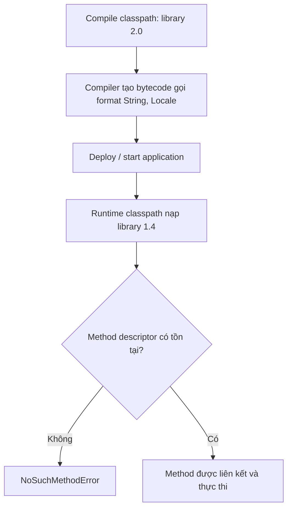

# NoSuchMethodError và dấu hiệu lệch phiên bản thư viện lúc chạy

`NoSuchMethodError` là lỗi liên kết nhị phân (binary linkage) xảy ra khi JVM cần gọi một method mà class hoặc interface được nạp lúc chạy không cung cấp method với tên và descriptor mà bytecode của caller đang tham chiếu. Trong ứng dụng Java, nguyên nhân phổ biến là mã đã được biên dịch với một phiên bản thư viện nhưng runtime lại nạp phiên bản khác không còn API tương thích.

Ví dụ, ứng dụng được biên dịch với `common-utils:2.0`, trong đó có method `format(String, Locale)`. Khi chạy, classpath lại chứa `common-utils:1.4`, chỉ có `format(String)`. Compiler đã chấp nhận lời gọi dựa trên API của version 2.0, nhưng JVM không tìm thấy method tương ứng trong class thực tế được nạp. Kết quả là `NoSuchMethodError`.

Lỗi này thường không được sửa đúng cách bằng việc thêm một JAR bất kỳ hoặc nâng tất cả dependency lên version mới nhất. Cần xác định caller mong đợi method nào, JVM đã nạp class từ artifact nào, vì sao artifact đó xuất hiện trên runtime classpath và phiên bản nào tương thích với toàn bộ dependency graph.

## 1. `NoSuchMethodError` là gì?

`NoSuchMethodError` thuộc nhóm `LinkageError`, là lỗi liên kết class xảy ra trong quá trình JVM liên kết bytecode với định nghĩa class/interface thực tế. Bytecode được compiler tạo ra chứa symbolic reference đến method. Khi JVM cần resolve reference đó, nó phải tìm được method tương ứng trong class/interface được chỉ định và hệ thống kế thừa liên quan.

Thông báo thường có dạng:

```text
java.lang.NoSuchMethodError: 'java.lang.String org.example.TextFormatter.format(java.lang.String, java.util.Locale)'
    at com.example.app.ReportService.createTitle(ReportService.java:42)
    at com.example.app.Main.main(Main.java:18)
```

Thông báo cung cấp hai manh mối quan trọng:

- Method mà bytecode muốn gọi: `TextFormatter.format(String, Locale)`.
- Caller đã thực hiện lời gọi: `ReportService.createTitle` tại dòng 42.

Stack trace thường cho biết điểm lỗi được phát hiện, nhưng chưa nói trực tiếp JAR nào đã cung cấp class `TextFormatter`. Cần kiểm tra classloader và runtime classpath để xác định nguồn class.

### 1.1. JVM tìm method theo tên và descriptor

Ở mức bytecode, một method reference không chỉ là tên method. Nó chứa owner class/interface, tên method và descriptor. Descriptor bao gồm kiểu tham số và kiểu trả về sau khi biểu diễn theo quy tắc JVM.

Ví dụ mã Java:

```java
String title = formatter.format("invoice", Locale.US);
```

Lời gọi có thể được biểu diễn trong constant pool của class file bằng một symbolic reference tương tự:

```text
org/example/TextFormatter.format:
  (Ljava/lang/String;Ljava/util/Locale;)Ljava/lang/String;
```

Descriptor trên cho biết method nhận `String` và `Locale`, trả về `String`. Khi JVM resolve reference, method phải khớp tên và descriptor theo quy tắc liên kết của JVM. Một method cùng tên nhưng khác số lượng/thứ tự kiểu tham số không đáp ứng reference đó.

Kiểu trả về cũng nằm trong descriptor ở mức JVM. Vì vậy, thay đổi kiểu trả về có thể phá binary compatibility dù mã nguồn Java không cho phép overload hai method chỉ khác kiểu trả về.

### 1.2. Vì sao compile thành công nhưng runtime thất bại?

Compiler kiểm tra mã nguồn với compile classpath tại thời điểm biên dịch. Bytecode sau đó chứa các tham chiếu đến API mà compiler nhìn thấy. Khi chạy, JVM dùng runtime classpath hoặc module path của tiến trình thực tế để nạp class.

Nếu compile classpath và runtime classpath cung cấp các định nghĩa class không tương thích, compile có thể thành công nhưng JVM thất bại khi liên kết method.



Điểm cốt lõi là compiler và JVM có thể nhìn thấy hai phiên bản khác nhau của cùng class.

## 2. Ví dụ tái hiện lệch phiên bản

Giả sử thư viện `text-utils` có hai phiên bản.

**Version 1.0**:

```java
package org.example;

public class TextFormatter {
    public String format(String value) {
        return value.trim();
    }
}
```

**Version 2.0** bổ sung overload:

```java
package org.example;

import java.util.Locale;

public class TextFormatter {
    public String format(String value) {
        return value.trim();
    }

    public String format(String value, Locale locale) {
        return value.trim().toLowerCase(locale);
    }
}
```

Ứng dụng được biên dịch với version 2.0:

```java
package com.example.app;

import java.util.Locale;
import org.example.TextFormatter;

public class ReportService {
    public String createTitle(String source) {
        TextFormatter formatter = new TextFormatter();
        return formatter.format(source, Locale.US);
    }
}
```

Nếu runtime chỉ có version 1.0, JVM nạp `TextFormatter` nhưng không tìm thấy method `format(String, Locale)`. Ứng dụng có thể khởi động bình thường và chỉ ném lỗi khi đường code gọi method đó được thực thi.

Đây là lý do một smoke test đơn giản có thể pass dù ứng dụng vẫn có lỗi linkage: test chưa đi qua method bị ảnh hưởng.

### 2.1. Thay đổi API có thể gây lỗi linkage

Các thay đổi sau có thể làm bytecode đã biên dịch không còn liên kết được:

- Xóa một method công khai hoặc protected.
- Đổi tên method.
- Đổi số lượng, thứ tự hoặc kiểu tham số.
- Đổi kiểu trả về theo cách làm thay đổi descriptor nhị phân.
- Thay đổi quan hệ kế thừa khiến method không còn được tìm thấy qua class/interface hierarchy.
- Thay đổi bridge method hoặc generic API theo cách phá binary compatibility.
- Thay một interface/class bằng kiểu khác hoặc thay đổi cấu trúc API liên quan.

Không phải mọi thay đổi API đều tạo `NoSuchMethodError`. Ví dụ thay đổi static/instance hoặc một số thay đổi class/interface có thể dẫn đến `IncompatibleClassChangeError`; thay đổi khả năng override có thể dẫn đến `AbstractMethodError`. Cần đọc exception cụ thể và descriptor để xác định dạng incompatibility.

## 3. Dấu hiệu nhận biết lỗi lệch phiên bản lúc chạy

Một số dấu hiệu thường xuất hiện cùng `NoSuchMethodError`:

- Build compile thành công, nhưng ứng dụng lỗi khi chạy hoặc khi một endpoint/feature cụ thể được gọi.
- Lỗi xuất hiện sau khi nâng một thư viện trực tiếp hoặc gián tiếp.
- Lỗi chỉ xảy ra trên CI, server, container hoặc production; máy phát triển vẫn chạy.
- Stack trace nhắc đến method của thư viện bên thứ ba, không phải method do ứng dụng định nghĩa.
- `dependencyInsight` cho thấy compile và runtime configuration chọn version khác nhau.
- Runtime classpath có nhiều artifact chứa cùng fully qualified class name.
- JAR được đóng gói trong ứng dụng khác với JAR được dùng lúc compile.
- Application server, plugin framework hoặc container nạp một bản thư viện từ classloader riêng.
- Chạy bằng IDE thành công nhưng chạy bằng `java -jar`, Gradle `run` hoặc service script lại thất bại.

Những dấu hiệu này giúp định hướng điều tra nhưng không phải bằng chứng cuối cùng. Bằng chứng quyết định là class thực tế được JVM nạp và API mà class đó cung cấp.

## 4. Các nguyên nhân phổ biến

### 4.1. Compile classpath và runtime classpath khác nhau

Một dependency có thể xuất hiện ở compile classpath nhưng không có ở runtime classpath. Trong Gradle, trường hợp này có thể đến từ cách khai báo configuration:

| Configuration | Có trên compile classpath? | Có trên runtime classpath? |
|---|---|---|
| `implementation` | Có | Có |
| `api` (Java Library) | Có và được xuất cho consumer | Có theo dependency graph runtime |
| `compileOnly` | Có | Không theo configuration này |
| `runtimeOnly` | Không | Có |

Nếu compile dùng một API mới nhưng runtime được cung cấp bởi một dependency khác hoặc một JAR cũ, có thể phát sinh linkage error. Hãy kiểm tra đúng configuration thay vì chỉ nhìn dòng dependency trong build file.

### 4.2. Dependency bắc cầu kéo về version khác

Ứng dụng có thể khai báo `library-a:3.0`, nhưng thư viện đó phụ thuộc vào `common-api:2.0`. Một dependency khác lại yêu cầu `common-api:1.4`. Công cụ build phải giải quyết xung đột và chọn một version.

```text
application
├── library-a:3.0
│   └── common-api:2.0
└── legacy-adapter:1.2
    └── common-api:1.4
```

Nếu version được chọn không tương thích với một consumer, runtime có thể báo `NoSuchMethodError`. Dependency trực tiếp trong build file không nhất thiết là dependency đang gây ra version được chọn; cần lần theo nhánh bắc cầu.

### 4.3. Có nhiều JAR chứa cùng một class

Classpath có thể chứa hai artifact khác tọa độ nhưng cùng chứa `org.example.TextFormatter`. JVM sẽ nạp một định nghĩa class theo quy tắc classloader và thứ tự tìm kiếm. Nếu class được nạp không phải bản mà caller được biên dịch theo, lỗi linkage có thể xảy ra.

Trường hợp này thường xuất hiện khi:

- Một JAR fat/shaded đóng gói lại thư viện gốc.
- Ứng dụng vừa thêm dependency mới vừa giữ JAR cũ trong thư mục `lib`.
- Server/container cung cấp thư viện, trong khi ứng dụng lại đóng gói một version khác.
- Plugin hoặc module con mang theo bản thư viện riêng.
- Một dependency bị copy thủ công vào thư mục runtime ngoài Gradle/Maven.

Chỉ xem dependency graph chưa đủ nếu classpath được bổ sung bên ngoài build tool. Cần xác minh nguồn class trong tiến trình thật.

### 4.4. Artifact triển khai không khớp artifact compile

Build có thể tạo JAR/WAR đúng nhưng bước deploy copy một file cũ, một thư mục `lib` khác hoặc một image/container layer cũ. Khi đó runtime không dùng artifact vừa build.

Các tình huống cần kiểm tra:

- Pipeline deploy lấy artifact từ đúng build number/commit không?
- Dockerfile có copy đúng file vừa tạo không?
- Image tag có bị tái sử dụng hoặc cache layer làm giữ JAR cũ không?
- WAR/EAR có chứa version thư viện đúng không?
- Service startup script có thêm thư mục `lib` ngoài artifact không?
- Application server có shared library hoặc parent classloader cung cấp version khác không?

### 4.5. Version bị ép hoặc dependency bị exclude

Một rule `force`, constraint nghiêm ngặt, platform/BOM hoặc exclusion có thể làm runtime chọn một version không phù hợp với consumer.

Ví dụ, build ép mọi configuration dùng `common-api:1.4`, trong khi `library-a` đã được compile/test với API `2.x`. Build có thể vẫn resolve thành công nhưng runtime lỗi khi method mới được gọi.

Đừng xóa `force` hoặc exclusion một cách mù quáng. Trước hết cần xác định vì sao rule được thêm, dependency nào phụ thuộc vào nó và version nào thực sự tương thích.

## 5. Phân biệt `NoSuchMethodError` với các lỗi gần giống

Đọc đúng loại exception giúp tránh sửa sai tầng.

| Exception | Ý nghĩa chính | Hướng điều tra |
|---|---|---|
| `NoSuchMethodError` | JVM không resolve được method reference có tên/descriptor mà bytecode yêu cầu. | API method của class runtime, version skew, duplicate class. |
| `NoSuchFieldError` | JVM không resolve được field reference mà bytecode yêu cầu. | Version của class, field bị xóa/đổi tên/đổi descriptor. |
| `NoClassDefFoundError` | JVM không thể định nghĩa/nạp class cần thiết hoặc class đã thất bại khi khởi tạo. | Runtime classpath, dependency thiếu, lỗi static initializer trước đó. |
| `ClassNotFoundException` | Code chủ động yêu cầu nạp class theo tên nhưng classloader không tìm thấy. | Reflection, `Class.forName`, ServiceLoader, classloader. |
| `AbstractMethodError` | Runtime dispatch cần implementation method nhưng class thực tế không cung cấp implementation phù hợp. | Version mismatch giữa interface/abstract API và implementation. |
| `IncompatibleClassChangeError` | Cấu trúc class/interface hoặc cách truy cập không tương thích với bytecode caller. | Thay đổi class/interface, static/instance, hierarchy. |
| `IllegalAccessError` | Bytecode truy cập thành phần không còn được phép. | Access modifier, JPMS exports, binary compatibility. |
| `NoSuchMethodException` | Reflection API không tìm được method theo yêu cầu; đây là checked exception của reflection. | Tên, kiểu tham số, visibility và cách gọi reflection. |

`NoSuchMethodException` và `NoSuchMethodError` không giống nhau. Lỗi thứ nhất thường xuất hiện từ `Class.getMethod()`/`getDeclaredMethod()` và có thể được xử lý trong code. Lỗi thứ hai là `LinkageError` khi JVM liên kết bytecode, thường chỉ ra runtime API không tương thích với bytecode đã biên dịch.

## 6. Quy trình điều tra: bắt đầu từ method bị thiếu

Đừng bắt đầu bằng cách thay version. Hãy thu thập các bằng chứng theo thứ tự.

### Bước 1: Ghi lại toàn bộ exception và caller

Lưu toàn bộ stack trace, gồm:

- Tên method và descriptor được nêu trong `NoSuchMethodError`.
- Class caller và dòng code đầu tiên thuộc ứng dụng.
- Các frame phía trên/bên dưới liên quan đến framework hoặc thư viện.
- Phần `Caused by` nếu có exception gốc khác.
- Lệnh khởi chạy, môi trường và thời điểm lỗi xuất hiện.

Xác định feature/đường code gây lỗi. Nếu lỗi chỉ xuất hiện khi gọi một endpoint, chạy một test cụ thể tái hiện đúng lời gọi đó để rút ngắn vòng điều tra.

### Bước 2: Xác định owner class và method descriptor

Tách thông báo lỗi thành:

- Owner class/interface, ví dụ `org.example.TextFormatter`.
- Method name, ví dụ `format`.
- Tham số và kiểu trả về, ví dụ `(String, Locale) -> String`.

Kiểm tra caller được biên dịch với API nào. Nếu có source hoặc JAR compile dependency, dùng `javap` để xem class:

```bash
javap -classpath path/to/common-api-2.0.jar -p -s org.example.TextFormatter
```

Tùy chọn `-p` hiển thị cả thành phần không public; `-s` hiển thị descriptor. Xác nhận method mà caller mong đợi thực sự có trong API version compile.

### Bước 3: Xác định class runtime được nạp từ đâu

Trong code chẩn đoán có thể in nguồn class:

```java
Class<?> type = org.example.TextFormatter.class;

System.out.println("Class: " + type.getName());
System.out.println("ClassLoader: " + type.getClassLoader());
System.out.println("CodeSource: " + type.getProtectionDomain()
        .getCodeSource()
        .getLocation());
System.out.println("Module: " + type.getModule());
```

`CodeSource` thường cho biết class được nạp từ thư mục hoặc JAR nào. Trong một số môi trường, class có thể do bootstrap/platform loader hoặc custom classloader định nghĩa mà không có `CodeSource`; giá trị có thể là `null`.

Có thể bật class loading log trên JDK 9 trở lên:

```bash
java -Xlog:class+load=info -jar app.jar
```

Với JDK 8:

```bash
java -verbose:class -jar app.jar
```

Lọc log theo class cần điều tra:

```powershell
java -Xlog:class+load=info -jar app.jar 2>&1 |
    Select-String 'org.example.TextFormatter'
```

Class loading log là bằng chứng mạnh để xác định JAR thực tế. Nếu ứng dụng dùng plugin classloader, application server hoặc module layer riêng, hãy ghi lại cả classloader của class và classloader của caller.

### Bước 4: Kiểm tra method có trong JAR runtime hay không

Sau khi biết JAR thực tế được nạp, kiểm tra nội dung:

```bash
jar tf path/to/runtime-common-api.jar
```

Xem API class:

```bash
javap -classpath path/to/runtime-common-api.jar -p -s org.example.TextFormatter
```

So sánh method name và descriptor với bytecode caller. Nếu JAR runtime không có method, đã xác nhận version/class mismatch. Nếu JAR có method đúng mà lỗi vẫn xảy ra, cần xem classloader thực tế có nạp một class khác cùng tên hay không, hoặc owner class/interface trong reference có khác với giả định ban đầu không.

### Bước 5: Xem bytecode của caller

Để biết caller tham chiếu chính xác method nào, dùng:

```bash
javap -classpath path/to/application.jar -c -verbose com.example.app.ReportService
```

Tìm constant pool entry và instruction `invokevirtual`, `invokeinterface`, `invokestatic` hoặc `invokespecial` tương ứng. Thông tin này giúp xác định owner, method name và descriptor được bytecode yêu cầu.

### Bước 6: So sánh compile và runtime dependency graph

Với Gradle, xem riêng `compileClasspath` và `runtimeClasspath`. Với Maven, xem dependency tree theo scope runtime và compile. Tìm module chứa owner class và lý do version được chọn.

### Bước 7: Kiểm tra artifact deploy cuối cùng

Nếu local graph đúng nhưng production lỗi, kiểm tra JAR/WAR/image được triển khai, manifest, thư mục `lib`, shared library và launch command. Xác nhận artifact hash/build number trùng với artifact được tạo từ commit đang điều tra.

## 7. Điều tra bằng Gradle

Gradle phân giải dependency theo configuration. Vì vậy, hãy truy vấn đúng configuration mà task/ứng dụng dùng.

### 7.1. Xem runtime dependency tree

```bash
./gradlew dependencies --configuration runtimeClasspath
```

Để so sánh với compile graph:

```bash
./gradlew dependencies --configuration compileClasspath
```

Nếu lỗi xảy ra khi chạy test:

```bash
./gradlew dependencies --configuration testRuntimeClasspath
```

Một dependency có thể được resolve khác nhau giữa các configuration do variant, constraint, dependency scope hoặc rule. Đừng suy luận runtime version chỉ từ `implementation` declaration.

### 7.2. Dùng `dependencyInsight` tìm lý do version được chọn

Ví dụ module bị nghi ngờ là `org.example:common-api`:

```bash
./gradlew dependencyInsight \
    --dependency org.example:common-api \
    --configuration runtimeClasspath
```

Kết quả có thể cho biết:

- Dependency nào yêu cầu version nào.
- Version nào được chọn.
- Version nào bị conflict resolution thay thế.
- Constraint/platform nào tác động.
- Có rule `force`, substitution hoặc selection rule hay không.

Chạy cùng lệnh cho `compileClasspath`:

```bash
./gradlew dependencyInsight \
    --dependency org.example:common-api \
    --configuration compileClasspath
```

Nếu compile graph chọn `2.0` nhưng runtime graph chọn `1.4`, đã có một khác biệt cần giải thích. Tiếp tục truy nhánh dependency và rule ảnh hưởng đến runtime configuration.

### 7.3. Kiểm tra dependency declaration và scope

Ví dụ:

```groovy
dependencies {
    implementation 'org.example:common-api:2.0'
    runtimeOnly 'org.example:legacy-adapter:1.4'
    testImplementation 'org.junit.jupiter:junit-jupiter:5.11.0'
}
```

Nếu `legacy-adapter` kéo `common-api:1.4` và runtime resolution chọn version không tương thích, cần xem vì sao version đó được chọn và adapter hỗ trợ API nào. Việc chỉ đổi `runtimeOnly` thành `implementation` không tự sửa version conflict; nó chỉ thay đổi scope dependency.

### 7.4. Kiểm tra force, constraints và platform

Tìm trong build logic các cấu hình như:

```groovy
configurations.configureEach {
    resolutionStrategy.force 'org.example:common-api:1.4'
}
```

Hoặc dependency constraint/platform:

```groovy
dependencies {
    constraints {
        implementation('org.example:common-api:1.4') {
            because 'Temporary compatibility pin'
        }
    }
}
```

Một pin version có thể được thêm vì một lý do hợp lệ trước đó. Hãy kiểm tra lịch sử và consumer trước khi gỡ. Nếu cần đồng bộ nhiều module, platform/BOM thường thể hiện version policy rõ hơn việc rải `force` khắp build.

### 7.5. Dependency locking

Dependency locking giữ version đã resolve cho configuration được bật locking. Nếu lockfile còn giữ version cũ, build có thể tiếp tục dùng version đó dù declaration hoặc platform đã thay đổi theo cách khác.

Kiểm tra lockfile trong repository và quy trình cập nhật lock. Khi chủ động nâng version, cập nhật lock có review rồi chạy test. Không xóa lockfile chỉ để làm resolution chọn version mới mà chưa hiểu vì sao version cũ được pin.

## 8. Điều tra bằng Maven

Maven sử dụng dependency mediation, trong đó quy tắc nearest definition có thể khiến version gần project gốc hơn được chọn. Vì vậy, version trong dependency declaration của một thư viện không nhất thiết là version cuối cùng trên runtime classpath.

### 8.1. Xem dependency tree

```bash
mvn dependency:tree
```

Để lọc một artifact:

```bash
mvn dependency:tree -Dincludes=org.example:common-api
```

Có thể xem theo scope runtime:

```bash
mvn dependency:tree -Dscope=runtime
```

Đọc cây để xác định nhánh nào đưa `common-api` vào, version được mediation chọn và có dependency bị omitted for conflict hay không.

### 8.2. `dependencyManagement` và BOM

`dependencyManagement` có thể định nghĩa version thống nhất cho dependency khi module được khai báo:

```xml
<dependencyManagement>
  <dependencies>
    <dependency>
      <groupId>org.example</groupId>
      <artifactId>common-api</artifactId>
      <version>2.0.0</version>
    </dependency>
  </dependencies>
</dependencyManagement>
```

Nó không tự thêm dependency vào project. Nó cung cấp version/default management cho dependency được khai báo trong phần `<dependencies>` hoặc dependency bắc cầu theo quy tắc Maven.

Với nhiều module cùng dùng một release train, BOM có thể tập trung quản lý version. Sau khi thay đổi dependency management, hãy kiểm tra lại `dependency:tree` của runtime scope và test ứng dụng.

### 8.3. Exclusions và dependency convergence

Exclusion có thể loại một dependency bắc cầu khỏi graph:

```xml
<dependency>
  <groupId>org.example</groupId>
  <artifactId>legacy-adapter</artifactId>
  <version>1.4.0</version>
  <exclusions>
    <exclusion>
      <groupId>org.example</groupId>
      <artifactId>common-api</artifactId>
    </exclusion>
  </exclusions>
</dependency>
```

Nếu loại `common-api` nhưng không cung cấp version tương thích khác, ứng dụng có thể chuyển từ `NoSuchMethodError` sang `NoClassDefFoundError` hoặc lỗi khác. Chỉ exclude khi biết module thay thế sẽ cung cấp API cần thiết.

Maven Enforcer Plugin với rule `dependencyConvergence` có thể giúp phát hiện graph yêu cầu nhiều version khác nhau. Đây là tín hiệu cần review; convergence không tự bảo đảm API compatibility, nhưng giúp giảm những version skew không được kiểm soát.

## 9. Kiểm tra duplicate class và classloader

Dependency graph có thể cho thấy chỉ một version của module Maven/Gradle, nhưng runtime vẫn có duplicate class từ nguồn khác. Ví dụ ứng dụng đóng gói một thư viện shaded, server có shared library và launch script thêm một thư mục `lib`.

### 9.1. Tìm class trong các JAR

Tên class `org.example.TextFormatter` tương ứng với entry:

```text
org/example/TextFormatter.class
```

Liệt kê JAR:

```bash
jar tf path/to/library.jar
```

Với nhiều JAR, có thể dùng script hoặc lệnh phù hợp hệ điều hành để tìm artifact nào chứa entry này. Đừng chỉ dựa vào tên file JAR; artifact có thể đã được đổi tên khi đóng gói.

### 9.2. Classloader delegation

Một JVM có thể có nhiều classloader. Application server, plugin framework, servlet container hoặc OSGi-like environment có thể dùng parent/child loader và chính sách delegation riêng.

Vì vậy, cùng một tên class có thể được định nghĩa trong các classloader khác nhau. Hai class có cùng fully qualified name nhưng do hai classloader khác nhau định nghĩa không phải cùng một `Class` theo JVM identity.

Khi điều tra:

- In `Class.getClassLoader()` cho owner class.
- In classloader của caller nếu có thể.
- Xem `CodeSource` của từng class.
- Kiểm tra shared libraries của server/container.
- Xem launch arguments và module/plugin classloader configuration.

Nếu server ưu tiên parent classloader, JAR trong ứng dụng có thể không phải JAR cung cấp class thực tế. Nếu môi trường dùng child-first cho một số package, kết quả có thể ngược lại. Hãy dựa vào log runtime, không suy luận từ cấu trúc thư mục.

## 10. Kiểm tra API binary compatibility

Không phải mọi version mới đều binary-compatible với version cũ. Khi nâng một thư viện, cần xác định nhà cung cấp cam kết mức tương thích nào: source compatibility, binary compatibility hay behavioral compatibility.

### 10.1. Source compatibility và binary compatibility

- **Source compatibility:** mã nguồn cũ có thể biên dịch lại với API mới mà không cần sửa hoặc chỉ cần sửa nhỏ theo cam kết cụ thể.
- **Binary compatibility:** class file đã biên dịch trước đó vẫn liên kết được với API mới theo các quy tắc JVM.
- **Behavioral compatibility:** chương trình vẫn có hành vi tương đương theo kỳ vọng khi chạy với version mới.

Một thư viện có thể source-compatible nhưng không binary-compatible trong một số thay đổi, hoặc binary-compatible nhưng behavioral behavior thay đổi. `NoSuchMethodError` là dấu hiệu của lỗi binary linkage, không phải mọi dạng incompatibility.

### 10.2. Kiểm tra release notes và compatibility policy

Khi nâng version, đọc:

- Release notes/changelog.
- Migration guide.
- Breaking changes.
- API deprecation/removal notes.
- Compatibility matrix với framework và JDK.
- Version range được nhà cung cấp hỗ trợ.

Không nên chỉ so sánh số version. Một version mới có thể thay đổi package, artifact split, module name hoặc dependency graph. Một số framework yêu cầu các module cùng release train phải dùng chung version.

### 10.3. Dùng công cụ so sánh API

`javap` giúp xem một class cụ thể. Với thư viện lớn, có thể dùng công cụ binary compatibility/API diff để so sánh hai artifact và phát hiện method/field bị xóa hoặc descriptor thay đổi.

Ví dụ kiểm tra class trong hai JAR:

```bash
javap -classpath common-api-1.4.jar -p -s org.example.TextFormatter
javap -classpath common-api-2.0.jar -p -s org.example.TextFormatter
```

So sánh output để xem method nào được thêm, xóa hoặc đổi descriptor. Đây là kiểm tra ở mức class; cần thêm integration tests để xác nhận cả hành vi và tương tác giữa thư viện.

## 11. Cách khắc phục theo nguyên nhân

Sau khi đã xác nhận JAR runtime và method bị thiếu, chọn cách sửa phù hợp.

### 11.1. Đồng bộ version tương thích

Nếu caller cần API của `common-api:2.0`, hãy bảo đảm runtime graph và artifact deploy cung cấp version tương thích. Có thể cập nhật dependency trực tiếp, platform/BOM hoặc constraint tại nơi quản lý version.

Không nhất thiết phải chọn version mới nhất. Chọn version được các consumer hỗ trợ và đã qua kiểm thử trong sản phẩm.

### 11.2. Nâng dependency consumer

Nếu một thư viện cũ chỉ hỗ trợ API `common-api:1.x`, còn ứng dụng cần `2.x`, có thể phải nâng thư viện consumer lên version hỗ trợ API mới. Chỉ ép dependency bắc cầu lên `2.x` có thể làm consumer cũ hỏng.

### 11.3. Hạ caller về API tương thích

Nếu chưa thể nâng dependency consumer, có thể sửa code ứng dụng để dùng API chung mà các version được hỗ trợ cùng cung cấp. Đây là giải pháp có thể chấp nhận khi API cũ vẫn đáp ứng yêu cầu và nhóm có kế hoạch nâng cấp rõ ràng.

### 11.4. Loại bỏ JAR trùng hoặc nguồn runtime cũ

Nếu class được nạp từ JAR cũ trong thư mục `lib`, shared library hoặc image layer, hãy sửa bước đóng gói/deploy để chỉ còn nguồn artifact đúng. Không nên thêm JAR mới vào đầu classpath để che bản cũ; cách đó vẫn để lại dependency không rõ ràng và dễ tái phát.

### 11.5. Điều chỉnh dependency management có kiểm soát

Nếu version bị chọn do constraint, BOM, lockfile hoặc force, cập nhật chính sách ở đúng nơi sở hữu version. Ghi lại lý do và chạy test cho các consumer có liên quan. Tránh rải nhiều force rule khiến graph khó dự đoán.

### 11.6. Không dùng reflection để che lỗi linkage

Có thể có tình huống ứng dụng muốn hỗ trợ nhiều version API. Reflection có thể kiểm tra method có tồn tại hay không, nhưng chỉ nên dùng khi hỗ trợ nhiều version thực sự là yêu cầu thiết kế và có nhánh fallback được kiểm thử.

Không nên bắt `LinkageError` rồi tiếp tục chạy như thể không có lỗi. Khi bytecode đã được biên dịch theo API không tương thích, bỏ qua exception có thể dẫn đến trạng thái ứng dụng sai hoặc lỗi muộn khó điều tra hơn.

## 12. Kiểm chứng sau khi sửa

Một bản sửa chỉ hoàn tất khi runtime thực tế dùng đúng artifact và đường code gây lỗi chạy thành công.

Quy trình kiểm chứng:

1. Chạy dependency report cho compile và runtime configuration.
2. Xác nhận version được chọn và lý do lựa chọn.
3. Kiểm tra JAR runtime có method/descriptor cần thiết.
4. Xác nhận class loading log trỏ đến JAR mong muốn.
5. Chạy test tái hiện lỗi trước đây.
6. Chạy test cho các consumer khác dùng cùng dependency.
7. Tạo artifact deploy và kiểm tra nội dung JAR/WAR/image.
8. Chạy ứng dụng trong môi trường gần production và gọi feature từng gây lỗi.
9. Kiểm tra không còn duplicate class hoặc dependency pin ngoài ý muốn.

Với Gradle, các lệnh thường dùng:

```bash
./gradlew dependencyInsight --dependency common-api --configuration runtimeClasspath
./gradlew test
./gradlew build
```

Với Maven:

```bash
mvn dependency:tree -Dincludes=org.example:common-api
mvn test
mvn verify
```

Nếu lỗi chỉ xảy ra trong container/server, phải kiểm chứng chính image hoặc deployment artifact cuối cùng. Test local trên classpath của IDE không đủ chứng minh runtime production đã được sửa.

## 13. Ví dụ tình huống thực tế: framework và thư viện transitive

Giả sử ứng dụng dùng `web-framework:5.0`, framework này yêu cầu `common-api:3.0`. Một plugin nội bộ cũ kéo `common-api:2.1`. Build resolution hoặc một thư mục `lib` thủ công khiến runtime nạp version 2.1.

```text
application
├── web-framework:5.0
│   └── common-api:3.0
└── internal-plugin:1.0
    └── common-api:2.1
```

Framework gọi method mới có trong `common-api:3.0`, nhưng runtime nạp 2.1. Ứng dụng có thể khởi động và chỉ lỗi khi framework xử lý request cần method đó.

Quy trình điều tra:

1. Lấy stack trace và xác định method của `common-api`.
2. Chạy `dependencyInsight` cho runtime configuration.
3. Xem plugin nội bộ kéo version nào và vì sao version được chọn.
4. Xác nhận classloader nạp `common-api` từ JAR nào.
5. Kiểm tra plugin nội bộ có tương thích với version 3.0 không.
6. Nâng plugin nội bộ hoặc chọn framework/version set tương thích.
7. Chạy test tích hợp qua request path gây lỗi.

Nếu plugin nội bộ không tương thích với API 3.0, chỉ force `common-api:3.0` có thể chuyển lỗi sang plugin. Khi đó cần nâng plugin hoặc giữ framework ở version tương thích, thay vì coi việc resolve dependency thành công là đủ.

## 14. Phòng ngừa lỗi lệch version

Có thể giảm rủi ro bằng các thực hành sau:

- Dùng platform/BOM để quản lý các module thuộc cùng release train.
- Dùng dependency constraints và version catalog có review.
- Bật dependency locking khi cần kết quả resolve tái lập.
- Hạn chế `force` và ghi lý do cho mọi rule thay đổi resolution.
- Dùng dependency convergence/consistency checks để phát hiện version skew sớm.
- Kiểm tra runtime graph, không chỉ compile graph.
- Kiểm tra duplicate class trong fat JAR, thư mục `lib` và container/server shared libraries.
- Tự động chạy smoke/integration test qua các đường code quan trọng.
- Kiểm tra artifact cuối cùng được deploy đúng build/commit.
- Đọc migration guide và binary compatibility notes khi nâng thư viện.
- Dùng class loading diagnostics khi có khác biệt giữa local, CI và production.

Một dependency graph nhất quán là điều kiện tốt, nhưng không tự bảo đảm binary compatibility. Một module có thể có version duy nhất mà vẫn không tương thích với consumer. Vì vậy, cần kết hợp graph inspection với API compatibility review và runtime testing.

## 15. Những điều không nên làm khi gặp `NoSuchMethodError`

- Không thêm hàng loạt JAR vào classpath để thử vận may.
- Không nâng tất cả dependency lên version mới nhất mà không xem compatibility matrix.
- Không ép version bằng `force` trước khi xác định dependency nào cần API nào.
- Không exclude dependency bắc cầu khi chưa biết consumer còn dùng class đó không.
- Không cho rằng compile thành công nghĩa runtime graph đúng.
- Không cho rằng dependency tree là bằng chứng cuối cùng nếu container/classloader có thể thêm thư viện ngoài build.
- Không bỏ qua `LinkageError` để ứng dụng tiếp tục chạy trong trạng thái không xác định.
- Không chỉ kiểm tra trên IDE nếu lỗi xuất hiện trong server hoặc container.

## 16. Checklist điều tra

- [ ] Đã lưu đầy đủ stack trace và xác định caller.
- [ ] Đã xác định owner class, method name và descriptor bị thiếu.
- [ ] Đã xác định API/version mà caller được biên dịch theo.
- [ ] Đã xác định JAR/class thực tế JVM nạp và classloader tương ứng.
- [ ] Đã kiểm tra method descriptor trong JAR runtime bằng `javap`.
- [ ] Đã so sánh compile và runtime dependency graph.
- [ ] Đã lần theo dependency bắc cầu, constraint, platform, force, lockfile và exclusion.
- [ ] Đã kiểm tra duplicate class, shared library và artifact deploy.
- [ ] Đã xác nhận version được chọn tương thích với tất cả consumer liên quan.
- [ ] Đã chạy test tái hiện, integration test và kiểm tra artifact cuối cùng.

`NoSuchMethodError` là dấu hiệu mạnh cho thấy bytecode và định nghĩa class mà JVM nạp không khớp ở mức method linkage. Cách xử lý đáng tin cậy là lần từ method descriptor trong stack trace về caller, xác định class runtime qua classloader/CodeSource, kiểm tra API trong JAR bằng `javap`, rồi đối chiếu compile và runtime dependency graph cùng artifact được triển khai. Khi biết chính xác version nào được yêu cầu, version nào thực sự được nạp và consumer nào cần API đó, nhóm mới có thể đồng bộ dependency, nâng consumer hoặc sửa bước đóng gói một cách an toàn.
