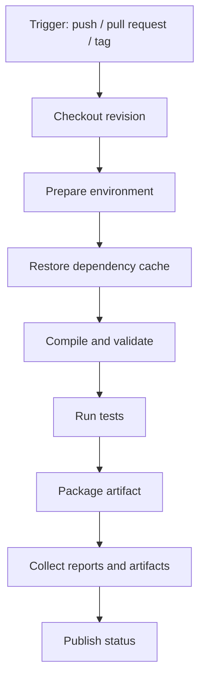
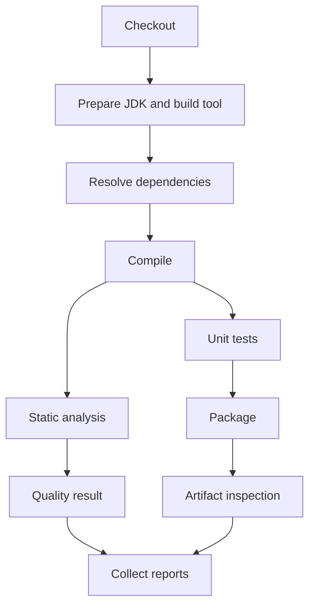
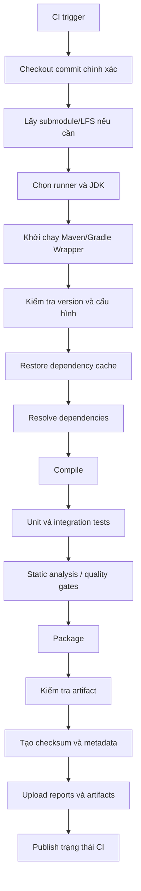

# Chuỗi checkout, chuẩn bị môi trường, build và thu thập kết quả

Một pipeline CI (Continuous Integration) nhận mã nguồn từ một revision cụ thể, chuẩn bị môi trường cần thiết, chạy các bước kiểm tra và build, sau đó thu thập kết quả để nhóm biết thay đổi có đạt yêu cầu hay không. Nếu pipeline chỉ chạy lệnh build mà không quản lý checkout, JDK, dependency, test report và artifact, kết quả có thể khó tái lập hoặc không đủ thông tin để điều tra khi thất bại.

Một chuỗi CI đáng tin cậy cần làm rõ bốn giai đoạn chính:

1. **Checkout:** lấy đúng repository, branch, commit và các thành phần mã nguồn liên quan.
2. **Chuẩn bị môi trường:** chọn JDK, build tool, cấu hình, credentials và dependency cache.
3. **Build và kiểm chứng:** compile, test, phân tích, đóng gói và xác nhận đầu ra.
4. **Thu thập kết quả:** lưu log, test report, artifact, metadata và trạng thái pipeline.

Các giai đoạn cần chạy theo đúng thứ tự và có quan hệ phụ thuộc rõ ràng. Nếu một bước bắt buộc thất bại, pipeline phải thể hiện trạng thái thất bại thay vì tạo cảm giác rằng sản phẩm đã sẵn sàng.

## 1. CI pipeline là gì?

CI pipeline là chuỗi công việc tự động được kích hoạt khi có sự kiện như push commit, mở pull request, tạo tag hoặc chạy theo lịch. Với dự án Java, pipeline thường kiểm tra mã nguồn, biên dịch, chạy test và tạo artifact.

Một pipeline cơ bản:



Mỗi bước tạo đầu vào cho bước tiếp theo. Ví dụ, bước package cần class file đã compile; bước thu thập test report cần test task đã chạy; bước upload artifact cần file đầu ra tồn tại và đã được xác định đúng.

### 1.1. CI khác CD như thế nào?

CI tập trung tích hợp thay đổi thường xuyên và xác nhận chúng không phá vỡ dự án. CD có thể chỉ Continuous Delivery hoặc Continuous Deployment tùy cách dùng:

- Continuous Delivery: chuẩn bị phần mềm ở trạng thái có thể phát hành, việc phát hành có thể cần phê duyệt.
- Continuous Deployment: tự động đưa thay đổi đã đạt điều kiện vào môi trường triển khai.

Một pipeline có thể dừng sau khi tạo artifact và lưu kết quả CI. Triển khai production là giai đoạn khác, cần quyền, điều kiện và kiểm soát riêng.

### 1.2. Pipeline cần có đầu ra rõ ràng

Một lần chạy CI nên trả lời được:

- Commit nào đã được kiểm tra?
- Build dùng JDK và build tool phiên bản nào?
- Lệnh hoặc task nào đã chạy?
- Compile và test có thành công không?
- Có bao nhiêu test pass, fail, skip?
- Artifact nào được tạo và lưu ở đâu?
- Nếu thất bại, bước nào và lý do nào?
- Có thể tải log, report và artifact để điều tra không?

Nếu không thu thập các thông tin này, trạng thái xanh hoặc đỏ của pipeline có thể không đủ để ra quyết định.

## 2. Giai đoạn 1: Checkout đúng revision

Checkout là bước đưa mã nguồn từ hệ thống quản lý phiên bản vào workspace của runner.

Với Git, cần xác định chính xác:

- Repository cần checkout.
- Branch, tag hoặc commit.
- Revision của pull request cần kiểm tra.
- Submodule và Git LFS nếu dự án sử dụng.
- Quyền truy cập repository riêng.
- Quy tắc fetch depth và lịch sử cần thiết.

### 2.1. Build từ commit cụ thể

Một build có thể tái lập cần biết chính xác source revision. Trong log CI, nên ghi commit SHA:

```bash
git rev-parse HEAD
git status --short
```

Commit SHA giúp liên kết artifact với mã nguồn đã tạo ra nó. Tên branch có thể thay đổi theo thời gian; SHA xác định một revision cụ thể.

Đối với pull request, nền tảng CI có thể checkout merge commit tạm thời hoặc head commit của nhánh đóng góp. Cần biết pipeline đang kiểm tra loại revision nào để kết quả phản ánh đúng quy tắc merge của dự án.

### 2.2. Fetch depth và lịch sử Git

Checkout nông (shallow checkout) chỉ lấy một phần lịch sử để tiết kiệm thời gian và băng thông. Điều này thường đủ cho compile và test, nhưng một số tác vụ cần lịch sử sâu hơn:

- Tính version từ Git tags.
- Tạo changelog.
- Tìm commit gần nhất.
- Tạo metadata release.
- Chạy công cụ phân tích thay đổi giữa các revision.

Nếu một task cần tags hoặc lịch sử nhưng checkout không lấy chúng, build có thể thất bại hoặc tạo version không chính xác. Khi đó cần điều chỉnh fetch depth hoặc fetch tags theo nhu cầu.

### 2.3. Submodule và Git LFS

Nếu repository sử dụng Git submodule, pipeline phải khởi tạo và cập nhật chúng trước khi build. Nếu dùng Git LFS, runner cần lấy nội dung file thực tế thay vì chỉ checkout pointer.

Nếu bỏ qua bước này, build có thể gặp file thiếu hoặc nhận dữ liệu không đúng. Các dependency ngoài repository cần được chuẩn bị rõ ràng trong pipeline.

### 2.4. Checkout sạch

Runner có thể tái sử dụng workspace hoặc tạo workspace mới. Nếu dùng lại workspace, file còn sót từ lần chạy trước có thể ảnh hưởng đến build.

Một pipeline nên đảm bảo workspace bắt đầu từ trạng thái được kiểm soát:

- Checkout đúng revision.
- Không dùng file output cũ ngoài ý muốn.
- Không để file local hoặc credentials từ job khác tồn tại.
- Dùng clean task khi cần làm sạch output.
- Cô lập workspace giữa các job không tin cậy.

Không nhất thiết phải xóa mọi cache dependency. Dependency cache là dữ liệu tái sử dụng có thể hữu ích; cần phân biệt nó với output dự án có thể chứa trạng thái cũ.

## 3. Giai đoạn 2: Chuẩn bị môi trường

Sau checkout, pipeline chuẩn bị công cụ và cấu hình để build chạy nhất quán.

### 3.1. Chọn JDK

Xác định:

- JDK dùng để khởi động Maven hoặc Gradle.
- JDK/toolchain dùng để biên dịch.
- Java release đích của artifact.
- JDK dùng để chạy test.
- Vendor và phiên bản JDK nếu yêu cầu nghiêm ngặt.

Ví dụ kiểm tra:

```bash
java -version
javac -version
```

Với Gradle:

```bash
./gradlew --version
```

Với Maven:

```bash
./mvnw -version
```

Các lệnh này giúp ghi nhận runtime thực tế. Không nên chỉ dựa vào cấu hình trên máy phát triển vì runner có thể dùng JDK khác.

### 3.2. Dùng Maven Wrapper hoặc Gradle Wrapper

Wrapper giúp pipeline chạy phiên bản build tool do repository quy định.

Gradle:

```bash
./gradlew clean build
```

Maven:

```bash
./mvnw clean verify
```

Trên Windows, dùng script tương ứng gradlew.bat hoặc mvnw.cmd. Trong CI Linux, wrapper script thường cần quyền thực thi.

Wrapper không tự cố định JDK, plugin, dependency hay hệ điều hành. Những thành phần đó cần được quản lý riêng.

### 3.3. Cố định môi trường runner

Môi trường có thể ảnh hưởng kết quả build:

- Hệ điều hành và kiến trúc CPU.
- JDK vendor và patch level.
- Locale, timezone và encoding.
- Shell và công cụ hệ thống.
- Biến môi trường.
- Thư mục làm việc.
- Quyền file.
- Container image.
- Cấu hình mạng và proxy.

Nếu dự án cần build nhất quán, nên chọn runner image có phiên bản rõ ràng hoặc digest bất biến theo chính sách CI. Tránh dùng image tag trôi nổi như latest khi cần truy vết và tái lập.

Có thể ghi nhận môi trường đầu pipeline:

```bash
git rev-parse HEAD
java -version
./gradlew --version
```

Với Maven, thay lệnh Gradle bằng ./mvnw -version.

### 3.4. Chuẩn bị biến môi trường và cấu hình

Build có thể cần các biến như:

- JAVA_HOME.
- CI hoặc BUILD_NUMBER.
- Profile hoặc feature flag.
- URL repository nội bộ.
- Cấu hình test.
- Đường dẫn cache hoặc thư mục tạm.

Giá trị ảnh hưởng đến output cần được khai báo và kiểm soát. Không để build phụ thuộc vào biến môi trường cá nhân không được ghi nhận.

Không đưa mật khẩu, token hoặc private key vào source code, build log hay artifact. Dùng secret store của CI và chỉ inject secret vào job cần chúng.

### 3.5. Quyền thực thi và công cụ phụ trợ

Một số pipeline cần:

- Shell script.
- Docker hoặc container runtime.
- Zip/unzip.
- Native compiler.
- Công cụ ký artifact.
- Browser hoặc service phục vụ integration test.

Cần cài hoặc chọn runner image có các công cụ đó. Nếu thiếu, pipeline nên thất bại ở bước chuẩn bị môi trường với thông báo dễ hiểu.

## 4. Giai đoạn 2: Dependency cache và repository

Sau khi môi trường sẵn sàng, build tool cần resolve dependency và plugin.

### 4.1. Gradle dependency cache

Gradle lưu dependency cache trong Gradle User Home. Có thể bật cache task riêng và cache dependency qua runner hoặc action tương ứng của CI.

Một pipeline không nên cache toàn bộ workspace một cách tùy tiện. Nên xác định cache nào được chia sẻ:

- Gradle User Home hoặc vùng dependency cache phù hợp.
- Maven local repository.
- Build cache local/remote.
- Không dùng output dự án cũ thay thế bước build nếu không có chính sách rõ.

Cache dependency giúp giảm thời gian tải JAR và metadata. Build cache giúp tái sử dụng output task; hai cơ chế có mục đích khác nhau.

### 4.2. Maven local repository

Maven mặc định lưu dependency và plugin trong local repository, thường ở thư mục .m2/repository dưới home của runner.

CI có thể cache thư mục này theo hệ điều hành, JDK hoặc cấu hình phù hợp. Khi cache bị miss, Maven tải lại dependency từ repository được cấu hình.

### 4.3. Cache key cần phản ánh cấu hình

Nếu cache key quá rộng, một cache cũ có thể được dùng trong môi trường không tương thích. Nếu cache key quá hẹp, cache miss thường xuyên.

Các thành phần có thể ảnh hưởng key:

- Hệ điều hành và kiến trúc.
- JDK version.
- Gradle/Maven wrapper version.
- Build file hoặc dependency lockfile.
- Version catalog hoặc BOM.
- Cấu hình repository.
- File checksum dùng để nhận diện dependency declarations.

Không cần đưa mọi file source vào dependency cache key nếu mục tiêu chỉ là cache thư viện. Build cache task-level có logic cache key riêng do build tool quản lý.

### 4.4. Cache không được thay thế dependency declaration

Cache chỉ là nơi lưu dữ liệu đã tải hoặc output đã tạo. Build phải vẫn xác định dependency từ build file, lockfile, BOM hoặc cấu hình được quản lý.

Nếu cache bị xóa, build vẫn phải có khả năng tải đúng dependency từ repository. Nếu dùng offline build, cần chuẩn bị đầy đủ cache trước đó và kiểm tra chính lệnh offline.

### 4.5. Repository tin cậy

Nên dùng repository được nhóm phê duyệt. Nếu sử dụng mirror nội bộ, pipeline phải có URL và credentials phù hợp.

Không đưa credentials vào URL hoặc in ra log. Secret chỉ nên được cấp cho job cần truy cập repository riêng, với quyền đọc tối thiểu.

## 5. Giai đoạn 3: Chạy các bước kiểm tra và build

Sau khi checkout và chuẩn bị môi trường, pipeline thực hiện các bước xác nhận chất lượng và tạo sản phẩm.

Thứ tự thường gặp:

1. Kiểm tra cấu hình và định dạng.
2. Compile.
3. Unit test.
4. Integration test nếu phù hợp.
5. Static analysis hoặc coverage.
6. Package.
7. Kiểm tra artifact.
8. Tạo metadata build.

Tùy dự án, một số bước có thể chạy song song nếu không phụ thuộc output của nhau. Nhưng không nên tạo artifact phát hành trước khi các điều kiện bắt buộc đã đạt.

### 5.1. Gradle pipeline command

Ví dụ đơn giản:

```bash
./gradlew clean check build
```

Java plugin cung cấp các task như compileJava, processResources, classes, test, check và build. Plugin khác có thể bổ sung task riêng.

Nếu muốn chạy các bước riêng để thu thập log rõ hơn:

```bash
./gradlew clean
./gradlew test
./gradlew build
```

Trong pipeline thực tế, không phải lúc nào cũng cần chạy test hai lần. Chọn task graph sao cho test chỉ chạy một lần và artifact được tạo từ cùng trạng thái source.

### 5.2. Maven pipeline command

Ví dụ:

```bash
./mvnw clean verify
```

Maven lifecycle verify bao gồm các phase trước đó như validate, compile, test, package và các bước verification được cấu hình. Plugin gắn vào lifecycle sẽ chạy theo thứ tự phase.

Nếu chỉ chạy package, một số bước verification hoặc integration test có thể chưa được thực hiện. Hãy chọn lifecycle phù hợp với chính sách dự án.

### 5.3. Phân biệt check, test, package và verify

Các task hoặc phase có mục tiêu khác nhau:

| Bước | Mục đích |
|---|---|
| Compile | Kiểm tra mã nguồn và tạo bytecode |
| Unit test | Kiểm tra hành vi của thành phần nhỏ |
| Integration test | Kiểm tra tương tác giữa nhiều thành phần |
| Static analysis | Tìm lỗi hoặc vi phạm quy tắc mà không cần chạy ứng dụng đầy đủ |
| Package | Tạo JAR, WAR hoặc distribution |
| Verify | Chạy các kiểm tra bổ sung theo lifecycle hoặc build configuration |

Build thành công chỉ có nghĩa các bước được pipeline yêu cầu đã hoàn thành. Nếu integration test không được cấu hình trong lifecycle, trạng thái xanh không chứng minh integration test đã chạy.

## 6. Tách job và stage theo quan hệ phụ thuộc

Pipeline lớn có thể chia thành nhiều job hoặc stage:

- Checkout và prepare.
- Compile/test.
- Static analysis.
- Package.
- Publish artifacts hoặc báo cáo.

Có thể chạy các kiểm tra độc lập song song để tiết kiệm thời gian. Nhưng mỗi job cần có checkout, toolchain và artifact input rõ ràng.

Ví dụ:



Nếu static analysis và unit test không phụ thuộc lẫn nhau, chúng có thể chạy song song sau compile. Package có thể chờ test đạt nếu chính sách yêu cầu chỉ tạo artifact sau khi test pass.

### 6.1. Truyền artifact giữa các job

Mỗi job thường có workspace riêng. Nếu job package cần class output từ job compile, cần truyền artifact hoặc checkout và build lại theo thiết kế pipeline.

Không nên giả định file tạo trong workspace của job A tự xuất hiện ở job B. Dùng cơ chế artifact transfer hoặc build lại có kiểm soát.

Khi truyền artifact:

- Dùng tên và đường dẫn rõ.
- Ghi lại commit và job tạo ra artifact.
- Kiểm tra checksum.
- Không truyền file bí mật hoặc cache không tin cậy.
- Đảm bảo job nhận artifact đúng revision.

## 7. Xử lý lỗi và điều kiện dừng

Pipeline cần phân biệt lỗi bắt buộc và bước phụ trợ.

### 7.1. Lỗi bắt buộc

Ví dụ:

- Checkout thất bại.
- JDK không đúng.
- Dependency không resolve được.
- Compile lỗi.
- Unit test thất bại.
- Package không tạo được artifact.

Các lỗi này thường phải làm pipeline thất bại. Không được tiếp tục publish artifact như thể build đã đạt yêu cầu.

### 7.2. Bước thu thập kết quả sau khi test thất bại

Ngay cả khi test thất bại, pipeline vẫn nên thu thập test report và log để người phát triển điều tra. Đây là trường hợp dùng cơ chế always/finally/post step của nền tảng CI.

Điều này không có nghĩa bỏ qua lỗi test. Pipeline vẫn phải giữ trạng thái failed, nhưng bước thu thập báo cáo cần được thực hiện ngay cả khi bước trước thất bại.

### 7.3. Bước không bắt buộc

Một số bước như benchmark, báo cáo phụ hoặc kiểm tra nightly có thể được cấu hình không chặn pull request. Hãy thể hiện rõ chúng là non-blocking và không gộp trạng thái của chúng với các điều kiện phát hành bắt buộc.

### 7.4. Không che giấu exit code

Nếu script gọi nhiều lệnh, cần bảo đảm lỗi của lệnh quan trọng được truyền về pipeline. Tránh dùng cách chạy lệnh khiến shell luôn trả về mã 0 dù build đã thất bại.

Ví dụ bash:

```bash
set -euo pipefail
./gradlew clean check build
```

Với PowerShell, cần kiểm tra exit code của chương trình native và trả về trạng thái lỗi thích hợp. Cách xử lý chính xác phụ thuộc shell và runner.

## 8. Giai đoạn 4: Thu thập test report và log

Khi task test chạy, build tool thường tạo report trong thư mục build output.

Gradle Java plugin thường tạo XML và HTML test report trong build/reports/tests/test, tùy cấu hình.

Maven Surefire thường tạo report trong target/surefire-reports. Maven Failsafe thường dùng target/failsafe-reports cho integration test.

Các report cần được lưu ngay cả khi pipeline thất bại để tránh mất bằng chứng.

### 8.1. Test report nên thể hiện gì?

Một báo cáo hữu ích cho biết:

- Tổng số test.
- Số pass.
- Số fail.
- Số skipped.
- Tên test suite và test case.
- Stack trace hoặc thông tin lỗi.
- Thời gian chạy.
- Module xảy ra lỗi.

Nếu dùng JUnit XML, nền tảng CI có thể hiển thị test result trực tiếp trong giao diện pull request hoặc job.

### 8.2. Lưu log

Log cần đủ thông tin để truy vết nhưng không chứa secret.

Nên lưu:

- Commit SHA.
- Build tool và JDK version.
- Lệnh/task đã chạy.
- Profile hoặc build variant.
- Dependency resolution failure nếu có.
- Stack trace và test failure.
- Thời gian và mã job.

Không nên in toàn bộ environment variables vì có thể làm lộ credentials. Nếu cần chẩn đoán, chỉ in các biến không nhạy cảm đã được chọn trước.

### 8.3. Lưu report kể cả khi job thất bại

Cấu hình upload report nên chạy trong bước post/always/finally phù hợp của CI. Nếu upload chỉ chạy khi mọi bước trước thành công, nhóm có thể mất đúng báo cáo cần để điều tra.

Pipeline vẫn phải trả trạng thái thất bại nếu test hoặc build lỗi. Thu thập report là bước hậu xử lý.

## 9. Thu thập và lưu artifact

Artifact là file được tạo ra để dùng ở bước sau, tải xuống, kiểm thử tiếp hoặc phát hành.

Ví dụ:

- JAR hoặc WAR.
- ZIP/TAR distribution.
- Test report.
- Coverage report.
- SBOM.
- Metadata build.
- Log chẩn đoán.
- File checksum.

Không phải mọi file trong workspace đều là artifact cần lưu. Hãy chọn rõ đường dẫn và thời gian lưu.

### 9.1. Xác định artifact đầu ra

Gradle thường tạo JAR trong:

```text
build/libs/
```

Maven thường tạo artifact trong:

```text
target/
```

Tên file có thể phụ thuộc project name, version, classifier hoặc cấu hình plugin. Không nên giả định một tên file duy nhất nếu build tạo nhiều artifact.

Có thể liệt kê trước khi upload:

```powershell
Get-ChildItem -Recurse build/libs
```

Lệnh trên dành cho PowerShell. Trong Bash có thể dùng find hoặc ls theo cấu trúc dự án.

### 9.2. Chỉ upload artifact khi đạt điều kiện

Artifact phát hành nên được upload sau khi các bước bắt buộc đạt:

- Compile thành công.
- Test bắt buộc thành công.
- Static analysis hoặc quality gate đạt nếu là điều kiện.
- Packaging thành công.
- Artifact tồn tại và có kích thước hợp lý.
- Không chứa file cấu hình local hoặc secret ngoài ý muốn.

Nếu build thất bại, có thể vẫn lưu artifact chẩn đoán hoặc output tạm, nhưng phải đánh dấu rõ là artifact của build failed và không được xem như bản phát hành đạt yêu cầu.

### 9.3. Gắn metadata cho artifact

Nên lưu thông tin liên kết artifact với build:

- Repository.
- Commit SHA.
- Branch hoặc tag.
- Build number/job ID.
- Version ứng dụng.
- JDK và build tool.
- Thời điểm tạo.
- Checksum SHA-256.

Ví dụ tạo checksum:

```bash
sha256sum build/libs/my-app.jar
```

Trên PowerShell:

```powershell
Get-FileHash build/libs/my-app.jar -Algorithm SHA256
```

Checksum giúp kiểm tra file có bị thay đổi khi truyền hoặc lưu trữ. Nó không tự xác minh nguồn phát hành; cần liên kết checksum với metadata và hệ thống CI đáng tin cậy.

## 10. Kiểm tra artifact trước khi lưu

Không nên chỉ dựa vào exit code của task package. Hãy xác nhận artifact có nội dung dự kiến.

Các kiểm tra có thể gồm:

- File tồn tại.
- Kích thước lớn hơn 0.
- Đúng định dạng.
- Có Main-Class nếu cần executable JAR.
- Có dependency hoặc distribution theo thiết kế.
- Không chứa secret.
- Không chứa file local.
- Class file phù hợp Java release.
- Tên/version đúng với commit hoặc release.

Liệt kê nội dung JAR:

```bash
jar --list --file build/libs/my-app.jar
```

Kiểm tra manifest:

```bash
unzip -p build/libs/my-app.jar META-INF/MANIFEST.MF
```

Nếu hệ thống không có unzip, có thể dùng công cụ JDK phù hợp hoặc giải nén bằng tiện ích có sẵn.

Kiểm tra class file:

```bash
javap -verbose path/to/Main.class
```

Tìm major version để xác nhận bytecode phù hợp release đích.

## 11. Ví dụ chuỗi CI cho Gradle

Một pipeline GitHub Actions đơn giản có thể minh họa thứ tự checkout, chọn JDK, chạy wrapper, thu thập report và upload artifact.

```yaml
name: Java CI

on:
  push:
    branches: [main]
  pull_request:

jobs:
  build:
    runs-on: ubuntu-latest

    steps:
      - name: Checkout
        uses: actions/checkout@v4

      - name: Set up JDK
        uses: actions/setup-java@v4
        with:
          distribution: temurin
          java-version: '17'

      - name: Verify toolchain
        run: |
          java -version
          ./gradlew --version

      - name: Build and test
        run: ./gradlew clean check build

      - name: Upload test reports
        if: always()
        uses: actions/upload-artifact@v4
        with:
          name: test-reports
          path: build/reports/tests/
          if-no-files-found: warn

      - name: Upload application artifact
        if: success()
        uses: actions/upload-artifact@v4
        with:
          name: application-jar
          path: build/libs/*.jar
          if-no-files-found: error
```

Đây là ví dụ cấu trúc. Trong dự án thật, cần kiểm tra phiên bản action theo chính sách bảo mật của tổ chức, có thể pin action bằng commit SHA, cấu hình Gradle cache, thiết lập permissions tối thiểu và chọn runner image phù hợp.

Điểm đáng chú ý:

- Checkout xảy ra trước mọi bước build.
- JDK được chọn tường minh.
- Wrapper được dùng thay vì Gradle cài toàn cục.
- Test report được upload kể cả khi build thất bại.
- Artifact ứng dụng chỉ upload khi job thành công.

Nếu project dùng multi-module hoặc tạo nhiều artifact, hãy điều chỉnh đường dẫn và tên artifact.

## 12. Ví dụ chuỗi CI cho Maven

Một pipeline Maven có thể dùng Maven Wrapper và JDK cố định:

```yaml
name: Maven CI

on:
  push:
    branches: [main]
  pull_request:

jobs:
  verify:
    runs-on: ubuntu-latest

    steps:
      - name: Checkout
        uses: actions/checkout@v4

      - name: Set up JDK
        uses: actions/setup-java@v4
        with:
          distribution: temurin
          java-version: '17'
          cache: maven

      - name: Verify toolchain
        run: |
          java -version
          ./mvnw -version

      - name: Build and verify
        run: ./mvnw --batch-mode --no-transfer-progress clean verify

      - name: Upload test reports
        if: always()
        uses: actions/upload-artifact@v4
        with:
          name: maven-test-reports
          path: |
            **/target/surefire-reports/
            **/target/failsafe-reports/
          if-no-files-found: warn

      - name: Upload package
        if: success()
        uses: actions/upload-artifact@v4
        with:
          name: maven-package
          path: |
            **/target/*.jar
            **/target/*.war
          if-no-files-found: error
```

Đây cũng là ví dụ minh họa. Với Maven multi-module, cần tránh upload JAR phụ hoặc artifact trung gian ngoài ý muốn. Có thể giới hạn đường dẫn vào module phát hành.

## 13. Bảo vệ secret và dữ liệu trong pipeline

Pipeline thường có quyền truy cập repository, registry, signing service hoặc môi trường triển khai. Vì vậy, dữ liệu nhạy cảm cần được quản lý cẩn thận.

Nguyên tắc:

- Lưu credentials trong secret store của CI.
- Chỉ cấp secret cho job thực sự cần.
- Dùng token có quyền tối thiểu và thời hạn phù hợp.
- Không in secret ra log.
- Không lưu secret vào test report hoặc artifact.
- Không đưa runtime secret vào JAR.
- Tách job chạy code không tin cậy khỏi job có quyền publish hoặc deploy.
- Kiểm soát ai có thể đọc artifact và log.
- Xoay vòng secret khi nghi ngờ bị lộ.

Pull request từ fork hoặc nguồn đóng góp không tin cậy thường không nên nhận secrets có quyền publish artifact hoặc triển khai. Cần cấu hình quyền theo cơ chế bảo vệ của nền tảng CI.

## 14. Artifact retention và truy vết

Artifact và report thường có thời hạn lưu trữ. Cần chọn retention phù hợp:

- Test report của pull request có thể lưu ngắn hơn.
- Artifact release cần lưu theo chính sách phát hành.
- Log phục vụ audit có thể cần thời hạn dài hơn.
- Artifact chứa dữ liệu nhạy cảm cần giới hạn quyền và thời gian lưu.

Để truy vết, mỗi artifact nên liên kết với job và commit tạo ra nó. Không nên chỉ đặt tên file theo version nếu version có thể được build lại nhiều lần với nội dung khác nhau.

Có thể dùng tên chứa build number hoặc commit short SHA, đồng thời giữ version sản phẩm trong metadata.

Ví dụ tên artifact:

```text
sample-app-1.4.0+build.182.jar
sample-app-1.4.0-4f2a91c.jar
```

Tên chỉ là một phần nhận diện. Metadata của CI và checksum mới giúp liên kết artifact với nguồn và quá trình tạo.

## 15. Phân biệt log, report, artifact và cache

Các loại dữ liệu này có mục đích khác nhau:

| Loại | Ví dụ | Dùng để làm gì? |
|---|---|---|
| Log | Console output, stack trace | Điều tra tiến trình và lỗi |
| Test report | JUnit XML, HTML report | Xem test pass/fail/skip |
| Artifact | JAR, WAR, ZIP | Chạy, kiểm thử tiếp hoặc phát hành |
| Build cache | Task output đã lưu | Tái sử dụng kết quả build |
| Dependency cache | JAR thư viện và metadata | Tránh tải dependency nhiều lần |
| Metadata | Commit SHA, version, checksum | Truy vết nguồn và đầu ra |

Không nên upload cache như thể đó là artifact phát hành. Cũng không nên xóa report sau khi upload artifact nếu nhóm cần report để xác nhận chất lượng.

## 16. Thiết kế pipeline cho pull request, main và release

Không phải mọi trigger đều cần chạy cùng một tập bước.

### Pull request

Mục tiêu là phản hồi nhanh và phát hiện lỗi trước khi merge:

- Checkout revision cần kiểm tra.
- Chuẩn bị JDK và build tool.
- Compile.
- Unit test.
- Static analysis bắt buộc.
- Lưu report.
- Không cấp quyền publish/deploy không cần thiết.

### Main branch

Sau khi merge:

- Chạy lại bộ kiểm tra tích hợp phù hợp.
- Tạo artifact có metadata commit.
- Lưu artifact để kiểm thử hoặc triển khai tiếp.
- Có thể tạo SBOM hoặc báo cáo bảo mật theo chính sách.

### Release tag

Khi tạo release:

- Checkout tag hoặc commit được xác định.
- Xác nhận version sản phẩm.
- Build từ môi trường được kiểm soát.
- Chạy toàn bộ kiểm tra phát hành.
- Tạo artifact và checksum.
- Ký artifact nếu quy trình yêu cầu.
- Lưu artifact trong registry/repository phát hành.
- Ghi lại metadata và nguồn tạo.

Tách pipeline theo trigger giúp giảm quyền không cần thiết và làm rõ artifact nào được phép phát hành.

## 17. Khi build thất bại, thu thập gì để điều tra?

Một báo cáo lỗi hữu ích nên có:

1. Repository và commit SHA.
2. Trigger và branch/pull request.
3. Runner image, OS và architecture.
4. JDK version và build tool version.
5. Command/task/lifecycle đã chạy.
6. Build log có stack trace liên quan.
7. Test report.
8. Dependency resolution output nếu lỗi liên quan dependency.
9. Danh sách artifact đã tạo trước khi thất bại.
10. Thời gian và job ID.

Không đưa credentials, token hoặc dữ liệu cá nhân vào báo cáo. Nếu cần chia sẻ log ra ngoài nhóm, hãy kiểm tra và loại bỏ thông tin nhạy cảm.

## 18. Một quy trình tham chiếu từ đầu đến cuối



Nếu một bước bắt buộc thất bại, pipeline cần:

- Dừng những bước phụ thuộc vào kết quả thất bại.
- Vẫn thu thập log và report đã tạo.
- Giữ trạng thái failed.
- Không publish artifact như bản phát hành đạt yêu cầu.
- Ghi rõ bước và lý do thất bại.

## 19. Ghi nhớ

- CI pipeline nên thể hiện rõ checkout, chuẩn bị môi trường, build/kiểm chứng và thu thập kết quả.
- Checkout cần lấy đúng commit và các thành phần phụ như submodule hoặc Git LFS nếu dự án dùng.
- JDK, build tool, plugin và môi trường runner phải được kiểm soát.
- Maven Wrapper và Gradle Wrapper giúp cố định build tool version.
- Dependency cache, build cache, log, report và artifact là các loại dữ liệu khác nhau.
- Chọn task hoặc lifecycle phù hợp; build pass không chứng minh những kiểm tra chưa chạy đã đạt.
- Thu thập test report kể cả khi pipeline thất bại, nhưng giữ trạng thái pipeline failed.
- Chỉ upload release artifact khi các điều kiện bắt buộc đạt.
- Artifact nên gắn với commit SHA, job ID, version và checksum.
- Không đưa secret vào source, log, report hoặc artifact.
- Workspace giữa các job không tự chia sẻ file; cần cơ chế artifact transfer.
- Pipeline pull request, main và release có thể có quyền và bước khác nhau.
- Kết quả CI cần đủ thông tin để truy vết và tái lập.

## 20. Tự kiểm tra

1. Bốn giai đoạn chính của một chuỗi CI Java là gì?
2. Vì sao cần ghi lại commit SHA thay vì chỉ branch name?
3. Khi nào shallow checkout có thể gây lỗi?
4. JDK chạy build tool khác Java toolchain ở điểm nào?
5. Wrapper giúp kiểm soát thành phần nào và không kiểm soát thành phần nào?
6. Dependency cache khác build cache ra sao?
7. Gradle check/build và Maven verify có mục tiêu gì?
8. Vì sao cần thu thập test report ngay cả khi pipeline thất bại?
9. Khi nào artifact ứng dụng được phép upload như đầu ra đạt yêu cầu?
10. Vì sao job sau không tự thấy file được tạo trong workspace của job trước?
11. Metadata nào giúp truy vết một artifact về đúng source commit?
12. Làm thế nào để tránh secret xuất hiện trong log và artifact?
13. Pipeline pull request khác pipeline release ở những điểm nào?
14. Nếu test fail nhưng report upload thành công, trạng thái cuối của pipeline nên là gì?

Khi có thể theo dõi một revision từ lúc checkout, chuẩn bị đúng môi trường, chạy đầy đủ bước build và kiểm chứng, rồi thu thập report cùng artifact có metadata rõ ràng, bạn đã nắm được cấu trúc cơ bản của một chuỗi CI Java đáng tin cậy.

