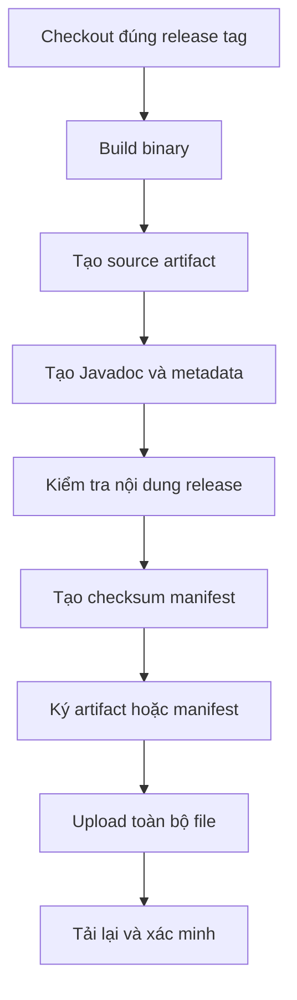

# Artifact nguồn, tài liệu, checksum và chữ ký đi kèm

Khi phát hành một thư viện hoặc ứng dụng Java, file JAR chính thường chưa phải toàn bộ những gì người dùng và hệ thống phân phối cần. Người dùng có thể cần mã nguồn để đọc hoặc debug, tài liệu API để tích hợp, checksum để phát hiện file bị thay đổi và chữ ký số để xác minh ai đã phát hành artifact.

Một bộ phát hành tốt phải bảo đảm các file đi kèm thuộc đúng phiên bản, được tạo từ cùng revision và có thể kiểm tra độc lập. Nếu source JAR lệch phiên bản so với binary JAR, Javadoc được tạo từ mã nguồn khác hoặc checksum được tạo trước khi artifact cuối cùng hoàn tất, người nhận có thể tải đủ file nhưng vẫn không có một bộ phát hành đáng tin cậy.

Bài học này giải thích các loại artifact đi kèm, cách tạo chúng bằng Maven và Gradle, sự khác nhau giữa checksum và chữ ký số, cách xác minh trước khi sử dụng và quy trình đóng gói, ký, phân phối một bản phát hành Java.

## 1. Một bản phát hành Java gồm những gì?

Một thư viện Java thường có artifact chính và một số file hỗ trợ.

Ví dụ bộ phát hành cho thư viện sample-library phiên bản 1.4.0:

```text
sample-library-1.4.0.jar
sample-library-1.4.0-sources.jar
sample-library-1.4.0-javadoc.jar
sample-library-1.4.0.pom
sample-library-1.4.0.module
sample-library-1.4.0.jar.sha256
sample-library-1.4.0.jar.asc
sample-library-1.4.0-sources.jar.sha256
sample-library-1.4.0-sources.jar.asc
SHA256SUMS
SHA256SUMS.asc
LICENSE
NOTICE
README.md
CHANGELOG.md
sbom.json
```

Không phải dự án nào cũng tạo tất cả các file trên. Loại file cần phát hành phụ thuộc vào cách phân phối, người sử dụng và chính sách của tổ chức.

| Thành phần | Mục đích |
|---|---|
| Binary artifact | File thực thi hoặc thư viện đã biên dịch, thường là JAR/WAR |
| Source artifact | Mã nguồn tương ứng với binary, thường là source JAR |
| API documentation | Tài liệu API, thường là Javadoc JAR hoặc HTML |
| POM/module metadata | Metadata để build tool resolve dependency và variant |
| Checksum | Kiểm tra nội dung file có bị thay đổi hay hỏng khi truyền |
| Detached signature | Xác minh artifact hoặc manifest được ký bởi khóa tương ứng |
| License/NOTICE | Thông tin quyền sử dụng và thông báo bản quyền |
| SBOM | Danh sách thành phần phần mềm có trong sản phẩm |
| Provenance/build metadata | Thông tin về source, môi trường và quy trình tạo artifact |

Artifact chính, source, tài liệu và metadata phải được gắn với cùng một version. Không nên lấy file nguồn từ nhánh mới nhất rồi ghép với binary của một tag cũ.

## 2. Binary artifact

Binary artifact là sản phẩm đã được biên dịch và đóng gói. Với Java, định dạng phổ biến là JAR; ứng dụng web có thể phát hành WAR; một số dự án tạo ZIP hoặc TAR chứa ứng dụng, thư viện và script khởi chạy.

Ví dụ:

```text
sample-library-1.4.0.jar
```

Binary JAR thường chứa:

- Các file .class.
- Resource được đóng gói.
- Manifest.
- Metadata cần thiết cho ứng dụng hoặc thư viện.
- Có thể có module descriptor hoặc service provider configuration.

Binary là file người dùng thêm vào classpath hoặc build dependency. Người nhận cần biết artifact được biên dịch cho Java release nào, có dependency nào và dùng version nào.

Không nên chỉnh sửa binary sau khi đã tạo checksum hoặc chữ ký. Nếu thay đổi manifest, thêm file hoặc repack JAR, checksum và chữ ký cũ không còn đại diện cho file mới.

## 3. Source artifact: mã nguồn đi kèm binary

Source artifact chứa mã nguồn tương ứng với bản binary được phát hành. Trong hệ sinh thái Maven, tên file thường có classifier sources:

```text
sample-library-1.4.0-sources.jar
```

Source JAR thường chứa các file .java và resource nguồn cần thiết để IDE hiển thị source, hỗ trợ debug hoặc người dùng đọc cách triển khai.

### 3.1. Vì sao cần source JAR?

Source artifact hữu ích trong nhiều tình huống:

- IDE hiển thị mã nguồn khi người dùng điều hướng vào class của dependency.
- Debugger có thể gắn breakpoint và hiển thị dòng mã tương ứng.
- Người tích hợp hiểu rõ cách API hoạt động.
- Người duy trì thư viện có thể kiểm tra source được phát hành.
- Công cụ phân tích hoặc kiểm tra license có thêm dữ liệu.

Source JAR không thay thế binary JAR. Người dùng vẫn chạy binary; source JAR chủ yếu phục vụ đọc, debug và phân tích.

### 3.2. Source phải khớp đúng phiên bản binary

Source JAR cần được tạo từ cùng commit hoặc tag đã tạo binary. Nếu source được lấy từ branch mới hơn, dòng code và line number có thể không khớp với bytecode đang chạy.

Một số vấn đề có thể phát sinh:

- Breakpoint đặt sai dòng.
- Stack trace không tương ứng với source hiển thị.
- API trong source khác API binary.
- File source có thay đổi chưa được phát hành.
- Source archive vô tình chứa test fixture hoặc file nội bộ.

Nên build binary và source artifact trong cùng một pipeline, từ cùng checkout và cùng version.

### 3.3. Không đưa bí mật vào source artifact

Source JAR thường được phân phối công khai hoặc cho nhiều người dùng hơn binary nội bộ. Trước khi phát hành, cần bảo đảm source không chứa:

- Mật khẩu hoặc API token.
- Private key.
- File cấu hình riêng của máy.
- Dump dữ liệu hoặc log.
- Test credentials còn hiệu lực.
- File nội bộ không được phép phân phối.

Không nên nghĩ rằng chỉ binary mới cần kiểm tra bảo mật. Source JAR có thể làm lộ thông tin mà binary không chứa dưới dạng dễ đọc.

## 4. Tạo source JAR bằng Maven

Maven Source Plugin có thể tạo source JAR và gắn nó vào quá trình đóng gói hoặc phát hành.

Ví dụ trong pom.xml:

```xml
<build>
    <plugins>
        <plugin>
            <groupId>org.apache.maven.plugins</groupId>
            <artifactId>maven-source-plugin</artifactId>
            <version>3.3.1</version>
            <executions>
                <execution>
                    <id>attach-sources</id>
                    <goals>
                        <goal>jar-no-fork</goal>
                    </goals>
                </execution>
            </executions>
        </plugin>
    </plugins>
</build>
```

Khi chạy lifecycle phù hợp, plugin tạo file source JAR và attach vào project artifact.

Ví dụ:

```bash
./mvnw clean package
```

Đối với quy trình publish, goal deploy sẽ triển khai các artifact đã attach cùng artifact chính theo cấu hình của dự án:

```bash
./mvnw clean deploy
```

Tên goal, phiên bản plugin và cách triển khai cần được quản lý rõ trong dự án. Hãy kiểm tra thư mục target và log để xác nhận source JAR thực sự được tạo.

### 4.1. Source JAR trong dự án multi-module

Với Maven multi-module, mỗi module có thể tạo source JAR riêng. Module parent kiểu pom thường không có source code nên không nhất thiết có source JAR.

Cần xác định module nào được phát hành và module nào chỉ dùng nội bộ. Tránh publish source JAR rỗng hoặc file source của module không có binary tương ứng.

## 5. Tạo source JAR bằng Gradle

Gradle Java Plugin có thể tạo source JAR bằng cấu hình withSourcesJar.

Ví dụ build.gradle:

```groovy
plugins {
    id 'java'
    id 'maven-publish'
}

group = 'com.example'
version = '1.4.0'

java {
    withSourcesJar()
}
```

Gradle tạo task sourcesJar và gắn source artifact vào component Java. Có thể kiểm tra:

```bash
./gradlew tasks --all
./gradlew sourcesJar
```

Source JAR thường nằm trong build/libs:

```text
build/libs/sample-library-1.4.0-sources.jar
```

Với Maven Publish Plugin, component Java có thể đưa source JAR vào publication:

```groovy
publishing {
    publications {
        mavenJava(MavenPublication) {
            from components.java
        }
    }
}
```

Khi publication lấy từ components.java và withSourcesJar đã được bật, source artifact được attach vào publication theo cơ chế Java component.

Không cần tự tạo task ZIP source nếu plugin đã cung cấp artifact chuẩn. Nếu dự án có source set riêng hoặc nhiều module, hãy xác định rõ source nào thuộc publication.

## 6. Tài liệu API và Javadoc

Javadoc mô tả API công khai của thư viện Java. Tài liệu tốt giúp người dùng biết class, interface, method, tham số, giá trị trả về, exception và cách sử dụng.

Một bộ tài liệu API thường bao gồm:

- Package summary.
- Class và interface documentation.
- Constructor và method documentation.
- Tham số và giá trị trả về.
- Exception có thể được ném.
- Ví dụ sử dụng.
- Module/package overview.
- Link tới tài liệu liên quan.

Tài liệu API thường được phát hành dưới dạng Javadoc HTML và có thể đóng gói thành Javadoc JAR:

```text
sample-library-1.4.0-javadoc.jar
```

### 6.1. Javadoc phải khớp API đã phát hành

Javadoc cần được tạo từ đúng source revision và cấu hình compile tương ứng binary. Nếu Javadoc thuộc commit khác, người dùng có thể đọc một method chưa tồn tại trong JAR hoặc bỏ lỡ một thay đổi API.

Cần bảo đảm:

- Cùng release version.
- Cùng source set được phát hành.
- Cùng public API.
- Cùng cấu hình module/package.
- Link tới dependency documentation phù hợp.
- Không tạo tài liệu từ file generated sai thời điểm.

### 6.2. Tài liệu Javadoc khác README

README thường giới thiệu dự án, cách cài đặt, ví dụ nhanh và hướng dẫn bắt đầu. Javadoc tập trung vào API cụ thể.

Một bộ phát hành có thể có:

- README: cách dùng tổng quan.
- Javadoc: chi tiết API.
- User guide: quy trình tích hợp và cấu hình.
- Migration guide: thay đổi giữa các phiên bản.
- Changelog: lịch sử thay đổi.
- Reference documentation: kiến trúc và hành vi chi tiết.

Không nhất thiết tất cả tài liệu đều nằm trong Javadoc JAR. Có thể phát hành website docs hoặc file ZIP riêng, nhưng phải chỉ rõ version của tài liệu.

## 7. Tạo Javadoc JAR bằng Maven

Maven Javadoc Plugin có thể tạo Javadoc JAR và attach vào artifact.

Ví dụ:

```xml
<build>
    <plugins>
        <plugin>
            <groupId>org.apache.maven.plugins</groupId>
            <artifactId>maven-javadoc-plugin</artifactId>
            <version>3.11.2</version>
            <executions>
                <execution>
                    <id>attach-javadocs</id>
                    <goals>
                        <goal>jar</goal>
                    </goals>
                </execution>
            </executions>
        </plugin>
    </plugins>
</build>
```

Chạy:

```bash
./mvnw clean package
```

Plugin tạo Javadoc JAR trong target nếu cấu hình và nguồn hợp lệ. Một số lỗi Javadoc có thể làm build thất bại, ví dụ tham chiếu sai class, link không hợp lệ hoặc tài liệu không tương thích với JDK đang dùng.

Không nên tắt toàn bộ kiểm tra chỉ để tạo được file. Hãy phân biệt lỗi tài liệu thật với warning của toolchain và chọn chính sách phù hợp.

### 7.1. Javadoc cho multi-module

Với nhiều module, có thể tạo tài liệu riêng cho từng module hoặc tài liệu aggregate tùy cấu trúc dự án. Tài liệu aggregate có ích khi người dùng cần một điểm vào thống nhất, nhưng phải bảo đảm chỉ đưa module API được phát hành vào tài liệu.

## 8. Tạo Javadoc JAR bằng Gradle

Gradle Java Plugin hỗ trợ withJavadocJar:

```groovy
plugins {
    id 'java'
    id 'maven-publish'
}

group = 'com.example'
version = '1.4.0'

java {
    withSourcesJar()
    withJavadocJar()
}
```

Cấu hình này tạo hai task:

- sourcesJar.
- javadocJar.

Javadoc JAR được gắn vào Java component và có thể đi cùng publication.

Ví dụ:

```groovy
publishing {
    publications {
        mavenJava(MavenPublication) {
            from components.java
        }
    }
}
```

Chạy:

```bash
./gradlew clean javadocJar sourcesJar
```

Hoặc chạy publish task phù hợp với repository đích.

Nếu Javadoc generation thất bại, hãy kiểm tra source, JDK, doclint, external links và module configuration. Không nên tự tạo một Javadoc JAR rỗng chỉ để thỏa mãn tên file.

## 9. Metadata đi kèm artifact

Ngoài source và tài liệu, người dùng cần metadata để build tool resolve đúng dependency.

### 9.1. Maven POM

POM mô tả:

- Group ID, artifact ID và version.
- Packaging.
- Dependency.
- Scope và optional dependency.
- Dependency management.
- Exclusions.
- License và SCM metadata nếu được khai báo.
- Thông tin project và publication.

Ví dụ tọa độ Maven:

```text
com.example:sample-library:1.4.0
```

POM thường được phát hành cùng JAR trong Maven repository.

### 9.2. Gradle Module Metadata

Gradle có thể phát hành file .module chứa thông tin variant và dependency metadata chi tiết hơn POM trong một số trường hợp.

Ví dụ:

```text
sample-library-1.4.0.module
```

Metadata này giúp Gradle lựa chọn variant phù hợp theo attributes, capabilities và dependency constraints. Không nên sửa tay file module metadata sau khi Gradle tạo publication.

### 9.3. License, NOTICE và changelog

Bộ phát hành có thể kèm:

- LICENSE.
- NOTICE.
- CHANGELOG.md.
- README.md.
- Migration guide.
- Third-party notices.

Các file này giúp người dùng hiểu quyền sử dụng, thay đổi và những điều cần lưu ý khi nâng phiên bản.

Cần bảo đảm license và notice phản ánh đúng dependency và nội dung thực sự được phân phối. Nếu sản phẩm bundling nhiều thư viện, có thể cần tổng hợp third-party notices theo chính sách pháp lý của tổ chức.

### 9.4. SBOM và provenance

SBOM (Software Bill of Materials) liệt kê thành phần phần mềm trong artifact hoặc sản phẩm. Nó hỗ trợ kiểm kê dependency và phản ứng khi có lỗ hổng.

Provenance mô tả artifact được tạo từ source nào, bởi quy trình nào và trong môi trường nào. Provenance không giống checksum hoặc chữ ký artifact, dù có thể được ký để xác minh nguồn gốc.

Những file này hữu ích trong chuỗi cung ứng phần mềm, đặc biệt khi phát hành cho khách hàng hoặc hệ thống có yêu cầu truy xuất.

## 10. Checksum là gì?

Checksum là giá trị được tính từ nội dung file bằng một hàm băm. Người nhận tính lại hash trên file tải về và so sánh với giá trị do nhà phát hành cung cấp.

Ví dụ SHA-256:

```text
sample-library-1.4.0.jar
SHA256: 9f... (giá trị minh họa)
```

Nếu chỉ một byte của file thay đổi, hash SHA-256 gần như chắc chắn thay đổi.

Checksum thường được dùng để phát hiện:

- File tải về bị lỗi.
- File bị thay đổi khi truyền.
- Artifact bị hỏng trong lưu trữ hoặc sao chép.
- File tải về không trùng với file đã được công bố.

### 10.1. Checksum không chứng minh ai phát hành file

Checksum tự nó không xác minh danh tính nhà phát hành. Nếu kẻ tấn công thay được cả JAR lẫn file checksum trên cùng một máy chủ, người nhận có thể tính lại hash và vẫn thấy hai file khớp nhau.

Do đó:

- Checksum giúp kiểm tra tính toàn vẹn so với một giá trị tham chiếu.
- Chữ ký số giúp xác minh giá trị hoặc artifact được ký bởi người nắm giữ private key tương ứng.
- Người nhận vẫn phải xác minh public key hoặc danh tính ký qua một kênh đáng tin cậy.

Không nên coi một file .sha256 được tải cùng máy chủ với JAR là bằng chứng độc lập về nguồn gốc.

## 11. Tạo checksum bằng SHA-256

### 11.1. Linux và macOS

Tạo checksum:

```bash
sha256sum sample-library-1.4.0.jar
```

Lưu ra file:

```bash
sha256sum sample-library-1.4.0.jar > sample-library-1.4.0.jar.sha256
```

Kiểm tra:

```bash
sha256sum -c sample-library-1.4.0.jar.sha256
```

Kết quả thành công thường hiển thị tên file cùng trạng thái OK. Nếu hash không khớp, lệnh báo FAILED.

Trên macOS, có thể dùng shasum:

```bash
shasum -a 256 sample-library-1.4.0.jar
```

### 11.2. Windows PowerShell

Tính hash:

```powershell
Get-FileHash .\sample-library-1.4.0.jar -Algorithm SHA256
```

Có thể lưu giá trị vào file văn bản theo định dạng do quy trình phát hành quy định. Khi xác minh, tính lại hash và so sánh chính xác với giá trị công bố.

Ví dụ:

```powershell
$expected = (Get-Content .\sample-library-1.4.0.jar.sha256).Split(' ')[0]
$actual = (Get-FileHash .\sample-library-1.4.0.jar -Algorithm SHA256).Hash.ToLower()
if ($actual -ne $expected.ToLower()) {
    throw 'SHA-256 checksum mismatch'
}
```

Đoạn lệnh giả định file sidecar có hash ở trường đầu tiên. Nếu định dạng manifest khác, cần parse theo đúng định dạng đó.

### 11.3. Chọn thuật toán hash

SHA-256 là lựa chọn phổ biến cho checksum phát hành. Không nên dùng MD5 hoặc SHA-1 cho mục đích chống giả mạo vì chúng không còn phù hợp với yêu cầu chống va chạm hiện đại.

Checksum không phải mã hóa. Người dùng không cần secret để tính SHA-256; bất kỳ ai có file đều có thể tính cùng hash.

## 12. Checksum cho toàn bộ bộ phát hành

Nếu release có nhiều file, có thể tạo một manifest chứa checksum của tất cả artifact:

```bash
sha256sum sample-library-1.4.0.jar sample-library-1.4.0-sources.jar sample-library-1.4.0-javadoc.jar sample-library-1.4.0.pom > SHA256SUMS
```

Người nhận tải các file và manifest rồi chạy:

```bash
sha256sum -c SHA256SUMS
```

Cách này giúp kiểm tra đồng bộ nhiều file. Tuy nhiên, nếu manifest không được ký hoặc lấy từ một nguồn tin cậy, người nhận vẫn chưa xác minh được ai tạo manifest.

Một quy trình tốt là ký manifest checksum. Khi chữ ký manifest hợp lệ, người nhận xác minh checksum từng file theo danh sách đã được ký.

Cần tạo manifest sau khi tất cả file cuối cùng đã được đóng gói. Không sửa file sau khi checksum được tính.

## 13. Chữ ký số và detached signature

Chữ ký số sử dụng một cặp khóa:

- Private key: người phát hành giữ bí mật và dùng để ký.
- Public key: người nhận dùng để xác minh chữ ký.

Với chữ ký bất đối xứng, chữ ký được tạo bằng private key và có thể được xác minh bằng public key tương ứng.

Detached signature là file chữ ký riêng, thường có hậu tố .asc trong quy trình OpenPGP:

```text
sample-library-1.4.0.jar
sample-library-1.4.0.jar.asc
```

File .asc không chứa bản sao của JAR. Nó chứa chữ ký gắn với nội dung file được ký. Nếu nội dung JAR thay đổi, xác minh chữ ký sẽ thất bại.

### 13.1. Chữ ký xác minh điều gì?

Chữ ký hợp lệ cho biết:

- Nội dung được xác minh khớp với nội dung đã ký.
- Chữ ký được tạo bởi private key tương ứng với public key dùng để xác minh.
- File chưa bị thay đổi kể từ lúc ký, trong phạm vi thuật toán và giả định mật mã được sử dụng.

Chữ ký hợp lệ không tự chứng minh phần mềm an toàn, không có lỗi hoặc không chứa mã độc. Nó xác minh nguồn ký và tính toàn vẹn của dữ liệu đã ký.

### 13.2. Xác minh public key

Người nhận cần biết public key thuộc về ai. Không nên chỉ tải key từ cùng một địa chỉ với artifact rồi tin ngay.

Có thể xác minh fingerprint qua kênh độc lập như:

- Website chính thức của nhà phát hành.
- Tài liệu release đã được xác thực.
- Key directory hoặc hệ thống quản lý khóa của tổ chức.
- Kênh liên lạc nội bộ được xác nhận.
- Chính sách trust của repository hoặc nền tảng phân phối.

Nếu không xác minh danh tính key, chữ ký chỉ cho biết file được ký bởi một key nào đó, không đủ để khẳng định đúng nhà phát hành mong muốn.

## 14. Ký và xác minh bằng GPG/OpenPGP

GPG là công cụ thường được dùng để tạo và xác minh detached signature.

### 14.1. Tạo chữ ký

Với private key đã được thiết lập trong keyring:

```bash
gpg --armor --detach-sign sample-library-1.4.0.jar
```

Lệnh tạo file:

```text
sample-library-1.4.0.jar.asc
```

Có thể ký manifest checksum:

```bash
gpg --armor --detach-sign SHA256SUMS
```

File tạo ra:

```text
SHA256SUMS.asc
```

Private key cần được bảo vệ bằng passphrase và hệ thống lưu trữ phù hợp. Không commit private key vào Git, không đưa vào source JAR và không ghi key material ra log.

### 14.2. Xác minh chữ ký

Sau khi có public key của nhà phát hành và đã xác minh fingerprint:

```bash
gpg --verify sample-library-1.4.0.jar.asc sample-library-1.4.0.jar
```

Hoặc kiểm tra manifest:

```bash
gpg --verify SHA256SUMS.asc SHA256SUMS
sha256sum -c SHA256SUMS
```

Thứ tự có ý nghĩa:

1. Xác minh chữ ký của manifest checksum.
2. Xác minh checksum của từng file theo manifest đã xác thực.

Nếu chữ ký không hợp lệ hoặc checksum không khớp, không nên sử dụng artifact cho đến khi xác định nguyên nhân.

### 14.3. Chữ ký và key rotation

Khóa ký có thể hết hạn, bị thu hồi hoặc cần thay đổi khi người giữ khóa rời tổ chức. Quy trình phát hành cần có chính sách:

- Ai được phép giữ hoặc sử dụng private key.
- Khóa được lưu ở đâu.
- Cách backup và khôi phục an toàn.
- Cách xoay vòng key.
- Cách công bố fingerprint key mới.
- Cách xử lý key bị mất hoặc bị lộ.
- Cách xác minh chữ ký cũ sau khi key hết hạn hoặc bị thu hồi.

Nếu private key bị lộ, cần thu hồi hoặc thay thế key theo quy trình, đánh giá các release đã ký trong khoảng thời gian có rủi ro và công bố thông tin cần thiết cho người dùng.

## 15. Chữ ký bên trong JAR bằng jarsigner

Java cung cấp công cụ jarsigner để ký nội dung JAR. Đây là cơ chế khác với detached OpenPGP signature.

Ký JAR:

```bash
jarsigner -keystore release-keystore.p12 -storetype PKCS12 sample-library-1.4.0.jar release-key-alias
```

Xác minh:

```bash
jarsigner -verify -verbose -certs sample-library-1.4.0.jar
```

JAR signing ghi metadata chữ ký vào bên trong archive, thường dưới META-INF. JVM hoặc công cụ có thể xác minh chữ ký của các entry được ký.

### 15.1. JAR signing khác detached signature

| Đặc điểm | Detached signature | JAR signing |
|---|---|---|
| Vị trí chữ ký | File riêng như .asc | Metadata trong JAR |
| Phạm vi | File được ký theo quy trình | Các entry trong JAR được ký |
| Công cụ ví dụ | GPG/OpenPGP | jarsigner |
| Cách phân phối | Artifact và file chữ ký | JAR đã ký |
| Trust | Xác minh public key và fingerprint | Xác minh certificate chain/trust theo chính sách |

JAR signing có thể phù hợp với ứng dụng hoặc hệ thống cần kiểm tra chữ ký ở cấp Java archive. Detached signature phù hợp để xác minh file phát hành hoặc checksum manifest qua hệ thống phân phối.

Hai cơ chế có thể cùng được dùng nếu chính sách yêu cầu. Chữ ký trong JAR không tự thay thế checksum hoặc detached signature của bộ phát hành.

### 15.2. Chứng chỉ và trust

Với jarsigner, người nhận cần kiểm tra certificate chain, thời hạn, trạng thái thu hồi và danh tính chủ thể ký theo chính sách trust. Thông báo rằng JAR có chữ ký không đồng nghĩa certificate được tin cậy.

Nếu chỉ dùng self-signed certificate mà người nhận không có cách xác minh fingerprint, chữ ký có thể kiểm tra tính toàn vẹn nhưng chưa xác lập danh tính đáng tin cậy.

## 16. Ký publication bằng Gradle

Gradle Signing Plugin có thể ký artifact được khai báo trong publication.

Ví dụ với Maven Publish:

```groovy
plugins {
    id 'java'
    id 'maven-publish'
    id 'signing'
}

group = 'com.example'
version = '1.4.0'

java {
    withSourcesJar()
    withJavadocJar()
}

publishing {
    publications {
        mavenJava(MavenPublication) {
            from components.java
        }
    }
}

signing {
    sign publishing.publications.mavenJava
}
```

Signing Plugin tạo chữ ký cho artifact của publication theo cấu hình ký. Trong môi trường thật, cần cấu hình private key an toàn và tuân theo cơ chế key management của tổ chức.

Không nên ghi private key hoặc passphrase trực tiếp vào build.gradle. Có thể lấy chúng từ secret store của CI hoặc cấu hình môi trường bảo mật. Cần tránh in giá trị secret ra log.

### 16.1. Ký publication sau khi artifact đã hoàn chỉnh

Chữ ký phải ứng với đúng byte của artifact được publish. Nếu task khác chỉnh sửa JAR sau khi ký, chữ ký không còn hợp lệ.

Pipeline nên có thứ tự:

1. Compile và package.
2. Tạo source JAR và Javadoc JAR.
3. Tạo POM/module metadata.
4. Ký các artifact publication theo cấu hình.
5. Tạo hoặc ký checksum manifest theo quy trình.
6. Publish toàn bộ bộ phát hành.

Thứ tự task cụ thể do Gradle task graph và plugin quản lý. Hãy xác nhận publication thực tế chứa những file nào và chữ ký được tạo cho đúng tập file cần phát hành.

## 17. Ký artifact bằng Maven

Maven GPG Plugin có thể tạo chữ ký OpenPGP cho các artifact trong quá trình build hoặc deploy.

Ví dụ cấu hình plugin:

```xml
<build>
    <plugins>
        <plugin>
            <groupId>org.apache.maven.plugins</groupId>
            <artifactId>maven-gpg-plugin</artifactId>
            <version>3.2.7</version>
            <executions>
                <execution>
                    <id>sign-artifacts</id>
                    <phase>verify</phase>
                    <goals>
                        <goal>sign</goal>
                    </goals>
                </execution>
            </executions>
        </plugin>
    </plugins>
</build>
```

Ví dụ trên minh họa việc gắn goal ký vào lifecycle. Cấu hình thực tế cần phù hợp với phiên bản plugin, GPG executable, keyring và cách tổ chức quản lý private key.

Có thể dùng batch mode trong CI:

```bash
./mvnw --batch-mode clean verify
```

Không nên đặt passphrase trực tiếp trong POM được commit. Dùng secret store và cấu hình an toàn cho runner.

### 17.1. Ký các artifact đã attach

Nếu source JAR và Javadoc JAR được attach trước khi ký, plugin cần được cấu hình và thực thi ở giai đoạn mà các artifact đó đã tồn tại. Hãy xem log và thư mục target để xác nhận file chữ ký tương ứng được tạo.

Không nên chỉ kiểm tra chữ ký của binary JAR rồi mặc định source, Javadoc và POM đều đã được ký.

## 18. Thứ tự tạo checksum và chữ ký

Thứ tự xử lý quan trọng vì mọi thay đổi sau khi ký đều làm chữ ký hoặc checksum cũ mất hiệu lực.

Một chuỗi tham chiếu:



Có hai cách thường dùng:

- Tạo checksum và chữ ký riêng cho từng artifact.
- Tạo một manifest checksum bao gồm mọi file cần bảo vệ rồi ký manifest đó.

Cách thứ hai giảm số chữ ký cần quản lý và cho phép xác minh cả bộ phát hành, nhưng phải bảo đảm manifest liệt kê đầy đủ file. Một số hệ thống phân phối yêu cầu chữ ký riêng theo từng artifact; hãy tuân theo yêu cầu của repository.

Không sửa artifact sau bước checksum/signing. Nếu cần thay đổi bất kỳ byte nào, hãy tạo lại checksum và chữ ký liên quan.

## 19. Xác minh bộ phát hành sau khi upload

Không chỉ xác minh file trong workspace trước upload. Hãy kiểm tra lại bản tải từ nơi phân phối vì quá trình upload, proxy, mirror hoặc storage có thể gây lỗi.

Quy trình:

1. Tải binary JAR.
2. Tải source JAR và Javadoc JAR.
3. Tải POM/module metadata.
4. Tải checksum manifest và chữ ký.
5. Xác minh public key/fingerprint.
6. Xác minh chữ ký.
7. Xác minh checksum.
8. Mở archive và kiểm tra file cần thiết.
9. Xác nhận version và classifier.
10. Thử resolve dependency từ repository như một consumer thực tế.

Ví dụ:

```bash
gpg --verify SHA256SUMS.asc SHA256SUMS
sha256sum -c SHA256SUMS
```

Sau khi checksum đạt, kiểm tra nội dung:

```bash
jar --list --file sample-library-1.4.0.jar
jar --list --file sample-library-1.4.0-sources.jar
jar --list --file sample-library-1.4.0-javadoc.jar
```

Nếu người dùng tải artifact từ Maven repository, có thể tạo một project thử nghiệm nhỏ và khai báo dependency theo tọa độ để xác nhận repository metadata và classifier hoạt động đúng.

## 20. Cấu trúc một thư mục release hoàn chỉnh

Một thư mục release có thể được tổ chức như sau:

```text
release/
├── sample-library-1.4.0.jar
├── sample-library-1.4.0.jar.asc
├── sample-library-1.4.0-sources.jar
├── sample-library-1.4.0-sources.jar.asc
├── sample-library-1.4.0-javadoc.jar
├── sample-library-1.4.0-javadoc.jar.asc
├── sample-library-1.4.0.pom
├── sample-library-1.4.0.pom.asc
├── SHA256SUMS
├── SHA256SUMS.asc
├── LICENSE
├── NOTICE
├── README.md
├── CHANGELOG.md
├── sbom.json
└── provenance.json
```

Tên và số lượng file tùy hệ thống phân phối. Nếu repository tự sinh metadata hoặc checksum, cần tránh upload file trùng lặp hoặc định dạng không tương thích.

Với Maven repository, artifact chính, classifier và POM cần tuân thủ layout tọa độ. Không nên đổi tên tùy tiện sau khi deploy vì build tool dùng groupId, artifactId, version và classifier để resolve.

## 21. Quyền quản lý khóa ký

Private key là tài sản nhạy cảm. Nếu private key bị lộ, kẻ khác có thể tạo chữ ký trông như đến từ nhà phát hành.

Một chính sách quản lý khóa nên xác định:

- Ai được phép ký release.
- Key nằm trong hardware security module, signing service hoặc secret store nào.
- Có yêu cầu phê duyệt release trước khi ký không.
- Cách backup và phục hồi.
- Cách rotate hoặc revoke key.
- Cách công bố public key và fingerprint.
- Cách kiểm tra key expiration.
- Cách audit hoạt động ký.

Trong CI, ưu tiên cơ chế ký được quản lý tập trung thay vì đưa private key dạng file vào repository. Nếu cần dùng file key tạm, hãy tạo trong vùng bảo vệ của job, giới hạn quyền truy cập và xóa theo quy trình sau khi ký.

Không nên chia sẻ private key qua email, chat hoặc file artifact.

## 22. Chữ ký không thay thế provenance và SBOM

Các cơ chế này trả lời những câu hỏi khác nhau:

| Cơ chế | Câu hỏi |
|---|---|
| Checksum | File có khớp với nội dung tham chiếu không? |
| Chữ ký | Nội dung được ký bởi khóa nào và có bị thay đổi không? |
| Provenance | Artifact được tạo từ source, workflow và môi trường nào? |
| SBOM | Artifact chứa những thành phần phần mềm nào? |
| Test report | Những kiểm tra nào đã chạy và kết quả ra sao? |

Một artifact được ký hợp lệ vẫn có thể chứa dependency dễ tổn thương. SBOM có thể giúp kiểm kê dependency nhưng không chứng minh artifact được build từ source nào. Provenance có thể liên kết artifact với workflow, nhưng cần xác minh chữ ký hoặc trust policy để tin vào provenance.

Một quy trình phát hành trưởng thành thường kết hợp các cơ chế phù hợp thay vì dùng một file để thay thế tất cả.

## 23. Các lỗi thường gặp

| Hiện tượng | Nguyên nhân có thể | Cách xử lý |
|---|---|---|
| Repository chỉ có binary JAR | Chưa bật tạo source JAR | Cấu hình Maven Source Plugin hoặc Gradle withSourcesJar |
| Thiếu Javadoc JAR | Chưa attach Javadoc hoặc task tạo tài liệu thất bại | Cấu hình Javadoc Plugin/withJavadocJar và kiểm tra task |
| Source hiển thị không khớp khi debug | Source JAR đến từ revision khác | Tạo binary và source từ cùng commit/tag |
| Checksum không khớp | File bị thay đổi, hỏng hoặc checksum cũ | Tải lại từ nguồn tin cậy và kiểm tra manifest |
| Checksum đúng nhưng không rõ ai phát hành | Chỉ có hash, không có chữ ký hoặc nguồn tham chiếu tin cậy | Xác minh chữ ký và fingerprint nhà phát hành |
| GPG báo BAD signature | Artifact thay đổi hoặc chữ ký không ứng với file | Kiểm tra đúng cặp file và tải lại bộ phát hành |
| GPG báo public key không có | Chưa import public key của người ký | Lấy key từ nguồn tin cậy và xác minh fingerprint |
| Chữ ký hợp lệ nhưng key không được tin cậy | Chưa xác minh danh tính key | Kiểm tra fingerprint và trust policy |
| JAR signing báo certificate không tin cậy | Certificate chain hoặc trust store chưa được thiết lập | Xác minh certificate theo chính sách tổ chức |
| File thay đổi sau khi ký | Có bước repack hoặc chỉnh metadata sau signing | Hoàn tất artifact trước, sau đó tạo lại chữ ký |
| Source JAR chứa secret | Resource hoặc file local bị đóng gói | Loại file nhạy cảm và tạo lại source archive |
| Javadoc JAR thuộc version khác | Build hoặc upload nhầm output cũ | Clean, build cùng revision và kiểm tra tên/version |
| Manifest checksum thiếu file | Chỉ liệt kê một phần bộ phát hành | Tạo manifest từ danh sách artifact cuối cùng |
| Release có POM nhưng thiếu classifier | Publication không attach source/Javadoc đúng cách | Kiểm tra publication component và artifact attachments |

## 24. Quy trình phát hành đề xuất

Một quy trình có thể áp dụng cho thư viện Java:

1. Checkout đúng release tag hoặc commit đã được phê duyệt.
2. Xác nhận version trong build configuration.
3. Chuẩn bị JDK và Maven/Gradle Wrapper đúng phiên bản.
4. Compile, test và chạy các kiểm tra bắt buộc.
5. Tạo binary JAR/WAR.
6. Tạo source JAR từ cùng revision.
7. Tạo Javadoc JAR và tài liệu hướng dẫn.
8. Tạo POM hoặc Gradle module metadata.
9. Đính kèm license, notice, changelog và SBOM nếu cần.
10. Kiểm tra nội dung archive, classifier và version.
11. Tạo checksum cho artifact cuối cùng.
12. Ký artifact hoặc checksum manifest bằng khóa phát hành.
13. Upload toàn bộ bộ phát hành vào repository/registry.
14. Tải lại từ nơi phân phối và xác minh chữ ký, checksum.
15. Ghi nhận metadata, provenance và kết quả phát hành.

Nếu bất kỳ artifact nào thay đổi sau khi ký, cần tạo lại checksum và chữ ký liên quan. Nếu source hoặc tài liệu không được tạo thành công, không nên âm thầm thay bằng file của release trước.

## 25. Ghi nhớ

- Một bộ phát hành Java có thể gồm binary, source, Javadoc, POM/module metadata, checksum, chữ ký và tài liệu hỗ trợ.
- Source JAR giúp đọc mã nguồn và debug; nó phải khớp đúng commit và version của binary.
- Javadoc JAR mô tả API; README, user guide, migration guide và changelog có mục đích riêng.
- Maven Source Plugin và Javadoc Plugin có thể attach source/Javadoc artifacts.
- Gradle Java Plugin hỗ trợ withSourcesJar và withJavadocJar.
- Checksum SHA-256 phát hiện nội dung file không khớp, nhưng không tự xác minh danh tính người phát hành.
- Chữ ký số xác minh nội dung đã ký và khóa ký; người nhận cần xác minh public key/fingerprint.
- Detached OpenPGP signature khác chữ ký bên trong JAR được tạo bằng jarsigner.
- Không để private key trong Git, source JAR, log hoặc artifact.
- Tạo checksum và chữ ký sau khi artifact đã hoàn chỉnh; không sửa file sau signing.
- Ký manifest checksum có thể bảo vệ danh sách nhiều artifact trong một bộ phát hành.
- Xác minh lại file sau khi tải từ repository, không chỉ kiểm tra trong workspace.
- Provenance, SBOM, checksum, signature và test report cung cấp những loại bằng chứng khác nhau.

## 26. Tự kiểm tra

1. Một thư viện Java thường phát hành những artifact đi kèm nào ngoài binary JAR?
2. Source JAR khác binary JAR ở mục đích nào?
3. Vì sao source JAR phải được tạo từ cùng commit với binary?
4. Maven Source Plugin và Gradle withSourcesJar dùng để làm gì?
5. Javadoc JAR khác README và migration guide như thế nào?
6. Checksum SHA-256 giúp phát hiện điều gì?
7. Vì sao checksum tải từ cùng máy chủ không tự chứng minh nguồn phát hành?
8. Detached signature là gì?
9. GPG xác minh file chữ ký .asc như thế nào?
10. JAR signing bằng jarsigner khác detached OpenPGP signature ở điểm nào?
11. Vì sao cần xác minh fingerprint của public key?
12. Vì sao không được chỉnh sửa artifact sau khi tạo checksum và chữ ký?
13. Có thể bảo vệ toàn bộ bộ phát hành bằng cách ký SHA256SUMS như thế nào?
14. SBOM và provenance khác checksum/chữ ký ở mục đích nào?
15. Những file nào nên được kiểm tra lại sau khi upload release?

Khi có thể tạo source và tài liệu đúng revision, tạo checksum cho artifact cuối cùng, ký bằng khóa được bảo vệ và xác minh bộ phát hành sau khi tải xuống, bạn đã nắm được cách chuẩn bị các thành phần hỗ trợ cho một bản phát hành Java đáng tin cậy.

