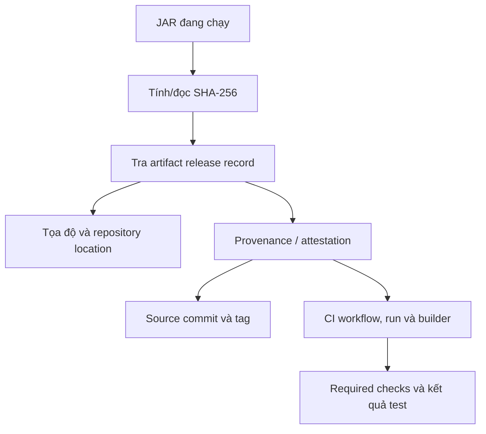

# Liên hệ phiên bản artifact với commit, tag và kết quả CI

Một artifact được phát hành cần trả lời được ba câu hỏi: **đây là phiên bản nào, được tạo từ mã nguồn nào và build bằng lần chạy CI nào?** Tọa độ artifact cho biết module và version mà consumer sử dụng. Git commit xác định chính xác trạng thái mã nguồn. Git tag thường đánh dấu một mốc phát hành có ý nghĩa. Kết quả CI ghi nhận quá trình kiểm tra và tạo artifact.

Nếu những thông tin này không được liên kết, đội phát triển có thể biết ứng dụng đang chạy `order-service:1.4.0` nhưng không xác định được commit đã tạo JAR, tag nào đại diện cho release hoặc pipeline nào đã kiểm thử artifact. Khi cần điều tra sự cố, vá bảo mật hay chứng minh một bản phát hành đã qua kiểm tra, việc thiếu liên kết khiến quá trình truy vết chậm và dễ nhầm lẫn.

Bài học này trình bày cách xây dựng mối liên hệ có thể kiểm chứng giữa version, commit SHA, Git tag, CI run, artifact digest và trạng thái kiểm thử trong quy trình phát hành Java.

## 1. Bốn định danh trả lời bốn câu hỏi khác nhau

Một quy trình release thường có ít nhất bốn loại định danh:

| Định danh | Ví dụ | Câu hỏi được trả lời |
|---|---|---|
| Artifact version | `1.4.0` | Consumer đang dùng phiên bản module nào? |
| Git commit SHA | `a1b2c3d4...` | Chính xác mã nguồn ở revision nào đã được checkout? |
| Git tag | `v1.4.0` | Mốc phát hành hoặc mốc source nào được đặt tên? |
| CI run identity | workflow `release`, run `8421`, attempt `2` | Pipeline nào đã build và kiểm tra artifact? |

Ngoài ra, cần có **artifact digest** (ví dụ SHA-256) để nhận diện chính xác nội dung byte của tệp đã tạo. Hai JAR có cùng tên và cùng tọa độ version vẫn có thể khác nội dung nếu repository cho phép ghi đè hoặc pipeline build từ source khác nhau.

Một release record đáng tin cậy nối các định danh này:

```text
Artifact coordinate: com.example.orders:order-service:1.4.0
Git repository:      https://git.example.com/orders/order-service
Git commit:          a1b2c3d4e5f6...
Git tag:              v1.4.0
CI workflow:          release.yml
CI run:               8421, attempt 1
CI result:             success
Artifact:              order-service-1.4.0.jar
SHA-256:               <digest của tệp đã publish>
```

Các giá trị trên chỉ minh họa. Trong hệ thống thật, mọi trường phải lấy từ đúng checkout, đúng lần chạy CI và đúng tệp artifact được phát hành.

## 2. Artifact version không phải Git tag

Với Maven, tọa độ cơ bản của một artifact là:

```text
groupId:artifactId:version
```

Ví dụ:

```text
com.example.orders:order-service:1.4.0
```

Gradle dùng module coordinates dạng `group:name:version` khi publish. `version` là định danh release mà consumer khai báo trong dependency.

Git tag là nhãn trong repository mã nguồn. Nhóm thường đặt tag như `v1.4.0` để đánh dấu commit phát hành. Dấu `v` là quy ước đặt tên phổ biến, không bắt buộc và không tự động làm thay đổi artifact version.

Ví dụ:

| Thành phần | Giá trị |
|---|---|
| Maven/Gradle artifact version | `1.4.0` |
| Git tag | `v1.4.0` |
| Commit được tag | `a1b2c3d4...` |

Một pipeline có thể bỏ tiền tố `v` khi đặt project version từ tag, nhưng phải quy định rõ cách chuyển đổi. Không nên giả định mọi tag đều là version hợp lệ hoặc tự động dùng tag name làm artifact version.

### 2.1. Version là hợp đồng với consumer

Artifact version được dùng trong dependency declaration, repository path, POM và metadata. Nó cần tuân theo chính sách versioning của project, chẳng hạn Semantic Versioning:

```text
MAJOR.MINOR.PATCH
```

- MAJOR thường tăng khi có thay đổi không tương thích.
- MINOR thường tăng khi bổ sung chức năng tương thích ngược.
- PATCH thường tăng khi sửa lỗi tương thích ngược.

SemVer là quy ước phát hành mà nhóm áp dụng. Build tool không tự chứng minh thay đổi API tuân thủ đúng quy tắc chỉ vì version có ba phần số.

### 2.2. Tag là mốc source, không phải artifact

Tag `v1.4.0` có thể trỏ tới một commit. Nó không chứa JAR, không ghi nhận CI test đã pass và không tự chứng minh artifact được publish được tạo từ commit đó.

Một release pipeline cần tạo artifact từ commit mà tag trỏ tới, ghi nhận kết quả CI và liên kết digest của artifact với commit. Chỉ tạo tag hoặc chỉ publish một tọa độ version chưa đủ để tạo chuỗi truy vết.

## 3. Commit SHA là định danh source revision chính xác

Git commit có một mã định danh (SHA) được tính từ nội dung commit và các metadata liên quan. Trong thực tế, pipeline thường ghi full commit SHA vào build metadata.

Các lệnh thường dùng:

```bash
# Commit hiện tại đã checkout
git rev-parse HEAD

# Commit mà tag trỏ tới, kể cả annotated tag
git rev-parse 'v1.4.0^{commit}'

# Xem thông tin tag và commit
git show --no-patch --decorate v1.4.0

# Kiểm tra working tree
git status --short
```

`git rev-parse HEAD` lấy commit hiện tại của checkout. Biểu thức `^{commit}` dereference tag tới commit mà nó trỏ đến; cách này hữu ích khi tag là annotated tag.

### 3.1. Dùng full SHA thay cho branch name

Tên branch như `main`, `release/1.4` hoặc `feature/order` có thể di chuyển khi có commit mới. Vì vậy, branch name không đủ để xác định source revision đã build.

Hãy ghi full commit SHA. Có thể lưu branch hoặc ref name làm metadata bổ sung để biết build được kích hoạt từ đâu, nhưng không dùng branch name thay commit SHA.

### 3.2. Kiểm tra working tree có sạch không

Một build từ commit có thể vẫn chứa thay đổi chưa commit nếu pipeline hoặc developer sửa file sau checkout. Khi đó, chỉ ghi `git rev-parse HEAD` chưa mô tả đầy đủ nội dung source thực tế.

Đối với release, thường nên yêu cầu working tree sạch:

```bash
if [ -n "$(git status --porcelain)" ]; then
  echo "Working tree is not clean" >&2
  exit 1
fi
```

Nếu build cố ý tạo file hoặc thay đổi source trong quá trình chuẩn bị, hãy phân biệt generated output với thay đổi source được commit. Không nên bỏ qua trạng thái dirty mà không ghi nhận.

### 3.3. Shallow checkout và tag

CI có thể checkout repository ở chế độ shallow để giảm thời gian tải. Shallow checkout đôi khi không có đủ tag hoặc lịch sử cần thiết cho lệnh `git describe` và xác minh tag.

Nếu release pipeline cần xác minh tag và commit, hãy cấu hình checkout lấy tag/history cần thiết. Với GitHub Actions, ví dụ thường dùng `fetch-depth: 0` để lấy toàn bộ lịch sử và tag:

```yaml
- uses: actions/checkout@v4
  with:
    fetch-depth: 0
```

Chỉ lấy toàn bộ history khi quy trình cần; với build thông thường có thể dùng shallow checkout. Nhưng release job phải có đủ dữ liệu để xác nhận tag và commit.

## 4. Git tag và tính bất biến của release

Tag là một tham chiếu có tên. Tag có thể là lightweight tag hoặc annotated tag.

### 4.1. Lightweight và annotated tag

Tạo lightweight tag:

```bash
git tag v1.4.0
```

Tạo annotated tag:

```bash
git tag -a v1.4.0 -m "Release 1.4.0"
```

Annotated tag lưu metadata như tagger, thời điểm và thông điệp. Có thể ký tag bằng cơ chế GPG/SSH phù hợp:

```bash
git tag -s v1.4.0 -m "Release 1.4.0"
```

Việc ký tag giúp người nhận xác minh danh tính người ký nếu có public key và trust policy phù hợp. Chữ ký tag không tự xác minh artifact đã publish; nó xác nhận tag object theo cơ chế chữ ký của Git.

### 4.2. Tag có thể bị di chuyển nếu không được bảo vệ

Một tag name không tự bất biến. Người có quyền có thể xóa và tạo lại tag hoặc force-update reference trên remote, tùy quyền và chính sách server.

Với release, nên:

- Dùng annotated tag; cân nhắc ký tag theo yêu cầu tổ chức.
- Bảo vệ pattern tag release trên Git hosting.
- Hạn chế quyền tạo, xóa hoặc cập nhật tag đã phát hành.
- Không tái sử dụng tag name cho commit khác.
- Ghi lại tag object và commit SHA trong release record.

Nếu tag `v1.4.0` bị di chuyển sau khi artifact `1.4.0` được publish, tag name không còn là bằng chứng đáng tin cậy cho source đã tạo artifact. Commit SHA và attestation/digest đã lưu giúp phát hiện sai lệch này.

### 4.3. Tag release phải khớp artifact version

Đặt quy ước rõ ràng, ví dụ:

```text
Git tag:             v1.4.0
Project version:    1.4.0
Published artifact: com.example.orders:order-service:1.4.0
```

CI cần xác minh phần version rút ra từ tag khớp version dự kiến trong build. Nếu tag là `v1.4.0` nhưng POM hoặc Gradle publication tạo `1.3.9`, pipeline nên thất bại hoặc yêu cầu quy tắc chuyển đổi được định nghĩa rõ.

## 5. Liên kết artifact version với Git trong Gradle

Gradle project có thể đặt `group` và `version` trong build script hoặc lấy version từ property được CI truyền vào.

Ví dụ:

```groovy
plugins {
    id 'java-library'
    id 'maven-publish'
}

group = 'com.example.orders'
version = providers.gradleProperty('releaseVersion').orElse('0.0.0-dev').get()

publishing {
    publications {
        create('mavenJava', MavenPublication) {
            from components.java
            artifactId = 'order-service'
        }
    }
}
```

CI có thể truyền `-PreleaseVersion=1.4.0` khi build release tag. Build local có thể dùng version development mặc định, còn release pipeline phải cung cấp version chính xác.

### 5.1. Ghi commit và CI metadata vào JAR manifest

Một cách đơn giản để giúp người vận hành tra cứu là ghi metadata không nhạy cảm vào `META-INF/MANIFEST.MF`.

```groovy
def gitCommit = providers.environmentVariable('GIT_COMMIT').orElse('unknown')
def gitTag = providers.environmentVariable('GIT_TAG').orElse('')
def ciRunId = providers.environmentVariable('CI_RUN_ID').orElse('local')
def ciRunUrl = providers.environmentVariable('CI_RUN_URL').orElse('')

tasks.named('jar') {
    manifest {
        attributes(
            'Implementation-Title': project.name,
            'Implementation-Version': project.version,
            'Build-Revision': gitCommit.get(),
            'Build-Tag': gitTag.get(),
            'Build-CI-Run': ciRunId.get(),
            'Build-CI-URL': ciRunUrl.get()
        )
    }
}
```

Các trường `Build-Revision`, `Build-Tag`, `Build-CI-Run` và `Build-CI-URL` là custom manifest attributes do project quy ước. Không phải mọi build tool tự sinh các trường này.

Manifest là nơi thuận tiện để xem nhanh thông tin. Nó không phải bằng chứng mật mã rằng artifact được tạo từ commit được ghi. Để tăng độ tin cậy, cần liên kết digest artifact với provenance/attestation được lưu và xác minh riêng.

### 5.2. Kiểm tra commit trước khi build release

Trong release job, lấy commit từ checkout thực tế và xác minh nó khớp commit mà tag trỏ tới. Ví dụ shell:

```bash
COMMIT_SHA="$(git rev-parse HEAD)"
TAG_COMMIT="$(git rev-parse "refs/tags/${GIT_TAG}^{commit}")"

if [ "$COMMIT_SHA" != "$TAG_COMMIT" ]; then
  echo "Checked-out commit does not match release tag" >&2
  exit 1
fi

export GIT_COMMIT="$COMMIT_SHA"
```

`GIT_TAG` cần được pipeline thiết lập từ tag ref đã kích hoạt release. Cú pháp dereference tag giúp xử lý annotated tag. Trước khi chạy, cần bảo đảm tag tồn tại trong checkout và đã được fetch.

Không lấy commit SHA từ một biến không liên quan tới checkout mà không xác minh. Mục tiêu là metadata trong artifact mô tả đúng source revision đã được build.

## 6. Liên kết artifact version với Git trong Maven

Maven khai báo GAV trong `pom.xml`:

```xml
<groupId>com.example.orders</groupId>
<artifactId>order-service</artifactId>
<version>1.4.0</version>
<packaging>jar</packaging>
```

Với release tự động, version có thể được quản lý qua property hoặc CI release process. Nếu dùng property:

```xml
<properties>
    <revision>1.4.0</revision>
    <scm.revision>unknown</scm.revision>
</properties>

<version>${revision}</version>
```

Maven hỗ trợ một số quy ước CI-friendly versions như `${revision}`, `${sha1}` và `${changelist}` trong các trường hợp phù hợp. Nếu dùng chúng trong multi-module project hoặc khi publish, cần cấu hình flatten/deployment metadata theo hướng dẫn Maven để consumer nhận được version đã resolve đúng, không phải placeholder chưa được thay.

### 6.1. Ghi SCM metadata trong POM

POM hỗ trợ phần tử `scm`:

```xml
<scm>
    <connection>scm:git:https://git.example.com/orders/order-service.git</connection>
    <developerConnection>scm:git:ssh://git.example.com/orders/order-service.git</developerConnection>
    <url>https://git.example.com/orders/order-service</url>
    <tag>v1.4.0</tag>
</scm>
```

Thông tin này giúp consumer tìm repository và tag theo quy ước release. Giá trị `tag` không thay thế commit SHA; tag có thể bị di chuyển nếu server không bảo vệ.

### 6.2. Ghi commit và CI metadata vào manifest

Maven Jar Plugin có thể thêm manifest entries. Ví dụ:

```xml
<properties>
    <scm.revision>unknown</scm.revision>
    <release.tag>unknown</release.tag>
    <ci.run.id>local</ci.run.id>
</properties>

<build>
    <plugins>
        <plugin>
            <groupId>org.apache.maven.plugins</groupId>
            <artifactId>maven-jar-plugin</artifactId>
            <version>3.4.2</version>
            <configuration>
                <archive>
                    <manifestEntries>
                        <Implementation-Version>${project.version}</Implementation-Version>
                        <Build-Revision>${scm.revision}</Build-Revision>
                        <Build-Tag>${release.tag}</Build-Tag>
                        <Build-CI-Run>${ci.run.id}</Build-CI-Run>
                    </manifestEntries>
                </archive>
            </configuration>
        </plugin>
    </plugins>
</build>
```

CI truyền các giá trị khi chạy Maven:

```bash
./mvnw -Dscm.revision="$GIT_COMMIT" \
       -Drelease.tag="$GIT_TAG" \
       -Dci.run.id="$CI_RUN_ID" \
       clean verify
```

Đối với release, pipeline nên kiểm tra các property bắt buộc có giá trị hợp lệ thay vì chấp nhận `unknown`. Build local có thể dùng giá trị mặc định để developer không cần Git/CI metadata cho mọi lần compile.

## 7. CI run identity: ghi nhận đúng lần chạy

CI run identity thường gồm nhiều thành phần:

- Tên workflow hoặc pipeline.
- Run ID.
- Attempt hoặc số lần retry của cùng run.
- Job/stage tạo artifact.
- Repository và source ref.
- Commit SHA được checkout.
- Thời điểm bắt đầu/kết thúc.
- Runner image hoặc môi trường build.

Không nên chỉ lưu một chuỗi `build-8421` nếu hệ thống CI có thể có nhiều repository, workflow hoặc attempt trùng số. Hãy ghi đủ thông tin để mở đúng lần chạy.

### 7.1. Ví dụ metadata từ GitHub Actions

GitHub Actions cung cấp các biến môi trường như:

| Biến | Ý nghĩa |
|---|---|
| `GITHUB_REPOSITORY` | Repository đang chạy workflow. |
| `GITHUB_SHA` | Commit SHA gắn với event/workflow context. |
| `GITHUB_REF` | Ref đã kích hoạt workflow. |
| `GITHUB_REF_NAME` | Tên branch hoặc tag của ref. |
| `GITHUB_RUN_ID` | ID của workflow run. |
| `GITHUB_RUN_ATTEMPT` | Số attempt của run. |
| `GITHUB_WORKFLOW` | Tên workflow. |
| `GITHUB_SERVER_URL` | URL GitHub server. |

Run URL có thể tạo từ server URL, repository và run ID:

```text
${GITHUB_SERVER_URL}/${GITHUB_REPOSITORY}/actions/runs/${GITHUB_RUN_ID}
```

Với GitHub Enterprise hoặc nền tảng CI khác, dùng URL và biến tương ứng của hệ thống đó. Không hard-code `github.com` nếu tổ chức dùng GitHub Enterprise Server.

### 7.2. CI status phải gắn với đúng commit và run

Một status `success` chung chung chưa đủ nếu không biết nó thuộc commit nào, workflow nào và job nào. Cần xác định:

- Các required checks nào đã hoàn tất?
- Tất cả job bắt buộc có pass không?
- Có job bị skipped do điều kiện sai hoặc workflow filter không?
- Artifact được tạo ở job nào và từ commit nào?
- Job publish có dùng đúng artifact đã được kiểm tra không?

Một pipeline chỉ được coi là release-ready khi các gate được định nghĩa rõ và hoàn thành thành công. Không nên chỉ dựa vào màu xanh của một job riêng lẻ nếu workflow còn các job kiểm thử hoặc bảo mật khác.

## 8. Xây dựng release pipeline từ tag

Một quy trình phổ biến là tạo release khi có tag theo pattern như `v*`.

Ví dụ GitHub Actions ở mức khái quát:

```yaml
name: Release

on:
  push:
    tags:
      - 'v*'

jobs:
  release:
    runs-on: ubuntu-latest
    steps:
      - uses: actions/checkout@v4
        with:
          fetch-depth: 0

      - uses: actions/setup-java@v4
        with:
          distribution: temurin
          java-version: '21'

      - name: Verify tag and checkout
        shell: bash
        run: |
          TAG_COMMIT="$(git rev-parse "refs/tags/${GITHUB_REF_NAME}^{commit}")"
          test "$TAG_COMMIT" = "$(git rev-parse HEAD)"
          test -z "$(git status --porcelain)"

      - name: Build and test
        env:
          GIT_COMMIT: ${{ github.sha }}
          GIT_TAG: ${{ github.ref_name }}
          CI_RUN_ID: ${{ github.run_id }}
          CI_RUN_URL: ${{ github.server_url }}/${{ github.repository }}/actions/runs/${{ github.run_id }}
        run: ./gradlew clean build
```

Đây là ví dụ rút gọn. Một release workflow hoàn chỉnh còn cần kiểm tra tag version khớp project version, publish vào repository release, tính digest, lưu provenance và bảo vệ quyền publish. Nếu dùng Maven, thay lệnh Gradle bằng Maven Wrapper và cấu hình các property tương ứng.

### 8.1. Kiểm tra tag name và artifact version

Nếu tag là `v1.4.0`, pipeline có thể lấy version bằng cách bỏ tiền tố `v` theo quy ước. Sau đó so sánh với version trong build metadata.

```bash
TAG_VERSION="${GITHUB_REF_NAME#v}"
```

Đừng dùng phép cắt chuỗi này nếu nhóm có nhiều dạng tag khác nhau. Hãy validate pattern và fail nếu tag không theo chuẩn. Việc bỏ tiền tố `v` là quy ước pipeline, không phải quy tắc chung của Git.

### 8.2. Build một lần, promote cùng artifact

Một quy trình đáng tin cậy thường tạo artifact một lần từ commit/tag, chạy test, tính digest và publish chính các byte đã được kiểm tra.

```text
Tag v1.4.0
    ↓
Checkout commit A
    ↓
Build artifact version 1.4.0
    ↓
Run tests and required checks
    ↓
Compute SHA-256 and create provenance
    ↓
Publish artifact
    ↓
Promote the same artifact to the next repository/environment
```

Không nên build lại cùng version ở một job khác rồi giả định output giống hệt. Khác biệt JDK, dependency resolution, timestamp, environment hoặc build parameter có thể làm digest thay đổi. Nếu cần promote qua staging và production, hãy promote artifact đã kiểm tra, không tái tạo artifact bằng một build khác.

## 9. Liên kết CI result với artifact cụ thể

CI result thường được lưu trong hệ thống CI, còn artifact được lưu trong Maven repository, package registry hoặc artifact store. Cần có một liên kết bền vững giữa chúng.

Một release record nên lưu tối thiểu:

| Trường | Nội dung |
|---|---|
| Artifact coordinate | Group, artifact/module, version, classifier/extension nếu có. |
| Artifact location | Repository URL và đường dẫn artifact. |
| Artifact digest | SHA-256 của đúng tệp được publish. |
| Source repository | URL repository Git. |
| Source commit | Full commit SHA. |
| Release tag | Tag name và commit mà tag trỏ tới. |
| CI workflow | Tên workflow/pipeline và job tạo artifact. |
| CI run | Run ID, attempt và URL. |
| CI outcome | Kết quả các required checks, không chỉ một trạng thái chung. |
| Toolchain | JDK, Gradle/Maven và plugin/build tool versions. |
| Build inputs | Các dependency/material quan trọng hoặc tham chiếu SBOM. |

Có thể lưu record trong release metadata, artifact repository properties, build provenance hoặc hệ thống quản lý release. Chọn nơi lưu có thể tra cứu sau khi log CI hết thời hạn retention.

### 9.1. Build log không phải release record lâu dài

Log CI có thể bị xóa theo retention policy, job có thể được retry hoặc run URL thay đổi theo quyền truy cập. Vì vậy, release metadata quan trọng cần được lưu cùng artifact hoặc trong hệ thống provenance/release record có thời gian lưu phù hợp.

### 9.2. Một CI run có thể tạo nhiều artifact

Một build multi-module có thể tạo nhiều JAR, sources JAR, Javadoc JAR, POM, SBOM và archive. Cần lưu digest cho từng file, không chỉ ghi một digest chung cho cả run.

Ví dụ:

```text
com.example.orders:order-api:1.4.0
  order-api-1.4.0.jar          SHA-256: ...
  order-api-1.4.0-sources.jar  SHA-256: ...
  order-api-1.4.0-javadoc.jar  SHA-256: ...
  order-api-1.4.0.pom          SHA-256: ...
```

Nếu repository sinh metadata sau publish, hãy quyết định rõ file nào thuộc release và file nào là metadata của repository.

## 10. Artifact digest: nối metadata với đúng nội dung byte

Artifact version và commit SHA mô tả module/source, nhưng không nhận diện chính xác file. Digest giúp nhận diện nội dung byte của artifact.

Tính SHA-256:

```bash
sha256sum order-service-1.4.0.jar
```

Trên PowerShell:

```powershell
Get-FileHash .\order-service-1.4.0.jar -Algorithm SHA256
```

Sau khi publish, tải artifact từ repository về và tính digest lại. Digest phải khớp với giá trị đã lưu từ file được CI tạo/publish.

Digest trả lời câu hỏi “đây có đúng cùng nội dung byte không?”. Nó không tự chứng minh ai đã tạo file hoặc file được tạo từ commit nào. Nếu kẻ tấn công có thể thay cả artifact lẫn file checksum ở cùng một nơi, checksum ở nơi đó không đủ để xác minh nguồn gốc.

Để tăng độ tin cậy, ràng buộc digest với provenance hoặc attestation được ký bởi builder đáng tin cậy.

## 11. Build provenance và attestation

**Build provenance** mô tả nguồn gốc và quá trình tạo artifact. Một provenance record có thể ghi:

- Source repository và commit SHA.
- Tag/ref dùng để kích hoạt build.
- Builder identity và CI workflow.
- Build parameters và toolchain.
- Các dependency/material đầu vào.
- Artifact output và digest.
- Thời điểm build hoặc định danh lần chạy.

**Attestation** là một tuyên bố có cấu trúc về một đối tượng, thường được ký hoặc xác minh qua một trust mechanism. Attestation có thể ràng buộc artifact digest với provenance để consumer kiểm tra.

Các khung như SLSA provenance hoặc in-toto attestation cung cấp định dạng và mô hình để mô tả nguồn gốc. Tổ chức có thể dùng công cụ phù hợp với CI và artifact registry của mình; không cần tự tạo một JSON tùy ý rồi coi đó là bằng chứng đã được xác minh.

### 11.1. Manifest chỉ là metadata tiện dụng

Manifest có thể ghi `Build-Revision: a1b2...`, nhưng người tạo JAR cũng có thể ghi bất kỳ chuỗi nào vào đó. Manifest giúp operator tra cứu nhanh; nó không chứng minh build thực sự chạy trên commit đó.

Provenance đáng tin cậy cần được tạo bởi builder/workflow có danh tính được xác minh và liên kết với digest artifact. Consumer cần xác minh chữ ký hoặc trust policy thay vì chỉ đọc metadata do artifact tự khai báo.

### 11.2. SBOM và provenance bổ sung cho nhau

SBOM (Software Bill of Materials) liệt kê thành phần phần mềm được đưa vào artifact. Provenance mô tả artifact được tạo từ source, builder và inputs nào.

| Tài liệu | Trả lời câu hỏi |
|---|---|
| SBOM | Artifact chứa những thành phần/phụ thuộc nào? |
| Provenance | Artifact được tạo từ source và quy trình nào? |
| Digest | Nội dung byte của artifact cụ thể là gì? |
| Signature/attestation | Có thể xác minh ai hoặc hệ thống nào đã ký tuyên bố về artifact không? |

Trong quy trình release có yêu cầu supply-chain security, nên liên kết SBOM và provenance với cùng artifact digest.

## 12. Kết quả CI phải phản ánh đúng các gate bắt buộc

Không phải mọi pipeline xanh đều có ý nghĩa như nhau. Một release có thể yêu cầu nhiều nhóm kiểm tra:

- Unit test và integration test.
- Static analysis, lint và kiểm tra chất lượng.
- Dependency vulnerability scan.
- License/compliance checks.
- Package verification và smoke test.
- SBOM/provenance generation.
- Signature hoặc policy verification.

Hãy xác định required checks trong release policy. Nếu một job bị skipped do điều kiện, không được diễn giải nó như đã pass. Nếu test được retry, ghi nhận lần fail ban đầu và trạng thái retry. Nếu pipeline có manual approval, lưu thông tin phê duyệt theo hệ thống CI/release.

### 12.1. Build success khác test success

Một lệnh `build` hoặc `package` có thể thành công dù test bị bỏ qua bằng flag hoặc profile. Release record cần biết test thực sự được chạy hay không.

Ví dụ Maven:

```bash
./mvnw clean verify
```

thường chạy lifecycle tới `verify`, bao gồm các phase kiểm thử theo cấu hình plugin. Ngược lại:

```bash
./mvnw -DskipTests package
```

có thể bỏ qua việc thực thi test. Một artifact được tạo từ lệnh thứ hai không nên được ghi nhận như thể toàn bộ test đã pass.

Với Gradle, `./gradlew build` thường phụ thuộc vào `check` và các task test được cấu hình, nhưng build script có thể thay đổi quan hệ đó. Hãy xem task graph và test report thay vì chỉ dựa vào tên task.

## 13. Release record và ví dụ truy vết

Giả sử production đang chạy:

```text
com.example.orders:order-service:1.4.0
```

Khi cần điều tra một lỗi, operator cần xác định:

1. JAR đang chạy có digest nào?
2. Digest đó thuộc artifact nào trong repository?
3. Artifact được tạo từ commit SHA nào?
4. Commit đó có được tag `v1.4.0` trỏ tới không?
5. CI run nào đã tạo artifact?
6. Các required checks có pass không?
7. JDK, Gradle/Maven và dependency materials nào đã được sử dụng?

Chuỗi truy vết:



Nếu artifact không có digest hoặc provenance, có thể phải dựa vào log CI, manifest và repository metadata. Những thông tin này vẫn hữu ích nhưng mức độ xác minh thấp hơn và có thể không đủ nếu log đã hết retention hoặc artifact bị ghi đè.

## 14. Tránh các lỗi liên kết version, tag và CI

### 14.1. Tag trỏ tới commit khác với commit build

Nguyên nhân có thể là checkout sai ref, tag bị di chuyển, shallow clone thiếu tag hoặc pipeline dùng biến commit không khớp checkout.

Giải pháp: fetch tag cần thiết, resolve tag tới commit, so sánh với `HEAD`, lưu full SHA và bảo vệ tag release.

### 14.2. Artifact version không khớp tag

Nguyên nhân có thể là version trong POM/Gradle hard-code cũ, pipeline bỏ tiền tố tag sai hoặc module con có version riêng.

Giải pháp: xác định một quy tắc chuyển tag thành version, validate trước build và kiểm tra tọa độ trong POM/artifact sau publish.

### 14.3. CI status xanh nhưng artifact được tạo từ run khác

Nguyên nhân có thể là publish job tải artifact từ lần chạy trước, lấy artifact theo tên chung hoặc rebuild từ branch thay vì cùng commit.

Giải pháp: truyền artifact giữa job bằng ID/digest rõ ràng, xác minh commit và digest trước publish, tránh tìm artifact chỉ bằng tên không duy nhất.

### 14.4. Cùng tọa độ nhưng nội dung artifact thay đổi

Nguyên nhân có thể là repository cho phép overwrite release version, snapshot được cập nhật hoặc pipeline build lại cùng version với inputs khác.

Giải pháp: release version bất biến, không tái sử dụng GAV cho nội dung khác, lưu digest và promote cùng artifact bytes.

### 14.5. Build metadata ghi `unknown`

Nguyên nhân có thể là local build không có CI variables hoặc pipeline chưa truyền đúng property.

Giải pháp: cho phép giá trị mặc định trong local development nếu cần, nhưng release pipeline phải kiểm tra commit/tag/run ID hợp lệ trước khi publish.

### 14.6. Tag tồn tại nhưng chưa có required checks

Một tag push có thể kích hoạt workflow release trước khi mọi kiểm tra cần thiết hoàn thành hoặc workflow filter bỏ qua một job.

Giải pháp: thiết kế release job phụ thuộc vào các required jobs, kiểm tra trạng thái rõ ràng và chỉ publish sau khi toàn bộ gate bắt buộc pass.

## 15. Phiên bản snapshot, prerelease và release

Không phải mọi CI build đều là release chính thức.

| Loại build | Version ví dụ | Tag/ref | Cách sử dụng |
|---|---|---|---|
| Development | `1.5.0-SNAPSHOT` hoặc version dev nội bộ | Branch/commit | Tích hợp trong quá trình phát triển. |
| Pre-release | `1.5.0-rc.1` | Tag `v1.5.0-rc.1` | Kiểm thử candidate trước release. |
| Release | `1.5.0` | Tag `v1.5.0` | Artifact ổn định, không ghi đè. |

Maven snapshot có thể được publish lại dưới cùng version logic, với repository metadata phân biệt timestamp/build number. Vì vậy snapshot không phải artifact bất biến như release. Gradle cũng có thể resolve snapshot hoặc dynamic versions từ Maven repository theo metadata và cache policy.

Với release chính thức, dùng version cố định và repository policy ngăn overwrite. Nếu có lỗi sau phát hành, tạo version mới theo chính sách thay vì thay nội dung dưới cùng tọa độ.

## 16. Reproducible build và traceability

**Traceability** trả lời artifact đến từ đâu. **Reproducible build** hướng đến việc build lại từ cùng source và inputs được kiểm soát sẽ tạo output giống nhau về byte.

Hai mục tiêu có liên quan nhưng không đồng nghĩa:

| Mục tiêu | Bằng chứng/cơ chế |
|---|---|
| Source traceability | Commit SHA, repository URL, tag/ref. |
| CI traceability | Workflow/run ID, builder identity, logs và required checks. |
| Artifact identity | SHA-256 digest. |
| Authenticity | Signature hoặc attestation được xác minh. |
| Reproducibility | Toolchain, dependency versions, build parameters và output ổn định. |

Artifact có thể truy vết tốt nhưng không tái lập byte-for-byte nếu archive chứa timestamp hoặc dữ liệu môi trường không ổn định. Ngược lại, hai lần build có thể tạo cùng digest nhưng nếu không lưu commit và CI provenance thì vẫn khó xác định lịch sử tạo.

Để cải thiện khả năng tái lập:

- Dùng Gradle Wrapper hoặc Maven Wrapper.
- Khóa JDK/toolchain và version plugin.
- Dùng version dependency cố định hoặc locking/constraints phù hợp.
- Không dùng dynamic version trong release build.
- Kiểm soát locale, timezone và encoding.
- Tránh đưa thời gian hiện tại hoặc đường dẫn tuyệt đối vào archive nếu không cần.
- Lưu build parameters và dependency materials.
- Dùng archive configuration hỗ trợ timestamp/thứ tự entry ổn định khi cần byte-for-byte reproducibility.

## 17. Kiểm tra artifact sau khi build và publish

Sau khi CI tạo artifact, hãy kiểm tra metadata bên trong:

```bash
unzip -p order-service-1.4.0.jar META-INF/MANIFEST.MF
```

Xác nhận:

- `Implementation-Version` khớp version release.
- `Build-Revision` là full commit SHA đúng.
- `Build-Tag` khớp tag release.
- `Build-CI-Run` trỏ tới run đã tạo artifact.
- Không có secret hoặc thông tin nhạy cảm trong manifest/resource.

Tính digest:

```bash
sha256sum order-service-1.4.0.jar
```

Sau khi publish, tải lại đúng artifact từ repository và so sánh digest. Nếu digest khác, dừng quá trình promote/release và tìm nguyên nhân.

Đừng chỉ kiểm tra file local trước publish. Cần xác minh artifact thực sự được lưu trong repository là cùng nội dung đã được CI kiểm tra.

## 18. Maven và Gradle: metadata SCM và release process

### 18.1. Gradle

Gradle `maven-publish` tạo publication từ component và sử dụng `group`, `name`/`artifactId`, `version`. Build script có thể ghi commit/tag/CI metadata vào manifest hoặc generated resource. Publication nên được tạo sau khi task build và verification hoàn tất.

Ví dụ release invocation:

```bash
./gradlew clean build publish -PreleaseVersion=1.4.0
```

Trong pipeline thật, `releaseVersion` phải được xác minh khớp tag; credentials publish được cấp qua secret store; artifact digest và provenance được tạo/lưu sau build.

### 18.2. Maven

Maven POM khai báo GAV và SCM metadata. `maven-jar-plugin` có thể thêm manifest entries; `maven-deploy-plugin` hoặc lifecycle `deploy` publish artifact theo `distributionManagement`.

Ví dụ:

```bash
./mvnw -Drevision=1.4.0 \
       -Dscm.revision="$GIT_COMMIT" \
       -Drelease.tag="$GIT_TAG" \
       -Dci.run.id="$CI_RUN_ID" \
       clean verify deploy
```

Lệnh chỉ là minh họa; project cần cấu hình CI-friendly version, manifest properties và distribution repository tương ứng. Với release, nên tách verify và publish theo policy để bảo đảm deploy chỉ xảy ra khi required checks pass.

## 19. Ví dụ release record

Một release record dạng YAML có thể trông như sau:

```yaml
artifact:
  group: com.example.orders
  name: order-service
  version: 1.4.0
  file: order-service-1.4.0.jar
  sha256: "<sha256-digest>"
source:
  repository: https://git.example.com/orders/order-service
  commit: "a1b2c3d4e5f6..."
  tag: v1.4.0
ci:
  provider: github-actions
  workflow: release.yml
  runId: "8421"
  attempt: 1
  result: success
  runUrl: https://github.example.com/example/orders/actions/runs/8421
build:
  java: 21
  gradle: 8.x
  requiredChecks:
    unitTests: success
    integrationTests: success
    dependencyScan: success
```

Đây là schema minh họa, không phải định dạng chuẩn bắt buộc. Hãy chọn format phù hợp với release registry/provenance tooling của tổ chức. Giá trị digest phải là digest thật của artifact; URL phải trỏ tới đúng CI server; không ghi token, password hoặc secret.

## 20. Quy trình truy vết từ sự cố production về commit

Giả sử log production cho biết ứng dụng đang dùng `order-service:1.4.0` và người vận hành có file JAR thực tế.

1. Tính SHA-256 của JAR đang chạy hoặc lấy digest từ deployment metadata.
2. Tìm artifact trong repository theo tọa độ và xác nhận digest khớp.
3. Đọc manifest để lấy commit SHA, tag và CI run làm đầu mối.
4. Tìm provenance/attestation gắn với digest và xác minh chữ ký/trust policy.
5. Mở commit SHA trong source repository; kiểm tra tag release có trỏ tới commit đó không.
6. Mở CI run và xác nhận workflow, attempt, runner/toolchain và required checks.
7. Nếu cần tái hiện, checkout đúng commit, dùng wrapper/toolchain và dependency inputs được ghi trong release record.
8. So sánh artifact digest của build tái lập với digest đã phát hành nếu quy trình yêu cầu reproducibility.

Nếu manifest nói commit A nhưng provenance gắn digest với commit B, không nên chọn một trong hai theo cảm tính. Hãy dừng promote/điều tra, xác minh artifact digest, CI run và source checkout thực tế.

## 21. Lỗi thường gặp và cách xử lý

| Triệu chứng | Nguyên nhân có thể | Hướng xử lý |
|---|---|---|
| Tag `v1.4.0` trỏ tới commit khác với JAR metadata | Tag bị di chuyển hoặc pipeline checkout sai ref. | Resolve tag tới commit, so sánh `HEAD`, bảo vệ tag và lưu SHA. |
| Artifact version khác tag | Version hard-code hoặc quy tắc bỏ tiền tố tag sai. | Validate tag pattern và so sánh với project version trước publish. |
| Manifest ghi `unknown` trong release | CI không truyền biến/property hoặc build script không đọc đúng. | Kiểm tra env mapping và fail release nếu metadata bắt buộc thiếu. |
| CI xanh nhưng release record thiếu test | Gate bị skip hoặc pipeline chỉ kiểm tra build job. | Khai báo required checks và lưu kết quả từng job/test suite. |
| Artifact trong repository có digest khác file CI | Publish nhầm artifact, overwrite hoặc biến đổi sau khi tính digest. | Tính digest đúng thời điểm, tải lại sau publish và so sánh trước promote. |
| Cùng GAV nhưng nội dung thay đổi | Repository cho phép overwrite release hoặc pipeline rebuild cùng version. | Bật immutable release policy và phát hành version mới khi nội dung thay đổi. |
| Không tìm được tag trong CI | Shallow checkout không fetch tag hoặc ref không đúng. | Fetch tag/history cần thiết và kiểm tra `GITHUB_REF`/ref tương ứng. |
| CI run URL không xác định đúng build | Chỉ lưu run number, thiếu repository/workflow/attempt. | Lưu provider, repository, workflow, run ID, attempt và URL. |
| Build lại không tạo cùng digest | Toolchain, dependencies, timestamp hoặc môi trường khác. | Kiểm soát inputs, wrapper, JDK, dependency locking và archive reproducibility. |
| Tag đã ký nhưng artifact không xác minh được | Chữ ký tag chỉ xác nhận tag object, không ký artifact. | Ký artifact hoặc provenance/attestation theo policy riêng. |

## 22. Nguyên tắc thiết kế release traceability

1. **Dùng version rõ ràng.** Artifact version là hợp đồng với consumer; không suy luận nó chỉ từ branch name.
2. **Ghi full commit SHA.** Branch và tag name không thay thế source revision.
3. **Bảo vệ tag release.** Không cho phép di chuyển tag đã phát hành theo chính sách repository.
4. **Xác minh tag khớp checkout.** Resolve tag tới commit và so sánh với `HEAD` trước build.
5. **Gắn CI run identity đầy đủ.** Lưu workflow, run ID, attempt, repository và URL.
6. **Chỉ publish sau required checks.** Phân biệt build success, test success và skipped checks.
7. **Tính digest cho từng artifact.** Digest phải liên kết với đúng file được publish.
8. **Publish artifact bất biến.** Không tái sử dụng tọa độ release cho nội dung khác.
9. **Promote cùng bytes.** Không rebuild một version mới cho mỗi môi trường nếu mục tiêu là promote cùng artifact đã kiểm tra.
10. **Lưu provenance.** Ràng buộc source, builder, materials và artifact digest; xác minh chữ ký khi cần.
11. **Không để lộ secret.** Manifest, release record và provenance chỉ chứa metadata không nhạy cảm.
12. **Giữ thông tin lâu dài.** Không phụ thuộc duy nhất vào log CI có retention ngắn.

## 23. Thực hành: liên kết một release với commit và CI

Trong một project Java dùng Gradle Wrapper hoặc Maven Wrapper, hãy tạo một quy trình thử nghiệm:

1. Chọn một commit source cụ thể và xác nhận working tree sạch.
2. Tạo annotated tag thử nghiệm theo version, ví dụ `v0.1.0-rc.1`.
3. Resolve tag tới commit bằng `git rev-parse 'v0.1.0-rc.1^{commit}'` và so sánh với `HEAD`.
4. Truyền full commit SHA và tag name vào build dưới dạng environment variables hoặc Maven properties.
5. Cấu hình manifest để ghi artifact version, commit SHA, tag và CI run identity.
6. Chạy wrapper với các task/phase kiểm tra bắt buộc.
7. Xác nhận test report và required CI jobs đều có trạng thái mong muốn.
8. Tạo artifact và tính SHA-256 cho từng file được phát hành.
9. Publish vào repository thử nghiệm có chính sách version phù hợp.
10. Tải artifact từ repository về và so sánh digest.
11. Lưu release record liên kết GAV, commit, tag, CI run, result và digest.
12. Thử truy vết từ JAR trở lại commit và CI run.

Sau khi thực hành, hãy tự trả lời:

- Artifact version khác Git tag ở điểm nào?
- Vì sao full commit SHA đáng tin cậy hơn branch name?
- Vì sao tag cần được bảo vệ sau khi phát hành?
- Làm sao xác nhận tag đang build trỏ tới đúng `HEAD`?
- CI run ID và CI status cần những trường nào để truy vết?
- Vì sao build success không đồng nghĩa tất cả test đã pass?
- Digest xác nhận điều gì và không xác nhận điều gì?
- Manifest có đủ để chứng minh source provenance không?
- Vì sao cần promote cùng artifact bytes thay vì rebuild cho từng môi trường?
- SBOM, provenance và attestation bổ sung cho nhau như thế nào?

## 24. Kết luận

Artifact version, Git commit, tag và CI run là các định danh khác nhau nhưng cần được liên kết trong quy trình phát hành. Version cho biết module mà consumer sử dụng; commit SHA xác định chính xác source revision; tag đánh dấu mốc release; CI run ghi nhận builder và các bước kiểm tra. Artifact digest nối toàn bộ thông tin đó với đúng nội dung byte đã được phát hành.

Hãy xác minh tag trỏ tới đúng commit đã checkout, kiểm tra version khớp tag, ghi commit và CI metadata vào artifact, lưu kết quả required checks, tính digest và publish release bất biến. Với yêu cầu supply-chain security, tạo provenance/attestation được xác minh và liên kết với digest. Khi các quan hệ này được lưu đầy đủ, đội phát triển có thể truy ngược một artifact production về source, tag và lần chạy CI đã tạo ra nó một cách rõ ràng và có thể kiểm chứng.
