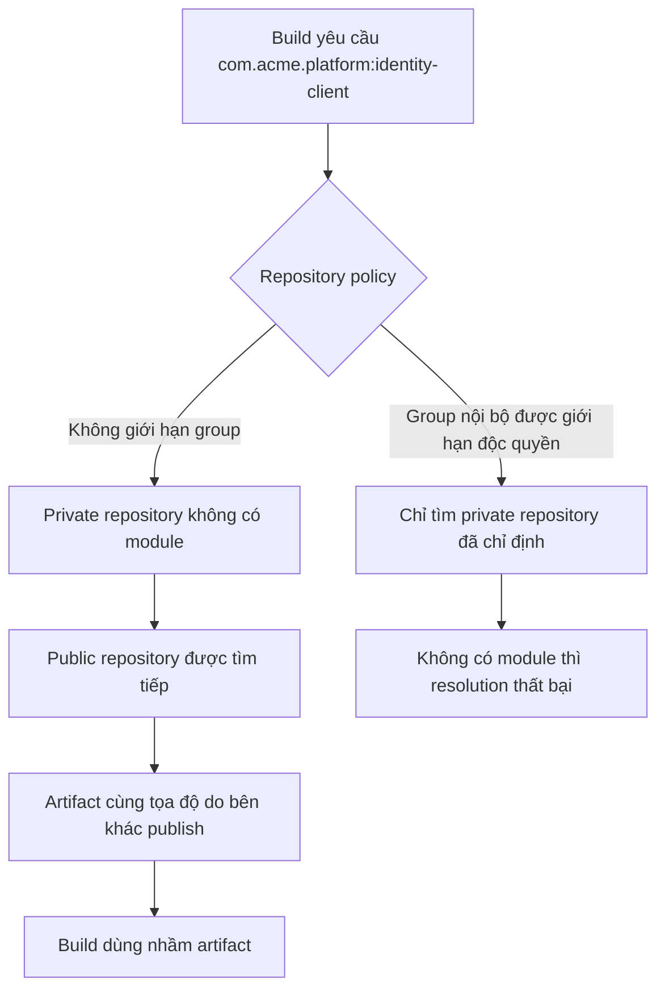
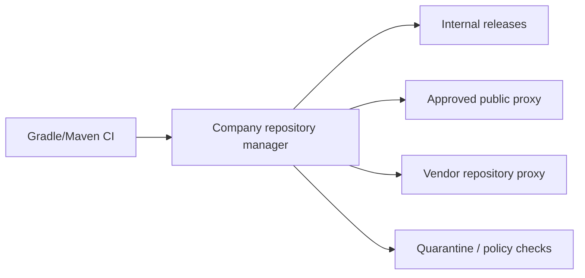

# Tránh tải nhầm artifact cùng tên từ kho không mong muốn

Một dependency có thể được khai báo đúng tọa độ nhưng vẫn được tải từ nguồn không đáng tin. Trong hệ thống Java, tên thư viện hoặc tọa độ như `group:artifact:version` không tự chứng minh artifact đến từ repository nào, do ai publish hay nội dung có đúng với bản đã được review hay không. Nếu build tìm cùng một tọa độ ở nhiều repository, thứ tự tìm kiếm, cấu hình mirror, content filter và chính sách xác minh sẽ quyết định artifact nào được sử dụng.

Rủi ro này xuất hiện trong nhiều tình huống: thư viện nội bộ bị thiếu trên private repository rồi được tìm thấy ở public repository; một package phổ biến bị giả mạo bằng tên gần giống; cùng tọa độ được publish với nội dung khác nhau ở hai nguồn; hoặc build script thêm một repository ngoài ý muốn. Đây là các dạng supply-chain risk, trong đó dependency confusion và typosquatting là hai ví dụ nổi bật.

Để tránh tải nhầm artifact, cần kiểm soát **nguồn được phép cung cấp từng nhóm tọa độ**, giới hạn repository trong đúng phạm vi, xác minh nội dung artifact và kiểm tra nguồn thực tế trong CI. Việc khóa version hoặc xem dependency tree là cần thiết nhưng chưa đủ: version cho biết artifact nào được yêu cầu, còn repository policy và verification mới giúp kiểm soát artifact đến từ đâu và nội dung có đáng tin hay không.

## 1. Artifact identity và repository origin là hai thông tin khác nhau

Trong Maven repository layout, một dependency thường được định danh bằng:

```text
groupId:artifactId:version
```

Ví dụ:

```text
com.example.billing:payment-client:3.2.1
```

Tọa độ này giúp build tool xác định module cần resolve. Nó không tự gắn một nhà cung cấp duy nhất vào module. Nhiều repository có thể cùng chứa tọa độ trên, thậm chí cùng version nhưng nội dung JAR hoặc metadata khác nhau.

Hãy phân biệt:

| Khái niệm | Câu hỏi được trả lời | Ví dụ |
|---|---|---|
| Coordinates | Module nào được yêu cầu? | `com.example.billing:payment-client:3.2.1` |
| Repository origin | Module được lấy từ server/repository nào? | `https://repo.company.example/releases` |
| Artifact integrity | Nội dung tải về có đúng nội dung đã được xác minh không? | SHA-256 hoặc checksum đã được phê duyệt. |
| Publisher authenticity | Artifact có được ký bởi danh tính được tin cậy không? | Chữ ký số và public key đã được xác minh. |
| Provenance | Artifact được tạo từ source, workflow và quy trình nào? | Attestation/SLSA provenance gắn với commit và build pipeline. |

Hai artifact có cùng tọa độ vẫn có thể khác byte. Vì vậy, “đúng group, artifact và version” chỉ là điều kiện nhận diện module, chưa phải bằng chứng về nguồn gốc hoặc tính toàn vẹn.

## 2. Những tình huống có thể khiến build tải nhầm artifact

### 2.1. Dependency confusion

Dependency confusion xảy ra khi build mong muốn một package nội bộ nhưng repository policy cho phép tìm package đó ở nguồn public. Kẻ tấn công có thể publish một package cùng tên hoặc cùng tọa độ trong public registry với version được chọn cao hơn hoặc với nội dung độc hại.

Ví dụ tổ chức dùng tọa độ nội bộ:

```text
com.acme.platform:identity-client:1.0.0
```

Private repository chưa có module này do publish chưa hoàn tất hoặc cấu hình sai. Nếu build cũng tìm public repository và không giới hạn namespace nội bộ, nó có thể lấy một artifact cùng tọa độ từ public source.



Điểm nguy hiểm là build có thể vẫn thành công. Một dependency không tìm thấy sẽ báo lỗi rõ ràng; một dependency giả mạo có cùng tọa độ có thể vượt qua resolution và chỉ biểu hiện thành hành vi bất thường khi chạy.

### 2.2. Typosquatting và package name confusion

Typosquatting dùng tên gần giống dependency phổ biến để lợi dụng lỗi gõ hoặc sự thiếu chú ý khi review. Ví dụ tên package có thể khác một ký tự, dùng dấu gạch nối thay cho dấu chấm hoặc thêm một từ khó nhận ra.

```text
org.apache.commons:commons-text
org.apache.common:commons-text
```

Hai tọa độ trên không giống nhau. Build tool không biết người khai báo có gõ nhầm hay không; nó chỉ resolve đúng tọa độ đã được yêu cầu. Vì vậy cần review dependency diff, dùng version catalog/central dependency management, kiểm tra publisher và hạn chế thêm dependency tùy tiện.

### 2.3. Cùng tọa độ, khác nội dung giữa nhiều repository

Một module release nên được xem là bất biến. Nếu cùng `group:artifact:version` được publish với nội dung khác nhau lên hai repository, kết quả build có thể phụ thuộc repository được chọn, cache state hoặc môi trường.

Điều này có thể xảy ra do:

- Một repository nội bộ ghi đè release đã tồn tại.
- Một mirror proxy trả về metadata/artifact khác với upstream.
- Một artifact bị thay thế sau sự cố bảo mật.
- Hai team publish trùng tọa độ vào hai repository độc lập.
- Build local và CI dùng repository list hoặc mirror khác nhau.

Không publish lại release version với nội dung mới. Nếu artifact cần thay đổi, phát hành version mới và giữ lại metadata lịch sử để build cũ có thể tái lập.

### 2.4. Repository ngoài ý muốn được thêm qua build script

Một subproject, plugin, included build hoặc profile Maven có thể bổ sung repository riêng. Khi build lớn, rất khó nhận ra một module đang lấy dependency từ nguồn nào nếu repository được khai báo rải rác.

Các nguồn cần kiểm tra:

- Gradle `settings.gradle(.kts)` và `build.gradle(.kts)`.
- `pluginManagement.repositories`.
- `dependencyResolutionManagement.repositories`.
- `buildscript.repositories` và repository của included build/build logic.
- Maven `<repositories>` và `<pluginRepositories>` trong POM.
- Maven `settings.xml`, active profiles và mirrors.
- Init scripts, enterprise build logic, CI setup và repository manager.

### 2.5. Local repository hoặc cache giữ artifact cũ

Artifact local có thể che giấu nguồn thực tế. Gradle `mavenLocal()` và Maven local repository (`~/.m2/repository`) có thể chứa module do developer cài thủ công. Nếu nội dung local không giống artifact đã publish trên server, local build và CI có thể khác nhau.

CI cache cũng có thể khôi phục dependency đã tải trước đó. Cache là tối ưu hiệu năng, không phải bằng chứng rằng artifact vẫn đến từ nguồn được phê duyệt. Cần kết hợp cache với lockfile, repository policy và checksum/signature verification.

## 3. Quy tắc nền tảng: namespace nội bộ phải có chủ sở hữu rõ ràng

Tổ chức nên xác định namespace cho artifact nội bộ và quy định repository duy nhất được phép cung cấp namespace đó.

Ví dụ:

| Namespace | Nguồn được phép |
|---|---|
| `com.acme.*` | Private Maven repository của công ty. |
| `com.acme.platform.gradle.*` | Private Gradle plugin repository. |
| Dependency public đã phê duyệt | Maven Central hoặc mirror nội bộ đã kiểm soát. |
| Artifact từ vendor riêng | Repository vendor hoặc mirror nội bộ được phê duyệt. |

Quy ước group ID nên được kiểm soát ở cấp tổ chức. Không nên để team tự chọn group tùy ý mà không có ownership, vì namespace lỏng lẻo làm tăng nguy cơ trùng tên và dependency confusion.

Một nguyên tắc quan trọng là: nếu một group được xác định là nội bộ, khi private repository không có module thì resolution nên thất bại thay vì tìm một module cùng group ở public repository. Điều này cần được thực thi bằng exclusive repository policy hoặc mirror/allowlist phù hợp.

## 4. Gradle: hiểu thứ tự repository và repository stickiness

Gradle phân giải dependency từ repository được khai báo trong repository handler. Thứ tự repository có ý nghĩa: Gradle tìm module theo danh sách. Khi tìm thấy metadata của module trong một repository, Gradle gắn module đó với repository tương ứng và lấy artifact của module từ cùng repository đó; nó không tùy tiện ghép metadata từ một nguồn với JAR cùng tọa độ từ nguồn khác.

Ví dụ:

```groovy
repositories {
    maven {
        name = 'companyRepo'
        url = uri('https://repo.company.example/maven')
    }
    mavenCentral()
}
```

Nếu `companyRepo` không có module, Gradle có thể tiếp tục tìm ở repository kế tiếp. Nếu public repository có cùng tọa độ và module được tìm thấy ở đó, public artifact có thể được sử dụng. Vì vậy, chỉ đặt private repository lên trước không phải chính sách đủ mạnh cho namespace nội bộ.

Nếu Gradle tìm thấy metadata trong repository đầu tiên nhưng artifact tương ứng bị thiếu hoặc không thể tải, resolution có thể thất bại thay vì tìm JAR cùng tọa độ từ repository khác. Tính gắn kết nguồn này giúp tránh trộn metadata/artifact giữa repository, nhưng không tự ngăn một repository không đáng tin cung cấp module ngay từ đầu.

## 5. Gradle content filters và `exclusiveContent`

Gradle hỗ trợ content filtering để giới hạn module mà một repository được phép cung cấp. Có hai khái niệm cần phân biệt:

- `content { include... }` giới hạn module được tìm trong repository đó.
- `exclusiveContent` quy định một nhóm module chỉ được lấy từ repository được chỉ định và loại chúng khỏi các repository khác trong cùng repository handler.

Nếu chỉ dùng `content { includeGroup(...) }` cho private repository, group đó có thể vẫn được tìm ở repository public khác nếu public repository cho phép mọi nội dung. Khi namespace cần được bảo vệ độc quyền, `exclusiveContent` diễn tả chính sách rõ hơn.

### 5.1. Ví dụ giới hạn group nội bộ

Trong `settings.gradle`:

```groovy
dependencyResolutionManagement {
    repositories {
        exclusiveContent {
            forRepository {
                maven {
                    name = 'companyInternal'
                    url = uri('https://repo.company.example/maven-releases')
                }
            }
            filter {
                includeGroupByRegex 'com\\.acme(\\..*)?'
            }
        }

        mavenCentral()
    }
}
```

Trong ví dụ, các group `com.acme` và group con được tìm độc quyền ở `companyInternal`. Nếu private repository không có một module thuộc namespace đó, Gradle sẽ không lấy module cùng group từ Maven Central.

Có thể giới hạn một group cụ thể:

```groovy
content {
    includeGroup('com.acme.billing')
}
```

Hoặc một module:

```groovy
content {
    includeModule('com.acme.billing', 'payment-client')
}
```

Khi viết regex, cần kiểm tra nó khớp chính xác group ID. Regex quá rộng có thể đưa dependency public vào namespace nội bộ; regex quá hẹp có thể khiến module nội bộ rơi sang repository khác nếu không được bảo vệ độc quyền.

### 5.2. Dùng `exclusiveContent` cho nhiều namespace

Nếu tổ chức có nhiều repository nội bộ, có thể ánh xạ từng namespace đến nguồn sở hữu:

```groovy
dependencyResolutionManagement {
    repositories {
        exclusiveContent {
            forRepository {
                maven {
                    name = 'billingRepo'
                    url = uri('https://repo.company.example/billing')
                }
            }
            filter {
                includeGroupByRegex 'com\\.acme\\.billing(\\..*)?'
            }
        }

        exclusiveContent {
            forRepository {
                maven {
                    name = 'platformRepo'
                    url = uri('https://repo.company.example/platform')
                }
            }
            filter {
                includeGroupByRegex 'com\\.acme\\.platform(\\..*)?'
            }
        }

        mavenCentral()
    }
}
```

Mỗi namespace được gắn với một repository cụ thể. Nếu repository manager nội bộ đã làm proxy và quản lý toàn bộ artifact, có thể dùng một repository nội bộ làm nguồn duy nhất cho nhiều namespace, tùy chính sách tổ chức.

### 5.3. Centralize repository trong settings

Với multi-project build, `dependencyResolutionManagement` cho phép quản lý repository tập trung:

```groovy
dependencyResolutionManagement {
    repositoriesMode.set(RepositoriesMode.FAIL_ON_PROJECT_REPOS)
    repositories {
        exclusiveContent {
            forRepository {
                maven {
                    name = 'companyInternal'
                    url = uri('https://repo.company.example/maven')
                }
            }
            filter {
                includeGroupByRegex 'com\\.acme(\\..*)?'
            }
        }
        mavenCentral()
    }
}
```

`FAIL_ON_PROJECT_REPOS` khiến build thất bại nếu subproject cố khai báo repository riêng. Điều này giúp ngăn một module âm thầm thêm public repository hoặc một URL không được review.

`PREFER_SETTINGS` ưu tiên repository trong settings và bỏ qua repository khai báo ở project; `PREFER_PROJECT` ưu tiên repository ở project. Chọn mode theo chính sách, nhưng nếu mục tiêu là kiểm soát chặt nguồn dependency thì `FAIL_ON_PROJECT_REPOS` thường dễ phát hiện vi phạm nhất.

Lưu ý: repository management cho dependency project và repository cho plugin DSL là hai scope riêng. `repositoriesMode` không thay thế cấu hình `pluginManagement.repositories`.

## 6. Gradle plugin repositories cũng cần kiểm soát riêng

Plugin được khai báo qua `plugins {}` được resolve trong plugin management scope. Một repository được thêm vào `dependencyResolutionManagement.repositories` không tự động trở thành nguồn plugin.

Ví dụ:

```groovy
pluginManagement {
    repositories {
        exclusiveContent {
            forRepository {
                maven {
                    name = 'companyGradlePlugins'
                    url = uri('https://repo.company.example/gradle-plugins')
                }
            }
            filter {
                includeGroupByRegex 'com\\.acme\\.gradle(\\..*)?'
            }
        }

        gradlePluginPortal()
    }
}
```

Với plugin nội bộ, cần đảm bảo filter bao phủ cả marker artifact và implementation artifact. Plugin marker thường có group liên quan đến plugin ID, trong khi implementation module có thể dùng group khác. Nếu marker được tìm thấy nhưng implementation nằm ngoài filter hoặc ở repository không được khai báo, plugin resolution vẫn thất bại.

Nếu dùng `resolutionStrategy.eachPlugin { useModule(...) }` để ánh xạ plugin ID sang implementation module, hãy bảo đảm module đó được cung cấp từ repository nội bộ đã phê duyệt. Không để plugin ID nội bộ có thể rơi sang public portal chỉ vì marker bị thiếu.

Repository của `buildscript {}` là một scope khác nữa. Build logic kiểu cũ khai báo `buildscript.repositories` và `buildscript.dependencies { classpath(...) }` cần được kiểm soát riêng. Included build hoặc `build-logic` có settings/repository policy riêng; không nên giả định policy của root tự áp dụng cho mọi build logic độc lập.

## 7. Tránh `mavenLocal()` và repository cá nhân trong build tin cậy

`mavenLocal()` hữu ích khi phát triển một thư viện trên máy cá nhân rồi dùng thử trong project khác. Nhưng local repository không phải nguồn có thể kiểm soát tập trung:

- Artifact có thể được cài từ source chưa review.
- Cùng tọa độ/version có thể chứa nội dung khác với CI.
- Developer có thể vô tình dùng artifact cũ đã cài từ trước.
- Build có thể thành công local nhưng CI không resolve được artifact đó.

Không nên thêm `mavenLocal()` vào repository list của build release hoặc CI nếu không có nhu cầu cụ thể. Nếu cần kiểm thử artifact local, dùng một workflow phát triển riêng và xác nhận build phát hành chỉ lấy artifact từ repository được phê duyệt.

Tương tự, tránh repository file system cá nhân, `flatDir` hoặc URL tạm thời trong build dùng chung. Các nguồn này có thể không cung cấp metadata module đầy đủ và khó xác minh nguồn gốc.

## 8. Maven: kiểm soát repository bằng mirror và settings

Maven xác định repository từ cấu hình trong POM, profile và settings. `settings.xml` hỗ trợ mirror để chuyển yêu cầu repository qua một endpoint khác, thường là repository manager nội bộ.

Ví dụ mirror toàn bộ repository request qua một proxy nội bộ:

```xml
<settings>
  <mirrors>
    <mirror>
      <id>company-mirror</id>
      <name>Company approved artifact mirror</name>
      <url>https://repo.company.example/maven-all</url>
      <mirrorOf>*</mirrorOf>
    </mirror>
  </mirrors>
</settings>
```

`mirrorOf` với `*` yêu cầu Maven dùng mirror này cho mọi repository được mirror theo cấu hình. Repository manager nội bộ chịu trách nhiệm proxy các nguồn public được phê duyệt và phục vụ artifact nội bộ. Đây là cách tập trung kiểm soát nguồn, giảm việc mỗi project tự kết nối Internet tới nhiều repository.

Trong một số tổ chức, policy chỉ mirror repository bên ngoài bằng `external:*` hoặc loại trừ một repository ID cụ thể. Cần hiểu chính xác pattern `mirrorOf` được chọn và kiểm tra effective settings để bảo đảm không có repository nào đi vòng qua proxy.

### 8.1. Mirror khác repository declaration

POM có thể khai báo repository:

```xml
<repositories>
  <repository>
    <id>vendor-releases</id>
    <url>https://repo.vendor.example/releases</url>
  </repository>
</repositories>
```

Mirror trong settings ánh xạ repository ID/selection pattern sang một URL khác khi Maven thực hiện request. Điều này cho phép tổ chức giữ POM tương đối độc lập với hạ tầng mirror của từng môi trường.

Mirror không tự tạo một bản sao artifact và không tự xác minh publisher. Repository manager đằng sau mirror cần có chính sách proxy, quarantine, allowlist, checksum/signature validation và audit phù hợp.

### 8.2. Dependency repository và plugin repository

Maven có hai loại khai báo:

- `<repositories>` cho dependency của project.
- `<pluginRepositories>` cho Maven build plugin.

Build plugin cũng là phần mềm được tải và thực thi trong quá trình build. Vì vậy, cần kiểm soát nguồn plugin như dependency thông thường. Mirror policy trong Maven settings nên được kiểm tra cho cả dependency và plugin resolution; đừng chỉ xem `dependency:tree` của thư viện ứng dụng.

### 8.3. Kiểm tra effective settings và effective POM

Maven có thể nhận repository/profile từ nhiều nơi. Dùng:

```bash
mvn help:effective-settings
mvn help:effective-pom
```

Các lệnh này giúp thấy cấu hình sau khi hợp nhất settings/POM và profile đang hoạt động. Với debug log:

```bash
mvn -X -B verify
```

Log có thể cho biết Maven đang truy cập URL nào và artifact nào được tải. Cần xử lý log cẩn thận để không phát tán token hoặc credential.

## 9. Maven dependency mediation không phải repository security

Maven dùng quy tắc dependency mediation, thường được mô tả là nearest definition, để chọn version khi nhiều dependency bắc cầu yêu cầu cùng artifact. Quy tắc này trả lời câu hỏi **version nào được chọn trong dependency graph**, không trả lời câu hỏi **artifact được lấy từ repository nào**.

Ví dụ:

```text
application
├── library-a
│   └── common-api:2.0
└── legacy-adapter
    └── common-api:1.4
```

Maven có thể chọn version theo vị trí gần project hơn trong graph hoặc theo dependency management. Dù version được chọn là `2.0`, build vẫn cần kiểm soát repository source cho tọa độ đó.

Tương tự, Gradle conflict resolution và dependency constraints quyết định version/variant được chọn, còn repository filtering/exclusive policy quyết định nơi module được phép resolve. Không dùng `dependencyManagement`, BOM, version catalog hoặc dependency locking như biện pháp duy nhất chống dependency confusion.

## 10. Pin version và dependency locking

Version cố định giúp tránh dynamic version tự đổi theo thời gian:

```groovy
dependencies {
    implementation 'com.acme.platform:identity-client:2.4.1'
}
```

Tránh các khai báo động trong build phát hành nếu không có chính sách refresh rõ ràng:

```groovy
dependencies {
    implementation 'com.acme.platform:identity-client:+'
}
```

Dynamic version có thể khiến một lần build sau chọn version mới hơn. Điều đó làm tăng nguy cơ nhận artifact ngoài ý muốn nếu repository policy không giới hạn namespace.

Gradle dependency locking giữ version đã resolve:

```groovy
dependencyLocking {
    lockAllConfigurations()
}
```

Sau đó có thể tạo/cập nhật lock state bằng task phù hợp của Gradle, ví dụ chạy build với `--write-locks`. Lockfile giúp build tái lập về version. Nó không khóa repository origin và không chứng minh nội dung artifact là đáng tin.

Maven có thể dùng `dependencyManagement`/BOM, Enforcer rules và version policy để kiểm soát version. Nhưng cùng nguyên tắc: version pinning giảm sự thay đổi không mong muốn, còn mirror/repository policy và verification kiểm soát nguồn/nội dung.

## 11. Xác minh checksum và chữ ký artifact

Repository policy giúp giới hạn nguồn. Dependency verification giúp phát hiện nội dung artifact không đúng với dữ liệu đã được phê duyệt.

### 11.1. Checksum

Checksum như SHA-256 có thể phát hiện artifact bị thay đổi so với checksum tin cậy:

```text
artifact: payment-client-3.2.1.jar
SHA-256: 9f... (giá trị minh họa)
```

Nếu checksum được lấy từ chính repository không đáng tin trong cùng lần tải, kẻ tấn công có thể thay cả artifact lẫn checksum. Vì vậy checksum chỉ mạnh khi giá trị tham chiếu đến từ một nguồn tin cậy độc lập hoặc đã được review/commit trong repository của dự án.

### 11.2. Gradle dependency verification

Gradle hỗ trợ dependency verification bằng checksum và chữ ký. Metadata xác minh được lưu trong `gradle/verification-metadata.xml`.

Có thể khởi tạo metadata checksum:

```bash
./gradlew --write-verification-metadata sha256 help
```

Lệnh này tạo/cập nhật các checksum được quan sát trong quá trình resolve. Trước khi commit, cần review nguồn dependency và checksum; không nên chạy lệnh rồi chấp nhận tất cả giá trị mới mà không xác minh.

Cấu hình strict verification trong settings:

```groovy
dependencyVerification {
    verificationMode = VerificationMode.STRICT
}
```

Ở strict mode, dependency không có verification metadata phù hợp có thể làm build thất bại. Đây là hành vi mong muốn với build cần kiểm soát chặt, nhưng nhóm phải có quy trình cập nhật metadata khi chủ động nâng dependency hoặc thêm plugin.

Verification metadata có thể bao gồm checksum của artifact và metadata như POM/module metadata theo cấu hình. Chữ ký cần có key được tin cậy; chỉ thấy một chữ ký hợp lệ về mặt toán học chưa đủ nếu public key không được xác minh đúng danh tính.

### 11.3. Maven checksum và signature

Maven repository metadata thường cung cấp checksum. Có thể cấu hình checksum policy ở repository để yêu cầu lỗi khi checksum không khớp hoặc không có, tùy repository/tool configuration.

Ví dụ repository policy trong POM:

```xml
<repositories>
  <repository>
    <id>approved-releases</id>
    <url>https://repo.company.example/releases</url>
    <releases>
      <enabled>true</enabled>
      <checksumPolicy>fail</checksumPolicy>
    </releases>
    <snapshots>
      <enabled>false</enabled>
    </snapshots>
  </repository>
</repositories>
```

Checksum policy giúp fail khi checksum không đáp ứng chính sách, nhưng checksum được phục vụ cùng nguồn không phải chữ ký publisher. Với artifact quan trọng, cần xác minh chữ ký số hoặc dùng repository manager có quy trình kiểm tra nguồn và quarantine.

## 12. Repository manager và allowlist

Trong tổ chức, repository manager như Nexus Repository, Artifactory hoặc một proxy Maven nội bộ có thể làm điểm kiểm soát tập trung.

Một mô hình thường gặp:



Lợi ích:

- CI chỉ cần truy cập một hoặc một số endpoint được kiểm soát.
- Public dependency có thể được proxy và cache tập trung.
- Tổ chức có thể chặn group/artifact/version không được phê duyệt.
- Artifact mới có thể được quarantine trước khi cho phép sử dụng.
- Audit log có thể ghi lại ai tải/publish artifact và từ upstream nào.
- Có thể kiểm soát release/snapshot repository riêng.
- Có thể áp dụng retention, immutability và cleanup policy.

Repository manager không tự bảo đảm an toàn nếu cấu hình cho phép proxy mọi nguồn không giới hạn hoặc cho phép ghi đè release. Cần bật policy cụ thể, giới hạn quyền publish và bảo vệ tài khoản quản trị.

## 13. Quy tắc publish artifact nội bộ

Để tránh artifact nội bộ bị giả mạo hoặc trùng tọa độ:

- Dùng group namespace thuộc quyền kiểm soát của tổ chức.
- Chỉ pipeline release tin cậy được quyền publish vào release repository.
- Không cho developer hoặc pull request không tin cậy ghi đè release artifact.
- Cấm redeploy/rewrite cùng release version.
- Dùng snapshot repository riêng và không dùng snapshot trong build phát hành nếu có thể.
- Lưu checksum/signature và build provenance.
- Gắn artifact với source commit, build number và workflow identity.
- Review thay đổi group/artifact/version trong pull request.
- Giới hạn token publish theo repository và quyền tối thiểu.

Nếu một artifact cần sửa sau khi publish, hãy phát hành version mới. Việc thay nội dung của `3.2.1` thành một JAR khác làm mọi cache và build cũ trở nên khó tái lập.

## 14. Điều tra nguồn artifact thực tế

Khi nghi ngờ build tải nhầm artifact, cần xác định cả tọa độ lẫn repository URL thực tế.

### 14.1. Gradle

Xem dependency graph và lý do version được chọn:

```bash
./gradlew dependencies --configuration runtimeClasspath
./gradlew dependencyInsight --dependency payment-client --configuration runtimeClasspath
```

`dependencies` và `dependencyInsight` cho biết graph, version và selection reason; chúng không phải lúc nào cũng thể hiện đầy đủ repository origin trong output mặc định.

Chạy với log chi tiết:

```bash
./gradlew build --info
```

Log resolution có thể cho biết request đến repository URL nào. Nếu cần, dùng build scan hoặc logging phù hợp với chính sách tổ chức. Không đưa credential hoặc URL chứa token vào báo cáo chia sẻ.

Kiểm tra cấu hình repository ở settings, project, plugin management và buildscript scope. Sau khi biết JAR runtime, có thể kiểm tra nội dung và checksum:

```bash
jar tf path/to/payment-client-3.2.1.jar
```

Trên PowerShell, có thể tính SHA-256:

```powershell
Get-FileHash -Algorithm SHA256 -LiteralPath 'path\to\payment-client-3.2.1.jar'
```

So sánh với checksum trong verification metadata hoặc nguồn tin cậy độc lập.

### 14.2. Maven

Xem dependency tree:

```bash
mvn dependency:tree -Dincludes=com.acme.billing:payment-client
```

Xem effective configuration:

```bash
mvn help:effective-settings
mvn help:effective-pom
```

Xem URL tải artifact bằng debug log:

```bash
mvn -X -B dependency:resolve
```

Maven debug log có thể chứa thông tin repository và authentication context. Chỉ lưu/chia sẻ log đã được rà soát, tránh công khai token, password hoặc thông tin hạ tầng nhạy cảm.

### 14.3. Kiểm tra artifact cuối cùng

Dependency tree của build không chứng minh artifact deploy cuối cùng chứa đúng JAR. Hãy kiểm tra:

- Nội dung JAR/WAR/EAR hoặc fat JAR.
- Manifest và thư mục `BOOT-INF/lib`, `WEB-INF/lib` hoặc layout tương ứng.
- Docker image layer và file được copy vào image.
- Startup script, `-cp`, `-jar` hoặc module path.
- Shared library của application server/container.
- Checksum của artifact deploy so với artifact CI vừa tạo.

Nếu runtime có thể nạp thư viện từ classloader riêng, dùng class-loading log hoặc `CodeSource` để xác định JAR thật sự được nạp.

## 15. Cache không thay thế repository policy

CI cache giúp tiết kiệm thời gian nhưng có thể làm nguồn artifact khó quan sát hơn nếu nhóm không kiểm soát cache lifecycle.

Một số nguyên tắc:

- Cache dependency theo manifest/lockfile và tool/environment phù hợp.
- Không cache secret hoặc toàn bộ user home có cấu hình xác thực.
- Tách cache theo trust boundary giữa pull request không tin cậy và release pipeline.
- Không cho job không tin cậy ghi cache được release job tin cậy sử dụng.
- Không dùng cache key quá rộng để khôi phục output project cũ.
- Bật dependency verification để phát hiện nội dung artifact thay đổi.
- Khi nghi ngờ cache bị nhiễm, tạo namespace mới hoặc làm mới cache theo quy trình kiểm soát.
- Ghi nhận cache hit/miss và nguồn artifact trong log CI.

Nếu cache trả về một artifact đã tải từ nguồn sai trong lần trước, chỉ thay repository list có thể chưa đủ nếu build tool tiếp tục dùng cache state. Hãy xác minh checksum/signature, kiểm tra metadata và làm mới dependency cache có chủ đích sau khi sửa repository policy.

## 16. Các tình huống và cách xử lý

| Tình huống | Rủi ro | Biện pháp |
|---|---|---|
| Private group không có module, public repository có cùng tọa độ | Dependency confusion | Gradle `exclusiveContent`; Maven mirror/allowlist tập trung. |
| Module nội bộ được tìm ở Maven Central | Namespace nội bộ chưa được bảo vệ | Quy định group ownership và chặn public fallback. |
| Plugin nội bộ không tìm thấy marker trong private repo | Gradle có thể tìm plugin ở portal nếu policy cho phép | Cấu hình plugin repository riêng và filter cả marker/implementation. |
| Subproject tự thêm repository lạ | Dependency source policy bị bypass | Centralize repository và `FAIL_ON_PROJECT_REPOS`. |
| Maven POM/profile thêm repository ngoài | CI có thể tải từ nguồn không mong muốn | Kiểm tra effective POM/settings, dùng mirror policy. |
| Cùng GAV có JAR khác nhau trên hai server | Build không tái lập | Cấm redeploy release, verify checksum/signature, một nguồn sở hữu. |
| `mavenLocal()` chứa bản cũ | Local khác CI | Không dùng trong release/CI; dùng repo riêng cho dev. |
| Dynamic version hoặc SNAPSHOT đổi theo thời gian | Build lấy version/content mới ngoài dự kiến | Pin/lock version, kiểm soát update policy. |
| CI cache chứa artifact đã tải sai | Build tiếp tục dùng dữ liệu cũ | Verification, cache invalidation có kiểm soát và audit origin. |
| Fork PR ghi cache dùng chung | Cache poisoning | Tách quyền đọc/ghi và trust boundary. |

## 17. Checklist chính sách repository an toàn

- [ ] Namespace/group ID nội bộ có owner và repository nguồn được xác định.
- [ ] Private group được giới hạn độc quyền, không rơi sang public repository khi thiếu module.
- [ ] Gradle dependency repositories được centralize hoặc kiểm soát theo project policy.
- [ ] Gradle plugin repositories và legacy buildscript repositories được quản lý riêng.
- [ ] Marker và implementation artifact của plugin nội bộ đều có nguồn được phê duyệt.
- [ ] Maven `<repositories>` và `<pluginRepositories>` được kiểm soát qua effective settings/mirrors.
- [ ] CI dùng repository manager hoặc mirror/allowlist đã được phê duyệt.
- [ ] Release version là bất biến; không redeploy cùng tọa độ/version với nội dung khác.
- [ ] Dependency version được pin/lock phù hợp; dynamic/SNAPSHOT có policy rõ ràng.
- [ ] Checksum/signature verification được bật và metadata được review.
- [ ] Cache không chứa secret và job không tin cậy không thể ghi cache dùng cho release.
- [ ] CI log hoặc audit có thể xác định repository origin khi cần điều tra.
- [ ] Artifact cuối cùng được kiểm tra checksum và nguồn trước khi deploy.

## 18. Quy trình xử lý khi phát hiện artifact đến từ nguồn không mong muốn

1. **Dừng phát hành artifact bị nghi ngờ:** không tiếp tục promote/deploy chỉ vì build pass.
2. **Ghi lại bằng chứng:** tọa độ, version, repository URL, checksum, build revision, job và thời điểm tải.
3. **Xác định phạm vi:** dependency trực tiếp hay bắc cầu, plugin hay thư viện runtime, project nào sử dụng.
4. **Kiểm tra policy:** repository list, content filters, exclusive rules, Maven mirrors, active profiles và init scripts.
5. **So sánh nội dung:** checksum, signature, metadata và artifact từ nguồn được phê duyệt.
6. **Cô lập nguồn:** loại repository không mong muốn hoặc giới hạn namespace độc quyền.
7. **Làm mới cache có kiểm soát:** chỉ sau khi xác định cache path và policy đúng; không xóa mù toàn bộ user home.
8. **Resolve lại và kiểm chứng:** xác nhận URL/source, version, checksum và dependency graph.
9. **Chạy test và kiểm tra artifact deploy:** bảo đảm output đúng và không còn duplicate class.
10. **Ghi nhận incident/policy change:** cập nhật repository allowlist, ownership và quy trình publish nếu cần.

Nếu artifact có dấu hiệu độc hại, xử lý theo quy trình ứng phó bảo mật của tổ chức: bảo toàn log/evidence, thu hồi credential bị ảnh hưởng, quarantine artifact và đánh giá build/deploy nào đã sử dụng nó.

## 19. Nguyên tắc cần nhớ

- Tọa độ dependency xác định module được yêu cầu; nó không chứng minh repository origin.
- Không dựa riêng vào thứ tự repository để bảo vệ namespace nội bộ.
- Với Gradle, dùng content filter và `exclusiveContent` để ánh xạ group/module vào repository được phép.
- Quản lý `pluginManagement.repositories`, project dependency repositories và `buildscript.repositories` trong đúng scope.
- Với multi-project build, centralize repository và dùng `FAIL_ON_PROJECT_REPOS` khi cần ngăn repository tự phát.
- Với Maven, dùng mirror/repository manager và kiểm tra cả dependency lẫn plugin repositories.
- Dependency mediation, BOM, version catalog và lockfile kiểm soát version; chúng không tự xác minh origin.
- Checksum cần nguồn tham chiếu đáng tin; chữ ký cần key được xác minh.
- Release artifact phải bất biến; không publish lại cùng GAV/version với nội dung khác.
- Cache là tối ưu hiệu năng, không phải ranh giới tin cậy.
- Xác minh repository URL, checksum và artifact cuối cùng trong CI/deployment.

Tránh tải nhầm artifact bắt đầu từ việc xác định namespace nào thuộc tổ chức và repository nào được phép cung cấp namespace đó. Gradle có thể dùng `exclusiveContent` để ngăn public fallback cho group nội bộ; Maven có thể chuyển repository request qua mirror/repository manager được kiểm soát. Version pinning và lockfile giúp build ổn định, còn checksum/signature verification giúp phát hiện nội dung bị thay đổi. Khi kết hợp các lớp này với quyền publish tối thiểu, cache có trust boundary rõ ràng và kiểm tra artifact deploy, nhóm có thể giảm nguy cơ dependency confusion, typosquatting và sử dụng nhầm artifact cùng tên từ nguồn không mong muốn.
