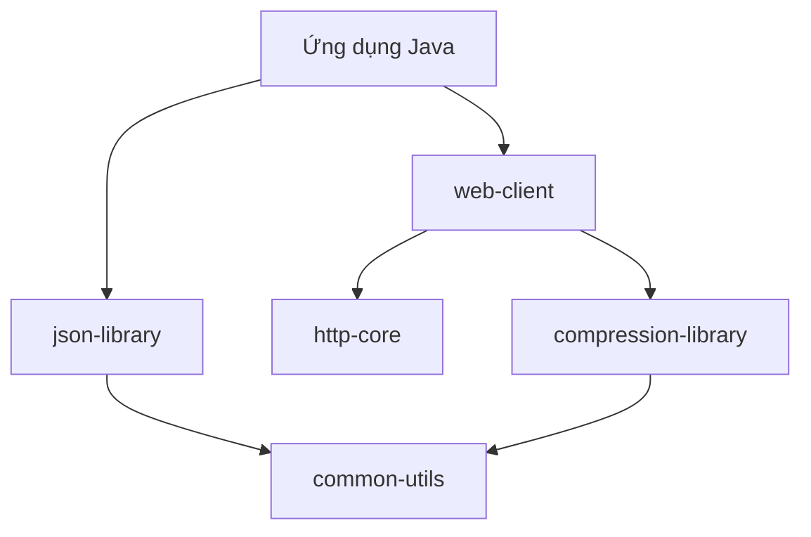
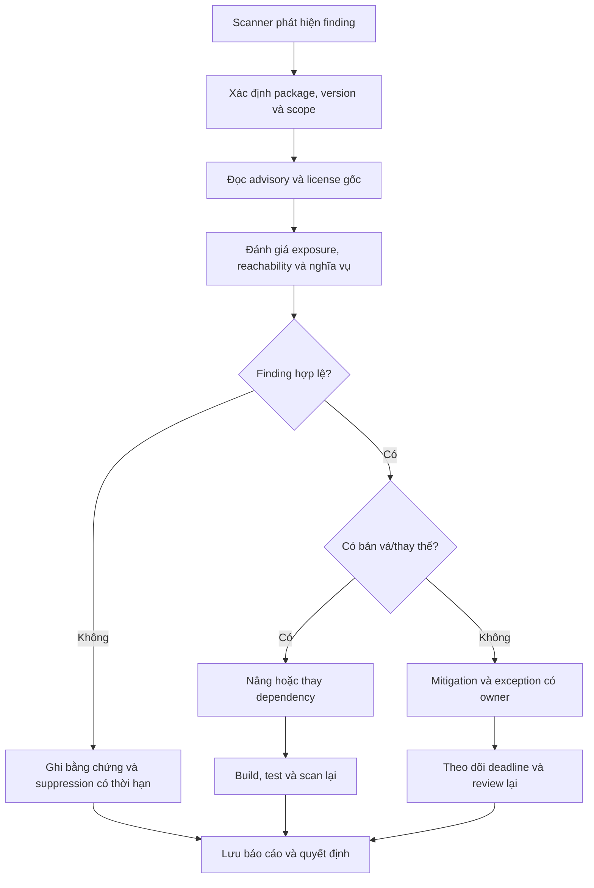

# Quét lỗ hổng và giấy phép trong phạm vi quy trình build

Một dự án Java hiếm khi chỉ chứa mã nguồn do nhóm tự viết. Ứng dụng thường phụ thuộc vào nhiều thư viện bên ngoài, và mỗi thư viện có thể kéo theo các dependency khác. Những thành phần này có thể chứa lỗ hổng bảo mật, dùng giấy phép không phù hợp với cách phân phối sản phẩm hoặc thay đổi trạng thái theo thời gian.

Quét lỗ hổng và giấy phép trong quy trình build giúp nhóm phát hiện rủi ro trước khi merge hoặc phát hành. Việc quét cần bao phủ dependency trực tiếp và bắc cầu, phân biệt thư viện chạy thật với công cụ chỉ dùng lúc build, tạo báo cáo có thể truy vết và áp dụng chính sách xử lý rõ ràng.

Hai mục tiêu cần được phân biệt:

- **Quét lỗ hổng (vulnerability scanning):** tìm phiên bản thành phần có liên quan đến lỗ hổng đã được công bố và đánh giá mức độ rủi ro.
- **Quét giấy phép (license scanning):** xác định giấy phép của các thành phần được sử dụng và kiểm tra xem chúng có phù hợp với chính sách phân phối của dự án hay không.

Một lần quét thành công không tự chứng minh phần mềm an toàn hoặc việc sử dụng mọi dependency đã tuân thủ giấy phép. Scanner cung cấp dữ liệu và cảnh báo; nhóm cần đánh giá kết quả, sửa dependency hoặc ghi nhận ngoại lệ có kiểm soát.

## 1. Vì sao cần quét ngay trong quy trình build?

Dependency có thể được thêm vào dự án qua một dòng khai báo đơn giản, nhưng tác động của nó rộng hơn nhiều.

Ví dụ Gradle:

```groovy
dependencies {
    implementation 'org.example:client-library:2.4.1'
}
```

Thư viện client-library có thể phụ thuộc vào HTTP client, JSON parser, logging framework và nhiều thành phần khác. Nếu một dependency bắc cầu có lỗ hổng, ứng dụng vẫn có thể bị ảnh hưởng dù mã nguồn của nhóm không gọi trực tiếp API có vấn đề.

Một dependency cũng có thể dùng giấy phép không phù hợp với mô hình phân phối của sản phẩm. Chỉ kiểm tra các thư viện mà lập trình viên khai báo trực tiếp sẽ bỏ sót phần lớn dependency graph.

Quét trong build mang lại các lợi ích:

- Phát hiện dependency có lỗ hổng trước khi phát hành.
- Nhận diện thư viện có giấy phép cần xem xét.
- Tạo báo cáo nhất quán cho pull request, main branch và release.
- Theo dõi thay đổi rủi ro khi dependency được nâng hoặc hạ phiên bản.
- Hỗ trợ tạo SBOM để kiểm kê thành phần.
- Giữ lại bằng chứng phục vụ điều tra và audit.
- Đặt quality gate để ngăn rủi ro nghiêm trọng đi vào bản phát hành.

Quét càng sớm thì chi phí xử lý thường càng thấp. Một cảnh báo xuất hiện ngay khi thêm dependency dễ được điều tra hơn cảnh báo được phát hiện sau khi artifact đã phát hành.

## 2. Phân biệt các loại quét bảo mật

Quét lỗ hổng và giấy phép của dependency thường thuộc nhóm Software Composition Analysis (SCA). SCA tập trung vào thành phần phần mềm được sử dụng và metadata của chúng.

Nó khác với những loại kiểm tra khác:

| Loại kiểm tra | Phạm vi chính | Ví dụ phát hiện |
|---|---|---|
| SCA | Dependency trực tiếp và bắc cầu | Thư viện có CVE, giấy phép bị hạn chế |
| SAST | Mã nguồn do dự án viết | SQL injection, xử lý dữ liệu không an toàn |
| Secret scanning | Source, history và file | API token hoặc private key bị commit |
| Container scanning | Image và package trong container | OS package có lỗ hổng |
| IaC scanning | Cấu hình hạ tầng | Storage mở công khai, quyền quá rộng |
| Dynamic testing | Ứng dụng đang chạy | Lỗi bảo mật có thể khai thác qua request |

Một pipeline trưởng thành có thể kết hợp nhiều loại quét. Tuy nhiên, mỗi công cụ trả lời một nhóm câu hỏi khác nhau. SCA không thay thế SAST; quét container không thay thế việc kiểm tra dependency trong JAR.

## 3. Dependency trực tiếp và dependency bắc cầu

Dependency trực tiếp (direct dependency) được khai báo rõ trong build file. Dependency bắc cầu (transitive dependency) được đưa vào graph bởi một dependency khác.

Ví dụ:



Nếu common-utils có lỗ hổng, ứng dụng có thể bị ảnh hưởng qua cả hai nhánh dù không khai báo trực tiếp.

Khi quét cần xác định:

- Dependency trực tiếp.
- Dependency bắc cầu.
- Phiên bản được resolve cuối cùng.
- Configuration hoặc scope mà dependency thuộc về.
- Dependency có nằm trong artifact phát hành hay chỉ phục vụ build/test.
- Dependency có được đóng gói trong fat JAR, WAR hoặc container image hay không.

### 3.1. Phạm vi runtime và build-time

Không phải dependency nào xuất hiện trong build đều được phân phối cùng ứng dụng.

Ví dụ Maven có các scope:

- compile.
- runtime.
- provided.
- test.
- system.
- import trong dependencyManagement.

Gradle có các configuration như:

- implementation.
- api.
- compileOnly.
- runtimeOnly.
- testImplementation.
- testRuntimeOnly.
- annotationProcessor.
- buildscript/plugin classpath.

Một thư viện test-only có thể không nằm trong runtime artifact nhưng vẫn có rủi ro trong môi trường CI. Plugin build cũng có thể thực thi code trong pipeline và cần được quản lý bảo mật.

Vì vậy, nên có ít nhất hai góc nhìn:

1. **Runtime/product inventory:** những thành phần được đưa vào sản phẩm hoặc có mặt khi ứng dụng chạy.
2. **Build/test tool inventory:** plugin, compiler extension, test framework và công cụ được thực thi trong pipeline.

Không nên bỏ qua build-time dependency chỉ vì chúng không nằm trong JAR phát hành. Một plugin bị xâm nhập có thể ảnh hưởng trực tiếp đến quá trình tạo artifact.

## 4. Lỗ hổng dependency được nhận diện như thế nào?

Các cơ sở dữ liệu bảo mật ghi nhận lỗ hổng theo mã định danh và thông tin về thành phần, phiên bản bị ảnh hưởng.

Nguồn dữ liệu thường gặp:

- CVE (Common Vulnerabilities and Exposures).
- NVD (National Vulnerability Database).
- GHSA (GitHub Security Advisories).
- OSV (Open Source Vulnerabilities).
- Advisory của nhà phát hành thư viện.
- Cơ sở dữ liệu bảo mật do nhà cung cấp scanner tổng hợp.

Scanner cố gắng ánh xạ dependency đã resolve sang thông tin package và phiên bản trong dữ liệu lỗ hổng. Việc ánh xạ có thể không hoàn hảo, đặc biệt với artifact có metadata thiếu, package được fork hoặc tên sản phẩm gần giống nhau.

### 4.1. CVE và phiên bản bị ảnh hưởng

Một advisory thường mô tả:

- Thành phần bị ảnh hưởng.
- Dải phiên bản có lỗ hổng.
- Phiên bản đã sửa nếu có.
- Điều kiện khai thác.
- Mức độ nghiêm trọng.
- Hướng khắc phục hoặc biện pháp giảm thiểu.

Ví dụ minh họa:

```text
Component: example-parser
Installed version: 1.8.2
Affected versions: 1.0.0 through 1.8.4
Fixed version: 1.8.5
Advisory: CVE-YYYY-NNNN
Severity: High
```

Đây là dữ liệu giả lập để minh họa cách đọc báo cáo, không phải một advisory thực tế.

Không nên chỉ tìm chuỗi tên thư viện trong báo cáo. Cần xác minh tọa độ package, phiên bản, ecosystem và dải phiên bản bị ảnh hưởng.

### 4.2. CVSS và mức độ nghiêm trọng

CVSS (Common Vulnerability Scoring System) đưa ra điểm số và mức độ nghiêm trọng dựa trên các yếu tố kỹ thuật của lỗ hổng.

Các mức thường gặp:

| Mức | Dải CVSS thường dùng |
|---|---:|
| Critical | 9.0–10.0 |
| High | 7.0–8.9 |
| Medium | 4.0–6.9 |
| Low | 0.1–3.9 |
| None | 0.0 |

Dải này giúp phân loại nhanh, nhưng không nên là tiêu chí duy nhất để quyết định xử lý.

CVSS không tự trả lời:

- Ứng dụng có gọi code dễ tổn thương không?
- Thành phần có được expose ra Internet không?
- Có exploit công khai hoặc đang bị khai thác không?
- Có bản vá tương thích không?
- Có biện pháp giảm thiểu ở runtime không?
- Dependency chỉ nằm trong test classpath hay runtime?
- Dữ liệu nhạy cảm nào có thể bị ảnh hưởng?

### 4.3. Đánh giá khả năng khai thác và mức độ liên quan

Một cảnh báo High không nhất thiết có cùng rủi ro trong mọi ứng dụng. Nhóm nên xem xét:

- **Severity:** điểm và mức độ nghiêm trọng được công bố.
- **Exploitability:** điều kiện và độ dễ khai thác.
- **Known exploitation:** có bằng chứng khai thác thực tế hay không.
- **Reachability:** ứng dụng có thể đi tới code hoặc đường xử lý dễ tổn thương không.
- **Exposure:** thành phần có thể bị truy cập từ mạng hoặc input không tin cậy không.
- **Impact:** hậu quả nếu khai thác thành công.
- **Fix availability:** có phiên bản vá tương thích hay không.
- **Compensating controls:** có biện pháp giảm thiểu được kiểm chứng không.

Một số nền tảng cung cấp EPSS hoặc tín hiệu khai thác. Đây là dữ liệu bổ sung để ưu tiên, không phải bằng chứng chắc chắn rằng lỗ hổng sẽ hoặc sẽ không bị khai thác.

### 4.4. Không phải cảnh báo nào cũng là kết luận cuối cùng

Có thể xảy ra false positive khi scanner ánh xạ nhầm package hoặc không phân biệt được fork. Cũng có thể xảy ra false negative khi advisory chưa được cập nhật, package metadata không đầy đủ hoặc phiên bản được nhận diện sai.

Vì vậy, báo cáo cần được xác minh với nguồn advisory chính thức và thông tin của nhà phát hành khi rủi ro đáng kể.

## 5. Giấy phép phần mềm cần được kiểm tra ra sao?

Dependency có thể được phân phối theo nhiều loại giấy phép. Giấy phép quy định quyền sử dụng, sửa đổi, phân phối và những nghĩa vụ đi kèm.

Một số nhóm giấy phép phổ biến:

- Permissive licenses.
- Copyleft licenses.
- Weak copyleft licenses.
- Proprietary/commercial licenses.
- Dual-license hoặc multi-license.
- License chưa xác định hoặc metadata không rõ.

Không thể kết luận một dependency phù hợp chỉ dựa trên tên thư viện hoặc việc nó miễn phí tải về.

### 5.1. Ví dụ các giấy phép phổ biến

| Giấy phép | Nhóm khái quát | Điều cần xem xét |
|---|---|---|
| MIT | Permissive | Giữ thông báo bản quyền và license |
| Apache-2.0 | Permissive | Giữ license/notice; có điều khoản về patent |
| BSD-2-Clause | Permissive | Giữ copyright và disclaimer |
| BSD-3-Clause | Permissive | Có thêm điều khoản không dùng tên tác giả để quảng bá |
| MPL-2.0 | Weak copyleft | Nghĩa vụ có thể áp dụng với file được sửa đổi thuộc phạm vi MPL |
| LGPL | Weak copyleft | Cách liên kết và phân phối cần được xem xét |
| GPL | Strong copyleft | Nghĩa vụ phân phối có thể ảnh hưởng đến sản phẩm kết hợp |
| AGPL | Strong network copyleft | Cần xem xét cả trường hợp cung cấp dịch vụ qua mạng |

Bảng trên chỉ mô tả khái quát. Cách áp dụng phụ thuộc văn bản license, phiên bản, cách kết hợp và phân phối phần mềm, cũng như chính sách của tổ chức.

### 5.2. License metadata có thể không đầy đủ

POM hoặc package metadata có thể ghi license identifier, nhưng dữ liệu đó có thể:

- Thiếu.
- Dùng tên không chuẩn.
- Liệt kê nhiều license.
- Không phản ánh file thực tế trong source archive.
- Đã lỗi thời so với phiên bản hiện tại.
- Mô tả lựa chọn dual-license không rõ ràng.

Nếu scanner báo license UNKNOWN hoặc NOASSERTION, không nên tự động coi đó là permissive. Cần xem POM, LICENSE, NOTICE, repository chính thức và thông tin nhà phát hành.

### 5.3. SPDX identifiers

SPDX cung cấp các identifier chuẩn để mô tả license. Ví dụ:

```text
MIT
Apache-2.0
BSD-3-Clause
MPL-2.0
GPL-3.0-only
GPL-3.0-or-later
NOASSERTION
```

Một số license có biến thể only hoặc or-later; chúng không đồng nghĩa. Biểu thức license phức hợp cũng có thể dùng AND/OR để mô tả lựa chọn hoặc kết hợp giấy phép.

Ví dụ:

```text
MIT OR Apache-2.0
```

Biểu thức này thể hiện lựa chọn theo cách metadata SPDX mô tả; không nên diễn giải sai thành nghĩa vụ đồng thời tuân thủ cả hai. Khi có lựa chọn license, cần xác định điều kiện của nhà phát hành và chính sách tổ chức.

## 6. Quét license không giống kiểm tra header bản quyền

Một số plugin kiểm tra header license trong source file để bảo đảm file mã nguồn có thông báo bản quyền theo mẫu. Đây là một tác vụ khác với việc nhận diện license của dependency bên thứ ba.

Cần phân biệt:

- **Source license header check:** file source của dự án có header theo quy định hay không.
- **Third-party dependency license inventory:** thư viện bên ngoài dùng license nào.
- **License policy/compliance review:** license đó có phù hợp với cách sử dụng và phân phối sản phẩm hay không.

Một plugin kiểm tra header trong source không thể thay thế SCA license scan. Ngược lại, report dependency license không tự bảo đảm mọi file source do nhóm viết đã có header cần thiết.

## 7. Công cụ quét lỗ hổng dependency

Có nhiều công cụ có thể tích hợp vào build hoặc CI.

| Công cụ/nhóm công cụ | Phạm vi thường dùng |
|---|---|
| OWASP Dependency-Check | Nhận diện dependency và đối chiếu dữ liệu lỗ hổng |
| OSV-Scanner | Đối chiếu dependency/lockfile với dữ liệu OSV |
| Trivy | Quét dependency, container image và nhiều loại artifact |
| Grype | Quét package và image theo cơ sở dữ liệu lỗ hổng |
| Snyk Open Source | Phân tích dependency, advisory và đề xuất xử lý |
| GitHub dependency alerts | Cảnh báo dependency trong repository được hỗ trợ |

Mỗi công cụ có cách nhận diện package, nguồn advisory, độ phủ ecosystem và chính sách cập nhật dữ liệu khác nhau. Có thể dùng một công cụ chính trong pull request và thêm công cụ khác ở release hoặc định kỳ nếu cần.

### 7.1. Chọn công cụ theo nhu cầu

Khi lựa chọn, xem xét:

- Hỗ trợ Maven và Gradle.
- Nhận diện dependency bắc cầu.
- Có hiểu lockfile và resolved graph không.
- Nguồn dữ liệu vulnerability và tần suất cập nhật.
- Có quét license và xuất license report không.
- Có hỗ trợ CycloneDX hoặc SPDX SBOM không.
- Có chế độ offline hoặc mirror nội bộ không.
- Có quality gate và suppression policy không.
- Có thể lưu report ở dạng JSON/SARIF/HTML không.
- Cách bảo vệ API key và credentials.
- Chi phí, quyền riêng tư và vị trí xử lý dữ liệu.

Không nên chọn công cụ chỉ vì có nhiều cảnh báo. Độ chính xác, khả năng giải thích và quy trình xử lý mới quyết định giá trị thực tế.

## 8. Tích hợp quét lỗ hổng vào Maven

OWASP Dependency-Check có plugin cho Maven. Plugin phân tích dependency và đối chiếu với dữ liệu lỗ hổng được hỗ trợ.

Ví dụ cấu hình trong pom.xml:

```xml
<build>
    <plugins>
        <plugin>
            <groupId>org.owasp</groupId>
            <artifactId>dependency-check-maven</artifactId>
            <version>12.1.0</version>
            <executions>
                <execution>
                    <id>dependency-vulnerability-scan</id>
                    <phase>verify</phase>
                    <goals>
                        <goal>check</goal>
                    </goals>
                </execution>
            </executions>
            <configuration>
                <failBuildOnCVSS>7.0</failBuildOnCVSS>
                <formats>
                    <format>HTML</format>
                    <format>JSON</format>
                </formats>
            </configuration>
        </plugin>
    </plugins>
</build>
```

Phiên bản plugin trong ví dụ là phiên bản được pin để minh họa; dự án cần chọn bản đã được kiểm tra và cập nhật theo chính sách công cụ.

Chạy:

```bash
./mvnw clean verify
```

Hoặc gọi goal riêng:

```bash
./mvnw org.owasp:dependency-check-maven:12.1.0:check
```

Plugin có thể tạo báo cáo HTML và JSON. Vị trí mặc định thường nằm dưới target/dependency-check-report.*; cần xem cấu hình thực tế của dự án để đặt đường dẫn upload report chính xác.

### 8.1. Cơ sở dữ liệu vulnerability

Dependency-Check cần dữ liệu advisory để phân tích. Lần chạy đầu có thể mất thời gian cập nhật cơ sở dữ liệu; trong CI, việc cập nhật lặp lại có thể làm chậm pipeline hoặc gặp giới hạn dịch vụ dữ liệu.

Nên:

- Dùng API key nếu nguồn dữ liệu yêu cầu và cung cấp cơ chế đó.
- Lưu key trong secret store.
- Không ghi key ra log hoặc POM.
- Dùng cache hoặc cơ sở dữ liệu được quản lý phù hợp.
- Theo dõi thời điểm cập nhật dữ liệu.
- Không coi kết quả từ database quá cũ là trạng thái hiện tại.
- Có chiến lược khi scanner không thể truy cập nguồn advisory.

Không nên vô hiệu hóa cập nhật dữ liệu vô thời hạn chỉ để pipeline chạy nhanh.

### 8.2. Giới hạn severity gate

Ví dụ đặt ngưỡng CVSS 7.0 khiến build thất bại với cảnh báo đạt ngưỡng cấu hình. Điều này giúp ngăn High/Critical theo thang điểm được dùng trong ví dụ, nhưng có thể tạo nhiều lỗi nếu dự án có backlog cũ.

Trong thực tế, hãy thiết lập baseline, phân biệt cảnh báo mới và cũ, ưu tiên runtime dependency và xác định cách xử lý ngoại lệ. Ngưỡng CVSS là một phần của policy, không phải toàn bộ quy trình đánh giá.

## 9. Tích hợp quét lỗ hổng vào Gradle

OWASP Dependency-Check cũng có Gradle plugin.

Ví dụ build.gradle:

```groovy
plugins {
    id 'java'
    id 'org.owasp.dependencycheck' version '12.1.0'
}

dependencyCheck {
    failBuildOnCVSS = 7.0
    formats = ['HTML', 'JSON']
}
```

Chạy task:

```bash
./gradlew dependencyCheckAnalyze
```

Có thể đưa task vào verification lifecycle của dự án nếu nhóm muốn nó chạy trong build bắt buộc. Một cách cấu hình là làm check phụ thuộc vào task scan:

```groovy
tasks.named('check') {
    dependsOn tasks.named('dependencyCheckAnalyze')
}
```

Cấu hình trên làm dependency scan trở thành một phần của task check. Hãy cân nhắc thời gian cập nhật database và việc chạy trên mọi developer build; có thể tách chế độ local nhanh và CI bắt buộc nếu policy cho phép, nhưng không được để release pipeline bỏ qua scan bắt buộc.

### 9.1. Chọn configuration cần quét

Gradle project có nhiều configuration. Cần hiểu scanner đang phân tích những configuration nào và kết quả phản ánh runtime hay toàn bộ dependency graph.

Với multi-project build, cần bảo đảm mọi module phát hành đều được quét. Một task ở root không nhất thiết bao phủ mọi project nếu plugin hoặc cấu hình không được áp dụng đúng.

## 10. Quét license bằng Maven

Maven License Plugin có thể tạo báo cáo về dependency bên thứ ba. Ví dụ minh họa:

```xml
<build>
    <plugins>
        <plugin>
            <groupId>org.codehaus.mojo</groupId>
            <artifactId>license-maven-plugin</artifactId>
            <version>2.5.0</version>
            <executions>
                <execution>
                    <id>third-party-license-report</id>
                    <phase>verify</phase>
                    <goals>
                        <goal>aggregate-add-third-party</goal>
                    </goals>
                </execution>
            </executions>
            <configuration>
                <thirdPartyFilename>THIRD-PARTY.txt</thirdPartyFilename>
            </configuration>
        </plugin>
    </plugins>
</build>
```

Plugin và goal cụ thể cần được xác nhận theo phiên bản đã chọn. Báo cáo third-party giúp kiểm kê thư viện và thông tin license; nó không tự quyết định rằng mọi license đều được phép dùng trong sản phẩm.

Chạy:

```bash
./mvnw verify
```

Sau khi chạy, xem báo cáo được tạo trong target hoặc vị trí đã cấu hình. Nếu plugin không nhận diện được license, cần điều tra thay vì bỏ qua thành phần đó.

### 10.1. Đọc báo cáo license

Báo cáo nên được nhóm theo:

- Dependency và version.
- License identifier hoặc tên license.
- Direct/transitive.
- Module sử dụng.
- Trạng thái nhận diện.
- Hướng dẫn hoặc file license đi kèm.

Nếu một dependency khai báo nhiều license, hãy đọc biểu thức và tài liệu gốc. Không tự chọn một license thuận tiện nếu chưa có cơ sở.

## 11. Quét license bằng Gradle

Một lựa chọn phổ biến là plugin Dependency License Report.

Ví dụ settings trong build.gradle:

```groovy
plugins {
    id 'java'
    id 'com.github.jk1.dependency-license-report' version '2.9'
}
```

Chạy task:

```bash
./gradlew generateLicenseReport
```

Plugin tạo báo cáo license cho dependency graph theo cấu hình của nó. Đường dẫn report có thể được tùy chỉnh; hãy kiểm tra task output và tài liệu phiên bản đang dùng.

Trong dự án multi-module, cần xác nhận report bao phủ tất cả module được phát hành. Nếu module có dependency riêng hoặc publication riêng, có thể cần report aggregate hoặc cấu hình ở root project.

### 11.1. Báo cáo không thay thế policy

License report là inventory. Nhóm cần ánh xạ license vào policy:

- Allowed: có thể dùng theo điều kiện đã xác định.
- Restricted: cần review hoặc phê duyệt.
- Prohibited: không được đưa vào sản phẩm nếu chưa có quyết định thay đổi chính sách.
- Unknown: cần xác minh thêm.

Không nên tự động xếp license unknown vào allowed. Metadata sai hoặc thiếu cần được xử lý như một mục chưa hoàn tất.

## 12. Đánh giá license theo cách phân phối sản phẩm

Một dependency có thể được dùng nội bộ nhưng khi phân phối lại thì phát sinh nghĩa vụ khác. Cần xem xét:

- Sản phẩm là proprietary, open source hay kết hợp.
- Dependency được đóng gói trực tiếp, shading, static linking hay dynamic linking.
- Có sửa đổi mã nguồn dependency không.
- Sản phẩm được phân phối dưới dạng binary hay source.
- Người dùng nhận được những file license/notice nào.
- Có nghĩa vụ cung cấp source hoặc thông tin sửa đổi theo license không.
- Có điều khoản patent, attribution hoặc trademark nào không.
- Có license thương mại hoặc điều kiện riêng không.

Không nên suy luận nghĩa vụ pháp lý chỉ từ một nhãn như permissive hoặc copyleft. Cần đọc license text và chính sách tổ chức; các trường hợp phức tạp nên được chuyển cho người phụ trách pháp lý hoặc compliance.

### 12.1. License của dependency bắc cầu

Một dependency trực tiếp có license Apache-2.0 không có nghĩa toàn bộ graph chỉ có Apache-2.0. Nó có thể kéo theo dependency MIT, BSD, EPL hoặc một license khác.

Do đó, license inventory cần bao phủ dependency bắc cầu và module thực sự được phát hành.

### 12.2. License của plugin và công cụ build

Plugin hoặc công cụ chỉ chạy trong CI cũng là phần mềm được tổ chức sử dụng. Dù chúng không được phân phối trong sản phẩm, license của chúng vẫn có thể liên quan đến việc dùng công cụ trong tổ chức.

Nên tách báo cáo product dependencies với build tooling dependencies để người review hiểu rõ phạm vi.

## 13. Tạo SBOM để hỗ trợ kiểm kê

SBOM (Software Bill of Materials) là danh sách có cấu trúc các thành phần phần mềm trong một sản phẩm hoặc artifact.

SBOM thường mô tả:

- Tên component.
- Version.
- Package URL (purl) nếu có.
- Supplier hoặc publisher nếu biết.
- Dependency relationship.
- License.
- Hash.
- External references.
- Vulnerability information trong một số định dạng mở rộng.

Hai định dạng thường gặp là CycloneDX và SPDX.

SBOM giúp:

- Biết sản phẩm chứa thư viện nào.
- Tìm sản phẩm bị ảnh hưởng khi có CVE mới.
- Hỗ trợ kiểm kê license.
- Cung cấp thông tin cho khách hàng hoặc đội vận hành.
- Liên kết dependency với artifact cụ thể.

SBOM không tự chứng minh artifact an toàn hoặc giấy phép đã được phê duyệt. Nó là dữ liệu đầu vào cho quy trình phân tích và quản trị.

### 13.1. Tạo SBOM từ resolved graph

SBOM cần phản ánh dependency graph thực tế được resolve cho artifact, không chỉ danh sách dependency khai báo trong build file.

Nếu build có nhiều variant hoặc module, có thể cần SBOM riêng cho từng artifact hoặc một SBOM aggregate có mô tả rõ phạm vi.

Nếu phát hành fat JAR hoặc container image, nên kiểm tra SBOM có bao phủ thành phần được đóng gói thực tế hay không. Dependency không được đưa vào artifact vẫn có thể xuất hiện trong report graph, nên cần phân biệt inventory build với inventory product.

### 13.2. Gắn SBOM với release

Nên lưu SBOM cùng version, commit SHA và artifact checksum. Nếu SBOM được tạo từ một build khác hoặc source revision khác, nó có thể không mô tả đúng artifact đã phát hành.

Khi có thay đổi dependency, hãy tạo lại SBOM và lưu cùng release tương ứng.

## 14. Đặt quality gate trong CI

Scanner có thể tạo hàng trăm cảnh báo. Nếu tất cả đều làm build thất bại, nhóm có thể gặp quá nhiều false positive hoặc backlog cũ khiến CI mất tác dụng. Nếu không cảnh báo nào chặn build, rủi ro nghiêm trọng có thể đi qua.

Một policy cần cân bằng giữa bảo vệ và khả năng xử lý.

### 14.1. Ví dụ policy theo mức độ

| Điều kiện | Hành động gợi ý |
|---|---|
| Critical có bản vá và ảnh hưởng runtime | Chặn merge/release theo policy |
| High mới được phát hiện trong runtime dependency | Chặn hoặc yêu cầu phê duyệt khẩn cấp |
| Medium có thể khai thác từ input không tin cậy | Ưu tiên xử lý và có thể chặn tùy exposure |
| Low không có đường khai thác liên quan | Ghi nhận và xử lý theo lịch |
| Cảnh báo false positive có bằng chứng | Suppress có lý do, owner và thời hạn |
| License bị cấm theo policy | Chặn publication cho đến khi thay thế hoặc được phê duyệt |
| License unknown | Yêu cầu review trước khi phát hành |
| License restricted | Chuyển review compliance/pháp lý theo quy trình |

Đây chỉ là mẫu định hướng. Ngưỡng và hành động cần dựa trên threat model, sản phẩm, yêu cầu hợp đồng và chính sách của tổ chức.

### 14.2. Chặn cảnh báo mới thay vì làm CI luôn đỏ

Với dự án lâu năm, có thể đã tồn tại nhiều cảnh báo cũ. Một cách triển khai thực tế:

1. Tạo baseline đã được review.
2. Ghi nhận các finding đang tồn tại.
3. Trong pull request, so sánh finding mới với baseline.
4. Chặn finding mới vượt ngưỡng policy.
5. Theo dõi backlog cũ với owner và deadline.
6. Định kỳ nâng baseline sau khi xử lý và review.

Không nên âm thầm loại toàn bộ finding cũ khỏi báo cáo. Baseline giúp kiểm soát thay đổi, nhưng backlog vẫn phải được theo dõi và xử lý.

### 14.3. Quét định kỳ ngoài build

Một dependency không đổi hôm nay có thể có CVE mới được công bố vào ngày mai. Vì vậy, chỉ quét khi có commit là chưa đủ.

Nên có scheduled scan để:

- Resolve hoặc kiểm tra dependency hiện tại.
- Cập nhật vulnerability database.
- Quét lại artifact đã phát hành khi có advisory mới.
- Tạo ticket cho finding mới.
- Cập nhật SBOM và inventory.

Scheduled scan không thay thế pull request scan. Hai cơ chế bổ sung cho nhau.

## 15. Xử lý false positive và suppression

Scanner có thể báo nhầm do package mapping hoặc dữ liệu chưa đầy đủ. Suppression là cơ chế loại một finding cụ thể khỏi kết quả chặn hoặc đánh dấu nó đã được xem xét.

Không nên suppression chỉ vì cảnh báo làm build thất bại.

Trước khi suppression, cần xác minh:

- Dependency và version có đúng không.
- CVE/advisory có áp dụng cho package này không.
- Có fork hoặc patch riêng không.
- Vulnerable code có nằm trong artifact không.
- Có đường gọi tới code bị ảnh hưởng không.
- Có bản vá hoặc biện pháp giảm thiểu không.
- Ai chịu trách nhiệm review lại.

Ví dụ suppression file minh họa cho Dependency-Check:

```xml
<suppressions>
    <suppress>
        <notes>
            Placeholder example only. Replace with a reviewed finding,
            documented evidence, owner and review ticket.
        </notes>
        <cve>CVE-YYYY-NNNN</cve>
    </suppress>
</suppressions>
```

CVE trong ví dụ là placeholder, không phải finding thực tế. Cấu trúc suppression cần tuân theo schema của đúng phiên bản scanner.

Mỗi ngoại lệ nên được quản lý cùng thông tin:

- Finding ID hoặc CVE.
- Component và version.
- Lý do suppression.
- Bằng chứng kỹ thuật.
- Owner.
- Ticket hoặc quyết định review.
- Ngày phê duyệt.
- Ngày hết hạn hoặc ngày xem xét lại.
- Biện pháp giảm thiểu.

Không dùng wildcard rộng để suppression toàn bộ một package hoặc mọi CVE nếu không có lý do rất rõ. Suppression không được trở thành cách tắt scanner.

## 16. Xử lý lỗ hổng khi scanner phát hiện

Khi finding được xác nhận, quy trình xử lý thường gồm:

1. Xác định dependency và đường dẫn đưa nó vào graph.
2. Xác định scope/configuration và artifact bị ảnh hưởng.
3. Đọc advisory và dải version bị ảnh hưởng.
4. Xác định phiên bản đã vá hoặc biện pháp giảm thiểu.
5. Kiểm tra tương thích API, JDK và dependency graph.
6. Nâng version trực tiếp hoặc dependency cha kéo dependency bắc cầu.
7. Chạy compile, unit test và integration test.
8. Quét lại để xác nhận finding đã biến mất.
9. Cập nhật lockfile, BOM hoặc version catalog nếu cần.
10. Lưu báo cáo và quyết định xử lý.

Nếu không có bản vá tương thích, có thể cần loại bỏ thư viện, thay thế bằng thư viện khác, vô hiệu hóa tính năng bị ảnh hưởng hoặc áp dụng biện pháp giảm thiểu. Quyết định phải được ghi nhận và có thời hạn xem xét.

### 16.1. Không chỉ ép version dependency bắc cầu

Nếu một dependency cha kéo phiên bản có lỗ hổng, việc ép một phiên bản mới hơn có thể gây lỗi tương thích.

Trước khi override, cần kiểm tra:

- Phiên bản được nhà phát hành dependency cha hỗ trợ.
- API/binary compatibility.
- Các dependency liên quan.
- Kết quả test.
- Runtime behavior.
- Release notes của phiên bản được chọn.

Tốt hơn hết là nâng dependency cha lên bản đã cập nhật khi có thể. Override chỉ nên dùng khi có hiểu biết và kiểm thử đầy đủ.

## 17. Quét dependency trong container và artifact cuối

Một dự án Java có thể build JAR rồi đóng gói vào container image. Dependency scan ở build graph chưa chắc đã bao phủ toàn bộ image.

Container có thể chứa:

- JRE hoặc JDK base image.
- OS packages.
- Native libraries.
- Application JAR.
- Agent hoặc sidecar binary.
- Script và file cấu hình.

Do đó, nên quét cả dependency graph của Java và container image cuối nếu sản phẩm được phân phối dưới dạng container.

Với fat JAR, shaded JAR hoặc WAR, cần xác định thư viện thực sự được đóng gói. Một dependency test-only có thể không xuất hiện trong sản phẩm, còn một thư viện được nhúng có thể không còn hiện diện dưới tọa độ package ban đầu nếu bị shade/relocate.

Quét artifact cuối giúp đối chiếu inventory với sản phẩm thực tế.

## 18. Báo cáo và lưu bằng chứng

Kết quả quét cần được lưu để người review có thể xem lại.

Một bộ report hữu ích có thể gồm:

- Vulnerability report dạng HTML hoặc JSON.
- License inventory.
- SBOM CycloneDX hoặc SPDX.
- Danh sách finding mới so với baseline.
- Suppression/exception records.
- Commit SHA và version.
- Scanner version.
- Thời điểm cập nhật vulnerability database.
- Kết quả quality gate.

Nên lưu report kể cả khi build thất bại để điều tra. Tuy nhiên, artifact release chỉ được publish khi policy bắt buộc đạt.

Không đưa API key, token hoặc dữ liệu nhạy cảm vào report. Nếu report chứa thông tin nội bộ, giới hạn quyền truy cập và retention theo chính sách.

## 19. Quản lý scanner và dữ liệu vulnerability

Bản thân scanner và dữ liệu mà nó sử dụng cũng cần được quản lý.

Các nguyên tắc:

- Pin phiên bản plugin hoặc scanner.
- Nâng cấp scanner định kỳ.
- Theo dõi release notes và thay đổi database source.
- Cập nhật vulnerability database đủ thường xuyên.
- Lưu version scanner trong report.
- Kiểm tra lỗi mạng, rate limit và database update.
- Không biến lỗi cập nhật database thành kết quả "không có lỗ hổng".
- Có cách chạy lại scan khi nguồn advisory phục hồi.

Nếu scanner không thể tải dữ liệu mới, trạng thái phù hợp là scan incomplete hoặc dữ liệu stale, không phải clean.

Trong CI, nên phân biệt:

- Scan completed with findings.
- Scan completed with no findings.
- Scan failed.
- Scan completed with stale data.
- Policy gate failed.

Điều này giúp người dùng hiểu chính xác trạng thái.

## 20. Ví dụ chuỗi kiểm tra Maven trong CI

Một pipeline Maven có thể chạy build và scan trong verify lifecycle:

```bash
./mvnw --batch-mode clean verify
```

Nếu plugin Dependency-Check và license report đã được cấu hình vào lifecycle, chúng sẽ chạy theo execution đã khai báo.

Có thể tách lệnh để log rõ hơn:

```bash
./mvnw --batch-mode clean test
./mvnw --batch-mode verify
```

Trong thực tế, cần tránh chạy lại test không cần thiết. Hãy chọn lifecycle và plugin binding phù hợp để scan và test chỉ chạy theo thiết kế.

Một job CI nên:

1. Checkout commit.
2. Chọn JDK.
3. Chạy Maven Wrapper.
4. Resolve dependency.
5. Compile và test.
6. Chạy vulnerability scan.
7. Tạo license report và SBOM.
8. Áp dụng quality gate.
9. Upload report kể cả khi job thất bại.
10. Chỉ publish artifact nếu mọi điều kiện phát hành đạt.

## 21. Ví dụ chuỗi kiểm tra Gradle trong CI

Một pipeline Gradle có thể chạy:

```bash
./gradlew clean check dependencyCheckAnalyze generateLicenseReport
```

Lệnh này giả định dự án đã áp dụng plugin và task tương ứng. Nếu task license report hoặc dependency scan không được cấu hình, Gradle sẽ báo không tìm thấy task.

Với dự án multi-module, cần xác nhận root task bao phủ đúng module và configuration cần quét.

Pipeline nên lưu:

- Dependency-Check HTML/JSON report.
- License report.
- SBOM nếu có.
- Build/test report.
- Commit SHA và scanner version.

Không nên upload report như artifact release nếu nó chứa dữ liệu nội bộ mà người dùng bên ngoài không được phép xem.

## 22. Ma trận chính sách theo loại dependency

Một policy có thể phân biệt phạm vi sử dụng:

| Dependency scope | Vulnerability handling | License handling |
|---|---|---|
| Runtime/implementation | Ưu tiên cao vì có mặt khi ứng dụng chạy | Bắt buộc review theo sản phẩm phân phối |
| API/public dependency | Xem xét ảnh hưởng tới consumer và runtime | Kiểm tra license trong publication |
| Compile-only/provided | Đánh giá môi trường thực thi cung cấp nó | Xác định ai phân phối component |
| Test-only | Vẫn quét vì chạy trong CI, ưu tiên theo exposure | Theo dõi trong tool/test inventory |
| Build plugin/tool | Quét vì code thực thi trong pipeline | Kiểm tra theo chính sách công cụ |
| Container OS package | Quét image cuối và OS packages | Kiểm tra license của OS package theo mô hình phân phối |

Đừng loại test hoặc build dependency khỏi mọi báo cáo. Hãy phân loại chúng để ưu tiên đúng và tránh nhầm lẫn giữa product inventory với tooling inventory.

## 23. Các lỗi thường gặp

| Hiện tượng | Nguyên nhân có thể | Cách xử lý |
|---|---|---|
| Scan không phát hiện dependency bắc cầu | Chỉ quét khai báo trực tiếp hoặc input không đầy đủ | Quét resolved dependency graph |
| Báo cáo có nhiều finding không liên quan | Package mapping hoặc version matching sai | Xác minh tọa độ và advisory gốc |
| Build luôn fail vì CVE cũ | Không có baseline hoặc chính sách chỉ dựa trên ngưỡng | Phân biệt finding mới/cũ, có kế hoạch xử lý backlog |
| Scan báo sạch nhưng database cũ | Cập nhật nguồn advisory thất bại | Đánh dấu stale/incomplete và cập nhật database |
| License report có UNKNOWN | Metadata thiếu hoặc license không nhận diện | Kiểm tra LICENSE/POM/repository và yêu cầu review |
| Chỉ kiểm tra license dependency trực tiếp | Bỏ qua dependency bắc cầu | Tạo inventory toàn graph |
| License report bị xem như phê duyệt pháp lý | Nhầm inventory với compliance decision | Áp dụng policy và review trường hợp phức tạp |
| Suppression tồn tại vĩnh viễn | Không có owner hoặc ngày xem xét | Gắn ticket, lý do, owner và expiry/review date |
| Dependency scan pass nhưng container có CVE | Chỉ quét Java graph | Quét thêm image cuối và OS packages |
| Plugin scan không chạy trong CI | Task/goal không được gắn vào lifecycle | Kiểm tra execution binding và CI command |
| Nâng dependency để vá CVE làm build lỗi | Phiên bản mới không tương thích | Kiểm tra migration, dependency graph và test |
| Report bị mất khi pipeline fail | Upload chỉ chạy sau success | Dùng always/post step cho report |
| API key xuất hiện trong log | Truyền hoặc in secret sai cách | Dùng secret store, mask log và giới hạn quyền |
| Một module không có report | Scan chỉ áp dụng ở một phần multi-module build | Cấu hình aggregate hoặc chạy trên từng module |

## 24. Quy trình xử lý finding có kiểm soát

Một finding được scanner phát hiện nên đi qua các bước:



Một ngoại lệ không nên chỉ là dòng cấu hình suppress. Nó cần có lý do, bằng chứng, owner và thời hạn. Khi có phiên bản vá hoặc điều kiện khai thác thay đổi, finding phải được đánh giá lại.

## 25. Checklist đưa vulnerability và license scanning vào build

- [ ] Xác định module và artifact thuộc phạm vi phát hành.
- [ ] Quét dependency trực tiếp và bắc cầu.
- [ ] Phân loại runtime, test và build-time dependencies.
- [ ] Quét plugin và công cụ được thực thi trong CI.
- [ ] Dùng nguồn vulnerability data được quản lý và cập nhật.
- [ ] Ghi nhận scanner version và thời điểm cập nhật database.
- [ ] Đánh giá severity cùng exploitability, exposure và reachability.
- [ ] Tạo license inventory cho dependency graph.
- [ ] Xác minh license unknown và dual-license.
- [ ] Có policy allowed/restricted/prohibited/unknown.
- [ ] Tạo SBOM cho artifact cần phát hành.
- [ ] Đặt quality gate cho finding mới theo mức rủi ro.
- [ ] Quản lý baseline và backlog cũ.
- [ ] Suppression có lý do, owner và thời hạn review.
- [ ] Lưu report kể cả khi pipeline thất bại.
- [ ] Quét container/image cuối nếu sản phẩm được phân phối dưới dạng image.
- [ ] Chỉ publish release artifact khi điều kiện bắt buộc đạt.
- [ ] Có scheduled scan để phát hiện advisory mới sau khi phát hành.

## 26. Ghi nhớ

- SCA quét dependency để tìm lỗ hổng và nhận diện license.
- Dependency bắc cầu có thể tạo rủi ro dù dự án không khai báo trực tiếp.
- Runtime dependency, test dependency và build plugin có phạm vi rủi ro khác nhau; cần phân loại.
- CVSS hữu ích để phân loại severity nhưng không thay thế đánh giá exploitability, reachability và exposure.
- Advisory cần được xác minh theo package, version và nguồn dữ liệu.
- License metadata có thể thiếu hoặc sai; UNKNOWN cần được review.
- SPDX identifier giúp biểu diễn license chuẩn hóa nhưng biểu thức AND/OR cần được hiểu đúng.
- License inventory không tự chứng minh compliance; cần đối chiếu policy và cách phân phối.
- OWASP Dependency-Check có thể tích hợp với Maven và Gradle để tạo vulnerability report.
- License report cần bao phủ dependency graph và được review theo chính sách tổ chức.
- SBOM hỗ trợ kiểm kê thành phần, không tự chứng minh sản phẩm an toàn.
- Quality gate cần có baseline, ngưỡng, owner và quy trình xử lý ngoại lệ.
- Suppression phải cụ thể, có bằng chứng và ngày xem xét lại.
- Quét định kỳ giúp phát hiện lỗ hổng mới được công bố sau khi dependency không thay đổi.
- Quét Java dependency không thay thế quét container image hoặc các lớp bảo mật khác.

## 27. Tự kiểm tra

1. SCA khác SAST và secret scanning ở điểm nào?
2. Vì sao cần quét dependency bắc cầu?
3. Dependency test-only có cần quét không? Vì sao?
4. CVSS score có đủ để quyết định một finding có thể chặn release không?
5. Reachability và exposure giúp bổ sung thông tin gì cho severity?
6. Vì sao license UNKNOWN không nên được mặc định là allowed?
7. SPDX identifier có vai trò gì trong license inventory?
8. License report khác license compliance approval như thế nào?
9. OWASP Dependency-Check có thể được gắn vào Maven verify lifecycle ra sao?
10. Có thể chạy task vulnerability scan và license report trong Gradle như thế nào?
11. Vì sao cần quét lại dependency theo lịch dù source không thay đổi?
12. Một suppression hợp lệ nên có những thông tin nào?
13. SBOM khác checksum và chữ ký số ở mục đích nào?
14. Vì sao cần quét cả container image khi ứng dụng Java được phân phối dưới dạng image?
15. Pipeline nên xử lý thế nào nếu scanner không cập nhật được vulnerability database?

Khi có thể quét toàn bộ dependency graph, phân biệt lỗ hổng với nghĩa vụ giấy phép, đánh giá finding theo bối cảnh sử dụng và đưa kết quả vào quality gate có kiểm soát, bạn đã xây dựng được một lớp kiểm soát chuỗi cung ứng phần mềm ngay trong quy trình build Java.

