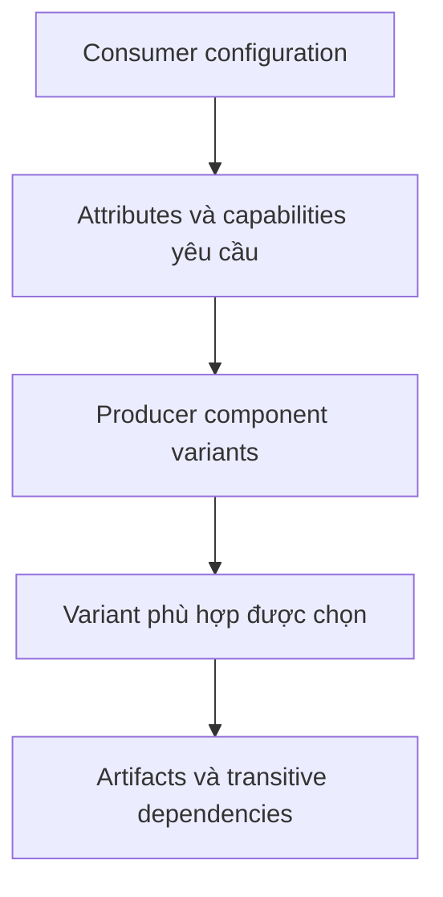

# So sánh mô hình phụ thuộc và cách mở rộng ở mức khái niệm

Khi lựa chọn công cụ build cho một dự án Java, hai câu hỏi quan trọng là: công cụ mô hình hóa dependency như thế nào và nhóm có thể mở rộng quy trình build đến đâu? Maven và Gradle đều có thể tải thư viện, biên dịch, chạy test, đóng gói và phát hành ứng dụng. Tuy nhiên, cách chúng biểu diễn dependency, lựa chọn phiên bản, tổ chức các bước build và cung cấp điểm mở rộng khác nhau.

Maven xây dựng quy trình quanh mô hình project, lifecycle, phase và plugin goal. Dependency được khai báo trong POM, sau đó Maven giải quyết graph theo scope và quy tắc mediation. Gradle xây dựng quy trình quanh project, plugin, configuration, variant và task graph. Dependency được khai báo trong configuration; Gradle resolve graph dựa trên version constraints, attributes và variant selection. Cả hai đều có hệ sinh thái plugin rộng, nhưng mức độ tùy biến, cách biểu đạt và chi phí bảo trì build logic khác nhau.

Không có công cụ nào luôn tốt hơn trong mọi dự án. Lựa chọn nên dựa trên mức độ phức tạp của dependency graph, nhu cầu multi-module, yêu cầu tích hợp công cụ, khả năng chuẩn hóa build, kinh nghiệm của nhóm và chi phí duy trì quy trình lâu dài.

## 1. Dependency model là gì?

Dependency model là cách build tool mô tả những thành phần mà một project cần để thực hiện một công việc. Trong Java, dependency có thể là thư viện biên dịch, thư viện runtime, test framework, annotation processor, plugin build hoặc một project khác trong cùng repository.

Một dependency model thường phải trả lời các câu hỏi:

- Module nào được yêu cầu? Ví dụ `group:artifact:version`.
- Dependency được dùng ở giai đoạn nào: compile, runtime, test hay build logic?
- Dependency có được truyền cho consumer khi project được dùng như thư viện không?
- Version được chọn theo quy tắc nào khi nhiều nhánh yêu cầu các version khác nhau?
- Dependency có biến thể theo JDK, nền tảng, capability hoặc thuộc tính khác không?
- Nguồn repository nào được phép cung cấp module?
- Làm thế nào khóa version, xác minh artifact và tái lập kết quả resolution?

Maven và Gradle đều mô hình hóa dependency graph thay vì chỉ tải một danh sách JAR. Tuy nhiên, abstraction và quy tắc resolution của chúng không giống nhau.

## 2. Khai báo dependency: POM và Gradle configuration

### 2.1. Maven: dependency được khai báo trong POM

Maven sử dụng file `pom.xml` làm mô tả project. Dependency được khai báo trong phần `<dependencies>` với group ID, artifact ID, version và scope.

Ví dụ:

```xml
<dependencies>
  <dependency>
    <groupId>org.apache.commons</groupId>
    <artifactId>commons-text</artifactId>
    <version>1.12.0</version>
  </dependency>

  <dependency>
    <groupId>org.junit.jupiter</groupId>
    <artifactId>junit-jupiter</artifactId>
    <version>5.11.0</version>
    <scope>test</scope>
  </dependency>
</dependencies>
```

Mô hình POM có cấu trúc XML rõ ràng và được chuẩn hóa. Người đọc có thể xác định dependency trực tiếp, scope và version ngay trong file. Các quy tắc dùng chung có thể được đưa vào parent POM hoặc BOM thông qua `dependencyManagement`.

### 2.2. Gradle: dependency được khai báo trong configuration

Gradle chia dependency theo configuration. Java Plugin tạo các configuration có vai trò cụ thể, chẳng hạn `implementation`, `api`, `compileOnly`, `runtimeOnly`, `testImplementation` và `testRuntimeOnly`.

Ví dụ Groovy DSL:

```groovy
dependencies {
    implementation 'org.apache.commons:commons-text:1.12.0'
    testImplementation 'org.junit.jupiter:junit-jupiter:5.11.0'
}
```

Ví dụ Kotlin DSL:

```kotlin
dependencies {
    implementation("org.apache.commons:commons-text:1.12.0")
    testImplementation("org.junit.jupiter:junit-jupiter:5.11.0")
}
```

Configuration xác định dependency được dùng cho mục đích nào và có thể mang attributes để tham gia variant selection. Build script Gradle là code cấu hình được thực thi trong quá trình configuration; Kotlin DSL cung cấp kiểm tra kiểu và hỗ trợ IDE tốt hơn ở nhiều tình huống, còn Groovy DSL có cú pháp linh hoạt và ngắn gọn.

### 2.3. So sánh ở mức khái niệm

| Khía cạnh | Maven | Gradle |
|---|---|---|
| Mô tả project | POM XML có schema và cấu trúc chuẩn. | Build script Groovy/Kotlin cùng model project/plugin. |
| Phân loại dependency | Scope như `compile`, `provided`, `runtime`, `test`. | Configuration như `api`, `implementation`, `compileOnly`, `runtimeOnly`, test configurations. |
| Mục đích configuration | Scope gắn với lifecycle và classpath theo quy tắc Maven. | Configuration là tập dependency có thể được resolve, kế thừa và mang attributes. |
| Mở rộng dependency model | Plugin, dependency management, BOM, profile và extension. | Plugin, configuration, attributes, capabilities, constraints, platforms và component metadata rules. |
| Biểu đạt logic build | POM khai báo project; plugin goals thực hiện công việc. | Build script cấu hình model và task graph; plugin đóng gói logic. |

Không nên coi Maven scope và Gradle configuration là hai bộ tên gọi tương đương một-một. Chúng có vai trò gần nhau nhưng quy tắc truyền dependency, variant selection và classpath có thể khác.

## 3. Scope của Maven và configuration của Gradle

### 3.1. Maven scopes

Maven định nghĩa các scope phổ biến sau:

| Scope | Compile classpath | Runtime classpath | Test classpath | Ý nghĩa chính |
|---|---|---|---|---|
| `compile` | Có | Có | Có | Mặc định; dependency cần cho phần lớn hoạt động của project và có thể truyền bắc cầu. |
| `provided` | Có | Thường không do runtime của project cung cấp | Có | Container/JDK hoặc môi trường triển khai dự kiến cung cấp dependency. |
| `runtime` | Không cần cho compile chính | Có | Có | Cần khi chạy, ví dụ driver hoặc implementation được nạp lúc runtime. |
| `test` | Không | Không | Có | Chỉ dùng cho test. |
| `system` | Có | Không theo cách dependency repository thông thường | Có | Tham chiếu JAR theo đường dẫn local; khó tái lập và thường nên tránh. |
| `import` | Không phải scope dependency thông thường | Không | Không | Dùng trong `dependencyManagement` để import BOM có `pom` packaging. |

Scope ảnh hưởng classpath và cách dependency được truyền qua graph. Ví dụ, một dependency `test` không trở thành dependency runtime của artifact được publish.

### 3.2. Gradle configurations

Với Java Library Plugin, các configuration thường gặp gồm:

| Configuration | Vai trò |
|---|---|
| `api` | Dependency thuộc public API mà consumer cần thấy trên compile classpath. |
| `implementation` | Dependency dùng nội bộ khi biên dịch/chạy module; không được xuất như API compile dependency của consumer. |
| `compileOnly` | Cần để compile nhưng không được đưa vào runtime theo configuration này. |
| `runtimeOnly` | Chỉ cần khi chạy. |
| `testImplementation` | Dependency compile cho mã test. |
| `testRuntimeOnly` | Dependency chỉ cần khi chạy test. |
| `annotationProcessor` | Annotation processor chạy trong quá trình compile. |

Điểm đáng chú ý là Gradle phân biệt dependency thuộc public API với dependency triển khai nội bộ. Ví dụ một library công khai method nhận kiểu `com.example.types.Money`, thì thư viện chứa `Money` có thể cần được khai báo qua `api` để consumer biên dịch được khi gọi API đó. Nếu chỉ dùng nội bộ trong implementation, `implementation` thường phù hợp.

### 3.3. Vì sao không nên chuyển đổi scope máy móc?

Không nên đổi mọi Maven `compile` thành Gradle `api`, hoặc mọi Maven `provided` thành `compileOnly`, mà không xem cách dependency được dùng và cách artifact được tiêu thụ.

Một số khác biệt:

- Maven `compile` dependency được truyền bắc cầu theo quy tắc Maven. Trong Gradle Java Library, `api` và `implementation` phân biệt rõ public API với implementation detail.
- Maven `provided` biểu đạt dependency mà môi trường triển khai cung cấp; Gradle `compileOnly` có thể gần với compile-time visibility nhưng runtime packaging/consumer semantics cần xem riêng.
- Gradle `runtimeOnly` và Maven `runtime` đều phục vụ dependency cần khi chạy, nhưng variant và graph selection vẫn có khác biệt.
- Test scope/configuration của mỗi công cụ gắn với lifecycle/task model riêng.

Khi chuyển build từ Maven sang Gradle, hãy phân tích classpath của consumer và artifact packaging thay vì đổi tên scope theo bảng tra cứu đơn giản.

## 4. Dependency graph và dependency bắc cầu

Dependency trực tiếp là module được khai báo bởi project. Dependency bắc cầu (transitive dependency) là module được kéo vào bởi một dependency khác.

Ví dụ:

```text
application
├── web-client:4.0
│   ├── http-core:2.3
│   └── json-api:1.8
└── metrics-agent:1.2
    └── json-api:1.5
```

Ứng dụng khai báo `web-client` và `metrics-agent`, nhưng graph còn có `http-core` và `json-api`. Build tool phải giải quyết xung đột khi hai nhánh yêu cầu `json-api` khác version.

### 4.1. Maven dependency mediation

Maven dùng dependency mediation để chọn một version khi graph có nhiều yêu cầu cho cùng artifact. Quy tắc chính thường được mô tả là nearest definition: dependency được tìm thấy ở độ sâu gần project hơn thường thắng; nếu ở cùng độ sâu, thứ tự khai báo có thể quyết định. `dependencyManagement` có thể quản lý version được áp dụng cho dependency trong phạm vi phù hợp.

Điều này khiến thứ tự và cấu trúc graph có ý nghĩa. Khi thêm một dependency trực tiếp, version được chọn cho một dependency bắc cầu có thể thay đổi do nó trở thành định nghĩa gần hơn.

### 4.2. Gradle conflict resolution

Gradle mặc định giải quyết xung đột version bằng cách chọn version phù hợp theo quy tắc conflict resolution, thường là version cao hơn trong nhóm version có thể so sánh. Tuy nhiên, kết quả còn có thể chịu ảnh hưởng bởi rich version constraints, platforms, strict constraints, resolution rules và variant attributes.

Gradle không chỉ chọn version cao nhất trong mọi tình huống. Một constraint nghiêm ngặt, platform hoặc rule có thể giới hạn lựa chọn; dynamic version và component metadata cũng tác động đến resolution.

### 4.3. Cách xem graph

Maven:

```bash
mvn dependency:tree
mvn dependency:tree -Dincludes=org.example:json-api
```

Gradle:

```bash
./gradlew dependencies --configuration runtimeClasspath
./gradlew dependencyInsight --dependency json-api --configuration runtimeClasspath
```

Các lệnh này giúp trả lời dependency nào kéo module vào, version nào được chọn và lý do resolution. Khi điều tra lỗi runtime, cần xem runtime graph chứ không chỉ compile graph.

## 5. Quản lý version tập trung: Parent POM, BOM và Version Catalog

Khi có nhiều module, khai báo version lặp lại làm tăng nguy cơ lệch version. Maven và Gradle đều có cơ chế quản lý tập trung, nhưng cách dùng khác nhau.

### 5.1. Maven `dependencyManagement`

Parent POM có thể định nghĩa version chung:

```xml
<dependencyManagement>
  <dependencies>
    <dependency>
      <groupId>org.junit.jupiter</groupId>
      <artifactId>junit-jupiter</artifactId>
      <version>5.11.0</version>
    </dependency>
  </dependencies>
</dependencyManagement>
```

Module con khai báo dependency mà không cần lặp version:

```xml
<dependencies>
  <dependency>
    <groupId>org.junit.jupiter</groupId>
    <artifactId>junit-jupiter</artifactId>
    <scope>test</scope>
  </dependency>
</dependencies>
```

`dependencyManagement` không tự thêm dependency vào module. Nó cung cấp metadata quản lý version/scope/exclusions cho dependency được khai báo hoặc được quản lý theo quy tắc Maven.

### 5.2. Maven BOM

BOM (Bill of Materials) là POM packaging dùng để quản lý tập version liên quan. Project có thể import BOM trong `dependencyManagement`:

```xml
<dependencyManagement>
  <dependencies>
    <dependency>
      <groupId>org.springframework.boot</groupId>
      <artifactId>spring-boot-dependencies</artifactId>
      <version>3.3.5</version>
      <type>pom</type>
      <scope>import</scope>
    </dependency>
  </dependencies>
</dependencyManagement>
```

BOM giúp các module thuộc cùng hệ sinh thái dùng bộ version đã được kiểm thử cùng nhau. Nó không tự khai báo tất cả dependency cho project.

### 5.3. Gradle Version Catalog

Gradle Version Catalog tập trung alias và version trong `gradle/libs.versions.toml`:

```toml
[versions]
junit = "5.11.0"
commons-text = "1.12.0"

[libraries]
junit = { module = "org.junit.jupiter:junit-jupiter", version.ref = "junit" }
commons-text = { module = "org.apache.commons:commons-text", version.ref = "commons-text" }
```

Build script dùng alias:

```kotlin
dependencies {
    testImplementation(libs.junit)
    implementation(libs.commons.text)
}
```

Version Catalog giúp chuẩn hóa cách tham chiếu dependency và tránh lặp tọa độ/version. Nó không tự đảm bảo version được chọn cuối cùng; constraints, platforms và dependency graph vẫn có thể ảnh hưởng resolution.

### 5.4. Gradle platforms và constraints

Gradle có thể dùng Maven BOM thông qua platform:

```kotlin
dependencies {
    implementation(platform("org.springframework.boot:spring-boot-dependencies:3.3.5"))
    implementation("org.springframework:spring-core")
}
```

Platform truyền các dependency constraints vào graph. `enforcedPlatform` áp dụng ràng buộc mạnh hơn và cần thận trọng vì có thể ép version cho consumer. Version Catalog là nơi đặt alias/version dễ dùng; platform/BOM là cơ chế quản lý version trong dependency graph. Hai cơ chế có thể phối hợp nhưng không thay thế nhau.

## 6. Variant selection: một khác biệt quan trọng trong Gradle

Dependency không phải lúc nào cũng chỉ có một JAR duy nhất. Một component có thể cung cấp nhiều variant: API/runtime, debug/release, JVM version, operating system, architecture hoặc capability khác nhau.

Gradle sử dụng attributes để chọn variant phù hợp với consumer. Ví dụ consumer cần runtime library cho JVM, còn producer cung cấp variant API và runtime với attributes tương ứng.

Ở mức khái niệm:



Maven dependency model truyền thống chủ yếu dựa vào coordinates, scopes, classifiers và metadata POM. Maven có thể dùng classifier, profile và plugin để phân biệt artifact, nhưng không có variant-aware dependency model tương đương Gradle attributes ở mức cốt lõi theo cùng cách.

Điều này khiến Gradle hữu ích trong build có nhiều biến thể hoặc component cần công bố nhiều API/runtime/platform variants. Đổi lại, variant selection thêm khái niệm cần hiểu và có thể làm lỗi resolution khó đọc hơn nếu attributes/capabilities không được thiết kế rõ.

## 7. Dependency exclusions, optional và capability

### 7.1. Exclusion trong Maven

Maven cho phép loại dependency bắc cầu theo từng dependency declaration:

```xml
<dependency>
  <groupId>org.example</groupId>
  <artifactId>legacy-client</artifactId>
  <version>2.0</version>
  <exclusions>
    <exclusion>
      <groupId>org.example</groupId>
      <artifactId>old-logging</artifactId>
    </exclusion>
  </exclusions>
</dependency>
```

Exclusion cần được đặt ở nhánh dependency thích hợp. Nó không nhất thiết loại module đó khỏi mọi nhánh khác trong graph.

### 7.2. Exclusion trong Gradle

Gradle cũng hỗ trợ exclusion:

```groovy
dependencies {
    implementation('org.example:legacy-client:2.0') {
        exclude group: 'org.example', module: 'old-logging'
    }
}
```

Ngoài ra, Gradle có component metadata rules, dependency substitution và capabilities để biểu đạt những tình huống phức tạp hơn. Các cơ chế này nên được dùng khi có yêu cầu rõ ràng, vì rule quá rộng có thể làm graph khó dự đoán.

### 7.3. Maven optional dependencies

Dependency có `<optional>true</optional>` không được truyền bắc cầu cho consumer theo cách dependency thông thường. Consumer muốn dùng nó phải khai báo trực tiếp. Optional không có nghĩa dependency không được tải trong project khai báo ban đầu; nó chủ yếu điều khiển propagation.

### 7.4. Gradle capabilities

Capabilities mô tả khả năng mà một component cung cấp. Chúng có thể giúp Gradle nhận diện hai module là các implementation thay thế cùng cung cấp một capability, từ đó xử lý xung đột theo policy. Đây là một công cụ mô hình hóa component, không chỉ là cơ chế loại JAR trùng tên.

## 8. Dependency resolution và repository source

Maven và Gradle đều cần repository để tải dependency. Cả hai hỗ trợ nhiều repository, mirror/proxy và chính sách kiểm soát nguồn, nhưng cấu hình nằm ở những scope khác nhau.

Maven thường quản lý repository trong POM và mirror/profile trong `settings.xml`. Tổ chức có thể cấu hình một repository manager nội bộ làm mirror cho các nguồn public và private.

Gradle tách repository cho project dependencies, plugin management và buildscript classpath. `dependencyResolutionManagement` trong settings có thể tập trung repository cho subprojects; `pluginManagement.repositories` kiểm soát nguồn plugin DSL.

Không nên coi repository declaration là một phần thay thế cho dependency version management. Một dependency được pin đúng version vẫn có thể đến từ nguồn không đáng tin nếu repository policy không chặt. Ngược lại, repository được kiểm soát không tự bảo đảm version graph tương thích.

Với cả hai công cụ, nên cân nhắc:

- Repository manager/mirror được tổ chức phê duyệt.
- Namespace nội bộ chỉ được cung cấp từ private repository.
- Version release bất biến; không ghi đè cùng version.
- Locking hoặc dependency management để giữ version ổn định.
- Checksum/signature verification để kiểm tra nội dung artifact.
- Audit log để biết artifact được resolve từ nguồn nào.

## 9. Mô hình mở rộng của Maven

Maven ưu tiên convention và lifecycle chuẩn. Plugin cung cấp goal được gắn vào phase của lifecycle hoặc được gọi trực tiếp.

### 9.1. Lifecycle và phase

Với packaging `jar`, lifecycle mặc định có các phase như `validate`, `compile`, `test`, `package`, `verify`, `install` và `deploy`. Plugin goal được bind vào phase để thực hiện công việc.

Ví dụ, Maven Compiler Plugin gắn compile goal vào phase `compile`; Surefire Plugin chạy unit test ở phase `test`; JAR Plugin đóng gói ở phase `package`.

Khi chạy:

```bash
mvn verify
```

Maven thực thi các phase trước `verify` theo thứ tự lifecycle, gồm các goal đã được bind vào những phase đó. Người dùng thường không cần tự nối từng bước compile/test/package.

### 9.2. Plugin goals

Plugin là đơn vị mở rộng chính của Maven. Một plugin có thể cung cấp nhiều goal, mỗi goal có parameters và có thể được bind vào lifecycle phase.

Ví dụ gọi goal trực tiếp:

```bash
mvn dependency:tree
```

Ví dụ cấu hình plugin trong POM:

```xml
<build>
  <plugins>
    <plugin>
      <groupId>org.apache.maven.plugins</groupId>
      <artifactId>maven-compiler-plugin</artifactId>
      <version>3.13.0</version>
      <configuration>
        <release>17</release>
      </configuration>
    </plugin>
  </plugins>
</build>
```

Plugin encapsulate logic, còn POM cấu hình parameters. Đây là cách mở rộng có quy ước và dễ chuẩn hóa trong nhiều module.

### 9.3. Extension points khác của Maven

Maven còn có:

- Build extensions khai báo qua `<extensions>` hoặc `.mvn/extensions.xml` để thay đổi/cung cấp thành phần cho build.
- Core extensions can thiệp sâu hơn vào Maven runtime/model.
- Maven profiles để bật cấu hình theo môi trường/property/JDK/OS.
- Parent POM để chia sẻ plugin management, dependency management, properties và build configuration.
- Archetypes để tạo project từ template.
- Custom Maven Plugin để triển khai goal riêng bằng Java.

Maven phù hợp khi nhóm muốn lifecycle rõ ràng, convention chuẩn và mở rộng chủ yếu thông qua plugin có goal/parameter xác định. Khi logic build đặc thù tăng lên, có thể viết plugin riêng nhưng cần tuân theo Maven Plugin API và lifecycle model.

## 10. Mô hình mở rộng của Gradle

Gradle có plugin làm điểm mở rộng trung tâm, nhưng plugin thường cấu hình project model và đăng ký task vào task graph. Build script có thể kết hợp DSL, providers, extensions và task dependencies để mô tả quy trình.

### 10.1. Plugin và task graph

Gradle plugin có thể:

- Tạo extension để người dùng cấu hình.
- Tạo configurations và dependency constraints.
- Đăng ký task.
- Kết nối task bằng dependency.
- Cấu hình task theo plugin hoặc thuộc tính project.
- Thêm variant/artifact và component metadata.

Ví dụ đơn giản:

```kotlin
tasks.register("generateVersionInfo") {
    val output = layout.buildDirectory.file("generated/version.txt")
    outputs.file(output)

    doLast {
        val file = output.get().asFile
        file.parentFile.mkdirs()
        file.writeText(project.version.toString())
    }
}
```

Task là đơn vị công việc trong Gradle. Task graph được tạo từ task được yêu cầu và các dependency giữa task. Gradle chỉ thực thi những task cần thiết cho graph đó, dựa trên dependencies và trạng thái up-to-date/cache.

### 10.2. Extension và DSL

Plugin có thể tạo extension để build script cấu hình theo ngôn ngữ domain-specific:

```kotlin
abstract class ApiDocsExtension {
    abstract val title: Property<String>
    abstract val outputDirectory: DirectoryProperty
}
```

Người dùng plugin có thể cấu hình extension trong build script. Cách này tạo một API build có tên gọi theo domain, thay vì yêu cầu người dùng sửa trực tiếp task implementation.

### 10.3. Convention plugin và included build

Convention plugin đóng gói quy ước của tổ chức, chẳng hạn Java toolchain, test framework, compiler options, coverage và publishing. Có thể đặt plugin trong `build-logic` included build hoặc `buildSrc`.

Điểm mạnh của cách tiếp cận này là build logic có thể được kiểm thử, version hóa và tái sử dụng. Module chỉ cần áp dụng plugin phù hợp với vai trò của nó.

### 10.4. Custom task types và lazy configuration

Gradle cho phép định nghĩa task type riêng với properties có annotation input/output. Provider API và configuration avoidance giúp trì hoãn việc lấy giá trị và cấu hình task cho đến khi cần.

Điều này hữu ích khi xây dựng pipeline lớn hoặc task có input/output phức tạp. Tuy nhiên, custom task phải khai báo input/output chính xác để up-to-date checking, incremental execution và build cache hoạt động đúng.

## 11. So sánh cách mở rộng

| Khía cạnh | Maven | Gradle |
|---|---|---|
| Đơn vị mở rộng chính | Plugin và goal. | Plugin, extension và task. |
| Mô hình quy trình | Lifecycle/phase với goal được bind. | Task graph được tạo từ task dependencies. |
| Cấu hình plugin | XML parameters trong POM/settings. | Groovy/Kotlin DSL, extension objects và providers. |
| Custom build logic | Custom Maven Plugin, build/core extension, profile. | Custom plugin, task type, convention plugin, build logic included build. |
| Tổ chức quy ước | Parent POM, plugin management, archetype. | Convention plugin, version catalog, settings plugin và build logic. |
| Tính linh hoạt | Cao trong khuôn khổ lifecycle/plugin model. | Rất linh hoạt nhờ task graph và DSL có thể lập trình. |
| Rủi ro bảo trì | POM/profile/plugin configuration có thể phức tạp. | Build script có thể trở thành code tùy biến khó quản lý nếu không đóng gói plugin. |

Gradle linh hoạt hơn trong cách mô hình hóa task graph và viết build logic. Điều đó không tự động khiến mọi Gradle build dễ bảo trì hơn. Một build script chứa nhiều logic tùy tiện, truy cập trạng thái project không kiểm soát hoặc cấu hình chéo project có thể khó hiểu hơn một Maven POM dùng plugin chuẩn.

Maven có mô hình convention rõ và lifecycle quen thuộc. Đổi lại, khi cần một workflow không khớp lifecycle hoặc logic build có quan hệ dữ liệu phức tạp, nhóm có thể phải viết plugin hoặc cấu hình nhiều goal/profile hơn.

## 12. Multi-module và chia sẻ quy ước

### 12.1. Maven reactor và parent POM

Maven dùng `<modules>` để đưa các module vào reactor build:

```xml
<modules>
  <module>app</module>
  <module>core</module>
  <module>adapter</module>
</modules>
```

Parent POM có thể chia sẻ version, plugin configuration và properties. Một POM có thể vừa là aggregator vừa là parent, nhưng hai vai trò khác nhau: aggregator xác định module được build cùng nhau; parent biểu đạt quan hệ kế thừa cấu hình.

### 12.2. Gradle multi-project build và convention plugin

Gradle dùng settings để khai báo project:

```kotlin
rootProject.name = "shop-platform"
include("app", "core", "adapter")
```

Module phụ thuộc module khác bằng project dependency:

```kotlin
dependencies {
    implementation(project(":core"))
}
```

Convention plugin có thể chia sẻ compiler/test/publishing rules. Root project có thể định nghĩa aggregate task để điều phối kiểm tra các module. Việc `include` project không tự làm module con kế thừa toàn bộ build script của root.

### 12.3. So sánh

| Nhu cầu | Maven | Gradle |
|---|---|---|
| Khai báo module | `<modules>` | `include` trong settings. |
| Chia sẻ dependency version | Parent `dependencyManagement`, BOM. | Version Catalog, platform/BOM, constraints. |
| Chia sẻ plugin configuration | Parent `pluginManagement`/plugin configuration. | Convention plugin hoặc settings/build logic. |
| Module dependency | Dependency tọa độ của module khác trong reactor. | `project(":module")` component dependency. |
| Điều phối build | Reactor và lifecycle. | Task graph và aggregate tasks. |

## 13. Tính tái lập và kiểm soát dependency

Một build đáng tin cần tạo kết quả nhất quán khi chạy lại trong cùng điều kiện. Dependency model và extension model đều ảnh hưởng khả năng này.

### 13.1. Version pinning và locking

Maven có thể quản lý version bằng parent POM, BOM, dependency management và Enforcer rules. Gradle có version catalog, platforms, constraints và dependency locking.

Các cơ chế này giúp kiểm soát version được chọn, nhưng không phải cơ chế giống nhau hoàn toàn. Maven mediation và Gradle conflict resolution có quy tắc khác nhau; khi chuyển công cụ cần kiểm tra dependency tree thực tế.

### 13.2. Dependency verification

Gradle hỗ trợ verification metadata để xác minh checksum/chữ ký artifact. Maven có thể dựa vào checksum/signature policy của repository, repository manager và plugin/tooling bổ sung.

Version lock không chứng minh artifact có nguồn gốc đáng tin. Cần phân biệt:

- Version selection: dependency version nào được chọn.
- Repository origin: artifact được lấy từ đâu.
- Integrity/authenticity: nội dung artifact có đúng và có publisher đáng tin không.

### 13.3. Build cache và dependency cache

Gradle có task up-to-date checking và build cache dựa trên input/output của task. Maven có local repository để cache dependency/plugin đã tải; output caching tổng quát thường cần plugin hoặc hệ thống bên ngoài.

Điều này có thể ảnh hưởng quyết định khi CI cần chia sẻ output giữa runner. Tuy nhiên, không nên so sánh bằng cách cache tùy tiện `target/` của Maven với Gradle Build Cache, vì mức hiểu biết input/output và cơ chế invalidation khác nhau.

## 14. Hiệu năng và khả năng mở rộng quy mô

Maven và Gradle đều hỗ trợ multi-module build, parallel execution và cache ở các mức khác nhau. Hiệu năng thực tế phụ thuộc cấu trúc graph, plugin, task, test, I/O, dependency resolution và cách build được sử dụng.

Gradle có task avoidance, incremental execution, build cache và configuration cache. Những cơ chế này hữu ích khi build được mô hình hóa tốt và task khai báo input/output đầy đủ. Gradle build logic quá động hoặc custom task không khai báo input/output đúng có thể làm mất lợi ích.

Maven có lifecycle đơn giản, plugin được bind theo phase và local repository giúp tái sử dụng dependency. Parallel reactor build có thể tăng tốc multi-module project khi quan hệ module được khai báo đúng. Với workflow đặc thù, nhóm có thể cần plugin bổ sung hoặc custom plugin.

Không nên chọn Gradle chỉ vì một benchmark đơn lẻ nhanh hơn, hoặc chọn Maven chỉ vì POM ngắn hơn. Cần benchmark các scenario đại diện: first build, clean build, warm no-change, incremental build, test và CI cache restore.

## 15. Khả năng mở rộng và chi phí bảo trì

Mở rộng build không chỉ là khả năng viết thêm code. Một build tốt phải giúp người khác hiểu được quy ước, thay đổi có kiểm soát và nâng cấp plugin mà không phá toàn bộ repository.

### 15.1. Maven: ưu tiên convention và plugin có cấu trúc

Maven thường dễ dự đoán khi project tuân theo lifecycle chuẩn và dùng plugin phổ biến. Parent POM giúp chuẩn hóa cấu hình giữa nhiều module. Plugin goal có parameters rõ, nên người dùng thường cấu hình hơn là viết logic tùy tiện trong POM.

Khi cần behavior riêng, nhóm có thể viết custom Maven Plugin bằng Java. Plugin có thể cung cấp goal, parameters, lifecycle binding và metadata. Cách này tạo abstraction tái sử dụng nhưng cần hiểu Maven Plugin API, goal execution và plugin classloader/dependency.

### 15.2. Gradle: ưu tiên plugin hóa build logic

Gradle cho phép bắt đầu với DSL ngắn, sau đó tách logic lặp lại vào convention plugin và task type. Đây là cách giữ build script module nhỏ trong khi vẫn hỗ trợ quy trình phức tạp.

Rủi ro xuất hiện khi build logic nằm rải rác trong `doLast`, `allprojects`, `subprojects`, script plugin không quản lý hoặc truy cập trạng thái project quá nhiều. Khi đó, build trở thành một ứng dụng code khó kiểm thử và khó dùng configuration cache.

### 15.3. Nguyên tắc chung cho cả hai

- Dùng plugin chính thức hoặc phổ biến trước khi tự viết logic.
- Tập trung version và policy ở một nơi.
- Tạo abstraction khi có quy ước lặp lại thực sự, không tạo plugin cho mọi dòng cấu hình nhỏ.
- Ghi rõ trách nhiệm của custom goal/task.
- Tránh phụ thuộc vào trạng thái máy developer.
- Kiểm soát plugin version và nguồn plugin.
- Tách build logic khỏi code ứng dụng.
- Kiểm tra behavior khi nâng JDK, build tool hoặc plugin.
- Giữ pipeline có thể đọc, debug và tái lập.

## 16. Khi nào Maven thường là lựa chọn phù hợp?

Maven thường phù hợp khi:

- Dự án Java chủ yếu theo lifecycle chuẩn compile/test/package/deploy.
- Nhóm muốn POM XML có cấu trúc rõ và quy ước thống nhất.
- Hệ sinh thái hiện tại đã có parent POM, BOM và plugin Maven ổn định.
- Các module có dependency model tương đối đơn giản.
- Tổ chức đã có repository manager, mirror và pipeline Maven được chuẩn hóa.
- Thành viên nhóm quen Maven và chi phí chuyển đổi không đem lại lợi ích rõ ràng.
- Custom build logic chỉ chiếm phần nhỏ và có thể xử lý bằng plugin có sẵn.

Maven không chỉ dành cho dự án đơn giản. Các hệ thống enterprise nhiều module có thể được quản lý tốt bằng reactor, parent POM, BOM, plugin management và custom plugin có kỷ luật.

## 17. Khi nào Gradle thường là lựa chọn phù hợp?

Gradle thường phù hợp khi:

- Build cần task graph tùy chỉnh hoặc workflow không khớp hoàn toàn lifecycle chuẩn.
- Dự án có nhiều loại component/variant theo JDK, platform hoặc capability.
- Nhóm cần convention plugin để chuẩn hóa nhiều loại module.
- Build có yêu cầu incremental execution, build cache hoặc configuration cache.
- Có nhiều build logic nội bộ cần tổ chức thành plugin/testable code.
- Multi-project hoặc composite build cần điều phối component linh hoạt.
- Nhóm sẵn sàng đầu tư vào việc thiết kế và duy trì build logic bằng Kotlin/Groovy DSL.

Gradle không tự động tốt hơn cho mọi dự án. Nếu build chỉ cần lifecycle chuẩn, nhiều logic tùy biến trong script có thể tạo chi phí bảo trì cao hơn lợi ích.

## 18. Những hiểu nhầm thường gặp

### 18.1. “Gradle không có quy ước, mọi thứ đều tùy biến”

Gradle có plugin và lifecycle/task conventions do plugin cung cấp. Java Plugin và Java Library Plugin tạo các task/configuration tiêu chuẩn. Gradle linh hoạt, nhưng một build tốt vẫn nên dùng convention plugin và API chuẩn.

### 18.2. “Maven không thể mở rộng”

Maven có hệ thống plugin, custom goal, build extension, core extension, profiles và parent POM. Nó có thể được mở rộng đáng kể, nhưng cách mở rộng gắn với lifecycle và plugin model.

### 18.3. “Gradle configuration tương đương Maven scope”

Một số configuration có mục đích gần scope, nhưng Gradle còn có API/implementation separation, attributes, capabilities và variant-aware resolution. Không thể chuyển đổi tên máy móc.

### 18.4. “BOM hoặc Version Catalog tự thêm dependency”

Maven BOM quản lý version trong `dependencyManagement`; Gradle Version Catalog cung cấp alias/version để tham chiếu. Chúng không tự động thêm tất cả dependency vào project. Gradle platform truyền constraints vào graph, cũng không tương đương việc khai báo mọi dependency trực tiếp.

### 18.5. “Version cao nhất luôn là version được chọn”

Gradle default conflict resolution thường chọn version cao hơn, nhưng constraints, platform, strict version và rules có thể thay đổi kết quả. Maven thường dùng nearest definition và dependency management. Cần đọc graph thực tế.

### 18.6. “Build script linh hoạt hơn nghĩa là build dễ bảo trì hơn”

Tính linh hoạt làm tăng khả năng biểu đạt nhưng cũng tăng số cách một nhóm có thể triển khai cùng một việc. Quy ước, convention plugin, review và tài liệu vẫn cần thiết.

## 19. Quy trình đánh giá công cụ cho một dự án cụ thể

Có thể đánh giá theo các bước:

1. **Lập inventory dependency:** liệt kê thư viện trực tiếp/bắc cầu, plugin, annotation processor, test tool và dependency nội bộ.
2. **Phân loại usage:** xác định compile, runtime, test, provided, build logic và public API.
3. **Xem graph và version policy:** kiểm tra conflict, BOM/platform, constraints, lockfile và exclusions.
4. **Đánh giá variant needs:** xác định có cần artifact khác nhau theo JDK, OS, architecture hoặc capability không.
5. **Liệt kê workflow build:** compile, test, integration test, code generation, packaging, publishing, deployment.
6. **Đánh giá extension needs:** xem plugin hiện có đáp ứng không, cần custom goal/task hay convention plugin không.
7. **Đánh giá multi-module:** xác định cách chia module, chia sẻ quy ước và điều phối build.
8. **Đánh giá security/reproducibility:** repository policy, dependency locking, verification, plugin source và cache trust.
9. **Benchmark đại diện:** đo first build, clean, warm no-change, incremental và CI scenario với điều kiện tương đương.
10. **Đánh giá năng lực nhóm:** tính đến kinh nghiệm, tài liệu, ecosystem, ownership và chi phí vận hành.

Không nên quyết định chỉ bằng cú pháp build file. Một POM ngắn có thể phụ thuộc nhiều parent/plugin ẩn; một Gradle script ngắn có thể gọi convention plugin chứa phần lớn logic. Cần xem toàn bộ build model và đường đi của dependency/task.

## 20. Bảng quyết định khái quát

| Tiêu chí | Maven có lợi thế khi... | Gradle có lợi thế khi... |
|---|---|---|
| Quy trình chuẩn | Lifecycle Maven đã đáp ứng nhu cầu. | Plugin Gradle tiêu chuẩn đáp ứng và nhóm muốn task avoidance/cache. |
| Dependency model | Scope và BOM đủ mô tả graph. | Cần API/implementation separation, attributes, capabilities hoặc variants. |
| Version management | Parent POM/BOM đã được tổ chức chuẩn hóa. | Version Catalog, platforms và constraints phù hợp build logic. |
| Multi-module | Reactor và parent POM đã đáp ứng cấu trúc. | Cần project/composite build và convention plugin linh hoạt. |
| Custom workflow | Có plugin Maven phù hợp hoặc custom goal nhỏ. | Cần task graph và custom task/plugin phức tạp. |
| Tốc độ build | Local repository, parallel reactor và plugin phù hợp là đủ. | Task avoidance, incremental execution, build/configuration cache đem lại lợi ích đo được. |
| Khả năng tiếp cận | Nhóm quen POM/lifecycle và muốn ít DSL code. | Nhóm có năng lực duy trì Kotlin/Groovy build logic. |
| Bảo trì lâu dài | Parent/plugin governance đã vững. | Convention plugin/build logic được kiểm thử và quản lý tốt. |

Đây là hướng dẫn định hướng, không phải bảng xếp hạng tuyệt đối. Một tổ chức có thể dùng cả hai công cụ ở các hệ thống khác nhau nếu có lý do vận hành và chính sách dependency thống nhất.

## 21. Kết luận lựa chọn

Maven và Gradle đều giải quyết dependency management và build automation cho Java, nhưng khác nhau ở abstraction trung tâm. Maven đặt POM, scope, lifecycle và plugin goal làm nền tảng. Gradle đặt project model, configuration, variant, plugin và task graph làm nền tảng. Maven thường đem lại quy trình dễ dự đoán khi project phù hợp lifecycle chuẩn; Gradle thường đem lại khả năng biểu đạt linh hoạt hơn khi dependency variants hoặc workflow build phức tạp.

Khi chọn công cụ, hãy bắt đầu từ dependency graph và công việc thực tế của build. Nếu scope, BOM, parent POM và plugin Maven đã đáp ứng, việc chuyển công cụ có thể không mang lại lợi ích đủ lớn. Nếu cần variant-aware dependency resolution, task graph tùy biến, convention plugin và cache theo input/output, Gradle có thể phù hợp hơn. Dù chọn công cụ nào, chất lượng cuối cùng phụ thuộc vào cách nhóm quản lý version, repository, plugin, build logic, bảo mật và tính tái lập. Một build dễ hiểu, có quy ước và được kiểm soát tốt quan trọng hơn việc sử dụng nhiều tính năng mở rộng nhất có thể.
