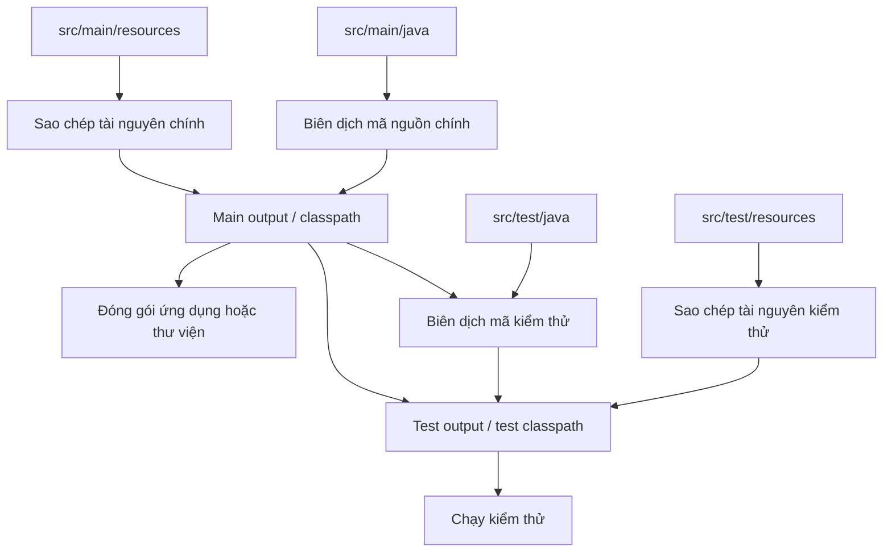
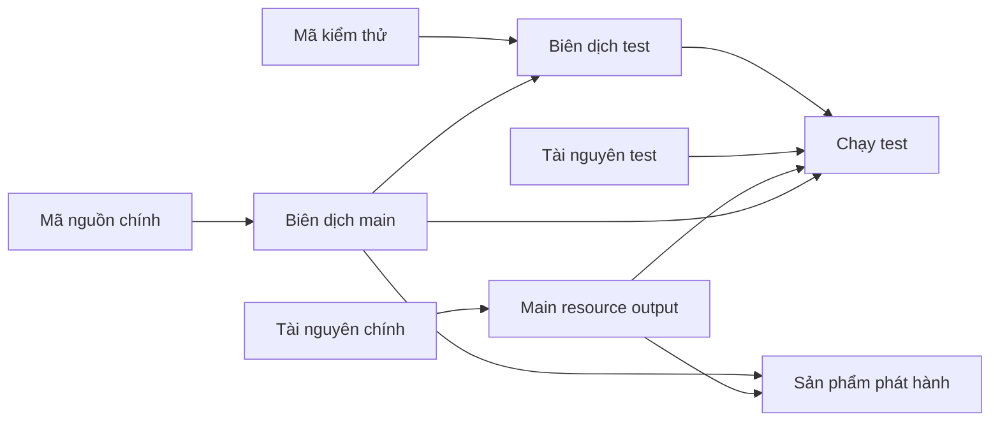

# Phân tách mã nguồn chính, mã kiểm thử và tài nguyên

Một dự án Java thường chứa nhiều loại tệp: mã nguồn tạo nên chức năng của ứng dụng, mã dùng để kiểm thử chức năng đó, cấu hình, dữ liệu mẫu và các tài nguyên cần đọc khi chương trình chạy. Nếu đặt tất cả trong cùng một thư mục, dự án sẽ nhanh chóng khó hiểu: phần nào được đóng gói để phát hành, phần nào chỉ phục vụ kiểm thử, và tệp nào cần xuất hiện trên classpath?

Cách tổ chức phổ biến là tách dự án thành ba nhóm: **mã nguồn chính (main source)**, **mã kiểm thử (test source)** và **tài nguyên (resources)**. Trong Java, quy ước này được Maven và Gradle hỗ trợ trực tiếp. Việc phân tách giúp build tool biết cần biên dịch gì, sao chép tệp nào, chạy test với classpath nào và đưa những thành phần nào vào sản phẩm cuối cùng.

## 1. Ba nhóm thành phần trong dự án Java

### 1.1. Mã nguồn chính

Mã nguồn chính chứa những lớp và thành phần tạo nên chức năng mà ứng dụng hoặc thư viện cung cấp. Ví dụ:

- Lớp xử lý nghiệp vụ.
- Các lớp mô hình dữ liệu.
- Thành phần truy cập dữ liệu.
- API công khai của thư viện.
- Lớp khởi động ứng dụng.

Những lớp này cần được biên dịch và thường được đưa vào sản phẩm phát hành như JAR hoặc WAR.

Trong cấu trúc dự án Java phổ biến, mã nguồn chính nằm trong:

```text
src/main/java/
```

Ví dụ, lớp `GreetingService` có package `com.example.app` được đặt tại:

```text
src/main/java/com/example/app/GreetingService.java
```

Đường dẫn thư mục phản ánh package của lớp. Khi biên dịch, compiler tạo tệp `GreetingService.class` trong thư mục đầu ra với cấu trúc package tương ứng.

### 1.2. Mã kiểm thử

Mã kiểm thử chứa các lớp dùng để kiểm tra hành vi của mã nguồn chính. Những lớp này có thể kiểm tra:

- Một phương thức trả về kết quả mong đợi hay không.
- Trường hợp đầu vào không hợp lệ được xử lý thế nào.
- Một thành phần có tương tác đúng với thành phần khác không.
- Lỗi có được phát hiện và báo cáo đúng không.

Mã kiểm thử thường không phải một phần của ứng dụng được phát hành. Nó được biên dịch riêng, chạy trong quá trình kiểm thử và có thể sử dụng các thư viện test như JUnit.

Theo quy ước phổ biến, mã kiểm thử nằm trong:

```text
src/test/java/
```

Ví dụ, lớp kiểm thử cho `GreetingService` có thể nằm tại:

```text
src/test/java/com/example/app/GreetingServiceTest.java
```

Việc đặt test trong source root riêng giúp build tool phân biệt lớp ứng dụng với lớp kiểm thử. Khi tạo JAR thông thường, các lớp trong `src/test/java` không được đưa vào JAR của mã nguồn chính.

### 1.3. Tài nguyên

Tài nguyên là các tệp không phải mã nguồn Java nhưng ứng dụng hoặc bài kiểm thử cần đọc. Ví dụ:

- Tệp cấu hình `.properties`, `.json`, `.xml`.
- Mẫu email hoặc mẫu HTML.
- Hình ảnh, biểu tượng và tệp âm thanh.
- Dữ liệu mẫu dùng khi kiểm thử.
- Tệp văn bản hoặc dữ liệu nhị phân.

Tài nguyên cũng được chia thành hai nhóm theo mục đích sử dụng:

- **Tài nguyên chính** nằm trong `src/main/resources/`, được sao chép vào đầu ra của mã nguồn chính và thường được đóng gói cùng ứng dụng hoặc thư viện.
- **Tài nguyên kiểm thử** nằm trong `src/test/resources/`, chỉ phục vụ quá trình kiểm thử và được đưa vào classpath khi chạy test.

Ví dụ, cấu hình mặc định của ứng dụng có thể nằm tại `src/main/resources/application.properties`, còn dữ liệu mẫu dành riêng cho test nằm tại `src/test/resources/fixtures/users.json`.

Tài nguyên không được biên dịch thành `.class` như mã nguồn Java. Build tool sao chép chúng vào thư mục đầu ra và giữ cấu trúc đường dẫn tương ứng để Java có thể tìm thấy trên classpath.

## 2. Cấu trúc thư mục chuẩn

Một dự án Java đơn giản có thể được tổ chức như sau:

```text
my-app/
├── src/
│   ├── main/
│   │   ├── java/
│   │   │   └── com/
│   │   │       └── example/
│   │   │           └── app/
│   │   │               └── GreetingService.java
│   │   └── resources/
│   │       └── com/
│   │           └── example/
│   │               └── app/
│   │                   └── messages.properties
│   └── test/
│       ├── java/
│       │   └── com/
│       │       └── example/
│       │           └── app/
│       │               └── GreetingServiceTest.java
│       └── resources/
│           └── fixtures/
│               └── names.txt
├── pom.xml hoặc build.gradle
└── ...
```

Có thể đọc cấu trúc này theo mục đích:

| Thư mục | Nội dung | Được dùng khi nào? |
|---|---|---|
| `src/main/java` | Mã nguồn chính | Biên dịch ứng dụng hoặc thư viện |
| `src/main/resources` | Tài nguyên chính | Đóng gói và chạy ứng dụng |
| `src/test/java` | Mã kiểm thử | Biên dịch và chạy test |
| `src/test/resources` | Tài nguyên kiểm thử | Chạy test |
| `pom.xml` hoặc `build.gradle` | Cấu hình build | Khai báo dependency, plugin, task và quy tắc build |

Tên thư mục `main` và `test` là một quy ước có ý nghĩa: chúng tạo ra hai source set có mục đích và classpath khác nhau. Dự án có thể khai báo thêm source set hoặc thay đổi vị trí thư mục, nhưng nên giữ quy ước mặc định nếu không có lý do cụ thể.

## 3. Ví dụ: tổ chức một chức năng và bài kiểm thử

Hãy tạo một dịch vụ đơn giản trả về lời chào. Mã chính đọc mẫu lời chào từ tài nguyên; bài kiểm thử kiểm tra kết quả của dịch vụ.

### 3.1. Mã nguồn chính

Tạo tệp `src/main/java/com/example/app/GreetingService.java`:

```java
package com.example.app;

import java.io.IOException;
import java.io.InputStream;
import java.io.InputStreamReader;
import java.io.Reader;
import java.io.UncheckedIOException;
import java.nio.charset.StandardCharsets;
import java.text.MessageFormat;
import java.util.Properties;

public class GreetingService {

    public String greet(String name) {
        Properties messages = new Properties();

        try (InputStream input =
                     GreetingService.class.getResourceAsStream("messages.properties")) {

            if (input == null) {
                throw new IllegalStateException("messages.properties not found");
            }

            try (Reader reader =
                         new InputStreamReader(input, StandardCharsets.UTF_8)) {
                messages.load(reader);
            }
        } catch (IOException exception) {
            throw new UncheckedIOException(exception);
        }

        String pattern = messages.getProperty("greeting", "Hello, {0}!");
        return MessageFormat.format(pattern, name);
    }
}
```

Lớp này thuộc package `com.example.app`. Lời gọi:

```java
GreetingService.class.getResourceAsStream("messages.properties")
```

tìm tài nguyên tương đối với package của lớp. Vì thế, tệp tài nguyên chính phải nằm tại:

```text
src/main/resources/com/example/app/messages.properties
```

Tạo tệp đó với nội dung:

```properties
greeting=Hello, {0}!
```

Khi build, tài nguyên sẽ được sao chép vào thư mục đầu ra theo đường dẫn:

```text
com/example/app/messages.properties
```

### 3.2. Mã kiểm thử

Tạo tệp `src/test/java/com/example/app/GreetingServiceTest.java`:

```java
package com.example.app;

public class GreetingServiceTest {

    public static void main(String[] args) {
        GreetingService service = new GreetingService();

        String actual = service.greet("Linh");
        String expected = "Hello, Linh!";

        if (!expected.equals(actual)) {
            throw new AssertionError(
                "Expected: " + expected + ", but got: " + actual
            );
        }

        System.out.println("GreetingService test passed.");
    }
}
```

Đây là ví dụ kiểm thử tối giản chỉ dùng Java, không cần thư viện test bên ngoài. Nó tạo đối tượng của lớp chính, gọi phương thức và so sánh kết quả với giá trị mong đợi. Nếu kết quả không đúng, chương trình ném `AssertionError` và kết thúc với lỗi.

Trong dự án thực tế, nhóm thường dùng framework như JUnit để có cách viết test, tổ chức test case, setup/teardown và báo cáo kết quả thuận tiện hơn. Tuy nhiên, dù dùng framework nào, nguyên tắc tổ chức vẫn giống nhau: mã test nằm trong source root riêng và được chạy với mã chính trên test classpath.

### 3.3. Tài nguyên chỉ dành cho kiểm thử

Giả sử test cần một danh sách tên mẫu. Ta có thể tạo:

```text
src/test/resources/fixtures/names.txt
```

với nội dung:

```text
Linh
Minh
An
```

Tệp này không phải cấu hình của ứng dụng và không cần xuất hiện trong thư viện phát hành. Nó chỉ là dữ liệu đầu vào cho test. Build tool sẽ sao chép nó vào vùng tài nguyên kiểm thử để test có thể tải bằng classpath.

Nếu tài nguyên được dùng cả trong ứng dụng và test, đặt nó trong `src/main/resources`. Nếu tài nguyên chỉ phục vụ test, đặt nó trong `src/test/resources`. Cách phân loại này giúp tránh đóng gói nhầm dữ liệu kiểm thử vào sản phẩm chính.

## 4. Build tool xử lý các source root như thế nào?

Build tool sử dụng cấu hình source set để biết những thư mục nào là mã chính, mã test và tài nguyên tương ứng. Mỗi nhóm được xử lý theo các bước riêng.

Quy trình tổng quát:



Có thể thấy test cần sử dụng được đầu ra của mã chính, vì test thường tạo đối tượng và gọi các lớp mà nó đang kiểm tra. Do đó, test classpath thường bao gồm:

- Các lớp kiểm thử đã biên dịch.
- Tài nguyên kiểm thử.
- Các lớp và tài nguyên chính.
- Các thư viện dành cho kiểm thử.

Ngược lại, classpath biên dịch mã chính không nên phụ thuộc vào lớp test. Mã nguồn chính phải có thể biên dịch và tạo sản phẩm mà không cần các lớp chỉ tồn tại trong `src/test/java`.

## 5. Thư mục đầu ra sau khi build

Thư mục đầu ra cụ thể phụ thuộc build tool. Điều quan trọng là mã chính và mã test được lưu riêng, cũng như tài nguyên được sao chép vào đúng classpath.

### 5.1. Với Maven

Maven dùng các thư mục mặc định sau:

| Đầu vào | Đầu ra mặc định |
|---|---|
| `src/main/java` | `target/classes` |
| `src/main/resources` | `target/classes` |
| `src/test/java` | `target/test-classes` |
| `src/test/resources` | `target/test-classes` |

Sau khi build, cấu trúc có thể tương tự:

```text
target/
├── classes/
│   └── com/example/app/
│       ├── GreetingService.class
│       └── messages.properties
├── test-classes/
│   ├── com/example/app/
│   │   └── GreetingServiceTest.class
│   └── fixtures/
│       └── names.txt
└── my-app.jar
```

Maven xử lý mã chính và tài nguyên chính trong các phase tương ứng, sau đó xử lý mã test và tài nguyên test trước khi chạy kiểm thử. Các lệnh thường dùng:

```bash
# Biên dịch mã chính
./mvnw compile

# Biên dịch và chạy kiểm thử
./mvnw test

# Chạy các phase cần thiết và đóng gói
./mvnw package
```

Trên Windows, Maven Wrapper thường được gọi bằng:

```powershell
.\mvnw.cmd test
.\mvnw.cmd package
```

Lệnh `package` chạy các phase trước đó trong lifecycle, bao gồm các bước kiểm thử theo cấu hình mặc định. JAR chính thường được tạo từ đầu ra của mã nguồn chính trong `target/classes`; các lớp và tài nguyên test không được đưa vào JAR đó.

### 5.2. Với Gradle

Khi sử dụng Java Plugin của Gradle, các thư mục mặc định thường là:

| Đầu vào | Đầu ra mặc định |
|---|---|
| `src/main/java` | `build/classes/java/main` |
| `src/main/resources` | `build/resources/main` |
| `src/test/java` | `build/classes/java/test` |
| `src/test/resources` | `build/resources/test` |

Cấu trúc đầu ra có thể tương tự:

```text
build/
├── classes/
│   └── java/
│       ├── main/
│       │   └── com/example/app/GreetingService.class
│       └── test/
│           └── com/example/app/GreetingServiceTest.class
├── resources/
│   ├── main/
│   │   └── com/example/app/messages.properties
│   └── test/
│       └── fixtures/names.txt
└── libs/
    └── my-app.jar
```

Các task thông dụng:

```bash
# Biên dịch mã chính
./gradlew classes

# Biên dịch và chạy test
./gradlew test

# Chạy build tổng thể
./gradlew build
```

Trên Windows, dùng Gradle Wrapper:

```powershell
.\gradlew.bat test
.\gradlew.bat build
```

Java Plugin tạo các source set `main` và `test` theo quy ước này. Task `test` sử dụng đầu ra của main cùng với test classes, test resources và các dependency cần thiết. Task đóng gói JAR lấy đầu ra chính; test output không tự động trở thành nội dung của JAR ứng dụng.

## 6. Tại sao phải tách mã test khỏi mã chính?

Việc tách riêng không chỉ để thư mục gọn gàng. Nó còn giúp giữ ranh giới rõ ràng trong quá trình biên dịch, chạy và phát hành.

### 6.1. Sản phẩm phát hành không chứa lớp test

Mã test phục vụ người phát triển và quy trình CI. Người dùng thư viện hoặc ứng dụng thường không cần các lớp này. Khi test source được tách riêng, build tool có thể tạo JAR từ main output mà không đưa test classes vào.

Điều này giúp sản phẩm nhỏ và rõ mục đích hơn, đồng thời tránh vô tình phát hành dữ liệu test hoặc tiện ích chỉ dành cho môi trường phát triển.

### 6.2. Dependency test không làm phình dependency runtime

Framework kiểm thử, thư viện tạo dữ liệu giả hoặc công cụ hỗ trợ test chỉ cần thiết khi chạy test. Chúng thường được khai báo dưới dạng dependency dành riêng cho test.

Ví dụ, Maven có scope `test`; Gradle có cấu hình `testImplementation`. Các dependency này được dùng khi biên dịch hoặc chạy test nhưng không trở thành dependency runtime thông thường của ứng dụng chỉ vì được khai báo cho test.

### 6.3. Tránh phụ thuộc ngược từ mã chính sang mã test

Mã chính có thể được test sử dụng, nhưng mã chính không nên gọi lớp nằm trong source root test. Nếu một lớp trong `src/main/java` cần lớp ở `src/test/java`, cấu trúc phụ thuộc đã bị đảo ngược: sản phẩm chính không còn độc lập với môi trường kiểm thử.

Nếu nhiều bài test cần dùng chung helper, có thể đặt helper trong một thư viện test riêng hoặc một source set test phù hợp. Không nên đưa tiện ích test vào main chỉ để làm cho test biên dịch được.

### 6.4. Tài nguyên test không bị đóng gói vào ứng dụng

Dữ liệu fixture, tệp mẫu hoặc cấu hình riêng của test thường không cần xuất hiện trong JAR phát hành. Tách `src/test/resources` giúp giữ chúng trong test classpath.

Điều này cũng giảm nguy cơ nhầm dữ liệu giả lập với dữ liệu cấu hình thật. Không nên lưu mật khẩu, token hoặc dữ liệu cá nhân thật trong fixture; hãy dùng giá trị mẫu an toàn và cấu hình kiểm thử riêng.

### 6.5. Build và CI có thể chạy từng phần rõ ràng

Khi các source root được tách biệt, nhóm có thể gọi task biên dịch mã chính, chạy test, hoặc đóng gói theo các mục tiêu rõ ràng. Hệ thống CI cũng có thể báo lỗi riêng ở bước compile hoặc test, giúp xác định vấn đề nhanh hơn.

## 7. Biên dịch và chạy thủ công để hiểu classpath

Maven và Gradle tự động xử lý source root. Tuy vậy, hiểu cách làm thủ công giúp ta thấy rõ tại sao cần tách đầu ra và classpath.

Giả sử cấu trúc dự án đúng như ví dụ ở trên. Ta dùng thư mục `out` làm nơi lưu kết quả tạm.

### 7.1. Biên dịch mã chính

Từ thư mục gốc dự án, tạo thư mục đầu ra và biên dịch:

```bash
mkdir -p out/main

javac -d out/main \
  src/main/java/com/example/app/GreetingService.java
```

Trên Windows PowerShell, có thể chạy:

```powershell
New-Item -ItemType Directory -Force -Path out/main | Out-Null
javac -d out/main src/main/java/com/example/app/GreetingService.java
```

Sau lệnh này, lớp đã biên dịch nằm tại:

```text
out/main/com/example/app/GreetingService.class
```

### 7.2. Sao chép tài nguyên chính

Sao chép nội dung của `src/main/resources` vào `out/main`:

```bash
cp -R src/main/resources/. out/main/
```

Trên Windows PowerShell:

```powershell
Copy-Item -Path src/main/resources/* -Destination out/main -Recurse -Force
```

Sau đó, `out/main` chứa cả lớp và tài nguyên:

```text
out/main/
└── com/example/app/
    ├── GreetingService.class
    └── messages.properties
```

### 7.3. Biên dịch mã kiểm thử riêng

Tạo thư mục đầu ra cho test:

```bash
mkdir -p out/test

javac -cp out/main -d out/test \
  src/test/java/com/example/app/GreetingServiceTest.java
```

Trên Windows PowerShell:

```powershell
New-Item -ItemType Directory -Force -Path out/test | Out-Null
javac -cp out/main -d out/test src/test/java/com/example/app/GreetingServiceTest.java
```

Tùy chọn `-cp out/main` cho compiler biết nơi tìm các lớp chính mà test sử dụng. Tùy chọn `-d out/test` giữ lớp kiểm thử ở một thư mục riêng.

### 7.4. Sao chép tài nguyên kiểm thử

Nếu có tài nguyên test, sao chép vào test output:

```bash
cp -R src/test/resources/. out/test/
```

Trên Windows PowerShell:

```powershell
Copy-Item -Path src/test/resources/* -Destination out/test -Recurse -Force
```

### 7.5. Chạy test với classpath kết hợp

Khi chạy test, Java cần tìm thấy cả test output lẫn main output. Trên macOS hoặc Linux:

```bash
java -cp "out/test:out/main" com.example.app.GreetingServiceTest
```

Trên Windows:

```powershell
java -cp "out/test;out/main" com.example.app.GreetingServiceTest
```

Kết quả dự kiến:

```text
GreetingService test passed.
```

Ví dụ trên dùng test harness tự viết nên không cần thư viện test. Nếu dùng JUnit, classpath còn phải có JUnit và các dependency liên quan; build tool thường quản lý phần này qua cấu hình test dependency.

Điểm cần nhớ là `out/main` và `out/test` có vai trò khác nhau. Test cần cả hai vùng, còn ứng dụng phát hành chỉ cần main output cùng các dependency runtime thích hợp.

## 8. Quy tắc phụ thuộc và classpath giữa main và test

Có thể mô tả quan hệ giữa hai nhóm mã như sau:



Mã kiểm thử sử dụng lớp chính nên test compile và test runtime cần main output. Nhưng main compile không cần test output. Sản phẩm phát hành được tạo từ main output, không phải từ test output.

Một số quy tắc thực hành:

- Đặt lớp được ứng dụng sử dụng trong `src/main/java`.
- Đặt test case trong `src/test/java`.
- Đặt cấu hình và dữ liệu cần khi ứng dụng chạy trong `src/main/resources`.
- Đặt fixture và cấu hình chỉ dành cho test trong `src/test/resources`.
- Không để mã chính phụ thuộc vào thư viện chỉ dành cho test.
- Không dùng test resources như nguồn cấu hình cho ứng dụng phát hành.
- Khi tải tài nguyên bằng classpath, bảo đảm đường dẫn trong output khớp với cách lớp Java tìm tệp.

## 9. Một số lỗi thường gặp

| Hiện tượng | Nguyên nhân có thể | Cách xử lý |
|---|---|---|
| Lớp test không tìm thấy lớp chính | Test compile thiếu main output trên classpath | Dùng cấu hình source set mặc định hoặc thêm main output vào test classpath |
| Test chạy nhưng không tìm thấy tệp fixture | Tài nguyên test chưa được sao chép hoặc đường dẫn sai | Kiểm tra `src/test/resources` và test runtime classpath |
| JAR phát hành chứa lớp test | Đóng gói nhầm cả thư mục output của test | Tạo artifact từ main output; kiểm tra nội dung JAR |
| Ứng dụng không tìm thấy cấu hình khi chạy | Tài nguyên chính chưa được sao chép vào main output | Đặt tệp trong `src/main/resources` và kiểm tra output |
| Mã chính không biên dịch nếu thiếu JUnit | Dependency test hoặc lớp test bị đặt nhầm vào main source | Chuyển test code sang `src/test/java` và khai báo framework ở test scope |
| Test dùng nhầm cấu hình sản phẩm | Fixture hoặc tệp cấu hình có tên giống nhau trên classpath | Tách rõ main resources và test resources; kiểm tra thứ tự classpath |
| Test chạy trên máy cá nhân nhưng lỗi trên CI | Test phụ thuộc đường dẫn tuyệt đối hoặc tệp nằm ngoài source root | Dùng classpath resource và đưa fixture vào `src/test/resources` |

Khi gặp lỗi, hãy xác định trước tệp đang thuộc nhóm nào, build tool đưa nó vào output nào và chương trình đang chạy với classpath nào. Ba thông tin đó thường giúp khoanh vùng vấn đề nhanh hơn việc thay đổi ngẫu nhiên đường dẫn.

## 10. Khi nào cần thay đổi cấu trúc mặc định?

Quy ước `src/main/java`, `src/main/resources`, `src/test/java` và `src/test/resources` phù hợp với phần lớn dự án Java. Một số dự án có thể cần thêm source set, chẳng hạn:

- Mã kiểm thử tích hợp riêng với unit test.
- Mã benchmark.
- Mã dùng để tạo code tự động.
- Tài nguyên cho một môi trường hoặc biến thể ứng dụng cụ thể.

Maven cho phép cấu hình thêm source directory và resource directory thông qua plugin hoặc cấu hình dự án. Gradle cho phép khai báo source set bổ sung và điều chỉnh các source directory. Khi có thêm nhóm mã, hãy xác định rõ nhóm đó được biên dịch khi nào, phụ thuộc vào nhóm nào, chạy trên classpath nào và có được đưa vào artifact hay không.

Không nên tạo thêm nhiều thư mục chỉ vì muốn phân loại theo tên chức năng nếu build tool chưa được cấu hình để xử lý chúng. Một thư mục có tên `integrationTest` không tự động trở thành source set được biên dịch và chạy. Nó cần được khai báo trong cấu hình tương ứng.

## 11. Ghi nhớ

- `src/main/java` chứa mã nguồn chính tạo nên ứng dụng hoặc thư viện.
- `src/test/java` chứa mã kiểm thử, được biên dịch và chạy riêng.
- `src/main/resources` chứa tài nguyên cần có khi ứng dụng chạy và thường được đóng gói cùng sản phẩm.
- `src/test/resources` chứa fixture và tài nguyên chỉ dùng khi kiểm thử.
- Test có thể phụ thuộc vào main output; main output không nên phụ thuộc vào test output.
- Maven và Gradle nhận biết các thư mục này theo quy ước mặc định, tạo output và classpath riêng cho main và test.
- Khi build thủ công, phải tự biên dịch từng nhóm, sao chép đúng tài nguyên và kết hợp classpath khi chạy test.

## 12. Tự kiểm tra

1. Vì sao mã nguồn chính và mã kiểm thử nên nằm trong hai source root khác nhau?
2. Tài nguyên nào nên đặt trong `src/main/resources`, và tài nguyên nào nên đặt trong `src/test/resources`?
3. Vì sao test classpath cần chứa main output?
4. Vì sao JAR phát hành thông thường không nên chứa lớp kiểm thử?
5. Maven lưu lớp chính và lớp test trong những thư mục đầu ra mặc định nào?
6. Gradle Java Plugin phân biệt main resources và test resources ra sao?
7. Nếu một lớp trong `src/main/java` cần sử dụng một lớp chỉ tồn tại trong `src/test/java`, điều đó cho thấy vấn đề gì trong cách tổ chức phụ thuộc?

Khi có thể nhìn vào một cây thư mục và xác định tệp nào thuộc mã chính, mã test, tài nguyên chính hay tài nguyên test, bạn đã hiểu nền tảng của việc phân tách source root trong dự án Java và cách build tool sử dụng cấu trúc đó.

