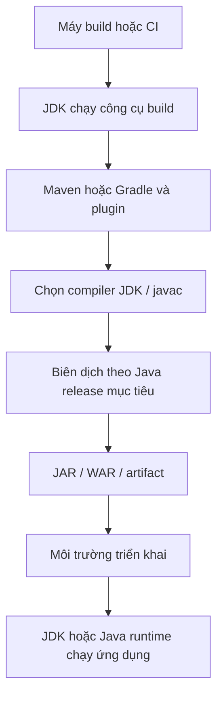
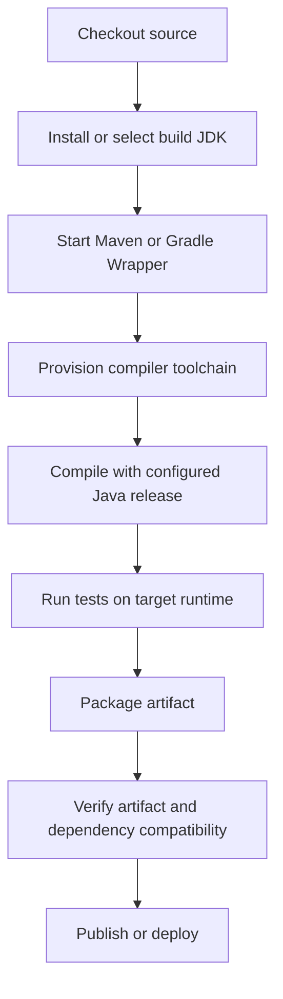

# Phân biệt JDK chạy công cụ build, JDK biên dịch và JDK chạy ứng dụng

Trong một dự án Java, cụm từ “dùng Java phiên bản 17” có thể đang nói đến nhiều việc khác nhau: dùng Java 17 để chạy Maven hoặc Gradle, dùng trình biên dịch của JDK 17 để tạo bytecode, hoặc chạy ứng dụng bằng JVM 17 sau khi triển khai. Ba việc này liên quan với nhau nhưng không bắt buộc phải dùng cùng một JDK.

Khi cấu hình môi trường build, cần tách rõ ba vai trò:

1. **JDK chạy công cụ build:** JVM đang chạy Maven, Gradle và các plugin của chúng.
2. **JDK biên dịch:** JDK cung cấp `javac` (hoặc compiler được cấu hình) để biên dịch mã nguồn Java.
3. **JDK chạy ứng dụng:** Java runtime trên môi trường thực thi ứng dụng, chẳng hạn máy chủ, máy người dùng hoặc container.

Một dự án có thể dùng JDK 21 để chạy Gradle, dùng JDK 17 làm compiler toolchain và tạo bytecode tương thích Java 17, sau đó chạy ứng dụng trên Java 17. Đây là cấu hình hợp lệ nếu phiên bản Gradle và plugin hỗ trợ JDK 21, compiler JDK 17 được cài hoặc được cung cấp cho build, và các dependency của ứng dụng cũng tương thích Java 17.

## 1. Ba vai trò Java trong một quy trình build

### 1.1. JDK chạy công cụ build

Maven và Gradle được viết để chạy trên JVM. Khi bạn gọi `mvn`, `mvnw`, `gradle` hoặc `gradlew`, một tiến trình Java được khởi chạy để thực thi build tool. JDK cung cấp JVM cho tiến trình đó được gọi ở đây là **build JDK** hoặc **JDK chạy công cụ build**.

JDK này quyết định môi trường Java mà bản thân Maven/Gradle và các plugin đang chạy trong đó nhìn thấy. Phiên bản build tool có yêu cầu riêng về những phiên bản Java được hỗ trợ để chạy. Ví dụ, một bản Gradle cũ có thể không chạy được trên JDK mới, dù mã nguồn của dự án hoàn toàn có thể biên dịch bằng phiên bản Java đó. Tương tự, một plugin Maven hoặc Gradle có thể có giới hạn tương thích riêng.

Thông thường, build JDK được xác định qua `JAVA_HOME` và `PATH`. Với Gradle, daemon JVM còn có thể được điều khiển bằng cấu hình như `org.gradle.java.home` hoặc cơ chế chọn JVM cho daemon ở các phiên bản Gradle hỗ trợ. Vì Gradle có thể giữ một daemon chạy nền, JVM của tiến trình gọi lệnh và JVM của daemon cần được phân biệt khi chẩn đoán.

Build JDK không tự động quyết định phiên bản bytecode ứng dụng. Nếu Gradle chạy trên JDK 21, điều đó không có nghĩa ứng dụng bắt buộc phải chạy trên Java 21. Muốn chọn JDK biên dịch và mức tương thích của ứng dụng, cần cấu hình riêng.

### 1.2. JDK biên dịch

JDK biên dịch là bộ JDK cung cấp compiler dùng để chuyển mã nguồn `.java` thành bytecode `.class`. Với compiler Java chuẩn, chương trình biên dịch là `javac`.

Nếu không cấu hình toolchain riêng, build tool thường dùng compiler thuộc JDK đang chạy tiến trình build. Khi đó build JDK và compiler JDK có thể là cùng một bản cài đặt. Tuy nhiên, Maven và Gradle đều có cơ chế để dự án chọn compiler JDK riêng, tách khỏi JDK đang chạy build tool.

Cần phân biệt hai lựa chọn sau:

- **Compiler JDK:** phiên bản JDK thực sự cung cấp `javac`.
- **Java release mục tiêu:** phiên bản ngôn ngữ, bytecode và API Java mà mã nguồn được phép sử dụng.

Hai lựa chọn này không đồng nghĩa. Ví dụ, compiler JDK 21 có thể biên dịch mã nguồn cho Java 17 bằng tùy chọn `--release 17`. Khi đó compiler vẫn là `javac` của JDK 21, còn kết quả được giới hạn theo nền tảng Java 17. Ngược lại, chỉ cài JDK 17 không tự đảm bảo mọi module đều được biên dịch cho Java 17 nếu cấu hình dự án yêu cầu một phiên bản khác hoặc plugin không áp dụng tùy chọn tương ứng.

Tùy chọn `--release N` của `javac` kết hợp mức ngôn ngữ nguồn, định dạng bytecode đích và tập API Java công khai tương ứng với release N. Đây là cách đáng tin cậy để biên dịch bằng JDK mới nhưng giữ khả năng tương thích với một phiên bản Java cũ hơn mà compiler hỗ trợ.

### 1.3. JDK chạy ứng dụng

Sau khi biên dịch và đóng gói, ứng dụng cần một môi trường Java để chạy. JVM trong môi trường đó đọc bytecode, nạp lớp, thực thi mã và cung cấp các API runtime. Ta gọi phiên bản Java ở đây là **runtime Java** hoặc **Java runtime chạy ứng dụng**.

Trong môi trường phát triển, runtime thường đến từ JDK cài trên máy. Khi triển khai, ứng dụng có thể chạy trên một bản JDK đầy đủ hoặc một runtime image phù hợp; nhiều môi trường trước đây dùng JRE riêng. Điều quan trọng là môi trường triển khai phải cung cấp JVM và các API mà ứng dụng cùng dependency cần đến.

Runtime của ứng dụng có thể khác build JDK. Ví dụ, build chạy trên JDK 21 nhưng ứng dụng được biên dịch cho Java 17 và triển khai trên Java 17. Nếu ứng dụng được biên dịch cho Java 21, môi trường Java 17 không thể chạy bytecode đó và thường báo lỗi phiên bản class file không được hỗ trợ.

Ngoài phiên bản bytecode, runtime còn phải có các API mà ứng dụng và thư viện sử dụng. Một thư viện phụ thuộc được biên dịch cho Java 21 có thể khiến ứng dụng không chạy trên Java 17, ngay cả khi mã nguồn của ứng dụng được biên dịch với `--release 17`. Vì vậy, cần kiểm tra cả dependency graph và yêu cầu Java tối thiểu của từng thư viện.

## 2. Hình dung ba JDK trong cùng một luồng



Sơ đồ thể hiện ba điểm cần cấu hình và kiểm tra. Build tool chạy trong JVM thứ nhất; compiler được chọn cho bước biên dịch; artifact được chạy trong runtime của môi trường đích. Một dự án nhỏ có thể dùng cùng một JDK cho cả ba điểm. Một dự án cần hỗ trợ nhiều phiên bản Java hoặc chạy trên CI có thể tách chúng ra.

| Vai trò | Câu hỏi cần trả lời | Cách kiểm tra thường dùng |
|---|---|---|
| Build JDK | Maven/Gradle đang chạy bằng Java nào? | `mvn -version`, `./gradlew --version`, thông tin JVM của daemon |
| Compiler JDK | `javac` nào đang biên dịch mã nguồn? | Cấu hình toolchain, log compiler, `javac -version` tại đúng môi trường |
| Java release mục tiêu | Bytecode và API nào được phép dùng? | `--release`, `maven.compiler.release`, `options.release` hoặc cấu hình tương ứng |
| Runtime ứng dụng | Ứng dụng thực tế sẽ chạy trên Java nào? | `java -version` tại máy/container triển khai và cấu hình runtime image |

## 3. Vì sao không nên gộp ba vai trò thành một?

### 3.1. Yêu cầu của build tool khác yêu cầu của ứng dụng

Build tool và plugin là những chương trình Java riêng. Chúng có thể cần một JDK mới để hoạt động, trong khi sản phẩm mà chúng tạo ra vẫn phải chạy trên một Java cũ hơn để đáp ứng môi trường khách hàng.

Ví dụ, nhóm có thể cần phiên bản Gradle mới để sử dụng plugin hoặc tính năng build hiện tại. Gradle phiên bản đó yêu cầu JDK 17 trở lên để chạy. Tuy nhiên, sản phẩm vẫn cần hỗ trợ máy chủ Java 11. Khi đó cần chọn build JDK được Gradle hỗ trợ, rồi cấu hình compiler để tạo kết quả tương thích Java 11 nếu compiler và các dependency cho phép.

Không nên hạ build JDK chỉ vì runtime của ứng dụng cũ hơn. Trước hết phải kiểm tra yêu cầu chạy của build tool, sau đó tách cấu hình biên dịch và runtime sản phẩm.

### 3.2. Dùng compiler mới để tạo ứng dụng cho runtime cũ

Một compiler mới có thể hỗ trợ nhiều release cũ hơn. Chẳng hạn, JDK 21 có thể biên dịch mã nguồn cho Java 17 bằng `--release 17`. Cách này giúp nhóm dùng compiler và công cụ hiện đại mà vẫn phát hành ứng dụng cho môi trường Java 17.

Tuy nhiên, `--release` không làm mọi dependency tự động tương thích. Nếu một JAR trong classpath chỉ hỗ trợ Java 21, ứng dụng vẫn có thể thất bại khi chạy trên Java 17. Cần kiểm tra bytecode và yêu cầu runtime của toàn bộ dependency.

### 3.3. Kiểm thử có thể chạy trên một runtime khác

Build JDK, compiler JDK và runtime production là ba vai trò chính, nhưng một dự án còn có thể có **test runtime**. Test runtime là JVM chạy các bài kiểm thử. Công cụ có thể chạy test bằng JDK được chọn qua toolchain hoặc bằng JVM khác được cấu hình riêng.

Nếu production dùng Java 17, chỉ chạy test trên Java 21 chưa đủ để chứng minh ứng dụng tương thích Java 17. Nên có ít nhất một lượt kiểm thử trên đúng phiên bản runtime mục tiêu, đặc biệt khi dự án hỗ trợ nhiều phiên bản Java.

## 4. Biến môi trường và lệnh kiểm tra trên máy

### 4.1. `JAVA_HOME` và `PATH`

`JAVA_HOME` thường trỏ đến thư mục cài đặt JDK mà công cụ dòng lệnh hoặc script build sẽ sử dụng. `PATH` quyết định shell tìm thấy lệnh `java`, `javac`, `mvn` hoặc các script khác ở đâu.

Hai biến này có liên quan nhưng không giống nhau. Bạn có thể đặt `JAVA_HOME` trỏ đến JDK 17 trong khi `PATH` vẫn tìm thấy `java.exe` của JDK 21 trước. Khi đó một số công cụ dùng `JAVA_HOME`, còn lệnh `java` chạy trực tiếp lại dùng đường dẫn được tìm thấy trước trong `PATH`.

Trên Windows PowerShell, kiểm tra bằng:

```powershell
$env:JAVA_HOME
Get-Command java
Get-Command javac
java -version
javac -version
```

Để xem tất cả vị trí `java` có thể được tìm thấy trong `PATH`:

```powershell
where.exe java
where.exe javac
```

Trên macOS hoặc Linux:

```bash
echo "$JAVA_HOME"
command -v java
command -v javac
java -version
javac -version
which -a java
which -a javac
```

Nếu `java -version` và `javac -version` cho kết quả thuộc hai phiên bản khác nhau, hãy kiểm tra thứ tự `PATH`, `JAVA_HOME` và cấu hình của IDE hoặc build tool. Không nên chỉ nhìn một lệnh rồi kết luận toàn bộ môi trường đang dùng cùng một JDK.

### 4.2. Kiểm tra JDK chạy Maven

Dùng Maven Wrapper nếu dự án có cung cấp wrapper:

```bash
./mvnw -version
```

Hoặc trên Windows:

```powershell
.\mvnw.cmd -version
```

Kết quả hiển thị phiên bản Maven và thông tin Java mà Maven đang chạy cùng, bao gồm Java version và Java home. Đây là thông tin về JVM chạy Maven. Nó chưa chứng minh compiler plugin đang sử dụng đúng JDK mà bạn muốn, vì compiler có thể được chọn qua Maven Toolchains.

### 4.3. Kiểm tra JDK chạy Gradle

Dùng Gradle Wrapper:

```bash
./gradlew --version
```

Hoặc trên Windows:

```powershell
.\gradlew.bat --version
```

Kết quả cho biết phiên bản Gradle và thông tin JVM liên quan. Tùy phiên bản Gradle, phần hiển thị có thể phân biệt Launcher JVM và Daemon JVM. Launcher JVM khởi chạy wrapper/Gradle client; Daemon JVM thực thi build lâu dài. Nếu hai thông tin khác nhau, hãy xem `JAVA_HOME`, `org.gradle.java.home` và cấu hình JVM của daemon.

### 4.4. IDE có thể dùng JDK riêng

IDE thường có ít nhất hai lựa chọn dễ bị nhầm:

- JDK của project/module, dùng để hiểu mã nguồn, gợi ý API hoặc cấu hình mức ngôn ngữ.
- JDK dùng để chạy Maven/Gradle trong IDE, tức JVM khởi chạy build tool.

Một số IDE còn có cấu hình JDK cho từng module hoặc từng run configuration. Vì vậy, build từ terminal thành công không đảm bảo build được gọi từ IDE dùng cùng JDK, và ngược lại. Khi kết quả khác nhau, hãy so sánh thông tin JVM trong log của hai cách chạy.

## 5. Cấu hình Maven để tách build JDK và compiler JDK

Maven thường chạy bằng JDK được chọn qua môi trường shell hoặc cấu hình chạy Maven. Nếu không chọn toolchain, Maven Compiler Plugin thường sử dụng compiler thuộc JDK đang chạy Maven. Để dùng compiler JDK khác, có thể cấu hình Maven Toolchains.

### 5.1. Chọn JDK chạy Maven

Ví dụ trên máy có JDK 21, đặt `JAVA_HOME` đến JDK 21 trước khi chạy wrapper. Cú pháp đường dẫn phụ thuộc hệ điều hành và cách cài đặt.

Trên PowerShell, ví dụ:

```powershell
$env:JAVA_HOME = 'C:\Java\jdk-21'
$env:Path = "$env:JAVA_HOME\bin;$env:Path"
.\mvnw.cmd -version
```

Đây là thiết lập cho phiên PowerShell hiện tại. Sau đó Maven Wrapper sẽ chạy bằng Java mà môi trường đó chọn, miễn là phiên bản Maven đang dùng hỗ trợ JDK 21.

### 5.2. Khai báo compiler JDK bằng Maven Toolchains

Maven Toolchains cho phép dự án yêu cầu một loại toolchain, còn mỗi máy phát triển hoặc máy CI ánh xạ yêu cầu đó đến đường dẫn JDK đã cài.

Trên máy cần cấu hình file `toolchains.xml`, thường đặt tại:

```text
${user.home}/.m2/toolchains.xml
```

Ví dụ nội dung cho JDK 17:

```xml
<?xml version="1.0" encoding="UTF-8"?>
<toolchains>
    <toolchain>
        <type>jdk</type>
        <provides>
            <version>17</version>
        </provides>
        <configuration>
            <jdkHome>/path/to/jdk-17</jdkHome>
        </configuration>
    </toolchain>
</toolchains>
```

Thay `/path/to/jdk-17` bằng đường dẫn cài JDK 17 thực tế trên máy. Trên Windows, đường dẫn có thể là `C:\Java\jdk-17`. File này thường chứa đường dẫn cục bộ, do đó không nên commit một đường dẫn chỉ đúng trên máy của một lập trình viên vào repository chung.

Trong POM, cấu hình Maven Toolchains Plugin để chọn JDK 17 từ toolchain đã khai báo:

```xml
<build>
    <plugins>
        <plugin>
            <groupId>org.apache.maven.plugins</groupId>
            <artifactId>maven-toolchains-plugin</artifactId>
            <version>3.2.0</version>
            <executions>
                <execution>
                    <goals>
                        <goal>toolchain</goal>
                    </goals>
                </execution>
            </executions>
            <configuration>
                <toolchains>
                    <jdk>
                        <version>17</version>
                    </jdk>
                </toolchains>
            </configuration>
        </plugin>
    </plugins>
</build>
```

Khi toolchain được chọn, các plugin Maven có hỗ trợ toolchain có thể sử dụng JDK đó. Maven Compiler Plugin hỗ trợ toolchain để chạy compiler từ JDK đã chọn. Hãy kiểm tra phiên bản plugin mà dự án đang quản lý và log build để xác nhận compiler thực tế.

### 5.3. Đặt Java release mục tiêu

Trong POM, có thể khai báo mức release cần tạo:

```xml
<properties>
    <maven.compiler.release>17</maven.compiler.release>
</properties>
```

Trong dự án thực tế, nên quản lý phiên bản Maven Compiler Plugin tường minh và bảo đảm phiên bản plugin hỗ trợ thuộc tính `maven.compiler.release`. Toolchain chọn JDK cung cấp compiler; thuộc tính release giới hạn ngôn ngữ, bytecode và API Java được dùng. Hai cấu hình này giải quyết hai vấn đề khác nhau.

### 5.4. Đọc cấu hình Maven đúng cách

Khi đọc POM, hãy phân biệt:

- `JAVA_HOME` và Java home trong `mvn -version`: JDK chạy Maven.
- Maven Toolchains và `toolchains.xml`: JDK được chọn cho plugin có hỗ trợ toolchain.
- `maven.compiler.release`: phiên bản Java mà compiler được yêu cầu nhắm đến.
- Maven Surefire/Failsafe hoặc plugin test: JVM thực tế dùng để chạy test, có thể cần cấu hình hoặc toolchain tương ứng.

Không nên kết luận compiler JDK chỉ từ `mvn -version`. Nếu build dùng toolchain, Java home của Maven và Java home của compiler có thể khác nhau.

## 6. Cấu hình Gradle để tách daemon JVM và compiler JDK

Gradle có khái niệm Java Toolchains. Đây là cơ chế quan trọng để chọn JDK cho các tác vụ Java mà không bắt buộc Gradle daemon phải chạy trên cùng JDK.

### 6.1. Chọn JDK chạy Gradle daemon

Gradle Wrapper chọn phiên bản Gradle của dự án; nó không tự chọn phiên bản JDK cho ứng dụng. JVM chạy Gradle thường được xác định từ môi trường khởi chạy, trong đó có `JAVA_HOME`. Có thể cấu hình `org.gradle.java.home` trong `gradle.properties` để chọn Java home cho Gradle build process/daemon.

Ví dụ cấu hình cục bộ:

```properties
org.gradle.java.home=/path/to/jdk-21
```

Đường dẫn này phụ thuộc máy và hệ điều hành. Nếu đặt trong file `gradle.properties` của repository, đường dẫn tuyệt đối có thể làm build của đồng đội hoặc CI thất bại. Thường nên đặt cấu hình máy cá nhân ở file properties người dùng hoặc thiết lập môi trường CI tương ứng. Các phiên bản Gradle mới còn hỗ trợ cơ chế daemon JVM criteria để nhóm mô tả yêu cầu JVM của daemon theo cách phù hợp hơn; cần kiểm tra tính năng tương thích với phiên bản wrapper đang dùng.

Sau khi thay đổi JVM của daemon, kiểm tra lại:

```bash
./gradlew --version
```

Nếu daemon cũ vẫn còn chạy, Gradle có thể khởi tạo daemon phù hợp khác. Khi chẩn đoán, hãy đọc thông tin JVM trong output và không giả định mọi tiến trình Java trên máy đều dùng cùng JDK.

### 6.2. Chọn compiler JDK bằng Java Toolchains

Trong `build.gradle.kts`, plugin Java có thể khai báo toolchain như sau:

```kotlin
plugins {
    java
}

java {
    toolchain {
        languageVersion = JavaLanguageVersion.of(17)
    }
}
```

Cấu hình này yêu cầu Gradle dùng JDK 17 cho các tác vụ Java được tích hợp với toolchain, như biên dịch Java và các launcher liên quan đến test hoặc Javadoc. Gradle daemon vẫn có thể chạy bằng JDK 21 nếu phiên bản Gradle hỗ trợ JDK 21.

Gradle cần tìm thấy JDK 17 trên máy hoặc có cấu hình cho phép tải/cung cấp toolchain. Có thể xem các JDK được phát hiện bằng task:

```bash
./gradlew javaToolchains
```

Nếu không tìm thấy JDK mong muốn, hãy kiểm tra đường dẫn cài đặt, cấu hình phát hiện toolchain và quyền truy cập mạng nếu dự án dựa vào cơ chế tự cung cấp JDK.

### 6.3. Đặt Java release mục tiêu trong Gradle

Có thể cấu hình compiler để chỉ sử dụng API và tạo bytecode cho Java 17:

```kotlin
tasks.withType<JavaCompile>().configureEach {
    options.release = 17
}
```

Ở đây, `java.toolchain` chọn JDK cung cấp compiler; `options.release` đặt release mục tiêu. Trong ví dụ này, cả hai cùng là 17 để dễ hiểu. Một trường hợp khác hợp lệ là dùng compiler JDK 21 nhưng đặt `options.release = 17`, miễn là toolchain và phiên bản Gradle hỗ trợ tổ hợp đó.

Không nên chỉ dựa vào `sourceCompatibility` và `targetCompatibility` để chọn compiler. Hai thuộc tính này mô tả mức tương thích nguồn và bytecode của compile task, nhưng không tự chọn JDK chạy Gradle hoặc JDK cung cấp compiler. Để giới hạn API Java theo release, ưu tiên `options.release` khi compiler hỗ trợ.

### 6.4. Chạy ứng dụng bằng Gradle và chạy ở production

Khi dùng plugin `application`, tác vụ `run` có thể dùng Java launcher từ toolchain đã cấu hình. Điều đó hữu ích khi chạy thử ứng dụng tại máy phát triển. Nhưng môi trường production vẫn do cấu hình triển khai quyết định: máy chủ, service, container image hoặc nền tảng cloud có thể dùng một Java runtime khác.

Vì vậy, cần kiểm tra cả cấu hình Gradle lẫn môi trường đích. Cấu hình toolchain giúp chuẩn hóa compile/test trong build; nó không tự cài đặt hay thay đổi Java trên máy chủ production.

## 7. `sourceCompatibility`, `targetCompatibility` và `--release` khác nhau thế nào?

Đây là một nguồn nhầm lẫn thường gặp khi cấu hình Java.

| Cấu hình | Vai trò | Có chọn JDK chạy build không? | Có giới hạn API Java theo release không? |
|---|---|---:|---:|
| `JAVA_HOME` / `org.gradle.java.home` | Chọn môi trường Java chạy build tool hoặc daemon theo cơ chế tương ứng | Có | Không |
| Maven/Gradle toolchain | Chọn JDK/compiler hoặc launcher cho các tác vụ hỗ trợ toolchain | Không chọn JVM chạy build tool | Không tự thay thế release target |
| `sourceCompatibility` | Chỉ định mức cú pháp/ngôn ngữ nguồn mà compiler chấp nhận | Không | Không đầy đủ |
| `targetCompatibility` | Chỉ định mức bytecode mục tiêu | Không | Không đầy đủ |
| `--release N` / `options.release` / `maven.compiler.release` | Chỉ định release Java gồm ngôn ngữ, bytecode và API chuẩn tương ứng | Không | Có |
| Java runtime trên production | JVM thực thi ứng dụng đã đóng gói | Không | Là môi trường phải tương thích với artifact và dependency |

Ví dụ, nếu compiler JDK 21 được gọi với `-source 17 -target 17`, mã nguồn và bytecode được đặt ở mức 17 nhưng compiler có thể vẫn cho phép tham chiếu một API chỉ có từ Java 21 nếu API đó có mặt trong JDK biên dịch. Khi chạy trên Java 17, ứng dụng có thể gặp `NoSuchMethodError` hoặc `NoClassDefFoundError`. `--release 17` giải quyết phần giới hạn API chuẩn này bằng cách biên dịch theo API của Java 17.

`--release` không kiểm tra toàn bộ thư viện bên thứ ba thay bạn. Các dependency vẫn phải được chọn phiên bản hỗ trợ runtime mục tiêu.

## 8. Ví dụ thực tế: build trên JDK 21, phát hành cho Java 17

Giả sử nhóm có các yêu cầu:

- Dùng phiên bản Gradle hiện tại và phiên bản đó yêu cầu JDK 21 để chạy.
- Dùng compiler JDK 17 để thống nhất với môi trường phát triển của nhóm.
- Phát hành ứng dụng để chạy trên máy chủ Java 17.
- Kiểm thử trên Java 17 trước khi phát hành.

Ma trận cấu hình:

| Thành phần | Phiên bản trong ví dụ | Lý do |
|---|---:|---|
| Gradle daemon JVM | JDK 21 | Đáp ứng yêu cầu chạy của Gradle và plugin |
| Compiler toolchain | JDK 17 | Dùng compiler JDK 17 để biên dịch |
| Java release | 17 | Giới hạn bytecode và API chuẩn ở Java 17 |
| Test runtime | Java 17 | Kiểm tra hành vi trên runtime mục tiêu |
| Production runtime | Java 17 | Môi trường chạy ứng dụng |

Trong trường hợp này, có thể đặt `JAVA_HOME` hoặc daemon JVM criteria để Gradle chạy bằng JDK 21, đồng thời khai báo Java toolchain 17 và release 17 trong build script. Pipeline CI cần có cả JDK 21 và JDK 17, hoặc có cơ chế cung cấp toolchain JDK 17 được dự án cho phép.

Nếu nhóm quyết định dùng compiler JDK 21 nhưng vẫn phát hành cho Java 17, có thể thay compiler toolchain thành 21 và giữ `options.release = 17`. Cấu hình đó cũng hợp lệ, nhưng phải kiểm tra phiên bản Gradle, compiler và dependency tương ứng.

Một ví dụ khác là dự án hỗ trợ Java 11 nhưng build tool mới yêu cầu Java 17. Khi đó build JDK có thể là 17, compiler JDK có thể là 17, release mục tiêu là 11 và production runtime là Java 11. Điều kiện là compiler hỗ trợ release 11, tất cả dependency hỗ trợ Java 11 và các plugin build hoạt động đúng trên JDK 17.

## 9. Kiểm tra artifact có tương thích với runtime mục tiêu không

Sau khi build, cần xác nhận artifact thực sự được tạo theo release dự kiến.

### 9.1. Kiểm tra phiên bản bytecode

Lệnh `javap -verbose` có thể hiển thị thông tin class file:

```bash
javap -verbose -classpath target/classes com.example.App
```

Với Gradle, đường dẫn class output mặc định thường là:

```bash
javap -verbose -classpath build/classes/java/main com.example.App
```

Trong output, tìm `major version`. Một số giá trị thường gặp:

| Java release | Class file major version |
|---:|---:|
| Java 8 | 52 |
| Java 11 | 55 |
| Java 17 | 61 |
| Java 21 | 65 |
| Java 25 | 69 |

Ví dụ, major version 61 tương ứng bytecode Java 17. Kiểm tra một class giúp xác nhận class đó, nhưng một ứng dụng có thể chứa nhiều class đến từ dependency khác nhau. Để đánh giá toàn bộ artifact, cần xem dependency và kiểm tra các class được đóng gói.

### 9.2. Chạy bằng đúng runtime mục tiêu

Nếu có JDK/runtime Java 17, hãy chạy artifact trong một môi trường dùng Java 17:

```bash
java -version
java -jar app.jar
```

Lệnh `java -version` cần được chạy trong đúng shell, container hoặc máy chủ sẽ thực thi ứng dụng. Nếu chạy qua Docker, hãy kiểm tra base image và command khởi chạy trong Dockerfile. Nếu chạy bằng service manager, hãy kiểm tra đường dẫn Java mà service thực sự gọi; nó có thể khác Java trong terminal của người dùng.

### 9.3. Kiểm tra dependency

Ứng dụng có thể có class file của dependency mới hơn class file của chính ứng dụng. Khi cần hỗ trợ Java 17, hãy kiểm tra:

- phiên bản Java tối thiểu được thư viện công bố hỗ trợ;
- class file của các dependency quan trọng;
- các API Java được thư viện sử dụng;
- dependency bắc cầu được chọn thực tế;
- plugin hoặc agent chạy cùng ứng dụng có yêu cầu JDK riêng hay không.

Nếu ứng dụng khởi động thất bại với lỗi phiên bản class file, hãy tìm lớp gây lỗi trong stack trace và xác định JAR chứa lớp đó. Không nên chỉ hạ release của mã nguồn ứng dụng rồi cho rằng vấn đề đã được giải quyết.

## 10. Những lỗi thường gặp và cách xác định đúng nguyên nhân

| Triệu chứng | Nguyên nhân có thể | Cách kiểm tra và xử lý |
|---|---|---|
| Maven/Gradle không khởi chạy trên máy | Build tool không hỗ trợ JDK đang được dùng, hoặc `JAVA_HOME`/`PATH` trỏ sai | Xem `mvn -version` hoặc `gradlew --version`; đối chiếu yêu cầu Java của phiên bản build tool |
| Build chạy ở terminal nhưng lỗi trong IDE | IDE dùng JDK chạy Maven/Gradle khác terminal | Kiểm tra Gradle JVM/Maven runner JDK trong IDE và so sánh log |
| `javac` mới hơn Java runtime production | Compiler tạo bytecode hoặc sử dụng API không tương thích runtime | Chọn toolchain và `--release` phù hợp; kiểm tra dependency; chạy test trên runtime mục tiêu |
| Đã đặt `sourceCompatibility` nhưng vẫn gặp API không tồn tại | Source/target không giới hạn đầy đủ API của JDK compiler mới | Dùng `--release` hoặc cấu hình release tương ứng |
| Maven báo không tìm thấy toolchain | `toolchains.xml` thiếu, sai đường dẫn hoặc không khớp yêu cầu version/vendor | Kiểm tra file toolchains ở đúng user home, đường dẫn JDK và log chọn toolchain |
| Gradle không tìm thấy JDK toolchain | JDK chưa cài, chưa được phát hiện hoặc không có cấu hình cung cấp toolchain | Chạy `javaToolchains`, cấu hình đường dẫn cài đặt hoặc cơ chế provision được phép |
| Ứng dụng báo `UnsupportedClassVersionError` | JVM chạy ứng dụng cũ hơn bytecode của một lớp được nạp | Xác định lớp/JAR gây lỗi, kiểm tra major version và nâng runtime hoặc build lại dependency tương thích |
| Ứng dụng báo `NoSuchMethodError` hoặc `NoClassDefFoundError` | Runtime thiếu API hoặc phiên bản dependency không phù hợp | Kiểm tra API Java và dependency thực tế, không chỉ kiểm tra class file của mã ứng dụng |
| Test thành công trên máy phát triển nhưng lỗi ở production | Test JVM khác runtime production, hoặc môi trường production thiếu cấu hình/thư viện | Chạy test trên Java mục tiêu và kiểm tra môi trường triển khai |

### 10.1. `UnsupportedClassVersionError` có ý nghĩa gì?

Lỗi này thường xuất hiện khi JVM cố nạp một class được biên dịch cho phiên bản Java mới hơn phiên bản JVM đang chạy hỗ trợ. Ví dụ, một class được biên dịch cho Java 21 không thể được JVM Java 17 nạp bình thường.

Quy trình xử lý:

1. Xác định class xuất hiện trong thông báo lỗi hoặc stack trace.
2. Tìm JAR hoặc module chứa class đó.
3. Kiểm tra major version của class bằng `javap -verbose` hoặc công cụ phân tích bytecode.
4. Xác định dependency nào đưa class đó vào ứng dụng.
5. Chọn một trong hai hướng: nâng runtime nếu sản phẩm cho phép, hoặc dùng phiên bản dependency/build phù hợp với runtime mục tiêu.

### 10.2. Vì sao đổi `JAVA_HOME` có thể không giải quyết lỗi compiler?

Đổi `JAVA_HOME` chủ yếu thay đổi JDK chạy tiến trình build. Nếu Maven Toolchains hoặc Gradle Java Toolchains đang chọn compiler JDK riêng, compiler có thể vẫn dùng JDK cũ hoặc không tìm được JDK được yêu cầu. Sau khi đổi `JAVA_HOME`, cần kiểm tra cả build JVM và toolchain compiler.

### 10.3. Vì sao đổi compiler JDK không làm Gradle chạy được?

Compiler toolchain chỉ được dùng sau khi Gradle đã khởi chạy và cấu hình build. Nếu JVM chạy Gradle không tương thích với phiên bản Gradle, build sẽ dừng trước khi task compile được thực hiện. Phải chọn build JDK được phiên bản Gradle hỗ trợ trước, sau đó mới chọn compiler toolchain.

## 11. Cấu hình môi trường build trong CI

CI cần tái hiện được các vai trò Java mà dự án yêu cầu. Một pipeline có thể thiết lập build JDK trước, sau đó cung cấp compiler toolchain và chạy test trên runtime mục tiêu.

Một trình tự khái niệm:



Khi thiết kế pipeline, hãy bảo đảm:

- phiên bản build tool được khóa bằng Maven Wrapper hoặc Gradle Wrapper;
- JDK chạy build đáp ứng yêu cầu của build tool và plugin;
- compiler toolchain được cài hoặc được cung cấp ổn định;
- release mục tiêu được khai báo rõ trong cấu hình build;
- test được chạy trên ít nhất runtime quan trọng của sản phẩm;
- image hoặc máy triển khai sử dụng Java runtime đúng phiên bản;
- log lưu lại thông tin JDK và build tool để có thể truy vết khi lỗi.

Không nên đưa đường dẫn JDK cục bộ của một máy lập trình viên vào cấu hình chung. Thay vào đó, dùng biến môi trường của CI, cấu hình cài đặt toolchain của runner hoặc cơ chế cung cấp JDK được tổ chức quản lý. Nếu dùng cache, hãy tính đến phiên bản JDK và toolchain trong khóa cache khi chúng ảnh hưởng đến đầu ra.

## 12. Checklist xác định đúng JDK ở từng giai đoạn

Khi một dự án có vấn đề về phiên bản Java, hãy lần lượt trả lời các câu hỏi sau:

1. Maven hoặc Gradle đang chạy trên JDK nào? Kiểm tra bằng `mvn -version` hoặc `gradlew --version`.
2. Phiên bản Maven/Gradle và các plugin có hỗ trợ JDK chạy build đó không?
3. Compiler JDK được chọn từ build JVM hay từ Maven/Gradle toolchain?
4. Compiler thực tế là phiên bản nào? Xem cấu hình và log của compile task.
5. Java release mục tiêu là bao nhiêu? Kiểm tra `maven.compiler.release`, `options.release` hoặc cấu hình tương đương.
6. Test được chạy bằng JVM nào? Có kiểm thử trên runtime mục tiêu không?
7. Dependency trực tiếp và bắc cầu có hỗ trợ runtime mục tiêu không?
8. Máy chủ hoặc container production thực sự chạy Java phiên bản nào?
9. Artifact được tạo có class file và API phù hợp với runtime đó không?

Các câu hỏi này giúp xác định đúng lớp cấu hình cần thay đổi. Nếu lỗi nằm ở việc Gradle không chạy được, hãy xử lý build JVM. Nếu lỗi nằm ở bytecode hoặc API, hãy kiểm tra compiler toolchain và release. Nếu ứng dụng khởi động thất bại trên máy chủ, hãy kiểm tra runtime production cùng dependency.

## 13. Bài tập thực hành

### Bài 1 — Quan sát môi trường hiện tại

Trên máy phát triển, ghi lại kết quả của:

```bash
java -version
javac -version
./mvnw -version
./gradlew --version
```

Nếu dự án chỉ dùng một trong hai build tool, chạy lệnh tương ứng. Ghi rõ JDK nào xuất hiện ở từng kết quả và xác định `JAVA_HOME` đang trỏ đến đâu.

### Bài 2 — Tách Gradle daemon JVM và compiler toolchain

Với một dự án Gradle có thể chạy trên JDK 21, cấu hình daemon chạy bằng JDK 21 và Java toolchain dùng JDK 17. Đặt release mục tiêu là 17. Chạy compile và task `javaToolchains`, sau đó ghi lại JDK được phát hiện và compiler được chọn.

Mục tiêu là quan sát rằng Gradle có thể chạy trên một JVM và gọi compiler từ một JDK khác. Nếu máy không có JDK 17, hãy cấu hình toolchain provisioning theo chính sách của dự án hoặc cài JDK phù hợp trước khi chạy bài tập.

### Bài 3 — Tách Maven JVM và compiler toolchain

Chạy Maven bằng JDK 21. Cấu hình Maven Toolchains để chọn JDK 17 cho compiler, đồng thời đặt `maven.compiler.release` là 17. Xác nhận Maven hiển thị Java 21 ở thông tin chạy Maven và log compiler cho thấy toolchain JDK 17 được chọn.

### Bài 4 — Kiểm tra runtime đích

Tạo artifact với release 17, sau đó chạy bằng Java 17. Nếu có thể, thử chạy trên Java 11 để quan sát khác biệt. Kiểm tra class file major version và đọc lỗi nếu runtime không tương thích. Không dùng kết quả chạy trên JDK mới hơn làm bằng chứng duy nhất cho khả năng tương thích với JDK cũ.

### Bài 5 — Mô tả ma trận Java của dự án

Viết một bảng cho dự án thực tế gồm build JDK, compiler JDK, release mục tiêu, test runtime và production runtime. Với mỗi giá trị, ghi file cấu hình hoặc bước CI chịu trách nhiệm chọn phiên bản đó. Nếu hai vai trò đang dùng chung một JDK, ghi rõ đó là lựa chọn có chủ đích hay chỉ là mặc định hiện tại.

## 14. Câu hỏi tự kiểm tra

1. JDK chạy Maven/Gradle có bắt buộc phải giống JDK biên dịch không? Vì sao?
2. `JAVA_HOME` thường ảnh hưởng đến vai trò nào?
3. Maven Toolchains và Gradle Java Toolchains giải quyết vấn đề gì?
4. Toolchain có tự quyết định Java release mục tiêu không?
5. `sourceCompatibility` và `targetCompatibility` khác `--release` ở điểm nào?
6. Vì sao compiler JDK 21 có thể tạo bytecode tương thích Java 17?
7. Vì sao `--release 17` chưa đảm bảo mọi dependency chạy được trên Java 17?
8. Làm thế nào kiểm tra JVM đang chạy Gradle daemon?
9. Vì sao cần kiểm thử ứng dụng trên runtime mục tiêu?
10. Khi gặp `UnsupportedClassVersionError`, cần xác định điều gì trước khi thay đổi `JAVA_HOME`?

Khi trả lời được các câu hỏi trên, bạn có thể đọc cấu hình môi trường build và xác định mỗi phiên bản Java đang phục vụ vai trò nào. Đây là kỹ năng quan trọng để làm việc với nhiều JDK trên máy phát triển, duy trì build ổn định trên CI và phát hành ứng dụng tương thích với môi trường chạy thực tế.
