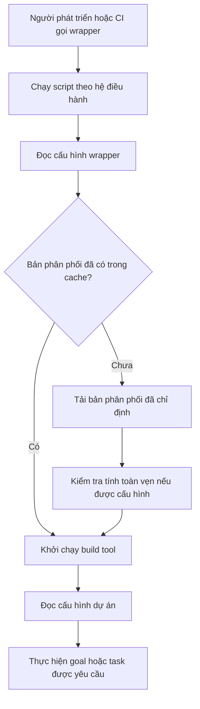
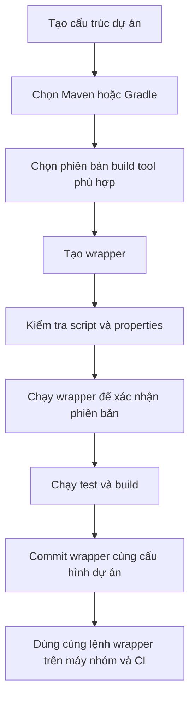

# Build wrapper: cố định phiên bản công cụ và khởi động dự án

Khi nhiều người cùng phát triển một dự án Java, họ cần chạy cùng một quy trình build bằng cùng một phiên bản công cụ. Nếu máy của mỗi người tự cài Maven hoặc Gradle ở một phiên bản khác nhau, kết quả build có thể khác nhau do thay đổi về hành vi, plugin, cú pháp cấu hình hoặc cách xử lý dependency.

**Build wrapper** giải quyết vấn đề này bằng cách đưa một bộ khởi động vào chính repository. Thành viên nhóm và hệ thống CI gọi wrapper đi kèm dự án; wrapper đọc cấu hình để xác định phiên bản Maven hoặc Gradle cần dùng, tải bản phân phối tương ứng nếu máy chưa có, rồi khởi chạy lệnh build.

Với Java, hai wrapper thường gặp là **Maven Wrapper** và **Gradle Wrapper**. Bài học này giải thích mục đích của wrapper, các tệp cấu thành, cách tạo và cập nhật wrapper, cách dùng khi bắt đầu dự án và các lưu ý khi làm việc trên máy cá nhân hoặc CI.

## 1. Build wrapper là gì?

Build wrapper là tập hợp script và tệp cấu hình được đặt trong dự án để khởi chạy một phiên bản build tool đã được dự án lựa chọn.

Nếu không dùng wrapper, thành viên nhóm thường phải:

1. Cài Maven hoặc Gradle trên máy.
2. Tự kiểm tra phiên bản đã cài.
3. Đảm bảo phiên bản đó tương thích với dự án.
4. Gọi lệnh build bằng chương trình cài đặt toàn hệ thống.

Cách này khiến mỗi máy có thể dùng một phiên bản khác nhau. Wrapper giúp dự án công bố phiên bản build tool cần dùng ngay trong repository. Người phát triển chạy lệnh wrapper, và wrapper tự tìm hoặc tải đúng bản phân phối.

Ví dụ, thay vì gọi trực tiếp:

```bash
mvn clean verify
gradle clean build
```

ta gọi wrapper nằm trong dự án:

```bash
./mvnw clean verify
./gradlew clean build
```

Trên Windows, tên script tương ứng thường là:

```powershell
.\mvnw.cmd clean verify
.\gradlew.bat clean build
```

Tên lệnh có thể khác đôi chút tùy shell, nhưng nguyên tắc giống nhau: lệnh được gọi từ repository sẽ chọn phiên bản build tool do dự án cấu hình.

## 2. Vì sao nên dùng wrapper?

### 2.1. Giữ phiên bản build tool nhất quán

Một dự án có thể hoạt động ổn định với Maven hoặc Gradle ở một phiên bản cụ thể. Khi build tool phát hành phiên bản mới, hành vi mặc định, plugin API hoặc yêu cầu runtime có thể thay đổi. Nếu mỗi người dùng phiên bản riêng, lỗi có thể chỉ xuất hiện trên một số máy.

Wrapper lưu phiên bản cần dùng trong tệp cấu hình được commit cùng mã nguồn. Thành viên mới clone repository có thể chạy lệnh wrapper mà không cần tự đoán phiên bản.

### 2.2. Giảm bước cài đặt ban đầu

Người mới tham gia dự án thường không biết nên tải phiên bản Maven hay Gradle nào. Wrapper làm rõ lựa chọn này. Khi chạy lần đầu, wrapper tải bản phân phối được cấu hình nếu chưa có trong cache cục bộ.

Người dùng vẫn cần môi trường Java phù hợp để khởi động wrapper. Wrapper quản lý phiên bản build tool, không tự động thay thế mọi yêu cầu về JDK của dự án.

### 2.3. Giúp CI chạy đúng công cụ

Máy CI cũng cần build tool. Nếu pipeline tự cài một phiên bản Maven hoặc Gradle riêng, cấu hình pipeline có thể lệch với cấu hình mà nhóm sử dụng trên máy cá nhân.

Dùng wrapper trong CI giúp lệnh build lấy phiên bản từ repository. Khi dự án cập nhật wrapper và commit thay đổi đó, cả máy lập trình viên lẫn CI đều có thể chuyển sang phiên bản mới theo cùng một thay đổi mã nguồn.

### 2.4. Làm rõ cách khởi động dự án

README của dự án có thể hướng dẫn một lệnh thống nhất như **./gradlew build** hoặc **./mvnw verify**. Thành viên không cần nhớ cài đặt toàn cục hay tự tìm phiên bản build tool trước khi bắt đầu.

### 2.5. Dễ tái tạo và xem xét thay đổi

Phiên bản wrapper được lưu trong Git. Reviewer có thể xem thay đổi phiên bản build tool qua diff của tệp cấu hình. Điều này giúp nhóm chủ động quyết định thời điểm nâng cấp, kiểm thử và đưa phiên bản mới vào sử dụng.

## 3. Maven Wrapper

Maven Wrapper cung cấp script để gọi Maven theo phiên bản mà dự án chỉ định. Các tệp thường gặp trong repository là:

```text
my-project/
├── .mvn/
│   └── wrapper/
│       ├── maven-wrapper.jar
│       └── maven-wrapper.properties
├── mvnw
├── mvnw.cmd
└── pom.xml
```

Các tệp có vai trò như sau:

| Tệp | Vai trò |
|---|---|
| **mvnw** | Script khởi chạy wrapper trên macOS và Linux |
| **mvnw.cmd** | Script khởi chạy wrapper trên Windows |
| **.mvn/wrapper/maven-wrapper.properties** | Khai báo URL và các thuộc tính để wrapper lấy Maven distribution |
| **.mvn/wrapper/maven-wrapper.jar** | Thành phần bootstrap của wrapper trong cấu hình wrapper có sử dụng JAR |
| **pom.xml** | Cấu hình dự án Maven: dependency, plugin, build và các thông tin khác |

Tệp thực tế được tạo có thể khác theo phiên bản Maven Wrapper và kiểu wrapper được chọn. Hãy commit toàn bộ các tệp wrapper do dự án tạo ra và được hướng dẫn sử dụng, không tự ý bỏ một tệp chỉ vì tên của nó có vẻ là thành phần phụ.

### 3.1. Cấu hình phiên bản Maven

Tệp **.mvn/wrapper/maven-wrapper.properties** thường chứa thuộc tính **distributionUrl**, trỏ đến bản phân phối Maven mà dự án muốn sử dụng. Ví dụ:

```properties
distributionUrl=https://repo.maven.apache.org/maven2/org/apache/maven/apache-maven/3.9.9/apache-maven-3.9.9-bin.zip
```

Ở ví dụ này, wrapper được cấu hình để dùng Maven 3.9.9. Khi gọi **mvnw**, wrapper đọc URL, kiểm tra cache và tải bản phân phối nếu cần.

Một số cấu hình wrapper còn có các thuộc tính khác như URL của thành phần bootstrap hoặc checksum. Ý nghĩa và tên thuộc tính phụ thuộc phiên bản wrapper. Khi sửa cấu hình, nên giữ định dạng do Maven Wrapper tạo ra thay vì tự viết lại toàn bộ tệp.

### 3.2. Tạo Maven Wrapper cho dự án

Nếu dự án đã có Maven cài trên máy, có thể dùng Maven Wrapper Plugin để tạo wrapper. Từ thư mục có **pom.xml**, một lệnh thường dùng là:

```bash
mvn wrapper:wrapper -Dmaven=3.9.9
```

Lệnh này yêu cầu plugin tạo các script và tệp cấu hình wrapper cho phiên bản Maven được chỉ định. Cú pháp và các tùy chọn chi tiết có thể phụ thuộc phiên bản Maven Wrapper Plugin mà dự án sử dụng.

Sau khi tạo, kiểm tra repository có các tệp cần thiết, đặc biệt là:

- **mvnw**
- **mvnw.cmd**
- **.mvn/wrapper/maven-wrapper.properties**
- Thành phần bootstrap được tạo theo wrapper type đang dùng

Sau đó, thêm các tệp wrapper vào Git cùng với thay đổi cấu hình dự án.

### 3.3. Chạy dự án bằng Maven Wrapper

Từ thư mục gốc dự án, trên macOS hoặc Linux:

```bash
./mvnw -v
./mvnw clean test
./mvnw clean verify
```

Trên Windows PowerShell hoặc Command Prompt:

```powershell
.\mvnw.cmd -v
.\mvnw.cmd clean test
.\mvnw.cmd clean verify
```

Lệnh **-v** hiển thị thông tin Maven và Java đang được sử dụng. Các lệnh **clean**, **test** và **verify** là goal/phase của Maven lifecycle; wrapper chuyển chúng cho phiên bản Maven đã cấu hình.

Nếu máy chưa có bản phân phối Maven tương ứng trong cache, lần chạy đầu cần kết nối mạng để tải. Những lần sau wrapper thường tái sử dụng bản đã tải.

## 4. Gradle Wrapper

Gradle Wrapper là cơ chế được tích hợp phổ biến trong dự án Gradle. Bộ tệp thường có cấu trúc:

```text
my-project/
├── gradle/
│   └── wrapper/
│       ├── gradle-wrapper.jar
│       └── gradle-wrapper.properties
├── gradlew
├── gradlew.bat
└── build.gradle hoặc build.gradle.kts
```

Các tệp có vai trò:

| Tệp | Vai trò |
|---|---|
| **gradlew** | Script khởi chạy wrapper trên macOS và Linux |
| **gradlew.bat** | Script khởi chạy wrapper trên Windows |
| **gradle/wrapper/gradle-wrapper.jar** | Bootstrap JAR giúp khởi động wrapper |
| **gradle/wrapper/gradle-wrapper.properties** | Cấu hình URL và loại bản phân phối Gradle |
| **build.gradle** hoặc **build.gradle.kts** | Cấu hình build của dự án |

Khác với việc gọi **gradle** được cài toàn hệ thống, gọi **gradlew** từ repository sẽ sử dụng phiên bản được khai báo trong wrapper properties.

### 4.1. Cấu hình phiên bản Gradle

Tệp **gradle/wrapper/gradle-wrapper.properties** thường có nội dung tương tự:

```properties
distributionBase=GRADLE_USER_HOME
distributionPath=wrapper/dists
distributionUrl=https\://services.gradle.org/distributions/gradle-8.14.3-bin.zip
distributionSha256Sum=<sha256-checksum-cua-ban-phan-phoi>
zipStoreBase=GRADLE_USER_HOME
zipStorePath=wrapper/dists
```

Trong đó:

- **distributionUrl** xác định bản phân phối Gradle cần tải.
- **distributionBase** và **distributionPath** xác định vị trí lưu bản phân phối trong Gradle User Home.
- **zipStoreBase** và **zipStorePath** xác định vị trí lưu tệp ZIP tải về.
- **distributionSha256Sum** có thể được dùng để xác minh checksum của bản phân phối trước khi sử dụng.

Giá trị checksum trong ví dụ là placeholder. Khi cấu hình thật, phải thay bằng SHA-256 chính thức tương ứng với đúng tệp ZIP được chọn; không sao chép một checksum từ phiên bản hoặc loại distribution khác.

Gradle thường cung cấp các loại distribution như **bin** và **all**. Bản **bin** chứa những thành phần cần thiết để chạy Gradle; bản **all** bổ sung tài liệu và mã nguồn hữu ích khi phát triển hoặc tra cứu trong IDE. Nhóm nên chọn loại phù hợp với nhu cầu và giữ lựa chọn đó nhất quán.

### 4.2. Tạo Gradle Wrapper

Nếu đã cài Gradle, có thể tạo wrapper từ thư mục gốc dự án bằng:

```bash
gradle wrapper --gradle-version 8.14.3 --distribution-type bin
```

Lệnh này tạo hoặc cập nhật các script và tệp wrapper để dự án sử dụng Gradle 8.14.3 với distribution type **bin**.

Sau khi tạo, kiểm tra các tệp:

- **gradlew**
- **gradlew.bat**
- **gradle/wrapper/gradle-wrapper.jar**
- **gradle/wrapper/gradle-wrapper.properties**

Đưa các tệp wrapper vào Git. Trong dự án đã có wrapper, nên dùng chính wrapper hiện tại để thực hiện nâng cấp khi có thể, rồi xem xét diff của tất cả tệp được cập nhật.

### 4.3. Chạy dự án bằng Gradle Wrapper

Trên macOS hoặc Linux:

```bash
./gradlew --version
./gradlew tasks
./gradlew clean test
./gradlew clean build
```

Trên Windows:

```powershell
.\gradlew.bat --version
.\gradlew.bat tasks
.\gradlew.bat clean test
.\gradlew.bat clean build
```

**--version** hiển thị phiên bản Gradle wrapper đã khởi chạy và thông tin JVM. **tasks** liệt kê các task có thể gọi. **test** chạy các bài kiểm thử được cấu hình; **build** thường bao gồm kiểm thử và tạo các artifact theo plugin mà dự án áp dụng.

## 5. Wrapper khởi động dự án như thế nào?

Có thể hình dung quy trình chung của Maven Wrapper và Gradle Wrapper qua các bước:



Các bước cụ thể khác nhau giữa Maven Wrapper và Gradle Wrapper, nhưng có cùng mục tiêu:

1. Chọn script đúng với hệ điều hành.
2. Tìm thông tin phiên bản và URL bản phân phối.
3. Kiểm tra bản phân phối trong cache.
4. Tải và lưu bản phân phối nếu chưa có.
5. Khởi chạy Maven hoặc Gradle.
6. Chuyển các tham số người dùng truyền vào cho build tool thực hiện.

Wrapper không cần tải lại toàn bộ bản phân phối trong mọi lần chạy. Sau khi đã tải thành công, nó có thể sử dụng bản đã lưu trong cache. Khi dự án đổi phiên bản wrapper, bản mới sẽ được tải riêng nếu máy chưa có.

## 6. Wrapper có cố định JDK không?

Đây là điểm rất quan trọng: **wrapper cố định phiên bản build tool, không đồng nghĩa cố định phiên bản JDK**.

Ví dụ, **gradle-wrapper.properties** có thể chọn Gradle 8.14.3, nhưng dự án vẫn có yêu cầu riêng về Java runtime để chạy Gradle và về JDK dùng để biên dịch mã nguồn.

Có ba khái niệm cần phân biệt:

| Thành phần | Vai trò |
|---|---|
| Phiên bản wrapper | Chọn phiên bản Maven hoặc Gradle |
| JVM chạy build tool | Java runtime dùng để khởi động Maven hoặc Gradle |
| JDK/toolchain của dự án | JDK và mức ngôn ngữ Java mà mã nguồn cần khi biên dịch hoặc kiểm thử |

Một dự án có thể chạy Gradle bằng một JVM nhưng cấu hình Java toolchain để biên dịch mã bằng JDK khác. Maven cũng có thể sử dụng Maven Toolchains hoặc cấu hình compiler plugin để chọn JDK cho bước biên dịch. Những cơ chế này được cấu hình riêng.

Vì vậy, để môi trường tái tạo tốt hơn, nhóm cần ghi rõ yêu cầu JDK trong README, cấu hình toolchain phù hợp và cấu hình CI tương ứng. Chỉ thêm wrapper không đảm bảo mọi máy đang dùng cùng JDK.

## 7. Cập nhật phiên bản wrapper

Không nên tự động nâng cấp build tool trên tất cả máy mà không có kế hoạch. Khi nhóm muốn nâng phiên bản, hãy thay đổi wrapper trong một commit có thể xem xét và kiểm thử.

### 7.1. Cập nhật Gradle Wrapper

Trong dự án Gradle đã có wrapper, có thể dùng phiên bản hiện tại để gọi task cập nhật:

```bash
./gradlew wrapper --gradle-version 8.14.3 --distribution-type bin
```

Trên Windows:

```powershell
.\gradlew.bat wrapper --gradle-version 8.14.3 --distribution-type bin
```

Sau khi chạy, xem xét thay đổi trong **gradle-wrapper.properties**, script và wrapper JAR. Tùy phiên bản Gradle và trạng thái wrapper hiện tại, có thể cần chạy task wrapper thêm một lần để các thành phần wrapper được cập nhật đầy đủ. Hãy kiểm tra diff thay vì giả định chỉ một tệp sẽ thay đổi.

Sau đó kiểm tra phiên bản và chạy build:

```bash
./gradlew --version
./gradlew clean build
```

### 7.2. Cập nhật Maven Wrapper

Với Maven Wrapper Plugin, có thể tạo lại hoặc cập nhật cấu hình wrapper bằng Maven đã cài hoặc bằng wrapper hiện tại, tùy trạng thái dự án. Ví dụ:

```bash
mvn wrapper:wrapper -Dmaven=3.9.9
```

Nếu dự án đã có Maven Wrapper, hãy kiểm tra tài liệu của phiên bản plugin đang dùng để chọn cách nâng cấp phù hợp. Sau khi cập nhật, xem xét các thay đổi trong **maven-wrapper.properties**, script và bootstrap JAR nếu có.

Kiểm tra phiên bản đã chọn:

```bash
./mvnw -v
./mvnw clean verify
```

### 7.3. Những điều cần xem xét khi nâng cấp

Trước khi chấp nhận phiên bản wrapper mới, nhóm nên xem xét:

- Phiên bản đó có tương thích với JDK mà dự án và CI sử dụng không?
- Các plugin Maven hoặc Gradle có tương thích không?
- Cú pháp build script hiện tại có còn được hỗ trợ không?
- Dependency và plugin có tải được từ repository của nhóm không?
- Build, test và đóng gói có thành công trên CI không?
- Có thay đổi đáng kể nào cần ghi vào tài liệu dự án không?

Việc nâng cấp wrapper có thể kéo theo yêu cầu nâng JDK hoặc plugin. Nên xử lý thay đổi có liên quan trong cùng một nhánh công việc và ghi rõ các điều kiện cần thiết để người khác tái tạo kết quả.

## 8. Đưa wrapper vào Git và hướng dẫn người mới

Wrapper chỉ có ích nếu các thành viên khác nhận được các tệp của nó khi clone repository. Vì vậy, thông thường nên commit các script, bootstrap và tệp properties do wrapper tạo ra.

Một repository Gradle thường commit:

```text
gradlew
gradlew.bat
gradle/wrapper/gradle-wrapper.jar
gradle/wrapper/gradle-wrapper.properties
```

Một repository Maven thường commit các script và cấu hình wrapper được tạo, ví dụ:

```text
mvnw
mvnw.cmd
.mvn/wrapper/maven-wrapper.jar
.mvn/wrapper/maven-wrapper.properties
```

Các tệp cache hoặc bản phân phối đã tải về không nên commit vào repository. Ví dụ, không đưa toàn bộ Gradle User Home, Maven local repository hay thư mục cache của wrapper vào Git. Các tệp này được tạo trên từng máy và có thể tải lại.

README có thể hướng dẫn thành viên mới theo trình tự:

1. Cài đặt JDK phù hợp với yêu cầu của dự án.
2. Clone repository.
3. Mở terminal tại thư mục gốc dự án.
4. Chạy lệnh wrapper được dự án hướng dẫn.
5. Chờ wrapper tải build tool trong lần đầu nếu cần.
6. Chạy test hoặc build để xác nhận môi trường hoạt động.

Ví dụ đoạn hướng dẫn cho Gradle:

```markdown
## Build dự án

Yêu cầu: JDK theo phiên bản được mô tả trong cấu hình dự án.

Trên macOS/Linux:

    ./gradlew clean build

Trên Windows:

    .\gradlew.bat clean build
```

Với Maven, thay lệnh bằng **./mvnw clean verify** hoặc **.\mvnw.cmd clean verify** tương ứng.

## 9. Sử dụng wrapper trong CI

Trong pipeline CI, nên gọi wrapper từ repository thay vì cài một phiên bản build tool tùy ý rồi gọi lệnh toàn cục.

Ví dụ các lệnh build trong môi trường Linux:

```bash
./gradlew clean build
```

hoặc:

```bash
./mvnw clean verify
```

Trên máy Linux, script có thể cần quyền thực thi. Nếu Git checkout không giữ quyền thực thi của script, có thể cần khôi phục quyền bằng:

```bash
chmod +x gradlew mvnw
```

Sau đó commit thay đổi quyền file nếu repository chưa ghi nhận đúng. Trên Windows, gọi trực tiếp file **.bat** hoặc **.cmd**.

Pipeline cần cài hoặc cung cấp JDK tương thích trước khi chạy wrapper. Wrapper sẽ tải build tool nếu cache của CI chưa có. Để pipeline nhanh hơn, có thể cache thư mục phân phối hoặc cache dependency theo cơ chế của hệ thống CI, nhưng cache không nên là điều kiện duy nhất để build thành công.

Một pipeline tốt nên:

- Dùng wrapper đã commit trong repository.
- Cài JDK theo yêu cầu của dự án.
- Chạy test và build bằng lệnh có thể tái tạo trên máy lập trình viên.
- Lưu log khi build thất bại.
- Không phụ thuộc vào Maven hoặc Gradle cài toàn hệ thống.
- Kiểm soát proxy và quyền truy cập repository khi chạy trong mạng nội bộ.

## 10. Mạng, proxy và chế độ offline

Lần đầu chạy wrapper, máy thường cần truy cập URL phân phối để tải Maven hoặc Gradle. Sau đó, wrapper lưu bản phân phối trong cache cục bộ.

Nếu mạng nội bộ dùng proxy hoặc giới hạn truy cập Internet, lần chạy đầu có thể thất bại dù cấu hình wrapper đúng. Khi đó cần kiểm tra:

- Máy có truy cập được host trong **distributionUrl** không?
- Proxy của hệ thống hoặc cấu hình build tool đã được khai báo đúng chưa?
- Chứng chỉ TLS của mạng nội bộ có được JVM tin cậy không?
- Repository có mirror hoặc proxy nội bộ cho Maven/Gradle distribution không?
- Người dùng có quyền ghi vào thư mục cache không?

Chế độ offline của Maven hoặc Gradle chỉ có thể sử dụng những dependency đã có trong cache. Nó không giúp tải bản phân phối wrapper còn thiếu khi máy chưa có Maven hoặc Gradle cần thiết. Vì vậy, cần phân biệt việc tải build tool với việc tải dependency của dự án.

Khi làm việc trong môi trường không có Internet, nhóm cần chuẩn bị sẵn distribution hoặc cung cấp mirror nội bộ và hướng dẫn cách cấu hình tương ứng. Không nên sửa URL wrapper tùy tiện sang một nguồn không rõ xuất xứ.

## 11. An toàn khi sử dụng wrapper

Wrapper là một phần của mã thực thi trong repository. Khi chạy wrapper, máy sẽ thực thi script và bootstrap được checkout cùng dự án, sau đó tải và khởi chạy build tool từ URL cấu hình. Vì vậy, nên xem xét wrapper như một phần mã cần tin cậy.

Một số nguyên tắc:

- Lấy wrapper từ repository chính thức hoặc từ một dự án mà nhóm tin cậy.
- Xem xét các thay đổi trong script, wrapper JAR và properties khi pull request cập nhật wrapper.
- Kiểm tra **distributionUrl** có trỏ đến nguồn phân phối mong đợi không.
- Với Gradle, cấu hình **distributionSha256Sum** bằng checksum chính thức của đúng distribution để xác minh tệp tải về.
- Không chạy wrapper từ một repository lạ mà chưa xem xét nội dung của nó.
- Giữ quyền ghi vào cache ở phạm vi người dùng cần thiết, không cấp quyền quản trị chỉ để chạy wrapper.

Checksum giúp phát hiện bản phân phối không khớp với giá trị mong đợi, nhưng không thay thế việc xác định nguồn tải đáng tin cậy. Một URL không rõ nguồn vẫn là rủi ro ngay cả khi người dùng không thấy lỗi tải xuống.

## 12. Những nhầm lẫn thường gặp

| Nhầm lẫn | Giải thích |
|---|---|
| Wrapper là một bản cài Maven hoặc Gradle đầy đủ được lưu trong repository | Repository chứa script, bootstrap và cấu hình; distribution thường được tải và cache trên máy |
| Wrapper tự cài JDK | Wrapper chọn build tool; JVM cần thiết để chạy wrapper phải được cung cấp riêng |
| Đổi phiên bản trong **pom.xml** là đổi phiên bản Maven | **pom.xml** mô tả dự án và plugin; Maven distribution được chọn bởi cấu hình Maven Wrapper |
| Đổi phiên bản Gradle trong **build.gradle** là đổi wrapper | Phiên bản Gradle wrapper nằm trong **gradle-wrapper.properties** |
| Đã cài Gradle toàn cục thì không cần **gradlew** | Dự án vẫn nên dùng wrapper để đảm bảo mọi người gọi cùng phiên bản |
| Chạy offline luôn dùng được wrapper | Máy vẫn cần có distribution wrapper trong cache trước khi có thể chạy offline |
| Wrapper làm mọi dependency luôn giống nhau | Wrapper cố định phiên bản build tool; dependency vẫn cần được khai báo và quản lý bằng cấu hình dự án |
| Không cần commit wrapper JAR hoặc script | Thành viên mới và CI cần các tệp này để khởi động wrapper sau khi clone |

## 13. Quy trình khởi động dự án mới

Khi tạo dự án Java mới bằng Maven hoặc Gradle, có thể áp dụng trình tự sau:



Với dự án đã tồn tại, không cần tạo wrapper mới nếu wrapper hiện tại đã hoạt động. Hãy kiểm tra phiên bản đang được cấu hình, dùng wrapper đó để build và chỉ cập nhật khi có lý do rõ ràng.

## 14. Ghi nhớ

- Build wrapper cung cấp script khởi động Maven hoặc Gradle theo phiên bản do dự án chỉ định.
- Maven Wrapper thường dùng **mvnw**, **mvnw.cmd** và **.mvn/wrapper/maven-wrapper.properties**.
- Gradle Wrapper thường dùng **gradlew**, **gradlew.bat** và **gradle/wrapper/gradle-wrapper.properties**.
- Wrapper tải bản phân phối nếu máy chưa có trong cache, sau đó tái sử dụng bản đã tải.
- Wrapper giúp máy lập trình viên và CI dùng cùng phiên bản build tool.
- Wrapper không tự cố định JDK; yêu cầu JVM và toolchain của dự án cần được cấu hình riêng.
- Các tệp wrapper cần được commit để thành viên mới có thể khởi động dự án sau khi clone.
- Khi nâng cấp wrapper, hãy xem xét diff, kiểm tra tính tương thích và chạy build/test trên CI.
- Cần kiểm tra nguồn tải, checksum và quyền thực thi của wrapper script khi cần.

## 15. Tự kiểm tra

1. Build wrapper giải quyết vấn đề gì khi nhiều thành viên cùng build một dự án?
2. Maven Wrapper lưu phiên bản Maven cần dùng trong tệp nào?
3. Gradle Wrapper lưu URL distribution trong tệp nào?
4. Lệnh **./gradlew build** khác gì với lệnh **gradle build**?
5. Vì sao wrapper không thể thay thế việc cài đặt JDK?
6. Những tệp wrapper nào nên được commit vào Git?
7. Vì sao lần chạy đầu tiên có thể cần Internet dù dự án không thay đổi dependency?
8. **distributionSha256Sum** trong Gradle Wrapper giúp ích gì?
9. Vì sao CI nên gọi wrapper từ repository thay vì tự cài một phiên bản Gradle hoặc Maven khác?
10. Khi nâng phiên bản wrapper, nhóm cần kiểm tra những thành phần nào ngoài tệp properties?

Khi có thể giải thích cách wrapper chọn phiên bản build tool, tải distribution, khởi chạy lệnh và phối hợp với JDK, bạn đã nắm được cách chuẩn hóa môi trường build để cả nhóm và CI khởi động dự án Java theo cùng một quy trình.

