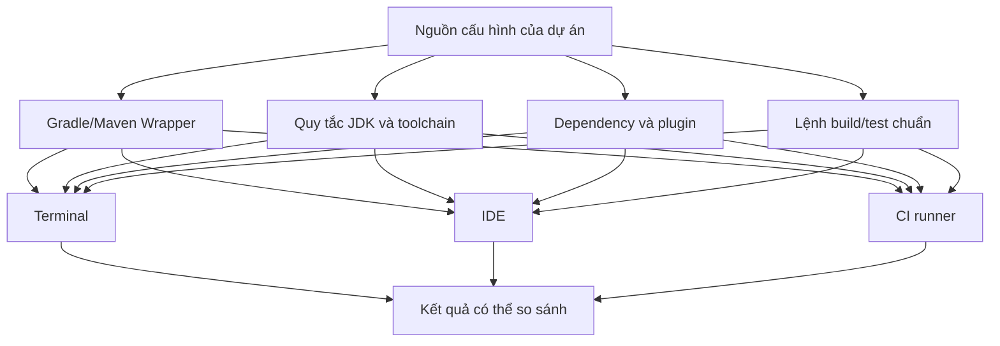

# Làm việc qua terminal, IDE và môi trường CI với cấu hình nhất quán

Một dự án Java thường được phát triển qua nhiều môi trường: lập trình viên chạy lệnh trong terminal, bấm Run hoặc Build trong IDE, còn hệ thống CI tự động biên dịch và kiểm thử sau mỗi commit hoặc pull request. Cả ba môi trường đều xử lý cùng một mã nguồn, nhưng chúng có thể dùng JDK, phiên bản Gradle/Maven, biến môi trường, thư mục làm việc và cấu hình chạy khác nhau.

Nếu mỗi nơi tự chọn một bộ thiết lập, dự án dễ rơi vào tình trạng “máy tôi chạy được”: build thành công trong IDE nhưng thất bại trên terminal, test qua local nhưng lỗi trên CI, hoặc ứng dụng đọc được cấu hình ở máy phát triển nhưng không tìm thấy file khi triển khai. Muốn làm việc ổn định, cần xác định cấu hình nào là nguồn chuẩn của dự án, cấu hình nào thuộc từng người hoặc từng môi trường, và cách các công cụ sử dụng chúng.

## 1. Cấu hình nhất quán nghĩa là gì?

**Cấu hình nhất quán** nghĩa là các môi trường thực hiện cùng một công việc dựa trên cùng những quy tắc và đầu vào đã được kiểm soát. Nó không đòi hỏi máy lập trình viên và CI phải giống hệt nhau về phần cứng, hệ điều hành hoặc đường dẫn cài đặt. Điều cần giữ ổn định là các yếu tố có ảnh hưởng đến kết quả build và hành vi của ứng dụng.

Một bộ cấu hình build thường bao gồm:

- Phiên bản Gradle hoặc Maven mà dự án yêu cầu.
- Phiên bản JDK dùng để chạy build và phiên bản Java mục tiêu của mã nguồn.
- Plugin và dependency cùng phiên bản được quản lý.
- Cấu hình biên dịch, kiểm thử, đóng gói và các quality gate.
- Profile, biến môi trường và thuộc tính được dùng trong từng tác vụ.
- Thư mục làm việc, đường dẫn đến tài nguyên và cách truyền tham số.
- Quy tắc lấy secret, credential và cấu hình riêng của môi trường.

Ví dụ, một nhóm có thể thống nhất dùng Gradle Wrapper, JDK 21 để chạy build, Java 17 làm toolchain biên dịch, JUnit Platform để chạy test và một task `build` làm lệnh kiểm tra chuẩn. Máy cá nhân có thể chạy Windows hoặc Linux, còn CI chạy Linux; các máy vẫn có thể tạo kết quả tương đương nếu những đầu vào liên quan được khai báo và kiểm soát rõ ràng.

Một cách nhìn tổng thể:



Các môi trường có thể có cấu hình bổ sung, nhưng cần biết cấu hình nào được chia sẻ và cấu hình nào chỉ có hiệu lực cục bộ.

## 2. Phân loại cấu hình: dùng chung, cục bộ và theo môi trường

Trước khi chỉnh IDE hay CI, hãy phân loại thiết lập theo phạm vi sở hữu.

| Phạm vi | Ví dụ | Nơi quản lý phù hợp |
|---|---|---|
| Dùng chung cho dự án | Gradle Wrapper, Java toolchain, dependency, test task, encoding | File build được commit vào Git |
| Cục bộ của lập trình viên | Đường dẫn JDK cài trên máy, cấu hình proxy cá nhân, lựa chọn IDE | IDE settings, user-level Gradle/Maven config hoặc biến môi trường cá nhân |
| Theo môi trường chạy | Database URL, endpoint, log level, feature flag | Biến môi trường, secret store hoặc cấu hình triển khai |
| Theo pipeline | JDK được cài trên runner, cache, quyền truy cập artifact | Workflow CI và cấu hình runner |
| Bí mật | Token, mật khẩu, private key, credential repository | Secret manager hoặc kho secret của CI |

Một thiết lập nên được đặt ở nơi có phạm vi nhỏ nhất nhưng vẫn đủ cho mục đích sử dụng. Ví dụ, phiên bản Gradle là yêu cầu chung nên được pin trong Wrapper; đường dẫn cài JDK trên từng máy là thông tin cục bộ; mật khẩu database là secret của môi trường. Đưa cả ba loại vào cùng một file được commit sẽ làm mất ranh giới giữa cấu hình dự án và cấu hình cá nhân.

### 2.1. Cấu hình có thể chia sẻ nên nằm trong repository

Những quyết định ảnh hưởng đến mọi người cần được thể hiện bằng file có version control. Các ví dụ thường gặp:

```text
project/
├── gradle/
│   └── wrapper/
│       ├── gradle-wrapper.jar
│       └── gradle-wrapper.properties
├── gradlew
├── gradlew.bat
├── settings.gradle
├── build.gradle
├── gradle.properties
└── .github/
    └── workflows/
        └── build.yml
```

Với Maven, repository thường có `mvnw`, `mvnw.cmd`, thư mục `.mvn/wrapper/`, `pom.xml` và có thể có `.mvn/maven.config` hoặc `.mvn/jvm.config` cho các tham số phù hợp. Những file này giúp nhóm thống nhất cách gọi build tool.

### 2.2. Cấu hình cục bộ không nên áp đặt lên mọi người

Một IDE có thể lưu đường dẫn JDK như `C:\Program Files\Java\jdk-21` hoặc `/usr/lib/jvm/jdk-21`. Đường dẫn này khác nhau giữa máy, nên không phù hợp để hard-code vào file build dùng chung. Dự án nên khai báo phiên bản toolchain; từng máy cung cấp một JDK tương thích hoặc cho phép Gradle/Maven tìm/tải toolchain theo chính sách đã cấu hình.

Tương tự, proxy cá nhân, thư mục cache, đường dẫn đến Docker daemon hoặc tên profile mặc định của người dùng nên được cấu hình ở cấp người dùng/IDE khi có thể. Nếu một thiết lập thật sự cần cho mọi người, hãy chuyển nó thành cấu hình dự án có tài liệu và giá trị mặc định hợp lý.

### 2.3. Cấu hình môi trường không phải cấu hình build

Ứng dụng có thể chạy với database local, staging hoặc production. Những endpoint và credential này thường không nên được ghi cứng vào build script. Build tạo artifact; runtime nhận cấu hình môi trường khi khởi chạy. Tách hai thời điểm giúp cùng một artifact đã kiểm thử có thể được đưa đến nhiều môi trường với cấu hình phù hợp.

Ví dụ, ứng dụng Spring Boot có thể đọc `SPRING_PROFILES_ACTIVE` hoặc `SPRING_DATASOURCE_URL` từ môi trường. Build script không cần biết mật khẩu database production để biên dịch và chạy unit test.

## 3. Thống nhất phiên bản Gradle/Maven bằng Wrapper

Một nguyên nhân phổ biến khiến máy này build được còn máy khác thất bại là các máy gọi những phiên bản build tool khác nhau. Gradle Wrapper và Maven Wrapper giúp dự án chỉ định phiên bản công cụ ngay trong repository.

### 3.1. Gradle Wrapper

Gradle Wrapper gồm script khởi chạy, file JAR hỗ trợ và cấu hình phân phối Gradle. Trong `gradle/wrapper/gradle-wrapper.properties`, dự án khai báo phiên bản distribution, ví dụ:

```properties
distributionUrl=https\://services.gradle.org/distributions/gradle-8.5-bin.zip
```

Thành viên trong nhóm nên chạy:

```bash
./gradlew clean build
```

Trên Windows:

```powershell
.\gradlew.bat clean build
```

Lệnh này dùng phiên bản Gradle mà Wrapper chỉ định. Nếu dùng `gradle build` trực tiếp, shell có thể gọi một bản Gradle đã cài toàn cục với phiên bản khác. Khi đó local build không còn phản ánh chính xác cấu hình mà CI đang dùng.

Wrapper không tự bảo đảm mọi thứ đều giống nhau. Máy vẫn cần JDK tương thích để khởi chạy Gradle, và dependency/plugin vẫn phải được resolve. Tuy vậy, pin phiên bản Wrapper loại bỏ một nguồn khác biệt lớn và giúp CI dùng đúng công cụ như nhóm phát triển.

### 3.2. Maven Wrapper

Maven Wrapper có vai trò tương tự. Dự án lưu cấu hình phiên bản Maven trong `.mvn/wrapper/` và cung cấp script `mvnw`/`mvnw.cmd`.

Linux/macOS:

```bash
./mvnw clean verify
```

Windows:

```powershell
.\mvnw.cmd clean verify
```

Nếu dự án đã cung cấp Maven Wrapper, dùng nó trong hướng dẫn, IDE và CI. Việc một máy có Maven cài toàn cục không phải lý do để bỏ qua Wrapper của dự án.

### 3.3. Khi nào cần cập nhật Wrapper?

Nâng cấp Gradle/Maven là một thay đổi có ảnh hưởng đến cả nhóm. Nên cập nhật file Wrapper trong một thay đổi có chủ đích, chạy lại các task chuẩn và ghi nhận yêu cầu JDK mới nếu có. Không nên để mỗi lập trình viên tự nâng phiên bản cài toàn cục rồi dùng kết quả đó làm chuẩn cho nhóm.

## 4. Thống nhất JDK, Java version và toolchain

“Java version” có thể nói đến nhiều khái niệm khác nhau. Nếu không phân biệt, IDE có thể biên dịch bằng JDK 21 trong khi CI dùng JDK 17, hoặc Gradle chạy bằng một JDK nhưng compiler lại dùng JDK khác.

Ba thông tin quan trọng:

1. **JDK chạy build tool:** JDK khởi chạy Gradle/Maven và các tiến trình liên quan.
2. **Java toolchain/compiler:** JDK được chọn để biên dịch hoặc chạy test theo cấu hình build.
3. **Java release mục tiêu:** phiên bản ngôn ngữ và Java API mà bytecode đầu ra được phép sử dụng.

Chúng có thể trùng nhau, nhưng không bắt buộc. Điều quan trọng là dự án công bố rõ yêu cầu và mọi môi trường tôn trọng yêu cầu đó.

### 4.1. Gradle Java Toolchains

Với Gradle, Java plugin hỗ trợ khai báo toolchain. Ví dụ:

```groovy
java {
    toolchain {
        languageVersion = JavaLanguageVersion.of(21)
    }
}
```

Cấu hình này yêu cầu toolchain Java 21 cho các task Java được hỗ trợ. Nếu dự án muốn kiểm soát riêng mức Java release, có thể cấu hình `options.release` cho `JavaCompile`:

```groovy
tasks.withType(JavaCompile).configureEach {
    options.release = 17
    options.encoding = 'UTF-8'
}
```

Trong ví dụ này, toolchain có thể cung cấp compiler JDK 21, trong khi `--release 17` giới hạn ngôn ngữ/API mục tiêu ở Java 17. Cần chọn giá trị phù hợp với yêu cầu thật của dự án; không sao chép nguyên xi nếu dự án đang dùng baseline khác.

### 4.2. Maven compiler configuration

Với Maven, có thể khai báo phiên bản Java mục tiêu qua thuộc tính compiler release, thường kết hợp với Maven Compiler Plugin:

```xml
<properties>
    <maven.compiler.release>17</maven.compiler.release>
    <project.build.sourceEncoding>UTF-8</project.build.sourceEncoding>
</properties>
```

`maven.compiler.release` hướng compiler tạo bytecode phù hợp với Java release đã chọn và giới hạn API tương ứng. JDK thực sự chạy Maven vẫn cần đáp ứng yêu cầu của phiên bản Maven và plugin đang sử dụng. Nếu dự án cần chọn JDK khác với JDK chạy Maven, có thể cấu hình Maven Toolchains và khai báo toolchain tương ứng.

### 4.3. Cấu hình JDK trong từng môi trường

Terminal có thể kiểm tra:

```bash
java -version
javac -version
```

Trên PowerShell:

```powershell
java -version
javac -version
Get-Command java
Get-Command javac
```

Các lệnh này cho biết executable mà shell tìm thấy qua `PATH`. Có thể kiểm tra `JAVA_HOME`:

```bash
echo "$JAVA_HOME"
```

```powershell
$env:JAVA_HOME
```

IDE có thể dùng JDK được chọn trong Project SDK, Gradle JVM hoặc Maven runner. Một số IDE có thiết lập JDK cho project và thiết lập JVM riêng cho Gradle/Maven; cần kiểm tra cả hai. CI runner phải cài hoặc chọn đúng JDK, đồng thời dùng Wrapper của dự án.

Đừng chỉ nhìn `java -version` rồi kết luận compiler của Gradle đang dùng cùng JDK. Hãy xem cấu hình toolchain và thông tin build thực tế. Có thể thêm một task chẩn đoán tạm thời hoặc bật log phù hợp để biết compiler/launcher được chọn.

## 5. Dùng cùng lệnh build ở terminal, IDE và CI

Một cách hiệu quả để giảm khác biệt là định nghĩa một số lệnh chuẩn mà mọi môi trường đều gọi. Ví dụ, dự án có thể quy ước:

| Mục đích | Gradle | Maven |
|---|---|---|
| Build và kiểm tra chính | `./gradlew clean build` | `./mvnw clean verify` |
| Chạy test | `./gradlew test` | `./mvnw test` |
| Xem task/project | `./gradlew tasks` / `./gradlew projects` | Dùng goal/plugin phù hợp hoặc xem reactor log |
| Xóa output cũ | `./gradlew clean` | `./mvnw clean` |

Lệnh chuẩn nên được ghi trong README hoặc tài liệu đóng góp. Khi có nhiều module, tài liệu cần nói rõ chạy ở build root nào và task/module path nào cần chọn.

### 5.1. Terminal

Terminal là cách trực tiếp để chạy Wrapper và quan sát toàn bộ log. Ví dụ:

```bash
./gradlew clean build
```

Hoặc:

```bash
./mvnw clean verify
```

Trên Windows, dùng script `.bat` tương ứng. Khi lệnh thất bại, hãy giữ lại lệnh đầy đủ, thư mục làm việc, phiên bản JDK và thông báo lỗi đầu tiên. Những dữ liệu này giúp so sánh với IDE và CI.

### 5.2. IDE

IDE cung cấp trải nghiệm chỉnh sửa, điều hướng mã nguồn, debug và chạy test thuận tiện. Tuy nhiên, IDE có thể dùng một cơ chế build nội bộ hoặc gọi Gradle/Maven. Nếu cơ chế build khác với CI, kết quả cũng có thể khác.

Để tăng tính nhất quán:

- Chọn Project SDK/JDK phù hợp với yêu cầu dự án.
- Đặt Gradle JVM hoặc Maven runner JDK phù hợp.
- Import project từ đúng thư mục chứa settings/POM cần dùng.
- Khi cần xác minh kết quả build chuẩn, chạy task Gradle hoặc Maven Wrapper từ cửa sổ IDE hoặc terminal tích hợp.
- Đồng bộ lại project sau khi thay đổi build script, dependency hoặc toolchain.
- Kiểm tra Working directory trong Run Configuration khi ứng dụng cần đọc file tương đối.

Với IntelliJ IDEA, có thể cấu hình Gradle distribution dùng Wrapper và chọn Gradle JVM trong phần thiết lập Gradle. Với Eclipse/Buildship hoặc VS Code, cũng cần kiểm tra JDK và cách extension gọi build tool. Tên menu có thể thay đổi theo phiên bản IDE; nguyên tắc là IDE phải import và thực thi cùng cấu hình dự án.

IDE có thể lưu cấu hình cá nhân trong thư mục `.idea`, workspace metadata hoặc file settings riêng. Chỉ commit những file nhóm đã thống nhất cần chia sẻ; tránh commit đường dẫn JDK tuyệt đối hoặc thiết lập cá nhân gây lỗi cho máy khác.

### 5.3. CI

CI nên tái hiện lệnh chuẩn của dự án từ một checkout sạch. Ví dụ workflow GitHub Actions cho Gradle:

```yaml
name: Build

on:
  pull_request:
  push:
    branches: [ main ]

jobs:
  build:
    runs-on: ubuntu-latest
    steps:
      - name: Checkout
        uses: actions/checkout@v4

      - name: Set up JDK
        uses: actions/setup-java@v4
        with:
          distribution: temurin
          java-version: '21'

      - name: Build with Gradle Wrapper
        run: ./gradlew clean build
```

Phiên bản JDK trong ví dụ chỉ là minh họa; hãy thay bằng phiên bản mà dự án thực sự yêu cầu. Nếu build nằm trong thư mục con, khai báo `working-directory` hoặc gọi Wrapper bằng đường dẫn rõ ràng. Nếu dùng Maven, thay bước cuối bằng `./mvnw clean verify` và chuẩn bị Maven cache theo nhu cầu.

CI có thể chạy trên runner Linux trong khi một số lập trình viên dùng Windows. Đó là lý do nên tránh phụ thuộc vào đường dẫn tuyệt đối, dấu phân cách riêng của hệ điều hành, tên file không thống nhất chữ hoa/chữ thường hoặc công cụ chỉ có trên máy cá nhân.

## 6. Biến môi trường, system properties và cấu hình ứng dụng

Biến môi trường cho phép cung cấp giá trị theo từng máy hoặc từng môi trường mà không phải sửa mã nguồn. Java có thể đọc chúng qua `System.getenv(...)`. System property được truyền vào JVM qua tùy chọn `-D` và đọc bằng `System.getProperty(...)`.

Ví dụ:

```java
String profile = System.getenv("APP_PROFILE");
String region = System.getProperty("app.region", "local");

System.out.println("Profile: " + profile);
System.out.println("Region: " + region);
```

Trên Linux/macOS:

```bash
APP_PROFILE=local java -Dapp.region=ap-southeast-1 -jar app.jar
```

Trên PowerShell:

```powershell
$env:APP_PROFILE = 'local'
java -Dapp.region=ap-southeast-1 -jar app.jar
```

Tên biến môi trường thường phân biệt chữ hoa/chữ thường trên Linux, trong khi Windows có quy tắc khác. Để giảm bất ngờ, nhóm nên thống nhất cách viết tên biến và không phụ thuộc vào sự khác biệt không cần thiết giữa hệ điều hành.

### 6.1. Tách cấu hình build khỏi cấu hình runtime

Build cần biết những gì để biên dịch và kiểm thử. Ứng dụng runtime cần biết endpoint, credential, profile và hành vi ở môi trường đang chạy. Hai nhóm này có thể có một số giao nhau, nhưng không nên trộn mọi giá trị vào build script.

Ví dụ với Spring Boot:

```yaml
spring:
  datasource:
    url: ${APP_DATABASE_URL:jdbc:h2:mem:localdb}
    username: ${APP_DATABASE_USER:sa}
    password: ${APP_DATABASE_PASSWORD:}
```

Các biến `APP_DATABASE_*` được cung cấp bởi môi trường chạy. Giá trị mặc định ở ví dụ phù hợp cho một cấu hình local minh họa; ứng dụng thật cần lựa chọn mặc định an toàn và phù hợp. Không đặt mật khẩu production trong file YAML được commit.

Profile như `local`, `test`, `staging` hoặc `production` nên thể hiện khác biệt cần thiết về hành vi/cấu hình runtime. Không nên tạo một profile riêng chỉ để né việc cấu hình sai JDK hoặc build tool. Profile ứng dụng cũng khác với Maven profile hoặc Gradle property; chúng được xử lý ở những tầng khác nhau.

### 6.2. Maven profiles và Gradle properties

Maven profile có thể bật một nhóm cấu hình build khi chạy:

```bash
./mvnw -P integration-tests verify
```

Gradle có thể nhận project property:

```bash
./gradlew -Penv=local build
```

Trong build script có thể đọc property đó và điều chỉnh tác vụ nếu thật sự cần. Hãy ghi rõ profile/property nào được dùng ở local và CI. Tránh để local luôn bật một profile mà CI không bật, khiến hai nơi biên dịch hoặc kiểm thử với cấu hình khác nhau.

Gradle còn có `gradle.properties` ở cấp project hoặc user-level. File project có thể được commit nếu chứa giá trị chung không nhạy cảm; file user-level thường nằm trong Gradle User Home và dành cho cấu hình cá nhân. Maven có `settings.xml` cấp người dùng, thường dùng để khai báo mirror, server credentials và cấu hình repository. Không commit password/token vào các file này.

## 7. Thư mục làm việc và đường dẫn phải được xác định rõ

Một dự án có thể được gọi từ terminal ở repository root, từ IDE ở thư mục module hoặc từ CI với working directory được đặt riêng. Đường dẫn tương đối có thể vì thế trỏ đến các vị trí khác nhau.

Kiểm tra thư mục hiện tại:

```bash
pwd
```

```powershell
Get-Location
```

Trong Java:

```java
System.out.println(System.getProperty("user.dir"));
```

Nếu ứng dụng mở `config/app.yml` bằng đường dẫn tương đối, hãy xác định file được tìm từ CWD hay từ một base directory do ứng dụng quy định. Không giả định đường dẫn tương đối luôn tính từ thư mục chứa source hoặc JAR.

### 7.1. Chọn project/build root tường minh

Với Gradle, `-p`/`--project-dir` chỉ định project directory để Gradle chọn build:

```bash
./gradlew -p /work/project/backend build
```

Với Maven, `-f`/`--file` chỉ định POM:

```bash
./mvnw -f /work/project/backend/pom.xml verify
```

Trong CI, có thể dùng `working-directory` cho một bước. Trong IDE, kiểm tra project/module được import và Working directory của Run Configuration. Khi viết script, nên xác định vị trí script hoặc nhận đường dẫn đầu vào rõ ràng thay vì phụ thuộc vào nơi người dùng mở terminal.

### 7.2. Khác biệt hệ điều hành

Một số lỗi chỉ xuất hiện trên CI Linux vì hệ thống file phân biệt chữ hoa/chữ thường. Ví dụ, import `com.example.UserService` có thể hoạt động trên một môi trường không phân biệt case nhưng thất bại khi tên file hoặc package trên repository không khớp chính xác.

Những điểm cần chú ý khác:

- Dấu phân cách đường dẫn (`/` và `\\`). Dùng `Path.resolve(...)` trong Java thay vì ghép chuỗi thủ công.
- Quyền thực thi của script shell. File `gradlew` trên Unix cần executable bit phù hợp.
- Line ending của file script (`LF`/`CRLF`). Có thể quy định qua `.gitattributes` khi cần.
- Encoding của source/resource. Nên khai báo UTF-8 rõ ràng khi compile và xử lý resource.
- Tên biến môi trường và cách shell đặt giá trị.
- Công cụ phụ trợ có sẵn trên runner (Docker, Node, native compiler, v.v.).

Không nên buộc mọi máy dùng cùng một đường dẫn cài đặt. Hãy chuẩn hóa những hành vi có ý nghĩa và để từng môi trường cung cấp đường dẫn cục bộ phù hợp.

## 8. Encoding, locale, timezone và các yếu tố môi trường khác

Hai máy dùng cùng JDK và dependency vẫn có thể cho kết quả khác nếu locale, timezone hoặc encoding khác nhau. Điều này thường thể hiện qua test xử lý ngày giờ, số thập phân, ký tự có dấu hoặc format dữ liệu.

### 8.1. Encoding

Nên lưu source code và tài nguyên văn bản theo UTF-8. Với Gradle Java plugin:

```groovy
tasks.withType(JavaCompile).configureEach {
    options.encoding = 'UTF-8'
}
```

Với Maven, có thể khai báo:

```xml
<properties>
    <project.build.sourceEncoding>UTF-8</project.build.sourceEncoding>
</properties>
```

Thiết lập encoding cho compiler không tự động sửa mọi file đã lưu sai encoding. Editor, formatter, resource processing và công cụ sinh mã cũng cần được cấu hình phù hợp.

### 8.2. Locale và timezone

Test không nên phụ thuộc ngầm vào locale hoặc timezone của máy nếu kết quả cần ổn định. Ví dụ, định dạng ngày theo `dd/MM/yyyy` có thể khác với định dạng theo locale Hoa Kỳ; một test chạy sát thời điểm chuyển ngày có thể cho kết quả khác giữa hai timezone.

Nếu nghiệp vụ yêu cầu một timezone chuẩn, hãy chỉ rõ timezone trong code hoặc cấu hình runtime, chẳng hạn dùng `ZoneId.of("UTC")` khi dữ liệu cần UTC. Nếu cần đặt system property cho test JVM, cấu hình rõ trong build và ghi nhận lý do. Không nên ép timezone toàn bộ môi trường một cách tùy tiện nếu ứng dụng cần mô phỏng timezone thật của người dùng.

### 8.3. Đồng hồ hệ thống và dữ liệu bên ngoài

Test dựa trực tiếp vào `now()` có thể thất bại tùy thời điểm chạy. Khi có thể, tiêm `Clock` hoặc một nguồn thời gian có thể kiểm soát vào logic cần test. Test tích hợp phụ thuộc dịch vụ bên ngoài nên có môi trường, dữ liệu và timeout được quy định rõ.

Các yếu tố như mạng, DNS, proxy, chứng chỉ TLS và quyền truy cập repository cũng ảnh hưởng đến việc resolve dependency hoặc gọi dịch vụ. CI cần được cấu hình quyền truy cập cần thiết, nhưng không nên đưa credential vào log hoặc source code.

## 9. Dependency, cache và khả năng tái lập build

Build nhất quán đòi hỏi cùng một mã nguồn phải resolve được dependency có thể dự đoán. Nếu dùng phiên bản động hoặc range quá rộng, hai lần build cách nhau có thể nhận dependency khác nhau dù không thay đổi source.

Ví dụ khai báo phiên bản cố định:

```groovy
dependencies {
    implementation 'com.fasterxml.jackson.core:jackson-databind:2.17.2'
}
```

Phiên bản trong ví dụ chỉ để minh họa cú pháp. Dự án thực tế nên quản lý phiên bản tập trung bằng version catalog, dependency constraints, platform/BOM hoặc cơ chế tương ứng. Khi cần khả năng tái lập cao, có thể dùng Gradle dependency locking và xác minh checksum theo chính sách dự án.

Maven có thể quản lý phiên bản tập trung qua `dependencyManagement` hoặc BOM. Cần tránh để mỗi module khai báo phiên bản không thống nhất khi chúng thuộc cùng một hệ thống.

### 9.1. Cache không phải nguồn chân lý

Gradle và Maven có thể cache dependency đã tải; Gradle còn hỗ trợ build cache cho đầu ra task. Cache giúp giảm thời gian nhưng không nên trở thành một yêu cầu ngầm khiến build chỉ thành công trên máy có trạng thái cũ.

Hãy bảo đảm build có thể chạy trên môi trường sạch với quyền truy cập repository phù hợp. Khi nghi ngờ cache gây lỗi, có thể thử build lại theo chế độ phù hợp, chẳng hạn `--refresh-dependencies` của Gradle hoặc `-U` của Maven để kiểm tra cập nhật snapshot/release metadata theo nhu cầu. Không xóa cache thường xuyên như một bước mặc định vì việc đó tốn thời gian và có thể che khuất nguyên nhân thật.

### 9.2. Offline mode

Gradle có `--offline`, Maven có `-o` để buộc sử dụng những dependency đã có trong cache. Chế độ này hữu ích khi làm việc không có mạng, nhưng nó chỉ thành công nếu tất cả dependency/plugin cần thiết đã được tải trước. Offline mode không chứng minh cấu hình repository trên CI là đúng.

### 9.3. Reproducible build

Build có thể tái lập tốt hơn khi các đầu vào được pin hoặc ghi nhận rõ: commit, Wrapper version, JDK/toolchain, dependency, plugin, profile và tham số build. Một số archive còn chứa timestamp hoặc metadata làm hai file khác checksum dù nội dung logic giống nhau. Gradle có thể cấu hình archive task theo hướng reproducible; Maven có thể dùng `project.build.outputTimestamp` cùng plugin hỗ trợ. Mức độ tái lập cần được kiểm chứng theo loại artifact và plugin đang sử dụng.

## 10. Secret và credential: cùng cách truy cập, khác giá trị theo môi trường

Một build có thể cần credential để tải dependency từ repository nội bộ hoặc publish artifact. Ứng dụng runtime có thể cần token để gọi dịch vụ. Những giá trị này phải được cung cấp qua cơ chế quản lý secret phù hợp.

Các nguyên tắc thực hành:

- Không commit password, token, private key hoặc file chứa credential vào Git.
- Không ghi secret trực tiếp vào lệnh có thể xuất hiện trong shell history hoặc process log.
- Dùng secret store của CI hoặc cơ chế credential của tổ chức để cấp giá trị khi cần.
- Giới hạn quyền của token theo repository, môi trường và hành động cần thiết.
- Không in biến môi trường chứa secret trong log debug.
- Có quy trình xoay vòng và thu hồi credential khi bị lộ hoặc hết hạn.

Ví dụ GitHub Actions có thể truyền secret vào một bước bằng cách tham chiếu secret đã được cấu hình trong repository/environment:

```yaml
- name: Publish artifact
  env:
    REPOSITORY_TOKEN: ${{ secrets.REPOSITORY_TOKEN }}
  run: ./gradlew publish
```

Tên secret ở ví dụ là placeholder. Cấu hình thật cần tạo secret trong hệ thống CI và chỉ cấp nó cho job cần publish. Pull request từ fork thường không được quyền đọc repository secrets; pipeline nên thiết kế để bước build/test không cần secret nếu có thể.

Local developer có thể lấy credential qua công cụ quản lý mật khẩu, biến môi trường hoặc user-level Gradle/Maven settings. File user-level không nên được commit và cũng không nên được chia sẻ bằng cách gửi file chứa password qua chat.

## 11. Ví dụ thiết lập một quy trình thống nhất cho Gradle

Giả sử một nhóm chọn các quy ước minh họa sau:

- Gradle Wrapper được commit và là cách gọi build duy nhất trong tài liệu.
- JDK 21 chạy Gradle.
- Java toolchain 17 dùng để biên dịch.
- Mã nguồn và resource văn bản dùng UTF-8.
- `./gradlew clean build` là lệnh kiểm tra chính.
- Unit test không cần credential hoặc dịch vụ production.

Một phần `build.gradle` có thể như sau:

```groovy
plugins {
    id 'java'
}

group = 'com.example'
version = '1.0.0'

java {
    toolchain {
        languageVersion = JavaLanguageVersion.of(17)
    }
}

tasks.withType(JavaCompile).configureEach {
    options.encoding = 'UTF-8'
    options.release = 17
}

tasks.test {
    useJUnitPlatform()
}
```

Phần này minh họa toolchain và encoding. Phiên bản Wrapper được pin trong file wrapper properties; JDK 21 cần được cài hoặc chọn trong terminal/IDE/CI để chạy phiên bản Gradle tương ứng. Compiler toolchain 17 cần có sẵn hoặc được provision theo cấu hình Gradle.

### 11.1. Chạy ở terminal

```bash
java -version
./gradlew --version
./gradlew clean build
```

Trên Windows:

```powershell
java -version
.\gradlew.bat --version
.\gradlew.bat clean build
```

`./gradlew --version` cung cấp thông tin về Gradle và JVM đang chạy Wrapper. Nếu thông tin không phù hợp, kiểm tra `JAVA_HOME`, `PATH` và cách terminal được khởi tạo.

### 11.2. Cấu hình trong IDE

Import project từ thư mục chứa `settings.gradle`, chọn Gradle distribution là Wrapper và đặt Gradle JVM theo yêu cầu chạy build. Kiểm tra Java toolchain của project và Run Configuration của ứng dụng. Sau đó chạy task `build` từ cửa sổ Gradle của IDE để so sánh với terminal.

Nếu IDE dùng compiler nội bộ để build nhanh, vẫn có thể sử dụng chức năng đó trong quá trình phát triển. Khi cần xác nhận kết quả tương đương CI, hãy chạy đúng Gradle task mà CI sử dụng.

### 11.3. Chạy trên CI

Workflow có thể chọn JDK 21 và chạy Wrapper:

```yaml
jobs:
  build:
    runs-on: ubuntu-latest
    steps:
      - uses: actions/checkout@v4
      - uses: actions/setup-java@v4
        with:
          distribution: temurin
          java-version: '21'
      - name: Build
        run: ./gradlew clean build
```

Nếu cần cache, có thể cấu hình action hoặc cache Gradle User Home theo khuyến nghị của nền tảng CI. Cache chỉ tối ưu tốc độ; build vẫn phải chạy được khi cache trống. Nếu project có nhiều build trong monorepo, đặt `working-directory` hoặc chỉ định build root phù hợp.

## 12. Ví dụ với Maven

Với Maven, nhóm có thể thống nhất dùng Maven Wrapper, compiler release, encoding và cùng một lifecycle phase để xác minh.

Ví dụ các thuộc tính trong `pom.xml`:

```xml
<properties>
    <maven.compiler.release>17</maven.compiler.release>
    <project.build.sourceEncoding>UTF-8</project.build.sourceEncoding>
</properties>
```

Mọi môi trường chạy cùng lệnh:

```bash
./mvnw clean verify
```

Trong IDE, import Maven project từ POM đúng, chọn JDK cho Maven runner và đồng bộ lại model khi POM thay đổi. Trong CI, cài JDK tương thích, checkout source và gọi `./mvnw clean verify`. Nếu dùng Maven profile, hãy truyền cùng profile cần thiết ở local và CI, hoặc ghi rõ vì sao pipeline dùng cấu hình khác.

Maven có thể lấy mirror và credential từ `~/.m2/settings.xml`. File này thuộc cấu hình người dùng, nên hai máy có thể dùng repository mirror khác nhau. Nếu tổ chức yêu cầu một mirror chung, cần tài liệu hóa hoặc cấp settings an toàn cho CI; không đưa password vào `pom.xml` được commit.

## 13. Chẩn đoán khi local và CI cho kết quả khác nhau

Khi một lệnh thành công ở terminal nhưng thất bại trong IDE hoặc CI, đừng bắt đầu bằng cách thay đổi nhiều file cấu hình cùng lúc. Hãy thu thập thông tin theo từng lớp để tìm khác biệt có ảnh hưởng.

| Dấu hiệu | Những điểm cần so sánh |
|---|---|
| `Unsupported class file major version` hoặc lỗi tương thích Gradle/JDK | JDK chạy build, phiên bản Gradle Wrapper, phiên bản plugin |
| Compiler báo source/release không được hỗ trợ | Java toolchain, compiler release, JDK thực tế |
| Không resolve được dependency | Repository/mirror, proxy, credential, version, mạng và cache |
| Test chỉ lỗi trên CI | Biến môi trường, profile, timezone, locale, filesystem case sensitivity, test order và dữ liệu ngoài |
| Không tìm thấy file | CWD, project root, đường dẫn tương đối, working directory của IDE/CI |
| Local chạy được nhưng CI không có quyền publish | Secret/permission, event trigger và quyền token của job |
| IDE build được nhưng Wrapper thất bại | IDE compiler khác Gradle/Maven, JDK runner, cấu hình import và task thực tế |
| Build chỉ thành công khi cache đã có | Dependency/plugin chưa được khai báo đúng hoặc repository truy cập không ổn định |

Một báo cáo lỗi hữu ích nên kèm:

- Lệnh chính xác đã chạy và thư mục thực hiện lệnh.
- Phiên bản build tool từ Wrapper.
- Phiên bản JVM chạy build và toolchain được cấu hình.
- Tên task/phase thất bại và lỗi đầu tiên trong log.
- Profile, tham số và biến môi trường liên quan (đã loại bỏ giá trị secret).
- Hệ điều hành và runner/IDE đang dùng.

Không gửi toàn bộ environment dump nếu nó có thể chứa token hoặc password. Chỉ cung cấp tên biến và trạng thái cần thiết để chẩn đoán.

### 13.1. So sánh môi trường một cách có hệ thống

Có thể tạo một task hoặc script chỉ in thông tin không nhạy cảm như Java version, Gradle/Maven version, OS name, default charset và working directory. Dùng cùng cách thu thập trên local và CI sẽ giúp nhìn ra khác biệt nhanh hơn.

Ví dụ Java:

```java
System.out.println("java.version=" + System.getProperty("java.version"));
System.out.println("java.vendor=" + System.getProperty("java.vendor"));
System.out.println("os.name=" + System.getProperty("os.name"));
System.out.println("user.dir=" + System.getProperty("user.dir"));
System.out.println("file.encoding=" + System.getProperty("file.encoding"));
System.out.println("user.timezone=" + System.getProperty("user.timezone"));
```

Những giá trị này chỉ mô tả một phần môi trường. Chúng không thay thế việc xem toolchain, dependency graph, build arguments và cấu hình IDE/CI.

### 13.2. Tách lỗi môi trường khỏi lỗi mã nguồn

Nếu compile error giống nhau trên mọi máy, khả năng cao vấn đề nằm ở mã nguồn hoặc cấu hình chung. Nếu chỉ một môi trường gặp lỗi, kiểm tra khác biệt về JDK, path, permission, environment và dependency resolution trước. Tuy nhiên, không nên mặc định lỗi chỉ xảy ra trên CI là lỗi CI; CI có thể đang phát hiện một phụ thuộc ngầm hoặc một file không được commit mà máy cá nhân tình cờ có.

Một cách kiểm tra hữu ích là chạy build từ checkout sạch hoặc clone mới, dùng Wrapper và JDK đã công bố. Nếu bước này tái hiện lỗi, ta có bằng chứng rằng build còn phụ thuộc vào trạng thái cục bộ chưa được khai báo.

## 14. Thiết kế quy ước chung cho cả nhóm

Một nhóm có thể ghi các quy ước build vào README hoặc `CONTRIBUTING.md` để người mới thiết lập nhanh và CI làm theo cùng hướng dẫn.

Nội dung nên nêu rõ:

1. JDK cần cài để chạy build tool.
2. Java toolchain/release mà project sử dụng.
3. Wrapper và phiên bản Gradle/Maven được pin.
4. Lệnh build, test và kiểm tra chuẩn.
5. Thư mục cần đứng khi chạy lệnh hoặc tham số chọn project root.
6. Biến môi trường cần thiết, ý nghĩa và cách cung cấp giá trị an toàn.
7. Cách cấu hình IDE để dùng Wrapper và đúng JDK.
8. Cách chạy tương ứng trong CI và nơi xem test/build report.
9. Những dịch vụ ngoài nào cần cho integration test và cách chạy test khi không có chúng.

Không cần sao chép mọi thiết lập cá nhân vào tài liệu. Hãy ghi những thông tin đủ để một người mới có thể clone repository, cài JDK, chạy Wrapper và thực hiện được lệnh kiểm tra chuẩn.

### 14.1. Một ví dụ hướng dẫn ngắn trong CONTRIBUTING.md

```markdown
## Build prerequisites

- Install the JDK version required to run the repository's Gradle Wrapper.
- Use the Java toolchain and release configured by the build.
- Run Gradle through the checked-in Wrapper.

## Verify changes

From the Gradle build root, run:

    ./gradlew clean build

On Windows, use:

    .\gradlew.bat clean build

Configure the IDE to use the Gradle Wrapper and the required Gradle JVM.
Do not commit local credentials or machine-specific JDK paths.
```

Đoạn trên là mẫu minh họa. Hướng dẫn thực tế cần ghi đúng phiên bản JDK, build root, task và tên biến môi trường của dự án.

## 15. Các nguyên tắc duy trì tính nhất quán theo thời gian

- Khi thay đổi Wrapper hoặc JDK baseline, cập nhật tài liệu và CI cùng một thay đổi.
- Khi thêm dependency hoặc plugin, quản lý phiên bản theo cơ chế chung của dự án.
- Khi thêm test cần dịch vụ ngoài, mô tả cách khởi tạo dịch vụ và cấu hình test rõ ràng.
- Khi thêm biến môi trường, ghi tên, mục đích, giá trị mặc định nếu an toàn và cách cấp secret.
- Khi thay đổi working directory hoặc cấu trúc module, cập nhật script và workflow đang tham chiếu đường dẫn cũ.
- Khi CI thất bại, giữ lại log và báo cáo để có thể tái hiện lỗi ở local.
- Định kỳ kiểm tra Wrapper, plugin và dependency theo chính sách nâng cấp của nhóm.
- Tránh tạo một lệnh build bí mật chỉ chạy được trong IDE hoặc trên máy của một người.

Terminal, IDE và CI là ba cách tương tác với cùng một dự án. Terminal cho phép gọi trực tiếp lệnh và quan sát môi trường shell; IDE bổ sung cấu hình project, compiler và working directory riêng; CI cung cấp môi trường tự động, sạch và có quyền hạn được kiểm soát. Khi Wrapper, toolchain, dependency, lệnh build, đường dẫn và cách cấp cấu hình được quy định rõ, cả ba có thể thực hiện cùng một quy trình với kết quả dễ dự đoán và dễ tái hiện. Những khác biệt cần thiết theo từng môi trường vẫn được giữ ở đúng phạm vi, giúp nhóm phát triển thuận tiện mà không làm mất tính tin cậy của build.
