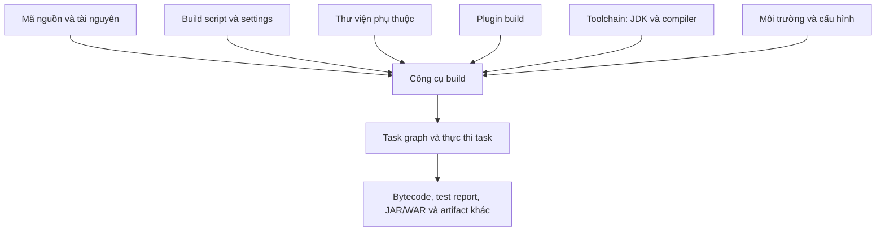

# Thư viện phụ thuộc, plugin và toolchain cũng là đầu vào

Khi nói đến đầu vào của một lần build, nhiều người chỉ nghĩ đến các tệp mã nguồn như `.java`. Trên thực tế, mã nguồn chỉ là một phần của dữ liệu quyết định kết quả build. Một dự án còn phụ thuộc vào thư viện bên ngoài, plugin của công cụ build, phiên bản Gradle hoặc Maven, JDK và compiler được chọn, cấu hình build cùng một số thông tin từ môi trường thực thi.

Những thành phần này đều có thể làm thay đổi cách mã được biên dịch, kiểm thử hoặc đóng gói. Nếu một thư viện được nâng phiên bản, plugin thay đổi cách tạo JAR, hoặc CI sử dụng JDK khác máy cá nhân, cùng một commit có thể cho kết quả khác nhau. Vì vậy, khi tìm hiểu đầu vào và đầu ra của build, cần xem dependency, plugin và toolchain là những đầu vào quan trọng của quy trình.

## 1. Một lần build nhận những đầu vào nào?

Một lần build thường sử dụng nhiều nhóm đầu vào:

| Nhóm đầu vào | Ví dụ | Ảnh hưởng đến build |
|---|---|---|
| Mã nguồn | Tệp `.java`, mã test, mã được sinh tự động | Quyết định lớp nào được biên dịch và kiểm thử. |
| Tài nguyên | YAML, properties, template, ảnh, tệp dữ liệu | Quyết định nội dung được đưa vào classpath hoặc artifact. |
| Cấu hình build | `build.gradle`, `settings.gradle`, `pom.xml` | Khai báo plugin, dependency, task, phiên bản và cách đóng gói. |
| Thư viện phụ thuộc | JAR của thư viện bên ngoài hoặc module khác | Cung cấp lớp và API mà mã nguồn cần dùng khi biên dịch hoặc chạy. |
| Plugin build | Java plugin, Spring Boot plugin, plugin kiểm tra chất lượng | Bổ sung task, cấu hình và hành vi cho build. |
| Toolchain | JDK, Java compiler, runtime dùng để chạy test | Quyết định công cụ và phiên bản nền tảng dùng để biên dịch hoặc thực thi. |
| Môi trường | Hệ điều hành, biến môi trường, cấu hình, quyền truy cập | Có thể ảnh hưởng đến task, dependency resolution và kết quả tạo ra. |

Có thể hình dung mối quan hệ tổng quát như sau:



Sơ đồ mô tả các nhóm đầu vào ở mức khái niệm. Từng task chỉ sử dụng những đầu vào liên quan đến nó. Ví dụ, task biên dịch Java cần mã nguồn, classpath và compiler; task đóng gói JAR cần các lớp đã biên dịch cùng tài nguyên; task kiểm tra dependency có thể cần thông tin về các artifact đã phân giải.

Điều quan trọng là kết quả build không chỉ phụ thuộc vào nội dung của thư mục `src`. Nó còn phụ thuộc vào những thành phần mà build script yêu cầu công cụ build sử dụng.

## 2. Thư viện phụ thuộc là đầu vào của build

**Dependency** là một thành phần mà project cần để biên dịch, kiểm thử hoặc chạy. Trong Java, dependency thường được cung cấp dưới dạng JAR và có thể đến từ Maven repository, repository nội bộ hoặc một Gradle project khác.

Ví dụ, một ứng dụng có thể dùng thư viện Apache Commons Lang để thao tác chuỗi. Mã nguồn gọi một lớp trong thư viện đó, nên compiler cần thư viện trên classpath khi biên dịch.

### 2.1. Dependency được dùng ở những giai đoạn nào?

Không phải dependency nào cũng được dùng ở mọi giai đoạn. Trong hệ sinh thái plugin Java của Gradle, một số configuration phổ biến gồm:

Configuration `api` được cung cấp khi áp dụng `java-library`; các configuration còn lại trong bảng cũng được dùng rộng rãi với Java plugin:

| Configuration | Mục đích |
|---|---|
| `implementation` | Thư viện cần cho mã chính của project. |
| `api` | Thư viện được công khai qua API của một Java library và cần hiện diện trên compile classpath của consumer. |
| `compileOnly` | Thư viện cần khi biên dịch nhưng không được đưa vào runtime classpath theo configuration này. |
| `runtimeOnly` | Thư viện cần khi chạy nhưng không cần để biên dịch mã nguồn chính. |
| `testImplementation` | Thư viện cần để biên dịch mã kiểm thử. |
| `testRuntimeOnly` | Thư viện chỉ cần khi chạy test, chẳng hạn test engine. |

Ví dụ:

```groovy
plugins {
    id 'java'
}

repositories {
    mavenCentral()
}

dependencies {
    implementation 'org.apache.commons:commons-lang3:3.17.0'

    testImplementation 'org.junit.jupiter:junit-jupiter:5.11.3'
    testRuntimeOnly 'org.junit.platform:junit-platform-launcher:1.11.3'
}

tasks.named('test') {
    useJUnitPlatform()
}
```

Trong ví dụ, `commons-lang3` tham gia dependency graph của mã chính. JUnit phục vụ mã kiểm thử. Test launcher cần ở runtime khi Gradle khởi chạy test theo nền tảng đã cấu hình. Các phiên bản trên chỉ là ví dụ về cách khai báo; dự án thực tế nên quản lý phiên bản phù hợp với nền tảng và quy tắc tương thích của nó.

Gradle dùng các configuration như `compileClasspath` và `runtimeClasspath` để xác định dependency nào có mặt ở từng giai đoạn. Một thư viện chỉ cần khi chạy không nhất thiết phải xuất hiện trên compile classpath.

### 2.2. Dependency có thể kéo theo dependency khác

Một thư viện thường sử dụng những thư viện khác. Khi project khai báo dependency trực tiếp, build tool có thể phân giải thêm các dependency bắc cầu (transitive dependencies) theo metadata của artifact.

Ví dụ:

```text
Ứng dụng
└── thư viện A
    ├── thư viện B
    │   └── thư viện D
    └── thư viện C
```

Ứng dụng chỉ khai báo A nhưng classpath có thể chứa cả B, C và D. Vì thế, thay đổi phiên bản của một thư viện trực tiếp có thể làm thay đổi cả một phần dependency graph.

Hai phiên bản khác nhau của cùng một module cũng có thể được nhiều dependency yêu cầu. Build tool cần áp dụng quy tắc chọn phiên bản, constraints, platform hoặc resolution strategy để xác định phiên bản hiệu lực. Nếu không kiểm tra dependency graph, bạn có thể không nhận ra một thư viện đã được nâng hoặc hạ phiên bản gián tiếp.

### 2.3. Repository là nơi phân giải dependency

Khai báo dependency cho build tool biết tọa độ artifact cần dùng, ví dụ:

```text
group:artifact:version
```

Repository cho biết nơi tìm artifact đó. Với Gradle:

```groovy
repositories {
    mavenCentral()
    // Có thể khai báo thêm repository nội bộ của tổ chức.
}
```

Dependency và repository có vai trò khác nhau: dependency xác định thành phần mà project yêu cầu; repository cung cấp nơi phân phối metadata và artifact. Một dependency có thể được lưu trong cache cục bộ sau lần tải đầu tiên, nhưng build trên máy khác hoặc CI vẫn cần nguồn cung cấp artifact khi cache chưa có dữ liệu.

Không nên thêm repository tùy tiện. Repository không đáng tin cậy có thể cung cấp artifact không mong muốn hoặc gây ra xung đột khi cùng tọa độ tồn tại ở nhiều nguồn. Dự án nên giới hạn repository vào những nguồn được tin cậy và quản lý quyền truy cập phù hợp.

### 2.4. Dependency thay đổi thì kết quả build có thể thay đổi

Giả sử mã nguồn không thay đổi nhưng dependency `library-x` được nâng từ phiên bản 1 lên phiên bản 2. Phiên bản mới có thể:

- Bổ sung hoặc loại bỏ API mà mã nguồn đang sử dụng.
- Thay đổi hành vi khi chạy dù mã vẫn biên dịch thành công.
- Thay đổi dependency bắc cầu và classpath.
- Thay đổi nội dung hoặc metadata được đóng gói.
- Sửa lỗi hoặc đưa vào lỗi mới ảnh hưởng đến test.

Do đó, dependency là đầu vào có ảnh hưởng trực tiếp đến bytecode, test và artifact. Để build ổn định, cần quản lý phiên bản và cách phân giải dependency một cách có chủ đích.

## 3. Plugin là đầu vào của logic build

**Plugin của build tool** mở rộng khả năng của công cụ build bằng cách bổ sung cấu hình, task, convention hoặc tích hợp với công cụ khác.

Với Gradle, Java plugin cung cấp source set `main` và `test`, các task biên dịch, test, JAR và những cấu hình dependency liên quan. Spring Boot plugin bổ sung các task và quy tắc phục vụ ứng dụng Spring Boot, chẳng hạn đóng gói executable archive và chạy ứng dụng trong quá trình phát triển.

Với Maven, plugin cung cấp các goal được gắn vào lifecycle, ví dụ compiler plugin, Surefire plugin để chạy test hoặc plugin đóng gói.

Plugin làm thay đổi những công việc mà build tool biết cách thực hiện. Vì vậy, plugin implementation và phiên bản plugin cũng là đầu vào của quá trình build.

### 3.1. Plugin khác dependency của ứng dụng

Hai loại thành phần có thể cùng được tải dưới dạng artifact nhưng phục vụ hai mục đích khác nhau:

| Thành phần | Được dùng để làm gì? | Ví dụ |
|---|---|---|
| Dependency của project | Cung cấp lớp hoặc chức năng cho mã ứng dụng, test hoặc runtime. | Thư viện JSON, JDBC driver, JUnit. |
| Plugin build | Thay đổi hoặc mở rộng cách công cụ build cấu hình và thực thi project. | Gradle Java plugin, Spring Boot Gradle plugin, Maven Compiler Plugin. |

Thêm một thư viện vào `implementation` không làm nó trở thành plugin Gradle. Tương tự, áp dụng Java plugin không có nghĩa project đang khai báo thư viện Java như một dependency của ứng dụng.

Plugin có thể sử dụng dependency riêng để hoạt động. Những thư viện đó thuộc classpath của plugin hoặc build logic, không nhất thiết được đưa vào runtime classpath của ứng dụng.

### 3.2. Khai báo plugin trong Gradle

Một project Java cơ bản có thể áp dụng plugin lõi:

```groovy
plugins {
    id 'java'
}
```

Một project Spring Boot có thể khai báo thêm plugin bên ngoài với phiên bản cụ thể:

```groovy
plugins {
    id 'java'
    id 'org.springframework.boot' version '3.3.5'
}
```

Phiên bản `3.3.5` chỉ minh họa cách gắn phiên bản vào plugin declaration. Khi chọn phiên bản thực tế, cần đối chiếu với phiên bản Gradle, Spring Boot, JDK và các plugin khác mà dự án hỗ trợ.

Gradle có thể tìm plugin thông qua các repository được cấu hình ở `pluginManagement` trong `settings.gradle` hoặc `settings.gradle.kts`. Ví dụ:

```groovy
pluginManagement {
    repositories {
        gradlePluginPortal()
        mavenCentral()
    }
}
```

Phần `plugins {}` khai báo plugin cần áp dụng; `pluginManagement.repositories` điều khiển nơi Gradle tìm plugin. Đây là cấu hình phân giải plugin, có phạm vi khác với `repositories` trong `build.gradle` dùng để phân giải dependency của project.

### 3.3. Plugin có thể thay đổi task graph và artifact

Khi áp dụng plugin, build có thể xuất hiện thêm task, configuration hoặc quy tắc mặc định. Ví dụ, Java plugin tạo các task như `compileJava`, `processResources`, `test` và `jar`. Plugin khác có thể bổ sung kiểm tra mã, tạo tài liệu, sinh source, đóng gói executable JAR hoặc cấu hình publish.

Vì vậy, nâng phiên bản plugin có thể thay đổi:

- Tên, đầu vào, đầu ra hoặc quan hệ phụ thuộc giữa các task.
- Compiler options hoặc cách xử lý source set.
- Quy tắc đóng gói JAR/WAR và metadata trong artifact.
- Cách chạy test hoặc thu thập báo cáo.
- Cách tích hợp với phiên bản Gradle, JDK hoặc plugin khác.

Một build script giống nhau nhưng dùng phiên bản plugin khác nhau có thể tạo ra kết quả khác nhau. Plugin nên được khai báo và quản lý phiên bản rõ ràng, đặc biệt trong dự án nhiều module.

## 4. Toolchain: chọn công cụ và nền tảng để build

**Toolchain** là tập hợp công cụ và môi trường kỹ thuật được chọn để thực hiện một công việc. Với dự án Java, toolchain thường đề cập đến JDK và các công cụ liên quan như Java compiler hoặc Java runtime được dùng cho task.

Một điểm dễ nhầm là JVM chạy Gradle và JDK dùng để biên dịch project có thể khác nhau. Gradle cần một JVM phù hợp để chạy chính nó. Java toolchain có thể chọn một JDK khác cho việc biên dịch, chạy test hoặc task khác được cấu hình sử dụng toolchain.

### 4.1. Cấu hình Java toolchain trong Gradle

Ví dụ, project yêu cầu Java 21:

```groovy
plugins {
    id 'java'
}

java {
    toolchain {
        languageVersion = JavaLanguageVersion.of(21)
    }
}
```

Gradle sẽ tìm một Java toolchain phù hợp với yêu cầu. Nếu môi trường có JDK phù hợp, Gradle có thể sử dụng nó. Việc tự động tải JDK còn phụ thuộc vào resolver và cấu hình provisioning được thiết lập cho build.

Toolchain giúp khai báo yêu cầu JDK ngay trong cấu hình dự án thay vì dựa hoàn toàn vào JDK mặc định của máy lập trình viên hoặc runner CI.

### 4.2. Toolchain khác source/target compatibility

Ba khái niệm sau có liên quan nhưng không giống nhau:

| Cấu hình | Ý nghĩa |
|---|---|
| Java toolchain | Chọn JDK/tool phù hợp để task sử dụng, chẳng hạn compiler và launcher. |
| `sourceCompatibility` | Mức cú pháp Java mà compiler chấp nhận cho mã nguồn trong cấu hình tương ứng. |
| `targetCompatibility` | Mức bytecode Java mà compiler tạo ra theo cấu hình tương ứng. |
| `options.release` | Yêu cầu compiler tuân theo phiên bản Java đích, bao gồm API nền tảng có thể sử dụng và mức bytecode tương ứng. |

Chỉ đặt `sourceCompatibility` hoặc `targetCompatibility` không đồng nghĩa với việc đã chọn một JDK cụ thể. Nếu máy đang dùng JDK 21, cấu hình target thấp hơn không biến compiler đó thành JDK 17. Khi cần kiểm soát JDK thực tế, hãy cấu hình toolchain.

Ví dụ kết hợp toolchain và release:

```groovy
java {
    toolchain {
        languageVersion = JavaLanguageVersion.of(21)
    }
}

tasks.withType(JavaCompile).configureEach {
    options.release = 21
}
```

Ở đây, toolchain chọn JDK 21 để biên dịch; `options.release` đặt mức Java API và bytecode mục tiêu là 21. Nếu mục tiêu là tạo bytecode tương thích với Java 17, có thể đặt release 17 trong khi dùng JDK mới hơn, miễn compiler và yêu cầu dự án hỗ trợ cấu hình đó.

### 4.3. JDK chạy Gradle có thể khác JDK của toolchain

Giả sử máy phát triển có JDK 21 và JDK 17. Gradle daemon có thể chạy bằng một JVM được chọn bởi môi trường hoặc cấu hình IDE, trong khi Java toolchain của project chọn JDK 21 cho task `compileJava`.

Điều này có nghĩa thông tin `java -version` trong terminal chưa chắc cho biết chính xác compiler mà task Gradle sẽ sử dụng. Khi điều tra khác biệt, cần xem cả JVM chạy Gradle và toolchain được chọn cho task.

Một số lệnh hữu ích:

```bash
./gradlew --version
./gradlew -q javaToolchains
```

Lệnh đầu hiển thị thông tin Gradle và JVM liên quan đến phiên chạy. Task `javaToolchains` của Gradle Java plugin liệt kê các toolchain mà Gradle phát hiện. Log task biên dịch cũng có thể giúp xác định compiler thực tế được sử dụng.

### 4.4. Toolchain trong Maven

Maven cũng có thể chọn JDK khác với JVM đang chạy Maven thông qua Maven Toolchains. Cấu hình JDK có thể được lưu trong `~/.m2/toolchains.xml` hoặc vị trí được Maven hỗ trợ, sau đó plugin toolchains chọn toolchain phù hợp trong build.

Ví dụ rút gọn về phần khai báo yêu cầu JDK trong `pom.xml`:

```xml
<build>
    <plugins>
        <plugin>
            <groupId>org.apache.maven.plugins</groupId>
            <artifactId>maven-toolchains-plugin</artifactId>
            <version>3.2.0</version>
            <executions>
                <execution>
                    <goals>
                        <goal>toolchain</goal>
                    </goals>
                </execution>
            </executions>
            <configuration>
                <toolchains>
                    <jdk>
                        <version>21</version>
                    </jdk>
                </toolchains>
            </configuration>
        </plugin>
    </plugins>
</build>
```

Máy chạy Maven cũng cần có toolchain phù hợp được đăng ký trong `toolchains.xml`; chỉ thêm cấu hình yêu cầu trong POM không tự tạo ra JDK trên máy. Compiler plugin cần được cấu hình phù hợp để sử dụng toolchain và release mục tiêu của dự án.

## 5. Phiên bản công cụ build cũng ảnh hưởng kết quả

Ngoài dependency, plugin và JDK, chính Gradle hoặc Maven cũng là một đầu vào. Phiên bản công cụ build quyết định cú pháp được hỗ trợ, hành vi task, khả năng tương thích plugin và một số quy tắc phân giải dependency.

Với Gradle, dự án thường commit Gradle Wrapper. Tệp `gradle/wrapper/gradle-wrapper.properties` chỉ định distribution cần sử dụng. Thành viên nhóm và CI nên gọi `./gradlew` hoặc `gradlew.bat` để dùng phiên bản dự án đã khai báo.

Với Maven, Maven Wrapper (`mvnw`, `mvnw.cmd` và thư mục `.mvn/wrapper`) có vai trò tương tự: chọn phiên bản Maven mà repository yêu cầu.

Wrapper không tự cố định toàn bộ môi trường. Nó giúp cố định phiên bản build tool; dự án vẫn cần quản lý JDK, plugin, dependency và những đầu vào khác.

## 6. Tính tái lập: giữ các đầu vào ổn định

Một quy trình build đáng tin cậy cần giúp các lần chạy cùng đầu vào tạo ra kết quả tương đương trong điều kiện được kiểm soát. Điều này thường được gọi là khả năng tái lập (reproducibility).

Nếu dependency, plugin hoặc toolchain thay đổi ngoài dự kiến, kết quả có thể thay đổi dù commit mã nguồn không đổi.

### 6.1. Khai báo phiên bản rõ ràng

Hạn chế dùng phiên bản động như `latest.release`, version range rộng hoặc dependency snapshot thay đổi nội dung theo thời gian trong những build cần tính ổn định. Ưu tiên khai báo phiên bản cụ thể hoặc dùng version catalog/platform có quản lý tập trung.

Ví dụ:

```groovy
dependencies {
    implementation 'org.apache.commons:commons-lang3:3.17.0'
}
```

Khi cần nâng phiên bản, thực hiện thay đổi có chủ đích, chạy kiểm thử và ghi nhận phiên bản mới trong repository.

### 6.2. Dependency locking

Gradle hỗ trợ dependency locking để ghi lại các phiên bản đã được chọn cho những configuration được bật locking. Ví dụ:

```groovy
dependencyLocking {
    lockAllConfigurations()
}
```

Sau khi bật locking, có thể chạy task phù hợp để ghi lại lock state:

```bash
./gradlew dependencies --write-locks
```

Tệp lock ghi lại các phiên bản được phân giải, giúp lần build tiếp theo sử dụng cùng lựa chọn phiên bản trong phạm vi locking. Locking không thay thế việc khai báo dependency và cũng không tự bảo đảm artifact tải về luôn là nội dung đáng tin cậy.

### 6.3. Dependency verification

Gradle có cơ chế dependency verification để kiểm tra checksum hoặc chữ ký của artifact đã phân giải theo metadata verification được quản lý trong repository. Cơ chế này giúp phát hiện trường hợp nội dung artifact không khớp với giá trị được tin cậy.

Dependency locking trả lời câu hỏi **phiên bản nào được chọn**; verification giúp kiểm tra **nội dung artifact tải về có khớp với dữ liệu xác minh đã khai báo hay không**. Hai cơ chế giải quyết hai vấn đề khác nhau và có thể dùng kết hợp.

### 6.4. Quản lý phiên bản plugin và toolchain

Plugin nên được khai báo phiên bản cụ thể, tránh phụ thuộc vào lựa chọn ngầm hoặc phiên bản thay đổi theo môi trường. Với Java toolchain, nên khai báo language version và vendor khi dự án có yêu cầu. Cần nhớ rằng `languageVersion = 21` xác định dòng Java 21; nó không nhất thiết khóa đến một bản vá JDK duy nhất. Nếu cần kiểm soát nghiêm ngặt hơn, môi trường runner hoặc cơ chế cung cấp JDK phải được quản lý bổ sung.

Đồng thời, hãy dùng Gradle/Maven Wrapper để thống nhất phiên bản công cụ build. Các yếu tố này kết hợp với nhau tạo nên nền tảng cho build ổn định giữa các máy.

## 7. Các đầu vào ảnh hưởng đến task và build cache

Gradle tổ chức công việc theo task. Mỗi task có thể có đầu vào và đầu ra được khai báo. Khi đầu vào liên quan thay đổi, task có thể cần chạy lại; khi đầu vào không thay đổi và task đủ điều kiện, Gradle có thể bỏ qua task hoặc tái sử dụng kết quả từ build cache.

Ví dụ, task biên dịch Java có đầu vào gồm mã nguồn, classpath và các tùy chọn compiler. Nếu một thư viện trong compile classpath thay đổi, bytecode có thể cần được biên dịch lại dù tệp `.java` không thay đổi.

Một task tùy chỉnh có thể khai báo input/output bằng annotation trên property:

```groovy
abstract class GenerateIndex extends DefaultTask {
    @Input
    abstract Property<String> getIndexTitle()

    @InputFiles
    @PathSensitive(PathSensitivity.RELATIVE)
    abstract ConfigurableFileCollection getSourceFiles()

    @OutputFile
    abstract RegularFileProperty getOutputFile()

    @TaskAction
    void generate() {
        def lines = sourceFiles.files
            .sort { it.path }
            .collect { it.name }

        outputFile.get().asFile.withWriter('UTF-8') { writer ->
            writer.println(indexTitle.get())
            lines.each { writer.println(it) }
        }
    }
}
```

Đây là ví dụ minh họa mô hình khai báo task, không phải một generator đầy đủ cho mọi dự án. `@Input`, `@InputFiles` và `@OutputFile` giúp Gradle biết dữ liệu nào quyết định kết quả. Nếu task đọc thêm một biến môi trường, tệp cấu hình hoặc dữ liệu bên ngoài nhưng không khai báo nó là input, Gradle có thể đánh giá sai việc task có cần chạy lại hay không.

Đầu vào phải mô tả đúng những gì task thực sự sử dụng. Khai báo thiếu làm cache hoặc incremental build có thể dùng kết quả cũ không còn phù hợp. Khai báo thừa khiến task chạy lại không cần thiết và làm giảm hiệu quả.

Không phải mọi task đều tự động cache được. Task phải tuân theo các điều kiện về tính xác định, input/output và side effect của cơ chế incremental build hoặc build cache. Một task gửi email, gọi dịch vụ bên ngoài hoặc tạo kết quả phụ thuộc thời điểm hiện tại không thể mặc nhiên được xem là một phép biến đổi thuần túy có thể tái sử dụng an toàn.

## 8. Phân tích dependency và kiểm tra đầu vào thực tế

Khi build thất bại hoặc kết quả khác dự kiến, cần kiểm tra các đầu vào đã được phân giải thay vì chỉ nhìn vào tệp khai báo.

### 8.1. Xem dependency graph trong Gradle

Để xem dependency theo configuration:

```bash
./gradlew dependencies --configuration compileClasspath
./gradlew dependencies --configuration runtimeClasspath
```

Lệnh đầu hiển thị các dependency dùng khi biên dịch mã chính; lệnh sau hiển thị dependency của runtime classpath. Với test, có thể xem `testCompileClasspath` hoặc `testRuntimeClasspath`.

Khi muốn biết vì sao một module được chọn phiên bản cụ thể, dùng:

```bash
./gradlew dependencyInsight --dependency commons-lang3 --configuration runtimeClasspath
```

Lệnh này giúp xem nguồn gốc yêu cầu dependency, phiên bản được chọn và các quy tắc ảnh hưởng đến lựa chọn đó.

### 8.2. Kiểm tra plugin và task

Để xem các task mà build hiện có:

```bash
./gradlew tasks --all
```

Task xuất hiện phụ thuộc vào plugin đã áp dụng và cấu hình project. Nếu một task mong đợi không tồn tại, hãy kiểm tra plugin đã được khai báo và áp dụng đúng project chưa.

Khi plugin được nâng phiên bản, nên đọc release notes và kiểm tra những task, extension hoặc quy tắc đóng gói mà project đang dùng. Không nên suy luận rằng chỉ cần mã nguồn biên dịch thành công là plugin mới hoàn toàn tương thích.

### 8.3. Kiểm tra toolchain

Một số điểm cần xác nhận:

- Phiên bản JDK mà Gradle daemon hoặc Maven process đang sử dụng.
- Phiên bản và vendor của Java toolchain được task chọn.
- Compiler options và release mục tiêu.
- Java runtime được dùng để chạy test hoặc ứng dụng trong task.
- CI có cài đặt hoặc provisioning được JDK phù hợp hay không.

Trong Gradle, có thể dùng `./gradlew --version`, `./gradlew -q javaToolchains` và log chi tiết của task biên dịch. Với Maven, xem thông tin Java trong `mvn -version` và kiểm tra cấu hình toolchains.

## 9. Khi local thành công nhưng CI thất bại

Một tình huống phổ biến là lập trình viên chạy build thành công trên máy cá nhân nhưng pipeline CI lại thất bại. Khi đó, đừng chỉ so sánh mã nguồn. Hãy so sánh toàn bộ đầu vào của build.

| Đầu vào | Khác biệt có thể gặp | Hướng kiểm tra |
|---|---|---|
| Phiên bản Gradle/Maven | Máy cá nhân chạy bản cài toàn cục mới hơn, CI chạy bản khác. | Dùng Wrapper của repository ở cả hai nơi. |
| JDK/toolchain | IDE dùng JDK 21, runner chỉ có JDK 17 hoặc chọn vendor khác. | Kiểm tra JVM chạy build và toolchain được chọn. |
| Dependency | Máy cá nhân có cache, CI cần tải artifact; dependency động có thể đã thay đổi. | Xem dependency graph, lockfile, repository và log resolution. |
| Plugin | Phiên bản hoặc repository plugin khác nhau; plugin không tương thích Gradle/JDK. | Khai báo version rõ ràng và kiểm tra plugin resolution. |
| Hệ điều hành | Đường dẫn, phân biệt chữ hoa/thường hoặc lệnh shell khác nhau. | Kiểm tra đường dẫn và script trên hệ điều hành của runner. |
| Biến môi trường | Máy cá nhân có property hoặc secret mà CI chưa cấu hình. | Liệt kê biến cần thiết và kiểm tra cấu hình CI an toàn. |
| Cache | Cache cục bộ che giấu đầu vào chưa được khai báo hoặc artifact cũ. | Thử build sạch và kiểm tra task input/output. |

Một quy trình chẩn đoán có thể là:

1. Ghi nhận commit và lệnh build thực tế mà CI chạy.
2. Dùng Gradle/Maven Wrapper thay cho lệnh cài toàn cục.
3. So sánh phiên bản JDK, toolchain, plugin và dependency đã phân giải.
4. Chạy build sạch để loại trừ việc vô tình dùng output cũ.
5. Đọc log của task đầu tiên thất bại và xác định input nào khác hoặc thiếu.
6. Nếu cần, bổ sung cấu hình hoặc khai báo input để local và CI sử dụng cùng quy tắc.

Ví dụ, nếu CI báo không tìm thấy một lớp thuộc thư viện, hãy kiểm tra compile classpath thay vì chỉ kiểm tra xem JAR có tồn tại trong cache máy cá nhân hay không. Nếu mã biên dịch được nhưng test lỗi vì API không tồn tại, hãy xem runtime classpath và phiên bản dependency được chọn.

## 10. Một số hiểu nhầm thường gặp

### “Chỉ mã nguồn mới là đầu vào của build”

Không đúng. Dependency, plugin, toolchain, cấu hình build và môi trường đều có thể ảnh hưởng đến task. Hai lần build cùng mã nguồn nhưng dùng dependency hoặc compiler khác nhau có thể tạo kết quả khác nhau.

### “Thư viện dependency và plugin là một loại”

Chúng có thể đều được tải dưới dạng artifact nhưng có vai trò khác nhau. Dependency cung cấp chức năng cho ứng dụng hoặc test; plugin mở rộng cách build tool cấu hình và thực thi project.

### “Có JDK trên máy là Gradle chắc chắn dùng đúng JDK đó”

Không nhất thiết. JVM chạy Gradle có thể khác toolchain mà task biên dịch hoặc test sử dụng. Hãy kiểm tra toolchain thực tế thay vì chỉ dựa vào `java -version`.

### “Đặt targetCompatibility là đã chọn đúng JDK”

Không. `targetCompatibility` liên quan đến mức bytecode đầu ra. Toolchain mới là cơ chế chọn JDK/tool phù hợp cho task.

### “Dùng Gradle Wrapper là build đã hoàn toàn tái lập”

Wrapper giúp thống nhất phiên bản Gradle, nhưng không tự khóa dependency, plugin, JDK, biến môi trường và mọi dữ liệu bên ngoài. Cần quản lý các đầu vào đó riêng.

### “Build cache luôn an toàn và sẽ tự biết mọi thứ task đã đọc”

Build tool chỉ có thể đánh giá chính xác dựa trên những đầu vào được khai báo và những quy tắc task tuân thủ. Nếu task đọc một tệp hoặc biến môi trường không được khai báo, kết quả cache có thể không còn hợp lệ.

## 11. Thực hành: quan sát đầu vào của một project Gradle

Trong một project Java có Gradle Wrapper, hãy lần lượt thực hiện:

1. Mở `settings.gradle` và `build.gradle` để xác định plugin, repository, dependency và cấu hình Java toolchain.
2. Chạy `./gradlew --version` để xem phiên bản Gradle và JVM của phiên chạy.
3. Chạy `./gradlew -q javaToolchains` để xem các JDK Gradle phát hiện.
4. Chạy `./gradlew dependencies --configuration compileClasspath` để xem dependency dùng khi biên dịch.
5. Chạy `./gradlew dependencies --configuration runtimeClasspath` để so sánh dependency lúc chạy.
6. Chạy `./gradlew tasks --all` để xem task được plugin bổ sung.
7. Chạy `./gradlew clean build` và quan sát task biên dịch, test, đóng gói.
8. Nếu dependency có nhiều phiên bản, dùng `dependencyInsight` để tìm lý do phiên bản được chọn.

Khi thực hành, hãy trả lời các câu hỏi:

- Nếu không có thư viện trong `compileClasspath`, task biên dịch có thể gặp vấn đề gì?
- Một thư viện chỉ được khai báo trong `runtimeOnly` có được dùng trực tiếp trong mã nguồn khi biên dịch không?
- Plugin Java bổ sung những task hoặc configuration nào?
- JDK chạy Gradle có nhất thiết là JDK mà task `compileJava` sử dụng không?
- Nếu chỉ nâng phiên bản plugin, những phần nào của build có thể thay đổi dù mã nguồn không đổi?
- Những đầu vào nào cần được khóa hoặc kiểm soát để CI có thể tái hiện build ổn định?

## 12. Kết luận

Thư viện phụ thuộc, plugin và toolchain đều là đầu vào của build vì chúng ảnh hưởng đến classpath, task graph, compiler, runtime và cách artifact được tạo ra. Dependency cung cấp chức năng cho mã ứng dụng hoặc test; plugin mở rộng logic của công cụ build; toolchain xác định JDK và công cụ được dùng để thực hiện các tác vụ.

Muốn build ổn định giữa máy cá nhân và CI, cần quản lý phiên bản Gradle/Maven bằng Wrapper, khai báo phiên bản plugin và dependency rõ ràng, kiểm soát dependency graph, chọn Java toolchain phù hợp và khai báo đầy đủ input/output cho task tùy chỉnh. Khi có lỗi, hãy kiểm tra các đầu vào đã được phân giải và môi trường thực thi thay vì chỉ nhìn vào mã nguồn. Điều đó giúp giải thích vì sao cùng một commit có thể tạo ra kết quả khác nhau và giúp quy trình build đáng tin cậy hơn.
