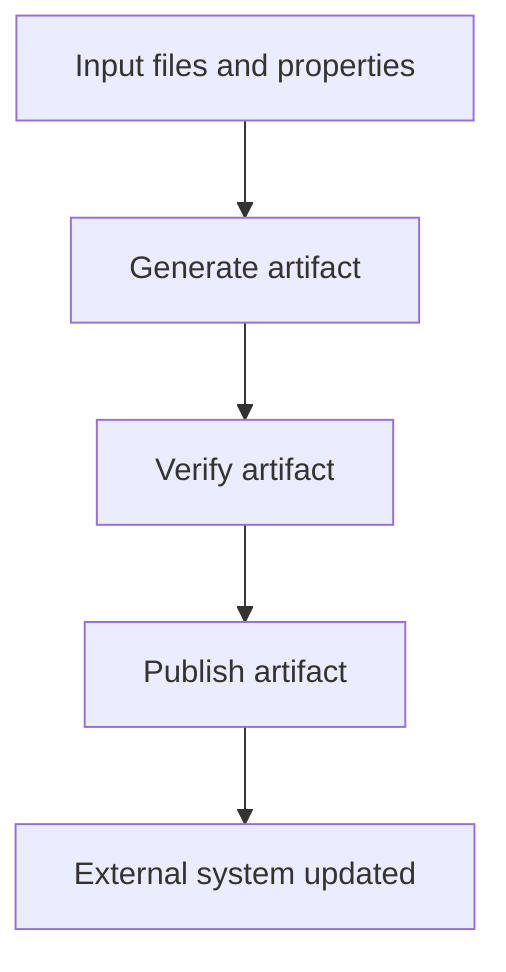

# Thư mục làm việc, tệp tạm và tác dụng phụ của tác vụ

Một Gradle task có thể đọc file đầu vào, ghi file kết quả, gọi một chương trình bên ngoài, tạo dữ liệu trung gian hoặc tương tác với hệ thống khác. Những thao tác này đều phụ thuộc vào vị trí chạy và trạng thái môi trường. Nếu đường dẫn không rõ ràng, tệp tạm không được quản lý hoặc tác dụng phụ xảy ra ngoài task graph, build dễ tạo ra kết quả khác nhau giữa máy phát triển và CI.

Khi thiết kế task, cần xác định rõ bốn điều: **task đọc dữ liệu ở đâu, chạy tiến trình trong thư mục nào, ghi đầu ra vào đâu và những thay đổi bên ngoài nào có thể xảy ra**. Gradle cung cấp mô hình thư mục, API task input/output và thư mục tạm để các quyết định đó được thể hiện trong cấu hình build.

## 1. Phân biệt các loại thư mục trong Gradle

Một Gradle build có thể gồm một project hoặc nhiều project. Mỗi project có thư mục riêng, trong khi toàn bộ build có một thư mục gốc. Ngoài ra, từng project thường có thư mục dành cho kết quả build.

| Khái niệm | Ý nghĩa |
|---|---|
| `settingsDir` | Thuộc tính của `Settings` trong settings script, chỉ thư mục chứa settings file của build. |
| `rootDir` | Thư mục gốc của Gradle build. |
| `projectDir` | Thư mục của project hiện tại; trong multi-project build, mỗi subproject có thể có một thư mục riêng. |
| `layout.projectDirectory` | `Directory` provider đại diện cho thư mục của project hiện tại. |
| `layout.buildDirectory` | `DirectoryProperty` đại diện cho thư mục chứa đầu ra build của project. |
| `temporaryDir` của task | Thư mục tạm dành cho task cụ thể. |

Ví dụ một build nhiều project:

```text
workspace/
├── settings.gradle
├── build.gradle
├── app/
│   ├── build.gradle
│   └── src/
└── shared/
    ├── build.gradle
    └── src/
```

Ở cấu trúc này, `rootDir` trỏ đến `workspace/`; `projectDir` của project `app` trỏ đến `workspace/app/`; `projectDir` của project `shared` trỏ đến `workspace/shared/`. Không nên mặc định mọi task trong build đều làm việc từ cùng một thư mục project.

### 1.1. Tạo đường dẫn từ project directory

Trong build script, có thể dùng `layout.projectDirectory` để mô tả vị trí file thuộc project:

```groovy
def sourceFile = layout.projectDirectory.file('src/data/input.json')
def configFile = layout.projectDirectory.file('config/tool.properties')
```

`layout.projectDirectory.file(...)` trả về một `RegularFile` mô tả vị trí file; việc lấy đối tượng `File` không đọc nội dung file. Nội dung chỉ được đọc khi task thực hiện thao tác đọc:

```groovy
tasks.register('inspectInput') {
    doLast {
        def input = layout.projectDirectory.file('src/data/input.json').asFile
        if (!input.isFile()) {
            throw new GradleException("Input file not found: ${input}")
        }
        logger.lifecycle("Reading ${input}")
    }
}
```

Với API `Project.file('relative/path')`, đường dẫn tương đối cũng được phân giải từ `projectDir` của project đang cấu hình. Nếu cần tham chiếu file thuộc root project từ một subproject, hãy thể hiện rõ ý định bằng `rootProject.layout.projectDirectory.file(...).asFile` hoặc `rootProject.file(...)`.

Không nên ghép chuỗi đường dẫn dựa trên giả định về thư mục hiện hành của terminal. Cùng một lệnh `./gradlew` có thể được gọi từ nhiều vị trí khác nhau, trong khi Gradle project directory vẫn được xác định bởi cấu trúc build. Dùng `layout.projectDirectory`, `rootProject` và `layout.buildDirectory` giúp đường dẫn ổn định hơn.

### 1.2. Đặt đầu ra vào build directory

File được tạo ra bởi build nên thường nằm trong `build/` của project tương ứng. Dùng `layout.buildDirectory` để tạo provider cho đầu ra:

```groovy
def generatedFile = layout.buildDirectory.file('generated/reports/summary.json')
def generatedDirectory = layout.buildDirectory.dir('generated/classes')
```

Ví dụ trên mô tả hai vị trí:

```text
<projectDir>/build/
└── generated/
    ├── reports/
    │   └── summary.json
    └── classes/
```

Gradle có thể được cấu hình để đổi build directory. Vì vậy, nên lấy đường dẫn qua `layout.buildDirectory` thay vì tự ghép chuỗi `projectDir + '/build'`. Đầu ra đặt trong build directory cũng dễ được quản lý bởi task `clean` của project.

Nếu một task tạo file dùng làm đầu vào cho task khác, hãy khai báo quan hệ đó qua provider và task dependency phù hợp. Không nên dựa vào việc task tình cờ chạy trước vì thứ tự trong terminal hoặc vì file đã tồn tại từ lần build cũ.

## 2. Thư mục làm việc của tiến trình

Thư mục làm việc (working directory) là thư mục hiện hành mà một tiến trình sử dụng khi xử lý đường dẫn tương đối. Nó ảnh hưởng đến lệnh đọc file như `./config.json`, nơi chương trình ghi log tương đối, cách công cụ tìm cấu hình mặc định và một số lệnh phụ thuộc vào vị trí repository.

Cần phân biệt thư mục của Gradle project với working directory của chương trình do task khởi chạy. Một task `Exec` hoặc `JavaExec` có thể gọi chương trình bên ngoài; chương trình đó có working directory do task cấu hình. Không nên suy luận working directory chỉ từ nơi người dùng mở terminal hoặc từ vị trí file build script.

### 2.1. Chỉ định working directory cho `Exec`

Task `Exec` chạy một tiến trình hệ điều hành. Có thể chỉ định rõ thư mục làm việc:

```groovy
tasks.register('showRepositoryStatus', Exec) {
    workingDir = layout.projectDirectory.asFile
    commandLine 'git', 'status', '--short'
}
```

Trong ví dụ, lệnh Git chạy từ thư mục project hiện tại. Nếu project là một subproject nhưng lệnh cần chạy tại root repository, hãy đặt `workingDir` thành `rootProject.layout.projectDirectory.asFile`.

Đường dẫn đầu vào và đầu ra của chương trình ngoài cũng cần được xác định rõ. Nếu truyền đường dẫn tương đối qua `commandLine`, chương trình thường diễn giải chúng theo working directory của tiến trình. Khi có thể, truyền đường dẫn tuyệt đối được lấy từ Gradle layout provider để giảm sự phụ thuộc vào thư mục hiện hành.

### 2.2. Chỉ định working directory cho `JavaExec`

`JavaExec` khởi chạy một lớp Java trong JVM riêng. Task cũng có thuộc tính `workingDir`:

```groovy
tasks.register('runDataTool', JavaExec) {
    classpath = sourceSets.main.runtimeClasspath
    mainClass = 'com.example.tools.DataTool'
    workingDir = layout.projectDirectory.asFile
    args layout.projectDirectory.file('src/data/input.json').asFile.absolutePath
}
```

Lớp `DataTool` nhận đường dẫn file đầu vào làm tham số. Việc đặt working directory tường minh giúp các đường dẫn tương đối mà chương trình sử dụng có ý nghĩa nhất quán.

Nếu chương trình Java được viết để chạy ở nhiều môi trường, nên truyền cấu hình hoặc đường dẫn cần thiết qua tham số, system properties hoặc biến môi trường thay vì để chương trình tự suy đoán vị trí file theo working directory.

### 2.3. Đừng nhầm working directory với classpath

Classpath cho biết JVM tìm lớp và tài nguyên Java ở đâu. Working directory cho biết tiến trình phân giải các đường dẫn file tương đối từ đâu. Hai khái niệm độc lập.

Ví dụ, một lớp có thể được nạp thành công từ `build/classes/java/main` nhưng khi mở `config/app.yml` bằng đường dẫn tương đối thì vẫn thất bại vì file cấu hình không nằm dưới working directory. Khi điều tra lỗi “file not found”, hãy kiểm tra cả classpath lẫn working directory và đường dẫn thực tế mà chương trình đang mở.

## 3. Tệp tạm và thư mục tạm của task

Tệp tạm chứa dữ liệu trung gian chỉ cần trong một giai đoạn xử lý, chẳng hạn file đã giải nén, nội dung chuyển đổi trước khi ghi kết quả cuối cùng, danh sách file trung gian hoặc dữ liệu trao đổi với một công cụ ngoài.

Gradle cung cấp `temporaryDir` trên task. Mỗi task có một thư mục tạm riêng; theo cấu hình mặc định, thư mục này nằm dưới `build/tmp/` của project và có tên gắn với task. Có thể dùng nó để tránh việc nhiều task ghi đè lên cùng một file tạm.

Ví dụ:

```groovy
tasks.register('prepareIntermediateData') {
    doLast {
        temporaryDir.mkdirs()

        def intermediateFile = new File(temporaryDir, 'normalized-data.txt')
        intermediateFile.setText('prepared data', 'UTF-8')

        logger.lifecycle("Intermediate file: ${intermediateFile}")
    }
}
```

`temporaryDir` là vị trí dành cho dữ liệu trung gian của task, không phải vị trí mặc định cho artifact cuối cùng. Nếu một task khác cần dùng kết quả lâu dài, hãy ghi kết quả vào một đường dẫn output được khai báo rõ ràng. Không nên bắt task khác đọc trực tiếp file tạm nội bộ nếu file đó không được mô hình hóa thành output của task tạo ra.

### 3.1. Tạo file tạm duy nhất

Khi nhiều lần chạy hoặc nhiều task có thể hoạt động đồng thời, không nên dùng tên file tạm cố định trong một thư mục chung như `/tmp/output.tmp`. Hai tiến trình có thể ghi đè hoặc đọc nhầm dữ liệu của nhau.

Java NIO cung cấp API tạo file và thư mục tạm có tên duy nhất:

```java
import java.io.IOException;
import java.nio.file.Files;
import java.nio.file.Path;

public class TemporaryFiles {
    public Path createTemporaryFile(Path directory) throws IOException {
        Files.createDirectories(directory);
        return Files.createTempFile(directory, "convert-", ".tmp");
    }
}
```

Trong Gradle task, có thể truyền `temporaryDir.toPath()` làm thư mục đích. API tạo file tạm sẽ sinh tên không trùng với file đã tồn tại tại thời điểm tạo, giảm nguy cơ xung đột giữa các lần chạy.

### 3.2. Dọn dẹp file tạm

Không nên giả định file tạm sẽ tự biến mất ngay sau khi task kết thúc. Task có thể chạy lại, bị dừng giữa chừng hoặc để lại dữ liệu cần kiểm tra. Hãy xác định rõ vòng đời file tạm và dọn dẹp trong `finally` khi file chỉ có ý nghĩa trong một lần thực thi.

Ví dụ Java:

```java
Path tempFile = Files.createTempFile("conversion-", ".tmp");
try {
    // Ghi và xử lý dữ liệu trung gian.
} finally {
    Files.deleteIfExists(tempFile);
}
```

Nếu cần giữ file để chẩn đoán khi task thất bại, có thể chỉ xóa khi thành công hoặc cung cấp một tùy chọn debug có chủ đích. Khi đó cần ghi rõ nơi lưu, thời hạn giữ và cách xóa dữ liệu cũ để tránh thư mục tạm tăng vô hạn.

Task `clean` của Gradle thường xóa build directory của project, do đó các file trong `build/tmp/` và các đầu ra nằm trong build directory được dọn theo. File đặt trong thư mục tạm của hệ điều hành, thư mục người dùng hoặc vị trí bên ngoài build directory không tự động thuộc phạm vi đó. Muốn dọn chúng, task phải tự quản lý vòng đời hoặc dùng cơ chế cleanup riêng.

### 3.3. Dùng thư mục tạm của hệ điều hành khi phù hợp

Java cung cấp `java.io.tmpdir` để lấy thư mục tạm do môi trường runtime cấu hình. Có thể dùng `Files.createTempFile` hoặc `Files.createTempDirectory` mà không chỉ định thư mục để hệ điều hành chọn vị trí.

```java
Path tempDirectory = Files.createTempDirectory("my-tool-");
```

Đây là lựa chọn phù hợp khi công cụ cần một vùng tạm độc lập với build directory hoặc cần tuân theo chính sách của môi trường. Tuy nhiên, phải tự quản lý việc xóa file và thư mục. Nếu dữ liệu trung gian chỉ phục vụ một Gradle task, `temporaryDir` thường giúp ownership và cleanup rõ ràng hơn.

## 4. Khai báo đầu vào và đầu ra của task

Gradle cần biết task phụ thuộc vào file, thư mục và giá trị nào để xác định khi nào task cần chạy lại. Task cũng cần công bố những file hoặc thư mục mà nó tạo ra. Các khai báo này là cơ sở cho incremental build, up-to-date checking và build cache.

Trong task có thể khai báo:

| API | Mục đích |
|---|---|
| `inputs.file(...)` | Khai báo một file đầu vào. |
| `inputs.files(...)` | Khai báo một tập file đầu vào. |
| `inputs.dir(...)` | Khai báo một thư mục đầu vào. |
| `inputs.property(...)` | Khai báo một giá trị ảnh hưởng đến kết quả task. |
| `outputs.file(...)` | Khai báo file đầu ra. |
| `outputs.dir(...)` | Khai báo thư mục đầu ra. |

Ví dụ task chuyển đổi file dữ liệu:

```groovy
def sourceFile = layout.projectDirectory.file('src/data/input.txt')
def resultFile = layout.buildDirectory.file('generated/data/result.txt')

tasks.register('normalizeData') {
    inputs.file(sourceFile)
    outputs.file(resultFile)

    doLast {
        def source = sourceFile.asFile
        def result = resultFile.get().asFile

        result.parentFile.mkdirs()
        result.setText(source.getText('UTF-8').trim().toLowerCase(), 'UTF-8')
    }
}
```

Task khai báo file nguồn và file kết quả trước khi thực thi. Khi file nguồn thay đổi, Gradle có thể xác định đầu vào đã thay đổi và chạy lại task. Nếu đầu vào không đổi và đầu ra vẫn hợp lệ, task có thể được đánh dấu `UP-TO-DATE`.

### 4.1. Đầu vào phải bao gồm mọi yếu tố ảnh hưởng kết quả

Nếu task đọc thêm một file cấu hình, sử dụng một tham số mode hoặc phụ thuộc vào một thư mục dữ liệu khác, các yếu tố đó cũng phải được khai báo. Nếu không, Gradle có thể không nhận ra kết quả đã lỗi thời.

Ví dụ khai báo thêm giá trị cấu hình:

```groovy
def mode = providers.gradleProperty('normalizeMode').orElse('standard')

tasks.register('normalizeData') {
    inputs.file(sourceFile)
    inputs.property('mode', mode)
    outputs.file(resultFile)

    doLast {
        logger.lifecycle("Normalization mode: ${mode.get()}")
        // Thực hiện chuyển đổi theo mode.
    }
}
```

`Provider` giúp Gradle nhận giá trị theo cách lazy, tức là chỉ cần lấy giá trị khi task thực sự thực thi. Khi một property ảnh hưởng đến đầu ra, hãy đưa nó vào tập input. Nếu task còn đọc biến môi trường, file bên ngoài hoặc thông tin phiên bản công cụ, cần cân nhắc cách mô hình hóa chúng để thay đổi có thể làm mất hiệu lực kết quả cũ.

Không nên đưa bí mật như mật khẩu hoặc access token vào log. Với tác vụ phụ thuộc credential, cần quản lý bí mật qua môi trường hoặc secret store phù hợp và đánh giá riêng khả năng cache. Tránh ghi credential vào file đầu ra hoặc thư mục tạm tồn tại lâu.

### 4.2. Đầu ra phải là sản phẩm ổn định của task

Đầu ra cần được ghi vào vị trí xác định, có quan hệ rõ với task và có thể tái tạo từ các input đã khai báo. Không nên ghi artifact vào một thư mục tùy ý trên máy người dùng rồi mong Gradle tự theo dõi.

Nếu task tạo nhiều file cùng thuộc một sản phẩm, có thể khai báo `outputs.dir(...)`. Nếu chỉ tạo một file kết quả, dùng `outputs.file(...)`. Nếu file output cần được task khác sử dụng, hãy nối provider output với input của task tiếp theo để Gradle hiểu quan hệ phụ thuộc.

Không khai báo một output giả chỉ để task có vẻ up-to-date. Output phải là dữ liệu thực sự do task sở hữu. Một task ghi dữ liệu ra database hoặc gửi request đến dịch vụ ngoài không thể được mô tả đầy đủ chỉ bằng một file đánh dấu rỗng.

## 5. Tác dụng phụ của tác vụ là gì?

Tác dụng phụ (side effect) là thay đổi mà task gây ra ngoài việc tính toán một giá trị nội bộ. Các ví dụ thường gặp:

- Tạo, sửa hoặc xóa file trên hệ thống file.
- Gọi chương trình bên ngoài hoặc thực hiện lệnh shell.
- Khởi động hoặc dừng service, container hay tiến trình nền.
- Ghi dữ liệu vào database, message broker hoặc object storage.
- Gửi HTTP request, upload artifact hoặc triển khai ứng dụng.
- Thay đổi trạng thái của tài nguyên dùng chung trong môi trường build.

Không phải tác dụng phụ nào cũng xấu. Build thường cần tạo file, chạy compiler và đóng gói artifact. Vấn đề xuất hiện khi side effect không được thể hiện rõ trong task, xảy ra ngoài phạm vi lệnh người dùng yêu cầu hoặc khiến build không thể chạy lặp lại một cách an toàn.

### 5.1. Chỉ thực hiện side effect trong task action

Gradle có giai đoạn cấu hình và giai đoạn thực thi task. Trong giai đoạn cấu hình, build script và plugin được đánh giá để tạo task graph. Trong giai đoạn thực thi, Gradle chạy action của những task cần thiết.

Không nên ghi file, gọi mạng hoặc chạy chương trình bên ngoài ngay trong phần cấu hình của build script. Nếu làm vậy, side effect có thể xảy ra ngay cả khi task tương ứng không được yêu cầu, hoặc lặp lại trong quá trình cấu hình nhiều project.

Ví dụ không nên làm:

```groovy
// Side effect xảy ra ngay khi build script được cấu hình.
file('build/generated.txt').text = 'generated'
```

Hãy chuyển thao tác vào task action:

```groovy
tasks.register('generateText') {
    def output = layout.buildDirectory.file('generated.txt')
    outputs.file(output)

    doLast {
        def target = output.get().asFile
        target.parentFile.mkdirs()
        target.setText('generated', 'UTF-8')
    }
}
```

Khi đó thao tác ghi file chỉ được thực hiện nếu task `generateText` nằm trong task graph và cần thực thi. Đây cũng là cách tổ chức phù hợp hơn với configuration cache và các cơ chế tối ưu build của Gradle.

### 5.2. Tách xử lý dữ liệu khỏi thao tác bên ngoài

Một task vừa chuyển đổi dữ liệu, vừa upload kết quả, vừa cập nhật trạng thái dịch vụ sẽ khó kiểm soát. Nếu upload thất bại sau khi file đã được tạo, lần chạy tiếp theo có thể lặp lại toàn bộ công việc và tạo trạng thái không nhất quán.

Nên chia thành các task có trách nhiệm rõ:



- `generateArtifact` xử lý input và tạo artifact trong build directory. Đây thường là tác vụ có thể theo dõi input/output và có thể phù hợp với cache nếu thực sự xác định được toàn bộ input.
- `verifyArtifact` kiểm tra artifact đã tạo, ví dụ cấu trúc, checksum hoặc định dạng.
- `publishArtifact` thực hiện upload hoặc thay đổi hệ thống ngoài. Đây là side effect cần được gọi có chủ đích và có quy tắc retry/idempotency riêng.

Việc tách task giúp có thể chạy lại bước tạo artifact mà không nhất thiết upload lại, hoặc điều tra artifact trước khi thực hiện thao tác xuất bản.

### 5.3. Side effect cần có tính idempotent khi có thể

Một thao tác idempotent có thể được thực hiện lặp lại mà không làm trạng thái cuối khác đi ngoài kết quả mong muốn. Ví dụ, ghi đè một file được tạo hoàn toàn từ input xác định thường dễ lặp lại hơn thao tác nối thêm nội dung vào cuối file ở mỗi lần chạy.

Với thao tác ngoài như tạo tài nguyên cloud, gửi dữ liệu hoặc upload artifact, cần thiết kế khóa định danh, kiểm tra trạng thái hiện tại hoặc API upsert nếu hệ thống hỗ trợ. Nếu request bị timeout sau khi dịch vụ đã xử lý, client có thể không biết thao tác đã thành công hay chưa; retry mù có thể tạo bản ghi hoặc tài nguyên trùng lặp.

Khi không thể làm thao tác idempotent, cần xác định rõ cơ chế kiểm tra trước/sau, xử lý lỗi một phần và cách phục hồi. Không nên coi việc chạy lại Gradle task luôn an toàn đối với side effect bên ngoài.

## 6. Side effect và up-to-date checking/build cache

Gradle quyết định một task có cần chạy hay không dựa trên trạng thái task, input và output đã khai báo. Nếu task có output được khai báo và input/output không thay đổi, task có thể được đánh dấu `UP-TO-DATE`. Nếu task đủ điều kiện cache và có kết quả phù hợp, Gradle có thể khôi phục output từ build cache.

Điều này rất hữu ích với tác vụ tạo artifact thuần túy. Tuy nhiên, nó có thể gây lỗi nếu task có side effect ngoài mà Gradle không thể quan sát.

Ví dụ, task upload artifact có thể được cấu hình với một file output đánh dấu. Lần đầu task upload thành công và tạo file đánh dấu. Lần sau Gradle thấy output còn nguyên và bỏ qua task. Dịch vụ đích có thể đã bị xóa artifact, credential có thể đã thay đổi hoặc người dùng muốn publish lại, nhưng Gradle không biết vì những trạng thái đó không nằm trong input/output đã khai báo.

Với tác vụ tương tác hệ thống ngoài:

- Không đánh dấu task là cacheable nếu khôi phục output không tái tạo được side effect cần thiết.
- Không dùng file đánh dấu giả làm bằng chứng duy nhất rằng trạng thái dịch vụ ngoài vẫn đúng.
- Nếu task phải luôn thực hiện, có thể không khai báo output up-to-date giả; với task có output thực sự nhưng cần chạy mỗi lần, cần cấu hình điều kiện up-to-date phù hợp, chẳng hạn `outputs.upToDateWhen { false }`.
- Thiết kế thao tác kiểm tra trạng thái đích, retry và idempotency theo khả năng của hệ thống ngoài.
- Ghi log kết quả và định danh thao tác đủ để điều tra, nhưng không ghi secret.

Task không có output được khai báo thường không được Gradle coi là up-to-date dựa trên output, nên action sẽ được thực thi khi task được yêu cầu. Dù vậy, vẫn phải xem xét task có bị disable, bị loại khỏi task graph hoặc bị bỏ qua do điều kiện khác hay không.

## 7. Quản lý file an toàn và khả năng chạy song song

Các task có thể chạy song song nếu Gradle xác định được quan hệ phụ thuộc và build bật khả năng song song. Nếu hai task cùng ghi vào một file tạm hoặc cùng sửa một thư mục mà không có quan hệ điều phối, kết quả có thể bị hỏng hoặc phụ thuộc vào thứ tự thực thi.

Một số nguyên tắc giúp tránh xung đột:

- Mỗi task dùng `temporaryDir` riêng thay vì một tên file tạm dùng chung.
- Mỗi task ghi vào output riêng, hoặc có quan hệ phụ thuộc rõ nếu cần chia sẻ output.
- Không để nhiều task cùng sửa một file cấu hình hoặc manifest.
- Tạo thư mục cha trước khi ghi file và xử lý lỗi quyền truy cập.
- Đóng stream, file handle và process sau khi sử dụng.
- Dọn dẹp dữ liệu trung gian trong `finally` hoặc cơ chế cleanup tương ứng.
- Tránh để task đọc một file đang được task khác ghi mà không có dependency.

Nếu cần cập nhật một file quan trọng, có thể ghi dữ liệu hoàn chỉnh vào file tạm rồi thay thế file đích sau khi ghi thành công. Cách này giảm khả năng để lại file đích ở trạng thái nửa chừng khi thao tác ghi bị lỗi. Việc thay thế nguyên tử còn phụ thuộc hệ thống file và vị trí file; không nên giả định mọi filesystem đều hỗ trợ mọi tùy chọn atomic move.

## 8. Ví dụ tổng hợp: tạo artifact qua file tạm

Ví dụ sau minh họa một task có input, output và thư mục tạm riêng. Task đọc dữ liệu nguồn, chuẩn hóa nội dung vào file tạm rồi chuyển file tạm thành output cuối cùng.

```groovy
def sourceFile = layout.projectDirectory.file('src/data/input.txt')
def resultFile = layout.buildDirectory.file('generated/data/result.txt')

tasks.register('generateNormalizedData') {
    inputs.file(sourceFile)
    outputs.file(resultFile)

    doLast {
        def source = sourceFile.asFile
        def result = resultFile.get().asFile

        if (!source.isFile()) {
            throw new GradleException("Missing input: ${source}")
        }

        result.parentFile.mkdirs()
        temporaryDir.mkdirs()

        def tempFile = File.createTempFile('normalized-', '.tmp', temporaryDir)
        try {
            def normalized = source.getText('UTF-8').trim().toLowerCase()
            tempFile.setText(normalized, 'UTF-8')

            java.nio.file.Files.move(
                tempFile.toPath(),
                result.toPath(),
                java.nio.file.StandardCopyOption.REPLACE_EXISTING
            )
        } finally {
            java.nio.file.Files.deleteIfExists(tempFile.toPath())
        }
    }
}
```

Các điểm đáng chú ý:

1. `sourceFile` lấy từ project directory nên không phụ thuộc thư mục terminal hiện tại.
2. `resultFile` nằm dưới build directory và được khai báo là output của task.
3. `temporaryDir` dành riêng cho task nên file trung gian ít có nguy cơ xung đột với task khác.
4. File tạm chỉ được chuyển thành output sau khi đã ghi xong.
5. Khối `finally` xóa file tạm kể cả khi quá trình chuyển đổi gặp lỗi.
6. Gradle có thể so sánh input/output để quyết định task có cần chạy lại hay không.

Đây là ví dụ minh họa cho file transformation. Nếu task gọi dịch vụ ngoài hoặc upload kết quả, nên tách side effect đó thành task khác và không coi file output cục bộ là bằng chứng đầy đủ cho trạng thái của dịch vụ đích.

## 9. Điều tra lỗi liên quan đến đường dẫn và tác dụng phụ

Khi task báo không tìm thấy file, ghi sai vị trí hoặc tạo output không như mong đợi, hãy kiểm tra theo từng lớp:

| Dấu hiệu | Nguyên nhân có thể | Hướng kiểm tra |
|---|---|---|
| File tương đối không được tìm thấy | Đường dẫn được phân giải từ project directory hoặc working directory khác với dự kiến. | In đường dẫn tuyệt đối; kiểm tra `projectDir`, `rootDir` và `workingDir`. |
| Chạy được trên máy cá nhân nhưng lỗi trên CI | Đường dẫn tuyệt đối, chữ hoa/thường, quyền hoặc cấu trúc thư mục khác nhau. | Dùng layout provider, kiểm tra quyền và tránh hard-code path theo máy. |
| Task không chạy lại sau khi input thay đổi | Input chưa được khai báo hoặc task đọc dữ liệu ngoài tập input. | Khai báo đầy đủ file, thư mục và property ảnh hưởng đầu ra. |
| Output cũ vẫn còn sau khi thay đổi cấu hình | Output/input chưa mô hình hóa đúng hoặc task ghi ra vị trí khác với output đã khai báo. | Kiểm tra output path và task action; không dựa vào file cũ. |
| File tạm bị ghi đè hoặc nội dung lẫn nhau | Nhiều task/process dùng chung tên file hoặc thư mục tạm. | Dùng `temporaryDir` và tên file duy nhất. |
| Build bị thay đổi dù task không được yêu cầu | Side effect xảy ra trong giai đoạn cấu hình. | Chuyển thao tác vào task action. |
| Publish không chạy dù task được gọi | Task bị `UP-TO-DATE` hoặc output đánh dấu không phản ánh trạng thái đích. | Xem task outcome và thiết kế lại điều kiện up-to-date/cache. |
| Chạy song song gây lỗi ngẫu nhiên | Nhiều task cùng đọc/ghi tài nguyên dùng chung mà thiếu dependency. | Tách output hoặc khai báo quan hệ phụ thuộc rõ ràng. |
| File tạm còn lại sau build | File nằm ngoài build directory hoặc task không có cleanup. | Kiểm tra `temporaryDir`, `java.io.tmpdir` và cơ chế cleanup. |

Để quan sát task graph và trạng thái task, có thể dùng:

```bash
./gradlew generateNormalizedData --info
./gradlew generateNormalizedData --dry-run
```

`--info` cung cấp thêm log về quá trình thực thi. `--dry-run` cho biết các task dự kiến nằm trong task graph mà không thực hiện action của chúng; vì vậy nó hữu ích để xem phạm vi công việc, nhưng không xác minh file có được tạo đúng hay side effect có thành công hay không.

Khi cần xác minh vị trí file, hãy in đường dẫn tuyệt đối trong log và kiểm tra file ở chính đường dẫn đó. Không nên chỉ kiểm tra một file cùng tên ở thư mục hiện hành vì có thể đang xem nhầm artifact từ lần chạy cũ.

## 10. Nguyên tắc thiết kế task có trách nhiệm rõ ràng

- **Đường dẫn có nguồn gốc:** dùng `layout.projectDirectory`, `rootProject` và `layout.buildDirectory` để thể hiện file thuộc project nào.
- **Working directory tường minh:** đặt `workingDir` cho `Exec` và `JavaExec` khi lệnh phụ thuộc vào file tương đối.
- **Temporary file có ownership:** dùng `temporaryDir` hoặc API tạo file tạm duy nhất; tránh tên file chung giữa các task.
- **Cleanup xác định:** xóa file tạm trong `finally` khi không cần giữ để debug; không dựa vào việc hệ điều hành tự dọn.
- **Input/output đầy đủ:** khai báo mọi dữ liệu ảnh hưởng kết quả và mọi artifact do task tạo ra.
- **Side effect đúng thời điểm:** chỉ thực hiện thao tác thay đổi trạng thái trong task action, không chạy trong giai đoạn cấu hình.
- **Tách xử lý và publish:** giữ tác vụ tạo artifact có thể tái lập riêng khỏi thao tác tương tác hệ thống ngoài.
- **Cache đúng bản chất:** chỉ cache task khi output có thể được tái tạo đầy đủ từ input đã khai báo; không cache side effect không thể phát lại.
- **An toàn khi chạy song song:** tránh chia sẻ file ghi và trạng thái mutable nếu không có dependency hoặc cơ chế đồng bộ.
- **Khả năng phục hồi:** thiết kế thao tác ngoài có idempotency, retry và log phù hợp.

Thư mục làm việc xác định cách tiến trình diễn giải đường dẫn tương đối; thư mục tạm cung cấp nơi chứa dữ liệu trung gian; khai báo input/output giúp Gradle hiểu task phụ thuộc vào gì và tạo ra gì; còn quản lý side effect bảo đảm thao tác thay đổi trạng thái diễn ra đúng lúc và có thể điều tra. Khi bốn phần này được thiết kế rõ ràng, task dễ chạy ổn định trên máy cá nhân, CI và trong một build có nhiều project hoặc nhiều task song song.
