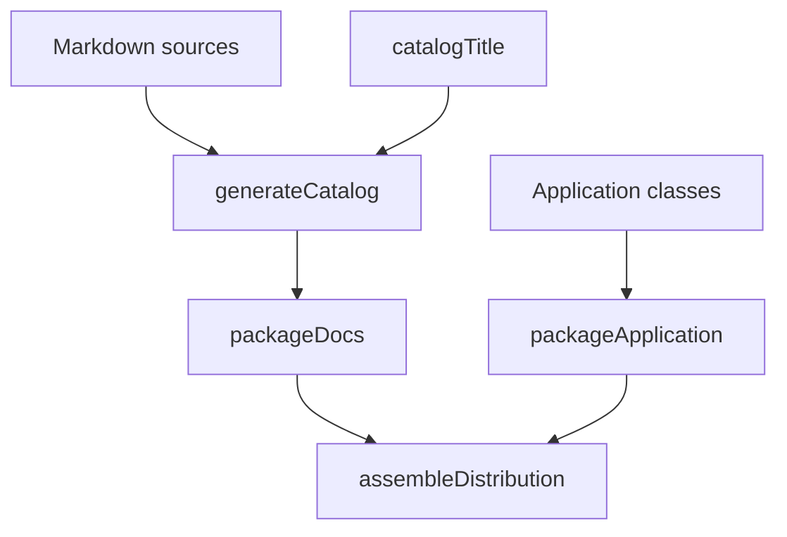

# Hợp đồng đầu vào và đầu ra của một bước build tùy chỉnh

Một bước build tùy chỉnh là công việc do dự án hoặc plugin bổ sung vào quy trình build, chẳng hạn sinh mã nguồn, tạo chỉ mục tài liệu, chuyển đổi file cấu hình, kiểm tra quy ước, tạo báo cáo hoặc chuẩn bị tài nguyên trước khi đóng gói. Để bước đó hoạt động ổn định, build tool cần biết nó đọc dữ liệu nào, tạo ra kết quả nào và phải chạy trước hay sau những công việc nào.

Tập hợp những thông tin này tạo thành **hợp đồng đầu vào và đầu ra** của bước build. Hợp đồng mô tả điều kiện để công việc có thể chạy đúng và để build tool xác định khi nào cần chạy lại, khi nào có thể dùng lại kết quả, cũng như bước nào có thể tiêu thụ kết quả đó.

Một hợp đồng rõ ràng thường trả lời được các câu hỏi:

- Bước build đọc những file, thư mục, dependency, tham số và cấu hình nào?
- Giá trị nào có thể làm thay đổi kết quả?
- Bước build tạo ra những file hoặc dữ liệu nào, và chúng nằm ở đâu?
- Bước build cần những kết quả nào từ các bước trước?
- Những bước nào cần chờ kết quả này?
- Nếu đầu vào không đổi thì có thể bỏ qua công việc hoặc tái sử dụng output không?
- Nếu thực thi thất bại giữa chừng, làm thế nào tránh để lại output dở dang?

Khi học build tool, cần phân biệt ba việc thường bị gộp làm một: **khai báo đầu vào/đầu ra**, **khai báo quan hệ phụ thuộc giữa các bước**, và **thực thi công việc**. Một bước có thể biết nó cần file nào nhưng chưa chắc build tool biết bước nào tạo file đó. Một bước có thể được đặt chạy sau bước khác nhưng build tool vẫn chưa biết đầu ra nào cần được theo dõi để kiểm tra tính hợp lệ hoặc tối ưu incremental build.

## 1. Hợp đồng của một bước build gồm những gì?

Hãy xem một bước tạo chỉ mục từ các file Markdown trong thư mục `src/catalog` và ghi kết quả vào `build/generated/catalog/catalog.md`.

| Thành phần | Ví dụ trong bước tạo chỉ mục | Vì sao cần khai báo |
|---|---|---|
| Đầu vào dạng file | Các file `*.md` trong `src/catalog` | Thay đổi nội dung hoặc thêm/xóa file có thể làm output thay đổi |
| Đầu vào dạng giá trị | Tiêu đề `Catalog` hoặc ngôn ngữ đầu ra | Thay đổi cấu hình có thể làm output thay đổi dù file nguồn không đổi |
| Đầu vào môi trường | Phiên bản formatter, locale hoặc toolchain nếu công việc phụ thuộc vào chúng | Giúp xác định điều kiện thực thi và khả năng tái lập |
| Đầu ra | `build/generated/catalog/catalog.md` | Build tool biết file nào được tạo và bước sau có thể sử dụng file đó |
| Quan hệ phụ thuộc | Bước tạo chỉ mục phải hoàn thành trước bước đóng gói tài liệu | Xác định thứ tự thực thi chính xác |
| Quy tắc thực thi lại | Chạy lại khi file nguồn, tiêu đề hoặc công cụ liên quan thay đổi | Tránh dùng kết quả cũ khi đầu vào đã khác |

Một cách mô tả ngắn gọn là:

```text
generateCatalog(
    inputs = [src/catalog/**/*.md, catalogTitle, formatterVersion],
    outputs = [build/generated/catalog/catalog.md]
)
```

Đây là ký hiệu mô tả, không phải cú pháp chung của Maven, Gradle hay Ant. Mỗi công cụ có cách khai báo riêng.

### 1.1. Đầu vào không chỉ là file

Đầu vào là mọi thông tin có thể ảnh hưởng đến kết quả của bước build. Ngoài file, đầu vào có thể gồm:

- chuỗi, số, cờ bật/tắt hoặc danh sách tùy chọn;
- phiên bản ngôn ngữ, JDK, compiler hoặc formatter;
- classpath hoặc tập dependency;
- cấu hình được đọc từ file properties;
- schema, template hoặc file cấu hình được công cụ tham chiếu;
- biến môi trường hoặc thông tin hệ thống nếu thuật toán thực sự phụ thuộc vào chúng.

Ví dụ, nếu bước tạo mã sinh ra khác nhau theo phiên bản schema, `schemaVersion` phải được xem là đầu vào. Nếu bước định dạng văn bản phụ thuộc vào locale, locale cũng ảnh hưởng kết quả. Nếu bỏ sót một yếu tố có ảnh hưởng, build tool có thể cho rằng đầu vào không đổi và tái sử dụng output cũ dù kết quả đúng ra phải khác.

Không nên khai báo mọi thông tin máy tính như một đầu vào một cách tùy tiện. Chỉ đưa vào hợp đồng những yếu tố có ý nghĩa đối với kết quả hoặc điều kiện chạy. Mục tiêu là mô tả đúng sự phụ thuộc thực tế.

### 1.2. Đầu ra phải xác định được

Đầu ra là file hoặc thư mục mà bước build chịu trách nhiệm tạo hay cập nhật. Ví dụ:

- file mã nguồn Java được sinh ra;
- file resource đã chuyển đổi;
- JAR/WAR hoặc gói phân phối;
- báo cáo kiểm thử hoặc báo cáo phân tích;
- chỉ mục, manifest hay metadata;
- thư mục chứa nhiều file được sinh tự động.

Nên đặt output trong thư mục build dành riêng cho công cụ, chẳng hạn `build/generated`, `target/generated-sources` hoặc `target/generated-resources`. Thư mục này có thể được xóa và tạo lại khi clean build. Tránh ghi file sinh ra vào thư mục mã nguồn do lập trình viên quản lý, vì output cũ có thể bị commit nhầm, gây xung đột hoặc che khuất việc công cụ không sinh lại file.

Đầu ra cần có chủ sở hữu rõ ràng. Nếu hai task cùng ghi một file, build có thể chạy sai khi thực thi song song hoặc khi một task bị bỏ qua nhờ cache. Một output nên thuộc về một bước tạo duy nhất; các bước khác chỉ đọc nó.

### 1.3. Đầu vào, đầu ra và dependency là ba quan hệ khác nhau

Giả sử task `generateCatalog` đọc Markdown và tạo file chỉ mục; task `packageDocs` đóng gói file chỉ mục vào ZIP.

- Quan hệ đầu vào/đầu ra của `generateCatalog` nói rằng Markdown là đầu vào và file chỉ mục là đầu ra.
- Quan hệ phụ thuộc nói rằng `packageDocs` cần kết quả của `generateCatalog`.
- Mã thực thi nói cách đọc Markdown, tạo nội dung và ghi file chỉ mục.

Nếu chỉ đặt `packageDocs` chạy sau `generateCatalog` bằng một thứ tự cố định, build tool có thể vẫn không biết file nào được tạo. Nếu chỉ khai báo `packageDocs` đọc file chỉ mục mà không nối nó với task tạo file, build có thể chạy khi file chưa tồn tại. Cần mô tả cả dữ liệu được truyền và quan hệ thực thi.

## 2. Vì sao hợp đồng đầu vào/đầu ra quan trọng?

### 2.1. Xác định khi nào phải chạy lại

Build tool cần biết đầu vào của một bước để nhận ra kết quả trước đó còn dùng được hay không. Nếu nội dung file nguồn thay đổi, output có thể đã cũ. Nếu chỉ một file không liên quan trong repository thay đổi, bước đó có thể không cần chạy lại.

Ví dụ:

| Thay đổi | Bước tạo chỉ mục có cần chạy lại không? | Lý do |
|---|---|---|
| Sửa một file Markdown trong `src/catalog` | Có | Nội dung nguồn thay đổi |
| Thêm file Markdown mới trong thư mục nguồn | Có | Tập file đầu vào thay đổi |
| Xóa file Markdown đã được đưa vào chỉ mục | Có | Kết quả phải loại bỏ nội dung cũ |
| Đổi tiêu đề của chỉ mục | Có | Tham số đầu vào thay đổi |
| Sửa file Java không liên quan | Thường không | Không thuộc đầu vào đã khai báo |
| Xóa output do task tạo | Có | Kết quả cần được tạo lại |

Khả năng đưa ra quyết định chính xác phụ thuộc vào mức độ đầy đủ của hợp đồng. Khai báo thiếu đầu vào có thể tạo ra output cũ. Khai báo thừa đầu vào có thể khiến task chạy lại quá thường xuyên và làm build chậm.

### 2.2. Cho phép build theo phần thay đổi

Trong dự án lớn, không phải mỗi thay đổi đều cần chạy lại toàn bộ quy trình. Nếu các bước khai báo đúng đầu vào, đầu ra và quan hệ phụ thuộc, build tool có thể chỉ thực hiện phần công việc chịu ảnh hưởng.

Ví dụ, thay đổi một file tài liệu chỉ cần tạo lại chỉ mục tài liệu và gói tài liệu. Không nhất thiết phải biên dịch toàn bộ mã Java nếu các bước đó không phụ thuộc vào tài liệu.

### 2.3. Hỗ trợ thực thi song song

Build tool có thể chạy đồng thời những bước không phụ thuộc lẫn nhau. Hợp đồng rõ giúp xác định những task nào đọc dữ liệu nào và ghi output ở đâu. Nếu hai task ghi cùng một file hoặc một task đọc output khi task tạo nó chưa hoàn tất, build song song có thể dẫn đến kết quả không xác định.

Không nên dùng thứ tự tình cờ của các task để che giấu một dependency còn thiếu. Hãy khai báo quan hệ dữ liệu hoặc dependency thực sự để build tool có thể lập lịch an toàn.

### 2.4. Hỗ trợ cache và tái lập build

Khi đầu vào được khai báo đầy đủ và công việc có tính xác định, build tool có thể tái sử dụng kết quả đã tạo trước đó. Với build cache, kết quả có thể được lấy từ cache cục bộ hoặc cache dùng chung nếu khóa đầu vào phù hợp và task được đánh dấu hỗ trợ cache.

Điều này chỉ an toàn khi output thực sự phụ thuộc vào các đầu vào đã khai báo. Nếu task âm thầm đọc file ngoài danh sách, dùng thời gian hiện tại, gọi dịch vụ mạng hoặc phụ thuộc vào một biến môi trường không được mô tả, cache có thể trả về kết quả không còn đúng.

## 3. Thiết kế hợp đồng trước khi viết mã thực thi

Trước khi tạo task hoặc plugin goal, hãy viết hợp đồng bằng ngôn ngữ đơn giản. Với ví dụ tạo chỉ mục Markdown:

**Mục đích:** tạo một file chỉ mục từ tất cả file Markdown trong thư mục nguồn.

**Đầu vào:**

- thư mục nguồn `src/catalog` và nội dung các file Markdown bên trong;
- tiêu đề do cấu hình `catalogTitle` cung cấp;
- quy tắc mã hóa UTF-8;
- phiên bản hoặc quy tắc định dạng nếu có sử dụng formatter ngoài.

**Đầu ra:**

- một file `build/generated/catalog/catalog.md`;
- nội dung file có thứ tự ổn định theo đường dẫn tương đối;
- file luôn được ghi bằng UTF-8.

**Điều kiện chạy lại:**

- file nguồn được thêm, sửa hoặc xóa;
- tiêu đề thay đổi;
- quy tắc định dạng hoặc phiên bản công cụ ảnh hưởng kết quả thay đổi;
- file output bị xóa.

**Điều kiện hoàn thành:**

- tất cả đầu vào được đọc thành công;
- output được ghi đầy đủ;
- nếu có lỗi, task trả lỗi rõ ràng và không để lại file output có vẻ hợp lệ nhưng thực chất bị ghi dở.

Việc mô tả này giúp chọn đúng loại thuộc tính trong build tool. Nếu đầu ra là một file, khai báo output file. Nếu là một tập file có cấu trúc, khai báo output directory. Nếu một tham số là giá trị cấu hình, khai báo input dạng scalar. Nếu đầu vào là classpath, dùng kiểu đầu vào chuyên biệt để build tool xử lý đúng ngữ nghĩa dependency.

## 4. Thiết kế đầu vào tốt

### 4.1. Khai báo toàn bộ dữ liệu ảnh hưởng kết quả

Một bước build không nên tự tìm thêm đầu vào ở những vị trí không được mô tả. Nếu công việc cần template, schema hoặc file cấu hình, hãy đưa chúng vào hợp đồng. Nếu công việc cần đọc một thư mục, khai báo thư mục đó hoặc tập file bên trong.

Ví dụ, task tạo mã nguồn từ schema có thể có:

| Đầu vào | Ví dụ |
|---|---|
| Schema | `src/main/schema/customer.yaml` |
| Template | `src/main/templates/model.tpl` |
| Phiên bản generator | `generatorVersion = 2.4` |
| Package đích | `com.example.generated` |
| Ngôn ngữ đầu ra | `java` |

Nếu generator thay đổi cách sinh mã giữa phiên bản 2.3 và 2.4, phiên bản generator có ảnh hưởng đến kết quả. Nếu nó được cập nhật nhưng không được phản ánh trong đầu vào, build tool có thể tái sử dụng mã sinh từ phiên bản cũ.

### 4.2. Phân biệt file đơn, tập file và thư mục

Các công cụ thường có loại khai báo khác nhau cho:

- một file cụ thể;
- nhiều file hoặc một file collection;
- một thư mục đầu vào;
- classpath hoặc tập artifact;
- một giá trị đơn như chuỗi, số hoặc boolean.

Chọn loại khai báo sát với ý nghĩa dữ liệu. Ví dụ, classpath không chỉ là danh sách file thông thường: thứ tự và nội dung artifact có thể ảnh hưởng cách compiler phân giải lớp. Build tool có thể có loại input chuyên biệt để chuẩn hóa cách tính fingerprint.

### 4.3. Xác định cách so sánh đường dẫn

Đối với đầu vào dạng file, đường dẫn cũng có thể ảnh hưởng kết quả. Có ít nhất ba cách nhìn phổ biến:

- **Đường dẫn tương đối:** chỉ xét vị trí file bên trong thư mục gốc đầu vào. Phù hợp khi output chứa đường dẫn tương đối và build có thể chuyển sang thư mục checkout khác.
- **Đường dẫn tuyệt đối:** đường dẫn đầy đủ là một phần của đầu vào. Chỉ dùng khi vị trí tuyệt đối thực sự ảnh hưởng kết quả.
- **Chỉ tên file:** chỉ tên file được quan tâm, còn thư mục cha không ảnh hưởng. Cách này phù hợp với một số tác vụ, nhưng có thể gây trùng tên nếu nhiều thư mục có file cùng tên.

Khai báo đường dẫn không phù hợp có thể làm cache mất khả năng dùng lại giữa các máy hoặc làm bỏ sót thay đổi có ý nghĩa. Nếu output chỉ chứa đường dẫn tương đối, thường nên dùng cách fingerprint theo đường dẫn tương đối.

### 4.4. Không giấu đầu vào trong môi trường

Các ví dụ sau dễ làm task khó tái lập:

- đọc `System.getenv("BUILD_MODE")` nhưng không khai báo giá trị này;
- lấy thời gian hiện tại để ghi timestamp vào file;
- đọc một file cấu hình trong thư mục home của người dùng;
- gọi HTTP API để lấy dữ liệu mới nhất;
- sử dụng phiên bản công cụ được cài toàn cục mà không khóa hoặc ghi nhận phiên bản;
- dùng locale hoặc timezone mặc định của máy mà không xác định.

Nếu yếu tố đó thực sự cần thiết, hãy đưa nó vào hợp đồng hoặc thiết kế bước theo cách không phụ thuộc vào nó. Với dữ liệu mạng thay đổi, thường nên tải dữ liệu thành một artifact đầu vào được quản lý riêng, sau đó để bước build xử lý artifact đó như file bình thường.

### 4.5. Xử lý đầu vào tùy chọn

Một số đầu vào có thể không tồn tại. Hãy phân biệt:

- đầu vào bắt buộc: thiếu thì task phải báo lỗi;
- đầu vào tùy chọn: thiếu thì dùng hành vi mặc định đã mô tả;
- tập đầu vào có thể rỗng: không có file nào vẫn là trạng thái hợp lệ và phải có quy tắc output tương ứng.

Không nên âm thầm bỏ qua file bắt buộc bị thiếu. Một task tạo báo cáo có thể tạo báo cáo rỗng khi không có dữ liệu; một task biên dịch schema có thể phải dừng vì schema không tồn tại. Hành vi phải được quyết định theo mục đích của bước build.

## 5. Thiết kế đầu ra tốt

### 5.1. Mỗi output có một nơi sở hữu

Chọn một thư mục riêng cho output của task. Ví dụ:

```text
project/
├── src/
│   └── catalog/
│       ├── intro.md
│       └── products/
│           └── item-a.md
└── build/
    └── generated/
        └── catalog/
            └── catalog.md
```

Thư mục `build/` là output có thể tái tạo. Người dùng có thể xóa thư mục này rồi build lại. Không đặt output cạnh file nguồn nếu không có lý do rõ ràng.

### 5.2. Tránh ghi đè đầu vào

Một task chuyển đổi file không nên ghi kết quả lên chính file nguồn, trừ khi công việc được thiết kế rõ ràng là sửa file tại chỗ và build tool có thể xử lý an toàn. Nếu ghi đè đầu vào, task có thể phá hủy dữ liệu, khiến lần chạy sau đọc kết quả đã biến đổi thay vì dữ liệu gốc, hoặc tạo vòng lặp khó đoán.

Mẫu an toàn thường là:

1. đọc đầu vào;
2. tạo nội dung hoàn chỉnh trong bộ nhớ hoặc file tạm;
3. kiểm tra kết quả;
4. ghi vào output riêng;
5. thay thế output cũ sau khi ghi thành công.

Với file lớn, có thể ghi vào file tạm cùng filesystem rồi đổi tên sang output cuối cùng. Cách này giảm khả năng để lại output nửa chừng khi tiến trình bị lỗi.

### 5.3. Output file và output directory

Nếu task tạo đúng một file, khai báo output file cụ thể. Nếu task tạo nhiều file với tên hoặc cấu trúc thay đổi theo đầu vào, khai báo output directory. Đừng khai báo một thư mục quá rộng như toàn bộ `build/` nếu task chỉ sở hữu một thư mục con; làm vậy có thể khiến nhiều task tranh chấp quyền sở hữu và ảnh hưởng đến cache.

Nếu task tạo nhiều output file cố định, hãy khai báo tất cả. Nếu output có số lượng thay đổi, một output directory riêng thường phù hợp hơn.

### 5.4. Xử lý output cũ khi đầu vào bị xóa

Giả sử lần đầu thư mục nguồn có ba file và task tạo ba phần trong output. Sau đó một file nguồn bị xóa. Lần build tiếp theo phải loại bỏ nội dung tương ứng khỏi kết quả.

Nếu task chỉ ghi thêm hoặc cập nhật file mới mà không dọn output cũ, artifact có thể giữ lại dữ liệu đã bị xóa. Với output directory, task thường nên quản lý toàn bộ thư mục do nó sở hữu và tạo lại nội dung cần thiết một cách nhất quán. Không xóa thư mục mà task khác cũng đang sử dụng.

### 5.5. Không dùng output làm nơi lưu trạng thái bí mật

Output là artifact có thể được lưu trong build cache hoặc chia sẻ giữa các máy. Không ghi token, mật khẩu, khóa riêng hay dữ liệu nhạy cảm vào output hoặc log. Nếu task cần secret để truy cập dịch vụ, phải đánh giá kỹ việc cache, phạm vi truy cập và khả năng rò rỉ qua fingerprint hoặc output. Task phụ thuộc secret thường không phù hợp để cache theo cách thông thường.

## 6. Tính xác định và khả năng tái lập

Một bước build có tính xác định khi cùng một tập đầu vào và cùng môi trường được mô tả sẽ tạo ra cùng kết quả. Đây là điều kiện quan trọng để build incremental và build cache hoạt động đáng tin cậy.

Các nguồn gây kết quả không xác định thường gặp:

- duyệt file theo thứ tự không được kiểm soát;
- đưa timestamp hiện tại vào output;
- dùng số ngẫu nhiên mà không có seed được khai báo;
- ghi đường dẫn tuyệt đối của máy lập trình viên vào file sinh ra;
- phụ thuộc locale, timezone hoặc encoding mặc định;
- tải nội dung thay đổi từ Internet;
- đọc biến môi trường hoặc file ngoài hợp đồng;
- dùng phiên bản dependency không được khóa;
- ghi output từ nhiều task đồng thời.

Để tăng khả năng tái lập:

1. sắp xếp danh sách file theo quy tắc rõ ràng;
2. chọn encoding cụ thể như UTF-8;
3. xác định định dạng ngày giờ hoặc loại bỏ timestamp nếu không cần;
4. cố định phiên bản generator và dependency;
5. dùng đường dẫn tương đối khi phù hợp;
6. khai báo mọi cấu hình ảnh hưởng kết quả;
7. tránh truy cập mạng trực tiếp trong task có mục tiêu tái lập;
8. bảo đảm một output không bị nhiều bước ghi đồng thời.

Không phải mọi task đều cần được cache. Nếu một task gửi dữ liệu lên dịch vụ từ xa, tạo bản phát hành có side effect hoặc phụ thuộc vào trạng thái bên ngoài, việc chạy lại và cache cần được cân nhắc riêng. Khai báo hợp đồng rõ vẫn hữu ích ngay cả khi task không bật cache.

## 7. Quan hệ phụ thuộc giữa các bước build

Đầu vào và đầu ra cho biết dữ liệu đi đâu. Dependency cho biết khi nào công việc được phép chạy.

Ví dụ:



`generateCatalog` phụ thuộc vào file Markdown và tiêu đề. `packageDocs` tiêu thụ output của task đó. `packageApplication` có thể chạy độc lập với việc tạo chỉ mục tài liệu. `assembleDistribution` chờ cả hai artifact.

Một build graph tốt thể hiện đúng quan hệ dữ liệu. Nếu task B đọc file do task A tạo, hãy nối B với output của A bằng cơ chế mà build tool hiểu được. Đừng chỉ dựa vào việc người dùng thường gọi task A trước task B.

### 7.1. Quan hệ dữ liệu và quan hệ thứ tự

Một số build tool cho phép khai báo phụ thuộc trực tiếp theo tên task hoặc target. Cách này diễn đạt thứ tự. Một số cơ chế còn cho phép truyền output của bước trước làm input của bước sau. Cách truyền output thường tốt hơn vì vừa biểu diễn dữ liệu, vừa giúp build tool suy ra quan hệ thực thi.

Nếu một task chỉ cần chạy sau task khác vì có side effect, hãy khai báo dependency theo cơ chế phù hợp và xem xét liệu side effect đó có thể được chuyển thành artifact rõ ràng hay không. Artifact tường minh thường dễ kiểm tra, lưu cache và tái sử dụng hơn.

### 7.2. Không tạo dependency giả

Nếu hai task không dùng chung dữ liệu và không cần thứ tự, đừng buộc task này phụ thuộc task kia chỉ để log trông có vẻ tuần tự. Dependency thừa làm giảm khả năng chạy song song và khiến build graph khó hiểu.

Ngược lại, nếu có dữ liệu được tạo bởi task khác, không được bỏ qua dependency chỉ vì file thường đã tồn tại trên máy lập trình viên. Build sạch hoặc CI mới có thể không có file đó.

## 8. Gradle: khai báo hợp đồng trực tiếp trên task

Gradle có mô hình task với các thuộc tính input và output. Task type có thể khai báo loại dữ liệu bằng annotation để Gradle kiểm tra, theo dõi thay đổi và hỗ trợ incremental execution hoặc build cache.

### 8.1. Các annotation thường gặp

| Annotation hoặc loại thuộc tính | Ý nghĩa | Ví dụ |
|---|---|---|
| `@Input` | Một giá trị đơn ảnh hưởng kết quả | Tiêu đề, chế độ, phiên bản generator |
| `@InputFile` | Một file đầu vào | Một schema hoặc template |
| `@InputFiles` | Tập file đầu vào | Nhiều file nguồn |
| `@InputDirectory` | Thư mục đầu vào | Thư mục chứa schema hoặc tài liệu |
| `@Classpath` | Classpath đầu vào | Các JAR dùng bởi compiler hoặc processor |
| `@CompileClasspath` | Classpath dùng trong ngữ cảnh compile | API lớp cần để biên dịch |
| `@Nested` | Một object có các thuộc tính đầu vào lồng nhau | Cấu hình có nhiều trường được khai báo |
| `@OutputFile` | Một file do task tạo | File chỉ mục |
| `@OutputFiles` | Một tập file output | Nhiều file sinh ra có đường dẫn xác định |
| `@OutputDirectory` | Thư mục output do task quản lý | Thư mục mã nguồn được sinh |
| `@Internal` | Thuộc tính cần cho implementation nhưng không tham gia fingerprint | Một tham chiếu nội bộ đã được suy ra từ input khác |
| `@LocalState` | Trạng thái cục bộ không phải output có thể chia sẻ | Dữ liệu tạm phục vụ incremental execution |

Annotation cần phản ánh đúng ý nghĩa. Không dùng `@Internal` để che giấu dữ liệu thực sự ảnh hưởng output. Nếu một thuộc tính cần thiết cho kết quả nhưng không được khai báo, Gradle có thể không nhận ra khi nào task phải chạy lại.

### 8.2. Ví dụ task type tạo chỉ mục

Ví dụ dưới đây định nghĩa một task type Kotlin. Có thể đặt lớp task trong `build-logic` hoặc `buildSrc`, sau đó áp dụng vào build. Task đọc các file Markdown trong một thư mục, sắp xếp theo đường dẫn tương đối và tạo một file chỉ mục.

```kotlin
import org.gradle.api.DefaultTask
import org.gradle.api.file.DirectoryProperty
import org.gradle.api.file.RegularFileProperty
import org.gradle.api.provider.Property
import org.gradle.api.tasks.CacheableTask
import org.gradle.api.tasks.Input
import org.gradle.api.tasks.InputDirectory
import org.gradle.api.tasks.OutputFile
import org.gradle.api.tasks.PathSensitive
import org.gradle.api.tasks.PathSensitivity
import org.gradle.api.tasks.TaskAction

@CacheableTask
abstract class GenerateCatalog : DefaultTask() {

    @get:InputDirectory
    @get:PathSensitive(PathSensitivity.RELATIVE)
    abstract val sourceDirectory: DirectoryProperty

    @get:Input
    abstract val title: Property<String>

    @get:OutputFile
    abstract val outputFile: RegularFileProperty

    @TaskAction
    fun generate() {
        val root = sourceDirectory.get().asFile
        val files = root.walkTopDown()
            .filter { it.isFile && it.extension.equals("md", ignoreCase = true) }
            .sortedBy { it.relativeTo(root).invariantSeparatorsPath }
            .toList()

        val content = buildString {
            append(title.get()).append('\n')
            files.forEach { file ->
                val relativePath = file.relativeTo(root).invariantSeparatorsPath
                append("\n## ").append(relativePath).append('\n')
                append(file.readText(Charsets.UTF_8)).append('\n')
            }
        }

        val target = outputFile.get().asFile
        target.parentFile.mkdirs()
        target.writeText(content, Charsets.UTF_8)
    }
}
```

Trong task này:

- `sourceDirectory` là đầu vào dạng thư mục. `@PathSensitive(PathSensitivity.RELATIVE)` nói rằng đường dẫn tương đối bên trong thư mục có ý nghĩa, còn vị trí tuyệt đối của checkout không cần là một phần của fingerprint.
- `title` là đầu vào scalar. Đổi tiêu đề sẽ làm task cần chạy lại.
- `outputFile` là file do task sở hữu.
- Danh sách file được sắp xếp theo đường dẫn tương đối để kết quả có thứ tự ổn định.
- Encoding được đặt rõ là UTF-8.
- `@CacheableTask` cho phép task tham gia build cache khi implementation thực sự đáp ứng điều kiện cache an toàn.

Đăng ký task trong `build.gradle.kts`:

```kotlin
tasks.register<GenerateCatalog>("generateCatalog") {
    sourceDirectory.set(layout.projectDirectory.dir("src/catalog"))
    title.set(providers.gradleProperty("catalogTitle").orElse("Catalog"))
    outputFile.set(layout.buildDirectory.file("generated/catalog/catalog.md"))
}
```

Task có thể được gọi bằng:

```bash
./gradlew generateCatalog
```

Đường dẫn output nằm dưới `build/`, do đó có thể tái tạo sau khi chạy `clean`. Giá trị `catalogTitle` có thể được truyền qua Gradle property, ví dụ `-PcatalogTitle="Product Catalog"`; vì nó được nối vào thuộc tính `@Input`, thay đổi giá trị sẽ ảnh hưởng fingerprint.

### 8.3. Nối output với task tiêu thụ

Giả sử một task khác cần đóng gói file chỉ mục. Hãy để task tiêu thụ nhận provider output từ task tạo, thay vì chỉ viết lại đường dẫn file ở hai nơi.

```kotlin
val generateCatalog = tasks.named<GenerateCatalog>("generateCatalog")

tasks.register<Zip>("packageCatalog") {
    from(generateCatalog.flatMap { it.outputFile })
    archiveFileName.set("catalog.zip")
    destinationDirectory.set(layout.buildDirectory.dir("distributions"))
}
```

Khi output của task được nối qua provider như trên, Gradle có thể suy ra task tạo output là dependency cần thực hiện trước. Task `packageCatalog` sẽ sử dụng đúng file do `generateCatalog` cung cấp.

Nếu chỉ viết `from(layout.buildDirectory.file("generated/catalog/catalog.md"))` mà không nối với task tạo file, Gradle có thể không biết cần chạy `generateCatalog` trước. File có thể tình cờ tồn tại trên máy cá nhân, nhưng build sạch hoặc CI có thể thất bại.

### 8.4. Incremental execution và build cache

Gradle theo dõi trạng thái task dựa trên các input và output đã khai báo. Khi input không đổi và output vẫn hợp lệ, task có thể được đánh dấu `UP-TO-DATE`. Khi build cache được bật và task phù hợp, kết quả có thể được lấy từ cache thay vì chạy lại action.

`@CacheableTask` là cam kết từ người viết task rằng cùng một tập input đã khai báo sẽ tạo ra output có thể tái sử dụng. Không nên thêm annotation này chỉ để build chạy nhanh hơn. Trước tiên phải bảo đảm:

- mọi yếu tố ảnh hưởng output đều được khai báo;
- task không phụ thuộc trạng thái ngầm của máy;
- output được ghi vào vị trí do task sở hữu;
- thứ tự xử lý ổn định;
- task không có side effect bên ngoài cần xảy ra mỗi lần chạy;
- output không chứa secret hoặc dữ liệu phụ thuộc người dùng mà cache có thể chia sẻ sai phạm vi.

Nếu task không đáp ứng điều kiện, hãy để task chạy theo cơ chế phù hợp và không bật cache. Có thể dùng `@DisableCachingByDefault` với lý do cụ thể cho task type không nên cache mặc định.

### 8.5. Các lỗi khai báo thường gặp trong Gradle

| Lỗi | Hậu quả có thể gặp | Cách xử lý |
|---|---|---|
| Đọc file nhưng không khai báo input | Task có thể bị đánh dấu `UP-TO-DATE` dù file đã đổi | Khai báo file hoặc thư mục bằng annotation phù hợp |
| Dùng `@Internal` cho giá trị ảnh hưởng output | Thay đổi giá trị không làm fingerprint thay đổi | Dùng `@Input`, `@InputFile` hoặc loại thích hợp |
| Ghi file ngoài output directory | Gradle không quản lý được file đó như output của task | Chuyển file vào output đã khai báo |
| Hai task cùng ghi một file | Race condition hoặc kết quả phụ thuộc thứ tự | Chỉ định một task sở hữu file; task khác đọc qua provider |
| Bật cache cho task đọc thời gian hiện tại | Cache có thể trả về kết quả không đúng thời điểm | Loại bỏ phụ thuộc thời gian hoặc khai báo và thiết kế lại hành vi |
| Dùng đường dẫn tuyệt đối không cần thiết | Cache khó dùng lại giữa các checkout | Chọn `PathSensitivity.RELATIVE` nếu phù hợp |
| Không xử lý file nguồn bị xóa | Output directory còn file cũ | Task quản lý toàn bộ output directory và dọn nội dung cũ đúng phạm vi |

## 9. Maven: mô tả hợp đồng qua plugin goal

Maven tổ chức công việc thông qua lifecycle phase và plugin goal. Một bước tùy chỉnh thường được đóng gói thành một goal của Maven plugin. Goal có tham số cấu hình, biết vị trí project và có thể tạo output trong thư mục build.

Khác với Gradle task, Maven plugin không dùng cùng hệ annotation input/output tổng quát để tự động fingerprint từng file. Người viết plugin cần thiết kế tham số, quy tắc output và hành vi incremental phù hợp. Việc goal được gắn vào phase giúp xác định thời điểm chạy trong lifecycle; điều đó tự nó không mô tả đầy đủ mọi file mà goal đọc hoặc tạo.

### 9.1. Khai báo tham số của Mojo

Một goal tùy chỉnh được triển khai bằng một lớp Mojo. Ví dụ rút gọn dưới đây minh họa các tham số chính cho bước tạo chỉ mục. Đoạn mã giả định plugin được phát triển bằng Maven Plugin API và dùng Java 11 trở lên.

```java
@Mojo(name = "generate-catalog", defaultPhase = LifecyclePhase.GENERATE_RESOURCES)
public class GenerateCatalogMojo extends AbstractMojo {

    @Parameter(
        defaultValue = "${project.basedir}/src/catalog",
        required = true
    )
    private File sourceDirectory;

    @Parameter(
        defaultValue = "${project.build.directory}/generated/catalog/catalog.md",
        required = true
    )
    private File outputFile;

    @Parameter(defaultValue = "${project.name}", readonly = true)
    private String title;

    @Override
    public void execute() throws MojoExecutionException {
        if (!sourceDirectory.isDirectory()) {
            throw new MojoExecutionException(
                "Catalog source directory does not exist: " + sourceDirectory
            );
        }

        try {
            Path root = sourceDirectory.toPath();
            List<Path> files;
            try (Stream<Path> paths = Files.walk(root)) {
                files = paths
                    .filter(Files::isRegularFile)
                    .filter(path -> path.getFileName().toString().endsWith(".md"))
                    .sorted(Comparator.comparing(
                        path -> root.relativize(path).toString()
                    ))
                    .collect(Collectors.toList());
            }

            StringBuilder content = new StringBuilder(title).append('\n');
            for (Path file : files) {
                String relative = root.relativize(file).toString()
                    .replace(File.separatorChar, '/');
                content.append("\n## ").append(relative).append('\n');
                content.append(Files.readString(file, StandardCharsets.UTF_8))
                    .append('\n');
            }

            Path output = outputFile.toPath();
            Files.createDirectories(output.getParent());
            Files.writeString(output, content.toString(), StandardCharsets.UTF_8);
        } catch (IOException ex) {
            throw new MojoExecutionException("Could not generate catalog", ex);
        }
    }
}
```

Trong ví dụ:

- `sourceDirectory` và `title` là đầu vào;
- `outputFile` là đầu ra;
- `defaultPhase` xác định phase mặc định khi goal được gắn vào lifecycle;
- thư mục nguồn được kiểm tra trước khi xử lý;
- file được sắp xếp theo đường dẫn tương đối;
- lỗi I/O được chuyển thành `MojoExecutionException` để Maven báo build thất bại.

Đây là ví dụ về cách tổ chức tham số và output. Plugin sản xuất cần bổ sung kiểm tra đầu vào, xử lý trường hợp thư mục rỗng, ghi output an toàn và kiểm soát mọi tham số khác có ảnh hưởng đến kết quả.

### 9.2. Gắn goal vào lifecycle

Trong POM của dự án sử dụng plugin, có thể cấu hình:

```xml
<plugin>
    <groupId>com.example.build</groupId>
    <artifactId>catalog-maven-plugin</artifactId>
    <version>1.0.0</version>
    <executions>
        <execution>
            <id>generate-catalog</id>
            <phase>generate-resources</phase>
            <goals>
                <goal>generate-catalog</goal>
            </goals>
        </execution>
    </executions>
    <configuration>
        <sourceDirectory>${project.basedir}/src/catalog</sourceDirectory>
        <outputFile>${project.build.directory}/generated/catalog/catalog.md</outputFile>
        <title>${project.name}</title>
    </configuration>
</plugin>
```

Khi Maven chạy tới phase `generate-resources`, goal được gắn vào phase sẽ được thực thi. Nếu output là tài nguyên cần đưa vào artifact, plugin còn phải đăng ký thư mục resource được sinh với project hoặc dùng cơ chế phù hợp của Maven để các phase sau biết cách sử dụng nó. Chỉ ghi file vào `target/` không tự động làm file đó trở thành resource được đóng gói.

### 9.3. Phân biệt phase với input/output

`generate-resources` trả lời câu hỏi “goal chạy ở giai đoạn nào của lifecycle?”. `sourceDirectory`, `title` và `outputFile` mô tả một phần hợp đồng dữ liệu. Hai việc bổ sung cho nhau.

Maven lifecycle giúp chuẩn hóa thứ tự các công việc như `validate`, `compile`, `test`, `package` và `verify`. Plugin goal có thể được gắn vào phase phù hợp. Tuy nhiên, Maven không tự suy ra toàn bộ dependency file-level chỉ từ tên phase. Plugin cần tự bảo đảm output được tạo đúng lúc và được công bố cho các bước sau.

### 9.4. Incremental behavior trong Maven plugin

Một plugin Maven có thể kiểm tra timestamp hoặc fingerprint của đầu vào để bỏ qua công việc khi output còn mới. Tuy nhiên, việc này phải được thiết kế cẩn thận:

- kiểm tra tất cả file đầu vào, kể cả file mới được thêm hoặc xóa;
- tính đến mọi tham số cấu hình ảnh hưởng output;
- tính đến phiên bản generator hoặc formatter;
- bảo đảm output tồn tại và còn hợp lệ;
- không chỉ so sánh timestamp nếu hệ thống có thể giữ timestamp không phản ánh nội dung thay đổi.

Một cách đơn giản là luôn tạo lại output khi goal chạy. Cách này có thể tốn thời gian hơn nhưng dễ hiểu và ít nguy cơ dùng kết quả cũ sai. Chỉ tối ưu bỏ qua công việc khi đã mô tả được hợp đồng đầy đủ.

## 10. Ant: target điều phối task, hợp đồng do người viết mô tả

Apache Ant tổ chức build bằng target và task. Target gom các công việc có tên; target có thể khai báo phụ thuộc vào target khác. Task là hành động cụ thể như tạo thư mục, copy file, compile, zip hoặc gọi công cụ ngoài.

Ant không có mô hình task input/output khai báo tường minh và fingerprint tự động giống Gradle. Người viết build file phải tự xác định các file đầu vào, output, thứ tự và cách kiểm tra output đã cũ hay chưa.

### 10.1. Ví dụ target tạo chỉ mục

```xml
<project name="catalog-build" default="build">
    <property name="catalog.source" location="src/catalog" />
    <property name="catalog.output.dir" location="build/generated/catalog" />
    <property name="catalog.output" location="${catalog.output.dir}/catalog.md" />
    <property name="catalog.title" value="Catalog" />

    <target name="generate-catalog">
        <mkdir dir="${catalog.output.dir}" />
        <concat destfile="${catalog.output}" encoding="UTF-8">
            <header>${catalog.title}</header>
            <fileset dir="${catalog.source}" includes="**/*.md" />
        </concat>
    </target>

    <target name="package-docs" depends="generate-catalog">
        <mkdir dir="build/distributions" />
        <zip destfile="build/distributions/catalog.zip">
            <fileset dir="${catalog.output.dir}" />
        </zip>
    </target>

    <target name="build" depends="package-docs" />
</project>
```

Ví dụ cho thấy:

- `catalog.source` là thư mục nguồn;
- `catalog.title` là giá trị cấu hình;
- `catalog.output` là file được tạo;
- `package-docs` phụ thuộc `generate-catalog`, vì nó cần file chỉ mục trước khi đóng gói.

Với yêu cầu output có thứ tự hoàn toàn ổn định giữa các hệ điều hành, nên dùng task tùy chỉnh hoặc bước chuẩn hóa danh sách file để sắp xếp rõ ràng theo đường dẫn tương đối. Khi chỉ dùng một `fileset`, không nên giả định thứ tự liệt kê luôn phản ánh đúng quy tắc nghiệp vụ mà dự án cần.

### 10.2. Ant không tự suy ra input/output từ target

Thuộc tính `depends` mô tả thứ tự target, không phải danh sách file đầu vào hoặc output theo kiểu Gradle. Nếu muốn tránh chạy lại khi output còn mới, có thể dùng task như `uptodate`, `available` hoặc logic riêng để kiểm tra. Ví dụ:

```xml
<target name="check-catalog">
    <uptodate property="catalog.output.current"
              targetfile="${catalog.output}">
        <srcfiles dir="${catalog.source}" includes="**/*.md" />
    </uptodate>
</target>

<target name="generate-catalog"
        depends="check-catalog"
        unless="catalog.output.current">
    <mkdir dir="${catalog.output.dir}" />
    <concat destfile="${catalog.output}" encoding="UTF-8">
        <header>${catalog.title}</header>
        <fileset dir="${catalog.source}" includes="**/*.md" />
    </concat>
</target>
```

Đây chỉ là kiểm tra timestamp cơ bản. Nó chưa tính đến thay đổi `catalog.title`, phiên bản công cụ hoặc mọi cấu hình khác. Nếu những yếu tố đó thay đổi output, cần bổ sung logic kiểm tra tương ứng hoặc luôn chạy lại task. Ví dụ này minh họa rằng incremental behavior trong Ant thường do người viết build file chịu trách nhiệm.

## 11. So sánh cách ba công cụ biểu diễn hợp đồng

| Khía cạnh | Gradle | Maven | Ant |
|---|---|---|---|
| Đơn vị công việc | Task | Plugin goal gắn vào lifecycle phase hoặc gọi trực tiếp | Task bên trong target |
| Đầu vào | Thuộc tính task với annotation như `@Input`, `@InputFiles`, `@Classpath` | Tham số Mojo và các đối tượng Maven được inject | Property, fileset, path và thuộc tính task |
| Đầu ra | Thuộc tính như `@OutputFile`, `@OutputDirectory` | File/thư mục do plugin tạo; plugin cần quản lý và công bố output | File/thư mục do task tạo; build file hoặc task tự quản lý |
| Dependency | Task dependency và provider nối output/input | Lifecycle phase, execution order và cơ chế plugin/project | Target `depends` và thứ tự task |
| Incremental | Có mô hình theo dõi input/output tích hợp cho task | Plugin thường tự triển khai kiểm tra khi cần | Người viết build file/task tự triển khai |
| Build cache | Hỗ trợ task phù hợp khi khai báo đúng và cache an toàn | Không có mô hình task cache tổng quát tương đương Gradle trong Maven core | Không có task cache tổng quát tích hợp tương đương Gradle |
| Trách nhiệm của người viết | Khai báo thuộc tính chính xác và bảo đảm implementation tuân thủ | Khai báo tham số, output, lifecycle binding và logic incremental phù hợp | Mô tả file, property, thứ tự và logic up-to-date rõ ràng |

Không nên kết luận một công cụ luôn nhanh hơn công cụ khác chỉ từ bảng này. Hiệu năng phụ thuộc loại công việc, plugin, cách khai báo và cấu trúc dự án. Điều cần nhớ là mỗi công cụ đặt mức trách nhiệm khác nhau lên người viết build step.

## 12. Các lỗi thiết kế hợp đồng thường gặp

### 12.1. Đọc file không được khai báo

Task đọc thêm một file cấu hình ở thư mục home nhưng chỉ khai báo thư mục nguồn. Khi file cấu hình đổi, build tool không nhận ra. Kết quả cũ có thể tiếp tục được dùng.

**Cách xử lý:** đưa file cấu hình vào input hoặc chuyển cấu hình thành tham số được khai báo rõ. Nếu đó là dữ liệu riêng của máy, cân nhắc thiết kế lại để build không phụ thuộc vào nó.

### 12.2. Đầu vào khai báo quá rộng

Task chỉ cần file trong `src/catalog`, nhưng lại khai báo toàn bộ repository làm input. Mọi thay đổi không liên quan đều khiến task chạy lại.

**Cách xử lý:** thu hẹp input về đúng file, thư mục, classpath hoặc tham số mà task thực sự sử dụng.

### 12.3. Output không được khai báo hoặc nằm ngoài thư mục quản lý

Task ghi file vào thư mục tạm hoặc thư mục nguồn nhưng build tool không biết đó là output. Clean build có thể không dọn file; task sau có thể vô tình đọc file cũ.

**Cách xử lý:** đặt output trong thư mục build chuyên biệt và khai báo chính xác file hoặc thư mục đó.

### 12.4. Hai task cùng sở hữu một output

Task A và task B cùng ghi `build/generated/config.json`. Khi chạy song song, task nào hoàn thành sau có thể ghi đè kết quả của task còn lại.

**Cách xử lý:** tách output theo task hoặc tạo một task duy nhất sở hữu file. Nếu hai bước cần biến đổi tuần tự, tạo output trung gian riêng cho từng bước.

### 12.5. Dùng output cũ khi file nguồn bị xóa

Task tạo output bằng cách ghi thêm vào thư mục cũ nhưng không xóa file đã bị loại khỏi tập nguồn. Build thành công nhưng artifact chứa dữ liệu lỗi thời.

**Cách xử lý:** làm cho task sở hữu toàn bộ output directory, dọn hoặc tạo lại nội dung của thư mục đó theo tập đầu vào hiện tại.

### 12.6. Dùng thời gian hiện tại nhưng không khai báo

Task thêm timestamp vào báo cáo. Hai lần chạy với cùng file nguồn tạo kết quả khác nhau, nhưng build cache có thể coi đầu vào giống nhau.

**Cách xử lý:** nếu timestamp không cần thiết, bỏ nó. Nếu thời điểm là một phần yêu cầu nghiệp vụ, hãy truyền giá trị thời điểm vào một cách tường minh và quyết định task có thể cache hay không.

### 12.7. Phụ thuộc vào mạng trong task có cache

Task gọi API lấy danh sách mới nhất nhưng chỉ khai báo URL. Nội dung API thay đổi mà URL không đổi, vì thế fingerprint không phản ánh dữ liệu mới.

**Cách xử lý:** tải dữ liệu thành artifact đầu vào có phiên bản hoặc checksum được quản lý, rồi chạy bước chuyển đổi trên artifact đó. Nếu bắt buộc truy cập mạng trực tiếp, phải thiết kế lại chính sách cache và tính tái lập.

### 12.8. Không xử lý lỗi ghi file

Task mở output rồi gặp lỗi khi đọc file nguồn thứ ba. Output cũ bị ghi đè một phần nhưng build dừng giữa chừng. Lần sau một bước khác có thể đọc file không hoàn chỉnh.

**Cách xử lý:** tạo nội dung ở file tạm, kiểm tra hoàn tất rồi thay thế output cuối cùng. Báo lỗi với thông tin đủ để xác định file hoặc thao tác thất bại.

## 13. Quy trình xây dựng một bước build tùy chỉnh

Có thể áp dụng trình tự sau khi thêm công việc mới vào dự án:

1. **Xác định mục đích:** viết một câu mô tả task tạo ra giá trị gì cho quy trình build.
2. **Liệt kê đầu vào:** ghi tất cả file, thư mục, tham số, dependency và yếu tố môi trường ảnh hưởng kết quả.
3. **Liệt kê đầu ra:** xác định file hoặc thư mục do task sở hữu, vị trí và định dạng.
4. **Xác định điều kiện lỗi:** đầu vào nào bắt buộc, trường hợp rỗng nào hợp lệ, lỗi nào phải dừng build.
5. **Nối dependency:** xác định task nào tạo đầu vào và task nào tiêu thụ output.
6. **Viết implementation:** đọc đầu vào, xử lý theo quy tắc ổn định và ghi output an toàn.
7. **Quyết định incremental/cache:** chỉ bật khi hợp đồng đầy đủ và output có thể tái sử dụng an toàn.
8. **Xác định cách clean:** bảo đảm output có thể được xóa và tạo lại mà không ảnh hưởng file nguồn hoặc output của task khác.
9. **Chạy trong build sạch:** xác nhận task không dựa vào file sinh ra thủ công từ lần chạy trước.
10. **Chạy lại sau khi thay đổi từng đầu vào:** xác nhận thay đổi cần thiết làm task chạy lại và thay đổi không liên quan không gây thực thi thừa khi công cụ hỗ trợ theo dõi.

Trình tự này giúp tránh viết task trước rồi mới phát hiện không rõ output thuộc về ai, dữ liệu nào làm thay đổi kết quả hoặc task sau cần chờ điều gì.

## 14. Ví dụ phân tích một bước build thực tế

Giả sử dự án có bước sinh lớp Java từ file schema YAML. Các lớp được dùng trong bước compile chính.

**Hợp đồng cần xác định:**

| Mục | Thiết kế |
|---|---|
| Input file | `src/main/schema/**/*.yaml` |
| Input file khác | Các template trong `src/main/templates` |
| Input scalar | Package đích, chế độ nullable, phiên bản generator |
| Input tool | Phiên bản generator và JDK cần để chạy generator nếu ảnh hưởng output |
| Output | `build/generated/sources/schema/main` |
| Consumer | Java compile task |
| Thứ tự | Generator chạy trước compile |
| Clean | Xóa output directory do generator sở hữu |
| Incremental | Chạy lại khi schema, template hoặc cấu hình generator đổi |

Trong Gradle, task generator khai báo `@InputFiles` cho schema/template, `@Input` cho package và phiên bản, `@OutputDirectory` cho thư mục mã sinh ra. Source set Java cần nhận thư mục output này, và compile task phải phụ thuộc vào output provider của generator.

Trong Maven, plugin goal được gắn vào phase thích hợp trước `compile`, ghi mã nguồn vào `target/generated-sources/...` và đăng ký compile source root với Maven project để compiler plugin biết thư mục đó. Nếu chỉ ghi file vào `target/` mà không đăng ký source root, mã sinh ra có thể không được compile.

Trong Ant, target sinh mã cần chạy trước target compile. Target compile cần đưa thư mục mã sinh ra vào `srcdir` hoặc path tương ứng. Người viết build file phải duy trì đúng danh sách source directory và kiểm soát output cũ khi schema bị xóa.

Ví dụ này cho thấy output có giá trị khi được nối với bước tiêu thụ. Chỉ tạo file thành công chưa đủ; build graph phải biết cách sử dụng nó.

## 15. Bảo đảm output được tiêu thụ đúng cách

Output của task thường có một trong ba vai trò:

- **Artifact cuối:** được lưu trữ, publish hoặc triển khai.
- **Output trung gian:** được task khác đọc để tiếp tục chuyển đổi.
- **Generated source/resource:** được compiler, test runtime hoặc packaging sử dụng như đầu vào mới.

Với output trung gian, hãy nối provider hoặc dependency rõ ràng. Với generated source/resource, cần đăng ký thư mục đó vào source set, compile source root hoặc resource root tương ứng. Với artifact cuối, hãy bảo đảm packaging hoặc publishing nhận đúng file được tạo.

Không nên dựa vào việc file output đã tồn tại từ lần build trước. Một build sạch phải có khả năng tạo lại toàn bộ chuỗi artifact cần thiết từ source và cấu hình được quản lý.

## 16. Câu hỏi tự kiểm tra

1. Hợp đồng đầu vào/đầu ra của một bước build cần mô tả những thành phần nào?
2. Vì sao một tham số như phiên bản generator cũng có thể là input?
3. Khai báo output khác khai báo task dependency ở điểm nào?
4. Vì sao hai task không nên cùng ghi một output file?
5. Điều gì có thể xảy ra nếu task âm thầm đọc file ngoài danh sách input?
6. Vì sao cần sắp xếp file và xác định encoding khi muốn output tái lập?
7. Khi một file nguồn bị xóa, task tạo output directory cần xử lý ra sao?
8. Gradle dùng annotation nào cho input scalar, input file và output directory?
9. Vì sao `@CacheableTask` là một cam kết về tính đúng đắn của task?
10. Maven plugin goal được gắn vào lifecycle phase có tự động khai báo toàn bộ input/output file-level không?
11. Ant target `depends` mô tả điều gì và không tự mô tả điều gì?
12. Nếu task tạo Java source, cần làm gì để compile task sử dụng được mã sinh ra?

Khi có thể trả lời các câu hỏi này, bạn đã có nền tảng để thiết kế một bước build tùy chỉnh có thể chạy đúng trên máy lập trình viên và CI, có output rõ ràng, dễ làm sạch, dễ chẩn đoán và có thể tận dụng incremental build hoặc cache khi phù hợp.
