# Đồ thị phụ thuộc có hướng không chu trình (DAG) trong build

Một quy trình build gồm nhiều công việc có quan hệ trước sau: biên dịch mã nguồn cần hoàn tất trước khi đóng gói; tài nguyên phải được sao chép vào đầu ra trước khi đóng gói; mã kiểm thử cần được biên dịch trước khi chạy test. Khi dự án lớn, các công việc này tạo thành một mạng lưới phụ thuộc thay vì chỉ là một danh sách lệnh chạy lần lượt.

Build tool mô tả mạng lưới đó bằng **đồ thị phụ thuộc có hướng không chu trình**, thường gọi là **DAG (Directed Acyclic Graph)**. DAG cho build tool biết công việc nào phải hoàn thành trước, công việc nào có thể chạy độc lập và khi nào có thể tạo sản phẩm cuối cùng.

Bài học này giới thiệu cấu trúc DAG, cách đọc các cạnh phụ thuộc, thứ tự thực thi, cách phát hiện chu trình và cách các build tool như Gradle, Maven sử dụng quan hệ phụ thuộc trong quy trình build.

## 1. DAG là gì?

DAG là viết tắt của *Directed Acyclic Graph*, nghĩa là đồ thị có hướng và không có chu trình.

Một đồ thị gồm hai thành phần chính:

- **Đỉnh (vertex hoặc node):** đại diện cho một đối tượng trong đồ thị. Trong build, một đỉnh thường đại diện cho một task như biên dịch, sao chép tài nguyên, chạy kiểm thử hoặc đóng gói.
- **Cạnh có hướng (directed edge):** biểu diễn quan hệ phụ thuộc hoặc thứ tự giữa hai đỉnh.

Từ **có hướng** có nghĩa là cạnh đi theo một chiều. Nếu có cạnh A → B, ta đọc là A phải hoàn thành trước B, vì B cần kết quả hoặc điều kiện do A cung cấp.

Từ **không chu trình** có nghĩa là không thể đi theo các cạnh có hướng rồi quay trở lại đỉnh ban đầu. Nói cách khác, không có một chuỗi phụ thuộc kiểu A cần B, B cần C, nhưng C lại cần A.

Ví dụ đơn giản:

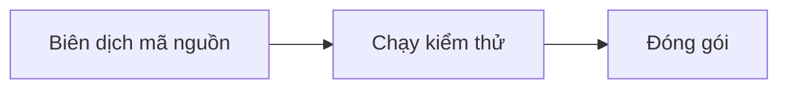

Trong đồ thị này:

- Biên dịch phải hoàn thành trước khi chạy kiểm thử.
- Kiểm thử phải hoàn thành trước khi đóng gói.
- Không có đường đi nào quay ngược về công việc ban đầu.

Đây là một DAG vì các cạnh có hướng và không tạo thành chu trình.

## 2. DAG biểu diễn quy trình build như thế nào?

Hãy xem một dự án Java có mã nguồn chính, tài nguyên, mã kiểm thử và bước tạo JAR. Build tool có thể mô hình hóa những công việc này thành các task:

- Biên dịch mã nguồn chính.
- Sao chép tài nguyên chính.
- Chuẩn bị đầu ra chính.
- Biên dịch mã kiểm thử.
- Sao chép tài nguyên kiểm thử.
- Chạy kiểm thử.
- Tạo JAR.
- Hoàn thành các nhóm task kiểm tra và đóng gói.

Các công việc không nhất thiết phải chạy nối tiếp tất cả. Biên dịch mã nguồn chính và sao chép tài nguyên chính có thể độc lập nếu chúng không chia sẻ đầu ra. Khi cả hai hoàn thành, build tool có thể chuẩn bị output hoặc đóng gói.

Một DAG minh họa:

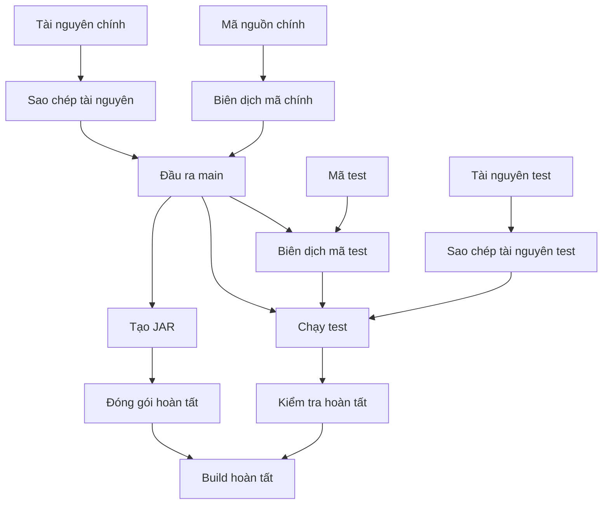

Sơ đồ là ví dụ khái niệm về quan hệ trước sau. Task thực tế, tên task và cách build tool nối chúng phụ thuộc plugin, cấu hình và loại dự án.

Cạnh trong đồ thị thể hiện điều kiện phụ thuộc. Chẳng hạn, nếu task đóng gói cần lớp đã biên dịch, đồ thị phải có đường phụ thuộc từ task biên dịch đến task đóng gói. Build tool không nên đoán thứ tự chỉ dựa trên tên task hoặc thứ tự ta viết chúng trong file cấu hình.

## 3. Đọc cạnh phụ thuộc cho đúng

Trong bài học này, ta dùng quy ước:

**A → B nghĩa là A là công việc tiên quyết của B; B chỉ có thể chạy sau khi A hoàn thành.**

Ví dụ:

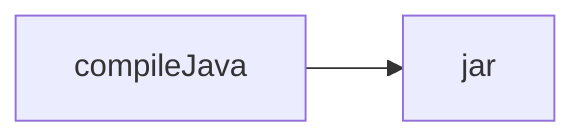

Ta hiểu rằng task tạo JAR cần kết quả biên dịch Java. Nếu chạy task jar, build tool sẽ tìm các task tiên quyết cần thiết và thực hiện chúng theo thứ tự phù hợp.

Một task có thể có nhiều dependency:

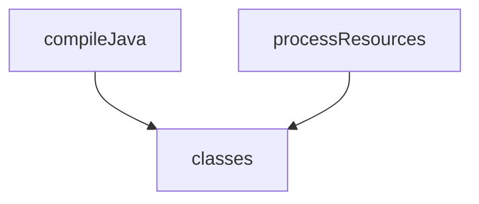

Task classes cần cả lớp Java đã biên dịch lẫn tài nguyên đã xử lý. Vì thế, cả compileJava và processResources đều phải hoàn thành trước classes.

Một task cũng có thể là dependency của nhiều task khác:

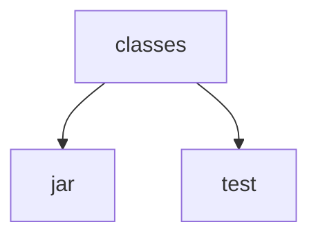

Đầu ra chính có thể được sử dụng để tạo JAR và để chạy kiểm thử. Một công việc tiên quyết có thể được chia sẻ trong đồ thị; build tool không cần thực hiện lại cùng task nhiều lần chỉ vì có nhiều task phía sau cần nó.

### Dependency trực tiếp và gián tiếp

Giả sử:

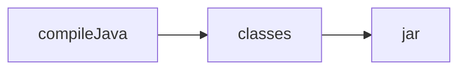

- compileJava là dependency trực tiếp của classes.
- classes là dependency trực tiếp của jar.
- compileJava là dependency gián tiếp của jar, vì jar cần classes và classes cần compileJava.

Khi yêu cầu jar, build tool cần hoàn thành toàn bộ chuỗi tiên quyết. Người dùng thường chỉ cần yêu cầu task đích; build tool sẽ suy ra các task cần chạy từ đồ thị phụ thuộc.

## 4. Thứ tự thực thi hợp lệ: Topological order

Vì DAG không có chu trình, ta có thể sắp xếp các đỉnh thành một thứ tự sao cho mọi đỉnh tiên quyết xuất hiện trước đỉnh phụ thuộc. Thứ tự này gọi là **topological order** hoặc thứ tự topo.

Với đồ thị:

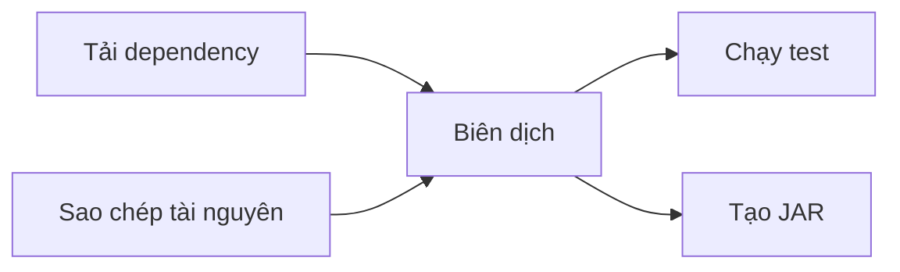

Một thứ tự topo hợp lệ có thể là:

1. Tải dependency.
2. Sao chép tài nguyên.
3. Biên dịch.
4. Chạy test.
5. Tạo JAR.

Một thứ tự khác cũng có thể hợp lệ:

1. Sao chép tài nguyên.
2. Tải dependency.
3. Biên dịch.
4. Tạo JAR.
5. Chạy test.

Hai công việc đầu tiên độc lập với nhau, và hai công việc cuối cùng cũng độc lập trong đồ thị minh họa. Vì vậy, DAG có thể có nhiều thứ tự topo khác nhau.

Điều bắt buộc là mọi dependency phải được hoàn thành trước task phụ thuộc. Build tool được tự do chọn thứ tự giữa các task độc lập, miễn là không vi phạm quan hệ đó.

### Thuật toán sắp xếp topo

Một cách phổ biến để tìm thứ tự topo là thuật toán Kahn:

1. Đếm số dependency đi vào mỗi đỉnh, gọi là indegree.
2. Đưa tất cả đỉnh có indegree bằng 0 vào hàng đợi.
3. Lấy một đỉnh ra, thêm nó vào thứ tự kết quả.
4. Với mỗi cạnh đi từ đỉnh đó đến đỉnh khác, giảm indegree của đỉnh đích đi 1.
5. Nếu indegree của một đỉnh trở thành 0, đưa đỉnh đó vào hàng đợi.
6. Lặp lại cho đến khi hàng đợi rỗng.
7. Nếu số đỉnh trong kết quả bằng tổng số đỉnh, ta có thứ tự topo. Nếu còn đỉnh chưa được xử lý, đồ thị có chu trình.

Ví dụ giả mã:

```text
ready = tất cả đỉnh có indegree bằng 0
order = danh sách rỗng

while ready không rỗng:
    current = lấy một đỉnh khỏi ready
    thêm current vào order

    for mỗi đỉnh next mà current có cạnh đi tới:
        giảm indegree[next] đi 1

        if indegree[next] bằng 0:
            thêm next vào ready

if số phần tử của order nhỏ hơn số đỉnh:
    báo có chu trình
else:
    order là một thứ tự topo hợp lệ
```

Với danh sách kề, thuật toán Kahn có độ phức tạp O(V + E), trong đó V là số đỉnh và E là số cạnh. Điều này có nghĩa việc sắp xếp topo có thể thực hiện hiệu quả ngay cả khi đồ thị có nhiều task và quan hệ phụ thuộc.

## 5. Chu trình phụ thuộc gây ra vấn đề gì?

Một DAG phải không có chu trình. Nếu task A cần task B, B cần C, nhưng C lại cần A, không có task nào có thể bắt đầu theo đúng các điều kiện phụ thuộc.

Ví dụ:

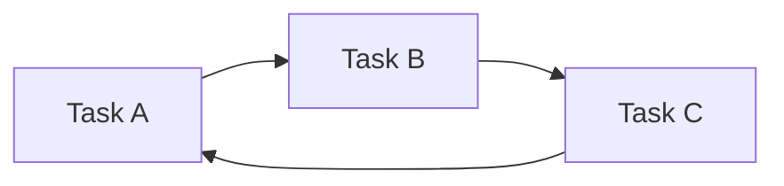

Các quan hệ trên có nghĩa:

- A chờ B.
- B chờ C.
- C chờ A.

Không có thứ tự topo nào thỏa mãn cả ba điều kiện. Build tool có thể báo lỗi circular dependency hoặc cycle detected và dừng build.

### Nguyên nhân thường gặp

- Task A khai báo phụ thuộc B trong khi B lại phụ thuộc A.
- Hai module phụ thuộc lẫn nhau.
- Task tạo file đầu vào lại phụ thuộc vào task cần chính file đó.
- Cấu hình source set hoặc task tùy chỉnh tạo ra dependency ngược.
- Một plugin bổ sung quan hệ task không phù hợp với cấu trúc build.

### Cách xử lý

Khi gặp lỗi chu trình, hãy đọc thông báo build tool để xác định chuỗi task hoặc module tạo thành vòng lặp. Sau đó:

1. Xác định ý nghĩa của từng dependency.
2. Tìm task nào thực sự cần đầu ra của task khác.
3. Bỏ dependency không cần thiết.
4. Tách phần dùng chung thành task hoặc module thứ ba nếu cả hai phía cùng cần nó.
5. Nếu chỉ cần sắp xếp khi hai task cùng được chọn, xem xét một quan hệ thứ tự thay vì dependency thực sự.
6. Chạy lại build để xác nhận đồ thị không còn chu trình.

Không nên xóa dependency chỉ để làm cho lỗi biến mất. Nếu task thật sự cần một đầu ra, dependency đó phải được giữ hoặc được mô hình hóa lại theo cách đúng.

## 6. Dependency khác gì với ràng buộc thứ tự?

Một điểm dễ nhầm là **phụ thuộc** và **thứ tự chạy** không giống nhau.

Dependency có nghĩa là task B cần task A, vì thế yêu cầu chạy B sẽ kéo theo việc chạy A.

Ràng buộc thứ tự chỉ nói rằng nếu cả A và B đều được chọn để chạy, một task phải được thực hiện trước task còn lại. Nó không nhất thiết làm task kia được chọn.

Ví dụ trong Gradle:

```groovy
tasks.register("generateReport") {
    doLast {
        println("Generate report")
    }
}

tasks.register("cleanup") {
    doLast {
        println("Cleanup temporary files")
    }
}

tasks.named("cleanup") {
    mustRunAfter("generateReport")
}
```

Quan hệ mustRunAfter ở đây chỉ yêu cầu cleanup chạy sau generateReport nếu cả hai task đều nằm trong task graph. Nếu chỉ gọi cleanup, Gradle không tự động chạy generateReport chỉ vì có ràng buộc này.

So sánh một số cơ chế Gradle:

| Cơ chế | Ý nghĩa | Có tự đưa task kia vào graph không? |
|---|---|---|
| dependsOn | Khai báo dependency thực sự | Có |
| mustRunAfter | Bắt buộc thứ tự khi cả hai task đã được chọn | Không |
| shouldRunAfter | Đề xuất thứ tự khi có thể áp dụng | Không |
| finalizedBy | Chạy task finalizer sau task được chỉ định | Có, khi task được finalize chạy |

Ví dụ dependency thực sự:

```groovy
tasks.register("generateConfig") {
    doLast {
        println("Generate config")
    }
}

tasks.register("packageApp") {
    dependsOn("generateConfig")
    doLast {
        println("Package application")
    }
}
```

Khi gọi packageApp, Gradle sẽ đưa generateConfig vào task graph vì packageApp phụ thuộc nó.

Nếu gọi cleanup trong ví dụ mustRunAfter mà không yêu cầu generateReport, Gradle chỉ chạy cleanup. Đây là lý do phải chọn đúng loại quan hệ: dependency diễn tả nhu cầu về đầu vào hoặc kết quả; ràng buộc thứ tự diễn tả thứ tự khi các task đã được chọn.

## 7. DAG trong Gradle

Gradle xây dựng task graph từ các task được yêu cầu và các dependency của chúng. Java Plugin cung cấp nhiều task phổ biến, ví dụ:

- compileJava: biên dịch mã nguồn chính.
- processResources: xử lý và sao chép tài nguyên chính.
- classes: tổng hợp các đầu ra chính.
- compileTestJava: biên dịch mã kiểm thử.
- processTestResources: xử lý tài nguyên kiểm thử.
- test: chạy kiểm thử.
- jar: tạo JAR.
- assemble: tạo các artifact.
- check: chạy các bước kiểm tra.
- build: kết hợp các bước kiểm tra và đóng gói.

Đồ thị đơn giản hóa có thể biểu diễn như sau:

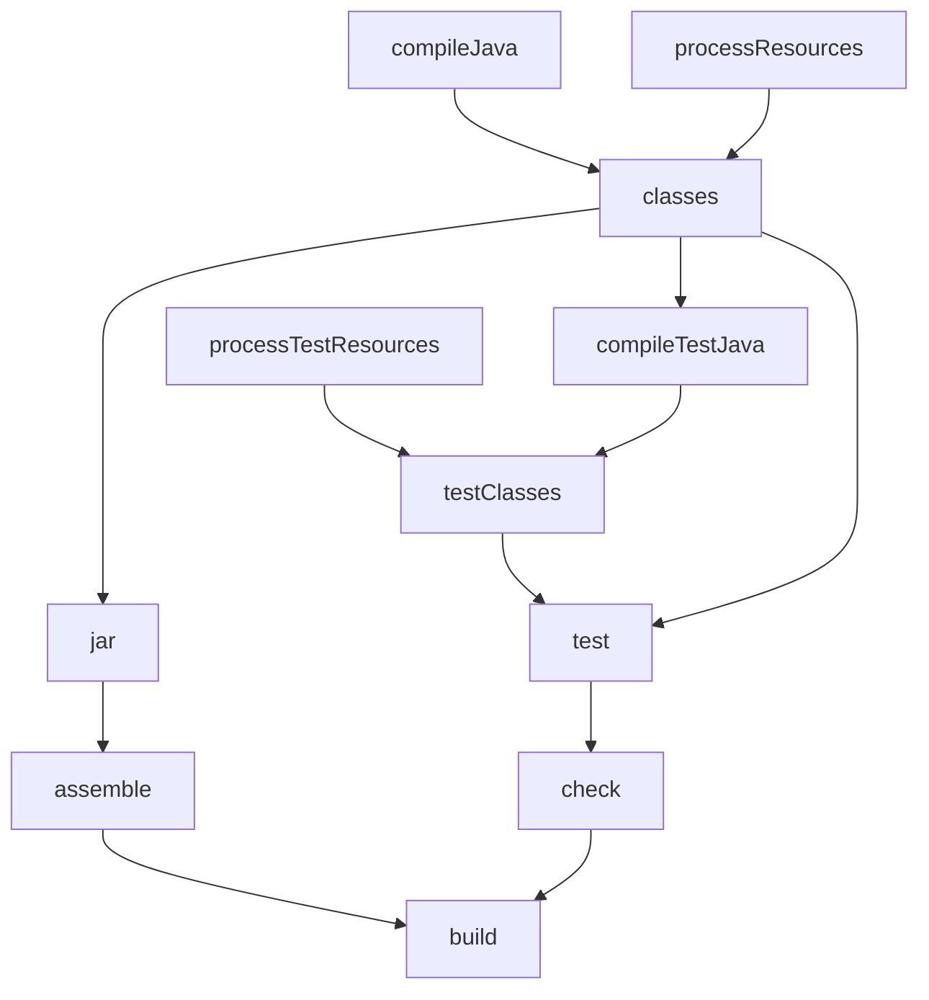

Đây là sơ đồ khái niệm để hiểu quan hệ giữa các nhóm task của Java Plugin; đồ thị chính xác còn tùy phiên bản Gradle, plugin, source set và cấu hình dự án.

### 7.1. Khai báo dependency bằng dependsOn

Ta có thể tạo task tùy chỉnh và khai báo task tiên quyết:

```groovy
tasks.register("prepareFiles") {
    doLast {
        println("Prepare files")
    }
}

tasks.register("createArchive") {
    dependsOn("prepareFiles")

    doLast {
        println("Create archive")
    }
}
```

Khi gọi:

```bash
./gradlew createArchive
```

Gradle sẽ lập task graph có prepareFiles trước createArchive. Nếu prepareFiles thất bại, task phụ thuộc không thể tiếp tục theo quy trình bình thường.

### 7.2. Khai báo đầu vào và đầu ra

Một task nên khai báo rõ file đầu vào và đầu ra để Gradle có thể hiểu công việc của task:

```groovy
def generatedFile = layout.buildDirectory.file("generated/config.txt")

tasks.register("generateConfig") {
    outputs.file(generatedFile)

    doLast {
        def output = generatedFile.get().asFile
        output.parentFile.mkdirs()
        output.text = "mode=production"
    }
}

tasks.register("printConfig") {
    dependsOn("generateConfig")
    inputs.file(generatedFile)

    doLast {
        println(generatedFile.get().asFile.text)
    }
}
```

Trong ví dụ:

- generateConfig tạo file config.txt.
- printConfig phụ thuộc generateConfig.
- printConfig khai báo file cần đọc là input.
- Gradle có thêm thông tin để theo dõi trạng thái task và xác định khi nào kết quả còn hợp lệ.

Khi task có đầu vào và đầu ra được khai báo chính xác, Gradle có thể kiểm tra task có cần chạy lại hay không. Nếu không khai báo đúng, build tool có thể không nhận ra thay đổi hoặc không thể tận dụng incremental build và build cache hiệu quả.

## 8. DAG trong Maven

Maven có mô hình thực thi khác Gradle. Maven tổ chức build bằng các **lifecycle** gồm nhiều phase theo thứ tự, chẳng hạn:

```text
validate → compile → test → package → verify → install → deploy
```

Các plugin goal được gắn vào những phase tương ứng. Khi gọi một phase, Maven thực hiện các phase trước đó trong lifecycle theo thứ tự. Ví dụ, gọi package sẽ chạy các phase cần thiết trước package, bao gồm compile và test theo cấu hình lifecycle thông thường.

Maven cũng phải xử lý quan hệ phụ thuộc giữa các module trong một dự án multi-module. Ví dụ:

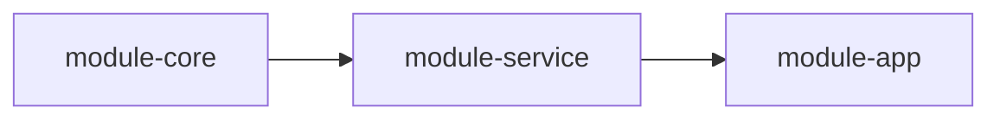

Nếu module-service phụ thuộc module-core và module-app phụ thuộc module-service, Maven Reactor cần xây dựng các module theo thứ tự phù hợp: core trước service, service trước app.

Quan hệ module này có thể được xem như một DAG. Maven Reactor sắp xếp module theo các quan hệ phụ thuộc để module cần thiết được build trước module sử dụng nó. Nếu các module phụ thuộc vòng tròn, Maven không thể tạo thứ tự build hợp lệ.

Cần phân biệt hai cách tổ chức:

- Gradle biểu diễn nhiều công việc build dưới dạng task graph.
- Maven sử dụng lifecycle phase và plugin goal để điều phối các bước, đồng thời Maven Reactor sắp xếp thứ tự module dựa trên dependency giữa các project.

Cả hai đều phải bảo đảm các điều kiện tiên quyết được đáp ứng, nhưng cấu hình và mô hình thực thi không hoàn toàn giống nhau.

## 9. DAG giúp build chạy song song như thế nào?

Một lợi ích quan trọng của DAG là giúp build tool nhận ra những công việc độc lập.

Giả sử:

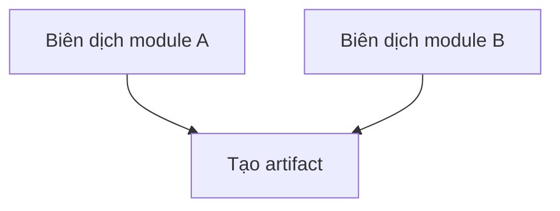

Hai task biên dịch A và B đều phải hoàn thành trước khi tạo artifact. Nếu chúng không phụ thuộc lẫn nhau và không tranh chấp tài nguyên, build tool có thể thực hiện chúng song song.

Ngược lại, không thể chạy task tạo artifact trước khi A và B hoàn tất, vì nó cần kết quả của cả hai.

### 9.1. Điều kiện để chạy song song an toàn

Các task có thể chạy song song khi:

- Không có dependency đường đi giữa chúng.
- Mỗi task có đầu vào và đầu ra được khai báo đúng.
- Không ghi đè lên cùng một file hoặc thư mục ngoài ý muốn.
- Không cùng sửa trạng thái dùng chung mà thiếu đồng bộ.
- Plugin và tác vụ tùy chỉnh hỗ trợ thực thi song song.

Chỉ vì hai task không có cạnh nối trực tiếp không có nghĩa chúng chắc chắn an toàn khi chạy song song. Có thể vẫn có xung đột thông qua file dùng chung, biến môi trường hoặc dịch vụ bên ngoài mà cấu hình chưa mô tả.

### 9.2. Mức song song phụ thuộc đồ thị

Nếu mọi task nằm trên một chuỗi phụ thuộc, phần lớn công việc phải chạy lần lượt:

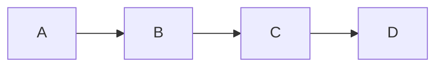

Nếu đồ thị có nhiều nhánh độc lập, có nhiều cơ hội chạy song song hơn:

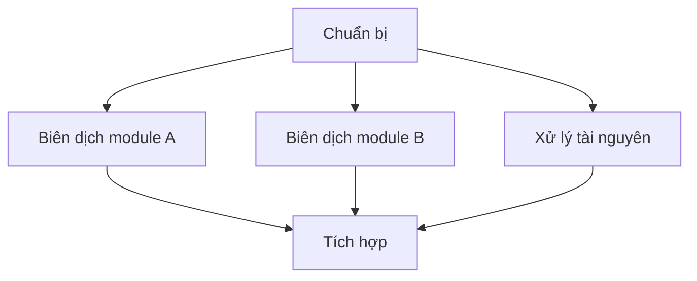

Sau khi chuẩn bị xong, ba nhánh có thể thực hiện độc lập. Task tích hợp phải chờ cả ba nhánh hoàn thành.

Số lượng task có thể chạy song song tại một thời điểm còn phụ thuộc số worker, cấu hình build, tài nguyên máy và giới hạn của hệ thống bên ngoài.

## 10. DAG, incremental build và build cache

DAG mô tả quan hệ giữa các công việc và thứ tự cần thiết để thực hiện chúng. Nó không tự quyết định một task có cần chạy lại hay không.

Đây là hai câu hỏi khác nhau:

- **DAG:** Task nào cần được thực hiện, và task nào phải chờ task nào?
- **Incremental build hoặc cache:** Với task đã có kết quả trước đó, kết quả đó còn hợp lệ để tái sử dụng không?

Ví dụ, task biên dịch phụ thuộc vào mã nguồn và cấu hình compiler. Nếu các đầu vào liên quan không đổi và build tool có thể xác nhận đầu ra còn hợp lệ, task có thể được đánh dấu up-to-date hoặc dùng kết quả cache thay vì thực hiện lại.

Tuy nhiên, task vẫn có thể nằm trong đồ thị. Build tool cần biết nó là một phần của quy trình và kiểm tra trạng thái của nó trước khi quyết định thực thi hay bỏ qua.

Các khái niệm thường gặp:

| Khái niệm | Vai trò |
|---|---|
| Task graph / DAG | Mô tả quan hệ phụ thuộc và thứ tự |
| Up-to-date checking | Xác định đầu ra của task còn phù hợp với đầu vào hiện tại hay không |
| Incremental build | Chỉ xử lý phần cần thiết sau khi đầu vào thay đổi |
| Build cache | Tái sử dụng kết quả task đã được tạo trước đó khi điều kiện cache phù hợp |

Nếu task không khai báo đầy đủ đầu vào và đầu ra, build tool khó xác định chính xác khi nào kết quả cũ còn dùng được. Vì thế, việc mô hình hóa task đúng vừa giúp DAG rõ ràng vừa hỗ trợ tối ưu build.

## 11. Điều gì xảy ra khi một task thất bại?

Giả sử task compileJava thất bại. Các task phía sau cần đầu ra của nó, chẳng hạn classes, test hoặc jar, không thể thực hiện như bình thường.

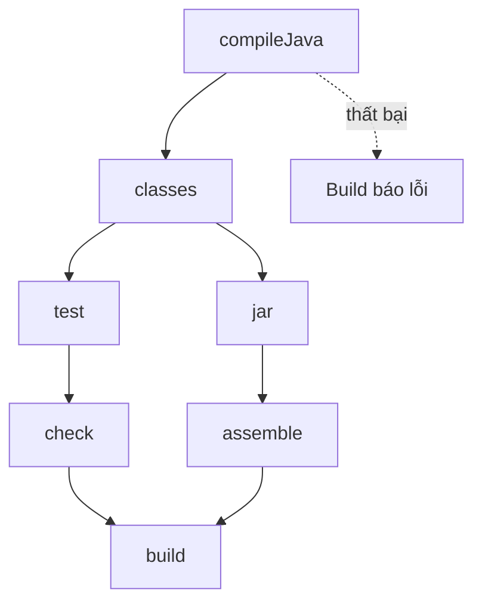

Build tool thường dừng hoặc đánh dấu các task phụ thuộc là không thể tiếp tục, tùy chính sách và loại task. Một số task độc lập có thể đã chạy hoặc vẫn có thể hoàn tất, nhưng task cần đầu ra thất bại không thể tạo kết quả đúng.

Khi đọc log build, hãy tìm task thất bại đầu tiên và thông báo lỗi gốc. Các task phía sau bị bỏ qua thường là hệ quả của lỗi trước đó, không nhất thiết là nguyên nhân độc lập.

## 12. Các lỗi thường gặp khi khai báo DAG

| Hiện tượng | Nguyên nhân có thể | Hướng xử lý |
|---|---|---|
| Build báo circular dependency | Hai hoặc nhiều task phụ thuộc vòng tròn | Xác định chuỗi dependency và loại bỏ quan hệ sai |
| Task chạy trước khi file đầu vào được tạo | Thiếu dependency hoặc khai báo input/output không đúng | Khai báo task tạo file là prerequisite của task sử dụng |
| Task chạy lại dù đầu vào không đổi | Thiếu khai báo input/output hoặc task không hỗ trợ up-to-date | Khai báo đầy đủ đầu vào và đầu ra |
| Task chạy song song nhưng ghi đè file | Hai task dùng chung output | Tách output hoặc thiết lập dependency phù hợp |
| Task không chạy dù mong đợi | Chỉ khai báo mustRunAfter, không có dependency | Dùng dependsOn nếu task thực sự cần task kia |
| Build chạy theo thứ tự không mong đợi | Dựa vào thứ tự khai báo thay vì dependency | Mô hình hóa quan hệ phụ thuộc hoặc ordering constraint phù hợp |
| Một task thất bại kéo theo nhiều task bị bỏ qua | Các task phía sau cần kết quả task thất bại | Tìm lỗi gốc ở task tiên quyết đầu tiên |

Đừng cố sửa lỗi thứ tự bằng cách thêm hàng loạt ràng buộc thứ tự. Trước tiên, xác định quan hệ dữ liệu thực tế: task nào tạo ra thứ mà task khác cần? Câu trả lời đó thường cho biết nên dùng dependency hay ordering constraint.

## 13. Cách thiết kế đồ thị phụ thuộc dễ bảo trì

Một DAG rõ ràng giúp nhóm hiểu build và giảm lỗi. Khi thiết kế task hoặc module, hãy áp dụng các nguyên tắc sau:

### Mỗi task nên có một trách nhiệm rõ ràng

Task biên dịch nên tập trung vào biên dịch; task sao chép tài nguyên xử lý tài nguyên; task đóng gói gom các đầu ra. Task quá lớn làm cho quan hệ phụ thuộc khó đọc và khó tái sử dụng.

### Khai báo dependency dựa trên đầu ra cần thiết

Nếu task B đọc file do task A tạo, hãy khai báo quan hệ để build tool biết B cần chờ A. Không dựa vào thứ tự tình cờ mà một task đã chạy trong lần build trước.

### Tránh phụ thuộc không cần thiết

Nếu task B không dùng kết quả của A, đừng khai báo A là dependency chỉ để ép thứ tự. Dependency dư thừa có thể làm giảm khả năng chạy song song và khiến thay đổi ở A kích hoạt nhiều công việc không liên quan.

### Tránh chu trình giữa các module

Một module nên có hướng phụ thuộc rõ ràng. Nếu hai module cần dùng chung chức năng, cân nhắc chuyển chức năng đó sang module thứ ba để cả hai cùng phụ thuộc vào nó.

### Khai báo input và output chính xác

Build tool cần biết task đọc gì và tạo gì. Khai báo đúng giúp theo dõi thay đổi, tránh ghi đè và hỗ trợ cache.

### Giữ task tùy chỉnh có thể tái sử dụng

Task nên nhận đầu vào và đầu ra qua thuộc tính cấu hình thay vì phụ thuộc vào đường dẫn cứng hoặc trạng thái bên ngoài. Điều này làm task dễ kiểm thử và dễ kết nối trong DAG.

## 14. Ghi nhớ

- DAG là đồ thị có hướng không chứa chu trình.
- Đỉnh biểu diễn task hoặc module; cạnh A → B có nghĩa A phải hoàn thành trước B.
- Một task có thể có nhiều dependency và một dependency có thể được nhiều task dùng chung.
- Thứ tự topo là thứ tự hợp lệ trong đó mọi prerequisite xuất hiện trước task phụ thuộc.
- Chu trình dependency khiến không thể tạo thứ tự topo và thường làm build tool báo lỗi.
- Trong Gradle, dependsOn tạo dependency; mustRunAfter và shouldRunAfter chỉ điều chỉnh thứ tự khi các task liên quan đã được chọn.
- Maven sử dụng lifecycle phase và plugin goal; Maven Reactor sắp xếp các module theo dependency.
- DAG giúp build tool tìm các task độc lập để chạy song song khi an toàn.
- DAG không đồng nghĩa với incremental build hoặc build cache; các cơ chế này quyết định có cần thực thi task hay có thể tái sử dụng kết quả.
- Khai báo dependency, input và output chính xác giúp build dễ hiểu, ổn định và hiệu quả.

## 15. Tự kiểm tra

1. DAG là gì? Hai đặc điểm “có hướng” và “không chu trình” có ý nghĩa gì?
2. Nếu có cạnh A → B, task nào phải hoàn thành trước?
3. Vì sao một DAG có thể có nhiều thứ tự topo hợp lệ?
4. Điều gì xảy ra nếu A phụ thuộc B, B phụ thuộc C và C phụ thuộc A?
5. Trong Gradle, dependsOn khác mustRunAfter ở điểm nào?
6. Vì sao build tool có thể chạy song song hai task độc lập?
7. Tại sao hai task không có dependency trực tiếp vẫn có thể không an toàn khi chạy song song?
8. DAG khác incremental build và build cache như thế nào?
9. Maven Reactor sử dụng dependency giữa các module để quyết định thứ tự build ra sao?
10. Nếu một task cần đọc file do task khác tạo, cần khai báo thông tin gì để build tool lập đồ thị đúng?

Khi có thể đọc một DAG, xác định prerequisite, giải thích thứ tự topo và tìm nguyên nhân của chu trình, bạn đã hiểu cách build tool điều phối các công việc trong một quy trình build có nhiều task và nhiều module.

