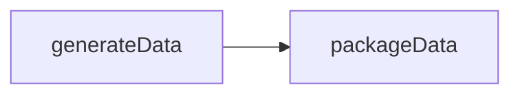
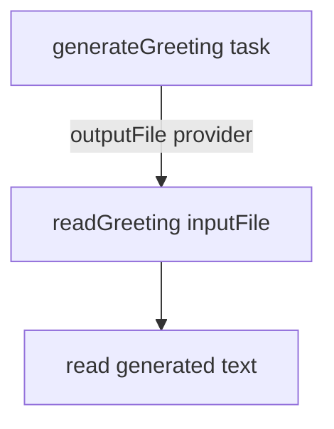

# Phụ thuộc ngầm qua tệp đầu ra và rủi ro thiếu khai báo

Trong Gradle, một task thường tạo ra file mà task khác cần đọc. Ví dụ, task thứ nhất sinh file cấu hình đã chuẩn hóa, còn task thứ hai đóng gói file đó vào artifact. Hai task có quan hệ phụ thuộc về dữ liệu: task đọc chỉ có thể chạy đúng sau khi task tạo file hoàn tất.

Gradle có thể tự suy ra quan hệ này khi đầu ra của task trước được truyền sang đầu vào của task sau thông qua một provider giữ thông tin nguồn tạo ra. Đây là **phụ thuộc ngầm (implicit task dependency)**. Cơ chế này giúp task graph phản ánh luồng dữ liệu mà không phải khai báo `dependsOn` thủ công ở mọi nơi.

Nếu chỉ truyền một đường dẫn file thông thường, Gradle có thể biết task sau đọc file nào nhưng không biết task nào tạo file đó. Khi thiếu khai báo producer, task graph có thể không chứa task tạo file, thứ tự thực thi có thể sai, hoặc Gradle có thể sử dụng một file cũ còn sót lại. Vì vậy, cần hiểu sự khác nhau giữa đường dẫn file, task output và provider mang theo thông tin phụ thuộc.

## 1. Task dependency là gì?

Task dependency mô tả một task cần task khác hoàn thành trước khi nó có thể thực thi. Nếu task `packageData` cần file do `generateData` tạo ra, task graph phải thể hiện:



Khi người dùng yêu cầu chạy `packageData`, Gradle phải đưa `generateData` vào task graph và chạy nó trước. Nếu chỉ có task `packageData` trong graph, file đầu vào có thể chưa tồn tại hoặc có thể là dữ liệu từ một lần build cũ.

Gradle có thể nhận biết dependency theo hai cách phổ biến:

- **Khai báo tường minh:** dùng `dependsOn` để nói task này phụ thuộc vào task khác.
- **Khai báo ngầm qua dữ liệu:** truyền output provider của task tạo dữ liệu vào input của task tiêu thụ dữ liệu. Gradle nhận ra provider đó được tạo bởi task nào và tự thêm dependency tương ứng.

Hai cách đều có thể tạo quan hệ trước-sau trong task graph. Cách khai báo qua dữ liệu còn mô tả được file nào được truyền từ producer sang consumer, giúp build logic rõ ràng hơn.

## 2. Phân biệt đường dẫn file với task output

Một đường dẫn như `build/generated/data.json` chỉ cho biết vị trí file. Bản thân đường dẫn không nói file đó được tạo bởi task nào, khi nào được tạo hoặc dữ liệu nào quyết định nội dung của nó.

Trong Gradle, task output được công bố qua các thuộc tính output như `@OutputFile`, `@OutputDirectory`, `outputs.file(...)` hoặc `outputs.dir(...)`. Khi task khác nhận provider của thuộc tính output đó làm input, Gradle có thể giữ quan hệ producer-consumer.

Ví dụ về các khái niệm:

| Giá trị | Điều Gradle biết |
|---|---|
| `file('build/generated/data.json')` | Một vị trí file. Không tự cho biết task nào tạo file. |
| `layout.buildDirectory.file('generated/data.json')` | Một provider mô tả vị trí file dưới build directory. Nó chưa tự xác định task producer. |
| `producer.flatMap { it.outputFile }` | Provider lấy từ output property của task producer; thông tin phụ thuộc producer được giữ để consumer có thể kế thừa. |
| `inputs.file(provider)` hoặc `@InputFile` | Khai báo file là đầu vào của consumer. Nếu provider mang thông tin producer, Gradle có thể suy ra task dependency. |

Điểm quan trọng là **cùng trỏ đến một file không có nghĩa hai task đã được nối với nhau**. Gradle cần biết cả file đó là input/output của task nào và mối liên hệ được biểu diễn bằng provider hay dependency phù hợp.

## 3. Ví dụ: nối output provider vào input của task khác

Một cách rõ ràng là định nghĩa task type có thuộc tính input/output. Ví dụ dưới đây dùng Groovy DSL và các task type minh họa ngay trong build script. Với build dùng chung, có thể đặt task type trong convention plugin hoặc build logic riêng.

```groovy
abstract class GenerateGreetingTask extends DefaultTask {
    @Input
    abstract Property<String> getGreeting()

    @OutputFile
    abstract RegularFileProperty getOutputFile()

    @TaskAction
    void generate() {
        def target = outputFile.get().asFile
        target.parentFile.mkdirs()
        target.setText(greeting.get(), 'UTF-8')
    }
}

abstract class ReadGreetingTask extends DefaultTask {
    @InputFile
    abstract RegularFileProperty getInputFile()

    @TaskAction
    void readGreeting() {
        def source = inputFile.get().asFile
        logger.lifecycle(source.getText('UTF-8'))
    }
}

def generator = tasks.register('generateGreeting', GenerateGreetingTask) {
    greeting.set('Hello from Gradle')
    outputFile.set(layout.buildDirectory.file('generated/greeting.txt'))
}

tasks.register('readGreeting', ReadGreetingTask) {
    inputFile.set(generator.flatMap { it.outputFile })
}
```

Trong ví dụ:

1. `GenerateGreetingTask` khai báo `outputFile` là `@OutputFile`.
2. `ReadGreetingTask` khai báo `inputFile` là `@InputFile`.
3. `generator` là `TaskProvider` của task `generateGreeting`.
4. `generator.flatMap { it.outputFile }` lấy output property từ task producer mà vẫn giữ quan hệ provider.
5. `inputFile.set(...)` nối provider output đó vào input của consumer.

Khi chạy:

```bash
./gradlew readGreeting
```

Gradle nhận ra `readGreeting` cần output của `generateGreeting`, nên tự đưa producer vào task graph và thực thi producer trước consumer. Không cần thêm `dependsOn('generateGreeting')` cho quan hệ dữ liệu này.



Đây là lợi ích quan trọng của task provider và property provider: chúng mô tả không chỉ vị trí dữ liệu mà còn cả nguồn tạo ra dữ liệu.

## 4. Rủi ro khi chỉ truyền đường dẫn file

Xét một ví dụ đơn giản hơn, trong đó hai task cùng dùng một đường dẫn:

```groovy
def generatedFile = layout.buildDirectory.file('generated/message.txt')

tasks.register('generateMessage') {
    outputs.file(generatedFile)

    doLast {
        def target = generatedFile.get().asFile
        target.parentFile.mkdirs()
        target.setText('generated content', 'UTF-8')
    }
}

tasks.register('consumeMessage') {
    inputs.file(generatedFile)

    doLast {
        def source = generatedFile.get().asFile
        logger.lifecycle(source.getText('UTF-8'))
    }
}
```

Hai task đều khai báo cùng một vị trí file, nhưng `generatedFile` chỉ là provider vị trí do `layout.buildDirectory.file(...)` tạo ra. Nó không phải output property provider lấy từ `generateMessage`. Vì vậy, Gradle không có quan hệ producer-consumer ngầm chỉ từ việc hai khai báo cùng tham chiếu một đường dẫn.

Nếu người dùng chạy riêng:

```bash
./gradlew consumeMessage
```

task `generateMessage` có thể không được đưa vào task graph. Trên máy đã từng chạy generator, file cũ có thể còn tồn tại nên consumer vẫn chạy và tạo cảm giác build đúng. Trên CI sạch hoặc sau `clean`, file không tồn tại và consumer thất bại.

Đây là lỗi khó phát hiện vì kết quả phụ thuộc trạng thái còn sót lại của workspace. Một build thành công trên máy cá nhân chưa chứng minh task graph đã khai báo đầy đủ dependency.

## 5. Cách sửa khi đang dùng đường dẫn file thuần

Nếu chưa thể nối provider output trực tiếp, hãy khai báo dependency tường minh và vẫn khai báo input file của consumer:

```groovy
def generatedFile = layout.buildDirectory.file('generated/message.txt')

def generator = tasks.register('generateMessage') {
    outputs.file(generatedFile)

    doLast {
        def target = generatedFile.get().asFile
        target.parentFile.mkdirs()
        target.setText('generated content', 'UTF-8')
    }
}

tasks.register('consumeMessage') {
    dependsOn(generator)
    inputs.file(generatedFile)

    doLast {
        logger.lifecycle(generatedFile.get().asFile.getText('UTF-8'))
    }
}
```

Ở đây hai khai báo có vai trò riêng:

- `dependsOn(generator)` bảo đảm task tạo file được đưa vào task graph và chạy trước consumer.
- `inputs.file(generatedFile)` cho Gradle biết file nào ảnh hưởng đến kết quả consumer, phục vụ kiểm tra up-to-date và các cơ chế incremental.

Chỉ có `dependsOn` thì Gradle biết thứ tự task, nhưng chưa chắc biết consumer phụ thuộc vào nội dung file nào. Chỉ có `inputs.file` với một đường dẫn thông thường thì Gradle biết dữ liệu được đọc, nhưng không tự biết task nào tạo ra nó. Khi dùng output provider từ producer, hai thông tin được nối với nhau tự nhiên hơn.

## 6. Đừng nhầm dependency với thứ tự chạy

Gradle có một số API điều khiển thứ tự thực thi. Chúng không có cùng ý nghĩa.

| API | Ý nghĩa | Có tự đưa task kia vào task graph không? |
|---|---|---|
| `dependsOn(task)` | Task hiện tại phụ thuộc vào task kia. | Có. |
| Output provider truyền vào input | Consumer phụ thuộc vào producer của dữ liệu. | Có, khi provider giữ metadata producer. |
| `mustRunAfter(task)` | Nếu cả hai task cùng có trong graph, task hiện tại phải chạy sau task kia. | Không. |
| `shouldRunAfter(task)` | Nếu có thể, ưu tiên chạy sau task kia; đây là ràng buộc thứ tự mềm. | Không. |
| `finalizedBy(task)` | Đăng ký task chạy sau task được finalize, thường dùng cleanup hoặc báo cáo. | Có đưa finalizer vào khi task được chạy theo quy tắc finalizer. |

Ví dụ:

```groovy
tasks.named('consumeMessage') {
    mustRunAfter('generateMessage')
}
```

Nếu chỉ chạy `consumeMessage`, Gradle không vì `mustRunAfter` mà tự chạy `generateMessage`. Ràng buộc này chỉ sắp xếp hai task khi cả hai đã nằm trong task graph.

Để tạo quan hệ phụ thuộc thực sự, dùng `dependsOn` hoặc nối output provider của producer vào input consumer. Không dùng `mustRunAfter` như một cách thay thế cho dependency dữ liệu.

## 7. Provider giữ metadata producer như thế nào?

Gradle khuyến khích khai báo task theo kiểu lazy. `tasks.register(...)` trả về `TaskProvider`, còn các property như `RegularFileProperty` và `DirectoryProperty` cung cấp giá trị theo cơ chế provider.

Khi một task có output property, Gradle biết property đó thuộc về task producer. Gọi `flatMap` trên `TaskProvider` cho phép lấy property từ task mà không cần lấy task instance ngay trong giai đoạn cấu hình.

Ví dụ:

```groovy
def producer = tasks.register('produceIndex', GenerateGreetingTask) {
    greeting.set('index')
    outputFile.set(layout.buildDirectory.file('generated/index.txt'))
}

def indexOutput = producer.flatMap { it.outputFile }

tasks.register('inspectIndex', ReadGreetingTask) {
    inputFile.set(indexOutput)
}
```

`indexOutput` là provider được lấy từ output property của task. Consumer nhận provider đó, vì vậy Gradle có thể suy ra producer dependency.

Ngược lại, nếu lấy giá trị ngay trong lúc cấu hình:

```groovy
def plainFile = producer.get().outputFile.get().asFile
```

thì build đã yêu cầu Gradle realize task producer và chuyển provider thành một `File` thông thường. Khi truyền `plainFile` sang task khác, metadata producer không còn nằm trong giá trị file đó. Cách này cũng làm mất một phần lợi ích lazy configuration. Hãy giữ provider xuyên suốt quá trình nối task; chỉ lấy `File` khi task action cần thao tác trên hệ thống file.

Lưu ý rằng không phải provider nào cũng chứa thông tin task producer. Ví dụ `layout.buildDirectory.file('generated/index.txt')` là provider vị trí do project layout cung cấp. Muốn có implicit dependency, provider cần bắt nguồn từ output property của task hoặc một file collection có khai báo `builtBy` tương ứng.

## 8. Khai báo dependency cho file collection và artifact

Khi consumer cần nhiều file được tạo bởi một hoặc nhiều task, có thể dùng `ConfigurableFileCollection` hoặc provider của thư mục đầu ra. Một file collection có thể giữ thông tin task tạo ra file thông qua `builtBy`.

Ví dụ khai báo collection và producer rõ ràng:

```groovy
def generatedDirectory = layout.buildDirectory.dir('generated/reports')

def generateReports = tasks.register('generateReports') {
    outputs.dir(generatedDirectory)

    doLast {
        def directory = generatedDirectory.get().asFile
        directory.mkdirs()
        new File(directory, 'summary.txt').setText('summary', 'UTF-8')
        new File(directory, 'details.txt').setText('details', 'UTF-8')
    }
}

def reportFiles = files(generatedDirectory).builtBy(generateReports)

tasks.register('archiveReports', Zip) {
    from(reportFiles)
    archiveFileName = 'reports.zip'
    destinationDirectory = layout.buildDirectory.dir('archives')
}
```

`builtBy(generateReports)` gắn producer vào file collection. Khi task `archiveReports` tiêu thụ collection đó, Gradle biết cần chạy `generateReports` trước. Trong dự án lớn, cũng có thể dùng artifact/configuration để publish một output từ project này sang project khác; cơ chế artifact thường giúp đóng gói cả file và quan hệ build dependency rõ ràng.

Khi khai báo `outputs.dir(...)`, task producer chịu trách nhiệm tạo nội dung của thư mục output. Consumer nên đọc collection hoặc provider output của producer thay vì tự dựng lại đường dẫn và giả định ai đó đã tạo thư mục.

## 9. Những lỗi thường gặp khi thiếu dependency

### 9.1. Consumer chạy trước producer

Nếu producer và consumer đều được yêu cầu bởi một task khác nhưng không có quan hệ dependency hoặc ordering đúng, Gradle có thể thực thi chúng theo thứ tự không như mong muốn. Khi build bật parallel execution, race condition càng dễ xuất hiện.

### 9.2. Chạy được trên máy cá nhân nhưng thất bại trên CI

Workspace cá nhân có thể còn output từ lần build trước. CI thường bắt đầu với workspace mới hoặc chạy `clean`, do đó lỗi thiếu producer dependency bộc lộ rõ hơn.

### 9.3. Dùng nhầm output cũ

Consumer đọc một file có cùng tên nhưng được tạo bởi một lần chạy khác, một phiên bản mã nguồn khác hoặc một task không còn liên quan. Kết quả có thể hợp lệ về cú pháp nhưng sai về nội dung.

### 9.4. Gradle không nhận ra input đã thay đổi

Nếu consumer không khai báo file là input, Gradle không thể đưa thay đổi nội dung file đó vào kiểm tra up-to-date của consumer. Task có thể bị đánh dấu `UP-TO-DATE` dù dữ liệu thực tế mà logic cần đã đổi.

### 9.5. Build cache lưu kết quả không hợp lệ

Cache chỉ đáng tin khi task mô hình hóa đầy đủ input và output. Nếu một task đọc file ngoài tập input hoặc dùng output của producer mà không khai báo quan hệ, cache key có thể không đại diện đúng cho dữ liệu thực tế. Khi đó Gradle có thể tái sử dụng kết quả được tạo từ trạng thái khác.

### 9.6. File biến mất khi chạy clean

Một task consumer có thể vô tình dựa vào file đã được tạo thủ công hoặc để lại trong `build/`. Khi `clean` xóa build directory, consumer không còn file để đọc. Đây là dấu hiệu build đang phụ thuộc vào trạng thái ngoài task graph.

## 10. Validation của Gradle và thông báo implicit dependency

Gradle có thể phát hiện một số trường hợp task đọc file được tạo bởi task khác nhưng quan hệ dependency không được khai báo. Khi nhận diện được producer, Gradle có thể báo validation problem với nội dung tương tự “uses this output of task ... without declaring an explicit or implicit dependency”.

Thông báo này cho biết task consumer đang dùng output của producer nhưng task graph chưa thể hiện quan hệ cần thiết. Cách sửa thường là:

1. Dùng output property provider của producer làm input cho consumer.
2. Nếu không thể nối provider, khai báo `dependsOn` tường minh.
3. Khai báo file hoặc thư mục đó là input của consumer.
4. Nếu dữ liệu đến từ file collection hoặc artifact, gắn producer bằng `builtBy` hoặc cơ chế artifact phù hợp.

Không phải mọi trường hợp thiếu dependency đều được Gradle phát hiện. Nếu metadata producer đã bị mất do chuyển provider thành `File`, hoặc task đọc dữ liệu ngoài mà Gradle không biết, build có thể không có validation message dù task graph vẫn sai. Vì thế, không thấy warning không đồng nghĩa mọi quan hệ dữ liệu đã được khai báo đầy đủ.

## 11. Cách điều tra task graph và file dependency

Khi consumer đọc file thiếu hoặc task chạy sai thứ tự, hãy bắt đầu từ task graph và khai báo input/output.

In task graph dự kiến mà không thực thi action:

```bash
./gradlew consumeMessage --dry-run
```

Nếu task producer không xuất hiện, hãy kiểm tra cách nối provider hoặc `dependsOn`. Lưu ý `--dry-run` chỉ hiển thị các task sẽ được đưa vào graph; nó không kiểm tra file có tồn tại hoặc nội dung có đúng.

Chạy task với log chi tiết:

```bash
./gradlew consumeMessage --info
```

Kiểm tra các câu hỏi sau:

- Producer có xuất hiện trong task graph không?
- Consumer khai báo đúng file hoặc thư mục là input chưa?
- Producer khai báo đúng output và có ghi vào đúng vị trí không?
- Provider truyền sang consumer có bắt nguồn từ output property của producer không?
- Có đoạn code nào gọi `.get()` rồi chuyển provider thành `File` trong giai đoạn cấu hình không?
- Task có đang đọc một file cũ nằm ngoài output path đã khai báo không?
- Có task khác cũng ghi vào cùng output không?
- Kết quả thay đổi sau `clean` hoặc khi build trên workspace mới không?

Có thể chạy lại với `--rerun-tasks` để yêu cầu các task trong phạm vi được thực thi lại, nhưng tùy chọn này không sửa task graph sai và không bổ sung input/output bị thiếu. Nếu producer không nằm trong graph, `--rerun-tasks` cũng không tự đưa producer vào graph.

## 12. Nguyên tắc thiết kế producer-consumer đáng tin cậy

- **Producer công bố output:** dùng `@OutputFile`, `@OutputDirectory`, `outputs.file` hoặc `outputs.dir` cho artifact do task sở hữu.
- **Consumer công bố input:** dùng `@InputFile`, `@InputDirectory`, `inputs.file` hoặc `inputs.dir` cho dữ liệu thực sự được đọc.
- **Giữ provider metadata:** truyền output provider của producer trực tiếp vào input property của consumer.
- **Dùng `dependsOn` đúng lúc:** thêm dependency tường minh khi không thể truyền producer output provider, đồng thời vẫn khai báo input file.
- **Không thay dependency bằng ordering:** `mustRunAfter` và `shouldRunAfter` chỉ sắp xếp task đã có trong graph.
- **Không làm mất provider quá sớm:** tránh gọi `TaskProvider.get()` hoặc chuyển output provider thành `File` trong giai đoạn cấu hình chỉ để nối task.
- **Một output có owner rõ:** tránh nhiều producer cùng ghi một file hoặc cùng sở hữu một thư mục output.
- **Kiểm tra workspace sạch:** xác minh task consumer chạy được sau `clean` và trong CI workspace mới.
- **Khai báo đủ input:** mọi file, property và dữ liệu ảnh hưởng kết quả phải tham gia vào input model.
- **Xem cache là hệ quả của mô hình đúng:** chỉ bật cache khi task có thể tái tạo output từ tập input đã khai báo đầy đủ.

Phụ thuộc ngầm qua tệp đầu ra là cách Gradle nối luồng dữ liệu vào task graph. Producer công bố output, consumer nhận provider đó làm input, và Gradle tự suy ra thứ tự thực thi. Khi thay provider bằng một đường dẫn file thuần, thông tin về task tạo file có thể biến mất; khi đó build cần dependency tường minh. Thiết kế đúng cả input, output và dependency giúp tránh lỗi chỉ xuất hiện trên CI, sau `clean`, khi chạy song song hoặc khi Gradle tái sử dụng kết quả từ build cache.
