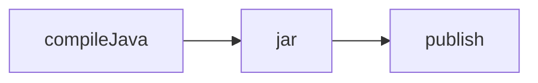
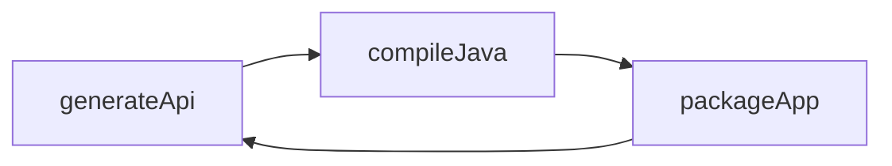
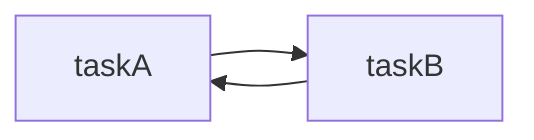
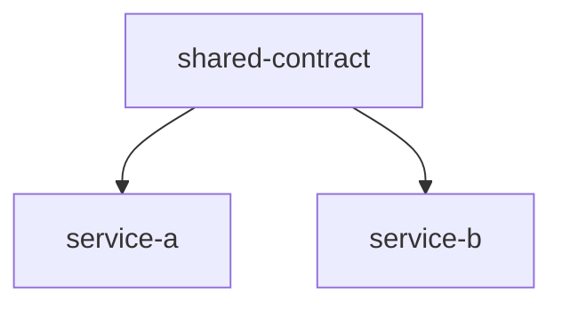
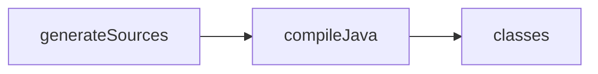
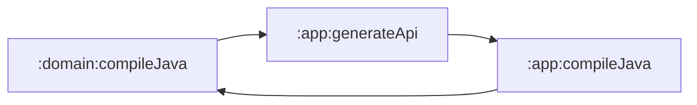
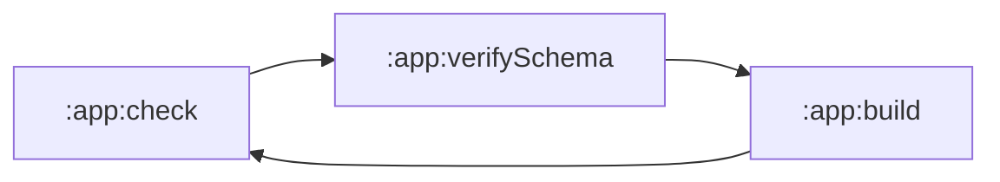
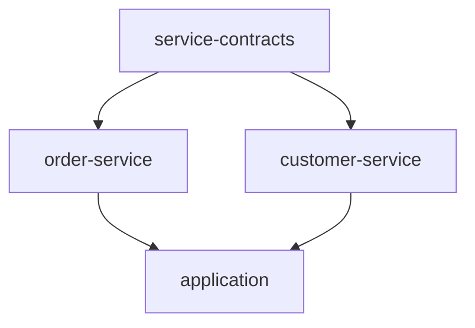

# Phát hiện chu trình phụ thuộc và phá vỡ liên kết không cần thiết

Build tool tổ chức công việc thành một đồ thị: task cần kết quả của task khác, module sử dụng artifact của module khác, và các bước kiểm tra hoặc đóng gói được kết nối theo thứ tự. Những quan hệ này giúp build tự động xác định việc nào phải chạy trước. Tuy nhiên, nếu các quan hệ được khai báo vòng quanh hoặc quá rộng, build có thể rơi vào chu trình phụ thuộc, chạy nhiều công việc không cần thiết hoặc trở nên khó thay đổi.

Với Gradle, task graph phải có thể sắp xếp thành một thứ tự thực thi hợp lệ. Một task không thể vừa cần kết quả của task khác, trong khi task kia lại cần kết quả của task ban đầu. Khi điều đó xảy ra, Gradle phát hiện chu trình và dừng trước khi thực thi phần task graph bị lỗi. Cách xử lý đúng là tìm quan hệ tạo vòng, xác định dữ liệu hoặc thứ tự thực sự cần thiết, rồi loại bỏ liên kết thừa hoặc đổi hướng phụ thuộc.

## 1. Đồ thị phụ thuộc và ý nghĩa của một chu trình

Đồ thị có hướng gồm các **đỉnh** và **cạnh**. Trong build, đỉnh có thể là task hoặc project; cạnh biểu diễn quan hệ giữa chúng. Khi một task cần một task khác hoàn thành trước, ta có quan hệ phụ thuộc.

Để đọc sơ đồ thực thi, bài này dùng mũi tên theo chiều **task tiên quyết → task sử dụng kết quả**. Ví dụ:



`jar` cần kết quả biên dịch, còn `publish` cần artifact đã đóng gói. Vì thế thứ tự thực thi hợp lệ là `compileJava`, sau đó `jar`, rồi `publish`.

Một đồ thị không có chu trình được gọi là DAG (Directed Acyclic Graph — đồ thị có hướng không chu trình). Đây là dạng đồ thị phù hợp để lập lịch task. Gradle có thể tìm một thứ tự thực thi thỏa mãn tất cả các quan hệ tiên quyết trong DAG.

### 1.1. Chu trình hình thành như thế nào?

Giả sử ba task có quan hệ:



`generateApi` cần kết quả của `compileJava`, `compileJava` cần đầu ra do `generateApi` tạo, và `packageApp` lại tạo ra đầu vào cho `generateApi`. Mỗi task đều chờ một task nằm phía sau nó. Không có task nào có thể bắt đầu theo thứ tự phụ thuộc đã khai báo.

Một chu trình ngắn hơn cũng gây cùng vấn đề:



Với chu trình này, không tồn tại thứ tự tuyến tính nào đặt mỗi prerequisite trước task cần nó. Gradle không thể tạo task execution graph hợp lệ nên báo lỗi chu trình phụ thuộc.

### 1.2. Phụ thuộc khác với thứ tự chạy

Không phải mọi quan hệ thứ tự đều là quan hệ phụ thuộc dữ liệu. Cần phân biệt:

- **Dependency:** task B cần đầu ra hoặc kết quả của task A. A phải được đưa vào task graph và hoàn thành trước B.
- **Ordering constraint:** nếu cả A và B đều được đưa vào task graph, ta muốn A chạy trước B. Quan hệ này không tự đưa A vào graph chỉ vì B được yêu cầu.

Gradle có các API như `dependsOn`, `mustRunAfter` và `shouldRunAfter`. Chọn nhầm loại quan hệ có thể làm graph phức tạp hoặc khiến một task chạy khi không cần thiết.

## 2. Dấu hiệu nhận biết chu trình phụ thuộc

Thông báo lỗi cụ thể thay đổi theo phiên bản Gradle và loại task, nhưng thường có nội dung như:

```text
Circular dependency between the following tasks:
:compileJava
\--- :generateApi
     \--- :compileJava
```

Thông báo cho biết một đường đi trong đồ thị quay trở lại task ban đầu. Tên task có thể có project path như `:app:compileJava` hoặc `:domain:generateSources` trong build nhiều module.

Một số dấu hiệu thường gặp:

- Gradle báo `Circular dependency between the following tasks` hoặc thông báo tương đương.
- Build dừng trong giai đoạn lập task graph, trước khi task liên quan thực hiện action.
- Lỗi xuất hiện sau khi thêm `dependsOn`, `finalizedBy`, task sinh mã hoặc quan hệ giữa các project.
- Chỉ một task lifecycle như `build`, `check`, `assemble` hoặc `publish` gặp lỗi, trong khi một task thấp hơn vẫn chạy được.
- Một module độc lập build được, nhưng khi build một module khác hoặc toàn bộ root project thì xuất hiện chu trình.

Không phải mọi build chạy lâu hoặc task bị bỏ qua đều là chu trình. Task có thể đang tải dependency, chờ dịch vụ ngoài, thực hiện test hoặc bị đánh dấu `UP-TO-DATE`. Cần dựa vào thông báo lỗi và task path để phân biệt.

## 3. Các nguyên nhân thường tạo ra chu trình

### 3.1. Hai task phụ thuộc lẫn nhau

Đây là trường hợp trực tiếp nhất. Ví dụ trong `build.gradle`:

```groovy
tasks.register('generateApi') {
    dependsOn 'compileJava'
}

tasks.named('compileJava') {
    dependsOn 'generateApi'
}
```

Hai dòng `dependsOn` tạo quan hệ hai chiều. `generateApi` đợi `compileJava`, còn `compileJava` đợi `generateApi`. Gradle không thể sắp xếp chúng.

Trường hợp này thường xuất hiện khi một task sinh mã cần class đã biên dịch, nhưng mã được sinh lại chính là đầu vào của lần biên dịch đó. Cần xem lại thiết kế: mã được sinh có thật sự cần class của cùng source set không? Có thể chuyển phần API/schema độc lập ra module riêng, hoặc chia quy trình thành các giai đoạn có đầu vào rõ ràng.

### 3.2. Task lifecycle và task con phụ thuộc ngược

Task lifecycle như `build`, `check` và `assemble` thường gom nhiều task khác. Nếu task con phụ thuộc ngược vào lifecycle task, chu trình có thể hình thành.

Ví dụ:

```groovy
tasks.named('build') {
    dependsOn 'publishInternal'
}

tasks.register('publishInternal') {
    dependsOn 'build'
}
```

`build` đợi `publishInternal`, nhưng `publishInternal` lại đợi `build`. Nếu mục tiêu của `publishInternal` chỉ là đóng gói hoặc phát hành JAR, hãy nối nó với task tạo artifact cần thiết như `jar`, hoặc với task kiểm tra cụ thể mà chính sách phát hành yêu cầu. Không để một task con phụ thuộc ngược vào lifecycle task đang chứa nó.

### 3.3. Hai project phụ thuộc vòng quanh

Trong multi-project build, module A có thể khai báo sử dụng module B, trong khi module B lại khai báo sử dụng A. Quan hệ project dependency như vậy có thể tạo chu trình ở các task biên dịch/đóng gói tương ứng, đồng thời thể hiện ranh giới module chưa rõ.

Ví dụ về thiết kế có vấn đề:

```text
service-a  --->  service-b
    ^               |
    |_______________|
```

Nếu A và B cùng cần kiểu dữ liệu hoặc hợp đồng của nhau, hãy xác định phần dùng chung thực sự và chuyển nó sang một module độc lập, chẳng hạn `shared-contract`. Khi ấy:



Hai service cùng phụ thuộc vào hợp đồng chung. Module dùng chung không phụ thuộc ngược vào các service sử dụng nó. Cách tổ chức này giúp build graph rõ ràng và giảm liên kết giữa các thành phần.

### 3.4. Task sinh mã phụ thuộc vào task biên dịch đang tiêu thụ mã đó

Một generator thường tạo file Java vào thư mục `build/generated/...`. Task biên dịch cần các file đó. Chiều phụ thuộc tự nhiên là:



Nếu generator gọi ngược `compileJava` để lấy class rồi `compileJava` lại đợi generator, ta có chu trình. Có thể tách generator thành công cụ độc lập, chạy bằng classpath riêng hoặc module build riêng, để generator không cần output của chính compilation đang tiêu thụ kết quả của nó.

### 3.5. Dùng `dependsOn` chỉ để ép thứ tự

Đôi khi hai task độc lập về dữ liệu, nhưng người viết build muốn chúng chạy theo thứ tự. Nếu task B chỉ cần chạy sau A khi cả hai được yêu cầu, dùng `dependsOn` sẽ biến A thành prerequisite bắt buộc của B. Điều này làm graph rộng hơn và có thể kéo theo nhiều task không cần thiết.

Ví dụ, nếu `verifyGeneratedDocs` chỉ cần chạy sau `generateDocs` khi cả hai cùng được chọn, một ordering constraint có thể phù hợp hơn dependency. Tuy nhiên, nếu `verifyGeneratedDocs` thật sự đọc file do `generateDocs` tạo, hãy mô tả quan hệ dữ liệu rõ ràng và để build tool biết prerequisite.

### 3.6. Finalizer hoặc ordering rule tạo đường vòng

`finalizedBy` dùng để chỉ định task dọn dẹp hoặc hoàn tất sau một task. Nếu task finalizer lại phụ thuộc vào task gốc hoặc một task khác dẫn ngược về task gốc, graph có thể bị vòng.

Tương tự, `mustRunAfter` và `shouldRunAfter` không phải giải pháp thay thế cho việc khai báo dữ liệu đầu vào/đầu ra. Ordering constraint chỉ điều khiển thứ tự khi các task đã có trong graph; nó không bảo đảm task tạo dữ liệu được chạy nếu task tiêu thụ dữ liệu được gọi riêng.

## 4. Phát hiện chu trình bằng Gradle

Gradle tự kiểm tra tính hợp lệ của task graph. Khi gặp chu trình, thông báo lỗi thường chứa các task tạo thành đường vòng. Hãy dùng đường dẫn task đó làm điểm bắt đầu điều tra.

### 4.1. Chạy đúng task đang lỗi với `--dry-run`

`--dry-run` yêu cầu Gradle lập kế hoạch task nhưng bỏ qua hành động thực thi task:

```bash
./gradlew build --dry-run
```

Nếu task graph hợp lệ, Gradle hiển thị những task sẽ được chạy. Nếu graph có chu trình, quá trình lập graph vẫn thất bại và Gradle báo lỗi. Vì vậy `--dry-run` hữu ích để xem phạm vi task và phát hiện lỗi dependency mà không chạy compiler/test/package thực tế.

Có thể thu hẹp phạm vi để điều tra:

```bash
./gradlew :app:compileJava --dry-run
./gradlew :app:build --dry-run
```

Nếu task thấp hơn chạy được nhưng lifecycle task thất bại, hãy kiểm tra những task bổ sung được lifecycle task kéo vào.

### 4.2. Lấy stack trace và log chi tiết

Khi cần thêm ngữ cảnh:

```bash
./gradlew build --stacktrace
```

Hoặc:

```bash
./gradlew build --info
```

`--stacktrace` cung cấp stack trace của lỗi; `--info` tăng mức log để hiểu thêm quá trình cấu hình và thực thi. Dùng chúng cùng task path trong thông báo chu trình để xác định nơi quan hệ được khai báo.

### 4.3. Liệt kê task không đồng nghĩa với xem toàn bộ dependency graph

Có thể xem các task mà build cung cấp:

```bash
./gradlew tasks --all
```

Lệnh này hữu ích để tìm tên task và nhóm task. Tuy nhiên, danh sách task không mô tả đầy đủ mọi cạnh `dependsOn` giữa chúng. Tương tự, `./gradlew dependencies` chủ yếu hiển thị dependency configurations và thư viện của project; nó không phải báo cáo task execution graph.

Để hiểu cạnh nào tạo vòng, hãy kết hợp task path từ lỗi, cấu hình build script, plugin convention và task graph của đúng lệnh đang chạy. Trong build nhiều module, nhớ kiểm tra build script của cả project liên quan, không chỉ file ở root.

### 4.4. Lần theo từng cạnh của chu trình

Giả sử thông báo cho biết:

```text
:app:compileJava
\--- :app:generateApi
     \--- :domain:compileJava
          \--- :app:compileJava
```

Hãy viết lại quan hệ theo thứ tự prerequisite → consumer:



Sau đó tìm nơi khai báo mỗi cạnh. Cạnh có thể đến từ:

- `dependsOn` được viết trực tiếp trong build script.
- Plugin thêm task dependency theo convention.
- Một task được gắn vào lifecycle task qua `check`, `build` hoặc `assemble`.
- Project dependency khiến task của module khác được đưa vào graph.
- Task provider hoặc output của task được truyền vào input của task khác.
- `finalizedBy` hoặc các quan hệ thứ tự được cấu hình ở nhiều file.

Không nên chỉ xóa một dòng `dependsOn` dựa trên tên task. Trước hết cần xác định task tiêu thụ dữ liệu nào, dữ liệu được tạo ở đâu và quan hệ nào thực sự bắt buộc để bảo đảm đầu ra đúng.

## 5. Sửa chu trình bằng cách mô hình hóa đúng quan hệ dữ liệu

Nguyên tắc quan trọng là task tạo dữ liệu phải đứng trước task tiêu thụ dữ liệu. Quan hệ phụ thuộc nên đi theo luồng dữ liệu, không theo mong muốn “chạy cho chắc” hoặc một thứ tự tình cờ.

### 5.1. Ví dụ: sửa chu trình của task sinh mã

Giả sử `generateApi` tạo Java source, còn `compileJava` biên dịch source đó. Cấu hình sai:

```groovy
tasks.register('generateApi') {
    dependsOn 'compileJava'
    // Sinh mã từ schema hoặc file đặc tả.
}

tasks.named('compileJava') {
    dependsOn 'generateApi'
}
```

Hai task đợi nhau. Cấu hình theo đúng chiều dữ liệu có thể như sau:

```groovy
def generatedApiDir = layout.buildDirectory.dir('generated/sources/api/main')

def generateApi = tasks.register('generateApi') {
    outputs.dir(generatedApiDir)

    doLast {
        // Đọc schema/đặc tả và ghi các file Java vào generatedApiDir.
    }
}

sourceSets.main.java.srcDir(generatedApiDir)

tasks.named('compileJava') {
    dependsOn(generateApi)
}
```

Luồng giờ là `generateApi` → `compileJava`. Generator đọc schema hoặc đặc tả và ghi source; compiler đọc source đã sinh cùng source chính. Generator không còn đợi output của compiler. Phần thân `doLast` là vị trí minh họa cho logic sinh file thực tế của dự án.

Nếu generator cần một thư viện Java, hãy cung cấp thư viện đó trên classpath của chính generator, hoặc đóng gói generator thành một module/tool độc lập. Tránh buộc generator phụ thuộc vào toàn bộ task `compileJava` của ứng dụng đang sử dụng output do generator tạo.

### 5.2. Chọn prerequisite nhỏ nhất đủ dùng

Một task cần JAR không nhất thiết cần toàn bộ `build`. Ví dụ:

```groovy
tasks.register('inspectArchive') {
    dependsOn tasks.named('jar')
    doLast {
        // Đọc archive do task jar tạo.
    }
}
```

Nếu dùng `dependsOn 'build'`, task này có thể kéo theo kiểm thử và các bước kiểm tra khác, thậm chí dẫn đến chu trình nếu một task trong `check` hoặc `assemble` lại cần `inspectArchive`. Hãy phụ thuộc vào task tạo đúng artifact mà công việc cần.

Điều này không có nghĩa luôn phải chọn task nhỏ nhất bằng mọi giá. Nếu yêu cầu nghiệp vụ là chỉ publish khi toàn bộ verification đạt, publish phải được nối với các task kiểm tra thích hợp. Mục tiêu là khai báo đúng điều kiện thực sự cần thiết, không kéo toàn bộ lifecycle vào một task chỉ để bảo đảm một file có mặt.

### 5.3. Tách lifecycle task và task thực thi

Một lifecycle task nên đóng vai trò điểm gom. Các task thành phần có thể được gom vào nó; task thành phần không nên phụ thuộc ngược vào lifecycle task đó.

Ví dụ:

```groovy
tasks.register('verifyAll') {
    group = 'verification'
    description = 'Runs the required verification tasks.'
    dependsOn tasks.named('test')
    dependsOn tasks.named('checkstyleMain')
}
```

`verifyAll` gom những bước cần thiết. `test` và `checkstyleMain` không cần phụ thuộc vào `verifyAll`. Khi gọi `verifyAll`, Gradle đưa các prerequisite vào graph theo một chiều. Nếu muốn tích hợp vào lifecycle chuẩn, có thể gắn `verifyAll` vào `check` khi điều đó phù hợp với chính sách dự án; không tạo quan hệ ngược từ một task thành phần trở lại `check`.

### 5.4. Dùng task ordering khi chỉ cần thứ tự

Giả sử `generateDocs` và `checkDocs` đều được gọi rõ ràng trong một lệnh, và `checkDocs` chỉ cần chạy sau `generateDocs`:

```groovy
tasks.named('checkDocs') {
    mustRunAfter tasks.named('generateDocs')
}
```

`mustRunAfter` không tự thêm `generateDocs` vào graph nếu chỉ gọi `checkDocs`. Nếu `checkDocs` thật sự cần file do `generateDocs` tạo, hãy khai báo quan hệ dữ liệu/prerequisite thay vì chỉ sắp thứ tự.

`shouldRunAfter` là ràng buộc thứ tự mềm; Gradle có thể bỏ qua trong một số tình huống để giải quyết giới hạn của graph hoặc chạy song song. Không dùng nó để che giấu một prerequisite bắt buộc.

## 6. Phá vỡ liên kết không cần thiết giữa các task

Một build có thể không có chu trình nhưng vẫn liên kết quá chặt. Ví dụ, task tạo báo cáo chỉ cần một file JAR nhưng lại phụ thuộc toàn bộ `build`; task tài liệu kéo theo integration test cần Docker; task đóng gói local lại kích hoạt publish lên repository. Những liên kết này làm lệnh chậm, khó chạy độc lập và dễ tạo chu trình khi dự án phát triển.

### 6.1. Chỉ phụ thuộc vào đầu ra thật sự cần

Hãy xác định task cần loại dữ liệu nào:

| Task tiêu thụ | Đầu vào cần thiết | Quan hệ nên thể hiện |
|---|---|---|
| Biên dịch Java | Java source, generated source, compile classpath | Phụ thuộc vào generator và dependency cần cho compile |
| Đóng gói JAR | Class và resource đã biên dịch | Phụ thuộc vào các task tạo class/resource |
| Kiểm tra archive | File JAR | Phụ thuộc vào task tạo JAR hoặc nhận output provider của nó |
| Sinh tài liệu từ schema | Schema/đặc tả | Phụ thuộc vào nguồn schema; không cần toàn bộ application build nếu không dùng output đó |
| Publish artifact | Artifact và metadata cần publish, cùng các quality gate theo chính sách | Phụ thuộc vào task tạo artifact và bước kiểm tra được yêu cầu |

Khi một task chỉ cần file, mô hình hóa file đó như input/output sẽ rõ ràng hơn một quan hệ rộng đến task lifecycle không liên quan.

### 6.2. Khai báo input và output rõ ràng

Task tùy chỉnh nên mô tả đầu vào và đầu ra. Điều này giúp Gradle xác định task cần chạy lại khi dữ liệu thay đổi và có thể suy ra quan hệ giữa producer/consumer khi provider output được nối đúng cách.

Ví dụ khái quát:

```groovy
def sourceSchema = layout.projectDirectory.file('src/main/schema/api.yaml')
def generatedDir = layout.buildDirectory.dir('generated/api')

def generateApi = tasks.register('generateApi') {
    inputs.file(sourceSchema)
    outputs.dir(generatedDir)

    doLast {
        // Đọc sourceSchema và ghi output vào generatedDir.
    }
}
```

`inputs.file(...)` mô tả file mà task đọc; `outputs.dir(...)` mô tả thư mục task tạo. Trong implementation thực tế, nên dùng task type có `@InputFile`, `@OutputDirectory` và các property phù hợp khi logic đủ lớn hoặc cần tái sử dụng. Đừng khai báo một file là output nếu task không thật sự tạo hoặc cập nhật nó.

Nếu task khác tiêu thụ output, nối output provider vào input của task tiêu thụ hoặc khai báo prerequisite rõ ràng. Tránh chỉ dùng một chuỗi đường dẫn giống nhau ở hai task rồi kỳ vọng Gradle tự hiểu quan hệ producer/consumer.

### 6.3. Tách việc tùy chọn khỏi lifecycle bắt buộc

Không phải mọi tác vụ đều phải chạy trong mỗi lần `build`. Ví dụ, publish, tạo image container, tải dữ liệu bên ngoài hoặc chạy kiểm thử cần hạ tầng riêng có thể là tác vụ theo nhu cầu.

Có thể tạo task riêng:

```groovy
tasks.register('buildContainerImage') {
    group = 'distribution'
    description = 'Builds the container image for local or release use.'
    dependsOn tasks.named('bootJar')
    doLast {
        // Gọi công cụ container với executable archive.
    }
}
```

Nếu `buildContainerImage` chỉ được gọi khi cần, `build` không phải phụ thuộc vào nó. Ngược lại, nếu chính sách dự án yêu cầu mọi build đều xác minh image, hãy thiết kế một lifecycle task riêng hoặc gắn task vào đúng lifecycle sau khi đánh giá chi phí và yêu cầu môi trường.

### 6.4. Giảm liên kết chéo giữa các module

Module nên phụ thuộc vào API hoặc artifact mà nó thực sự sử dụng. Nếu nhiều module cần cùng một kiểu dữ liệu, cân nhắc tạo module hợp đồng/domain dùng chung. Tránh để module dùng chung phụ thuộc ngược vào ứng dụng cụ thể.

Ví dụ:

```text
Thiết kế chặt:
service-a <----> service-b

Thiết kế theo hợp đồng chung:
          shared-contract
           /          \
          v            v
      service-a    service-b
```

Hướng phụ thuộc một chiều giúp module có thể biên dịch và kiểm thử độc lập hơn. Nó cũng làm rõ ai sở hữu kiểu dữ liệu và ai là bên sử dụng.

### 6.5. Tránh phụ thuộc vào task chỉ vì muốn “chạy trước cho chắc”

Một số build script thêm `dependsOn 'clean'` vào mọi task để tránh dùng output cũ. Cách làm này có thể làm mất lợi ích incremental build, tăng thời gian và tạo liên kết không cần thiết. `clean` thường là task riêng được gọi rõ ràng khi cần xóa output.

Tương tự, không nên để mọi task phụ thuộc `test` nếu chỉ một task release cần test thành công. Hãy gắn quality gate vào đúng điểm phát hành hoặc lifecycle kiểm tra, đồng thời cho phép những tác vụ độc lập chạy riêng khi phù hợp.

## 7. Quan hệ `dependsOn`, `mustRunAfter`, `shouldRunAfter` và `finalizedBy`

Các API này có ý nghĩa khác nhau. Bảng sau giúp chọn đúng loại quan hệ:

| API | Có thêm task vào graph? | Ý nghĩa |
|---|---:|---|
| `dependsOn` | Có | Task được khai báo là prerequisite phải được thực hiện |
| `mustRunAfter` | Không | Nếu cả hai task đã có trong graph, task hiện tại phải chạy sau task được chỉ định |
| `shouldRunAfter` | Không | Đề xuất thứ tự khi có thể; có thể bị bỏ qua |
| `finalizedBy` | Có | Đưa finalizer vào graph để thực hiện sau task được finalize |

Ví dụ:

```groovy
tasks.register('prepareData') {
    doLast { println 'Prepare data' }
}

tasks.register('runAnalysis') {
    doLast { println 'Run analysis' }
}

tasks.named('runAnalysis') {
    dependsOn tasks.named('prepareData')
}
```

Khi gọi `runAnalysis`, `prepareData` được đưa vào graph và chạy trước. Nếu thay `dependsOn` bằng `mustRunAfter`, gọi riêng `runAnalysis` sẽ không tự chạy `prepareData`.

Ví dụ finalizer cho tác vụ cần dọn tài nguyên:

```groovy
def startLocalService = tasks.register('startLocalService') {
    doLast {
        // Khởi động dịch vụ thử nghiệm và ghi nhận tài nguyên cần dọn.
    }
}

def stopLocalService = tasks.register('stopLocalService') {
    doLast {
        // Dọn dịch vụ/tài nguyên thử nghiệm.
    }
}

startLocalService.configure {
    finalizedBy(stopLocalService)
}
```

`stopLocalService` là công việc hoàn tất sau `startLocalService`; nó không phải prerequisite để khởi động dịch vụ. Trong hệ thống thực tế, cần xử lý trường hợp khởi động thất bại một phần và bảo đảm logic cleanup an toàn. Đừng tạo thêm dependency từ finalizer quay ngược về task được finalize.

## 8. Quy trình điều tra và sửa một chu trình cụ thể

Khi Gradle báo chu trình, có thể làm theo trình tự sau:

1. Ghi lại task path và chuỗi task trong thông báo lỗi.
2. Chạy lại đúng task với `--dry-run` để xác nhận lỗi xảy ra khi lập task graph.
3. Dùng `--stacktrace` hoặc `--info` khi cần thêm ngữ cảnh.
4. Với mỗi cạnh trong chu trình, tìm nơi khai báo dependency hoặc ordering rule.
5. Xác định task nào tạo dữ liệu, task nào tiêu thụ dữ liệu và prerequisite thực sự là gì.
6. Loại bỏ cạnh ngược hoặc liên kết lifecycle quá rộng; nếu cần, tách task/module thành các phần độc lập.
7. Chạy lại task hẹp nhất bị ảnh hưởng, rồi chạy lifecycle task ban đầu để xác nhận graph đã hợp lệ.

Ví dụ lỗi:

```text
:app:check
\--- :app:verifySchema
     \--- :app:build
          \--- :app:check
```

Sơ đồ theo chiều prerequisite → consumer:



Giả sử `verifySchema` chỉ đọc schema và kiểm tra tính hợp lệ, nhưng build script lại khai báo nó phụ thuộc `build` vì người viết nghĩ rằng cần compile trước. Trong khi đó `build` chứa `check`, và `check` chứa `verifySchema`. Nếu schema độc lập với class đã biên dịch, hãy bỏ dependency `verifySchema -> build`. Nếu schema thực sự được sinh từ class, cần thiết kế lại nguồn schema hoặc chia thành module/giai đoạn độc lập để tránh việc kiểm tra schema cần chính build đang chờ kết quả kiểm tra.

Sau khi sửa, xác nhận bằng:

```bash
./gradlew :app:check --dry-run
./gradlew :app:check
./gradlew build
```

Lệnh đầu xác nhận graph có thể được lập; lệnh thứ hai thực thi kiểm tra của module; lệnh cuối xác nhận lifecycle build tổng thể. Chọn phạm vi kiểm tra phù hợp với thay đổi thực tế.

## 9. Tránh chu trình trong build nhiều module

Trong build nhiều module, quan hệ project dependency cũng cần có hướng rõ ràng. Nếu module A sử dụng module B, hãy khai báo quan hệ đó ở A. Không tạo dependency ngược ở B chỉ để dùng một vài class tiện lợi.

### 9.1. Tách hợp đồng khỏi implementation

Giả sử `order-service` và `customer-service` cần trao đổi DTO. Nếu mỗi service import trực tiếp class implementation của service kia, hai module dễ phụ thuộc vòng quanh. Tạo module `service-contracts` chứa DTO/interface ổn định có thể giải quyết vấn đề:



Sơ đồ chỉ minh họa hướng phụ thuộc; cấu trúc module cụ thể phụ thuộc kiến trúc ứng dụng. Module contract nên chứa các kiểu dùng chung cần thiết, không trở thành nơi gom mọi class để né thiết kế ranh giới.

### 9.2. Không dùng task của project khác thay cho dependency artifact

Một module không nên gọi task nội bộ của module khác chỉ để lấy file nếu build đã có cơ chế project dependency hoặc artifact variant phù hợp. Project dependency cho phép Gradle lựa chọn output tương ứng và quản lý quan hệ giữa project theo mô hình build. Gọi trực tiếp task của project khác thường làm build script biết quá nhiều về cách module đó tạo sản phẩm.

Khi cần một artifact đặc biệt, hãy publish hoặc expose artifact/variant đó theo cơ chế phù hợp, rồi để consumer khai báo dependency. Cách này giữ cho consumer phụ thuộc vào sản phẩm/hợp đồng của producer thay vì vào chi tiết triển khai task.

### 9.3. Tránh module “dùng chung” phụ thuộc vào ứng dụng

Một module nền tảng hoặc contract nên có hướng phụ thuộc ổn định. Nếu `shared` phụ thuộc `app` để lấy một class, còn `app` phụ thuộc `shared`, graph có thể vòng. Hãy chuyển class đó về module có trách nhiệm sở hữu nó hoặc tách một abstraction độc lập. Ranh giới module tốt làm giảm cả chu trình build lẫn liên kết kiến trúc.

## 10. Những điều không nên làm khi chữa chu trình

Một số thay đổi có thể làm thông báo lỗi biến mất tạm thời nhưng che giấu vấn đề dữ liệu:

- Đổi `dependsOn` thành `mustRunAfter` dù task sau vẫn cần output của task trước. Khi chạy task sau riêng lẻ, output có thể không tồn tại hoặc đã cũ.
- Thêm `--continue` để cố chạy các task còn lại. Tùy chọn này không sửa được graph có chu trình.
- Xóa tùy tiện một dependency giữa hai module mà không kiểm tra classpath và API thực sự được sử dụng.
- Thêm `dependsOn 'build'` vào task con để bảo đảm mọi thứ đã chạy. Cách này thường kéo quá nhiều công việc và có thể tạo vòng qua lifecycle.
- Đưa tất cả task vào một lifecycle task duy nhất, khiến tác vụ tùy chọn và tác vụ bắt buộc phụ thuộc lẫn nhau.
- Dựa vào thứ tự task tình cờ khi chạy trên một máy hoặc khi build chưa bật song song.
- Tạo output vào thư mục source được quản lý thủ công rồi để task khác vừa đọc vừa ghi cùng file.

Sau khi sửa, không chỉ cần build hết lỗi. Cần bảo đảm task vẫn nhận đúng dữ liệu, chạy được độc lập theo hợp đồng của nó và không kéo theo các task không cần thiết.

## 11. Tổ chức task để build graph dễ hiểu

Một số thói quen giúp graph phát triển ổn định:

### 11.1. Đặt tên task theo trách nhiệm

Tên như `generateApiSources`, `compileJava`, `verifySchema`, `packageDistribution` thể hiện mục đích rõ hơn tên chung như `prepare`, `runStep2` hoặc `doAll`. Tên tốt giúp đọc thông báo chu trình và xác định task sở hữu công việc dễ hơn.

### 11.2. Mỗi task có đầu vào và đầu ra rõ

Task nên có trách nhiệm cụ thể, đọc đầu vào đã khai báo và tạo đầu ra đã khai báo. Tránh task vừa biên dịch, vừa publish, vừa thay đổi file source hoặc gọi một task lifecycle lớn khác. Khi một task làm nhiều việc, rất khó xác định dependency nhỏ nhất cần thiết.

### 11.3. Dùng Provider API và cấu hình trì hoãn

Với Gradle, `tasks.register(...)` và `tasks.named(...)` giúp đăng ký/tham chiếu task theo cách hỗ trợ configuration avoidance. Khi nối task, giữ task provider thay vì lấy object task sớm nếu không cần thiết.

Ví dụ:

```groovy
def compileMain = tasks.named('compileJava')

tasks.register('inspectClasses') {
    dependsOn(compileMain)
    doLast {
        // Kiểm tra output đã biên dịch.
    }
}
```

Provider API không tự loại bỏ chu trình. Nó giúp cấu hình build hiệu quả và thể hiện quan hệ task rõ ràng hơn; trách nhiệm thiết kế DAG vẫn thuộc người viết build.

### 11.4. Lifecycle task chỉ gom những bước thuộc cùng mục đích

`check` nên tập hợp các kiểm tra chất lượng; `assemble` tập hợp artifact; `build` kết hợp kiểm tra và assembly theo convention của plugin. Task tùy chọn như publish, deploy hoặc tạo image nên được tổ chức theo mục đích riêng, trừ khi quy trình dự án có yêu cầu rõ ràng đưa chúng vào lifecycle chuẩn.

### 11.5. Để module phụ thuộc theo API/artifact

Module consumer nên biết module producer qua dependency được khai báo, không cần biết danh sách task nội bộ của producer. Điều này giảm liên kết và cho phép producer thay đổi cách tạo artifact mà không buộc consumer sửa theo.

## 12. Phân biệt chu trình task với chu trình dependency thư viện

Trong Gradle, từ “dependency” có thể chỉ nhiều loại quan hệ:

| Loại | Ví dụ | Cách điều tra |
|---|---|---|
| Task dependency | `compileJava` phụ thuộc `generateSources` | Task path, build script, `--dry-run`, `--stacktrace` |
| Project dependency | `app` dùng `project(':domain')` | `settings.gradle`, dependency declarations, project graph |
| Library dependency | `implementation 'group:artifact:version'` | `dependencies`, `dependencyInsight`, repository metadata |
| File input/output | Task A tạo file, task B đọc file | Khai báo `inputs`, `outputs`, provider wiring |
| Ordering constraint | `mustRunAfter`, `shouldRunAfter` | Các rule thứ tự trong task configuration |

Một lỗi `Circular dependency between the following tasks` là lỗi task graph. Lỗi resolve dependency, xung đột version hoặc dependency library không tìm thấy là vấn đề khác. Gradle có thể báo lỗi về module/library dependency trong quá trình resolution, nhưng không nên dùng lệnh xem dependency configurations để thay thế việc điều tra task graph.

Một project dependency vòng quanh có thể cuối cùng biểu hiện thành chu trình task ở những task cần output của nhau. Khi đó, cần xem cả kiến trúc module lẫn task path để xác định nơi bắt đầu sửa.

## 13. Checklist thực hành khi gặp chu trình

Khi Gradle báo chu trình, có thể dùng các câu hỏi sau để điều tra:

1. Task path nào xuất hiện trong thông báo lỗi?
2. Quan hệ nào là prerequisite thực sự, quan hệ nào chỉ nhằm ép thứ tự?
3. Task nào tạo file/artifact, task nào tiêu thụ nó?
4. Có task lifecycle nào kéo task khác vào graph rồi bị phụ thuộc ngược không?
5. Có module nào phụ thuộc vòng quanh hoặc module dùng chung phụ thuộc ngược vào consumer không?
6. Có `finalizedBy`, `mustRunAfter` hoặc `shouldRunAfter` nào góp phần tạo đường vòng không?
7. Có thể thay dependency rộng bằng output/provider hoặc prerequisite nhỏ hơn không?
8. Task tùy chọn có bị nối vào `build`/`check` ngoài yêu cầu không?
9. Sau khi sửa, `--dry-run` có lập được graph và task có nhận đủ input không?
10. Task cụ thể và lifecycle build có thực thi đúng sau thay đổi không?

Chu trình phụ thuộc là dấu hiệu đồ thị build có các quan hệ không thể thỏa mãn đồng thời. Gradle có thể phát hiện và chỉ ra đường vòng, nhưng người phát triển cần hiểu luồng dữ liệu để chọn cạnh cần loại bỏ hoặc thiết kế lại. Khi task chỉ phụ thuộc vào prerequisite thật sự, producer/consumer được khai báo rõ, lifecycle task chỉ gom công việc cùng mục đích và module phụ thuộc theo API/artifact ổn định, build graph sẽ dễ đọc, dễ chạy độc lập và ít bị ảnh hưởng dây chuyền hơn.
