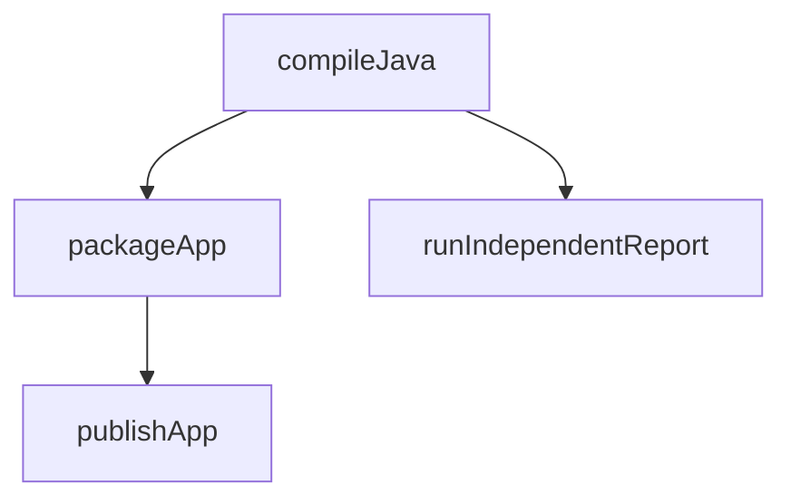
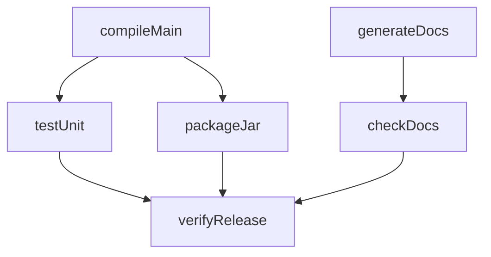
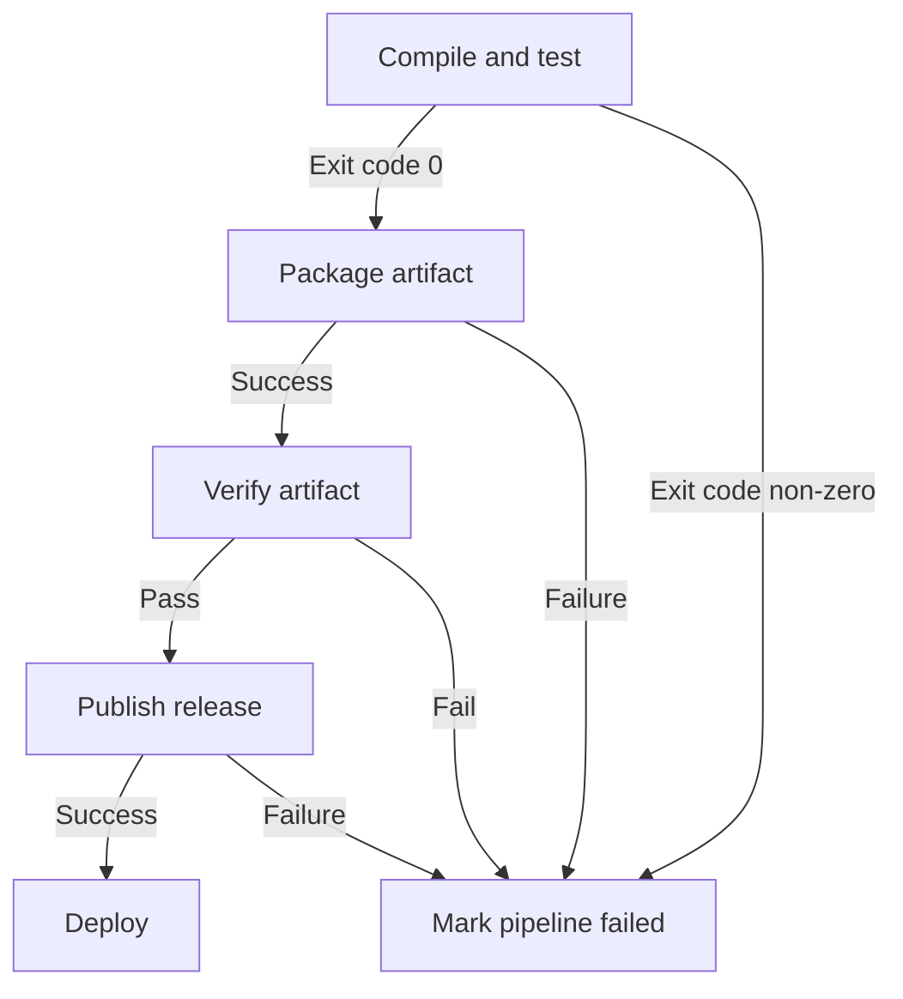

# Mã thoát, trạng thái thất bại và việc dừng chuỗi thực thi

Khi một lệnh build kết thúc, người chạy thường nhìn vào dòng cuối cùng để biết thành công hay thất bại. Nhưng để hiểu chính xác chuyện gì đã xảy ra, cần phân biệt ba khái niệm: **mã thoát của tiến trình (exit code)**, **trạng thái của từng task**, và **cách lỗi lan truyền trong chuỗi công việc**.

Một task có thể thất bại trong khi một số task độc lập khác vẫn được thực hiện. Một task cũng có thể được bỏ qua mà không phải là lỗi. Một lệnh Gradle có thể trả mã thoát khác 0 dù đã chạy xong một số công việc trong task graph. Ngược lại, một bước kiểm tra có thể được cấu hình để không làm build thất bại dù đã phát hiện vấn đề. Nếu không phân biệt các trường hợp này, người vận hành dễ đọc sai kết quả CI, bỏ qua lỗi hoặc dừng quy trình ở sai thời điểm.

## 1. Mã thoát của tiến trình là gì?

Khi một chương trình kết thúc, hệ điều hành cung cấp cho tiến trình gọi nó một giá trị số nguyên gọi là **exit code** hoặc **exit status**. Giá trị này là tín hiệu để shell, script hoặc chương trình khác biết tiến trình vừa chạy có hoàn tất theo cách mà chương trình xem là thành công hay không.

Quy ước phổ biến trên hệ điều hành kiểu Unix và trong nhiều công cụ dòng lệnh là:

- `0`: tiến trình báo thành công.
- Khác `0`: tiến trình báo có lỗi hoặc một trạng thái đặc biệt cần bên gọi xử lý.

Không nên giả định mọi mã khác `0` đều có cùng ý nghĩa. Một công cụ có thể dùng `1` cho lỗi tổng quát, `2` cho tham số không hợp lệ, hoặc các mã riêng để biểu thị kết quả nghiệp vụ. Cần đọc hợp đồng của công cụ đang gọi nếu muốn phân biệt từng loại mã.

Ví dụ, khi chạy Gradle Wrapper:

```bash
./gradlew build
```

Nếu build hoàn tất thành công, tiến trình Gradle thường trả mã `0`. Nếu một task thất bại và build được báo thất bại, tiến trình Gradle trả mã khác `0`. CI dựa vào mã thoát này để quyết định bước hiện tại có đạt hay không.

Điểm quan trọng là exit code thuộc về **toàn bộ tiến trình được gọi**. Nó không phải mã riêng của một task, cũng không mô tả đầy đủ tất cả task đã chạy. Để biết task nào thành công, bị bỏ qua hay thất bại, cần xem kết quả task và log Gradle.

## 2. Cách shell sử dụng mã thoát

Shell dùng exit status của lệnh trước để quyết định có tiếp tục chuỗi lệnh hay không. Trong Bash, biến `$?` chứa mã thoát của lệnh vừa chạy:

```bash
./gradlew test
test_status=$?

if [ "$test_status" -eq 0 ]; then
    echo "Tests passed"
else
    echo "Tests failed with exit code $test_status"
    exit "$test_status"
fi
```

Có thể dùng `&&` để chỉ chạy lệnh sau khi lệnh trước thành công:

```bash
./gradlew test && ./gradlew bootJar
```

Nếu `test` trả mã khác `0`, shell không chạy `bootJar` trong chuỗi trên. Đây là cách nối lệnh theo điều kiện thành công.

Ngược lại, toán tử `;` chỉ ngăn cách các lệnh; nó không tự yêu cầu lệnh trước phải thành công:

```bash
./gradlew test; ./gradlew bootJar
```

Với cách viết này, shell vẫn gọi `bootJar` sau khi `test` kết thúc, kể cả khi test thất bại. Mã thoát cuối cùng của chuỗi thông thường sẽ là mã của lệnh cuối cùng, vì vậy lỗi ở lệnh đầu có thể bị che khuất nếu script không lưu và kiểm tra mã thoát riêng.

Trong PowerShell, sau khi chạy chương trình native như `gradlew.bat`, có thể đọc mã thoát qua `$LASTEXITCODE`:

```powershell
./gradlew.bat test
$testStatus = $LASTEXITCODE

if ($testStatus -ne 0) {
    throw "Gradle test failed with exit code $testStatus"
}

./gradlew.bat bootJar
if ($LASTEXITCODE -ne 0) {
    throw "Gradle bootJar failed with exit code $LASTEXITCODE"
}
```

`$?` trong PowerShell thể hiện trạng thái thành công của câu lệnh vừa chạy theo cách PowerShell đánh giá; `$LASTEXITCODE` chứa mã thoát số nguyên từ chương trình native gần nhất. Khi cần kiểm tra chính xác kết quả của một tiến trình Gradle, nên đọc `$LASTEXITCODE` ngay sau lệnh đó, trước khi gọi một chương trình native khác.

## 3. Mã thoát của Gradle và trạng thái của task

Gradle thực hiện build thông qua nhiều task. Mỗi task có thể có kết quả riêng, trong khi tiến trình Gradle chỉ trả một mã thoát cuối cùng cho toàn build invocation.

Ví dụ:

```text
> Task :compileJava
> Task :processResources
> Task :classes
> Task :compileTestJava
> Task :test FAILED
> Task :jar

BUILD FAILED
```

Đây là dạng log minh họa để thấy rằng một build có thể thực hiện một số task trước hoặc độc lập với task thất bại. Khi build thất bại, tiến trình Gradle trả mã khác `0` dù một vài task đã hoàn thành.

Các trạng thái thường gặp trong log Gradle gồm:

| Trạng thái hiển thị | Ý nghĩa |
|---|---|
| `SUCCESS` hoặc task hoàn tất không có nhãn lỗi | Task thực thi và hoàn thành thành công |
| `UP-TO-DATE` | Input và output được Gradle theo dõi vẫn hợp lệ; task không cần thực thi action lại |
| `FROM-CACHE` | Output được khôi phục từ build cache thay vì thực thi action |
| `NO-SOURCE` | Không có source phù hợp để task xử lý |
| `SKIPPED` | Task bị bỏ qua theo điều kiện hoặc cấu hình skip |
| `FAILED` | Task thất bại và Gradle ghi nhận lỗi |

Các trạng thái như `UP-TO-DATE`, `FROM-CACHE`, `NO-SOURCE` hoặc `SKIPPED` không đồng nghĩa với thất bại. Chúng thường là kết quả hợp lệ của một build. Cần đọc ngữ cảnh và lý do task bị bỏ qua thay vì chỉ tìm từ khóa `SKIPPED` rồi kết luận build lỗi.

Một task được `UP-TO-DATE` cũng không có nghĩa dữ liệu đầu ra bị bỏ quên. Nó có nghĩa Gradle xác định input/output đã khai báo không cần thực hiện lại theo cơ chế kiểm tra của task. Nếu task khai báo thiếu đầu vào, kết quả `UP-TO-DATE` vẫn có thể che giấu một lỗi thiết kế build; vì vậy, việc khai báo input/output đúng rất quan trọng.

## 4. Lỗi trong task graph lan truyền như thế nào?

Giả sử task `packageApp` cần output của `compileJava`, còn `publishApp` cần artifact do `packageApp` tạo ra:



Nếu `compileJava` thất bại, `packageApp` không thể tiếp tục vì đầu vào cần thiết chưa được tạo hợp lệ. Task `publishApp` cũng không thể chạy vì phụ thuộc vào `packageApp`. Nhánh `runIndependentReport` không phụ thuộc vào kết quả biên dịch nên có thể vẫn chạy tùy chính sách thực thi của Gradle và graph.

Nguyên tắc là:

- Task phụ thuộc vào task thất bại không thể thực hiện theo graph bình thường; Gradle bỏ qua hoặc không thực hiện chúng vì prerequisite không hoàn thành.
- Task độc lập không cần output của task thất bại có thể tiếp tục.
- Build invocation cuối cùng vẫn được đánh dấu thất bại nếu có task thất bại chưa được xử lý theo cách khiến build thành công.
- Task finalizer có thể được lên lịch để chạy sau task được finalize, kể cả khi task đó thất bại.

Vì thế, một task thất bại không nhất thiết có nghĩa mọi tiến trình trong graph lập tức bị hủy. Điều quan trọng là quan hệ phụ thuộc: task nào cần kết quả của task lỗi thì không thể tiếp tục theo luồng đó.

## 5. Hành vi mặc định và tùy chọn `--continue`

Khi một task thất bại, Gradle mặc định dừng các nhánh phụ thuộc vào kết quả lỗi và có thể tiếp tục những task không phụ thuộc vào nhánh đó. Tùy chọn `--continue` yêu cầu Gradle tiếp tục thực hiện các task độc lập trong graph sau khi gặp lỗi, thay vì dừng sớm theo hành vi mặc định.

```bash
./gradlew build --continue
```

Ví dụ graph:



Giả sử `testUnit` thất bại:

- `verifyRelease` không thể hoàn thành vì nó phụ thuộc vào `testUnit`.
- `packageJar` có thể vẫn thực hiện nếu không phụ thuộc vào output do `testUnit` tạo ra.
- Nhánh tài liệu `generateDocs` và `checkDocs` độc lập có thể tiếp tục.
- Build vẫn thất bại vì `testUnit` đã thất bại.

`--continue` hữu ích khi muốn thu thập nhiều lỗi trong một lần chạy, chẳng hạn chạy nhiều bộ test độc lập hoặc kiểm tra nhiều module. Nó không biến lỗi thành thành công và cũng không cho phép task phụ thuộc sử dụng output chưa được tạo hợp lệ.

Hãy chọn chính sách phù hợp:

- Với vòng lặp phát triển nhanh, dừng sớm có thể giúp phản hồi ngắn và tập trung.
- Với CI chạy nhiều kiểm tra độc lập, `--continue` có thể cung cấp báo cáo đầy đủ hơn trong một lần chạy.
- Với bước phát hành hoặc triển khai, cần đảm bảo mọi điều kiện bắt buộc đều đạt trước khi đi tiếp.

Không nên dùng `--continue` như một cách bỏ qua lỗi. Sau khi Gradle đã thu thập đủ kết quả, pipeline vẫn phải đọc mã thoát cuối cùng và quyết định có cho phép bước sau hay không.

## 6. Quan hệ phụ thuộc và quan hệ thứ tự ảnh hưởng tới lỗi

Để hiểu việc dừng chuỗi thực thi, cần nhớ sự khác nhau giữa dependency và ordering:

| Quan hệ | Có kéo task vào graph? | Khi task trước thất bại |
|---|---|---|
| `dependsOn` | Có | Task phụ thuộc không thể chạy bình thường vì prerequisite thất bại |
| `mustRunAfter` | Không | Chỉ sắp xếp thứ tự nếu cả hai đã có trong graph; không tự tạo dependency |
| `shouldRunAfter` | Không | Chỉ là gợi ý thứ tự, không kéo task vào graph |
| `finalizedBy` | Có, như finalizer | Finalizer được lên lịch sau task được finalize, kể cả khi task đó thất bại |

Ví dụ:

```groovy
tasks.named('integrationTest') {
    finalizedBy(tasks.named('stopTestEnvironment'))
}
```

Nếu `integrationTest` thất bại, `stopTestEnvironment` vẫn cần chạy để dọn dẹp môi trường kiểm thử tạm. Nếu chỉ dùng `mustRunAfter` để đặt `stopTestEnvironment` sau `integrationTest`, task dọn dẹp sẽ không tự được đưa vào graph khi chỉ gọi `integrationTest`.

Đối với một task publish, quan hệ đúng thường là phụ thuộc vào task tạo và xác minh artifact. Không nên chỉ dùng `mustRunAfter` với task kiểm thử nếu publish thực sự cần kiểm thử đạt. Quan hệ thứ tự không đảm bảo task trước đã thành công; nó chỉ sắp xếp hai task nếu chúng cùng được yêu cầu.

## 7. Finalizer và công việc dọn dẹp khi có lỗi

Một số task mở tài nguyên hoặc tạo trạng thái tạm: khởi động container cơ sở dữ liệu, mở server kiểm thử, tạo thư mục tạm hoặc cấp phát môi trường. Nếu task chính thất bại, việc dọn dẹp vẫn cần được thực hiện.

Gradle hỗ trợ `finalizedBy` để khai báo task finalizer:

```groovy
tasks.register('startTestEnvironment') {
    doLast {
        println 'Starting temporary test environment'
    }
}

tasks.register('runIntegrationChecks') {
    dependsOn(tasks.named('startTestEnvironment'))
    doLast {
        println 'Running integration checks'
        // Công việc kiểm tra có thể thất bại.
    }
}

tasks.register('stopTestEnvironment') {
    doLast {
        println 'Stopping temporary test environment'
    }
}

tasks.named('runIntegrationChecks') {
    finalizedBy(tasks.named('stopTestEnvironment'))
}
```

Ví dụ chỉ minh họa quan hệ task. Trong dự án thật, task start/stop cần gọi API hoặc công cụ quản lý môi trường phù hợp và phải xử lý trường hợp môi trường chưa khởi động hoàn tất.

Finalizer không phải là một cơ chế để biến build thất bại thành thành công. Nếu task chính thất bại, build vẫn thất bại dù finalizer dọn dẹp thành công. Nếu finalizer cũng thất bại, Gradle còn có thể báo thêm lỗi dọn dẹp. Vì vậy, cần xem cả lỗi chính và lỗi finalizer trong báo cáo.

## 8. Bỏ qua task có phải là lỗi không?

Không phải task nào cũng cần chạy trong mọi build. Gradle hỗ trợ nhiều cách bỏ qua task có điều kiện.

Ví dụ `onlyIf`:

```groovy
tasks.register('publishPreview') {
    onlyIf {
        providers.gradleProperty('publishPreview').orNull == 'true'
    }

    doLast {
        println 'Publishing preview artifact'
    }
}
```

Task chỉ thực hiện action khi điều kiện đúng. Nếu điều kiện sai, task bị skip; bản thân việc skip không có nghĩa build thất bại.

Một số trường hợp thường gặp:

- **Không có source:** task không có tệp nguồn phù hợp để xử lý (`NO-SOURCE`).
- **Đầu ra còn hợp lệ:** task không cần chạy lại (`UP-TO-DATE`).
- **Có output trong cache:** Gradle khôi phục output (`FROM-CACHE`).
- **Điều kiện không thỏa:** task được bỏ qua (`SKIPPED`).
- **Task bị disable:** task không được thực thi theo cấu hình.

Khi đọc báo cáo, hãy tìm lý do skip nếu nó quan trọng với quy trình. Nếu task publish bị skip vì chưa bật cờ publish, điều đó có thể là hành vi đúng. Nếu task tạo file bắt buộc bị skip do cấu hình điều kiện sai, quy trình có thể không tạo được output mong đợi dù build chưa báo lỗi.

Do đó, một pipeline cần phân biệt **task không thất bại** với **điều kiện nghiệp vụ đã được đáp ứng**. Ví dụ, task kiểm tra bảo mật bị skip không phải là một lần kiểm tra thành công. Nếu kiểm tra đó bắt buộc, pipeline cần xác nhận task đã thực sự chạy hoặc xác định rõ lý do miễn trừ.

## 9. Xử lý mã thoát từ chương trình bên ngoài

Task Gradle có thể gọi chương trình bên ngoài như Docker, Git, một script hoặc công cụ kiểm tra. Mã thoát của chương trình con có thể quyết định task Gradle thành công hay thất bại.

Với task kiểu `Exec`, mặc định Gradle coi mã thoát khác `0` là lỗi thực thi và task thất bại. Có thể dùng `ignoreExitValue = true` khi muốn tự đọc mã thoát và quyết định cách xử lý:

```groovy
tasks.register('runExternalCheck', Exec) {
    commandLine 'some-check-tool', '--report', 'build/reports/check.json'
    ignoreExitValue = true

    doLast {
        int code = executionResult.get().exitValue
        if (code != 0) {
            throw new GradleException("External check failed with exit code ${code}")
        }
    }
}
```

Ví dụ này cho phép task đọc mã thoát rồi chủ động ném `GradleException` để đánh dấu thất bại. Nếu công cụ dùng mã khác `0` để biểu thị một kết quả không nghiêm trọng, build có thể phân loại theo hợp đồng của công cụ. Cần làm điều đó một cách rõ ràng, có log và có tiêu chí chấp nhận.

Không nên đặt `ignoreExitValue = true` rồi bỏ qua mã thoát. Nếu không kiểm tra `executionResult`, task có thể hoàn thành như thể mọi thứ ổn dù chương trình con đã báo lỗi. Điều đó làm mất tín hiệu thất bại cần thiết cho CI.

Nếu gọi process từ script shell, cũng cần giữ mã thoát của chương trình con. Ví dụ sau sẽ dừng chuỗi khi kiểm tra thất bại:

```bash
some-check-tool --report build/reports/check.json
check_status=$?

if [ "$check_status" -ne 0 ]; then
    echo "External check failed: $check_status"
    exit "$check_status"
fi

./gradlew bootJar
```

Nếu công cụ trả về mã thoát khác `0` nhưng script vẫn trả `0` ở cuối, hệ thống CI có thể hiểu nhầm toàn bộ bước thành công. Luôn truyền lỗi hoặc chuyển đổi mã thoát theo một quy tắc được xác định rõ.

## 10. Thất bại trong kiểm thử và chính sách fail-fast

Task `test` thường đánh dấu build thất bại nếu có test không đạt. Tuy nhiên, có những lựa chọn cấu hình ảnh hưởng tới việc kiểm thử tiếp tục bao lâu và kết quả có làm build thất bại hay không.

### Dừng sớm trong một test task

Với Gradle `Test` task, thuộc tính `failFast` có thể yêu cầu dừng chạy thêm test trong cùng task sau khi gặp lỗi đầu tiên:

```groovy
tasks.named('test') {
    failFast = true
}
```

Điều này nói về cách task kiểm thử xử lý tập test của nó. Nó khác với `--continue`, vốn liên quan đến việc Gradle có tiếp tục các task độc lập khác trong task graph sau khi có task thất bại hay không.

### Không làm build thất bại khi có test lỗi

`Test` task có thuộc tính `ignoreFailures`. Nếu đặt `true`, task không làm build thất bại chỉ vì có test không đạt:

```groovy
tasks.named('test') {
    ignoreFailures = true
}
```

Đây là lựa chọn có ảnh hưởng lớn tới chất lượng gate. Báo cáo test vẫn có thể ghi nhận test thất bại, nhưng task không truyền lỗi theo cách mặc định để làm build thất bại. Nếu dùng tùy chọn này, cần có bước khác đọc báo cáo và áp dụng chính sách rõ ràng. Không nên bật chỉ để pipeline luôn xanh.

Một nguyên tắc an toàn là kiểm thử bắt buộc phải có kết quả được kiểm tra. Nếu test không chạy, bị skip hoặc thất bại nhưng được bỏ qua, pipeline không nên tự động coi đó là bằng chứng chất lượng đạt.

## 11. Cách CI/CD sử dụng kết quả thất bại

Trong CI/CD, mỗi step thường được thực thi bởi runner hoặc shell. Nếu một step chạy Gradle và Gradle trả mã khác `0`, hệ thống CI thường đánh dấu step thất bại. Các bước tiếp theo có thể bị bỏ qua theo điều kiện mặc định của nền tảng CI.

Ví dụ pipeline khái niệm:



Ví dụ shell script cho một pipeline đơn giản:

```bash
set -e

./gradlew clean test
./gradlew bootJar
./gradlew verifyDistribution
```

Trong Bash, `set -e` yêu cầu shell thoát khi một lệnh đơn giản thất bại trong nhiều ngữ cảnh thông thường. Tuy nhiên, quy tắc của `set -e` có ngoại lệ liên quan tới điều kiện `if`, `while`, `&&`, `||`, pipeline và command substitution. Với script quan trọng, cần hiểu rõ ngữ nghĩa shell hoặc kiểm tra mã thoát tường minh thay vì dựa vào `set -e` như một cơ chế bắt lỗi tuyệt đối.

Trong GitHub Actions hoặc nền tảng CI tương tự, bước chạy command thường tự thất bại khi tiến trình trả mã khác `0`. Nếu một bước dùng `continue-on-error` hoặc một điều kiện luôn chạy như `always()`, pipeline có thể tiếp tục sau lỗi. Những tính năng này nên dùng cho mục đích rõ ràng, ví dụ tải log hoặc báo cáo sau khi test thất bại; bước phát hành và triển khai vẫn cần điều kiện thành công phù hợp.

## 12. Chẩn đoán khi chuỗi thực thi dừng sai hoặc tiếp tục sai

Khi build hoặc pipeline có hành vi khác mong đợi, hãy xác định tầng nào đã quyết định dừng:

1. **Chương trình con:** công cụ ngoài có trả mã thoát khác `0` không?
2. **Task Gradle:** task nào được ghi nhận `FAILED`, và exception hoặc log nào giải thích lỗi?
3. **Task graph:** task tiếp theo có phụ thuộc vào task lỗi không, hay chỉ có quan hệ thứ tự?
4. **Cấu hình bỏ qua:** task có bị `onlyIf`, `enabled`, `ignoreFailures` hoặc điều kiện khác tác động không?
5. **Finalizer:** task dọn dẹp có được lên lịch và có hoàn tất không?
6. **Shell/CI:** mã thoát có được giữ lại, chuyển tiếp hoặc vô tình ghi đè bởi lệnh sau không?

Một số tình huống điển hình:

| Hiện tượng | Nguyên nhân có thể | Cách kiểm tra |
|---|---|---|
| Gradle báo `BUILD FAILED` nhưng một số task đã chạy xong | Một task thất bại sau khi các task khác hoàn tất | Xem danh sách task và failure details |
| Task phụ thuộc không chạy sau lỗi | Prerequisite thất bại | Kiểm tra cạnh `dependsOn` trong graph |
| Task độc lập không chạy sau lỗi | Graph/policy thực thi hoặc điều kiện task khiến nó không chạy | Thử `--continue` để thu thập kết quả độc lập và xem log |
| Script vẫn tiếp tục sau lệnh Gradle lỗi | Dùng `;`, bỏ qua mã thoát hoặc cấu hình continue | Kiểm tra `$?`, `$LASTEXITCODE`, điều kiện shell/CI |
| Build xanh dù test có lỗi | `ignoreFailures`, `continue-on-error` hoặc gate bị bỏ qua | Kiểm tra cấu hình Test và điều kiện pipeline |
| Task dọn dẹp không chạy | Chưa khai báo finalizer hoặc finalizer không nằm trong graph | Kiểm tra `finalizedBy` và log task |
| Build thất bại thêm sau khi lỗi chính đã xảy ra | Finalizer hoặc bước thu thập kết quả cũng thất bại | Đọc toàn bộ failure report, không chỉ lỗi đầu tiên |

Khi chạy Gradle, các tùy chọn hữu ích gồm:

```bash
./gradlew build --info
./gradlew build --stacktrace
./gradlew build --continue
./gradlew build --dry-run
```

- `--info` cung cấp thêm thông tin về quá trình thực thi.
- `--stacktrace` hiển thị stack trace để tìm nguyên nhân kỹ thuật.
- `--continue` cho phép tiếp tục các task độc lập sau khi có task thất bại.
- `--dry-run` hiển thị task graph dự kiến mà không thực thi action.

`--dry-run` không thể xác nhận task có thành công khi chạy thật. `--continue` cũng không sửa nguyên nhân lỗi. Chúng là công cụ giúp quan sát và thu thập kết quả.

## 13. Thiết kế chính sách thất bại phù hợp

Một quy trình build tốt cần phân loại rõ công việc bắt buộc và công việc bổ trợ.

**Các bước bắt buộc** thường gồm biên dịch, kiểm thử cần thiết, kiểm tra artifact, kiểm tra bảo mật và xác minh cấu hình. Nếu các bước này thất bại, không nên tiếp tục phát hành hoặc triển khai phiên bản đó.

**Các bước bổ trợ** có thể gồm tạo báo cáo phụ, thu thập log, gửi thông tin hoặc dọn dẹp tài nguyên. Một số bước nên tiếp tục ngay cả khi kiểm thử thất bại để cung cấp thông tin chẩn đoán. Với các bước này, có thể dùng `--continue`, finalizer hoặc điều kiện của CI để bảo đảm chúng được chạy đúng lúc.

Khi thiết kế, hãy trả lời các câu hỏi:

- Task nào là gate bắt buộc để phát hành?
- Task nào có thể chạy độc lập để thu thập thêm kết quả?
- Task nào cần finalizer để giải phóng tài nguyên?
- Task nào được phép bỏ qua, và điều kiện skip có được ghi nhận không?
- Có task nào đang bỏ qua lỗi bằng `ignoreFailures` hoặc shell script không?
- Pipeline có giữ mã thoát cuối cùng của lệnh quan trọng không?
- Bước deploy có phụ thuộc vào kết quả xác minh artifact và phiên bản được chọn không?

Không nên biến mọi lỗi thành lỗi không nghiêm trọng chỉ để hoàn thành pipeline. Cũng không nên dừng mọi công việc bổ trợ ngay khi một test thất bại nếu nhóm cần báo cáo đầy đủ hoặc phải dọn dẹp môi trường. Hãy mô hình hóa điều kiện tiếp tục theo ý nghĩa của từng task.

## 14. Những điểm cần nhớ

Exit code là tín hiệu ở cấp tiến trình; task outcome là kết quả ở cấp công việc; task graph xác định công việc nào phụ thuộc vào công việc nào. Khi một task thất bại, những task cần kết quả của nó không thể tiếp tục bình thường, trong khi các task độc lập có thể tiếp tục theo chính sách Gradle. `--continue` giúp thu thập thêm kết quả nhưng không làm build thành công. `finalizedBy` giúp thực hiện dọn dẹp sau task, kể cả khi task chính thất bại.

Ở cấp shell và CI, cần kiểm tra và truyền đúng mã thoát. Ở cấp Gradle, cần phân biệt task thất bại với task được skip, up-to-date hoặc lấy từ cache. Khi kết hợp các tầng này, quy trình build sẽ báo lỗi trung thực, dừng các bước phát hành khi điều kiện bắt buộc không đạt và vẫn hoàn tất những công việc bổ trợ cần thiết để chẩn đoán hoặc dọn dẹp.
