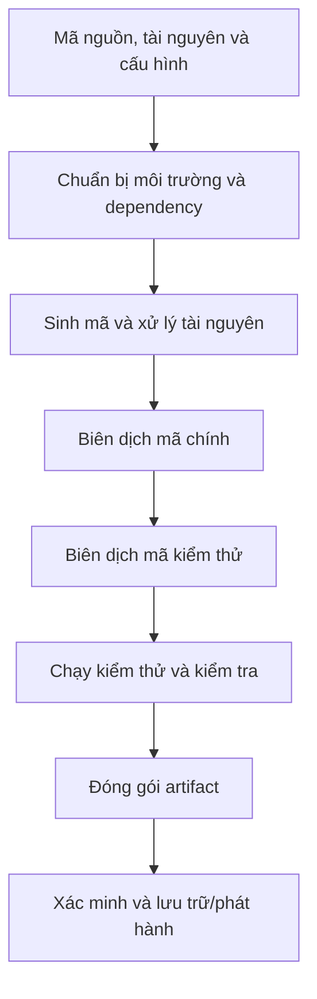
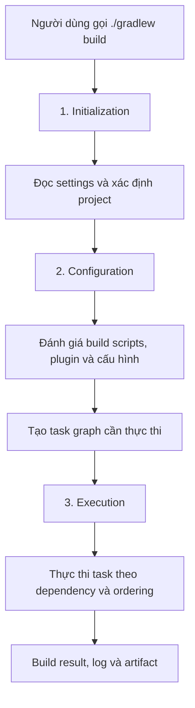
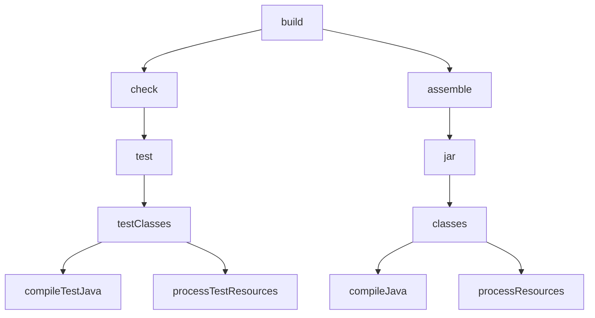

# Vòng đời build và quan hệ với các tác vụ cụ thể

Một lần build thường gồm nhiều công việc nối tiếp hoặc phụ thuộc lẫn nhau: chuẩn bị cấu hình, phân giải thư viện, xử lý tài nguyên, biên dịch mã chính, biên dịch mã kiểm thử, chạy test và đóng gói artifact. Công cụ build tổ chức những công việc đó thành một quy trình có thể chạy lại bằng lệnh hoặc tự động trên CI.

Để hiểu một quy trình build, cần phân biệt hai cách dùng khái niệm **vòng đời build**. Ở mức quy trình phần mềm, vòng đời mô tả các giai đoạn từ mã nguồn đến artifact đã được kiểm tra hoặc phát hành. Ở mức công cụ, Gradle có các giai đoạn xử lý một build invocation và task graph; Maven có các lifecycle với những phase được gắn plugin goal. Những khái niệm này liên quan với nhau nhưng không đồng nghĩa.

## 1. Vòng đời build ở mức quy trình

Một quy trình build Java điển hình có thể được mô tả như sau:



Đây là mô hình khái quát. Một dự án có thể bỏ qua bước sinh mã, bổ sung phân tích tĩnh, kiểm tra bảo mật, kiểm thử tích hợp hoặc tạo nhiều loại artifact. Một số tác vụ có thể chạy song song khi không phụ thuộc lẫn nhau.

| Giai đoạn | Công việc thường gặp | Kết quả mong đợi |
|---|---|---|
| Chuẩn bị | Đọc cấu hình, chọn JDK, phân giải plugin và dependency | Môi trường và classpath sẵn sàng |
| Sinh mã và xử lý tài nguyên | Sinh source từ schema, sao chép hoặc xử lý resource | Source và resource đầu vào cho các bước sau |
| Biên dịch mã chính | Gọi Java compiler với source, classpath và compiler options | Bytecode của ứng dụng hoặc thư viện |
| Biên dịch mã kiểm thử | Biên dịch test source với test classpath | Bytecode của test |
| Kiểm thử và kiểm tra | Chạy unit test, integration test, phân tích mã hoặc kiểm tra cấu hình | Báo cáo và trạng thái kiểm tra |
| Đóng gói | Gom bytecode, resource và metadata | JAR, WAR hoặc artifact khác |
| Xác minh và phát hành | Kiểm tra artifact, cài vào repository hoặc publish | Artifact được chấp nhận cho bước tiếp theo |

Không phải mọi lệnh build đều đi hết quy trình. Ví dụ, lệnh chỉ biên dịch mã chính có thể dừng sau bước compile. Lệnh build tổng hợp thường yêu cầu nhiều nhóm công việc hơn. Vì vậy, khi đọc một lệnh, hãy xác định chính xác nó yêu cầu những bước nào.

## 2. Vòng đời của một lần chạy Gradle

Gradle xử lý một lần chạy build (build invocation) qua ba giai đoạn chính: **initialization**, **configuration** và **execution**. Đây là các giai đoạn mà Gradle dùng để hiểu build và thực hiện những task được yêu cầu.



### 2.1. Initialization — xác định build và các project

Trong initialization, Gradle xác định build nào đang được chạy và project nào tham gia build. Nó đọc settings script (`settings.gradle` hoặc `settings.gradle.kts`) để biết root project, các project con và những thiết lập ở cấp build.

Ví dụ, một build nhiều project có thể khai báo:

```groovy
rootProject.name = 'shop'

include 'app', 'domain', 'infrastructure'
```

Gradle xác định root project `shop` và ba project con `:app`, `:domain`, `:infrastructure`. Nếu settings ánh xạ một project path tới thư mục vật lý khác, Gradle cũng xác định vị trí đó trong quá trình này.

Initialization không biên dịch Java và cũng không chạy test. Nó thiết lập phạm vi build để Gradle biết những project nào cần cấu hình.

### 2.2. Configuration — cấu hình project và lập task graph

Trong configuration, Gradle đánh giá build script của những project cần cấu hình, áp dụng plugin, tạo extension và khai báo task cùng các quan hệ giữa chúng. Sau đó, Gradle xác định đồ thị task cần thực thi cho yêu cầu hiện tại.

Ví dụ, build script:

```groovy
plugins {
    id 'java'
}

repositories {
    mavenCentral()
}

dependencies {
    implementation 'org.apache.commons:commons-lang3:3.17.0'
    testImplementation 'org.junit.jupiter:junit-jupiter:5.11.3'
}

tasks.named('test') {
    useJUnitPlatform()
}
```

Khi cấu hình project, Gradle áp dụng Java plugin, thiết lập các configuration và task của plugin, đọc khai báo dependency và cấu hình test. Việc phân giải dependency có thể diễn ra khi cần thông tin hoặc artifact cho một configuration/task; không nên hiểu rằng mọi dependency luôn được tải hết ngay khi vừa bắt đầu configuration.

Task graph là đồ thị có hướng thể hiện những task phải được đưa vào lần chạy và các ràng buộc thứ tự giữa chúng. Gradle dùng đồ thị này để biết task nào cần chạy trước task nào. Nếu hai task độc lập, chúng có thể được thực thi song song khi cấu hình build và điều kiện chạy cho phép.

### 2.3. Execution — thực thi các task đã chọn

Sau khi task graph được xác định, Gradle thực thi các task theo quan hệ phụ thuộc và ordering. Task có thể gọi compiler, sao chép resource, chạy test framework, tạo JAR hoặc thực hiện một công việc tùy chỉnh.

Trong giai đoạn này, Gradle cũng đánh giá trạng thái của task theo input/output và cơ chế incremental build hoặc build cache. Tùy điều kiện, task có thể thực thi, được bỏ qua vì không có source, được đánh dấu up-to-date hoặc lấy kết quả từ cache.

Nếu task thất bại, Gradle ghi nhận lỗi và quyết định tiếp tục hay dừng các task liên quan theo cấu hình và quan hệ trong graph. Các task không còn đủ điều kiện thực thi có thể bị bỏ qua. Kết quả cuối cùng cho biết build thành công hay thất bại và cung cấp log để điều tra.

## 3. Task là đơn vị công việc của Gradle

Trong Gradle, **task** là đơn vị công việc có thể được yêu cầu thực hiện. Ví dụ, `compileJava` biên dịch mã chính, `processResources` xử lý tài nguyên, `test` chạy kiểm thử và `jar` đóng gói JAR.

Task có thể có:

- **Inputs**: mã nguồn, tệp cấu hình, classpath, tùy chọn compiler hoặc dữ liệu khác ảnh hưởng đến kết quả.
- **Outputs**: bytecode, báo cáo, tệp resource đã xử lý, JAR hoặc tệp sinh ra.
- **Actions**: các hành động thực tế được thực hiện khi task chạy.
- **Dependencies và ordering rules**: quan hệ với các task khác.

Không phải mọi task đều có cùng cấu trúc. Một task tổng hợp có thể chủ yếu gom các task khác vào graph mà không tự tạo tệp. Một task biên dịch có đầu vào và đầu ra rõ ràng. Một task tùy chỉnh có thể được viết để sinh mã hoặc tạo báo cáo.

### 3.1. Quan hệ `dependsOn`

`dependsOn` khai báo rằng task này cần task khác hoàn tất trước khi nó có thể thực hiện. Quan hệ này cũng đưa task phụ thuộc vào graph nếu task đích được yêu cầu.

Ví dụ:

```groovy
tasks.register('prepareReport') {
    doLast {
        println 'Preparing report input'
    }
}

tasks.register('generateReport') {
    dependsOn 'prepareReport'

    doLast {
        println 'Generating report'
    }
}
```

Khi gọi:

```bash
./gradlew generateReport
```

Gradle đưa cả `prepareReport` và `generateReport` vào graph. `prepareReport` phải hoàn thành trước `generateReport` vì đây là dependency thực sự.

### 3.2. `mustRunAfter` và `shouldRunAfter`

Ordering rule quy định thứ tự tương đối khi các task liên quan đã được đưa vào graph. Chúng không có cùng ý nghĩa với `dependsOn`.

```groovy
tasks.named('publishReport') {
    mustRunAfter 'generateReport'
}
```

Nếu cả `generateReport` và `publishReport` đều được yêu cầu trong cùng lần chạy, `mustRunAfter` yêu cầu `generateReport` đứng trước `publishReport`. Nhưng chỉ gọi `publishReport` không tự động kéo `generateReport` vào graph.

`shouldRunAfter` cũng đề xuất thứ tự khi cả hai task được lên lịch, nhưng là ràng buộc mềm và có thể bị bỏ qua trong một số trường hợp, chẳng hạn để tránh chu trình hoặc khi thực thi song song.

| Cơ chế | Đưa task kia vào graph? | Ý nghĩa |
|---|---|---|
| `dependsOn` | Có | Task phụ thuộc phải được thực hiện trước task hiện tại. |
| `mustRunAfter` | Không | Nếu cả hai đã được lên lịch, task hiện tại phải chạy sau task được nêu. |
| `shouldRunAfter` | Không | Nếu có thể, ưu tiên chạy task hiện tại sau task được nêu. |
| `finalizedBy` | Có, như finalizer | Lên lịch task dọn dẹp hoặc hoàn tất sau task được finalize. |

### 3.3. `finalizedBy` — công việc sau khi task hoàn tất

Một số công việc cần chạy sau task chính, chẳng hạn thu dọn tài nguyên tạm hoặc dừng một dịch vụ test. Có thể dùng finalizer:

```groovy
tasks.register('stopTestService') {
    doLast {
        println 'Stopping test service'
    }
}

tasks.named('integrationTest') {
    finalizedBy 'stopTestService'
}
```

Khi `integrationTest` được lên lịch, Gradle cũng lên lịch finalizer tương ứng. Finalizer được thực hiện sau task được finalize, kể cả khi task chính kết thúc với lỗi trong các tình huống Gradle vẫn có thể chạy finalizer. Đây là cơ chế hữu ích để dọn dẹp, nhưng logic dọn dẹp cần được thiết kế sao cho an toàn khi tác vụ chính thất bại một phần.

## 4. Các task phổ biến của Gradle Java plugin

Khi áp dụng Java plugin, Gradle tạo một nhóm source set, configuration và task tiêu chuẩn. Những task này liên kết với nhau để tạo quy trình biên dịch, kiểm thử và đóng gói.

| Task | Vai trò |
|---|---|
| `compileJava` | Biên dịch mã Java trong source set `main`. |
| `processResources` | Sao chép và xử lý tài nguyên của source set `main`. |
| `classes` | Gom các công việc cần để tạo output của mã chính, thường phụ thuộc `compileJava` và `processResources`. |
| `compileTestJava` | Biên dịch mã Java của source set `test`. |
| `processTestResources` | Xử lý tài nguyên kiểm thử. |
| `testClasses` | Chuẩn bị output mã và tài nguyên của test. |
| `test` | Chạy các test đã cấu hình. |
| `jar` | Đóng gói output của mã chính thành JAR. |
| `check` | Nhóm các tác vụ kiểm tra chất lượng, bao gồm `test` trong cấu hình Java plugin mặc định. |
| `assemble` | Nhóm các tác vụ tạo artifact có thể phân phối, thường bao gồm `jar`. |
| `build` | Task tổng hợp, kết nối nhóm kiểm tra (`check`) và tạo artifact (`assemble`). |

Đồ thị rút gọn có thể hình dung như sau:

```text
build
├── check
│   └── test
│       └── testClasses
│           ├── compileTestJava
│           └── processTestResources
└── assemble
    └── jar
        └── classes
            ├── compileJava
            └── processResources
```

Đây là quan hệ khái quát của Java plugin tiêu chuẩn, không phải danh sách đầy đủ mọi task trong một dự án. Plugin khác, source set bổ sung hoặc cấu hình riêng có thể thêm task và dependency. Một số task được dùng chung bởi nhiều nhánh nhưng chỉ cần thực hiện một lần trong cùng graph.

### 4.1. Task tổng hợp và task thực hiện công việc

`build`, `check` và `assemble` thường được xem là task tổng hợp vì chúng kết nối các nhóm công việc. `compileJava`, `test` và `jar` thực hiện những công việc cụ thể hơn.

Sự phân chia này cho phép người dùng chọn phạm vi cần chạy:

```bash
# Chỉ biên dịch mã chính
./gradlew compileJava

# Chạy kiểm thử
./gradlew test

# Tạo artifact
./gradlew assemble

# Chạy các kiểm tra được cấu hình
./gradlew check

# Thực hiện quy trình build tổng hợp
./gradlew build
```

Task tổng hợp không nhất thiết tự thực hiện mọi công việc. Nó có thể chủ yếu phụ thuộc vào các task con. Vì vậy, khi muốn biết `build` làm những gì trong một dự án cụ thể, hãy xem task graph và plugin đã áp dụng.

### 4.2. `clean` không tự động là một phần của `build`

Java plugin cung cấp task `clean` thông qua các plugin nền tảng liên quan. Task này xóa output build theo cấu hình. Khi gọi riêng:

```bash
./gradlew clean
```

Gradle dọn kết quả build cũ. Gọi:

```bash
./gradlew build
```

không có nghĩa là luôn chạy `clean` trước. Nếu cần yêu cầu dọn output rồi build lại trong cùng lần chạy, lệnh thường dùng là:

```bash
./gradlew clean build
```

Hãy quan sát task execution log hoặc dry run để xác nhận thứ tự và những task thực sự được lên lịch. Trong cấu hình tùy chỉnh, các ordering rule và dependency bổ sung có thể ảnh hưởng đến graph.

## 5. Maven lifecycle: phase và plugin goal

Maven tổ chức quy trình build bằng các **lifecycle** có thứ tự phase xác định. Mỗi phase có thể được gắn một hoặc nhiều plugin goal. Khi gọi một phase, Maven chạy các phase đứng trước nó trong cùng lifecycle rồi thực thi các goal đã được gắn.

Maven có các lifecycle tích hợp phổ biến:

- `default`: xử lý việc kiểm tra, biên dịch, kiểm thử, đóng gói, xác minh, cài đặt và triển khai artifact.
- `clean`: dọn output từ build trước.
- `site`: tạo site hoặc tài liệu dự án.

### 5.1. Các phase tiêu biểu của default lifecycle

Một số phase thường gặp theo thứ tự:

| Phase | Ý nghĩa khái quát |
|---|---|
| `validate` | Kiểm tra project có hợp lệ và đủ thông tin cần thiết. |
| `initialize` | Khởi tạo trạng thái hoặc thuộc tính cần cho build. |
| `generate-sources` | Sinh mã nguồn nếu project có cấu hình. |
| `process-sources` | Xử lý mã nguồn trước khi biên dịch. |
| `generate-resources` | Sinh tài nguyên. |
| `process-resources` | Xử lý và sao chép tài nguyên chính. |
| `compile` | Biên dịch mã nguồn chính. |
| `process-classes` | Xử lý bytecode sau biên dịch nếu có cấu hình. |
| `generate-test-sources` | Sinh mã kiểm thử nếu cần. |
| `process-test-sources` | Xử lý mã nguồn kiểm thử. |
| `generate-test-resources` | Sinh tài nguyên kiểm thử. |
| `process-test-resources` | Xử lý tài nguyên kiểm thử. |
| `test-compile` | Biên dịch mã kiểm thử. |
| `process-test-classes` | Xử lý output của test sau biên dịch. |
| `test` | Chạy unit test theo cấu hình. |
| `prepare-package` | Chuẩn bị trước khi đóng gói. |
| `package` | Đóng gói artifact, ví dụ JAR hoặc WAR. |
| `pre-integration-test` | Chuẩn bị môi trường cho integration test. |
| `integration-test` | Chạy integration test theo cấu hình. |
| `post-integration-test` | Dọn hoặc hoàn tất môi trường integration test. |
| `verify` | Chạy các kiểm tra xác minh artifact và kết quả build. |
| `install` | Cài artifact vào local Maven repository. |
| `deploy` | Đưa artifact lên remote repository theo cấu hình. |

Danh sách trên tập trung vào các phase quan trọng trong default lifecycle. Maven còn có các phase khác xen giữa những phase này. Một phase không nhất thiết có sẵn một hành động cụ thể nếu không có plugin goal được gắn vào nó.

### 5.2. Phase khác goal như thế nào?

**Phase** là một điểm trong lifecycle, ví dụ `compile` hoặc `package`. **Goal** là một thao tác do plugin cung cấp, ví dụ `compiler:compile` hoặc `surefire:test`.

Có thể hình dung:

```text
Maven lifecycle phase
       |
       +--> plugin goal A
       +--> plugin goal B
       +--> plugin goal C
```

Project packaging type và cấu hình plugin quyết định goal nào được gắn với phase nào. Ví dụ, với packaging `jar`, Maven có các binding mặc định để biên dịch mã, chạy test và đóng gói. Project có thể bổ sung hoặc thay đổi binding trong `pom.xml`.

Khi gọi trực tiếp một goal như `mvn compiler:compile`, bạn đang yêu cầu goal đó chạy. Khi gọi phase như `mvn compile`, Maven đi theo lifecycle đến phase `compile` và thực hiện những goal được gắn với các phase đã đi qua.

### 5.3. Lệnh Maven và phạm vi công việc

```bash
# Dọn output cũ
./mvnw clean

# Chạy các phase đến compile
./mvnw compile

# Chạy các phase đến test
./mvnw test

# Đóng gói artifact sau các phase trước đó
./mvnw package

# Chạy quy trình đến bước xác minh
./mvnw verify

# Cài artifact vào local repository
./mvnw install
```

Khi gọi `verify`, Maven thực hiện các phase trước đó của default lifecycle, bao gồm validate, compile, test và package, rồi đến verify. Tương tự, `install` đi qua các phase trước đó trước khi cài artifact vào local repository.

`clean` thuộc clean lifecycle riêng. Lệnh thường dùng:

```bash
./mvnw clean verify
```

đề nghị Maven chạy clean lifecycle và sau đó chạy default lifecycle đến verify. Đây là cách phổ biến để xác minh một build từ output sạch.

## 6. Gradle task và Maven phase không phải cùng một mô hình

Gradle và Maven đều có thể tạo quy trình từ biên dịch đến đóng gói, nhưng mô hình điều phối khác nhau.

| Khía cạnh | Gradle | Maven |
|---|---|---|
| Đơn vị điều phối | Task | Lifecycle phase và plugin goal |
| Quan hệ thực thi | Task dependency và ordering rule tạo task graph | Phase có thứ tự; plugin goal được gắn vào phase |
| Chọn phạm vi | Yêu cầu một hoặc nhiều task, ví dụ `test`, `build` | Yêu cầu một phase, ví dụ `test`, `package`, `verify` |
| Công việc mở rộng | Plugin đăng ký task, configuration và convention | Plugin cung cấp goal và lifecycle binding |
| Cấu hình thường gặp | `build.gradle` / `build.gradle.kts`, `settings.gradle` | `pom.xml` |
| Dọn output | Task `clean` | Clean lifecycle, thường gọi `mvn clean` |

Không nên ánh xạ máy móc `gradle build` thành `mvn package` hoặc coi `gradle test` và `mvn test` có toàn bộ hành vi giống hệt nhau. Plugin, task graph, phase binding và cấu hình project có thể khiến phạm vi thực tế khác nhau.

## 7. Build nhiều project và phạm vi task

Trong Gradle multi-project build, mỗi project có thể có task riêng. Task path đầy đủ xác định project và task, ví dụ `:app:build` hoặc `:domain:test`.

Ví dụ cấu trúc:

```text
shop/
├── settings.gradle
├── app/
│   └── build.gradle
├── domain/
│   └── build.gradle
└── infrastructure/
    └── build.gradle
```

Một số lệnh minh họa:

```bash
# Xem task trong project app
./gradlew :app:tasks

# Chạy test của riêng app
./gradlew :app:test

# Build riêng project domain
./gradlew :domain:build

# Chạy task có tên test theo task selector trong build
./gradlew test
```

Task selector không có project path có thể chọn task cùng tên trong nhiều project tùy cấu trúc build và task tồn tại ở đâu. Khi cần phạm vi chính xác, hãy dùng task path đầy đủ.

Dependency giữa project cũng ảnh hưởng task graph. Nếu `:app` phụ thuộc `:domain`, task biên dịch hoặc đóng gói của app có thể cần output từ domain. Gradle sử dụng dependency project để đưa các task cần thiết của project được phụ thuộc vào graph.

Với Maven multi-module build, root `pom.xml` có thể khai báo `<modules>`. Maven reactor xác định các module và sắp xếp thứ tự build dựa trên quan hệ giữa chúng cùng các quy tắc reactor. Khi gọi một phase từ root, Maven thường áp dụng phase đó cho các module được chọn trong reactor.

## 8. Task graph không đồng nghĩa với một chuỗi lệnh tuyến tính

Một quy trình có thể được trình bày bằng danh sách bước để dễ hiểu, nhưng task graph có thể có nhánh song song và task dùng chung.

Ví dụ:



Các nhánh `check` và `assemble` có thể thực hiện một số công việc độc lập. Tuy nhiên, `test` cần test classes và `jar` cần classes. Nếu có dependency chung, Gradle chỉ đưa một task vào graph một lần cho cùng build invocation.

Điều này có ba hệ quả:

1. Không nên suy luận thứ tự thực thi chỉ từ cách các task được viết trong build script.
2. Một task có thể không chạy nếu output vẫn hợp lệ và Gradle xác định task up-to-date hoặc có thể dùng cache.
3. Thêm dependency không cần thiết có thể tuần tự hóa các công việc vốn có thể chạy song song; thiếu dependency có thể khiến task chạy khi đầu vào chưa sẵn sàng.

Khi thiết kế task tùy chỉnh, hãy khai báo quan hệ dữ liệu thật sự. Nếu task B đọc output của task A, hãy mô hình hóa output đó như input của B hoặc khai báo dependency phù hợp để Gradle hiểu thứ tự và tính hợp lệ của kết quả.

## 9. Incremental build, cache và trạng thái task

Một lý do build tool quản lý task graph là để tránh lặp lại công việc không cần thiết. Gradle có thể kiểm tra input/output của task để quyết định có cần thực thi lại hay không.

Các trạng thái thường thấy trong log Gradle gồm:

| Trạng thái | Ý nghĩa khái quát |
|---|---|
| `SUCCESS` | Task đã chạy và hoàn thành thành công. |
| `UP-TO-DATE` | Input không thay đổi theo mô hình Gradle theo dõi và output vẫn hợp lệ, nên task không cần chạy lại. |
| `FROM-CACHE` | Gradle lấy output phù hợp từ build cache. |
| `NO-SOURCE` | Task không có source phù hợp để xử lý. |
| `SKIPPED` | Task bị bỏ qua theo điều kiện hoặc cấu hình. |
| `FAILED` | Task thực thi và thất bại. |

Trạng thái thực tế hiển thị tùy task và phiên bản Gradle. Không phải mọi task đều có thể incremental hoặc cache. Task tùy chỉnh cần khai báo đầy đủ input/output và tránh side effect không phù hợp mới có thể tham gia cơ chế này một cách an toàn.

Ví dụ, task `compileJava` có thể cần chạy lại khi mã nguồn, compile classpath hoặc compiler options thay đổi. Nếu chỉ một tệp resource thay đổi, compiler có thể không cần chạy lại; task xử lý resource có thể là task cần cập nhật.

Nếu task luôn chạy dù input không đổi, hãy kiểm tra input/output declarations và các tùy chọn khiến task luôn out-of-date. Nếu task không chạy dù bạn mong đợi, kiểm tra xem Gradle có đánh dấu `UP-TO-DATE`, `FROM-CACHE`, `NO-SOURCE` hoặc `SKIPPED` hay không.

## 10. Cách quan sát vòng đời và task graph

Thay vì đoán một lệnh thực hiện những gì, hãy yêu cầu build tool hiển thị thông tin.

### 10.1. Với Gradle

```bash
# Liệt kê project trong build
./gradlew projects

# Liệt kê task phổ biến
./gradlew tasks

# Liệt kê cả task nâng cao
./gradlew tasks --all

# Xem trợ giúp của một task cụ thể
./gradlew help --task test

# Hiển thị những task sẽ được thực hiện mà không thực thi chúng
./gradlew build --dry-run

# Chạy với log chi tiết hơn
./gradlew build --info
```

`--dry-run` hữu ích khi muốn quan sát task graph và các task được lên lịch mà không chạy actions của chúng. Với build nhiều project, hãy dùng task path như `:app:build` để giới hạn phạm vi.

### 10.2. Với Maven

```bash
# Xem phiên bản Maven và Java đang chạy Maven
./mvnw --version

# Hiển thị cấu hình POM hiệu lực sau kế thừa
./mvnw help:effective-pom

# Mô tả một plugin goal
./mvnw help:describe -Dplugin=org.apache.maven.plugins:maven-compiler-plugin

# Chạy quy trình đến phase verify
./mvnw verify
```

POM hiệu lực giúp xác định plugin, version và cấu hình được kế thừa từ parent. Log Maven cho biết phase và goal được thực thi. Nếu cần hiểu một goal cụ thể, dùng help plugin để xem tham số và mô tả goal.

## 11. Chẩn đoán lỗi theo giai đoạn và task

Xác định task hoặc phase thất bại là bước đầu để khoanh vùng nguyên nhân.

| Triệu chứng | Giai đoạn hoặc task nên xem | Nội dung cần kiểm tra |
|---|---|---|
| Không nhận diện đúng project con | Gradle initialization hoặc Maven reactor | `settings.gradle`, `<modules>`, đường dẫn project và cấu trúc repository. |
| Build script lỗi hoặc plugin không được tìm thấy | Gradle configuration hoặc Maven plugin resolution | Phiên bản plugin, repository, cú pháp và tương thích công cụ. |
| Không tải được thư viện | Dependency resolution | Repository, tọa độ, phiên bản, proxy, quyền truy cập và cache. |
| Lỗi biên dịch | `compileJava` hoặc Maven `compile` | Mã nguồn, compile classpath, JDK/toolchain và compiler options. |
| Thiếu resource khi chạy | `processResources` hoặc Maven `process-resources` | Resource root, đường dẫn trong classpath và cấu hình đóng gói. |
| Test không được chạy | Gradle `test` hoặc Maven `test` | Test source set, test engine/provider, filter và cấu hình plugin. |
| Artifact không được tạo | Gradle `jar`/`assemble` hoặc Maven `package` | Output của compile/resource, packaging và cấu hình archive. |
| Kiểm tra sau đóng gói thất bại | Gradle `check` hoặc Maven `verify` | Test bổ sung, kiểm tra chất lượng, kiểm tra artifact và integration test. |

Một số nguyên tắc khi điều tra:

1. Tìm task hoặc phase đầu tiên thất bại; các lỗi sau đó có thể chỉ là hệ quả.
2. Đọc nguyên nhân gốc trong log, không chỉ dòng tổng kết `BUILD FAILED` hoặc `BUILD FAILURE`.
3. Xác định task đang dùng input nào: source, resource, classpath, toolchain hay cấu hình.
4. So sánh lệnh wrapper, JDK, dependency và plugin giữa máy local với CI.
5. Chạy phạm vi nhỏ nhất có thể để tái hiện lỗi, sau đó chạy lại quy trình tổng thể khi đã sửa.

## 12. Ví dụ xuyên suốt: theo dõi một lần build Java

Giả sử project dùng Gradle Java plugin và có một lớp `OrderService` cùng test `OrderServiceTest`.

Khi chạy:

```bash
./gradlew test
```

Gradle khởi tạo build, xác định project, cấu hình Java plugin và các task. Task graph đưa `test` cùng những dependency cần thiết vào lần chạy. `test` phụ thuộc vào test classes; để có test classes, Gradle cần biên dịch test và xử lý test resources. Test compile classpath bao gồm output mã chính và dependency phục vụ test. Sau đó, Gradle chạy test framework và thu thập kết quả.

Khi chạy:

```bash
./gradlew build
```

Gradle yêu cầu task tổng hợp `build`. Với Java plugin tiêu chuẩn, `build` kết nối `check` và `assemble`. Nhánh `check` kéo theo test và các kiểm tra đã được cấu hình; nhánh `assemble` tạo artifact như JAR. Các task compile và resource có thể được dùng chung giữa test và jar.

Nếu muốn kiểm tra từ output sạch:

```bash
./gradlew clean build
```

Task `clean` xóa output cũ, còn `build` yêu cầu các công việc kiểm tra và đóng gói. Khi đọc log, hãy xác nhận task nào đã chạy, task nào up-to-date hoặc lấy từ cache, và task nào thất bại.

Trong Maven, một lệnh tương đương ở mức mục tiêu quy trình thường là:

```bash
./mvnw clean verify
```

Maven chạy clean lifecycle rồi default lifecycle đến phase `verify`. Các plugin goal được gắn vào phase sẽ thực hiện việc xử lý resource, biên dịch, test, đóng gói và xác minh theo cấu hình POM.

## 13. Một số hiểu nhầm thường gặp

### “Build là một lệnh duy nhất nên chỉ có một bước”

Một lệnh có thể yêu cầu hàng chục task hoặc plugin goal. Lệnh là yêu cầu đầu vào; công cụ build phân tích cấu hình và xác định các công việc cần thực hiện.

### “Task được viết trước trong build script sẽ luôn chạy trước”

Vị trí khai báo không tự quyết định thứ tự. Gradle sử dụng dependency và ordering rules. Nếu task cần output từ task khác, phải khai báo quan hệ dữ liệu phù hợp.

### “`mustRunAfter` giống `dependsOn`”

`mustRunAfter` chỉ điều chỉnh thứ tự nếu cả hai task đã được lên lịch. `dependsOn` đưa task phụ thuộc vào graph và yêu cầu nó hoàn thành trước.

### “`build` luôn chạy `clean` trước”

`clean` là task riêng. `build` không tự động xóa output cũ. Nếu muốn yêu cầu cả hai trong cùng invocation, hãy gọi rõ `clean build`.

### “Maven phase là tên khác của Gradle task”

Gradle điều phối task bằng task graph. Maven đi theo lifecycle phase và gọi plugin goal đã được gắn vào phase. Hai công cụ có thể tạo ra quy trình tương tự nhưng không dùng cùng mô hình.

### “Gọi `verify` chỉ chạy một bước verify”

Trong Maven, gọi phase `verify` sẽ đi qua các phase đứng trước trong default lifecycle và chạy các goal được gắn với chúng. Vì vậy, nó thường bao gồm biên dịch, test và package trước khi đến verify.

## 14. Thực hành: quan sát quan hệ giữa task

Trong một project Java dùng Gradle Wrapper, hãy thử:

1. Chạy `./gradlew tasks` để tìm các task tiêu chuẩn.
2. Chạy `./gradlew help --task build` để xem mô tả task tổng hợp.
3. Chạy `./gradlew build --dry-run` để quan sát các task được lên lịch.
4. Chạy `./gradlew test` và nhận diện task biên dịch test, xử lý resource và chạy test.
5. Chạy `./gradlew assemble` để xem nhóm task tạo artifact.
6. Chạy `./gradlew clean build` và so sánh với lần build trước.
7. Nếu project có nhiều module, chạy `./gradlew :ten-module:build` để xem phạm vi task path.

Nếu dùng Maven, hãy chạy `./mvnw help:effective-pom`, `./mvnw test`, `./mvnw package` và `./mvnw verify`. Quan sát log để phân biệt phase lifecycle với plugin goal được thực thi.

Sau khi thực hành, hãy tự giải thích:

- Gradle làm gì trong initialization, configuration và execution?
- Vì sao `build` có thể kéo theo `check` và `assemble`?
- Khác biệt giữa `dependsOn` và `mustRunAfter` là gì?
- Khi nào một task có thể được đánh dấu `UP-TO-DATE` hoặc `FROM-CACHE`?
- Maven phase và plugin goal liên hệ với nhau ra sao?
- Vì sao cùng một tên gọi như `test` không bảo đảm hai dự án Gradle và Maven có cấu hình thực thi hoàn toàn giống nhau?

## 15. Kết luận

Vòng đời build mô tả cách một dự án đi từ mã nguồn và cấu hình đến kết quả đã biên dịch, kiểm thử và đóng gói. Gradle xử lý một build invocation qua initialization, configuration và execution, sau đó thực thi task graph dựa trên dependency và ordering rules. Java plugin cung cấp các task như `compileJava`, `test`, `jar`, `check`, `assemble` và `build` để kết nối công việc cụ thể thành quy trình.

Maven sử dụng lifecycle phase có thứ tự và gắn plugin goal vào các phase đó. Gọi một phase như `verify` sẽ chạy các phase trước nó trong default lifecycle. Hiểu cách mỗi công cụ tổ chức công việc giúp bạn chọn đúng lệnh, đọc task graph hoặc log phase chính xác, xác định nơi phát sinh lỗi và cấu hình quy trình build phù hợp với dự án.
