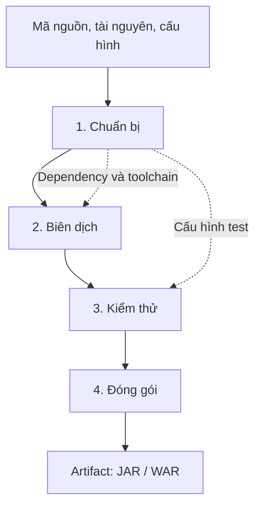
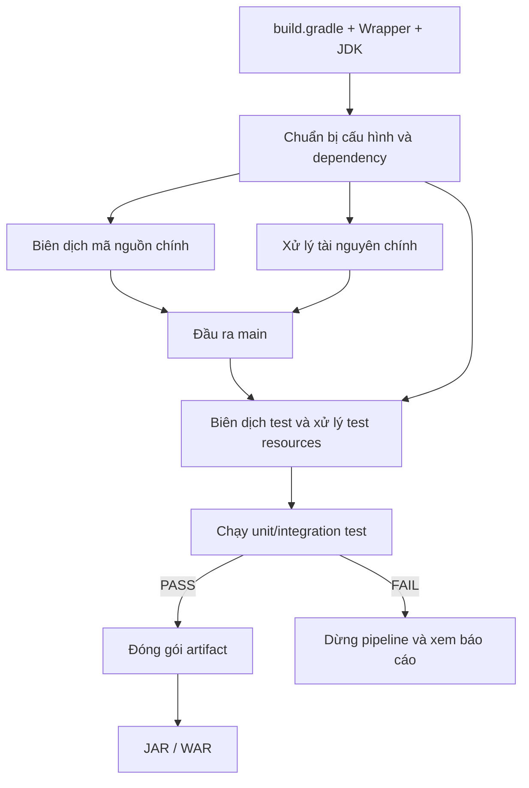

# Các giai đoạn khái niệm: chuẩn bị, biên dịch, kiểm thử và đóng gói

Một dự án Java không trở thành ứng dụng có thể chạy chỉ bằng cách lưu các file `.java`. Mã nguồn cần được kiểm tra, biên dịch cùng các thư viện cần thiết, kiểm thử, rồi đóng gói thành một artifact có thể chạy hoặc phân phối. Build tool tự động hóa chuỗi công việc đó để mỗi lần build có quy trình rõ ràng và có thể lặp lại trên máy lập trình viên lẫn máy CI.

Để dễ hiểu vòng đời build, ta có thể chia quy trình thành bốn giai đoạn khái niệm: **chuẩn bị, biên dịch, kiểm thử và đóng gói**. Đây là cách nhóm các công việc theo mục đích. Một build tool cụ thể có thể chia nhỏ chúng thành nhiều task hoặc phase, thêm các bước khác, hoặc sắp xếp công việc theo quan hệ phụ thuộc. Vì vậy, không nên hiểu bốn giai đoạn này là bốn lệnh bắt buộc hay bốn trạng thái cố định có tên giống nhau trong mọi công cụ.

## 1. Nhìn tổng thể vòng đời build

Một quy trình build Java điển hình có thể được hình dung như sau:



Mỗi giai đoạn nhận đầu vào, thực hiện một nhóm công việc và tạo ra đầu ra phục vụ giai đoạn sau:

| Giai đoạn | Câu hỏi chính | Đầu ra tiêu biểu |
|---|---|---|
| Chuẩn bị | Build cần những gì và phải kiểm tra điều kiện nào? | Cấu hình đã được xác định, dependency và toolchain sẵn sàng, danh sách công việc cần chạy |
| Biên dịch | Mã nguồn có hợp lệ và có thể chuyển thành bytecode không? | Các file `.class` và tài nguyên đã xử lý |
| Kiểm thử | Chương trình có đáp ứng hành vi mong đợi không? | Kết quả test, báo cáo và thông tin lỗi |
| Đóng gói | Cần phân phối những lớp, tài nguyên và metadata nào? | JAR, WAR hoặc artifact khác |

Trong thực tế, build tool có thể xen kẽ hoặc thực thi một số công việc theo quan hệ phụ thuộc thay vì luôn chạy một chuỗi tuyến tính. Chẳng hạn, xử lý tài nguyên và biên dịch mã nguồn có thể là hai nhánh độc lập trước khi được gom vào đầu ra của source set. Một task kiểm thử cần cả lớp chính lẫn lớp test đã biên dịch. Mô hình bốn giai đoạn giúp hiểu mục tiêu của quy trình, còn task graph hoặc lifecycle phase của công cụ quyết định cách thực thi cụ thể.

## 2. Giai đoạn 1: chuẩn bị

Giai đoạn chuẩn bị xác định điều kiện cần thiết để build có thể diễn ra. Nếu môi trường hoặc dependency chưa sẵn sàng, các bước biên dịch và kiểm thử phía sau có thể thất bại dù mã nguồn không có lỗi.

### 2.1. Xác định dự án và cấu hình build

Build tool cần biết project nào tham gia build, plugin nào được áp dụng, mã nguồn nằm ở đâu và các task nào được yêu cầu. Với một build nhiều module, công cụ còn phải xác định cấu trúc project và quan hệ giữa các module.

Trong Gradle, một lần chạy build được xử lý qua ba lifecycle phase thực tế:

1. **Initialization:** xác định build và các project tham gia.
2. **Configuration:** đọc build script, áp dụng plugin, cấu hình project và xây dựng thông tin task graph cần thiết.
3. **Execution:** thực thi các task đã được chọn.

Ba phase này là lifecycle của chính Gradle. Chúng không đồng nghĩa với bốn giai đoạn khái niệm của quy trình sản phẩm. Ví dụ, biên dịch, kiểm thử và đóng gói thường là các task được thực thi trong Gradle execution phase; việc chuẩn bị cấu hình diễn ra qua initialization và configuration, còn các task chuẩn bị khác cũng có thể chạy trong execution.

### 2.2. Kiểm tra phiên bản JDK và build tool

Mã nguồn Java cần một JDK tương thích với cấu hình của dự án. Build cũng cần một phiên bản Gradle hoặc Maven phù hợp với plugin và cấu hình đang dùng.

Gradle Wrapper (`gradlew` hoặc `gradlew.bat`) và Maven Wrapper (`mvnw` hoặc `mvnw.cmd`) giúp dự án chỉ định phiên bản build tool. Người dùng và CI chạy Wrapper của repository thay vì phụ thuộc vào một bản cài đặt toàn cục có thể khác nhau.

Với Gradle, Java toolchain có thể chọn phiên bản Java cần dùng cho các task Java:

```groovy
plugins {
    id 'java'
}

java {
    toolchain {
        languageVersion = JavaLanguageVersion.of(21)
    }
}
```

Cấu hình này yêu cầu toolchain Java 21 cho các task được hỗ trợ. Nó giúp kiểm soát phiên bản compiler/runtime được chọn, nhưng không tự động làm cho mọi công cụ bên ngoài build trở nên đồng nhất. Nếu dự án còn gọi Node.js, Docker CLI hoặc một công cụ riêng, các phiên bản đó cũng cần được quản lý theo cách phù hợp.

### 2.3. Phân giải dependency

Mã nguồn ứng dụng có thể sử dụng thư viện ngoài như logging, JSON, database driver hoặc framework. Mã nguồn kiểm thử cũng có thể cần JUnit và thư viện hỗ trợ test.

Trong giai đoạn chuẩn bị, build tool sử dụng các dependency đã khai báo để phân giải artifact từ repository. Với Gradle, ví dụ:

```groovy
repositories {
    mavenCentral()
}

dependencies {
    implementation 'org.slf4j:slf4j-api:2.0.13'
    testImplementation 'org.junit.jupiter:junit-jupiter:5.10.3'
}
```

Repository cho biết nơi tìm artifact. Configuration như `implementation` và `testImplementation` xác định phạm vi sử dụng. Dependency graph có thể bao gồm các dependency bắc cầu mà thư viện trực tiếp yêu cầu.

Không phải mọi dependency đều nhất thiết được tải ngay khi build bắt đầu. Gradle có thể phân giải chúng khi một task cần configuration tương ứng. Đây là một chi tiết quan trọng: “chuẩn bị” mô tả mục đích cần đạt, còn thời điểm thực tế có thể được trì hoãn để tránh làm công việc không cần thiết.

### 2.4. Kiểm tra điều kiện và đầu vào

Một build có thể cần kiểm tra file cấu hình, biến môi trường, thông tin xác thực, schema hoặc các tài nguyên nguồn. Ví dụ, task tạo mã từ OpenAPI cần file YAML đầu vào; task đóng gói frontend có thể cần Node.js; task kiểm thử tích hợp có thể cần một database hoặc dịch vụ phụ trợ.

Các điều kiện này cần được thể hiện rõ trong cấu hình và task. Nếu task đọc dữ liệu từ môi trường máy nhưng không khai báo thành input, Gradle có thể không nhận ra dữ liệu đã thay đổi. Khi đó, task có thể bị đánh dấu `UP-TO-DATE` hoặc dùng lại cache entry cũ dù kết quả đáng lẽ phải khác.

Vì vậy, chuẩn bị không chỉ là “mở IDE và nhấn nút build”. Đây là lúc xác định những đầu vào và công cụ mà các bước phía sau thực sự cần.

### 2.5. Đầu ra của giai đoạn chuẩn bị

Sau khi các điều kiện cần thiết đã được xác định, build tool có đủ thông tin để thực thi công việc:

- Cấu trúc project và plugin được xác định.
- Các dependency phù hợp có thể được phân giải.
- Toolchain và các tùy chọn build được cấu hình.
- Các task cần thực hiện cùng quan hệ phụ thuộc của chúng được xác định.
- Những điều kiện bắt buộc hoặc đầu vào bên ngoài được kiểm tra theo thiết kế của dự án.

Nếu bước chuẩn bị thất bại vì không tải được dependency, thiếu JDK hoặc cấu hình sai, lỗi thường xuất hiện trước khi compiler xử lý mã nguồn ứng dụng.

## 3. Giai đoạn 2: biên dịch

Biên dịch chuyển mã nguồn thành bytecode mà JVM có thể nạp và thực thi. Với dự án Java thông thường, build tool tổ chức việc biên dịch mã nguồn chính, xử lý tài nguyên và biên dịch mã nguồn kiểm thử thành những công việc riêng.

### 3.1. Biên dịch mã nguồn chính

Compiler đọc các file `.java`, kiểm tra cú pháp và kiểu dữ liệu, phân giải các tên lớp cần thiết trên compile classpath, sau đó tạo file `.class`.

Ví dụ:

```java
package com.example;

public class GreetingService {
    public String greet(String name) {
        return "Hello, " + name;
    }
}
```

Khi biên dịch thành công, compiler tạo bytecode tương ứng với `GreetingService`. Nếu chương trình tham chiếu một lớp từ dependency, lớp đó phải có mặt trong compile classpath và tương thích với phiên bản API mà mã nguồn sử dụng.

Trong Gradle Java plugin, task tiêu biểu là `compileJava`. Với Maven Compiler Plugin, công việc biên dịch mã nguồn chính được gắn với phase `compile` của default lifecycle.

### 3.2. Xử lý tài nguyên

Một ứng dụng Java không chỉ gồm bytecode. Nó còn có thể cần file cấu hình, template, ảnh, file tĩnh hoặc metadata. Những tài nguyên này thường nằm trong `src/main/resources` theo quy ước mặc định.

Gradle Java plugin cung cấp task `processResources` để sao chép và xử lý tài nguyên chính vào thư mục đầu ra của source set, thường là `build/resources/main`. Các file này sẽ được đưa vào classpath khi chạy và thường được đóng gói cùng lớp Java.

Ví dụ cấu trúc dự án:

```text
src/
├── main/
│   ├── java/
│   │   └── com/example/GreetingService.java
│   └── resources/
│       └── application.properties
└── test/
    ├── java/
    │   └── com/example/GreetingServiceTest.java
    └── resources/
        └── test-data.json
```

`src/main/java` chứa mã nguồn chính; `src/main/resources` chứa tài nguyên chính. Phần `src/test` dành cho mã và tài nguyên kiểm thử. Cấu trúc này là quy ước phổ biến của Java plugin và Maven, nhưng dự án có thể cấu hình source set hoặc source directory khác.

### 3.3. Biên dịch mã nguồn kiểm thử

Mã nguồn test thường tham chiếu các lớp chính và thư viện kiểm thử. Vì vậy, nó cần một compile classpath phù hợp gồm đầu ra của mã nguồn chính cùng các dependency dành cho test.

Trong Gradle Java plugin, `compileTestJava` biên dịch mã nguồn kiểm thử; `processTestResources` xử lý tài nguyên kiểm thử. Các đầu ra được gom trong source set test để task `test` sử dụng.

Ví dụ, test cho lớp `GreetingService`:

```java
package com.example;

import org.junit.jupiter.api.Test;

import static org.junit.jupiter.api.Assertions.assertEquals;

class GreetingServiceTest {
    @Test
    void returnsGreetingForName() {
        GreetingService service = new GreetingService();

        assertEquals("Hello, Lan", service.greet("Lan"));
    }
}
```

Đoạn test này chỉ biên dịch được khi JUnit có trong compile classpath của test. Đây là lý do dependency kiểm thử cần được khai báo đúng configuration, ví dụ `testImplementation` trong Gradle.

### 3.4. Biên dịch có tính tăng dần

Build tool không nhất thiết biên dịch lại toàn bộ project ở mỗi lần chạy. Với task có đầu vào và đầu ra được khai báo chính xác, Gradle có thể kiểm tra trạng thái để bỏ qua công việc không thay đổi (`UP-TO-DATE`) hoặc tái sử dụng đầu ra từ build cache khi task hỗ trợ cơ chế đó.

Ví dụ, nếu chỉ thay đổi một file Java, Gradle có thể chỉ biên dịch lại phần cần thiết thay vì xử lý lại mọi nguồn. Kết quả phụ thuộc vào task, compiler, cấu hình và quan hệ phụ thuộc; không nên giả định rằng mọi thay đổi đều chỉ tác động đến đúng một file.

Khai báo input/output sai có thể làm incremental build không đáng tin cậy. Nếu task đọc một biến môi trường ảnh hưởng đến mã được tạo nhưng không khai báo biến đó, Gradle có thể giữ lại output cũ. Ngược lại, khai báo dư thừa những giá trị không ảnh hưởng đến kết quả sẽ làm task chạy lại không cần thiết.

### 3.5. Lỗi thường gặp trong giai đoạn biên dịch

| Thông báo hoặc hiện tượng | Nguyên nhân có thể có | Nơi cần kiểm tra |
|---|---|---|
| `';' expected`, `illegal start of expression` | Sai cú pháp Java | Dòng mã nguồn được compiler chỉ ra |
| `cannot find symbol` | Tên lớp, biến hoặc method không tồn tại trong phạm vi hiện tại; thiếu dependency hoặc import | Mã nguồn, package, import và compile classpath |
| `package ... does not exist` | Dependency chứa package chưa có trong compile classpath | Dependency declaration, repository và configuration |
| `Unsupported class file major version` hoặc lỗi phiên bản bytecode | JDK/compiler hoặc công cụ phân tích không tương thích | Java toolchain, JDK đang dùng và plugin liên quan |
| File cấu hình không có trong classpath | Tài nguyên nằm sai thư mục hoặc chưa được xử lý | Source set và `processResources` |

Không phải mọi lỗi biên dịch đều là lỗi dependency. Hãy đọc thông báo compiler, xác định task thất bại và kiểm tra classpath trước khi thêm thư viện một cách tùy tiện.

## 4. Giai đoạn 3: kiểm thử

Biên dịch thành công chỉ chứng minh mã nguồn có thể được chuyển thành bytecode với các kiểu và API mà compiler nhìn thấy. Nó không chứng minh chương trình hoạt động đúng. Kiểm thử chạy mã để so sánh hành vi thực tế với kết quả mong đợi.

### 4.1. Kiểm thử đơn vị

Unit test kiểm tra một đơn vị nhỏ như method hoặc class. Test thường cô lập các phụ thuộc để tập trung xác minh logic.

Ví dụ với `GreetingService`, test xác nhận đầu vào `Lan` tạo kết quả `Hello, Lan`. Khi logic thay đổi ngoài dự kiến, test có thể phát hiện lỗi trước khi artifact được đóng gói hoặc triển khai.

Unit test thường nhanh và dễ chạy thường xuyên. Một project có thể có nhiều test cho các trường hợp thông thường, biên, giá trị rỗng hoặc dữ liệu không hợp lệ.

### 4.2. Kiểm thử tích hợp

Integration test xác minh nhiều thành phần phối hợp với nhau, chẳng hạn service với database, controller với HTTP layer hoặc ứng dụng với message broker. Những test này thường cần thêm cấu hình và dịch vụ hỗ trợ.

Không phải mọi project đều có cùng cách tổ chức integration test. Một số dự án dùng source set hoặc task riêng; dự án khác dùng plugin và quy ước riêng. Cần đọc cấu hình của project để biết task nào chạy unit test và task nào chạy integration test.

### 4.3. Test runtime classpath

Test cần nhiều hơn compile classpath. Khi chạy, test framework, engine, thư viện phụ trợ và các dependency runtime phải có mặt trong test runtime classpath.

Với Gradle, `testImplementation` thường cung cấp thư viện cho compile và runtime của test; `testRuntimeOnly` dành cho thư viện chỉ cần lúc chạy test. Ví dụ, một test engine có thể chỉ cần lúc thực thi. Khai báo sai phạm vi có thể khiến test biên dịch được nhưng không tìm thấy engine khi chạy.

### 4.4. Chạy kiểm thử và đọc kết quả

Với Gradle Java plugin:

```bash
# Chạy task test và các task tiền đề cần thiết
./gradlew test

# Chạy test với log chi tiết hơn
./gradlew test --info
```

Với Maven:

```bash
# Chạy đến phase test của default lifecycle
./mvnw test
```

Kết quả kiểm thử thường gồm số test được chạy, số test thành công, số test thất bại hoặc bị bỏ qua, cùng báo cáo chi tiết. Gradle Java plugin thường ghi báo cáo HTML trong `build/reports/tests/test/`; Maven Surefire thường ghi báo cáo trong `target/surefire-reports/`. Đường dẫn có thể thay đổi nếu dự án cấu hình lại plugin.

Một test thất bại không nhất thiết có nghĩa compiler sai. Cần phân biệt:

- **Test failure:** chương trình chạy được nhưng kết quả không khớp assertion hoặc điều kiện mong đợi.
- **Test error:** test không thể hoàn tất do exception hoặc lỗi môi trường.
- **Test skipped:** test bị bỏ qua theo cấu hình hoặc điều kiện chạy.
- **No tests found:** build không tìm thấy test phù hợp với quy tắc discovery hoặc filter hiện tại.

### 4.5. Kiểm thử là cổng chất lượng trước khi đóng gói

Trong một pipeline thông thường, bước đóng gói phát hành nên phụ thuộc vào kết quả kiểm thử. Nếu test bắt buộc thất bại, build nên dừng trước khi tạo artifact được coi là hợp lệ để phát hành.

Điều này không có nghĩa mọi task đóng gói trong mọi công cụ luôn tự động phụ thuộc vào toàn bộ test. Trong Gradle Java plugin, task `build` phụ thuộc vào các task kiểm tra và lắp ráp theo quy ước của plugin; task `jar` có thể được gọi độc lập và không đồng nghĩa với việc toàn bộ test đã chạy. Trong Maven, gọi phase `package` sẽ đi qua các phase trước đó của default lifecycle, bao gồm `test`, theo các plugin goal được gắn vào lifecycle.

Vì vậy, khi chọn lệnh chạy trong CI, hãy hiểu rõ task hoặc phase đó có bao gồm kiểm thử hay không. Nếu pipeline chỉ gọi `jar`, không nên mặc định rằng test đã chạy.

## 5. Giai đoạn 4: đóng gói

Sau khi mã nguồn và các bước kiểm tra cần thiết đã hoàn tất, build tool có thể đóng gói lớp, tài nguyên và metadata thành artifact. Artifact là sản phẩm được lưu trữ, chuyển giao, triển khai hoặc sử dụng bởi một project khác.

### 5.1. Đóng gói JAR

JAR (Java ARchive) là file ZIP theo quy ước Java, chứa bytecode, tài nguyên và metadata. Với Gradle Java plugin, task `jar` thường đóng gói đầu ra của source set chính thành file JAR trong `build/libs/`.

Ví dụ cấu trúc bên trong JAR:

```text
sample-app-1.0.0.jar
├── META-INF/
│   └── MANIFEST.MF
├── com/
│   └── example/
│       └── GreetingService.class
└── application.properties
```

JAR thư viện thông thường chứa lớp và tài nguyên để một ứng dụng khác sử dụng trên classpath. Nó không nhất thiết chứa mọi dependency bên ngoài. Nếu cần một JAR chạy độc lập có cả dependency, dự án phải cấu hình kiểu đóng gói phù hợp, ví dụ executable/fat JAR theo plugin của framework.

### 5.2. Đóng gói WAR

WAR (Web Application Archive) là định dạng đóng gói ứng dụng web Java. Nó có cấu trúc và quy ước triển khai phù hợp với servlet container hoặc nền tảng hỗ trợ WAR.

Trong Gradle, plugin `war` cung cấp task `war`. Trong Maven, packaging type `war` cùng plugin tương ứng tạo artifact WAR. Không phải ứng dụng Java nào cũng cần WAR; lựa chọn JAR hay WAR phụ thuộc cách ứng dụng được chạy và triển khai.

### 5.3. Metadata và tài nguyên đi kèm

Đóng gói không chỉ là nén file `.class`. Artifact có thể chứa:

- Bytecode đã biên dịch.
- Tài nguyên như file cấu hình, template và nội dung tĩnh.
- Manifest hoặc metadata cần thiết.
- Thông tin phiên bản và định danh artifact.
- Các file bổ sung được plugin hoặc build script yêu cầu.

Dependency bên ngoài có được nhúng vào artifact hay không tùy thuộc loại artifact và cấu hình đóng gói. Với JAR thư viện thông thường, dependency thường được công bố thông qua metadata của module để project tiêu thụ tự phân giải. Với executable JAR của một số framework, dependency có thể được đóng gói theo cấu trúc riêng để ứng dụng chạy thuận tiện.

### 5.4. Kiểm tra artifact sau khi đóng gói

Sau khi đóng gói, nên xác định artifact được tạo ở đâu, tên và phiên bản ra sao, có chứa những file nào và có thể được sử dụng theo cách dự định không.

Với Gradle:

```bash
# Tạo JAR theo task Java plugin
./gradlew jar

# Chạy toàn bộ quy trình build chuẩn của Java plugin
./gradlew build
```

Có thể kiểm tra nội dung JAR bằng JDK:

```bash
jar tf build/libs/sample-app-1.0.0.jar
```

Với Maven:

```bash
# Chạy default lifecycle đến phase package
./mvnw package
```

Artifact Maven thường nằm trong `target/`. Tên thực tế phụ thuộc `artifactId`, `version`, packaging và cấu hình build.

## 6. Cách bốn giai đoạn liên kết với nhau

Hãy xét một ứng dụng Java nhỏ có `GreetingService` và test tương ứng:

| Giai đoạn | Công việc trong ví dụ | Kết quả cần có |
|---|---|---|
| Chuẩn bị | Chọn JDK, cấu hình Java plugin, phân giải JUnit và kiểm tra source set | Môi trường và dependency sẵn sàng |
| Biên dịch | Biên dịch `GreetingService.java`, xử lý resource, biên dịch test | Các file `.class` và resource trong thư mục build |
| Kiểm thử | Chạy `GreetingServiceTest` bằng test runtime classpath | Báo cáo test và trạng thái thành công/thất bại |
| Đóng gói | Đưa lớp chính và resource vào JAR | Artifact trong `build/libs/` |

Luồng dữ liệu chính:



Sơ đồ biểu diễn một pipeline mong muốn. Một project thực tế có thể có nhiều source set, nhiều nhóm test, bước kiểm tra chất lượng, tạo mã, đóng gói tài liệu, ký artifact hoặc xuất bản lên repository. Những công việc bổ sung được kết nối vào task graph hoặc lifecycle theo yêu cầu dự án.

## 7. Thể hiện các giai đoạn trong Gradle

Gradle mô tả công việc bằng task và quan hệ giữa task. Với Java plugin, một số task tiêu biểu là:

| Task | Vai trò trong mô hình khái niệm |
|---|---|
| `help`, task kiểm tra cấu hình riêng | Hỗ trợ chuẩn bị và kiểm tra build |
| `compileJava` | Biên dịch mã nguồn chính |
| `processResources` | Xử lý tài nguyên chính |
| `compileTestJava` | Biên dịch mã nguồn kiểm thử |
| `processTestResources` | Xử lý tài nguyên kiểm thử |
| `test` | Chạy test |
| `jar` | Đóng gói JAR |
| `check` | Gom các bước kiểm tra theo quy ước plugin |
| `assemble` | Gom các bước tạo artifact |
| `build` | Kết hợp các bước kiểm tra và lắp ráp |

Các task này được liên kết qua quan hệ phụ thuộc. Ví dụ, task `test` cần đầu ra của các task biên dịch và xử lý tài nguyên liên quan; `jar` cần đầu ra chính để đóng gói. Task `build` của Java plugin phụ thuộc vào `check` và `assemble`, nhờ đó tạo một điểm vào thuận tiện cho quy trình build chuẩn.

Các lệnh thường dùng:

```bash
# Xem task có sẵn
./gradlew tasks --all

# Chỉ biên dịch mã nguồn chính và các task tiền đề
./gradlew classes

# Chạy kiểm thử
./gradlew test

# Tạo JAR
./gradlew jar

# Chạy các bước kiểm tra
./gradlew check

# Chạy kiểm tra và lắp ráp theo quy ước Java plugin
./gradlew build

# Xóa đầu ra cũ rồi build lại
./gradlew clean build
```

`classes`, `test`, `jar`, `check` và `build` là tên task trong hệ sinh thái Gradle Java plugin. Plugin khác có thể bổ sung task và thay đổi task graph. Luôn dùng `./gradlew tasks --all` hoặc `./gradlew help --task <task-name>` để kiểm tra task của project cụ thể.

## 8. Thể hiện các giai đoạn trong Maven

Maven mô tả quy trình bằng lifecycle và phase. Default lifecycle có các phase theo thứ tự, chẳng hạn:

```text
validate
   |
   v
compile
   |
   v
test
   |
   v
package
   |
   v
verify
   |
   v
install
   |
   v
deploy
```

Đây là một phần của default lifecycle, còn nhiều phase khác tồn tại trước, giữa và sau các phase minh họa. Plugin goal được gắn vào phase để thực hiện công việc cụ thể.

| Phase | Vai trò tiêu biểu |
|---|---|
| `validate` | Kiểm tra project có thông tin cần thiết và hợp lệ |
| `compile` | Biên dịch mã nguồn chính |
| `test` | Chạy unit test bằng test framework/plugin đã cấu hình |
| `package` | Đóng gói artifact theo packaging type, ví dụ JAR hoặc WAR |
| `verify` | Chạy các kiểm tra bổ sung để xác nhận artifact đáp ứng yêu cầu |
| `install` | Cài artifact vào local Maven repository để project khác trên máy có thể dùng |
| `deploy` | Phát hành artifact lên repository từ xa theo cấu hình |

Khi gọi một phase, Maven thực hiện các phase đứng trước nó trong cùng lifecycle. Ví dụ:

```bash
# Chạy các phase cần thiết cho đến compile
./mvnw compile

# Chạy các phase cần thiết cho đến test
./mvnw test

# Chạy từ đầu default lifecycle đến package, gồm các phase trước đó
./mvnw package

# Chạy đến verify
./mvnw verify
```

Vì `package` nằm sau `test`, lệnh `./mvnw package` sẽ chạy các công việc được gắn vào các phase trước đó của default lifecycle, bao gồm biên dịch và test. Việc này khác với cách gọi một task đơn lẻ trong Gradle: Maven phase là một điểm trong lifecycle có thứ tự, còn Gradle task graph là tập task được nối bằng quan hệ phụ thuộc.

## 9. Phân biệt build, test, package và publish

Các từ này thường xuất hiện cùng nhau nhưng không có cùng ý nghĩa:

- **Build:** tên gọi chung cho quy trình biến đầu vào dự án thành đầu ra đã được kiểm tra. Trong Gradle Java plugin, `build` là một task cụ thể kết hợp các bước kiểm tra và lắp ráp.
- **Compile:** chuyển mã nguồn thành bytecode hoặc dạng đầu ra biên dịch khác.
- **Test:** chạy kiểm thử để đánh giá hành vi.
- **Package:** tạo artifact như JAR hoặc WAR.
- **Publish/Deploy:** chuyển artifact tới repository hoặc môi trường đích để người khác sử dụng hoặc ứng dụng được triển khai.

Đóng gói không đồng nghĩa với phát hành. Có thể tạo JAR trên máy cá nhân mà không tải nó lên repository. Tương tự, task `install` của Maven đưa artifact vào local repository, còn `deploy` thường phát hành lên remote repository. Trong Gradle, publishing thường được cấu hình qua plugin như `maven-publish` và các task publish tương ứng.

Việc phân biệt này giúp chọn đúng lệnh trong CI. Một pipeline có thể chạy test, tạo artifact, xác minh artifact, sau đó mới publish hoặc deploy khi các điều kiện phát hành được đáp ứng.

## 10. Chẩn đoán lỗi theo giai đoạn

Khi build thất bại, hãy xác định task hoặc phase đầu tiên thất bại. Điều đó giúp khoanh vùng vấn đề:

| Giai đoạn | Dấu hiệu thường gặp | Hướng kiểm tra |
|---|---|---|
| Chuẩn bị | Không tìm thấy JDK, plugin hoặc dependency; lỗi repository; cấu hình project thất bại | Wrapper, JDK/toolchain, repository, tọa độ dependency, credentials, build script |
| Biên dịch | Lỗi cú pháp, kiểu, package hoặc symbol; thiếu tài nguyên | Compiler output, source set, compile classpath, resource directory |
| Kiểm thử | Assertion failure, exception, không tìm thấy test engine, thiếu dịch vụ tích hợp | Test report, test runtime classpath, test discovery, cấu hình môi trường và dịch vụ phụ trợ |
| Đóng gói | Artifact thiếu lớp/resource, manifest hoặc sai tên/loại file | Task package, source set output, manifest và cấu hình plugin |
| Phát hành | Không có quyền ghi repository, sai URL hoặc credential | Cấu hình publishing, quyền truy cập và secret của CI |

Ví dụ, lỗi `Could not resolve org.junit.jupiter:junit-jupiter` thường thuộc bước phân giải dependency trong giai đoạn chuẩn bị. Lỗi `cannot find symbol` xảy ra trong biên dịch. Một assertion thất bại thuộc kiểm thử. JAR thiếu `application.properties` thường cần kiểm tra source resource và task xử lý tài nguyên trước khi kiểm tra lại task đóng gói.

Không nên chỉ nhìn dòng cuối cùng của log. Hãy tìm task hoặc phase đầu tiên báo lỗi và đọc nguyên nhân gốc, vì những thông báo phía sau đôi khi chỉ là hệ quả của lỗi trước đó.

## 11. Xây dựng pipeline CI theo bốn giai đoạn

Một pipeline CI có thể ánh xạ các giai đoạn khái niệm thành những bước kiểm tra rõ ràng:

```text
Checkout source
    |
    v
Chuẩn bị: Wrapper, JDK, cấu hình và dependency
    |
    v
Biên dịch: compile main và test source
    |
    v
Kiểm thử: unit test / integration test
    |
    v
Đóng gói: tạo JAR hoặc WAR
    |
    v
Kiểm tra artifact và lưu artifact CI
    |
    v
Publish / deploy khi được phép
```

Với Gradle Java plugin, lệnh `./gradlew clean build` thường là điểm vào phù hợp để thực hiện các bước kiểm tra và lắp ráp chuẩn. Nếu project có integration test riêng, kiểm tra chất lượng, sinh mã hoặc đóng gói bổ sung, pipeline cần gọi hoặc gắn những task đó vào task graph theo cấu hình của project.

Một số nguyên tắc giúp pipeline đáng tin cậy:

1. Dùng Wrapper và phiên bản JDK/toolchain đã thống nhất.
2. Phân giải dependency từ repository được cấu hình; không dựa vào file JAR chỉ tồn tại trên máy cá nhân.
3. Đảm bảo test bắt buộc chạy trước bước phát hành.
4. Lưu artifact được tạo từ chính commit đã kiểm tra.
5. Giữ thông tin đầu vào môi trường rõ ràng, tránh đầu vào ẩn làm kết quả local và CI khác nhau.
6. Chỉ publish hoặc deploy sau khi các bước xác minh đã thành công và điều kiện phát hành được đáp ứng.

Không phải pipeline nào cũng phải triển khai ứng dụng ngay sau khi đóng gói. Với thư viện, đầu ra có thể là artifact để publish lên Maven repository. Với ứng dụng, đầu ra có thể được lưu làm artifact CI rồi triển khai ở một job hoặc môi trường riêng.

## 12. Bài tập vận dụng

Một nhóm có ứng dụng `order-service` với cấu trúc:

```text
src/main/java/...
src/main/resources/application.yml
src/test/java/...
src/test/resources/test-data.json
```

Nhóm dùng Gradle Java plugin, JUnit 5 và muốn tạo file `order-service-1.0.0.jar`. Hãy xác định:

1. Trước khi biên dịch, build cần chuẩn bị những công cụ và dependency nào?
2. Task nào biên dịch mã nguồn chính và task nào xử lý `application.yml`?
3. Task nào biên dịch mã nguồn test và xử lý `test-data.json`?
4. Task nào chạy JUnit test? Nếu test thất bại, pipeline nên xử lý bước đóng gói phát hành thế nào?
5. Task nào tạo JAR? File JAR được tạo ở thư mục nào theo mặc định của Java plugin?
6. Nếu một người gọi riêng `jar`, có thể kết luận test đã chạy không? Vì sao?
7. Nếu muốn CI tạo artifact rồi publish lên repository, bước publish thuộc giai đoạn nào và cần điều kiện gì?

Có thể kiểm chứng các câu trả lời bằng cách chạy `./gradlew tasks --all`, `./gradlew test`, `./gradlew jar` và `./gradlew build` trong một project Java dùng plugin tương ứng. Hãy quan sát task graph và thư mục đầu ra sau từng lệnh để thấy mỗi công việc tạo ra dữ liệu gì.

Khi hiểu vòng đời build theo các giai đoạn chuẩn bị, biên dịch, kiểm thử và đóng gói, ta có thể đọc build script có hệ thống: xác định môi trường và dependency, tìm task tạo bytecode, tìm task chạy test, rồi xác định artifact được tạo ra. Sau đó, dựa trên task graph của Gradle hoặc lifecycle phase của Maven để biết chính xác lệnh nào thực hiện những công việc đó.
