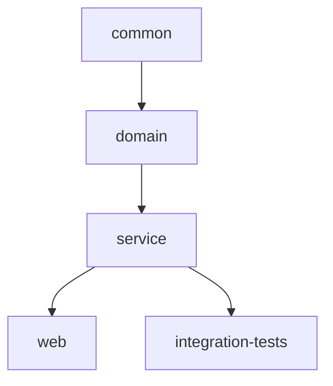

# Build toàn bộ, build một phần và chọn đúng mục tiêu cần chạy

Khi làm việc với một dự án Java, ta không phải lúc nào cũng cần chạy toàn bộ quy trình build. Có lúc chỉ cần biên dịch mã nguồn để nhận lỗi nhanh, có lúc cần chạy unit test, có lúc cần tạo JAR/WAR, và trước khi tích hợp hoặc phát hành có thể cần chạy đầy đủ các bước kiểm tra. Chọn đúng mục tiêu giúp nhận được phản hồi đủ tin cậy mà không mất thời gian cho những công việc chưa cần thiết.

Để chọn lệnh đúng, cần phân biệt ba khái niệm:

1. **Mục tiêu người dùng yêu cầu:** phase, task hoặc target mà ta gọi trực tiếp, chẳng hạn `test`, `build`, `package` hay `verify`.
2. **Đồ thị công việc cần thực thi:** các bước phụ thuộc mà build tool tự xác định để hoàn thành mục tiêu đó.
3. **Phạm vi build:** toàn bộ dự án, một module, một tập module hoặc một phần công việc trong một module.

Gọi một task đơn lẻ không có nghĩa chỉ có đúng một thao tác chạy. Ví dụ, yêu cầu Gradle chạy task `test` thường kéo theo các task cần thiết để biên dịch mã ứng dụng và mã kiểm thử. Tương tự, Maven chạy phase `package` sẽ thực hiện các phase đứng trước trong lifecycle tương ứng. Vì vậy, hãy hiểu mục tiêu được gọi và các công việc mà nó kéo theo.

## 1. Build toàn bộ và build một phần là gì?

### 1.1. Build toàn bộ

Build toàn bộ là chạy một mục tiêu đủ rộng để kiểm tra hoặc tạo các kết quả chính của dự án theo quy ước build. Với Maven, một lệnh thường dùng là `verify`; với Gradle, thường là `build`. Hai lệnh này không có nghĩa hoàn toàn giống nhau, nhưng đều thường được dùng để yêu cầu nhiều bước kiểm tra và tạo artifact.

Build toàn bộ có thể bao gồm:

- kiểm tra cấu hình và chuẩn bị môi trường;
- giải quyết dependency;
- biên dịch mã ứng dụng;
- xử lý resource;
- biên dịch mã kiểm thử;
- chạy unit test và các kiểm tra được cấu hình;
- đóng gói artifact;
- chạy các bước xác minh bổ sung.

Những bước cụ thể phụ thuộc lifecycle, plugin, task graph và cấu hình dự án. Một dự án có thể gắn kiểm tra chất lượng mã, integration test hoặc kiểm tra bảo mật vào mục tiêu build; dự án khác có thể chạy chúng trong pipeline riêng.

### 1.2. Build một phần

Build một phần là chỉ yêu cầu một phần công việc hoặc một phạm vi module phù hợp với câu hỏi hiện tại. Ví dụ:

- chỉ biên dịch mã ứng dụng;
- chỉ chạy unit test;
- chỉ tạo JAR;
- chỉ kiểm tra một module;
- chạy một task sinh mã nguồn;
- chỉ build module được sửa cùng các module mà nó phụ thuộc.

Build một phần hữu ích trong vòng lặp phát triển hằng ngày vì phản hồi nhanh hơn. Tuy nhiên, nó chỉ xác nhận những gì mục tiêu đó thực sự thực hiện. Chạy `compileJava` thành công không chứng minh test đã qua; chạy unit test thành công không chứng minh artifact cuối cùng đã được đóng gói đúng; build một module không nhất thiết chứng minh các module còn lại vẫn tương thích.

### 1.3. Chọn phạm vi và chọn mục tiêu là hai quyết định riêng

Có thể chọn mục tiêu `test` cho toàn bộ dự án hoặc chỉ cho một module. Cũng có thể build toàn bộ module nhưng chỉ chạy một nhóm task nhất định. Hãy tự hỏi hai câu:

- **Chạy việc gì?** Compile, test, package, verify hay publish?
- **Chạy ở đâu?** Toàn bộ project, một module hay một nhóm module?

Ví dụ, “chạy test cho module `service`” là mục tiêu kiểm thử trong phạm vi module `service`. “Build tất cả module” là phạm vi rộng, nhưng vẫn cần xác định mục tiêu cụ thể như `build`, `verify` hoặc `package`.

## 2. Hiểu lifecycle, task graph và target trước khi chọn lệnh

Maven, Gradle và Ant đều tổ chức công việc build, nhưng cách gọi mục tiêu khác nhau.

### 2.1. Maven: lifecycle phase và plugin goal

Maven có các lifecycle, trong đó các phase được thực hiện theo thứ tự. Khi gọi một phase, Maven chạy các phase trước đó trong lifecycle tương ứng và thực thi các plugin goal đã được gắn vào những phase này.

Ví dụ, lệnh:

```bash
mvn package
```

không chỉ chạy một thao tác đóng gói. Maven đi qua các phase trước `package` trong default lifecycle, chẳng hạn validate, compile, test và các bước xử lý cần thiết theo cấu hình dự án. Plugin goal được gắn vào từng phase sẽ được thực thi ở thời điểm tương ứng.

Một **phase** là mốc trong lifecycle. Một **plugin goal** là công việc cụ thể do plugin cung cấp. Chẳng hạn, `maven-compiler-plugin:compile` là goal biên dịch; goal đó thường được gắn vào phase `compile`. Khi đọc lệnh Maven, hãy xác định lệnh đang gọi phase hay gọi goal trực tiếp.

### 2.2. Gradle: task và task graph

Gradle biểu diễn công việc bằng task. Mỗi task có thể phụ thuộc vào task khác. Khi người dùng yêu cầu một task, Gradle xây dựng task graph gồm task được yêu cầu và những task cần thiết để hoàn thành nó.

Ví dụ:

```bash
./gradlew test
```

Trong một dự án dùng plugin Java, task `test` thường phụ thuộc vào các task biên dịch mã ứng dụng, xử lý resource và biên dịch test cần thiết. Gradle có thể bỏ qua task đã up-to-date hoặc lấy kết quả từ build cache nếu điều kiện phù hợp.

Task graph không nhất thiết là một chuỗi thẳng. Các task độc lập có thể chạy song song. Một task được yêu cầu trực tiếp có thể kéo theo nhiều task phụ thuộc, còn task không liên quan có thể không chạy.

### 2.3. Ant: target và task

Ant dùng target để nhóm công việc. Một target có thể phụ thuộc target khác qua thuộc tính `depends`; bên trong target là các task như `javac`, `copy`, `jar` hoặc task tùy chỉnh.

Ví dụ:

```xml
<target name="compile">
    <javac srcdir="src" destdir="build/classes" />
</target>

<target name="package" depends="compile">
    <jar destfile="build/app.jar" basedir="build/classes" />
</target>
```

Gọi `ant package` sẽ chạy target `compile` trước vì target `package` khai báo dependency. Ant không áp đặt một lifecycle Java tiêu chuẩn giống Maven; người viết `build.xml` quyết định target nào tồn tại và chúng liên hệ với nhau ra sao.

### 2.4. So sánh nhanh

| Công cụ | Đơn vị thường được gọi | Công cụ xác định công việc tiếp theo bằng cách nào? |
|---|---|---|
| Maven | Lifecycle phase hoặc plugin goal | Chạy các phase trước đó trong lifecycle và các goal được gắn vào phase |
| Gradle | Task | Tạo task graph từ task được yêu cầu và quan hệ phụ thuộc |
| Ant | Target | Chạy target được gọi cùng các target khai báo trong `depends` |

Không nên dịch máy móc một lệnh của công cụ này sang một lệnh có tên gần giống ở công cụ khác. Hãy so sánh mục đích, các bước được thực thi và artifact tạo ra.

## 3. Chọn đúng mục tiêu trong Maven

Maven có nhiều lifecycle. Với dự án Java thông thường, default lifecycle là phần thường xuyên được dùng để compile, test, package, verify, install và deploy. Lifecycle `clean` xử lý output build cũ; lifecycle `site` tạo tài liệu dự án khi được cấu hình.

### 3.1. Các phase thường dùng trong default lifecycle

| Phase | Mục đích chính | Khi nào thường chọn? |
|---|---|---|
| `validate` | Kiểm tra project và cấu hình cơ bản | Muốn kiểm tra sớm cấu hình hoặc gọi một bước xác thực |
| `compile` | Biên dịch mã nguồn chính | Vừa sửa mã ứng dụng và muốn phát hiện lỗi compile |
| `test` | Biên dịch và chạy unit test theo cấu hình | Muốn kiểm tra hành vi ở mức unit |
| `package` | Đóng gói kết quả thành artifact | Muốn tạo JAR, WAR hoặc package tương ứng |
| `verify` | Chạy các bước xác minh bổ sung sau package | Muốn kiểm tra artifact và các kiểm tra được gắn vào lifecycle |
| `install` | Cài artifact vào local Maven repository | Muốn module hoặc dự án khác trên cùng máy sử dụng artifact vừa build |
| `deploy` | Đưa artifact đến remote repository theo cấu hình | Muốn publish artifact theo quy trình phát hành |

Các phase đứng trước phase được gọi trong cùng lifecycle sẽ được thực hiện. Ví dụ, `mvn test` chạy các phase cần thiết trước `test`; `mvn verify` đi qua các phase trước đó, bao gồm package. Các plugin goal được gắn vào những phase đó cũng chạy theo cấu hình.

### 3.2. `compile`: phản hồi nhanh về mã ứng dụng

```bash
mvn compile
```

Chọn mục tiêu này khi muốn biết mã nguồn chính có biên dịch được hay không. Nó không yêu cầu chạy unit test hoặc đóng gói artifact cuối. Đây là lựa chọn phù hợp sau một thay đổi nhỏ trong mã ứng dụng, đặc biệt khi đang xử lý lỗi biên dịch.

Nếu thay đổi ảnh hưởng đến test source, chỉ chạy `compile` chưa đủ vì mã kiểm thử chưa nhất thiết được biên dịch. Nếu muốn xác nhận cả test, hãy chọn `test`.

### 3.3. `test`: kiểm tra unit test

```bash
mvn test
```

Phase `test` thường chạy các unit test được cấu hình qua Maven Surefire Plugin. Maven sẽ thực hiện những bước cần thiết trước đó, gồm compile mã chính và test source.

Lưu ý: integration test không tự động được chạy chỉ vì gọi `mvn test`. Dự án thường cấu hình Maven Failsafe Plugin để chạy integration test ở các phase `integration-test` và `verify`. Cần xem plugin và lifecycle binding thực tế của dự án.

### 3.4. `package`: tạo artifact

```bash
mvn package
```

Chọn khi cần file JAR, WAR hoặc loại artifact do packaging/plugin của dự án định nghĩa. Với default lifecycle, Maven đã đi qua các phase trước `package`, trong đó thông thường có compile và test.

Nếu dự án có integration test được cấu hình ở phase sau `package`, lệnh `package` chưa thực hiện những phase đó. Vì vậy, trước khi gửi thay đổi hoặc tạo artifact để kiểm tra, `verify` thường là lựa chọn bao quát hơn.

### 3.5. `verify`: xác minh quy trình build

```bash
mvn verify
```

Đây là mục tiêu thường phù hợp cho CI khi muốn chạy đến giai đoạn xác minh mà không cài artifact vào local repository hay publish lên remote repository. Nó thực hiện các phase trước đó và các plugin goal được gắn vào chúng. Nếu dự án cấu hình Failsafe cho integration test, các bước integration test và kiểm tra kết quả thường diễn ra trước hoặc tại `verify`.

`verify` không đảm bảo mọi kiểm tra có thể có đều tự chạy. Kiểm tra chất lượng mã, kiểm tra bảo mật, kiểm thử container hoặc kiểm tra triển khai chỉ chạy nếu được cấu hình vào lifecycle hoặc được gọi riêng.

### 3.6. `install` và `deploy`: phân biệt build với publish

```bash
mvn install
```

`install` chạy qua các phase trước nó, sau đó cài artifact vào local Maven repository, thường ở `~/.m2/repository`. Điều này hữu ích trong quá trình phát triển nhiều dự án phụ thuộc nhau trên cùng máy.

```bash
mvn deploy
```

`deploy` tiếp tục lifecycle đến bước triển khai artifact lên remote repository được cấu hình. Đây là hành động có thể ảnh hưởng đến kho dùng chung hoặc quy trình phát hành, nên chỉ chọn khi thực sự muốn publish và đã cấu hình đúng repository/credentials.

Để chỉ kiểm tra mã và artifact trước khi chia sẻ, thường không cần `install` hay `deploy`.

### 3.7. `clean`: xóa output build cũ

```bash
mvn clean
```

`clean` thuộc lifecycle riêng. Nó thường xóa thư mục `target/` do Maven tạo ra. Lệnh này không tự build lại dự án.

Kết hợp clean với một phase khác:

```bash
mvn clean test
mvn clean package
mvn clean verify
```

Maven thực hiện mục tiêu clean rồi thực hiện phase được yêu cầu trong default lifecycle. `clean verify` hữu ích khi muốn xác nhận build có thể tạo lại đầu ra từ đầu, không dựa vào file sinh ra còn sót từ lần chạy trước.

Không cần chạy clean trước mọi lần build. Build thông thường được thiết kế để xử lý đầu ra tăng dần. Chỉ dùng clean khi cần xác minh clean build, nghi ngờ output cũ, thay đổi cấu hình sinh file hoặc muốn loại bỏ trạng thái build bị lỗi.

### 3.8. Gọi plugin goal trực tiếp

Maven cho phép gọi goal trực tiếp, ví dụ:

```bash
mvn dependency:tree
mvn help:effective-pom
```

Đây là các goal phục vụ chẩn đoán. Gọi goal trực tiếp không giống việc yêu cầu một phase của default lifecycle. Một goal có thể thực hiện công việc riêng mà không chạy toàn bộ các phase trước đó. Hãy xem tài liệu plugin và đảm bảo những đầu vào cần thiết đã có sẵn.

## 4. Chọn đúng mục tiêu trong Gradle

Gradle không có một lifecycle phase cố định như Maven. Các plugin cung cấp task và quan hệ phụ thuộc. Với plugin Java, một số task thường gặp là `compileJava`, `processResources`, `classes`, `compileTestJava`, `test`, `jar`, `assemble`, `check` và `build`.

### 4.1. Những task phổ biến của plugin Java

| Task | Mục đích chính | Khi nào thường chọn? |
|---|---|---|
| `compileJava` | Biên dịch mã nguồn Java chính | Muốn kiểm tra lỗi compile nhanh |
| `processResources` | Xử lý/copy resource chính | Khi thay đổi resource và cần xác nhận đầu ra |
| `classes` | Chuẩn bị output chính, thường gồm compile và resource | Muốn tạo lớp chính mà chưa chạy test |
| `compileTestJava` | Biên dịch mã kiểm thử | Muốn xác nhận test source biên dịch được |
| `test` | Chạy test task | Muốn chạy unit test được cấu hình |
| `jar` | Tạo JAR của module | Muốn tạo artifact JAR |
| `assemble` | Tạo các artifact của project theo plugin | Muốn đóng gói mà không nhất thiết chạy toàn bộ verification |
| `check` | Chạy các task kiểm tra được gắn vào lifecycle verification | Muốn chạy test và các kiểm tra đã cấu hình |
| `build` | Gom các công việc build chính, thường gồm `assemble` và `check` | Muốn build rộng cho module hoặc dự án |

Task cụ thể có thể khác nếu dự án dùng plugin khác hoặc tự định nghĩa task. Dùng `./gradlew tasks` để xem các task được cung cấp trong project hiện tại.

### 4.2. `compileJava`: chỉ biên dịch mã chính

```bash
./gradlew compileJava
```

Đây là lựa chọn nhanh khi vừa sửa mã Java chính và chỉ cần xác nhận compiler chấp nhận mã nguồn. Task có thể kéo theo các công việc cần thiết khác như resolve dependency, nhưng không tự yêu cầu chạy unit test.

Nếu dự án có generated source được nối đúng với compile task, các task sinh mã cần thiết cũng có thể chạy trước. Nếu dependency giữa các task bị khai báo thiếu, build một phần có thể không tạo ra file mà compiler cần.

### 4.3. `test`: chạy test task

```bash
./gradlew test
```

Gradle chạy task `test` cùng những task cần thiết theo task graph, thường gồm compile mã chính, xử lý resource và compile test source. Task test dùng test framework/launcher được cấu hình trong project.

Nếu dự án có nhiều test task như `integrationTest`, `functionalTest` hoặc test suite tùy chỉnh, task `test` không nhất thiết chạy tất cả. Hãy xem task graph và cấu hình plugin để biết chính xác test nào được gọi.

Có thể chạy một nhóm test theo tên lớp hoặc pattern khi task hỗ trợ:

```bash
./gradlew test --tests "com.example.service.OrderServiceTest"
```

Đây là cách thu hẹp số test cần chạy trong vòng lặp phát triển. Nó không thay thế lượt chạy đầy đủ trước khi tích hợp.

### 4.4. `jar` và `assemble`: tạo artifact

```bash
./gradlew jar
```

Chọn `jar` khi chỉ cần JAR do plugin Java tạo. Task này thường phụ thuộc vào `classes`, nên mã chính và resource cần thiết sẽ được chuẩn bị trước.

```bash
./gradlew assemble
```

`assemble` là lifecycle task tập hợp các công việc tạo artifact của project. Với plugin Java, nó thường phụ thuộc vào `jar`; với plugin khác có thể tạo thêm archive hoặc output tương ứng. `assemble` thường không có nghĩa chạy toàn bộ test/verification.

### 4.5. `check`: chạy các bước kiểm tra

```bash
./gradlew check
```

`check` là task tổng hợp cho các bước kiểm tra được gắn vào lifecycle verification. Với plugin Java, nó thường phụ thuộc vào `test`. Plugin chất lượng mã hoặc test suite bổ sung có thể nối thêm task vào `check`.

Task `check` không nhất thiết tạo artifact phân phối. Nếu cần cả kiểm tra và artifact, dùng `build` hoặc một task phù hợp khác.

### 4.6. `build`: mục tiêu tổng hợp thường dùng

```bash
./gradlew build
```

Với plugin Java tiêu chuẩn, `build` thường phụ thuộc vào `assemble` và `check`. Nhờ đó, lệnh này vừa tạo artifact vừa chạy các bước verification đã được nối vào `check`.

`build` là lựa chọn hợp lý cho một lượt build đầy đủ thường ngày hoặc trong CI. Tuy nhiên, nội dung thực tế của `build` phụ thuộc plugin và cấu hình. Một task kiểm tra riêng chưa được nối vào `check` sẽ không tự chạy chỉ vì gọi `build`.

### 4.7. `clean`: xóa output Gradle

```bash
./gradlew clean
```

Task `clean` thường xóa thư mục `build/` của project. Giống Maven, clean không tự chạy build tiếp theo.

```bash
./gradlew clean test
./gradlew clean build
```

Dùng clean khi cần xác nhận build có thể tạo lại output từ đầu hoặc khi output cũ gây nghi ngờ. Build thông thường có thể dựa vào trạng thái up-to-date và cache để tiết kiệm thời gian.

### 4.8. Xem task graph trước khi chạy

Có thể xem danh sách task:

```bash
./gradlew tasks
```

Xem task được yêu cầu và các task phụ thuộc mà Gradle dự kiến thực hiện:

```bash
./gradlew build --dry-run
```

`--dry-run` giúp kiểm tra phạm vi task dự kiến mà không thực thi action của các task. Nó hữu ích khi một lệnh tổng hợp kéo theo nhiều công việc hoặc khi muốn hiểu vì sao một task được chạy. Output thực tế phụ thuộc phiên bản Gradle và project.

## 5. Ant: chọn target theo cấu trúc do dự án định nghĩa

Ant không áp đặt tên mục tiêu tiêu chuẩn như `compile`, `test`, `package` hay `build`. Dự án tự đặt tên target trong `build.xml`.

Ví dụ:

```xml
<project name="sample" default="build">
    <target name="clean">
        <delete dir="build" />
    </target>

    <target name="compile">
        <!-- Compile source files -->
    </target>

    <target name="test" depends="compile">
        <!-- Run tests -->
    </target>

    <target name="package" depends="test">
        <!-- Create archive -->
    </target>

    <target name="build" depends="package" />
</project>
```

Các lệnh có thể là:

```bash
ant compile
ant test
ant package
ant build
ant clean
ant clean build
```

Trong ví dụ, `ant package` kéo theo `test` và `compile`; `ant build` kéo theo `package`. Nhưng đây chỉ là quy ước của file build đang xem. Một dự án Ant khác có thể định nghĩa `dist`, `release`, `integration-test` hoặc tên khác.

Trước khi gọi Ant, hãy đọc `default` của project, danh sách target và thuộc tính `depends`. Lệnh:

```bash
ant -p
```

thường hiển thị mô tả các target được công bố trong build file. Nếu target không có mô tả, cần đọc `build.xml` để biết nó thực hiện gì.

## 6. Build một module trong dự án nhiều module

Trong dự án nhiều module, chọn đúng mục tiêu vẫn chưa đủ; cần chọn đúng phạm vi. Ví dụ một dự án có cấu trúc:

```text
shop-platform/
├── pom.xml hoặc settings.gradle.kts
├── common/
├── domain/
├── service/
├── web/
└── integration-tests/
```

`service` có thể phụ thuộc `domain` và `common`; `web` phụ thuộc `service`; module integration test có thể phụ thuộc nhiều module khác.

### 6.1. Maven: chọn module bằng `-pl`

Chạy mục tiêu trong một module:

```bash
mvn -pl service test
```

`-pl` (projects list) chọn module theo đường dẫn hoặc tọa độ phù hợp với reactor project. Tuy nhiên, nếu module `service` phụ thuộc một module nội bộ khác chưa được cài vào local repository, chỉ build `service` có thể thất bại vì dependency nội bộ chưa có artifact tương ứng.

Để build các module mà module được chọn phụ thuộc trong cùng reactor, dùng `-am` (also make):

```bash
mvn -pl service -am test
```

Lệnh này chọn `service` cùng các module cần thiết để build nó. Nó phù hợp khi muốn kiểm tra module đang sửa mà vẫn dùng đúng source của các module nội bộ phụ thuộc.

Để build các module phụ thuộc vào module được chọn, dùng `-amd` (also make dependents):

```bash
mvn -pl common -amd test
```

Điều này hữu ích khi thay đổi API trong `common` và muốn chạy build/test các module sử dụng nó. Có thể kết hợp các tùy chọn này theo nhu cầu, nhưng cần xem reactor selection để hiểu module nào được đưa vào.

Một số tùy chọn khác:

```bash
# Chọn module bằng đường dẫn tương đối
mvn -pl service -am verify

# Chỉ định rõ module theo artifactId khi cần
mvn -pl :service -am test

# Tiếp tục từ module cụ thể trong một lượt reactor phù hợp
mvn -rf :service verify
```

`-rf` (resume from) thường dùng để tiếp tục reactor build từ một project sau khi xử lý lỗi ở project đó. Nó không thay thế việc xác định đúng module phụ thuộc và trạng thái artifact.

### 6.2. Gradle: chọn project bằng đường dẫn task

Gradle dùng project path để chỉ định module/subproject. Ví dụ:

```bash
./gradlew :service:test
```

Dấu `:` ở đầu chỉ root project; `service` là subproject; `test` là task của module đó. Để build module:

```bash
./gradlew :service:build
```

Gradle sẽ đưa vào task graph những task phụ thuộc cần thiết. Nếu `service` phụ thuộc project `domain`, task compile có thể kéo theo output cần thiết từ project dependency. Tuy nhiên, task `:service:build` không mặc nhiên có nghĩa chạy `build` task của mọi project khác trong build. Hãy xem task graph nếu cần xác định chính xác phạm vi.

Chạy test ở một module khác:

```bash
./gradlew :web:test
```

Liệt kê project trong build:

```bash
./gradlew projects
```

Liệt kê task của module:

```bash
./gradlew :service:tasks
```

### 6.3. Ant: target theo module hoặc build file

Ant không có reactor/project path thống nhất như Maven hoặc Gradle. Dự án có thể dùng một build file ở root gọi các build file con bằng task `ant`, hoặc có target riêng cho từng module.

Ví dụ khái niệm:

```xml
<target name="build-common">
    <ant dir="common" target="build" />
</target>

<target name="build-service" depends="build-common">
    <ant dir="service" target="build" />
</target>
```

Hãy xem `build.xml` ở root để biết target có gọi sang module khác hay không. Gọi trực tiếp `ant -f service/build.xml build` có thể bỏ qua những bước chuẩn bị ở root nếu dự án yêu cầu chúng.

## 7. Chọn build một phần trong vòng lặp phát triển

Một vòng lặp phát triển thường gồm sửa mã, nhận phản hồi, sửa tiếp và chạy kiểm tra rộng hơn trước khi tích hợp. Có thể chọn mục tiêu theo loại thay đổi.

| Thay đổi vừa thực hiện | Mục tiêu ban đầu phù hợp | Mức xác nhận nhận được |
|---|---|---|
| Sửa một lớp Java chính | Compile | Mã chính biên dịch được |
| Sửa test source | Compile test hoặc test | Test source biên dịch và test được chọn chạy |
| Sửa logic nghiệp vụ | Test module liên quan | Các test trong phạm vi được chạy thành công |
| Sửa resource hoặc cấu hình đóng gói | Process resources, package hoặc assemble | Resource/output đóng gói được tạo theo cấu hình |
| Sửa plugin hoặc task build | Chạy task đó, sau đó chạy mục tiêu tiêu thụ output | Task và liên kết với bước sau hoạt động |
| Thay đổi API của module dùng chung | Build/test module đó và các module phụ thuộc | Các consumer chính vẫn tương thích |
| Sửa dependency hoặc phiên bản plugin | Build/test phạm vi bị ảnh hưởng, sau đó verify rộng | Dependency/plugin được resolve và các bước liên quan chạy |
| Chuẩn bị pull request hoặc tích hợp | Verify hoặc build theo chuẩn nhóm | Các kiểm tra và artifact được cấu hình cho mục tiêu tích hợp hoàn thành |
| Chuẩn bị phát hành | Lệnh release/publish đã được quy định | Artifact được xác minh và đưa đến đích theo quy trình phát hành |

Ví dụ, khi chỉ sửa một phương thức trong module `service`, có thể chạy test module đó trước. Khi thay đổi interface của `common`, nên kiểm tra cả các module phụ thuộc. Khi thay đổi plugin sinh mã, cần chạy task sinh mã và compile/test các consumer của output.

## 8. Build một phần không đồng nghĩa với bỏ qua dependency

Build một phần đúng nghĩa là giới hạn công việc không liên quan nhưng vẫn giữ các dependency cần thiết. Không nên bỏ qua task phụ thuộc chỉ để lệnh chạy nhanh hơn nếu bước sau cần output của nó.

Ví dụ:

- Nếu `compileJava` cần generated source, task sinh mã phải chạy trước compile.
- Nếu module `service` cần artifact từ `domain`, reactor hoặc task graph phải cung cấp module dependency đó.
- Nếu test cần resource được xử lý, task xử lý resource phải nằm trong graph.
- Nếu package cần manifest được sinh, bước tạo manifest phải hoàn thành trước package.

Các build tool được thiết kế để suy ra hoặc thực hiện quan hệ này khi cấu hình đúng. Nếu một build chỉ chạy được sau khi lập trình viên tự chạy thủ công một task khác, có thể dependency giữa các bước chưa được khai báo đầy đủ.

## 9. Incremental build, clean build và build cache

Ba khái niệm này có liên quan nhưng khác nhau.

### 9.1. Incremental build

Incremental build là cách build tool tránh lặp lại công việc khi đầu vào không thay đổi và output còn hợp lệ. Ví dụ, nếu chỉ sửa một file Java, công cụ có thể chỉ biên dịch lại phần bị ảnh hưởng thay vì làm lại toàn bộ công việc.

Incremental build phụ thuộc vào việc công cụ nhận diện được đầu vào, đầu ra và quan hệ giữa các bước. Một task tùy chỉnh khai báo thiếu input hoặc output có thể làm incremental build sai.

### 9.2. Clean build

Clean build xóa output build cũ rồi thực hiện lại mục tiêu. Đây là cách kiểm tra dự án có thể tạo ra kết quả từ source và cấu hình được quản lý hay không.

Ví dụ:

```bash
mvn clean verify
./gradlew clean build
```

Clean build thường chậm hơn build incremental, nhưng hữu ích trước khi tích hợp, khi nghi ngờ output cũ hoặc khi kiểm tra task sinh mã/resource.

### 9.3. Build cache

Build cache lưu kết quả của những công việc phù hợp để có thể dùng lại khi đầu vào tương ứng giống nhau. Gradle có build cache tích hợp cho task được cấu hình hỗ trợ. Các hệ sinh thái khác có cơ chế cache riêng ở cấp dependency, compiler hoặc CI, nhưng không nên coi chúng là cùng một loại cache.

Cache không thay thế hợp đồng input/output. Nếu task phụ thuộc dữ liệu ngầm, cache có thể tái sử dụng kết quả sai. Nếu task không có tính xác định hoặc có side effect, không nên bật cache theo cách thiếu kiểm soát.

### 9.4. Khi nào nên dùng từng kiểu?

| Tình huống | Cách chạy phù hợp |
|---|---|
| Đang sửa mã và cần phản hồi nhanh | Build incremental ở task/module liên quan |
| Muốn kiểm tra một module cùng dependency nội bộ | Maven `-pl ... -am` hoặc Gradle project task path |
| Nghi ngờ file sinh ra cũ hoặc bị sót | Clean rồi chạy task liên quan |
| Trước khi gửi thay đổi lớn | Chạy mục tiêu kiểm tra rộng theo chuẩn nhóm |
| Trên CI | Thường chạy build/verify rộng và dùng cache đã được cấu hình đúng |
| Trước khi phát hành | Clean build hoặc pipeline phát hành theo quy trình, kèm xác minh artifact |

Không cần dùng clean như phản xạ cho mọi lệnh. Nếu build incremental được thiết kế đúng, nó là con đường bình thường cho vòng lặp phát triển.

## 10. Những tùy chọn có thể làm thay đổi phạm vi build

### 10.1. Maven: bỏ qua hoặc chọn test

Maven có các tùy chọn thường gặp:

```bash
# Bỏ chạy test nhưng vẫn biên dịch test source theo cấu hình thông thường
mvn package -DskipTests

# Bỏ cả bước biên dịch test source và chạy test
mvn package -Dmaven.test.skip=true
```

Hai tùy chọn này có hành vi khác nhau. Không nên dùng để che một lỗi test trong pipeline kiểm tra chất lượng. Chúng phù hợp cho một số tình huống đóng gói đặc biệt, nhưng cần ghi rõ vì sao test bị bỏ qua.

Có thể chọn test theo pattern qua cấu hình plugin hoặc tham số mà Surefire hỗ trợ, ví dụ:

```bash
mvn -Dtest=OrderServiceTest test
```

Tên tham số và hành vi có thể phụ thuộc Surefire/Failsafe cùng phiên bản plugin. Hãy xem tài liệu plugin nếu dự án có cấu hình test tùy chỉnh.

### 10.2. Gradle: chỉ định test và loại trừ task

Chạy một lớp test:

```bash
./gradlew test --tests "com.example.service.OrderServiceTest"
```

Loại trừ task khỏi một lần gọi:

```bash
./gradlew build -x test
```

`-x` loại task khỏi task graph cho lần chạy đó. Dùng nó có thể khiến kết quả `build` không còn bao gồm kiểm tra mà nhóm thường mong đợi. Nếu dùng để tạo artifact tạm thời, hãy ghi rõ rằng test chưa chạy và phải có lượt kiểm tra đầy đủ trước khi tích hợp.

### 10.3. Chạy tiếp sau lỗi

Gradle có tùy chọn:

```bash
./gradlew build --continue
```

Tùy chọn này yêu cầu Gradle tiếp tục chạy những task không phụ thuộc vào task đã thất bại, trong phạm vi có thể. Nó hữu ích để thu thập nhiều lỗi độc lập trong một lượt. Build vẫn được xem là thất bại nếu có task thất bại.

Maven có thể dùng tùy chọn reactor như `-fae` (fail at end) hoặc `-fn` (fail never) trong một số tình huống. Các tùy chọn này thay đổi cách reactor xử lý lỗi giữa các module; cần hiểu rõ báo cáo kết quả và không coi việc lệnh tiếp tục chạy là build thành công.

## 11. Chọn mục tiêu cho dự án nhiều module

Khi làm việc với module, hãy hiểu dependency direction. Nếu `web` phụ thuộc `service`, còn `service` phụ thuộc `domain`, thay đổi trong `domain` có thể ảnh hưởng tất cả consumer phía trên.

Một sơ đồ đơn giản:



Nếu sửa một lớp trong `service`, test `service` thường là điểm bắt đầu hợp lý. Nếu sửa API trong `common`, cần kiểm tra `domain`, `service`, `web` và các consumer khác có thể bị ảnh hưởng.

### 11.1. Chọn module được sửa

Đầu tiên chạy mục tiêu hẹp ở module trực tiếp bị thay đổi. Điều này giúp phản hồi nhanh và khoanh vùng lỗi.

### 11.2. Thêm module phụ thuộc hoặc consumer

Sau khi module trực tiếp thành công, chạy các module phụ thuộc vào nó. Điều này đặc biệt quan trọng khi thay đổi public API, model dùng chung, cấu hình serialization hoặc dependency version.

### 11.3. Chạy mục tiêu toàn reactor hoặc toàn build

Trước khi tích hợp, chạy mục tiêu rộng theo quy định nhóm để xác nhận những module không được chạy trong lượt hẹp vẫn hoạt động.

Không nên chỉ build module con nếu nó phụ thuộc artifact nội bộ được cài từ lâu trong local repository. Khi đó máy có thể vô tình dùng phiên bản cũ của module dependency. Maven `-am` hoặc task graph Gradle thường giúp build từ source của các project nội bộ trong cùng build.

## 12. Đọc lệnh trước khi chạy

Một lệnh build thường có các thành phần:

```text
<wrapper hoặc build tool> [project/module selector] [goal/task/target] [options] [properties]
```

Ví dụ Maven:

```bash
./mvnw -pl service -am verify -DskipTests=false
```

Ví dụ Gradle:

```bash
./gradlew :service:build --continue --info
```

Ví dụ Ant:

```bash
ant -f build.xml package -DreleaseVersion=1.2.0
```

Trước khi chạy, hãy xác định:

- wrapper hay bản cài toàn cục được dùng;
- project/module nào được chọn;
- mục tiêu chính là phase, task hay target nào;
- tùy chọn nào thay đổi test, lỗi hoặc phạm vi;
- lệnh có tạo output cục bộ, cài artifact hoặc publish ra nơi dùng chung không.

Đặc biệt, cần phân biệt `install` với `deploy` trong Maven, `publish` với `build` trong Gradle và target có side effect trong Ant. Một lệnh có thể tạo hoặc cập nhật artifact ở nơi người khác sử dụng.

## 13. Chẩn đoán khi build một phần thành công nhưng build toàn bộ thất bại

Tình huống này khá phổ biến và không nhất thiết có nghĩa task đã chạy sai.

| Hiện tượng | Nguyên nhân có thể | Cách xử lý |
|---|---|---|
| Compile module thành công nhưng test toàn dự án thất bại | Lỗi nằm ở test hoặc module khác | Xem module và test report đầu tiên thất bại |
| Test module thành công nhưng verify thất bại | Integration test, plugin verification hoặc packaging có lỗi | Xác định phase/task mới được thêm ở mục tiêu rộng |
| Module con build được trên máy cá nhân nhưng CI không build được | Máy cá nhân có artifact cũ trong local repository | Dùng reactor/project dependency và kiểm tra clean build |
| `build` chạy task bất ngờ | Plugin đã nối thêm task vào lifecycle hoặc task graph | Xem `gradle tasks`, `--dry-run`, Maven effective POM hoặc log debug |
| Clean build thất bại nhưng build thường thành công | Output cũ đang che giấu dependency bị thiếu | Kiểm tra task sinh mã, resource và file được tạo thủ công |
| Build một module không cập nhật module consumer | Phạm vi build quá hẹp | Mở rộng sang module phụ thuộc hoặc consumer |
| Build lâu dù chỉ sửa một file | Input khai báo quá rộng, task không incremental hoặc cache không hiệu quả | Xem task thực thi, input/output và báo cáo build |

Một quy trình chẩn đoán:

1. Ghi lại lệnh chính xác đã chạy và module được chọn.
2. Xác định task/phase đầu tiên thất bại, không chỉ nhìn thông báo cuối cùng.
3. So sánh task graph hoặc lifecycle được thực hiện ở lượt hẹp và lượt rộng.
4. Kiểm tra module dependency và output được chia sẻ giữa các module.
5. Nếu lỗi chỉ xuất hiện sau clean, tìm file hoặc artifact còn sót từ lần build trước.
6. Sửa dependency/configuration gốc rồi chạy lại mục tiêu hẹp và mục tiêu rộng phù hợp.

## 14. Một số lệnh tham khảo theo mục đích

| Mục đích | Maven | Gradle | Ant |
|---|---|---|---|
| Xem thông tin mục tiêu | `mvn help:describe` với plugin/goal cụ thể | `./gradlew tasks` | `ant -p` |
| Compile mã chính | `mvn compile` | `./gradlew compileJava` | Target compile do dự án định nghĩa |
| Chạy unit test | `mvn test` | `./gradlew test` | Target test do dự án định nghĩa |
| Tạo artifact | `mvn package` | `./gradlew assemble` hoặc `jar` | Target package/dist do dự án định nghĩa |
| Kiểm tra rộng | `mvn verify` | `./gradlew build` hoặc `check` tùy nhu cầu | Target verify/build do dự án định nghĩa |
| Xóa output cũ | `mvn clean` | `./gradlew clean` | Target clean do dự án định nghĩa |
| Clean rồi kiểm tra | `mvn clean verify` | `./gradlew clean build` | `ant clean build` nếu target build phụ thuộc đúng |
| Build module | `mvn -pl module -am verify` | `./gradlew :module:build` | Target hoặc build file con theo cấu hình dự án |
| Xem dependency | `mvn dependency:tree` | `./gradlew dependencies` | Tùy thư viện/task tích hợp |

Các lệnh trong bảng là ví dụ phổ biến. Với dự án thực tế, hãy kiểm tra plugin, task, lifecycle binding và quy ước CI của repository.

## 15. Quy tắc chọn mục tiêu theo mức độ tin cậy cần có

Có thể hình dung các mục tiêu theo phạm vi xác nhận:

```text
Compile
  └── Xác nhận mã nguồn có biên dịch được

Test
  └── Chuẩn bị mã và chạy test được cấu hình

Package / Assemble
  └── Tạo artifact từ output đã chuẩn bị

Verify / Check / Build
  └── Chạy nhiều bước kiểm tra và tạo artifact theo cấu hình

Clean + Verify / Clean + Build
  └── Tái tạo output từ đầu và chạy phạm vi kiểm tra tương ứng

Install / Publish / Deploy
  └── Đưa artifact vào repository hoặc đích chia sẻ/triển khai
```

Đây là cách nhìn khái quát, không phải một chuỗi tương đương tuyệt đối giữa các công cụ. Maven `verify` và Gradle `build` có cấu trúc khác nhau; Ant phụ thuộc hoàn toàn vào target do dự án định nghĩa. Hãy xem những task hoặc goal nào được nối vào mục tiêu tổng hợp của project.

Một quy tắc thực tế:

- Khi đang sửa mã, chạy mục tiêu hẹp đủ để kiểm tra thay đổi.
- Khi sửa dependency, plugin, module API hoặc build logic, mở rộng phạm vi đến các consumer liên quan.
- Trước khi tích hợp, chạy mục tiêu xác minh mà nhóm thống nhất.
- Trước khi phát hành, dùng pipeline phát hành và kiểm tra rõ các hành động publish/deploy.
- Khi nghi ngờ output cũ hoặc build không tái lập, chạy clean build.

## 16. Bài tập thực hành

### Bài 1 — Quan sát Maven lifecycle

Trong một dự án Maven mẫu, lần lượt chạy:

```bash
./mvnw compile
./mvnw test
./mvnw package
./mvnw verify
```

Ghi lại các plugin goal và phase xuất hiện trong log. Xác định những bước nào được thêm vào khi chuyển từ `compile` sang `test`, từ `test` sang `package`, và từ `package` sang `verify`.

### Bài 2 — Quan sát Gradle task graph

Trong dự án Gradle dùng plugin Java, chạy:

```bash
./gradlew tasks
./gradlew test --dry-run
./gradlew build --dry-run
```

So sánh task graph của `test` và `build`. Xác định task nào liên quan đến compile, test, assemble và verification.

### Bài 3 — Build một module có dependency nội bộ

Trong dự án Maven multi-module, chọn một module phụ thuộc module khác. So sánh:

```bash
./mvnw -pl service test
./mvnw -pl service -am test
```

Quan sát reactor project được chọn và giải thích vì sao `-am` có thể cần thiết khi dependency nội bộ chưa được cài vào local repository.

### Bài 4 — So sánh task path Gradle

Trong dự án Gradle multi-project, chạy:

```bash
./gradlew :service:test --dry-run
./gradlew :service:build --dry-run
```

Xem task graph và ghi lại task nào thuộc module `service`, task nào đến từ project dependency và task nào không được gọi.

### Bài 5 — Xác định target Ant

Đọc `build.xml` của một dự án Ant. Tìm default target, target compile, test, package và clean. Vẽ quan hệ `depends`, sau đó dự đoán các target sẽ chạy khi gọi `ant package` trước khi thực thi.

### Bài 6 — Chọn lệnh theo tình huống

Với mỗi tình huống, ghi mục tiêu và phạm vi phù hợp:

1. Sửa một phương thức trong module service.
2. Sửa public API trong module common.
3. Thêm dependency chỉ dùng cho test.
4. Sửa plugin sinh mã và output của nó được compile.
5. Chuẩn bị pull request.
6. Muốn xác nhận build không dựa vào file output cũ.
7. Muốn publish artifact lên remote repository.

Sau mỗi lựa chọn, giải thích rõ điều gì đã được kiểm tra và điều gì vẫn chưa được xác nhận.

## 17. Câu hỏi tự kiểm tra

1. Build toàn bộ khác build một phần ở mục tiêu và phạm vi như thế nào?
2. Vì sao gọi một task đơn lẻ có thể làm nhiều task khác chạy?
3. Maven phase khác plugin goal ở điểm nào?
4. Gradle task graph được tạo từ những thông tin nào?
5. Ant target `depends` điều khiển thứ tự thực thi ra sao?
6. `mvn package` và `mvn verify` khác nhau thế nào?
7. `mvn install` có tác động gì ngoài việc tạo artifact?
8. Gradle `assemble`, `check` và `build` có mục đích gì?
9. Vì sao `compileJava` thành công chưa chứng minh ứng dụng đã được kiểm thử?
10. Maven `-pl` và `-am` giúp giới hạn reactor build như thế nào?
11. Gradle project path như `:service:test` có ý nghĩa gì?
12. Khi nào nên dùng clean build thay vì build incremental?
13. Vì sao không nên bỏ qua test trong lượt kiểm tra trước khi tích hợp?
14. Làm thế nào xác định task bất ngờ được kéo vào build graph?
15. Vì sao build một module có thể bỏ sót lỗi ở module consumer?

Khi trả lời được các câu hỏi này, bạn có thể chọn mục tiêu build theo loại thay đổi và mức độ xác nhận cần có. Hãy bắt đầu với phạm vi hẹp trong lúc phát triển, giữ nguyên các dependency cần thiết, rồi mở rộng sang build toàn bộ và clean build ở những mốc kiểm tra phù hợp. Điều đó giúp quy trình phát triển nhanh mà vẫn duy trì độ tin cậy của artifact trước khi tích hợp hoặc phát hành.
