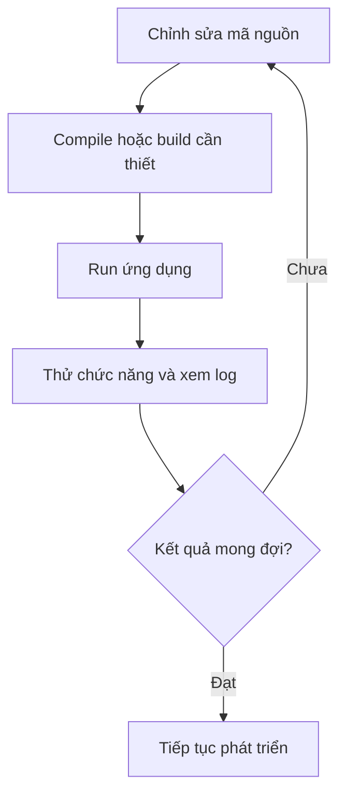
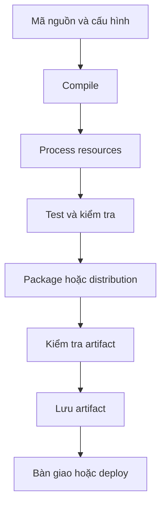
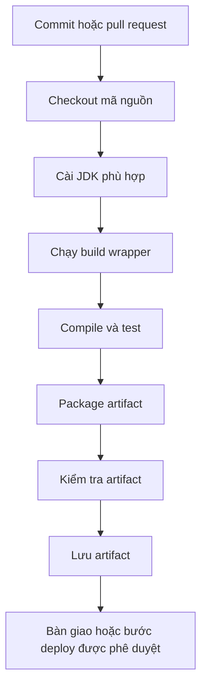

# Chạy ứng dụng trong phát triển và build sản phẩm bàn giao

Trong quá trình phát triển phần mềm, lập trình viên thường xuyên cần khởi chạy ứng dụng để xem giao diện, thử một chức năng hoặc gỡ lỗi. Khi chuẩn bị phát hành, nhóm lại cần tạo ra một sản phẩm build có thể chuyển cho người khác hoặc triển khai lên môi trường chạy. Hai hoạt động này có liên quan nhưng phục vụ những mục đích khác nhau.

**Chạy ứng dụng trong phát triển (run)** tập trung vào việc khởi động chương trình nhanh để làm việc và kiểm tra thay đổi. **Build sản phẩm bàn giao (build/package/distribution)** tập trung vào việc tạo artifact có cấu trúc, cấu hình và thành phần cần thiết để có thể kiểm thử, phân phối hoặc triển khai một cách nhất quán.

Bài học này trình bày sự khác nhau giữa hai quy trình, cách chạy ứng dụng Java trong lúc phát triển, cách tạo JAR hoặc distribution để bàn giao, cách cấu hình môi trường và cách kiểm tra sản phẩm trước khi chuyển giao.

## 1. Run và build sản phẩm giải quyết hai nhu cầu khác nhau

Một dự án Java thường đi qua nhiều hoạt động:

- Viết và chỉnh sửa mã nguồn.
- Biên dịch mã nguồn.
- Chạy ứng dụng để quan sát hành vi.
- Chạy kiểm thử.
- Đóng gói thành JAR, WAR hoặc distribution.
- Chuyển artifact đến người nhận hoặc môi trường triển khai.

Có thể phân biệt các khái niệm như sau:

| Hoạt động | Mục đích | Đầu ra thường thấy |
|---|---|---|
| Compile | Chuyển mã nguồn Java thành bytecode | Các tệp .class |
| Run | Khởi chạy ứng dụng để sử dụng hoặc thử nghiệm | Một tiến trình đang chạy |
| Test | Kiểm tra hành vi của mã nguồn hoặc ứng dụng | Kết quả test, báo cáo |
| Package | Gom lớp, tài nguyên và metadata thành artifact | JAR, WAR hoặc archive |
| Distribute | Chuẩn bị bộ tệp cần thiết để người khác chạy | JAR kèm dependency, ZIP/TAR distribution, image hoặc gói triển khai |
| Deploy | Đưa artifact vào môi trường đích | Ứng dụng được cài đặt hoặc chạy trên môi trường đó |

Một lệnh run có thể tự biên dịch mã nguồn trước khi khởi chạy. Điều đó không có nghĩa nó đã tạo ra một artifact bàn giao. Tương tự, build thành công không đồng nghĩa ứng dụng đã được triển khai hoặc đang chạy.

## 2. Chạy ứng dụng trong vòng lặp phát triển

Vòng lặp phát triển thường diễn ra liên tục:

1. Sửa mã nguồn hoặc tài nguyên.
2. Biên dịch lại phần thay đổi.
3. Khởi chạy ứng dụng.
4. Thử chức năng hoặc kiểm tra log.
5. Gỡ lỗi và quay lại bước đầu nếu cần.

Mục tiêu là nhận phản hồi nhanh. Lập trình viên thường chạy ứng dụng từ IDE hoặc dùng task run của build tool để không phải tự nhập đầy đủ classpath mỗi lần.

Quy trình khái quát:



Trong giai đoạn này, ứng dụng thường chạy với cấu hình phát triển, dữ liệu thử nghiệm, log chi tiết và các công cụ hỗ trợ debug. Một số framework có thể hỗ trợ tự khởi động lại hoặc hot reload khi file thay đổi, nhưng đây là tính năng của plugin hoặc framework, không phải hành vi mặc định của mọi ứng dụng Java.

## 3. Chạy ứng dụng Java trực tiếp bằng JDK

Với một ứng dụng nhỏ, ta có thể biên dịch rồi chạy trực tiếp bằng các công cụ JDK.

Giả sử cấu trúc dự án:

```text
hello-app/
├── src/
│   └── main/
│       └── java/
│           └── com/
│               └── example/
│                   └── Main.java
└── out/
```

Nội dung Main.java:

```java
package com.example;

public class Main {
    public static void main(String[] args) {
        System.out.println("Hello from Java!");
    }
}
```

Biên dịch từ thư mục gốc:

```bash
javac -d out src/main/java/com/example/Main.java
```

Chạy lớp chính:

```bash
java -cp out com.example.Main
```

Trong đó:

- javac gọi compiler của JDK.
- Tùy chọn -d out chỉ định thư mục chứa bytecode.
- java khởi chạy JVM.
- -cp out đưa thư mục output vào classpath.
- com.example.Main là tên đầy đủ của lớp có phương thức main.

Kết quả:

```text
Hello from Java!
```

Cách làm này phù hợp để hiểu quá trình biên dịch và chạy. Khi dự án có nhiều lớp, dependency và tài nguyên, classpath có thể dài và phức tạp. Build tool giúp gom những thông tin đó vào cấu hình và cung cấp lệnh run thuận tiện hơn.

## 4. Chạy ứng dụng bằng Gradle

Gradle Java Plugin quản lý việc biên dịch và kiểm thử Java. Để có task chạy ứng dụng, dự án thường áp dụng thêm **Application Plugin**.

Ví dụ build.gradle:

```groovy
plugins {
    id 'application'
}

group = 'com.example'
version = '1.0.0'

repositories {
    mavenCentral()
}

dependencies {
    // Khai báo dependency của ứng dụng tại đây.
}

application {
    mainClass = 'com.example.Main'
}
```

Application Plugin cung cấp task run. Từ thư mục gốc dự án:

```bash
./gradlew run
```

Trên Windows:

```powershell
.\gradlew.bat run
```

Task run sử dụng runtime classpath của source set main, bao gồm lớp đã biên dịch, tài nguyên chính và các dependency runtime được khai báo. Gradle sẽ thực hiện các task cần thiết trước khi khởi chạy ứng dụng.

### 4.1. Truyền tham số dòng lệnh

Nếu ứng dụng đọc tham số từ args, có thể truyền chúng qua Gradle:

```bash
./gradlew run --args="Linh 2026"
```

Ví dụ lớp Main:

```java
package com.example;

public class Main {
    public static void main(String[] args) {
        for (String arg : args) {
            System.out.println("Argument: " + arg);
        }
    }
}
```

Các tham số sau --args được chuyển cho phương thức main. Cần chú ý dấu nháy và cách shell xử lý khoảng trắng khi truyền nhiều tham số.

### 4.2. Chọn working directory

Ứng dụng có thể đọc file bằng đường dẫn tương đối, chẳng hạn config/dev.properties. Đường dẫn tương đối thường được giải quyết theo working directory của tiến trình, không nhất thiết là vị trí của lớp Java hoặc JAR.

Khi dùng Gradle Application Plugin, working directory mặc định của task run thường là thư mục dự án. Nếu ứng dụng cần một thư mục làm việc khác, có thể cấu hình:

```groovy
tasks.named('run') {
    workingDir = file('dev-runtime')
}
```

Thư mục làm việc cần tồn tại hoặc được tạo theo cách phù hợp. Khi chuyển ứng dụng sang môi trường khác, không nên giả định đường dẫn tương đối trên máy phát triển vẫn tồn tại.

### 4.3. Truyền biến môi trường

Ứng dụng có thể đọc cấu hình từ environment variable:

```java
String port = System.getenv().getOrDefault("APP_PORT", "8080");
System.out.println("Port: " + port);
```

Trong Gradle, có thể thiết lập biến môi trường cho task run:

```groovy
tasks.named('run') {
    environment 'APP_PORT', '8081'
}
```

Với thông tin nhạy cảm như mật khẩu hoặc token, không nên ghi giá trị thật trực tiếp vào build.gradle hoặc commit vào Git. Hãy lấy từ biến môi trường hoặc hệ thống quản lý secret của môi trường chạy.

## 5. Chạy ứng dụng bằng Maven

Maven có lifecycle và plugin goal để biên dịch, kiểm thử và đóng gói. Maven không cung cấp một task run chung cho mọi ứng dụng Java theo cách giống Application Plugin của Gradle. Dự án thường dùng một plugin phù hợp hoặc cấu hình chạy trong IDE.

### 5.1. Dùng Exec Maven Plugin

Một cách phổ biến là dùng Exec Maven Plugin để chạy lớp main. Ví dụ cấu hình trong pom.xml:

```xml
<build>
    <plugins>
        <plugin>
            <groupId>org.codehaus.mojo</groupId>
            <artifactId>exec-maven-plugin</artifactId>
            <version>3.5.0</version>
            <configuration>
                <mainClass>com.example.Main</mainClass>
            </configuration>
        </plugin>
    </plugins>
</build>
```

Sau đó chạy:

```bash
./mvnw compile exec:java
```

Trên Windows:

```powershell
.\mvnw.cmd compile exec:java
```

Exec Maven Plugin chạy lớp chính trong môi trường Maven với dependency classpath của dự án. Plugin cần được khai báo hoặc gọi theo cách phù hợp với cấu hình dự án.

Có thể truyền tham số cho ứng dụng bằng thuộc tính của plugin, ví dụ:

```bash
./mvnw compile exec:java -Dexec.args="Linh 2026"
```

### 5.2. Dự án dùng Spring Boot

Nếu dự án áp dụng Spring Boot Maven Plugin, có thể dùng goal spring-boot:run để chạy ứng dụng trong lúc phát triển:

```bash
./mvnw spring-boot:run
```

Trên Windows:

```powershell
.\mvnw.cmd spring-boot:run
```

Lệnh này chỉ phù hợp khi dự án đã cấu hình Spring Boot Maven Plugin. Không nên áp dụng nó cho một dự án Java Maven thông thường mà không có plugin tương ứng.

### 5.3. Chạy bằng IDE

IDE như IntelliJ IDEA, Eclipse hoặc VS Code có thể tạo run configuration cho lớp có phương thức main. Cấu hình thường bao gồm:

- Main class.
- Module hoặc classpath.
- Tham số dòng lệnh.
- Working directory.
- Environment variables.
- JVM arguments.

Chạy từ IDE thuận tiện khi cần đặt breakpoint, xem biến và debug. Tuy nhiên, run configuration có thể được lưu cục bộ hoặc chia sẻ tùy IDE và cách cấu hình dự án. Nếu một thành viên cần thiết lập thủ công nhiều giá trị, nên ghi các yêu cầu chung trong README hoặc cấu hình build để nhóm có thể tái tạo.

## 6. Chạy ứng dụng và chạy test không giống nhau

Một ứng dụng có thể khởi chạy bình thường nhưng test thất bại, hoặc test thành công nhưng ứng dụng không khởi động được. Hai hoạt động sử dụng classpath và mục tiêu khác nhau.

| Hoạt động | Classpath thường dùng | Mục đích |
|---|---|---|
| Run ứng dụng | Main output và runtime dependencies | Khởi động chương trình |
| Chạy test | Main output, test output, test resources và test dependencies | Kiểm tra hành vi |
| Package | Main output cùng metadata và tài nguyên cần đóng gói | Tạo artifact |
| Run artifact | Các thành phần runtime được phân phối | Kiểm tra cách người nhận sẽ chạy sản phẩm |

Task run không nhất thiết chạy toàn bộ test suite trước khi khởi động ứng dụng. Tương tự, gọi task test không đồng nghĩa ứng dụng đã được đóng gói thành sản phẩm bàn giao.

Với Gradle, các lệnh thường dùng:

```bash
./gradlew run
./gradlew test
./gradlew build
```

Với Maven:

```bash
./mvnw compile exec:java
./mvnw test
./mvnw package
```

Lệnh chạy ứng dụng phụ thuộc plugin hoặc framework đã cấu hình. Các lệnh test và package thuộc lifecycle hoặc task graph của build tool.

## 7. Build sản phẩm bàn giao là gì?

Sản phẩm bàn giao là artifact hoặc bộ artifact được tạo để chuyển cho người khác, lưu trữ, kiểm thử ở môi trường khác hoặc triển khai. Sản phẩm phải có đủ thành phần cần thiết để thực hiện mục đích đã định.

Tùy loại ứng dụng, artifact có thể là:

- JAR của thư viện Java.
- JAR ứng dụng có thể chạy.
- JAR chính kèm thư viện phụ thuộc.
- ZIP hoặc TAR chứa ứng dụng và runtime dependencies.
- WAR để triển khai lên servlet container.
- Gói cài đặt hoặc container image do pipeline tạo.

Build sản phẩm thường cần thực hiện các công việc:

1. Làm sạch hoặc chuẩn bị output.
2. Biên dịch mã nguồn.
3. Xử lý tài nguyên.
4. Chạy các bước kiểm thử và kiểm tra chất lượng theo yêu cầu.
5. Đóng gói artifact.
6. Kiểm tra tên, phiên bản, cấu trúc và nội dung artifact.
7. Lưu artifact để bàn giao hoặc triển khai.

Quy trình tổng quát:



Artifact nên được tạo từ mã nguồn và cấu hình đã xác định. Người nhận không nên phải tự tìm các file build trung gian trên máy lập trình viên.

## 8. Tạo JAR bằng Gradle

Với Java Plugin, Gradle cung cấp task jar để đóng gói các lớp và tài nguyên chính thành JAR. Ví dụ:

```groovy
plugins {
    id 'java'
}

group = 'com.example'
version = '1.0.0'
```

Chạy:

```bash
./gradlew clean jar
```

Artifact thường được tạo trong:

```text
build/libs/
```

Ví dụ tên file:

```text
build/libs/my-app-1.0.0.jar
```

Task jar tạo JAR từ main output. Với cấu hình Java Plugin thông thường, JAR này không tự động gom toàn bộ dependency bên ngoài vào bên trong. Nếu ứng dụng cần thư viện ngoài, người triển khai phải cung cấp chúng trên runtime classpath hoặc dùng một cách đóng gói distribution phù hợp.

### 8.1. Tạo JAR có Main-Class

Nếu muốn chạy bằng lệnh java -jar, manifest của JAR cần khai báo lớp chính. Ví dụ:

```groovy
plugins {
    id 'java'
}

group = 'com.example'
version = '1.0.0'

tasks.jar {
    manifest {
        attributes(
            'Main-Class': 'com.example.Main'
        )
    }
}
```

Sau khi build:

```bash
./gradlew clean jar
java -jar build/libs/my-app-1.0.0.jar
```

Lưu ý: khai báo Main-Class chỉ cho JVM biết lớp nào chứa phương thức main. Nó không tự đóng gói dependency ngoài. Nếu ứng dụng phụ thuộc thư viện khác, một JAR đơn giản có thể gặp lỗi ClassNotFoundException khi chạy bằng java -jar.

## 9. Phân phối ứng dụng kèm runtime dependencies

Một ứng dụng có dependency bên ngoài cần một cách phân phối để người nhận có thể chạy đầy đủ.

### 9.1. Gradle Application Plugin

Application Plugin cung cấp các task tạo bộ phân phối chứa ứng dụng và runtime dependencies. Cấu hình ví dụ:

```groovy
plugins {
    id 'application'
}

application {
    mainClass = 'com.example.Main'
}

group = 'com.example'
version = '1.0.0'
```

Tạo distribution:

```bash
./gradlew installDist
./gradlew distZip
./gradlew distTar
```

Các đầu ra thường nằm trong:

```text
build/
├── install/
│   └── my-app/
│       ├── bin/
│       │   └── my-app
│       └── lib/
│           ├── my-app-1.0.0.jar
│           └── dependency.jar
└── distributions/
    ├── my-app-1.0.0.zip
    └── my-app-1.0.0.tar
```

Thư mục bin chứa script khởi chạy, còn lib chứa JAR của ứng dụng và các runtime dependency. Người nhận giải nén distribution hoặc dùng thư mục đã cài và chạy script tương ứng.

Trên macOS/Linux:

```bash
build/install/my-app/bin/my-app
```

Trên Windows:

```powershell
build\install\my-app\bin\my-app.bat
```

Các tên file và đường dẫn có thể thay đổi theo applicationName, version và cấu hình dự án.

### 9.2. Vì sao distribution hữu ích?

Distribution giúp người nhận không phải tự ghép classpath hoặc tải từng dependency. Bộ phân phối có thể chứa:

- JAR ứng dụng.
- Các dependency runtime.
- Script chạy trên hệ điều hành.
- Tài nguyên và file cấu hình được đóng gói theo cấu hình.
- Thông tin phiên bản và hướng dẫn sử dụng.

Một distribution vẫn cần môi trường Java tương thích, trừ khi nhóm đóng gói thêm runtime riêng hoặc tạo một dạng artifact khác có chứa runtime. Application Plugin thông thường không tự mang theo JDK.

## 10. Đóng gói bằng Maven

Maven dùng packaging type và plugin để tạo artifact. Với dự án Java thông thường có packaging jar, lệnh:

```bash
./mvnw clean package
```

tạo JAR chính trong thư mục:

```text
target/
```

JAR mặc định thường chứa lớp và tài nguyên của dự án. Nó không nhất thiết chứa toàn bộ dependency runtime.

Có nhiều cách để chuẩn bị sản phẩm chạy được:

- Phân phối JAR chính cùng dependency và script khởi chạy.
- Dùng Maven Assembly Plugin để tạo archive theo cấu trúc mong muốn.
- Dùng Maven Shade Plugin để tạo uber-JAR, gom lớp của dependency vào một JAR.
- Với dự án Spring Boot, dùng Spring Boot Maven Plugin để tạo executable archive có cấu trúc phù hợp.

Ví dụ gọi Maven package:

```bash
./mvnw clean package
```

Nếu dự án có cấu hình Spring Boot Maven Plugin và execution repackage phù hợp, plugin có thể tạo executable JAR sau bước package. Với dự án Maven thông thường, chỉ gọi package không tự biến mọi JAR thành executable JAR có đầy đủ dependency.

### 10.1. Chọn dạng artifact phù hợp

| Dạng artifact | Trường hợp sử dụng |
|---|---|
| JAR thư viện | Được ứng dụng khác thêm vào dependency |
| JAR ứng dụng đơn giản | Ứng dụng có main class; dependency được cung cấp riêng |
| Uber-JAR / shaded JAR | Gom lớp của ứng dụng và dependency vào một archive |
| Executable JAR của framework | Archive có cấu trúc và loader riêng để chạy ứng dụng cùng dependency |
| WAR | Ứng dụng web được triển khai theo mô hình servlet container |
| ZIP/TAR distribution | Bàn giao bộ chạy gồm JAR, dependency, script và tài nguyên cần thiết |

Không nên chọn artifact chỉ vì tên file quen thuộc. Hãy xác định người nhận sẽ chạy ứng dụng thế nào và môi trường đích có những thành phần nào.

## 11. Cấu hình phát triển và cấu hình bàn giao

Ứng dụng thường cần cấu hình khác nhau theo môi trường. Ví dụ:

- Địa chỉ database.
- Port mạng.
- Log level.
- Đường dẫn lưu file.
- Endpoint của dịch vụ bên ngoài.
- Feature flag.

Có thể chia thành cấu hình mặc định và cấu hình theo môi trường, nhưng cần kiểm soát cách chúng được cung cấp.

### 11.1. Cấu hình trong lúc phát triển

Trong môi trường phát triển, ứng dụng có thể dùng:

- Database local hoặc database thử nghiệm.
- Log chi tiết.
- Dữ liệu mẫu.
- Cổng mạng dành cho lập trình viên.
- Fake service hoặc mock server.

Những giá trị này nên được cung cấp bằng file cấu hình mẫu, biến môi trường hoặc run configuration. Không nên để địa chỉ hoặc thông tin riêng của máy cá nhân trở thành giá trị bắt buộc trong artifact.

### 11.2. Cấu hình khi bàn giao

Artifact thường nên tách khỏi các giá trị phụ thuộc môi trường. Ví dụ, cùng một JAR có thể được chạy ở môi trường staging hoặc production bằng cách cung cấp biến môi trường hoặc file cấu hình bên ngoài.

Không nên đóng cứng mật khẩu, token, private key hoặc dữ liệu nhạy cảm vào mã nguồn hay JAR. Hãy cung cấp secret qua hệ thống quản lý secret của môi trường chạy.

Nếu ứng dụng cần file cấu hình ngoài JAR, tài liệu bàn giao cần nêu:

- Tên và vị trí file cấu hình.
- Các khóa bắt buộc.
- Giá trị mặc định nếu có.
- Cách cung cấp biến môi trường.
- Cách xử lý secret.
- Cách khởi động lại ứng dụng sau khi đổi cấu hình.

### 11.3. Cấu hình không nên phụ thuộc vào working directory ngầm định

Đường dẫn tương đối như config/app.properties được tính từ working directory của tiến trình. Khi chạy trong IDE, terminal hoặc service manager, working directory có thể khác nhau.

Để tránh lỗi, hãy dùng đường dẫn được cấu hình rõ ràng hoặc tải tài nguyên đóng gói qua classpath nếu file là một phần của ứng dụng. Nếu file phải nằm ngoài artifact, hãy hướng dẫn rõ vị trí và cách truyền đường dẫn.

## 12. Kiểm tra sản phẩm bàn giao

Build thành công chỉ chứng minh các task đã hoàn thành theo cấu hình. Nó chưa đảm bảo artifact có thể chạy ở môi trường của người nhận.

Trước khi bàn giao, cần kiểm tra sản phẩm bằng cách sử dụng chính artifact đã tạo, không chỉ chạy từ thư mục classes trong IDE.

Một số bước thực tế:

1. Xác nhận artifact tồn tại đúng tên và phiên bản.
2. Kiểm tra nội dung JAR hoặc archive.
3. Xác nhận lớp main và tài nguyên cần thiết có mặt.
4. Xác nhận dependency được đóng gói hoặc có trong distribution.
5. Chạy thử bằng lệnh được ghi trong hướng dẫn bàn giao.
6. Kiểm tra log và mã thoát.
7. Thử trên môi trường sạch hoặc môi trường tương tự nơi nhận.
8. Xác nhận cấu hình ngoài artifact được cung cấp đầy đủ.

Với JAR, có thể liệt kê nội dung bằng:

```bash
jar --list --file build/libs/my-app-1.0.0.jar
```

Hoặc với Maven:

```bash
jar --list --file target/my-app-1.0.0.jar
```

Nếu artifact được thiết kế chạy bằng java -jar, hãy kiểm tra manifest và chạy thử:

```bash
java -jar path/to/my-app.jar
```

Nếu là distribution, giải nén vào thư mục mới và chạy script bên trong. Cách này giúp phát hiện các file vô tình bị lấy từ máy lập trình viên nhưng không được đưa vào gói bàn giao.

## 13. Build sản phẩm bàn giao trong CI

Trong dự án nhóm, CI thường đảm nhiệm việc build và lưu artifact sau khi mã nguồn được đưa lên repository.

Quy trình có thể là:



Một số nguyên tắc:

- Dùng Maven Wrapper hoặc Gradle Wrapper đã commit trong repository.
- Dùng JDK phù hợp với cấu hình dự án.
- Chạy test trước khi lưu artifact phát hành.
- Đặt tên artifact có phiên bản hoặc build number.
- Lưu artifact cùng thông tin commit tạo ra nó.
- Không đưa secret vào log hoặc archive.
- Giữ lại log build để truy vết khi có lỗi.
- Chỉ deploy artifact đã được kiểm tra và đáp ứng điều kiện phát hành của nhóm.

CI có thể tạo artifact cho mọi commit hoặc chỉ cho nhánh/tag phát hành tùy chính sách dự án. Build artifact và deploy artifact là hai bước có thể tách biệt: tạo gói không đồng nghĩa tự động đưa gói vào production.

## 14. Những lỗi thường gặp

| Hiện tượng | Nguyên nhân có thể | Cách xử lý |
|---|---|---|
| Chạy được trong IDE nhưng không chạy bằng JAR | IDE cung cấp classpath hoặc file cấu hình mà artifact thiếu | Chạy thử artifact độc lập; kiểm tra manifest, dependency và resource |
| Lệnh java -jar báo thiếu Main-Class | Manifest không khai báo lớp khởi động | Cấu hình Main-Class hoặc dùng plugin đóng gói executable phù hợp |
| Lỗi ClassNotFoundException sau khi bàn giao | Dependency không có trong runtime classpath | Tạo distribution kèm dependency hoặc chọn dạng archive phù hợp |
| Ứng dụng không tìm thấy file cấu hình | Dùng đường dẫn tương đối phụ thuộc working directory | Cấu hình đường dẫn rõ ràng hoặc dùng classpath resource |
| Run dùng dữ liệu local nhưng artifact dùng sai dữ liệu | Run configuration hoặc môi trường phát triển cung cấp giá trị riêng | Tách cấu hình môi trường và ghi rõ cách cung cấp khi chạy |
| Build thành công nhưng ứng dụng khởi động thất bại | Build không kiểm tra đầy đủ điều kiện runtime | Thêm bước smoke test chạy artifact trong CI hoặc môi trường thử nghiệm |
| Người nhận không biết cách chạy distribution | Thiếu script hoặc tài liệu bàn giao | Đưa script và hướng dẫn vào gói phát hành |
| Artifact chạy ở máy người tạo nhưng lỗi ở máy khác | Khác JDK, dependency, biến môi trường hoặc quyền truy cập | Ghi rõ yêu cầu runtime và kiểm tra trên môi trường sạch |

## 15. Ghi nhớ

- Run khởi chạy ứng dụng để phát triển, thử nghiệm và debug.
- Build tạo artifact hoặc distribution để kiểm thử, bàn giao hoặc triển khai.
- Task run thường dùng main output và runtime classpath; task test dùng thêm test output và test dependencies.
- Gradle Application Plugin cung cấp task run và các task tạo distribution.
- Maven thường cần plugin như Exec Maven Plugin hoặc plugin của framework để chạy ứng dụng trong phát triển.
- Task jar mặc định không nhất thiết đóng gói mọi dependency runtime.
- Main-Class cho biết lớp khởi động của JAR nhưng không tự đưa dependency vào JAR.
- Artifact bàn giao cần có đủ lớp, tài nguyên, dependency, script và hướng dẫn theo dạng phân phối đã chọn.
- Cấu hình môi trường và secret cần được cung cấp phù hợp với nơi chạy.
- Nên kiểm tra chính artifact đã tạo trong một môi trường độc lập trước khi bàn giao.
- CI có thể build, test, package và lưu artifact; deploy là bước riêng có điều kiện phát hành.

## 16. Tự kiểm tra

1. Run khác package và deploy như thế nào?
2. Vì sao ứng dụng có thể chạy trong IDE nhưng thất bại khi chạy từ JAR?
3. Gradle cần plugin nào để cung cấp task run cho ứng dụng Java?
4. Maven có thể dùng plugin nào để chạy một lớp main trong quá trình phát triển?
5. Vì sao task jar mặc định không nhất thiết tạo ra JAR có thể chạy độc lập?
6. Thuộc tính Main-Class trong manifest có vai trò gì?
7. Gradle Application Plugin giúp tạo distribution chứa những thành phần nào?
8. Vì sao không nên đóng cứng mật khẩu hoặc token vào artifact?
9. Cần kiểm tra những gì trước khi chuyển artifact cho người nhận?
10. Vì sao build artifact trong CI và deploy artifact nên được xem là hai bước riêng?

Khi có thể chạy ứng dụng nhanh trong lúc phát triển, đồng thời tạo và kiểm tra được artifact có đủ thành phần để người khác sử dụng, bạn đã hiểu cách chuyển từ vòng lặp phát triển sang quy trình build sản phẩm bàn giao trong dự án Java.

