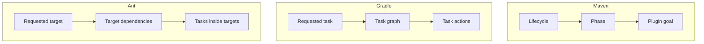
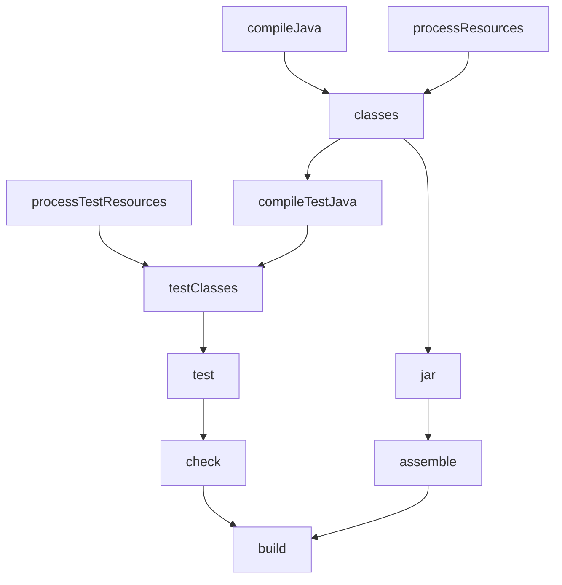

# Đối chiếu khái niệm vòng đời giữa Maven, Gradle và Ant

Maven, Gradle và Ant đều tự động hóa quá trình biên dịch, kiểm thử, đóng gói và phân phối phần mềm Java. Tuy nhiên, mỗi công cụ tổ chức quá trình đó theo một mô hình khác nhau. Maven định nghĩa các lifecycle và phase, Gradle xây dựng task graph từ các task cùng quan hệ phụ thuộc, còn Ant để người viết build script tổ chức các target và task theo nhu cầu.

Khi đọc hoặc chuyển đổi một build, cần hiểu đúng đơn vị điều phối của từng công cụ. Maven phase, Gradle task và Ant target có thể tham gia cùng một công đoạn như biên dịch hoặc kiểm thử, nhưng chúng không tương đương một-một. Sự khác nhau nằm ở cách công việc được gắn vào quy trình, cách quan hệ trước-sau được khai báo và cách công cụ quyết định phần việc nào cần thực hiện.

## 1. Ba mô hình điều phối build

| Công cụ | Đơn vị điều phối chính | Cách mô tả quy trình | Nguồn quy ước phổ biến |
|---|---|---|---|
| Maven | Lifecycle, phase và plugin goal | Một phase gọi các goal đã được bind; chạy phase sẽ chạy các phase đứng trước trong cùng lifecycle. | Lifecycle chuẩn và lifecycle mapping theo packaging. |
| Gradle | Task và task graph | Task được nối bằng dependency, input/output provider và các quy tắc thứ tự. Gradle chỉ thực thi graph cần cho yêu cầu hiện tại. | Plugin như `java`, `application`, `base` và convention plugin của dự án. |
| Ant | Target và task | Target gom các task; target có thể khai báo target phụ thuộc bằng `depends`. | Build file `build.xml` do dự án tự định nghĩa. |

Có thể hình dung ba mô hình như sau:



Maven thường bắt đầu từ một quy trình chuẩn có sẵn. Gradle thường bắt đầu từ task mà người dùng yêu cầu rồi lần theo các quan hệ để tạo graph. Ant bắt đầu từ target được gọi và các target mà nó phụ thuộc. Đây là khác biệt cốt lõi để đọc log, dự đoán thứ tự và thiết kế build.

## 2. Maven: lifecycle, phase và plugin goal

Maven mô hình hóa quá trình build bằng các lifecycle. Một lifecycle là chuỗi các phase có thứ tự. Mỗi phase là một điểm trong quy trình; công việc cụ thể được thực hiện bởi các plugin goal được bind vào phase đó.

Ba lifecycle chuẩn thường gặp là:

- **default:** quy trình chính để validate, biên dịch, kiểm thử, đóng gói và phân phối artifact.
- **clean:** quy trình xóa các đầu ra của build trước đó.
- **site:** quy trình tạo website và tài liệu dự án.

### 2.1. Các phase thường dùng trong default lifecycle

Một số phase quan trọng trong default lifecycle:

| Phase | Mục đích khái quát |
|---|---|
| `validate` | Kiểm tra project và thông tin cần thiết trước khi build. |
| `initialize` | Chuẩn bị trạng thái ban đầu cho build. |
| `generate-sources` | Tạo mã nguồn bổ sung nếu có. |
| `process-resources` | Xử lý và sao chép tài nguyên chính. |
| `compile` | Biên dịch mã nguồn chính. |
| `process-classes` | Xử lý sau biên dịch, ví dụ bytecode enhancement nếu được cấu hình. |
| `generate-test-sources` | Tạo mã nguồn kiểm thử nếu có. |
| `process-test-resources` | Xử lý tài nguyên kiểm thử. |
| `test-compile` | Biên dịch mã nguồn kiểm thử. |
| `test` | Chạy unit test thông qua plugin test đã được bind. |
| `prepare-package` | Chuẩn bị trước khi đóng gói. |
| `package` | Tạo artifact như JAR hoặc WAR. |
| `pre-integration-test` | Chuẩn bị môi trường cho integration test. |
| `integration-test` | Chạy integration test theo cấu hình plugin. |
| `post-integration-test` | Thu hồi hoặc dọn môi trường integration test. |
| `verify` | Kiểm tra artifact và kết quả build theo các rule đã cấu hình. |
| `install` | Cài artifact vào local Maven repository để project khác trên máy có thể sử dụng. |
| `deploy` | Đẩy artifact lên remote repository. |

Danh sách trên là các phase theo thứ tự trong default lifecycle; còn plugin goal nào chạy ở từng phase phụ thuộc packaging và cấu hình project.

Khi gọi:

```bash
mvn test
```

Maven chạy các phase trong default lifecycle từ đầu đến `test`, bao gồm những phase trước đó. Vì vậy, `mvn test` có thể thực hiện validate, xử lý resources, compile mã chính, xử lý test resources, compile test và sau đó chạy test.

Khi gọi:

```bash
mvn package
```

Maven tiếp tục từ đầu default lifecycle đến phase `package`, do đó các công việc cần thiết trước đóng gói cũng được thực hiện. Tương tự, `mvn verify` đi qua các phase trước `verify`, còn `mvn install` đi qua cả `verify` và `install`.

`clean` thuộc lifecycle riêng. Lệnh:

```bash
mvn clean package
```

chạy phase `clean` của clean lifecycle rồi chạy default lifecycle đến `package`. Đây là cách phổ biến để xóa output cũ trước khi tạo artifact mới.

### 2.2. Phase không phải plugin goal

Phase là điểm điều phối trong lifecycle. Plugin goal mới là đơn vị thực hiện công việc cụ thể. Ví dụ, trong một project đóng gói JAR, lifecycle mapping thông thường gắn các goal tương ứng với xử lý resources, compiler, test và JAR vào những phase thích hợp.

Project có thể cấu hình plugin goal cụ thể trong `pom.xml`:

```xml
<build>
  <plugins>
    <plugin>
      <groupId>org.apache.maven.plugins</groupId>
      <artifactId>maven-compiler-plugin</artifactId>
      <version>3.13.0</version>
      <configuration>
        <release>17</release>
      </configuration>
    </plugin>
  </plugins>
</build>
```

Trong ví dụ, cấu hình compiler plugin xác định mục tiêu Java khi goal biên dịch được thực thi. Người dùng vẫn gọi phase `compile` hoặc phase cao hơn như `package`; Maven tìm goal đã bind vào phase để thực hiện.

Plugin goal cũng có thể được gọi trực tiếp theo dạng `plugin-prefix:goal`, nhưng khi đó người dùng đang gọi goal trực tiếp, không nhất thiết chạy toàn bộ các phase trước nó như khi gọi một phase của lifecycle.

### 2.3. Packaging ảnh hưởng lifecycle mapping

Maven biết kiểu đóng gói qua phần tử `packaging`, chẳng hạn `jar`, `war` hoặc `pom`. Lifecycle mapping mặc định gắn các plugin goal khác nhau tùy packaging. Vì vậy, hai project có cùng phase `package` nhưng artifact tạo ra và công việc được gọi có thể khác nhau.

Ví dụ:

```xml
<project>
  <modelVersion>4.0.0</modelVersion>
  <groupId>com.example</groupId>
  <artifactId>sample-app</artifactId>
  <version>1.0.0</version>
  <packaging>jar</packaging>
</project>
```

Với packaging `jar`, Maven dùng lifecycle mapping dành cho JAR để thực hiện các goal cần thiết, bao gồm tạo JAR ở phase `package`. Với `war`, mapping sẽ phục vụ việc tạo WAR. Plugin và cấu hình riêng của dự án có thể bổ sung hoặc thay thế hành vi mặc định.

### 2.4. Maven multi-module

Trong dự án Maven nhiều module, reactor thu thập các project và sắp xếp thứ tự build dựa trên quan hệ giữa chúng, ví dụ dependency giữa module. Khi gọi phase ở root, Maven có thể thực hiện phase đó cho các module theo thứ tự reactor.

Ví dụ:

```text
parent/
├── pom.xml
├── common/
│   └── pom.xml
└── service/
    └── pom.xml
```

Nếu `service` phụ thuộc vào `common`, reactor sẽ sắp xếp để `common` được build trước khi `service` cần artifact của nó. Maven có các tùy chọn chọn module, bỏ qua module hoặc build theo thứ tự đã xác định, nhưng thứ tự module vẫn chịu sự điều phối của reactor.

## 3. Gradle: lifecycle task và task graph

Gradle không tổ chức quy trình Java bằng một danh sách phase tương đương default lifecycle của Maven. Gradle có các giai đoạn vận hành của chính build, thường được mô tả là initialization, configuration và execution. Trong giai đoạn execution, Gradle chạy task graph được tạo từ các task người dùng yêu cầu cùng các quan hệ phụ thuộc.

Khi áp dụng Java Plugin:

```groovy
plugins {
    id 'java'
}
```

Gradle cung cấp nhiều task cho quy trình Java, ví dụ:

| Task | Vai trò |
|---|---|
| `compileJava` | Biên dịch mã nguồn chính. |
| `processResources` | Xử lý tài nguyên chính. |
| `classes` | Gom các bước tạo đầu ra source set `main`. |
| `compileTestJava` | Biên dịch mã nguồn kiểm thử. |
| `processTestResources` | Xử lý tài nguyên kiểm thử. |
| `testClasses` | Gom đầu ra của source set `test`. |
| `test` | Chạy kiểm thử. |
| `check` | Điểm tổng hợp các kiểm tra; Java Plugin nối task `test` vào đây. |
| `jar` | Đóng gói JAR. |
| `assemble` | Điểm tổng hợp các task tạo artifact. |
| `build` | Điểm tổng hợp build, phụ thuộc vào `assemble` và `check`. |

Ví dụ các quan hệ chính có thể hình dung như sau:



Sơ đồ là mô hình giản lược các quan hệ thường gặp của Java Plugin; plugin khác hoặc cấu hình riêng có thể thêm task và dependency.

### 3.1. Task graph được tạo theo yêu cầu

Khi chạy:

```bash
./gradlew test
```

Gradle đưa task `test` và các dependency cần thiết của nó vào graph. Những task không có đường phụ thuộc đến `test` sẽ không tự chạy chỉ vì chúng tồn tại trong project.

Khi chạy:

```bash
./gradlew build
```

Gradle đưa `build` cùng các task phụ thuộc như `assemble` và `check` vào graph. Do `check` phụ thuộc `test`, kiểm thử nằm trong quy trình build. Các task độc lập có thể được thực thi theo thứ tự khác nhau hoặc song song nếu build cho phép.

Để nối task, Gradle có các cơ chế khác nhau:

- `dependsOn`: khai báo dependency, task phụ thuộc sẽ đưa task kia vào graph.
- Output provider truyền vào input: Gradle có thể suy ra implicit dependency từ task tạo output.
- `mustRunAfter` và `shouldRunAfter`: điều khiển thứ tự khi cả hai task đã nằm trong graph, không tự đưa task kia vào graph.
- `finalizedBy`: đăng ký task finalizer chạy sau task được finalize theo quy tắc của Gradle.

Do đó, Gradle task graph vừa thể hiện công việc cần chạy, vừa thể hiện quan hệ dữ liệu và thứ tự. Người thiết kế task cần khai báo input/output đúng để Gradle có thể tối ưu incremental build, up-to-date checking và build cache.

### 3.2. Lifecycle task là điểm quy ước, không phải phase

Các task như `check`, `assemble` và `build` thường được gọi là lifecycle task vì chúng gom hoặc điều phối nhiều công việc. Chúng là task bình thường trong task graph, có thể phụ thuộc vào các task khác và có thể được plugin mở rộng.

Ví dụ, plugin chất lượng mã có thể gắn task lint vào `check`. Plugin đóng gói bổ sung có thể gắn artifact vào `assemble`. Điều đó cho phép các plugin mở rộng lifecycle task mà không phải chèn công việc vào một chuỗi phase cố định.

### 3.3. Multi-project Gradle

Gradle multi-project build tổ chức project theo cấu trúc được khai báo trong `settings.gradle`. Task có thể được định danh bằng đường dẫn, ví dụ:

```bash
./gradlew :service:test
./gradlew :common:build
```

Quan hệ project dependency và task dependency có thể khiến task ở project khác tham gia graph. Tuy nhiên, không nên giả định gọi `:service:test` sẽ chạy mọi task của mọi project; Gradle chỉ đưa các dependency cần thiết vào graph.

## 4. Ant: target và task trong build.xml

Ant tổ chức build bằng các target. Mỗi target là một nhóm thao tác, bên trong chứa các task như `mkdir`, `javac`, `copy`, `jar`, `delete` hoặc task do người dùng/plugin cung cấp.

Một build file có thể khai báo target mặc định và quan hệ `depends`:

```xml
<project name="sample-app" default="package" basedir=".">
  <property name="src.dir" value="src/main/java"/>
  <property name="build.dir" value="build"/>
  <property name="classes.dir" value="${build.dir}/classes"/>
  <property name="dist.dir" value="${build.dir}/dist"/>

  <target name="clean">
    <delete dir="${build.dir}"/>
  </target>

  <target name="prepare">
    <mkdir dir="${classes.dir}"/>
  </target>

  <target name="compile" depends="prepare">
    <javac srcdir="${src.dir}"
           destdir="${classes.dir}"
           includeantruntime="false"/>
  </target>

  <target name="package" depends="compile">
    <mkdir dir="${dist.dir}"/>
    <jar destfile="${dist.dir}/sample-app.jar"
         basedir="${classes.dir}"/>
  </target>
</project>
```

Khi gọi:

```bash
ant package
```

Ant thực hiện các target mà `package` phụ thuộc, theo thứ tự dependency: `prepare`, `compile`, rồi `package`. Trong từng target, các task được thực hiện theo thứ tự khai báo.

Nếu chạy `ant` mà không chỉ định target, Ant dùng target được đặt trong thuộc tính `default` của phần tử `project`. Trong ví dụ, target mặc định là `package`.

### 4.1. Ant không áp đặt một lifecycle chuẩn cho Java

Tên target `clean`, `compile`, `test`, `package` là quy ước do người viết build file chọn. Ant không bắt buộc mọi project phải có các target này hoặc phải tổ chức chúng theo cùng một chuỗi. Một dự án có thể đặt tên target theo quy trình riêng, miễn là các quan hệ và task được định nghĩa rõ.

Ví dụ target kiểm thử có thể dùng task JUnit do Ant cung cấp qua thư viện mở rộng tương ứng:

```xml
<target name="test" depends="compile-tests">
  <junit printsummary="yes" haltonfailure="yes">
    <classpath>
      <pathelement location="${classes.dir}"/>
      <pathelement location="${test.classes.dir}"/>
      <fileset dir="lib/test" includes="*.jar"/>
    </classpath>
    <batchtest>
      <fileset dir="${test.classes.dir}" includes="**/*Test.class"/>
    </batchtest>
  </junit>
</target>
```

Đoạn này minh họa cách tổ chức target; để chạy được cần cấu hình target `compile-tests`, thư mục test classes, JUnit và task implementation tương ứng trên Ant runtime. Không phải mọi cài đặt Ant mặc định đều có sẵn task JUnit.

### 4.2. Target dependency và điều kiện

`depends` cho biết target cần các target khác chạy trước. Ant cũng hỗ trợ điều kiện `if` và `unless` dựa trên property để quyết định target có được thực thi hay không.

Một điểm cần lưu ý: target dependency không phải task graph có input/output metadata như Gradle. Ant thường thực hiện target được yêu cầu cùng các target phụ thuộc; một số task cụ thể như `javac` hoặc `copy` có thể dùng timestamp để tránh xử lý lại file không thay đổi. Đây là tối ưu ở cấp task cụ thể, không phải một mô hình up-to-date chung cho mọi target.

## 5. So sánh cùng một quy trình Java

Giả sử một project cần thực hiện các bước:

1. Chuẩn bị thư mục đầu ra.
2. Biên dịch mã nguồn chính.
3. Biên dịch và chạy unit test.
4. Tạo JAR.
5. Kiểm tra artifact trước khi phát hành.

Ba công cụ thể hiện quy trình theo cách khác nhau:

| Công đoạn | Maven | Gradle | Ant |
|---|---|---|---|
| Chuẩn bị | Các phase đầu lifecycle và plugin goal được bind. | Task dependency của các task biên dịch/kiểm thử. | Target `prepare` do build file định nghĩa. |
| Biên dịch mã chính | Phase `compile`, thường gọi compiler plugin goal. | Task `compileJava`. | Target `compile` chứa task `javac`. |
| Biên dịch test | Phase `test-compile`. | Task `compileTestJava`. | Target `compile-tests` tự định nghĩa, thường dùng `javac`. |
| Chạy unit test | Phase `test`, thường gọi Surefire plugin. | Task `test`. | Target `test` gọi JUnit task hoặc chương trình kiểm thử phù hợp. |
| Đóng gói | Phase `package`, goal tùy packaging. | Task `jar` và lifecycle task `assemble`. | Target `package` chứa task `jar`. |
| Kiểm tra tổng hợp | Phase `verify` và các goal đã bind. | Lifecycle task `check`, có thể gom nhiều task kiểm tra. | Target như `verify` do dự án tự định nghĩa. |
| Phân phối | Phase `install` hoặc `deploy`. | Task publish do plugin publishing cung cấp và được gọi theo cấu hình. | Target upload/deploy do build file hoặc task mở rộng định nghĩa. |

Điểm giống nhau là cả ba đều có thể biểu diễn một chuỗi công việc với quan hệ trước-sau. Điểm khác là Maven có lifecycle phase chuẩn; Gradle có task graph được tạo từ task dependency và plugin; Ant để build file tự định nghĩa target và quy ước.

## 6. Cùng một lệnh có ý nghĩa khác nhau

Không nên chỉ nhìn tên lệnh hoặc tên công đoạn để kết luận hai công cụ đang làm cùng một lượng công việc.

| Ý định | Maven | Gradle | Ant |
|---|---|---|---|
| Chạy kiểm thử | `mvn test` | `./gradlew test` | `ant test` nếu build file định nghĩa target đó. |
| Đóng gói | `mvn package` | `./gradlew assemble` hoặc task artifact cụ thể như `jar` | `ant package` nếu có target tương ứng. |
| Kiểm tra build | `mvn verify` | `./gradlew check` | `ant verify` nếu có target tương ứng. |
| Xóa output | `mvn clean` | `./gradlew clean` | `ant clean` nếu build file định nghĩa target. |
| Build tổng thể | Thường là `mvn verify` hoặc `mvn install` tùy mục tiêu | `./gradlew build` | Target mặc định hoặc target tổng hợp do dự án định nghĩa. |

Các lệnh trên chỉ là cách đối chiếu ý định phổ biến. Ví dụ, `mvn package` chạy qua toàn bộ phase trước package, trong khi `./gradlew assemble` chỉ chạy task graph phụ thuộc vào `assemble`; `ant package` chỉ làm đúng các target mà build file khai báo. Vì vậy, phải xem cấu hình thực tế trước khi thay thế lệnh trong CI.

## 7. Khác biệt về incremental build và trạng thái đầu ra

Ba công cụ đều có thể tránh một số công việc thừa, nhưng cơ chế khác nhau.

### 7.1. Maven

Maven điều phối goal qua lifecycle. Plugin goal có thể có logic riêng để kiểm tra timestamp, input hoặc output và bỏ qua một phần công việc khi không cần. Tuy nhiên, không nên hiểu phase như một đơn vị cache tổng quát. Maven không mặc định xây dựng task input/output graph theo mô hình Gradle cho mọi plugin goal.

### 7.2. Gradle

Gradle task có thể khai báo input/output. Từ đó Gradle hỗ trợ:

- **Up-to-date checking:** bỏ qua task khi input và output phù hợp với trạng thái đã ghi nhận.
- **Incremental execution:** task được thiết kế incremental có thể chỉ xử lý phần input thay đổi.
- **Build cache:** khôi phục output từ cache khi task đủ điều kiện và cache key phù hợp.
- **Task graph:** dùng dependency để đảm bảo producer chạy trước consumer.

Các khả năng này phụ thuộc vào việc task khai báo chính xác input/output và không che giấu dữ liệu ảnh hưởng kết quả.

### 7.3. Ant

Ant điều phối target bằng `depends` và thực hiện task bên trong target. Một số task như `javac`, `copy` có thể so sánh timestamp để tránh xử lý file không thay đổi. Nhưng Ant không tự áp dụng một mô hình input/output và build cache thống nhất cho tất cả target. Người viết build file phải hiểu hành vi của từng task và tổ chức output/cleanup.

## 8. Khác biệt khi mở rộng build

### Maven: mở rộng qua plugin và lifecycle binding

Muốn thêm code generation, kiểm tra chất lượng hoặc đóng gói đặc biệt, dự án thường cấu hình plugin và gắn goal vào phase phù hợp. Người đọc có thể xác định công việc bằng cách xem phase, plugin và goal trong `pom.xml` cùng lifecycle mapping của packaging.

### Gradle: mở rộng qua plugin và task

Plugin có thể đăng ký task, khai báo input/output và nối chúng vào lifecycle task như `check`, `assemble` hoặc `build`. Convention plugin cho phép nhóm chuẩn hóa cách các project áp dụng công việc. Việc nối task bằng provider output/input giúp dependency dữ liệu rõ ràng.

### Ant: mở rộng qua target và task

Người viết build file thêm target, khai báo `depends`, rồi đặt các task thực thi bên trong. Có thể tái sử dụng macro, import build file hoặc gọi build con. Quy ước và cấu trúc phụ thuộc thuộc trách nhiệm của dự án.

## 9. Chuyển đổi tư duy khi đọc build của công cụ khác

Khi đọc một build Maven, hãy bắt đầu từ phase được gọi, xác định lifecycle tương ứng, packaging và các plugin goal đã bind. Không nên chỉ tìm một dòng plugin rồi giả định nó là toàn bộ quy trình.

Khi đọc một build Gradle, hãy bắt đầu từ task người dùng yêu cầu, sau đó lần theo `dependsOn`, output provider, plugin và lifecycle task. Có thể dùng `--dry-run` để xem task graph dự kiến và `--info` để hiểu task outcome.

Khi đọc một build Ant, hãy bắt đầu từ target được gọi hoặc target mặc định, xem thuộc tính `depends`, rồi lần lượt đọc các task bên trong từng target. Kiểm tra thêm property conditions `if`/`unless` và macro/import nếu build được chia thành nhiều file.

Một số câu hỏi giúp so sánh đúng:

- Công việc nào được yêu cầu trực tiếp: phase, task hay target?
- Công cụ có tự chạy các bước trước đó không, và theo cơ chế nào?
- Plugin goal, task hoặc target nào thực sự biên dịch, test và đóng gói?
- Quan hệ dữ liệu giữa file được tạo và file được đọc được khai báo ở đâu?
- Việc nào được chạy lại, bỏ qua hoặc lấy từ cache khi input không đổi?
- Task/goal/target nào có side effect như upload, deploy hoặc cập nhật hệ thống ngoài?
- Khi build chạy trên workspace sạch, quy trình có tạo đủ mọi đầu vào cần thiết không?

## 10. Ví dụ đối chiếu lệnh trong CI

Giả sử pipeline cần xóa output cũ, chạy test và tạo JAR. Cấu hình có thể tương ứng như sau:

**Maven**

```bash
mvn clean package
```

Maven chạy clean lifecycle để xóa output, sau đó chạy default lifecycle đến `package`. Unit test được thực hiện ở phase `test` nếu plugin goal tương ứng được bind và không bị skip bởi cấu hình.

**Gradle**

```bash
./gradlew clean build
```

Gradle chạy task `clean` và task `build`. Với Java Plugin, `build` phụ thuộc `assemble` và `check`, do đó bao gồm đóng gói và các kiểm tra gắn với `check`, trong đó có `test`. Nếu chỉ muốn tạo artifact mà không chạy kiểm tra tổng hợp, có thể gọi `assemble`; nhưng pipeline cần xác định rõ khi nào test là điều kiện bắt buộc.

**Ant**

```bash
ant clean package
```

Lệnh này chỉ tương đương về ý định nếu `build.xml` định nghĩa target `clean` và `package` với dependency thích hợp, đồng thời target `package` gọi các bước compile/test mà nhóm yêu cầu. Ant không tự thêm unit test vào target package nếu build file không khai báo.

Trong CI, điều cần bảo đảm là hợp đồng công việc: clean output, compile, test, package và kiểm tra kết quả. Tên lệnh không tự chứng minh tất cả bước đó đã diễn ra.

## 11. Bảng tóm tắt các khái niệm dễ nhầm

| Khái niệm | Maven | Gradle | Ant |
|---|---|---|---|
| Điểm điều phối | Phase trong lifecycle | Task graph | Target dependencies |
| Công việc thực thi | Plugin goal | Task action | Ant task |
| Thứ tự | Thứ tự phase và goal binding | Dependency và ordering rule | `depends` và thứ tự task trong target |
| Quy trình chuẩn | Lifecycle chuẩn, phụ thuộc packaging mapping | Plugin cung cấp task và lifecycle task | Build file tự định nghĩa |
| Đóng gói Java | Goal gắn vào `package` | `jar`, `war` hoặc task artifact tương ứng | Task `jar`/`war` trong target |
| Kiểm thử | Goal gắn vào `test` và các phase liên quan | Task `test` được nối vào `check` | Target kiểm thử do build file định nghĩa |
| Xóa output | Clean lifecycle | Task `clean` | Target `clean` nếu có |
| Mô hình input/output chung | Không tương đương mô hình task property của Gradle | Task input/output là phần cốt lõi của mô hình task | Phụ thuộc vào task cụ thể và cấu hình build file |

## 12. Nguyên tắc khi so sánh hoặc chuyển đổi

- So sánh **hành vi thực tế** của build, không chỉ so sánh tên `test`, `package`, `build`.
- Với Maven, xác định lifecycle, phase, packaging và plugin goal đã bind.
- Với Gradle, lần theo task graph, task dependency và input/output provider.
- Với Ant, lần theo target được gọi, `depends`, property condition và task bên trong.
- Kiểm tra cả unit test, integration test, kiểm tra chất lượng và đóng gói; chúng có thể được nối vào những điểm khác nhau.
- Xác định rõ output nào được tạo, ai tiêu thụ nó và liệu dependency dữ liệu có được mô tả đầy đủ không.
- Kiểm tra hành vi trên workspace sạch và CI, vì file cũ có thể che giấu dependency bị thiếu.
- Xem riêng các tác vụ publish/deploy vì chúng có side effect bên ngoài và chính sách retry/cache khác với compile/package.
- Khi chuyển đổi, giữ nguyên hợp đồng đầu ra và tiêu chí pass/fail của pipeline trước khi tối ưu cấu trúc build.

Maven, Gradle và Ant cùng phục vụ tự động hóa build Java nhưng dùng những mô hình điều phối khác nhau. Maven đi theo lifecycle phase và plugin goal; Gradle tạo task graph từ dependency và luồng dữ liệu; Ant chạy target theo dependency do build file định nghĩa. Hiểu đúng các đơn vị này giúp đọc quy trình, điều tra lỗi và chuyển đổi build mà không vô tình bỏ qua bước kiểm thử, đóng gói hoặc kiểm tra chất lượng.
